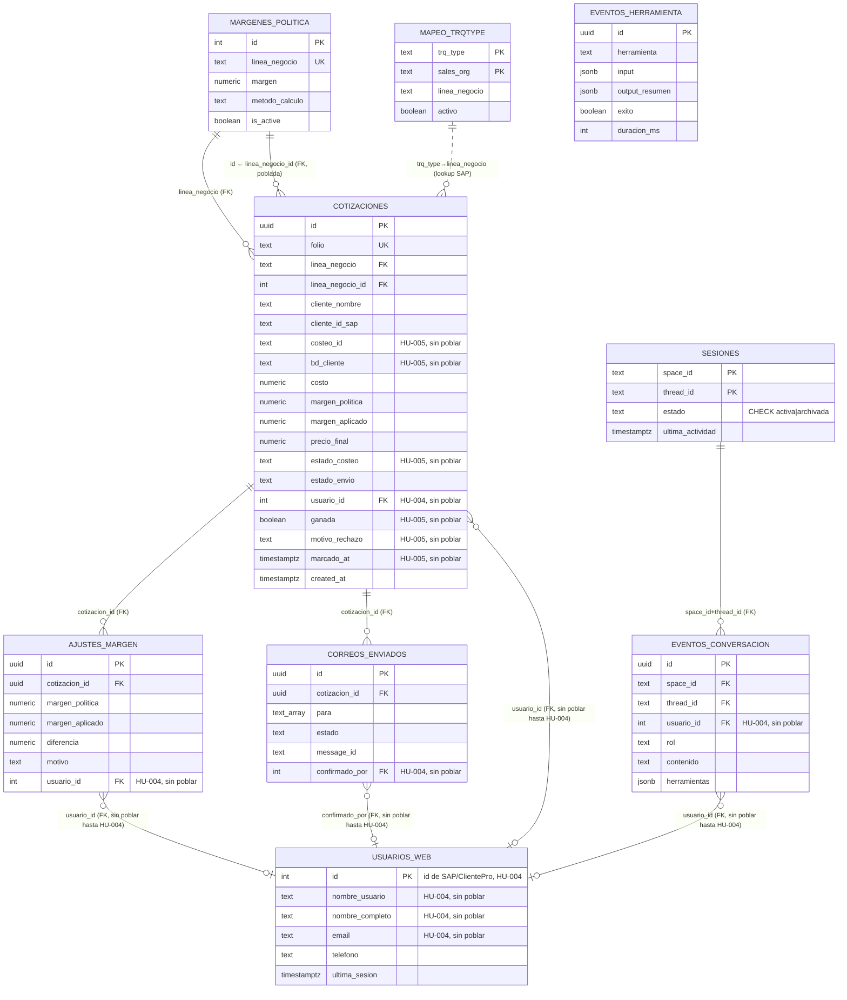

# Base de datos — Bot Cotizador

Referencia de la base de datos del proyecto: motor, esquema, vistas, configuración
vigente y cómo acceder a ella (local y producción).

## 1. Resumen

- **Motor:** PostgreSQL 16.
- **Acceso desde el código:** SQLAlchemy 2.x (estilo síncrono) + Alembic para migraciones.
- **Filosofía:** es la BD de **trazabilidad** del bot (§7.3 de la arquitectura) — registra
  cada cotización, ajuste de margen, correo enviado, turno de conversación e invocación de
  herramienta. No es el ERP: SAP TM y el tarifario de Drive son fuentes externas que el bot
  consulta, no persiste.
- Los IDs de negocio son `UUID` generados por Postgres (`gen_random_uuid()`); las tablas de
  configuración usan claves de negocio como PK (`linea_negocio`, `trq_type`).

## 2. Capas de acceso en el código

```
shared/config.py    → Settings.database_url (env DATABASE_URL, pydantic-settings)
shared/db.py        → engine (SQLAlchemy) + get_session() (context manager transaccional)
shared/models.py    → 9 tablas ORM (DeclarativeBase)
shared/repos.py     → repositorios estáticos (CotizacionRepo, SesionRepo, ...) — toda
                      consulta/escritura pasa por aquí, no hay SQL suelto en
                      orquestador/mcp_server
db/migrations/versions/ → 5 migraciones Alembic (esquema versionado)
```

`get_session()` (`shared/db.py`) hace commit al salir sin error y rollback ante excepción —
quien llama nunca maneja la transacción a mano.

## 3. Diagrama de tablas



> **Nota HU-002.2 (2026-09-22):** las columnas marcadas "sin poblar" existen en el
> esquema pero ningún código las llena todavía — dependen de HU-004 (ClientePro,
> identidad real) o HU-005 (Nexo, costeo). `/web/login` y los endpoints que dependían
> de `comercial_email` (`mis-cotizaciones`, `enviar`, `seguimiento`) quedaron
> desactivados hasta que exista esa identidad; cotizar por Google Chat no se vio
> afectado.

## 4. Tablas

### `cotizaciones` — el registro central
Una fila por cada cotización generada. `folio` (formato `PCN-DDMMAAAA[-vN]`) es el
identificador de negocio, único. Guarda el precio calculado y el margen (de política vs.
aplicado). Desde HU-002.2: `estado_envio` reemplaza al antiguo `estado` (que mezclaba costeo
y envío); `estado_costeo`, `costeo_id` y `bd_cliente` existen ya en el esquema pero **nadie
los llena todavía** — son para cuando la integración con Nexo (HU-005) esté lista. `origen`,
`destino` y `fuente_tarifa` se eliminaron (los reemplaza el detalle que vivirá en Nexo).
`usuario_id` reemplaza a `comercial_email`: es un entero (FK a `usuarios_web.id`) que
tampoco tiene todavía de dónde poblarse — depende de que ClientePro (HU-004) entregue la
identidad real. Mientras tanto, `/web/login` está desactivado y estos datos quedan `NULL`.
`efectiva`/`seguimiento_nota`/`seguimiento_actualizado` se renombraron a
`ganada`/`motivo_rechazo`/`marcado_at` (misma semántica boolean True/False/None) — el
botón que los llena y la sincronización con el `Resultado` de Nexo son de HU-005.

### `ajustes_margen` — auditoría de desvíos
Una fila cada vez que un comercial ajusta el margen manualmente por fuera de la política.
Guarda la diferencia (`margen_aplicado - margen_politica`) y el motivo. `usuario_id`
(antes `comercial_email`) tiene la misma limitación que en `cotizaciones`: sin HU-004, sin
poblar. Es la base de la vista `v_ajustes_margen_por_comercial` que usa Gerencia para
auditar.

### `correos_enviados` — trazabilidad de envíos
Un registro por cada intento de envío del PDF al cliente (`para`/`cc` como arrays, `estado`
enviado/fallido, `message_id`). `confirmado_por` pasó de texto (el correo) a entero (FK a
`usuarios_web.id`, sin poblar hasta HU-004) — el envío real sigue usando el correo tal cual
para el remitente/`Reply-To`, solo cambió lo que se persiste en esta tabla.
`CorreoRepo.duplicado_reciente` la consulta para no reenviar el mismo correo dos veces en
una ventana de 5 minutos.

### `eventos_conversacion` — historial del agente
Cada turno (usuario o asistente) de una conversación, con las herramientas invocadas en ese
turno (JSONB). Reconstruye el historial de una sesión (`ConversacionRepo.historial`). Tiene
FK real a `sesiones` desde HU-002.2. `usuario_id` (antes `usuario_email`) sin poblar hasta
HU-004.

### `eventos_herramienta` — auditoría técnica
Cada invocación a una herramienta del MCP (input, resumen de salida, éxito/fallo, duración).
Log de auditoría técnica, independiente del historial conversacional.

### `sesiones` — estado de la conversación
PK compuesta (`space_id`, `thread_id`). Trackea si una conversación sigue `activa` o fue
`archivada` (barrido por inactividad, `SESION_TTL_HORAS`; `CHECK` desde HU-002.2). La
columna `contexto` (JSONB) se eliminó en HU-002.2 — nunca se leía.

### `usuarios_web` — comerciales identificados por ClientePro
Rediseñada por completo en HU-002.2: la PK deja de ser el correo y pasa a ser el mismo id
entero de SAP que entregará ClientePro (HU-004). Se agregó `telefono`, y (migración `0009`)
`nombre_usuario`/`nombre_completo`/`email` — mapeo de `tblSAPUsuariosApp` del diseño
original (§2.6), construido ya aunque nada lo llene todavía, mismo criterio que
`costeo_id`/`bd_cliente`/`linea_negocio_id`. **La tabla está vacía
y sin forma de llenarse hasta que HU-004 exista** — el login propio por correo
(`POST /web/login`) fue retirado, y con él, `mis-cotizaciones`, `enviar` y `seguimiento` de
la Consola web (dependían de esa identidad). Cotizar por Google Chat no se vio afectado.

### `margenes_politica` — configuración: margen por línea
**Fallback** cuando SAP TM no tiene el margen del cliente. 8 filas hoy (una por línea de
negocio), **todas al 15%, incluida `ITR`** — corrección 2026-09-22: se había documentado
por error que `ITR` estaba al 50% (intencional); verificado contra la BD real y contra
`db/migrations/versions/0002_seed_config.py`, `ITR` está al 15% igual que las demás, sin
excepción. Método `margen`. Marcadas como
*provisionales, pendientes de validar con Gerencia Comercial* (migración `0002_seed_config`)
— HU-002.1 decidió no bloquear el cierre con esa validación: Gerencia las ajustará
directamente desde un panel admin una vez la app esté entregada. Desde HU-002.2 tiene `id`
serial (nueva PK) e `is_active`; `linea_negocio` sigue siendo único pero ya no es la PK.

### `mapeo_trqtype` — configuración: TrqType SAP ↔ línea de negocio
Traduce el `TrqType` de SAP TM a la línea de negocio interna (para saber qué política de
margen aplicar). PK compuesta (`trq_type`, `sales_org`); `sales_org=''` es el comodín
"aplica a todas las organizaciones de venta". Estado actual (8 filas):

| trq_type | línea de negocio    |
|----------|----------------------|
| OPTN     | Nacional             |
| OPDS     | Distribucion         |
| OPIM     | Importacion          |
| OPEX     | Exportacion          |
| OPTI     | Internacional        |
| OHUB     | Almacenamiento       |
| OH3P     | Almacenamiento3PL    |
| OPSC     | ITR                  |

## 5. Vistas de solo lectura (para Gerencia / soporte)

Creadas por Alembic vía SQL directo; no tienen modelo ORM propio.

- **`v_ajustes_margen_por_comercial`** (migración 0003, recreada en `0006` con `usuario_id`
  en vez de `comercial_email`): ajustes agregados por comercial + línea (num_ajustes,
  diferencia promedio/min/max, último ajuste).
- **`v_actividad_por_comercial`** (migración 0004, recreada en `0006` con `usuario_id` y
  `estado_envio`): actividad agregada por comercial (cotizaciones totales/enviadas,
  ajustes, última actividad) — quién usa el bot y cuánto.

**`v_trazabilidad_cotizaciones`** (migración 0004) **se eliminó en HU-002.2** (`0006`) y no
se recreó: sin consumidor de código, y dependía de `origen`/`destino`/`fuente_tarifa`, ya
eliminadas. Si Gerencia la necesita, se arma de nuevo contra el esquema vigente.

Uso típico (ver `DEPLOY.md` §A.7, stack Python):
```sql
SELECT * FROM v_ajustes_margen_por_comercial ORDER BY num_ajustes DESC;
```

Estas vistas también alimentan la sincronización a Google Sheets (`shared/sheets_sync.py`)
para el tablero de Looker Studio (ajustada en HU-002.2 a los nombres de columna nuevos).

## 6. Migraciones

| Revisión | Qué hace |
|---|---|
| `0001_initial` | Esquema base: las 6 tablas de trazabilidad + `margenes_politica`/`mapeo_trqtype`. |
| `0002_seed_config` | Semilla: 8 filas de mapeo TrqType↔línea + 8 de margen de política (15% todas, provisional). |
| `0003_vista_trazabilidad` | Vista `v_ajustes_margen_por_comercial`. |
| `0004_trazabilidad` | Vistas `v_trazabilidad_cotizaciones` y `v_actividad_por_comercial`. |
| `0005_usuarios_y_seguimiento` | Tabla `usuarios_web` + columnas de seguimiento en `cotizaciones` (`efectiva`, `seguimiento_nota`, `seguimiento_actualizado`). |
| `0006_hu002_2_esquema_completo` | HU-002.2: elimina `payload`/`contexto`/`origen`/`destino`/`fuente_tarifa`; agrega FKs (`eventos_conversacion→sesiones`, `linea_negocio→margenes_politica`, `usuario_id→usuarios_web`); rediseña `usuarios_web` (PK entera de SAP) y `margenes_politica` (id serial); agrega columnas de Nexo sin poblar (`costeo_id`, `bd_cliente`, `estado_costeo`) y `linea_negocio_id` (poblada aparte, ver `0008`). |
| `0007_ganada_perdida` | HU-002.2 (seguimiento): renombra `efectiva`/`seguimiento_nota`/`seguimiento_actualizado` → `ganada`/`motivo_rechazo`/`marcado_at` — esquema listo para el resultado sincronizado con Nexo (HU-005), sin poblar todavía. |
| `0008_backfill_linea_negocio_id` | Corrección 2026-09-22: `linea_negocio_id` no dependía de Nexo — se rellena por cruce local contra `margenes_politica` (sembrada desde `0002`). `mcp_server/server.py` ya la llena en cotizaciones nuevas. |
| `0009_usuarios_web_clientepro` | Agrega `nombre_usuario`/`nombre_completo`/`email` a `usuarios_web` (mapeo de `tblSAPUsuariosApp`, §2.6) — construidas ya, sin poblar hasta HU-004, mismo criterio que las columnas de Nexo. Nombre de revisión acortado a propósito (28 caracteres, no "...clientepro_columnas") — `alembic_version.version_num` es `VARCHAR(32)`, el nombre completo lo excedía y hacía fallar el `UPDATE` de versión. |

Se aplican con `alembic upgrade head` — automático en producción (entrypoint del contenedor
`orquestador`, ver `scripts/entrypoint_orquestador.sh`).

## 7. Cómo acceder

### Local (dev)
```
Host: localhost   Puerto: 5434   Usuario: bot   Password: bot   Base: botcotizador
```
```bash
docker compose exec postgres psql -U bot -d botcotizador   # psql dentro del contenedor
```
O cualquier cliente externo (DBeaver, TablePlus, pgAdmin) con esos datos. El puerto es
**5434**, no el 5432 estándar, para no chocar con otros Postgres locales (ver
`docker-compose.yml`).

### Producción / staging (Dokploy)
La BD (`bot-db`) vive solo en la red interna de Swarm, sin puerto publicado — no hay acceso
directo desde fuera. Alternativas:
```bash
# Por SSH al servidor de Dokploy:
docker exec -it $(docker ps -q -f name=bot-db) psql -U $POSTGRES_USER -d $POSTGRES_DB
```
o los scripts `scripts/backup_db.sh` / `scripts/restore_db.sh` (dump/restore con
`pg_dump`/`pg_restore`).

## 8. Backup / restore

```bash
DB_HOST=bot-db BACKUP_DIR=/backups sh scripts/backup_db.sh
DB_HOST=bot-db sh scripts/restore_db.sh /backups/botcotizador-YYYYmmdd-HHMMSS.dump
```
Formato `pg_dump -Fc` (custom, comprimido, restaurable selectivamente). En producción se
recomienda programarlo diario (ver `DEPLOY.md` §A.8, stack Python; el backend .NET usa §6).
