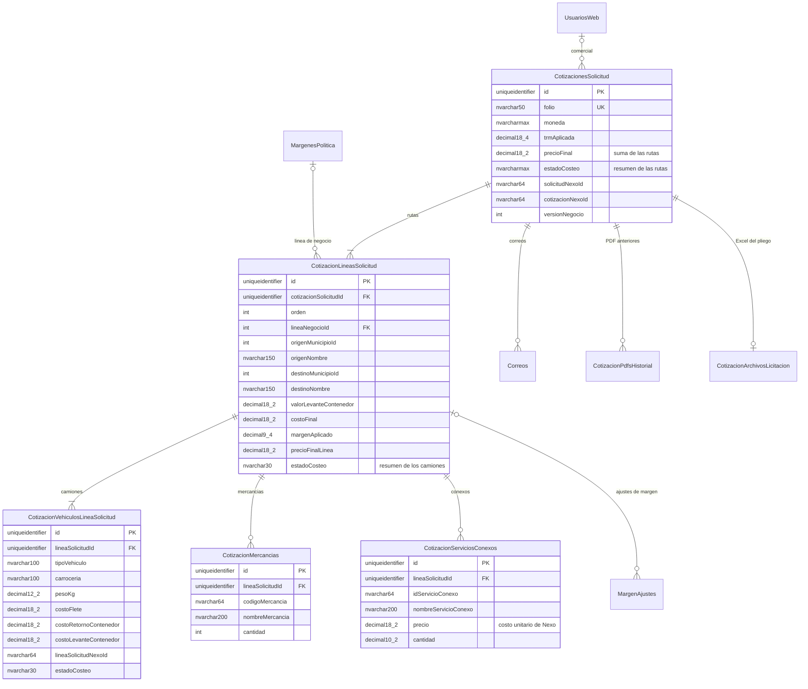

# Base de datos — Cotifly

> **Estado:** vigente desde HU-021 · **Dueño:** Duban Guerra (backend) · **Actualizado:** 2026-10-15 (HU-023 y HU-022.1)

Punto de entrada a la base de datos de Cotifly: motor, esquema, scripts y dónde está cada detalle.

## 1. Resumen

- **Motor:** SQL Server 2019. **Schema:** `dbo_cotifly`, dentro de la base compartida `dbTarifario_Nexo_Pruebas`
  (`tbsdatacenter`).
- **Acceso desde el código:** EF Core *Database First* en el backend .NET
  (`backend-dotnet/src/Cotifly.Infraestructura/Comun/Persistence/`). No hay migraciones de EF: el esquema solo cambia con
  scripts `db/migrations_mssql/000N_*.sql` (ADR-008).
- **Qué guarda:** la trazabilidad de cada cotización (rutas, camiones, costos de Nexo, margen, precio, PDF, correo y
  resultado), la identidad interna y la auditoría. No es el ERP: Nexo, SAP TM y el cubicador son fuentes externas.
- **20 tablas, sin vistas** (las 2 del borrador de métricas se retiraron en HU-014.3, #152, con `db/scripts/08`).

| Documento | Qué tiene |
|---|---|
| [`docs/database/ESQUEMA_OBJETIVO_SQLSERVER.md`](docs/database/ESQUEMA_OBJETIVO_SQLSERVER.md) | Esquema vigente (Parte A): diagramas ER, columnas, tipos, restricciones, índices y scripts |
| [`docs/database/DICCIONARIO_BASE_DE_DATOS.md`](docs/database/DICCIONARIO_BASE_DE_DATOS.md) | Qué significa cada columna, quién la escribe y quién la lee |
| [`db/README.md`](db/README.md) | Cómo instalar desde cero, migrar una base existente y verificar |
| [ADR-019](backend-dotnet/specs/decisiones/ADR-019-reestructuracion-rutas-y-camiones.md) | Decisión de las tres capas solicitud → ruta → camión y las decisiones 1 a 12 de HU-021 |
| [`DEPLOY.md`](DEPLOY.md) | Precondición de esquema para desplegar y errores de `/health/ready` |

## 2. Las tres capas: solicitud → ruta → camión

Desde el `0009` (HU-021) una cotización es una **solicitud** (`CotizacionesSolicitud`) con una o varias **rutas**
(`CotizacionLineasSolicitud`). Cada ruta sale en uno o varios **camiones** (`CotizacionVehiculosLineaSolicitud`, uno por
fila). Las **mercancías** (`CotizacionMercancias`) y los **servicios conexos** (`CotizacionServiciosConexos`) son de la ruta.
Nexo costea cada camión; la ruta suma sus camiones y sus conexos, aplica su margen y saca su precio; la cabecera suma sus
rutas. Cubica el sistema donde nace la solicitud: si nace en Cotifly, Cotifly llama al cubicador.

El diagrama completo, con todas las columnas y el resto de tablas, está en
[`ESQUEMA_OBJETIVO_SQLSERVER.md`](docs/database/ESQUEMA_OBJETIVO_SQLSERVER.md) §A.2 y §A.3.

## 3. Tablas

| Grupo | Tablas |
|---|---|
| Cotizaciones | `CotizacionesSolicitud` (cabecera, ex `Cotizaciones`), `CotizacionLineasSolicitud` (ruta), `CotizacionVehiculosLineaSolicitud` (camión), `CotizacionMercancias` (ex `CotizacionPosiciones`), `CotizacionServiciosConexos`, `CotizacionArchivosLicitacion`, `CotizacionPdfsHistorial` |
| Márgenes y correo | `MargenAjustes` (con la ruta ajustada), `Correos`, `CorreoDestinatarios` |
| Configuración | `MargenesPolitica` (líneas de negocio), `SapMapeoTrqType` |
| Identidad | `UsuariosWeb`, `Roles`, `UsuariosRoles`, `TokensRefresco`, `TokensRevocados` |
| Asistente y auditoría | `Sesiones`, `EventosConversacion`, `EventosHerramienta` |

## 4. Scripts

| Script | Qué hace |
|---|---|
| `db/scripts/01_crear_esquema.sql` + `db/seeder/*` | Instalación desde cero; equivale a `0001` a `0010` aplicados. Se corre con `db/ejecutar-bd.ps1` o `db/ejecutar-bd.sh` |
| `db/migrations_mssql/0001` a `0008` | Esquema inicial, identidad, costeo en Nexo, líneas de la solicitud, concurrencia y textos del PDF, campos de captura y horas por línea |
| `db/migrations_mssql/0009_reestructuracion_cotizaciones.sql` | HU-021: cabecera → rutas → camiones, mercancías y conexos en filas, con respaldo `Respaldo0009_*` |
| `db/migrations_mssql/0010_nombres_municipio.sql` | Nombres de municipio de la ruta, `solicitudNexoId`, nombre del conexo y el CHECK de `estadoEnvio`. **Borrador pendiente de revisión de scalderon-bs** |
| `db/scripts/02_alter_cubicador.sql` | HU-023.3: columnas de resultado de la cubicación y `codigoMercancia` en lugar de `idTipoMercancia`. Idempotente; el ejecutador lo corre después del `01` |
| `db/scripts/03_orden_vehiculo_y_conexo_catalogo.sql` | HU-023.3 (#158), mapeado en HU-014 (#188): `ordenVehiculo` del camión (índice único filtrado por ruta), `idServicioConexoCatalogo` del conexo y el CHECK del motivo del `07`. Obligatorio: sin él `/health/ready` responde "falta 03". Se aplica antes de la imagen |
| `db/scripts/05_categoria_conexo.sql` | #173, mapeado en HU-014 (#188): `categoriaServicioConexo` del conexo. Obligatorio: sin él `/health/ready` responde "falta 05". Se aplica antes de la imagen |
| `db/scripts/07_motivo_busqueda_agotada.sql` | HU-023 (#176): quinto motivo `BUSQUEDA_AGOTADA` en el CHECK del motivo. Idempotente |
| `db/scripts/08_retirar_vistas_actividad.sql` | HU-014.3 (#152): `DROP VIEW` de `vActividadPorComercial` y `vAjustesMargenPorComercial` si existen. Idempotente; lo aplica el DBA después de desplegar el backend sin el borrador de métricas |
| `db/scripts/09_score_prioridad.sql` | HU-018.1 (#155): `CotizacionesSolicitud.scorePrioridad DECIMAL(9,4) NULL` (el `scorePrioridad` de Nexo). Obligatorio: el backend mapea la columna; sin él `/health/ready` responde "falta 09". Se aplica antes de la imagen |
| `db/scripts/pendientes/04` y `06` | Propuestas pendientes de revisión de scalderon-bs y del DBA (cubicación en segundo plano e idempotencia de la captura). El ejecutador no las corre. El backend mapea el `04` (sin él, "falta 04") |
| `db/scripts/operacion/` | Scripts de datos de una sola vez (identidad compartida con Nexo, rol comercial). Los corre el DBA con aprobación |

Detalle de cada script en [`ESQUEMA_OBJETIVO_SQLSERVER.md`](docs/database/ESQUEMA_OBJETIVO_SQLSERVER.md) §A.5.

**Precondición para desplegar el backend:** `0001` a `0010`, el `02`, el `03`, el `pendientes/04`, el `05` y el `09` aplicados (o la
instalación desde cero con el ejecutador, más el `04`). Si falta algo, `/health/ready` responde `503` y dice qué falta (`falta 0009`,
`falta 0010`, `falta 02`, `falta 03`, `falta 04`, `falta 05`, `falta 09`, `falta Tabla.columna`; ver [`DEPLOY.md`](DEPLOY.md) §4.5).

## 5. Cómo acceder

- **Local:** el `docker-compose.yml` de la raíz levanta SQL Server en el puerto **1434** del host y el servicio `db-init`
  instala el esquema y los seeders en la base `bd_cotifly` (ver [`db/README.md`](db/README.md)). El backend .NET tiene sus
  propios scripts de arranque local: [`backend-dotnet/docs/06-ejecucion-local.md`](backend-dotnet/docs/06-ejecucion-local.md).
- **Base compartida:** `tbsdatacenter`, base `dbTarifario_Nexo_Pruebas`, schema `dbo_cotifly`. Los scripts los aplica el
  DBA, con aprobación; nunca se corren a mano desde el equipo de desarrollo.

## 6. Respaldo

La política de respaldo de `dbo_cotifly`, la exportación lógica (`exportar-dbo-cotifly.sh`) y el restore en una instancia
de pruebas están en [`DEPLOY.md`](DEPLOY.md) §6.

## 7. Pendientes

| Pendiente | Quién lo resuelve |
|---|---|
| Revisión del `0010` y de `db/scripts/pendientes/04` y `06` | scalderon-bs y el DBA |
| Confirmar que el `03` y el `05` están aplicados en la base compartida y en cada ambiente antes de la imagen de #188 (consulta en [`DEPLOY.md`](DEPLOY.md) §4.5) | DBA |
| `TrqType` de SAP TM para `DevolucionContenedor` (falta en `db/seeder/02_sap_mapeo_trqtype.sql`; no se inventa) | Negocio o SAP |
| Fijar `Roles.idRolExterno` de los roles de ClientePro en cada ambiente (`db/seeder/03_roles.sql`) | DBA |
| Borrar el respaldo `dbo_cotifly_respaldo_20261008` de la base compartida cuando ya no se necesite | DBA |
| Borrar las tablas `Respaldo0009_*` cuando el backend esté validado, si en algún ambiente se aplicó el `0009` sobre datos existentes (solo existen en ese caso) | DBA |
