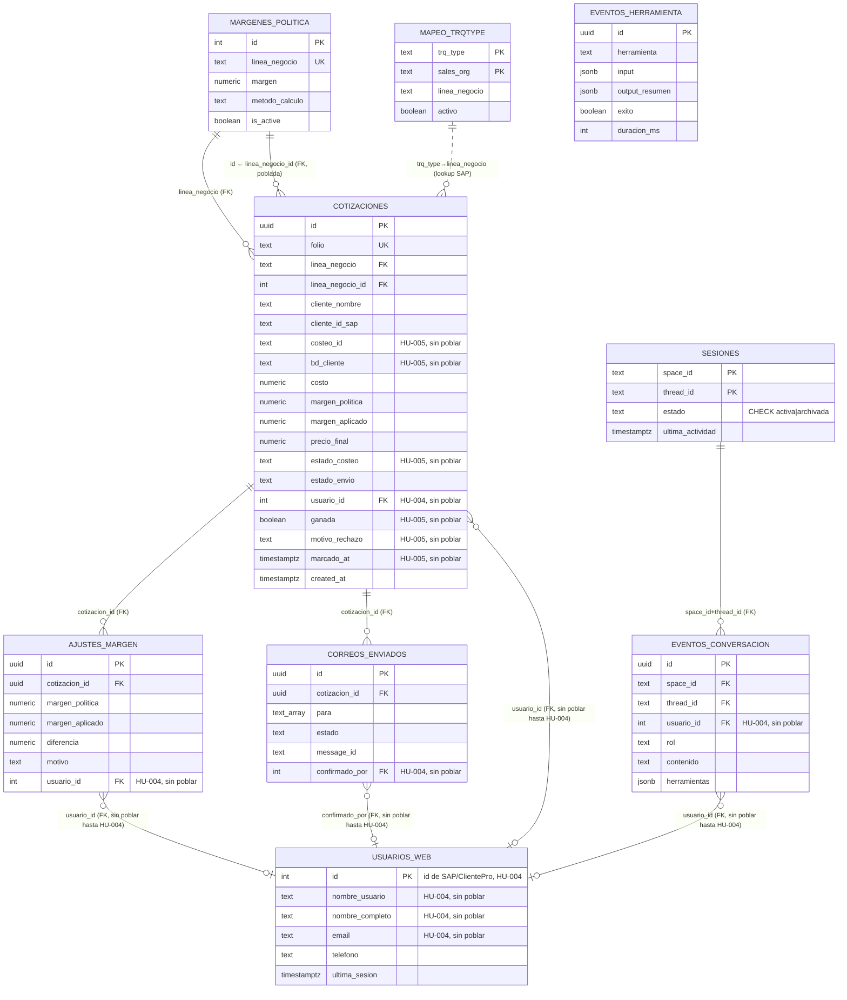

# Base de datos — Cotifly

**Vigente desde HU-021. Actualizado en HU-021.14 (2026-10-13).**

Punto de entrada a la base de datos de Cotifly: motor, esquema, scripts y dónde está cada detalle.

> La versión anterior de este documento describía la base **PostgreSQL** del bot en Python (SQLAlchemy y Alembic). Quedó
> al final como [anexo obsoleto](#anexo--base-postgres-del-bot-en-python-obsoleto). HU-022.1 (#146) decide si se borra.

## 1. Resumen

- **Motor:** SQL Server 2019. **Schema:** `dbo_cotifly`, dentro de la base compartida `dbTarifario_Nexo_Pruebas`
  (`tbsdatacenter`).
- **Acceso desde el código:** EF Core *Database First* en el backend .NET
  (`backend-dotnet/src/Cotifly.Infraestructura/Comun/Persistence/`). No hay migraciones de EF: el esquema solo cambia con
  scripts `db/migrations_mssql/000N_*.sql` (ADR-008).
- **Qué guarda:** la trazabilidad de cada cotización (rutas, camiones, costos de Nexo, margen, precio, PDF, correo y
  resultado), la identidad interna y la auditoría. No es el ERP: Nexo, SAP TM y el cubicador son fuentes externas.
- **20 tablas y 2 vistas.**

| Documento | Qué tiene |
|---|---|
| [`docs/database/ESQUEMA_OBJETIVO_SQLSERVER.md`](docs/database/ESQUEMA_OBJETIVO_SQLSERVER.md) | Esquema vigente (Parte A): diagramas ER, columnas, tipos, restricciones, índices y scripts |
| [`docs/database/DICCIONARIO_BASE_DE_DATOS.md`](docs/database/DICCIONARIO_BASE_DE_DATOS.md) | Qué significa cada columna, quién la escribe y quién la lee |
| [`db/README.md`](db/README.md) | Cómo instalar desde cero, migrar una base existente y verificar |
| [ADR-019](backend-dotnet/specs/decisiones/ADR-019-reestructuracion-rutas-y-camiones.md) | Decisión de las tres capas solicitud → ruta → camión y las decisiones 1 a 12 de HU-021 |
| [`DEPLOY.md`](DEPLOY.md) | Precondición de esquema para desplegar y errores de `/health/ready` |

## 2. Las tres capas: solicitud → ruta → camión

Desde el `0009` (HU-021) una cotización es una **solicitud** (`CotizacionesSolicitud`) con una o varias **rutas**
(`CotizacionLineasSolicitud`). Cada ruta sale en uno o varios **camiones** (`CotizacionVehiculosLineaSolicitud`, uno por
fila). Las **mercancías** (`CotizacionMercancias`) y los **servicios conexos** (`CotizacionServiciosConexos`) son de la ruta.
Nexo costea cada camión; la ruta suma sus camiones y sus conexos, aplica su margen y saca su precio; la cabecera suma sus
rutas. Cubica el sistema donde nace la solicitud: si nace en Cotifly, Cotifly llama al cubicador.


El diagrama completo, con todas las columnas y el resto de tablas, está en
[`ESQUEMA_OBJETIVO_SQLSERVER.md`](docs/database/ESQUEMA_OBJETIVO_SQLSERVER.md) §A.2 y §A.3.

## 3. Tablas

| Grupo | Tablas |
|---|---|
| Cotizaciones | `CotizacionesSolicitud` (cabecera, ex `Cotizaciones`), `CotizacionLineasSolicitud` (ruta), `CotizacionVehiculosLineaSolicitud` (camión), `CotizacionMercancias` (ex `CotizacionPosiciones`), `CotizacionServiciosConexos`, `CotizacionArchivosLicitacion`, `CotizacionPdfsHistorial` |
| Márgenes y correo | `MargenAjustes` (con la ruta ajustada), `Correos`, `CorreoDestinatarios` |
| Configuración | `MargenesPolitica` (líneas de negocio), `SapMapeoTrqType` |
| Identidad | `UsuariosWeb`, `Roles`, `UsuariosRoles`, `TokensRefresco`, `TokensRevocados` |
| Asistente y auditoría | `Sesiones`, `EventosConversacion`, `EventosHerramienta` |
| Vistas | `vAjustesMargenPorComercial`, `vActividadPorComercial` |

## 4. Scripts

| Script | Qué hace |
|---|---|
| `db/scripts/01_crear_esquema.sql` + `db/seeder/*` | Instalación desde cero; equivale a `0001` a `0010` aplicados. Se corre con `db/ejecutar-bd.ps1` o `db/ejecutar-bd.sh` |
| `db/migrations_mssql/0001` a `0008` | Esquema inicial, identidad, costeo en Nexo, líneas de la solicitud, concurrencia y textos del PDF, campos de captura y horas por línea |
| `db/migrations_mssql/0009_reestructuracion_cotizaciones.sql` | HU-021: cabecera → rutas → camiones, mercancías y conexos en filas, con respaldo `Respaldo0009_*` |
| `db/migrations_mssql/0010_nombres_municipio.sql` | Nombres de municipio de la ruta, `solicitudNexoId`, nombre del conexo y el CHECK de `estadoEnvio`. **Borrador pendiente de revisión de scalderon-bs** |

Detalle de cada script en [`ESQUEMA_OBJETIVO_SQLSERVER.md`](docs/database/ESQUEMA_OBJETIVO_SQLSERVER.md) §A.5.

**Precondición para desplegar el backend:** `0001` a `0010` aplicados (o la instalación desde cero). Si falta algo,
`/health/ready` responde `503` y dice qué falta (`falta 0009`, `falta 0010`, `falta Tabla.columna`; ver
[`DEPLOY.md`](DEPLOY.md) §4.5).

**Pendiente — HU-023 (cubicador):** `db/scripts/02_alter_cubicador.sql` agregará las columnas de resultado de la cubicación
y cambiará `idTipoMercancia` por `codigoMercancia`. Todavía no está en esta rama; cuando entre, pasa a ser parte de la
precondición.

## 5. Cómo acceder

- **Local:** el `docker-compose.yml` de la raíz levanta SQL Server en el puerto **1434** del host y el servicio `db-init`
  instala el esquema y los seeders en la base `bd_cotifly` (ver [`db/README.md`](db/README.md)). El backend .NET tiene sus
  propios scripts de arranque local: [`backend-dotnet/docs/06-ejecucion-local.md`](backend-dotnet/docs/06-ejecucion-local.md).
- **Base compartida:** `tbsdatacenter`, base `dbTarifario_Nexo_Pruebas`, schema `dbo_cotifly`. Los scripts los aplica el
  DBA, con aprobación; nunca se corren a mano desde el equipo de desarrollo.

## 6. Respaldo

La política de respaldo de `dbo_cotifly`, la exportación lógica (`exportar-dbo-cotifly.sh`) y el restore en una instancia
de pruebas están en [`DEPLOY.md`](DEPLOY.md) §6.

---

# Anexo — Base Postgres del bot en Python (OBSOLETO)

> **OBSOLETO.** Todo lo que sigue describe la base **PostgreSQL 16** del bot en Python (`shared/`, SQLAlchemy y las
> migraciones de Alembic en `db/migrations/`, que se borraron en HU-021.2). El backend .NET no la usa. Lo vigente está
> arriba y en [`docs/database/ESQUEMA_OBJETIVO_SQLSERVER.md`](docs/database/ESQUEMA_OBJETIVO_SQLSERVER.md). HU-022.1 (#146)
> decide si este anexo y el stack de Postgres se borran.

**Título original:** Base de datos — Bot Cotizador (Postgres)

Referencia de la base de datos del proyecto: motor, esquema, vistas, configuración
vigente y cómo acceder a ella (local y producción).

### 1. Resumen

- **Motor:** PostgreSQL 16.
- **Acceso desde el código:** SQLAlchemy 2.x (estilo síncrono) + Alembic para migraciones.
- **Filosofía:** es la BD de **trazabilidad** del bot (§7.3 de la arquitectura) — registra
  cada cotización, ajuste de margen, correo enviado, turno de conversación e invocación de
  herramienta. No es el ERP: SAP TM y el tarifario de Drive son fuentes externas que el bot
  consulta, no persiste.
- Los IDs de negocio son `UUID` generados por Postgres (`gen_random_uuid()`); las tablas de
  configuración usan claves de negocio como PK (`linea_negocio`, `trq_type`).

### 2. Capas de acceso en el código

```
shared/config.py    → Settings.database_url (env DATABASE_URL, pydantic-settings)
shared/db.py        → engine (SQLAlchemy) + get_session() (context manager transaccional)
shared/models.py    → 9 tablas ORM (DeclarativeBase)
shared/repos.py     → repositorios estáticos (CotizacionRepo, SesionRepo, ...) — toda
                      consulta/escritura pasa por aquí, no hay SQL suelto en
                      orquestador/mcp_server
db/migrations/versions/ → 5 migraciones Alembic (esquema versionado)
```

`get_session()` (`shared/db.py`) hace commit al salir sin error y rollback ante excepción —
quien llama nunca maneja la transacción a mano.

### 3. Diagrama de tablas



> **Nota HU-002.2 (2026-09-22):** las columnas marcadas "sin poblar" existen en el
> esquema pero ningún código las llena todavía — dependen de HU-004 (ClientePro,
> identidad real) o HU-005 (Nexo, costeo). `/web/login` y los endpoints que dependían
> de `comercial_email` (`mis-cotizaciones`, `enviar`, `seguimiento`) quedaron
> desactivados hasta que exista esa identidad; cotizar por Google Chat no se vio
> afectado.

### 4. Tablas

#### `cotizaciones` — el registro central
Una fila por cada cotización generada. `folio` (formato `PCN-DDMMAAAA[-vN]`) es el
identificador de negocio, único. Guarda el precio calculado y el margen (de política vs.
aplicado). Desde HU-002.2: `estado_envio` reemplaza al antiguo `estado` (que mezclaba costeo
y envío); `estado_costeo`, `costeo_id` y `bd_cliente` existen ya en el esquema pero **nadie
los llena todavía** — son para cuando la integración con Nexo (HU-005) esté lista. `origen`,
`destino` y `fuente_tarifa` se eliminaron (los reemplaza el detalle que vivirá en Nexo).
`usuario_id` reemplaza a `comercial_email`: es un entero (FK a `usuarios_web.id`) que
tampoco tiene todavía de dónde poblarse — depende de que ClientePro (HU-004) entregue la
identidad real. Mientras tanto, `/web/login` está desactivado y estos datos quedan `NULL`.
`efectiva`/`seguimiento_nota`/`seguimiento_actualizado` se renombraron a
`ganada`/`motivo_rechazo`/`marcado_at` (misma semántica boolean True/False/None) — el
botón que los llena y la sincronización con el `Resultado` de Nexo son de HU-005.

#### `ajustes_margen` — auditoría de desvíos
Una fila cada vez que un comercial ajusta el margen manualmente por fuera de la política.
Guarda la diferencia (`margen_aplicado - margen_politica`) y el motivo. `usuario_id`
(antes `comercial_email`) tiene la misma limitación que en `cotizaciones`: sin HU-004, sin
poblar. Es la base de la vista `v_ajustes_margen_por_comercial` que usa Gerencia para
auditar.

#### `correos_enviados` — trazabilidad de envíos
Un registro por cada intento de envío del PDF al cliente (`para`/`cc` como arrays, `estado`
enviado/fallido, `message_id`). `confirmado_por` pasó de texto (el correo) a entero (FK a
`usuarios_web.id`, sin poblar hasta HU-004) — el envío real sigue usando el correo tal cual
para el remitente/`Reply-To`, solo cambió lo que se persiste en esta tabla.
`CorreoRepo.duplicado_reciente` la consulta para no reenviar el mismo correo dos veces en
una ventana de 5 minutos.

#### `eventos_conversacion` — historial del agente
Cada turno (usuario o asistente) de una conversación, con las herramientas invocadas en ese
turno (JSONB). Reconstruye el historial de una sesión (`ConversacionRepo.historial`). Tiene
FK real a `sesiones` desde HU-002.2. `usuario_id` (antes `usuario_email`) sin poblar hasta
HU-004.

#### `eventos_herramienta` — auditoría técnica
Cada invocación a una herramienta del MCP (input, resumen de salida, éxito/fallo, duración).
Log de auditoría técnica, independiente del historial conversacional.

#### `sesiones` — estado de la conversación
PK compuesta (`space_id`, `thread_id`). Trackea si una conversación sigue `activa` o fue
`archivada` (barrido por inactividad, `SESION_TTL_HORAS`; `CHECK` desde HU-002.2). La
columna `contexto` (JSONB) se eliminó en HU-002.2 — nunca se leía.

#### `usuarios_web` — comerciales identificados por ClientePro
Rediseñada por completo en HU-002.2: la PK deja de ser el correo y pasa a ser el mismo id
entero de SAP que entregará ClientePro (HU-004). Se agregó `telefono`, y (migración `0009`)
`nombre_usuario`/`nombre_completo`/`email` — mapeo de `tblSAPUsuariosApp` del diseño
original (§2.6), construido ya aunque nada lo llene todavía, mismo criterio que
`costeo_id`/`bd_cliente`/`linea_negocio_id`. **La tabla está vacía
y sin forma de llenarse hasta que HU-004 exista** — el login propio por correo
(`POST /web/login`) fue retirado, y con él, `mis-cotizaciones`, `enviar` y `seguimiento` de
la Consola web (dependían de esa identidad). Cotizar por Google Chat no se vio afectado.

#### `margenes_politica` — configuración: margen por línea
**Fallback** cuando SAP TM no tiene el margen del cliente. 8 filas hoy (una por línea de
negocio), **todas al 15%, incluida `ITR`** — corrección 2026-09-22: se había documentado
por error que `ITR` estaba al 50% (intencional); verificado contra la BD real y contra
`db/migrations/versions/0002_seed_config.py`, `ITR` está al 15% igual que las demás, sin
excepción. Método `margen`. Marcadas como
*provisionales, pendientes de validar con Gerencia Comercial* (migración `0002_seed_config`)
— HU-002.1 decidió no bloquear el cierre con esa validación: Gerencia las ajustará
directamente desde un panel admin una vez la app esté entregada. Desde HU-002.2 tiene `id`
serial (nueva PK) e `is_active`; `linea_negocio` sigue siendo único pero ya no es la PK.

#### `mapeo_trqtype` — configuración: TrqType SAP ↔ línea de negocio
Traduce el `TrqType` de SAP TM a la línea de negocio interna (para saber qué política de
margen aplicar). PK compuesta (`trq_type`, `sales_org`); `sales_org=''` es el comodín
"aplica a todas las organizaciones de venta". Estado actual (8 filas):

| trq_type | línea de negocio    |
|----------|----------------------|
| OPTN     | Nacional             |
| OPDS     | Distribucion         |
| OPIM     | Importacion          |
| OPEX     | Exportacion          |
| OPTI     | Internacional        |
| OHUB     | Almacenamiento       |
| OH3P     | Almacenamiento3PL    |
| OPSC     | ITR                  |

### 5. Vistas de solo lectura (para Gerencia / soporte)

Creadas por Alembic vía SQL directo; no tienen modelo ORM propio.

- **`v_ajustes_margen_por_comercial`** (migración 0003, recreada en `0006` con `usuario_id`
  en vez de `comercial_email`): ajustes agregados por comercial + línea (num_ajustes,
  diferencia promedio/min/max, último ajuste).
- **`v_actividad_por_comercial`** (migración 0004, recreada en `0006` con `usuario_id` y
  `estado_envio`): actividad agregada por comercial (cotizaciones totales/enviadas,
  ajustes, última actividad) — quién usa el bot y cuánto.

**`v_trazabilidad_cotizaciones`** (migración 0004) **se eliminó en HU-002.2** (`0006`) y no
se recreó: sin consumidor de código, y dependía de `origen`/`destino`/`fuente_tarifa`, ya
eliminadas. Si Gerencia la necesita, se arma de nuevo contra el esquema vigente.

Uso típico (ver `DEPLOY.md` §A.7, stack Python):
```sql
SELECT * FROM v_ajustes_margen_por_comercial ORDER BY num_ajustes DESC;
```

Estas vistas también alimentan la sincronización a Google Sheets (`shared/sheets_sync.py`)
para el tablero de Looker Studio (ajustada en HU-002.2 a los nombres de columna nuevos).

### 6. Migraciones

| Revisión | Qué hace |
|---|---|
| `0001_initial` | Esquema base: las 6 tablas de trazabilidad + `margenes_politica`/`mapeo_trqtype`. |
| `0002_seed_config` | Semilla: 8 filas de mapeo TrqType↔línea + 8 de margen de política (15% todas, provisional). |
| `0003_vista_trazabilidad` | Vista `v_ajustes_margen_por_comercial`. |
| `0004_trazabilidad` | Vistas `v_trazabilidad_cotizaciones` y `v_actividad_por_comercial`. |
| `0005_usuarios_y_seguimiento` | Tabla `usuarios_web` + columnas de seguimiento en `cotizaciones` (`efectiva`, `seguimiento_nota`, `seguimiento_actualizado`). |
| `0006_hu002_2_esquema_completo` | HU-002.2: elimina `payload`/`contexto`/`origen`/`destino`/`fuente_tarifa`; agrega FKs (`eventos_conversacion→sesiones`, `linea_negocio→margenes_politica`, `usuario_id→usuarios_web`); rediseña `usuarios_web` (PK entera de SAP) y `margenes_politica` (id serial); agrega columnas de Nexo sin poblar (`costeo_id`, `bd_cliente`, `estado_costeo`) y `linea_negocio_id` (poblada aparte, ver `0008`). |
| `0007_ganada_perdida` | HU-002.2 (seguimiento): renombra `efectiva`/`seguimiento_nota`/`seguimiento_actualizado` → `ganada`/`motivo_rechazo`/`marcado_at` — esquema listo para el resultado sincronizado con Nexo (HU-005), sin poblar todavía. |
| `0008_backfill_linea_negocio_id` | Corrección 2026-09-22: `linea_negocio_id` no dependía de Nexo — se rellena por cruce local contra `margenes_politica` (sembrada desde `0002`). `mcp_server/server.py` ya la llena en cotizaciones nuevas. |
| `0009_usuarios_web_clientepro` | Agrega `nombre_usuario`/`nombre_completo`/`email` a `usuarios_web` (mapeo de `tblSAPUsuariosApp`, §2.6) — construidas ya, sin poblar hasta HU-004, mismo criterio que las columnas de Nexo. Nombre de revisión acortado a propósito (28 caracteres, no "...clientepro_columnas") — `alembic_version.version_num` es `VARCHAR(32)`, el nombre completo lo excedía y hacía fallar el `UPDATE` de versión. |

Se aplican con `alembic upgrade head` — automático en producción (entrypoint del contenedor
`orquestador`, ver `scripts/entrypoint_orquestador.sh`).

### 7. Cómo acceder

#### Local (dev)
```
Host: localhost   Puerto: 5434   Usuario: bot   Password: bot   Base: botcotizador
```
```bash
docker compose exec postgres psql -U bot -d botcotizador   # psql dentro del contenedor
```
O cualquier cliente externo (DBeaver, TablePlus, pgAdmin) con esos datos. El puerto es
**5434**, no el 5432 estándar, para no chocar con otros Postgres locales (ver
`docker-compose.yml`).

#### Producción / staging (Dokploy)
La BD (`bot-db`) vive solo en la red interna de Swarm, sin puerto publicado — no hay acceso
directo desde fuera. Alternativas:
```bash
# Por SSH al servidor de Dokploy:
docker exec -it $(docker ps -q -f name=bot-db) psql -U $POSTGRES_USER -d $POSTGRES_DB
```
o los scripts `scripts/backup_db.sh` / `scripts/restore_db.sh` (dump/restore con
`pg_dump`/`pg_restore`).

### 8. Backup / restore

```bash
DB_HOST=bot-db BACKUP_DIR=/backups sh scripts/backup_db.sh
DB_HOST=bot-db sh scripts/restore_db.sh /backups/botcotizador-YYYYmmdd-HHMMSS.dump
```
Formato `pg_dump -Fc` (custom, comprimido, restaurable selectivamente). En producción se
recomienda programarlo diario (ver `DEPLOY.md` §A.8, stack Python; el backend .NET usa §6).
