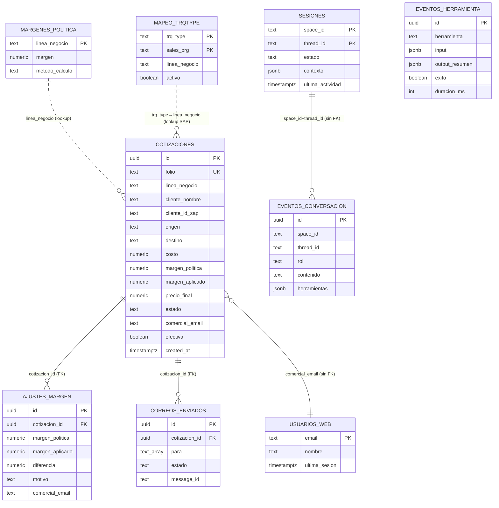

# Base de datos — Bot Cotizador

Referencia de la base de datos del proyecto: motor, esquema, vistas, configuración
vigente y cómo acceder a ella (local y producción).

## 1. Resumen

- **Motor:** PostgreSQL 16.
- **Acceso desde el código:** SQLAlchemy 2.x (estilo síncrono) + Alembic para migraciones.
- **Filosofía:** es la BD de **trazabilidad** del bot (§7.3 de la arquitectura) — registra
  cada cotización, ajuste de margen, correo enviado, turno de conversación e invocación de
  herramienta. No es el ERP: SAP TM y el tarifario de Drive son fuentes externas que el bot
  consulta, no persiste.
- Los IDs de negocio son `UUID` generados por Postgres (`gen_random_uuid()`); las tablas de
  configuración usan claves de negocio como PK (`linea_negocio`, `trq_type`).

## 2. Capas de acceso en el código

```
shared/config.py    → Settings.database_url (env DATABASE_URL, pydantic-settings)
shared/db.py        → engine (SQLAlchemy) + get_session() (context manager transaccional)
shared/models.py    → 9 tablas ORM (DeclarativeBase)
shared/repos.py     → repositorios estáticos (CotizacionRepo, SesionRepo, ...) — toda
                      consulta/escritura pasa por aquí, no hay SQL suelto en
                      orquestador/mcp_server
migrations/versions/ → 5 migraciones Alembic (esquema versionado)
```

`get_session()` (`shared/db.py`) hace commit al salir sin error y rollback ante excepción —
quien llama nunca maneja la transacción a mano.

## 3. Diagrama de tablas



## 4. Tablas

### `cotizaciones` — el registro central
Una fila por cada cotización generada. `folio` (formato `PCN-DDMMAAAA[-vN]`) es el
identificador de negocio, único. Guarda el precio calculado, el margen (de política vs.
aplicado), la fuente de la tarifa, quién la generó (`comercial_email`, `space_id`/`thread_id`
del hilo de Chat o de la Consola web) y el seguimiento comercial (`efectiva`,
`seguimiento_nota` — si el negocio se concretó).

### `ajustes_margen` — auditoría de desvíos
Una fila cada vez que un comercial ajusta el margen manualmente por fuera de la política.
Guarda la diferencia (`margen_aplicado - margen_politica`) y el motivo. Es la base de la
vista `v_ajustes_margen_por_comercial` que usa Gerencia para auditar.

### `correos_enviados` — trazabilidad de envíos
Un registro por cada intento de envío del PDF al cliente (`para`/`cc` como arrays, `estado`
enviado/fallido, `message_id`). `CorreoRepo.duplicado_reciente` la consulta para no reenviar
el mismo correo dos veces en una ventana de 5 minutos.

### `eventos_conversacion` — historial del agente
Cada turno (usuario o asistente) de una conversación, con las herramientas invocadas en ese
turno (JSONB). Reconstruye el historial de una sesión (`ConversacionRepo.historial`).

### `eventos_herramienta` — auditoría técnica
Cada invocación a una herramienta del MCP (input, resumen de salida, éxito/fallo, duración).
Log de auditoría técnica, independiente del historial conversacional.

### `sesiones` — estado de la conversación
PK compuesta (`space_id`, `thread_id`). Trackea si una conversación sigue `activa` o fue
`archivada` (barrido por inactividad, `SESION_TTL_HORAS`) y guarda `contexto` (JSONB) con el
estado de la ventana deslizante.

### `usuarios_web` — comerciales de la Consola
Identifica a quien usa el front web (`GET /web`) por su correo corporativo. No hay
contraseña: el login es solo por correo válido (`@boterosoto.com.co`) y emite un token
firmado (`WEB_SESSION_SECRET`).

### `margenes_politica` — configuración: margen por línea
**Fallback** cuando SAP TM no tiene el margen del cliente. 8 filas hoy (una por línea de
negocio), todas al **15%**, método `margen`. Marcadas como *provisionales, pendientes de
validar con Gerencia Comercial* (migración `0002_seed_config`).

### `mapeo_trqtype` — configuración: TrqType SAP ↔ línea de negocio
Traduce el `TrqType` de SAP TM a la línea de negocio interna (para saber qué política de
margen aplicar). PK compuesta (`trq_type`, `sales_org`); `sales_org=''` es el comodín
"aplica a todas las organizaciones de venta". Estado actual (8 filas):

| trq_type | línea de negocio    |
|----------|----------------------|
| OPTN     | Nacional             |
| OPDS     | Distribucion         |
| OPIM     | Importacion          |
| OPEX     | Exportacion          |
| OPTI     | Internacional        |
| OHUB     | Almacenamiento       |
| OH3P     | Almacenamiento3PL    |
| OPSC     | ITR                  |

## 5. Vistas de solo lectura (para Gerencia / soporte)

Creadas por Alembic vía SQL directo; no tienen modelo ORM propio.

- **`v_ajustes_margen_por_comercial`** (migración 0003): ajustes agregados por comercial +
  línea (num_ajustes, diferencia promedio/min/max, último ajuste).
- **`v_trazabilidad_cotizaciones`** (migración 0004): una fila por cotización con su
  precio/margen + cuántos ajustes y correos tuvo.
- **`v_actividad_por_comercial`** (migración 0004): actividad agregada por comercial
  (cotizaciones totales/enviadas, ajustes, última actividad) — quién usa el bot y cuánto.

Uso típico (ver `DEPLOY.md` §7):
```sql
SELECT * FROM v_ajustes_margen_por_comercial ORDER BY num_ajustes DESC;
```

Estas 3 vistas también alimentan la sincronización a Google Sheets (`shared/sheets_sync.py`)
para el tablero de Looker Studio.

## 6. Migraciones

| Revisión | Qué hace |
|---|---|
| `0001_initial` | Esquema base: las 6 tablas de trazabilidad + `margenes_politica`/`mapeo_trqtype`. |
| `0002_seed_config` | Semilla: 8 filas de mapeo TrqType↔línea + 8 de margen de política (15% todas, provisional). |
| `0003_vista_trazabilidad` | Vista `v_ajustes_margen_por_comercial`. |
| `0004_trazabilidad` | Vistas `v_trazabilidad_cotizaciones` y `v_actividad_por_comercial`. |
| `0005_usuarios_y_seguimiento` | Tabla `usuarios_web` + columnas de seguimiento en `cotizaciones` (`efectiva`, `seguimiento_nota`, `seguimiento_actualizado`). |

Se aplican con `alembic upgrade head` — automático en producción (entrypoint del contenedor
`orquestador`, ver `scripts/entrypoint_orquestador.sh`).

## 7. Cómo acceder

### Local (dev)
```
Host: localhost   Puerto: 5434   Usuario: bot   Password: bot   Base: botcotizador
```
```bash
docker compose exec postgres psql -U bot -d botcotizador   # psql dentro del contenedor
```
O cualquier cliente externo (DBeaver, TablePlus, pgAdmin) con esos datos. El puerto es
**5434**, no el 5432 estándar, para no chocar con otros Postgres locales (ver
`docker-compose.yml`).

### Producción / staging (Dokploy)
La BD (`bot-db`) vive solo en la red interna de Swarm, sin puerto publicado — no hay acceso
directo desde fuera. Alternativas:
```bash
# Por SSH al servidor de Dokploy:
docker exec -it $(docker ps -q -f name=bot-db) psql -U $POSTGRES_USER -d $POSTGRES_DB
```
o los scripts `scripts/backup_db.sh` / `scripts/restore_db.sh` (dump/restore con
`pg_dump`/`pg_restore`).

## 8. Backup / restore

```bash
DB_HOST=bot-db BACKUP_DIR=/backups sh scripts/backup_db.sh
DB_HOST=bot-db sh scripts/restore_db.sh /backups/botcotizador-YYYYmmdd-HHMMSS.dump
```
Formato `pg_dump -Fc` (custom, comprimido, restaurable selectivamente). En producción se
recomienda programarlo diario (ver `DEPLOY.md` §8).
