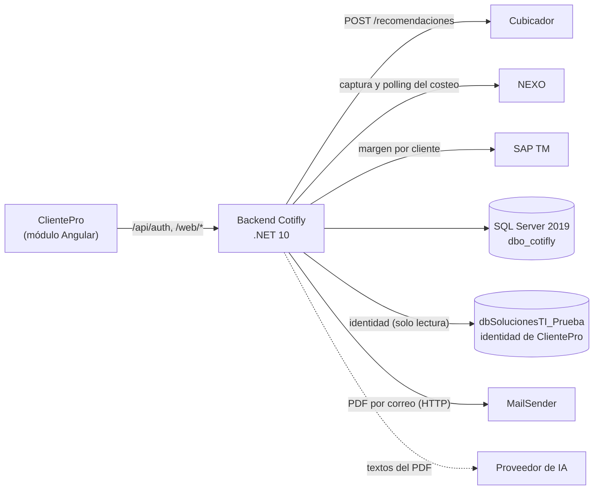

# Cotifly — Cotizador de fletes de Botero Soto

> **Estado:** vigente · **Dueño:** Duban Guerra (backend) · **Actualizado:** 2026-10-22

Cotifly es la herramienta con la que los comerciales de Botero Soto Soluciones Logísticas cotizan transporte de carga
por carretera. El comercial captura la solicitud en la consola web de **ClientePro** (por formulario o con el Excel de una
licitación); el **cubicador** recomienda los camiones de cada ruta; **NEXO** costea cada camión; el margen sale de
**SAP TM** o de la política de la línea de negocio; y el backend calcula el precio, arma el PDF y lo envía por correo a través
del microservicio interno **MailSender**.

El cálculo es determinista: lo hacen NEXO, SAP TM y el código. La IA solo redacta el asunto y la introducción del PDF y
propone ajustes que el comercial confirma; nunca recibe montos
([ADR-018](backend-dotnet/specs/decisiones/ADR-018-pipeline-determinista-ia-etapa-final.md)).

## Arquitectura



| Pieza | Qué hace | Dónde |
|---|---|---|
| Backend .NET 10 | Clean Architecture en un monolito modular (Dominio, Aplicación, Infraestructura, Api). Un solo contenedor | [`backend-dotnet/`](backend-dotnet/) |
| ClientePro | Portal corporativo. Autentica al comercial y aloja el módulo Angular de Cotifly (`clientepro-frontend`) | [Contrato de la API web](docs/docs_front/CONTRATO_API_WEB.md) |
| NEXO | Recibe la solicitud (una línea por camión), la costea y devuelve fletes y servicios conexos | [Contrato NEXO ⇄ Cotifly](backend-dotnet/docs/COTIFLY-CONTRATO.md) |
| Cubicador | Recomienda los camiones de cada ruta según la mercancía | [Conexión con el cubicador](backend-dotnet/docs/COTIFLY-COMO-CONECTARSE-AL-CUBICADOR.md) |
| SAP TM | Margen propuesto por cliente; si no responde, se usa la política de la línea | [Arquitectura](backend-dotnet/docs/02-arquitectura.md) |
| MailSender | Microservicio interno de correo: encola el correo con el PDF y lo entrega en segundo plano; Cotifly consulta su estado ([ADR-023](backend-dotnet/specs/decisiones/ADR-023-correo-mailsender-y-resultado-diferido.md)) | [Infraestructura](backend-dotnet/docs/03-infraestructura.md) |
| Base de datos | SQL Server 2019, esquema `dbo_cotifly`: solicitud → rutas → camiones | [`BASE_DE_DATOS.md`](BASE_DE_DATOS.md) |

## Cómo levantarlo en local

Solo hace falta Docker: la compilación, las pruebas y la API corren en contenedores. Desde la raíz del repositorio:

```powershell
# Windows (PowerShell): SQL Server 2019, esquema, identidad de prueba y API en http://localhost:8080
.\backend-dotnet\scripts\levantar-local.ps1
.\backend-dotnet\scripts\levantar-local.ps1 -Bajar        # detiene el entorno (conserva los datos)
```

```bash
# Linux, macOS o Git Bash
sh backend-dotnet/scripts/levantar-local.sh
sh backend-dotnet/scripts/levantar-local.sh --bajar
```

El script espera a que `GET /health/ready` responda 200. Los pasos, las variables y cómo compilar y correr las pruebas
están en [`backend-dotnet/docs/06-ejecucion-local.md`](backend-dotnet/docs/06-ejecucion-local.md).

## Estructura del repositorio

```
backend-dotnet/   Backend .NET 10: código, pruebas, contrato OpenAPI, escenarios BDD, ADR y documentación técnica
db/               Esquema dbo_cotifly: instalación desde cero, migraciones, ajustes y seeders
docker-compose.yml  Solo SQL Server local (servicios sqlserver y db-init) para probar los scripts de db/
docs/             Documentación funcional: base de datos, NEXO y cubicador, frontend, backlog y archivo
infra/            Manifiestos de Docker Swarm y Dokploy del backend .NET
scripts/          Utilidades del repositorio (verificador de enlaces de los .md)
.github/          Integración continua: build y pruebas del backend, enlaces de la documentación y la imagen base
```

## Documentación

| Para | Ver |
|---|---|
| Índice de toda la documentación, un documento por tema | [`docs/README.md`](docs/README.md) |
| Backend: descripción, arquitectura, API, pruebas y operación | [`backend-dotnet/README.md`](backend-dotnet/README.md) |
| Decisiones de arquitectura | [`backend-dotnet/specs/decisiones/README.md`](backend-dotnet/specs/decisiones/README.md) |
| Base de datos | [`BASE_DE_DATOS.md`](BASE_DE_DATOS.md) y [`db/README.md`](db/README.md) |
| Despliegue | [`DEPLOY.md`](DEPLOY.md) |

## Estado del proyecto

- **Backend .NET 10:** construido y probado (unitarias, integración con Testcontainers, API y BDD). Cubre el login SSO de
  ClientePro, la captura por formulario y por Excel de licitación, la cubicación con el cubicador (HU-023) con el vehículo
  elegido por el comercial como respaldo (HU-032, ADR-022), la edición de la solicitud ([ADR-021](backend-dotnet/specs/decisiones/ADR-021-edicion-de-la-solicitud.md)),
  el costeo en NEXO por rutas y camiones (HU-021) con el rechazo de líneas por la Mesa de Costeo (HU-028), el margen, el
  precio en COP o USD, el PDF, el correo por MailSender con su estado de entrega y el resultado ganada/perdida diferido a
  NEXO hasta que la Mesa entregue la cotización (HU-033, ADR-023), el asistente por folio y los tableros de métricas.
- **Despliegue:** el backend .NET todavía no está en producción. El staging en Dokploy (HU-006.6) y la ronda de regresión
  manual de QA están pendientes ([`DEPLOY.md`](DEPLOY.md) §1).
- **Base de datos:** el esquema vigente está en la base compartida de pruebas. Los scripts pendientes de aprobación del DBA
  están listados en [`db/README.md`](db/README.md#estado).
- **Pendientes con terceros:** las peticiones abiertas a NEXO y al cubicador están en
  [`docs/conexion_nexo/2026-10-08_CONSIDERACIONES_PARA_NEXO.md`](docs/conexion_nexo/2026-10-08_CONSIDERACIONES_PARA_NEXO.md).
- **Bot anterior:** el bot en Python (orquestador, servidor MCP y Google Chat) se retiró del repositorio en HU-022.1
  (#146). Su último estado está en el tag de git `python-final`.

El backlog vive en las milestones e issues de GitHub del repositorio `InnovacionIA-proyectos/Cotifly`.
