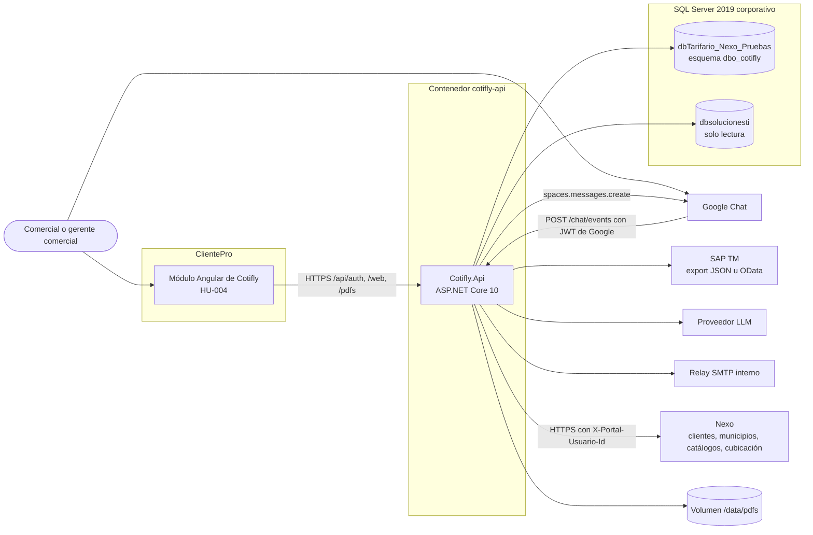
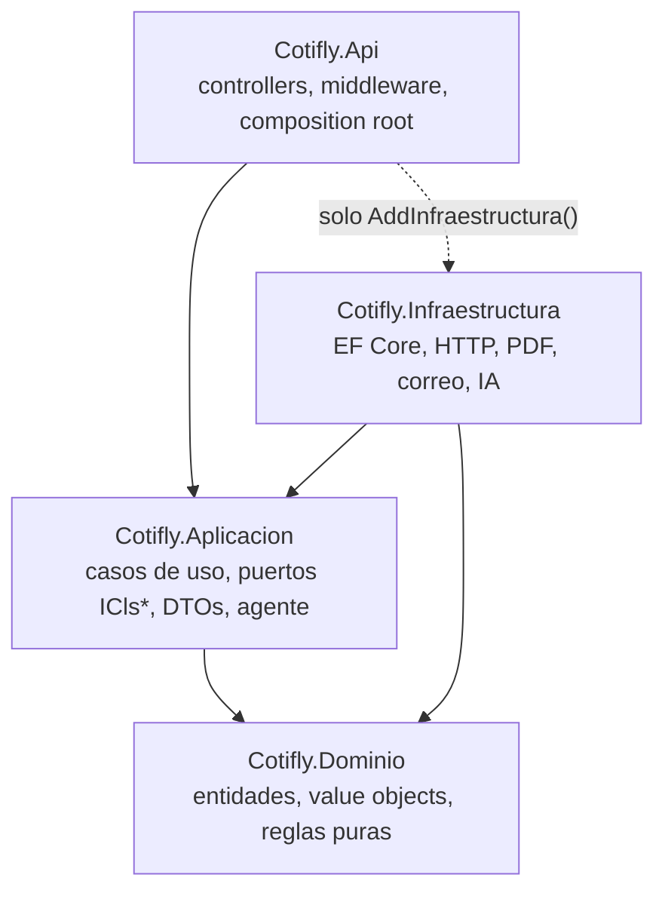
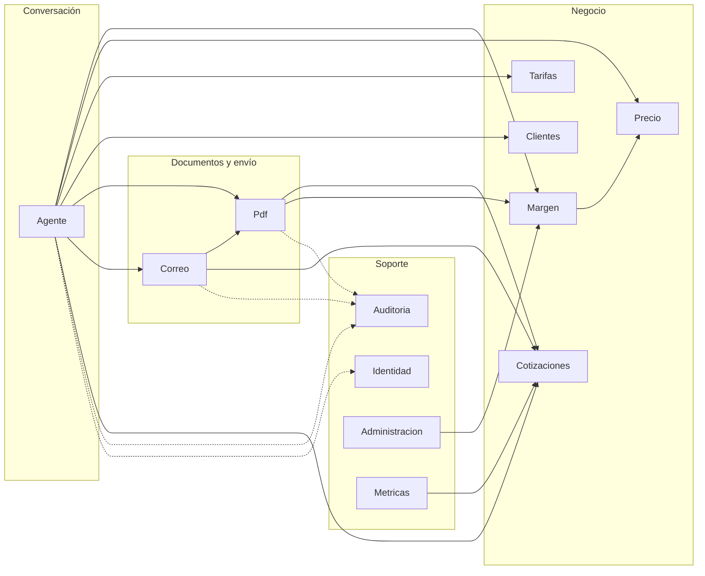
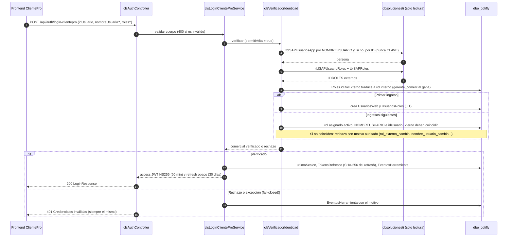
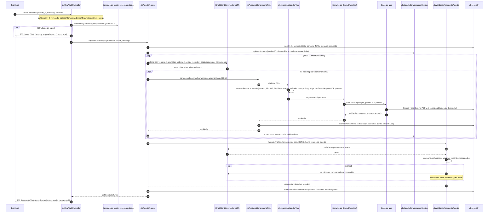
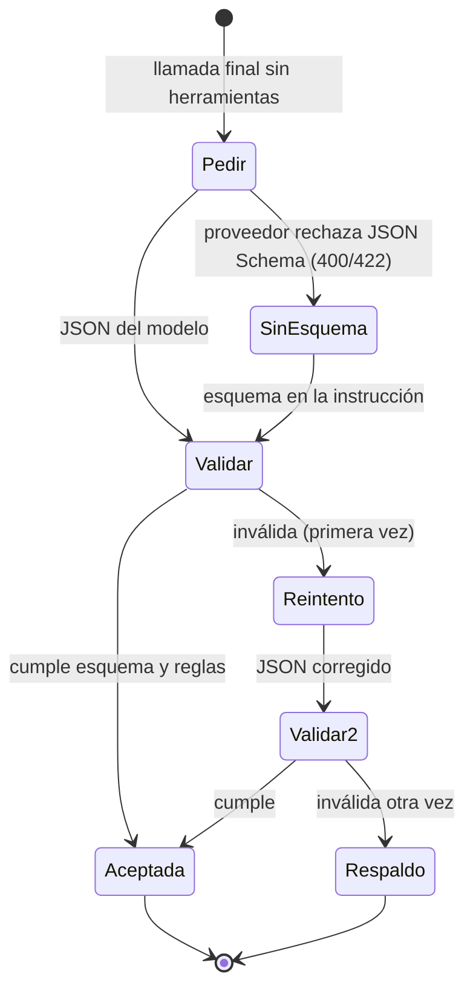

# 2. Arquitectura

Clean Architecture de 4 capas en un monolito modular ([ADR-002](../specs/decisiones/ADR-002-arquitectura-clean-monolito-modular.md)), con un agente de IA agnóstico al proveedor que solo redacta y elige herramientas ([ADR-003](../specs/decisiones/ADR-003-orquestacion-ia-agnostica.md)) sobre un estado de conversación estructurado ([ADR-004](../specs/decisiones/ADR-004-estado-conversacion-slot-filling.md)). Un solo proceso, `Cotifly.Api`, empaquetado en un solo contenedor ([ADR-007](../specs/decisiones/ADR-007-contenedores-sin-docker-compose.md)).

Contenido:

- [2.1 Vista de contexto](#21-vista-de-contexto)
- [2.2 Capas](#22-capas)
- [2.3 Módulos y carpetas](#23-módulos-y-carpetas)
- [2.4 Convenciones de nombres](#24-convenciones-de-nombres)
- [2.5 Modelo de dominio y persistencia](#25-modelo-de-dominio-y-persistencia)
- [2.6 Precio, margen y tarifas](#26-precio-margen-y-tarifas)
- [2.7 Fuentes de SAP TM](#27-fuentes-de-sap-tm)
- [2.8 PDF, correo y auditoría](#28-pdf-correo-y-auditoría)
- [2.9 Identidad: login SSO con verificación doble](#29-identidad-login-sso-con-verificación-doble)
- [2.10 API web](#210-api-web)
- [2.11 Agente de IA, /web/chat y Google Chat](#211-agente-de-ia-webchat-y-google-chat)
- [2.12 Turno de /web/chat de punta a punta](#212-turno-de-webchat-de-punta-a-punta)
- [2.13 Validador de la respuesta del agente](#213-validador-de-la-respuesta-del-agente)
- [2.14 Integración con Nexo](#214-integración-con-nexo)

## 2.1 Vista de contexto

Nexo está conectado para la búsqueda de clientes (HU-005.2, [ADR-005](../specs/decisiones/ADR-005-busqueda-clientes-desde-chat.md)), el catálogo de municipios (HU-005.13), los catálogos de flete (HU-005.3) y la cubicación rápida (HU-005.4), siempre que `Nexo__UrlBase` esté configurada ([2.14](#214-integración-con-nexo)). Siguen sin conectar el costeo de Nexo (HU-005.5 en adelante: `buscar_tarifa` responde `TARIFA_FUENTE_NO_DISPONIBLE`) y `DWCubosEBSSAP` (regional del comercial). Grovity no se integra en este backend: el alta de prospectos del formulario reutiliza el componente de `clientepro-frontend` contra el backend de ClientePro (corrección del 2026-09-27 en ADR-005); solo haría falta un adaptador si se aprueba usarlo desde el agente. Detalle de cada dependencia en [03-infraestructura](03-infraestructura.md#35-servicios-externos).

## 2.2 Capas

| Proyecto | Responsabilidad | Depende de |
|---|---|---|
| `Cotifly.Dominio` | Entidades, value objects, reglas puras, `clsResultado<T>`, `clsErrorDominio` | nada |
| `Cotifly.Aplicacion` | Casos de uso, puertos `ICls*`, DTOs, validadores | Dominio |
| `Cotifly.Infraestructura` | Adaptadores de los puertos (EF Core, HTTP, PDF, correo, IA) | Aplicacion, Dominio |
| `Cotifly.Api` | Controllers, middleware, composition root | Aplicacion; Infraestructura solo para `AddInfraestructura()` |

Las reglas de dependencia las verifica `Cotifly.Arquitectura.Tests` (ArchUnitNET y referencias de ensamblado): Dominio sin paquetes externos, Aplicacion sin Infraestructura ni Api, y la Api solo toca Infraestructura para registrar sus servicios.

## 2.3 Módulos y carpetas

Dominio, Aplicacion e Infraestructura tienen una carpeta por módulo: `Cotizaciones`, `Tarifas`, `Margen`, `Precio`, `Pdf`, `Correo`, `Auditoria`, `Identidad`, `Agente`, `Clientes`, `Administracion`, `Metricas`. Los catálogos del formulario que vienen de Nexo (`Municipios`, `CatalogosFlete`, `Cubicacion`) no tienen reglas de dominio: solo existen en Aplicacion (puerto y DTOs), Infraestructura (adaptadores) y Api (controller); no están en el diagrama porque no dependen de otros módulos ([2.14](#214-integración-con-nexo)). Api solo tiene carpetas de los módulos con endpoints en `specs/openapi.yaml`, más `Sistema/` (health). Además: `Comun/` para lo transversal, `Sesiones/` solo en Dominio y `Configuracion/` en Infraestructura. Mientras un módulo no tiene código, su carpeta solo contiene un `LEEME.md` con su propósito y subcarpetas (en inglés en todas las capas):

- Dominio: clases en la carpeta; si crece, `Entities/`, `ValueObjects/`, `Rules/`.
- Aplicacion: `DTOs/`, `Validators/`, `Services/`, `Repositories/` (puertos), `Interfaces/`.
- Infraestructura: `Repositories/`, `Services/`; `Persistence/` para el `DbContext` (el de `dbo_cotifly` en `Comun/Persistence/`, el de solo lectura de `dbsolucionesti` en `Identidad/Persistence/`).
- Api: `Controllers/`, `DTOs/`.

Las flechas son dependencias entre casos de uso dentro de Aplicacion; las punteadas son transversales (auditoría y resolución del comercial). Todos los módulos comparten `Comun/` (resultado, errores, reloj, calendario de negocio, unidad de trabajo).

## 2.4 Convenciones de nombres

**Convenciones de nombres** (ADR-002), exigidas por `.editorconfig` (IDE1006 con severidad `error`, rompe el build) y por `Cotifly.Arquitectura.Tests`:

| Símbolo | Regla | Ejemplo |
|---|---|---|
| Clases, records, clases estáticas, atributos, clases de prueba | `cls` + PascalCase | `clsCotizacionService`, `clsSecretoAttribute`, `clsResultadoTests` |
| Interfaces | `ICls` + PascalCase | `IClsCotizacionRepository` |
| Structs, enums, delegados | PascalCase | `EstadoEnvio` |
| Miembros no privados, constantes | PascalCase | `AhoraUtc`, `NombreServicio` |
| Campos privados (instancia y estáticos) | `_camelCase` | `_timeProvider` |
| Parámetros y variables locales | camelCase | `servicios` |
| Parámetros de tipo | `T` + PascalCase | `TValor` |
| Namespaces | file-scoped (IDE0161, error) | `namespace Cotifly.Dominio.Comun;` |

En los controllers la ruta siempre es explícita (`[Route("health")]`); nunca `[Route("[controller]")]`, porque el prefijo `cls` terminaría en la URL.

Única excepción: la clase `Program` que genera el compilador para las instrucciones de nivel superior (`Program.cs` suprime IDE1006 solo en su primera línea). En .NET 10 `Program` ya es pública, así que no se declara `public partial class Program`.

## 2.5 Modelo de dominio y persistencia

**Modelo de dominio y persistencia (#9).** Una entidad por tabla de `dbo_cotifly`, sin dependencias técnicas; setters privados, fábricas `Crear`/`Registrar`/`Emitir` que devuelven `clsResultado<T>` con las invariantes baratas (folio obligatorio ≤ 50, versión ≥ 1, TRM 0 en COP, márgenes ≥ 0 y < 1 solo con el método `margen` (`markup` admite ≥ 1, `clsReglaMargen`), correo con al menos un `para`, destinatario `para|cc`, hash SHA-256 de 64 hex...). Los enums se guardan con su código snake_case (`clsCodigoEnum`: `sin_enviar`, `politica_linea`, `gerente_comercial`), que es lo que exigen los CHECK del esquema.

| Tabla (`dbo_cotifly`) | Entidad (Dominio) | Puerto (Aplicacion) |
|---|---|---|
| `Cotizaciones` | `Cotizaciones/clsCotizacion` (+ `EstadoEnvio`, `clsDatosCotizacion`) | `IClsCotizacionRepository` |
| `MargenesPolitica` | `Margen/clsMargenPolitica` | `IClsMargenPoliticaRepository` |
| `SapMapeoTrqType` | `Margen/clsSapMapeoTrqType` | `IClsSapMapeoRepository` |
| `MargenAjustes` | `Margen/clsMargenAjuste` (+ `OrigenMargen`) | `IClsMargenAjusteRepository` |
| `Correos`, `CorreoDestinatarios` | `Correo/clsCorreo`, `clsCorreoDestinatario` (+ `EstadoCorreo`, `TipoDestinatario`) | `IClsCorreoRepository` |
| `Sesiones`, `EventosConversacion` | `Sesiones/clsSesion`, `clsEventoConversacion` (+ `EstadoSesion`) | `IClsSesionRepository` (en `Agente`) |
| `EventosHerramienta` | `Auditoria/clsEventoHerramienta` | `IClsAuditoriaRepository` |
| `UsuariosWeb` (+ `idUsuarioExterno`, script 0002) | `Identidad/clsUsuarioWeb` | `IClsUsuarioWebRepository` |
| `Roles`, `UsuariosRoles` (script 0002, #12) | `Identidad/clsRol`, `clsUsuarioRol` (+ `RolInterno`) | `IClsRolRepository` |
| `TokensRefresco`, `TokensRevocados` (script 0002) | `Identidad/clsTokenRefresco`, `clsTokenRevocado` | `IClsTokenRefrescoRepository`, `IClsTokenRevocadoRepository` (#12) |
| `Sesiones.estadoAgente` (JSON, script 0002) | `Agente/clsEstadoConversacion` (+ `clsCandidatoCliente`) | vía `clsSesion` |
| `dbsolucionesti.tblSAPUsuariosApp`, `tblSAPUsuarioRoles`, `tblSAPRoles` (solo lectura) | sin entidad de Dominio: filas internas de Infraestructura (sin `CLAVE`), DTOs `clsUsuarioExterno` y `clsRolExterno` en Aplicacion | `IClsAlmacenIdentidadExterno` (#12) |

Los repositorios solo agregan o modifican en memoria; `IClsUnitOfWork.GuardarCambiosAsync` confirma todo en una transacción y traduce las violaciones de unicidad a `clsViolacionUnicidadException` con código de negocio (`uq_cotizaciones_folio` → `FOLIO_DUPLICADO`). `OrigenCliente` vive en `Clientes`.

Base de datos, scripts de esquema y permisos: [03-infraestructura](03-infraestructura.md#33-base-de-datos) y [ADR-008](../specs/decisiones/ADR-008-persistencia-ef-core-database-first.md).

## 2.6 Precio, margen y tarifas

**Precio, Margen y Tarifas (#10, HU-003.4).** Port de `mcp_server/precio.py` y `mcp_server/margen/` con paridad verificada contra los tests del Python (tabla en [08-testing](08-testing.md)):

| Pieza | Capa | Qué hace |
|---|---|---|
| `Precio/clsCalculadoraPrecio` (+ `clsPrecioCalculado`) | Dominio | `margen`: costo / (1 − m), exige 0 ≤ m < 1; `markup`: costo × (1 + m), m ≥ 0. Precio a pesos enteros y utilidad a 2 decimales con `MidpointRounding.ToEven` sobre `decimal` (ADR-010 §6: paridad con Python salvo empates exactos de medio peso, donde .NET redondea el valor exacto y Python arrastra el error de `float`; diferencia máxima 1 peso, ~0,04 % de casos, ej. 55 con markup 0.1 → 60 y Python 61). Costo ≤ 0, m < 0, m ≥ 1 con `margen` o método desconocido → `PRECIO_INVALIDO` con los mensajes del Python |
| `Margen/clsReglasMargen` | Dominio | `Value` de SAP / 100 a 6 decimales, anomalía fuera de [0, 0.6], comparación de líneas sin tildes, mayúsculas ni espacios (`ALMACENAMIENTO 3PL` = `Almacenamiento3PL`) |
| `Margen/clsReglaMargen` | Dominio | Rango por método; ahora también lo usa `clsMargenAjuste` (con `markup` un ajuste ≥ 1 es válido), que además redondea ambos márgenes a 4 decimales (escala de la columna) antes de calcular la diferencia |
| `Comun/clsCodigosError` | Dominio | Códigos del esquema `ErrorNegocio` (verificados contra `openapi.yaml`) |
| `IClsPrecioService` / `clsPrecioService` → `clsSalidaPrecio` | Aplicacion | `calcular_precio`, salida `SalidaPrecio` `{precio, costo, margen, metodo, utilidad}` |
| `IClsMargenResolverService` / `clsMargenResolverService` → `clsMargenResuelto` (`Salida`: `clsSalidaMargen`) | Aplicacion | `obtener_margen`, mismo orden que el Python: línea → TrqType (`IClsSapMapeoRepository`, la organización específica gana al comodín) → si hay **BP** y TrqType, `IClsFuenteMargen` por (salesOrg, TrqType, BP) → `sap_tm`; sin BP no consulta SAP (ADR-004); sin BP, sin TrqType, sin registro o con la fuente no configurada → `politica_linea` con el motivo en `detalle`; sin política → `MARGEN_LINEA_DESCONOCIDA`; fuente configurada pero caída → `politica_linea` con el motivo "SAP TM no disponible" y un warning (decisión de #13; `MARGEN_FUENTE_NO_DISPONIBLE` solo si además la línea no tiene política). Devuelve además `LineaNegocioId`, `MargenPolitica` y `MetodoCalculo` para el estado (ADR-004) |
| `IClsAjusteMargenService` / `clsAjusteMargenService` → `clsSalidaAjusteMargen` | Aplicacion | Margen negociado: redondea a 4 decimales y valida por método (`AJUSTE_MARGEN_INVALIDO`, código nuevo agregado a `ErrorNegocio`; `PRECIO_INVALIDO` queda solo para el cálculo de precio), registra `MargenAjustes` con el comercial (`usuarioId`) y la cotización (debe ser suya; si no, `AJUSTE_COTIZACION_INVALIDA`), devuelve origen `negociado` y, si viene costo, el precio con el margen manual (sin recalcular la política) |
| `IClsFuenteMargen` (Strategy) / `clsOpcionesMargen` (`SapTm:SalesOrgDefault`, por defecto `50000005`) | Aplicacion | Puerto de SAP TM: devuelve el `Value` crudo (13.5 = 13,5 %) o `null`; el resolver lo divide por 100 una sola vez. Adaptadores `export_json` / `odata` en #13 (abajo) |
| `IClsTarifaProvider` | Aplicacion | Puerto de `buscar_tarifa` (el tarifario de Drive se retiró; el costeo viene de Nexo, HU-005) |
| `Margen/Services/clsFuenteMargenNoConfigurada` | Infraestructura | Fuente con `SapTm:Modo` vacío (valor por defecto): `EstaConfigurada = false` y devuelve `null` (no lanza); el resolver usa la política con el detalle "SAP TM no configurado: se usa la política de la línea" |
| `Tarifas/Services/clsTarifaProviderNoDisponible` | Infraestructura | Proveedor por defecto (`TryAdd`): `TARIFA_FUENTE_NO_DISPONIBLE`, "el costeo viene de Nexo (HU-005); mientras tanto el comercial ingresa el costo" |

Diferencias deliberadas con el Python: la línea se resuelve sin tildes ni espacios (la collation `CI_AS` distingue tildes); los textos de `detalle` son los del Python (`(cliente nuevo)`, `(sin registro en SAP TM)`, `Margen propuesto SAP TM para cliente X en OPTN: 13.5%`, con el `Value` tal como llega de SAP, igual que el `f"{value}%"` del Python, corregido en #13) salvo el caso sin BP (`cliente nuevo: sin BP de SAP, no se consulta SAP TM`, ADR-004) y los de SAP no configurado o no disponible; los márgenes del ajuste y su diferencia se redondean a 4 decimales (escala de `DECIMAL(9,4)`) y no a 6; el margen negociado se valida por método (el Python no validaba, código `AJUSTE_MARGEN_INVALIDO`) y un motivo vacío se registra como `Ajuste manual del comercial`; empates exactos de medio peso (ver arriba).

Las decisiones de negocio que siguen abiertas en este módulo están en [10-operacion](10-operacion.md#107-decisiones-pendientes). El orden de resolución del margen se muestra como diagrama en [04-flujo-del-sistema](04-flujo-del-sistema.md#45-resolución-del-margen).

## 2.7 Fuentes de SAP TM

**Fuentes de SAP TM (#13, HU-003.7).** Port de `mcp_server/margen/export_fuente.py`, `odata_fuente.py` y `construir_resolver`, con paridad verificada contra `test_export_*`, `test_odata_*`, `test_construir_resolver_*` y `test_conmutacion_export_a_odata_misma_salida` ([08-testing](08-testing.md)). Detalle operativo en [03-infraestructura](03-infraestructura.md).

| Pieza | Capa | Qué hace |
|---|---|---|
| `Configuracion/clsOpcionesSapTm` + `clsValidadorOpcionesSapTm` | Infraestructura | Misma sección `SapTm` que `clsOpcionesMargen`: `Modo` (`export_json` \| `odata` \| vacío), `ExportPath`, `Url`, `SapClient` (opcional, 3 dígitos), `User`, `Pass` (`[clsSecreto(LargoMinimo = 8, Opcional = true)]`). Valida al arrancar según el modo |
| `Margen/Services/clsFabricaFuenteMargen` | Infraestructura | `construir_resolver`: registra `IClsFuenteMargen` (transitorio, `TryAdd`) y elige el adaptador por `SapTm:Modo` al resolver |
| `Margen/Services/clsFuenteMargenExportJson` | Infraestructura | `export_json`: indexa `d.results` por (SalesOrgId, TrqType, OrderPartyId); singleton con caché que se recarga al cambiar la fecha o el tamaño del archivo; archivo ausente o malformado → `clsFuenteMargenNoDisponibleException` |
| `Margen/Services/clsFuenteMargenOData` | Infraestructura | `odata`: cliente HTTP tipado (`IHttpClientFactory`, nombre `SapTm`) con `AddStandardResilienceHandler` (10 s en total, 4 s por intento, 2 reintentos ante 5xx/408/429/red/timeout), Basic auth y `$filter` escapado; sin resultados → `null`; error → `clsFuenteMargenNoDisponibleException` |
| `Margen/Services/clsAvisosArranqueSapTm` | Infraestructura | `IHostedService` con avisos que no impiden arrancar: `Production` con `SapTm:Modo` vacío ("todos los márgenes salen de la política de la línea") y `export_json` cuyo archivo todavía no existe (se recoge en caliente cuando aparece) |
| `Margen/Services/clsFormatoRentabSap` (interno) | Infraestructura | Lectura común de `{"d":{"results":[...]}}`: identificadores como texto, `Value` como texto (`"13.5"`, formato OData v2 de `Edm.Decimal`) o número JSON |

Diferencias deliberadas con el Python:
- **SAP caído → política de la línea (decisión de #13).** El Python respondía `MARGEN_FUENTE_NO_DISPONIBLE` sin respaldo. .NET sigue el Gherkin de negocio de HU-009 ("Resiliencia si SAP no responde": cae a la política sin romper el flujo de cotización). El detalle dice "SAP TM no disponible: se usa la política de la línea" y queda un warning en el log. `MARGEN_FUENTE_NO_DISPONIBLE` sigue en el contrato, pero solo sale si SAP falla y además la línea no tiene política.
- **Detalle con el `Value` crudo:** `…en OPTN: 13.5%`, como el `f"{value}%"` del Python (en #10 se imprimía con 2 decimales fijos, `13.50%`).
- **Inyección en el filtro OData corregida:** el Python armaba `$filter` con un f-string sin escapar (un BP `15927' or 1 eq 1` cambiaba la consulta). .NET escribe cada valor como literal OData, con la comilla simple duplicada, y codifica el filtro para URL (`Uri.EscapeDataString`), así un valor no puede cerrar el literal ni agregar parámetros.
- **Modo por defecto vacío** (fuente no configurada, política de la línea), no `export_json` con el archivo de muestra; un modo desconocido no arranca (el Python caía a `export_json`).
- **Caché del export:** el Python leía el archivo una vez por proceso. .NET lo relee cuando cambia (fecha o tamaño revisados en cada consulta), sin TTL ni `FileSystemWatcher`, y descarta la caché si el archivo desaparece o queda ilegible: nunca sirve un export viejo.
- **Resiliencia:** el Python hacía un solo intento de 10 s; .NET reintenta los fallos transitorios dentro del mismo límite de 10 s y distingue la cancelación del llamador (se propaga) de una caída de SAP.
- **Validación:** `odata` exige `Url`, `User` y `Pass` (el Python aceptaba OData sin autenticación); el `Value` de un export o de una respuesta debe ser numérico. Una fila malformada invalida todo el export (en el Python salía una excepción de pydantic no controlada).
- **`SapTm:SapClient`** (nuevo, opcional, 3 dígitos): agrega `&sap-client=NNN` a la consulta OData. El Python no lo soportaba.
- **Logs:** un fallo de SAP deja una sola línea de warning (motivo, TrqType y organización) sin traza; la excepción completa queda en Debug, y los eventos de Polly de esta tubería (reintentos, timeouts) bajan a Debug (`TelemetryOptions.SeverityProvider` filtrado por el pipeline `SapTm-standard`).
- Los mensajes no incluyen la ruta del export ni credenciales; la ruta va al log.

## 2.8 PDF, correo y auditoría

**PDF, Correo y Auditoría (#11, HU-003.5).** Port de `mcp_server/pdf/` (`armar_cotizacion.py`, `armar_multi.py`, `generador.py`), `shared/almacen_pdf.py`, `mcp_server/correo.py` y `mcp_server/auditoria.py`. Casos de uso listos para los endpoints de #12 (`enviar`, `correo/vista-previa`, `destinatarios-previos`, `usuario/telefono`, `seguimiento`) y para las herramientas del agente (`generar_pdf`, `enviar_correo`):

| Pieza | Capa | Qué hace |
|---|---|---|
| `Pdf/DTOs/clsCotizacionPdfPayload` (+ `clsTarifaPayload`, `clsFilaTarifaPayload`, `clsServicioConexoPayload`...) | Aplicacion | Payload del PDF con el esquema de `ejemplo-solicitud.json` (snake_case, `clsJsonAplicacion.SnakeCase`). `comercial.nombre/email/cel` se ignoran (la firma sale de `UsuariosWeb`); `extra_css`/`dibujo_html` no existen (sin HTML). Nuevo: `servicios_conexos` (itemizado de "incluye") |
| `Pdf/Validators/clsValidadorCotizacionPdfPayload` + `Pdf/Services/clsTextoSeguro` | Aplicacion | Exige `linea_negocio` y al menos una fila de tarifa; largos máximos por campo; quita caracteres de control y de formato invisibles (el texto se inserta como texto: un `<script>` se imprime literal) → `PDF_PAYLOAD_INVALIDO` |
| `Pdf/Services/clsConstructorDocumentoCotizacion` → `clsDocumentoCotizacion` | Aplicacion | Reglas de `construir_html` sin maquetar: variante (`secciones` → multi), textos del payload o estándar (`clsTextosEstandar`, ambos juegos del Python), tarifa por fila (`tarifa` o costo/margen con `clsCalculadoraPrecio`), bloques condicionales (aduana solo si la línea empieza por "internacional", extradimensionada, refrigerada), imagen y leyenda por línea, nota de decretos, frase final y firma |
| `Pdf/Services/clsFormatoMoneda`, `clsFormatoFecha` | Aplicacion | `$3.294.798` / `US$1.200` / `—` (half-to-even, sin ICU ni cultura del proceso) y `Yumbo, 24 de septiembre de 2026` (meses propios; sin fecha, la de hoy en `Zona:ZonaHoraria` vía `IClsCalendarioNegocio`) |
| `IClsGenerarPdfService` / `clsGenerarPdfService` (+ decorador `clsGenerarPdfServiceAuditado`) → `clsSalidaPdf` | Aplicacion | `generar_pdf`: folio obligatorio de la entrada (lo genera el servidor, ADR-011; `^[A-Za-z0-9_-]+$`, ≤ 50) → payload → comercial en `UsuariosWeb` → línea con `IClsMargenResolverService.ResolverLineaAsync` (sin tildes, `MARGEN_LINEA_DESCONOCIDA` antes de renderizar, issue #44) → folio libre (`FOLIO_DUPLICADO`) → cotización válida en el dominio → coherencia con la trazabilidad (precio y moneda, ver abajo) → render (`PDF_RENDER_NO_DISPONIBLE`) → almacén sin reemplazar → fila en `Cotizaciones` (`lineaNegocioId`, costo, márgenes, precio, `origenMargen` incl. `negociado`, moneda/TRM, `usuarioId`, `spaceId`/`threadId`, `pdfPath`); si la base rechaza la fila se borra el PDF. Salida `SalidaPdf` `{cotizacion_id, folio, pdf_url, registrada_en_bd}` |
| `IClsGeneradorPdf` / `Pdf/Services/clsGeneradorPdfMigraDoc` (+ `clsBloquePortada`, `clsBloqueTarifa`, `clsBloqueCondiciones`, `clsBloqueFirma`, `clsEncabezadoPiePdf`, `clsEstilosPdf`/`clsDisenoPdf`) | Infraestructura | Maquetación con PDFsharp-MigraDoc 6.2.4 (ADR-006): A4, márgenes 34/16/30/16 mm (multi 34/14/28/14), logo, pie con `FOOTER_DIRS` y franja web, paleta `C`, 3 páginas en tarifa única y 2 en multi. Checklist de cobertura en ADR-006 |
| `Pdf/Services/clsResolvedorFuentes` (`IFontResolver`) + `clsRecursosPdf` | Infraestructura | Liberation Sans (normal, negrita, cursiva, negrita cursiva) embebida como recurso; cualquier familia pedida se resuelve a ella; viñetas con `•` propio. Logo y 7 imágenes por línea embebidos (ver [03-infraestructura](03-infraestructura.md)) |
| `IClsAlmacenPdf` / `Pdf/Services/clsAlmacenPdfVolumen` | Infraestructura | `Pdf:StorageDir` (por defecto `/data/pdfs`), nombres `^[A-Za-z0-9_-]+\.pdf$`, ruta siempre dentro de la carpeta, `GuardarNuevoAsync` nunca reemplaza (`FileMode.CreateNew`), lectura por referencia solo con el nombre del archivo. S3/MinIO no se porta (ADR-012) |
| `IClsCorreoService` / `clsCorreoService` (+ `clsCorreoServiceAuditado`, `clsCandadoEnvios`) | Aplicacion | `enviar_correo`: comercial autenticado (`CONFIRMACION_REQUERIDA`), `Correo:Habilitado` (`CORREO_DESHABILITADO`), destinatarios válidos (`CORREO_INVALIDO`), dueño (`COTIZACION_NO_ENCONTRADA`), deduplicación de 5 min contra envíos `enviado` al mismo conjunto de `para` sin distinguir mayúsculas (`CORREO_DUPLICADO`, regla movida del repositorio, ADR-008), PDF del almacén (`CORREO_PDF_NO_ENCONTRADO`), transporte (`CORREO_ENVIO_FALLIDO` + fila `fallido` con el error). Éxito: fila `enviado` con destinatarios y `estadoEnvio` `sin_enviar`→`enviada`, `enviada`/`reenviada`→`reenviada` (fix del bug del Python). Asunto por defecto `Cotización {folio} — Botero Soto`, cuerpo `_PLANTILLA` + HTML corporativo (`clsPlantillaCorreo`) |
| `IClsVistaPreviaCorreoService`, `IClsDestinatariosPreviosService` | Aplicacion | `VistaPreviaCorreo` (asunto, cuerpo, para/cc prediligenciados, adjunto) sin enviar nada; `Destinatarios` del último envío exitoso del comercial al NIT (`IClsCorreoRepository.ObtenerUltimoEnviadoAClienteAsync`) |
| `IClsTransporteCorreo` (Strategy) / `Correo/Services/clsTransporteSmtpRelay` (MailKit) | Aplicacion / Infraestructura | `smtp_relay`: texto plano, sin AUTH ni STARTTLS (como el relay `10.10.40.62`), `From`/`Reply-To`/`MAIL FROM` = comercial (o `FromFallback`), `RCPT TO` = para + cc, `multipart/mixed` (texto + HTML) con el PDF en base64, `Message-ID` `@boterosoto.com.co`; relay que rechaza destinatarios → mensaje para que TI autorice la IP. `wscorreos` y `smtp`: `clsTransporteCorreoNoImplementado` (D3) |
| `IClsAuditoriaService` / `clsAuditoriaService` | Aplicacion | `EventosHerramienta` en su propio ámbito de DI: herramienta, entrada y resumen JSON snake_case (máx. 4000 caracteres, `{"truncado":true,"preview":...}` si se pasa, siempre JSON válido para el CHECK `ISJSON`), éxito, duración, hilo. Nunca lanza. Los decoradores auditan `generar_pdf`, `enviar_correo` y `registrar_ajuste_margen` (también desde la web); el filtro del agente de #12 debe usar `RegistrarAsync` para el resto y omitir esas tres (`HerramientasAuditadasPorCasoDeUso`) |
| `IClsTelefonoComercialService` | Aplicacion (Identidad) | `GET/PUT /web/usuario/telefono`: patrón `^\+?[0-9 ]{7,20}$` (`TELEFONO_INVALIDO`), persiste en `UsuariosWeb.telefono`; vacío lo borra. Es el único origen del "Cel" del PDF |
| `IClsSeguimientoService` | Aplicacion (Cotizaciones) | Ganada/perdida con motivo (≤ 2000) y `marcadoAt`, solo del dueño. Sale de `IClsCotizacionRepository.MarcarSeguimientoAsync` (deuda de ADR-008) |
| `IClsCalendarioNegocio` / `Comun/clsCalendarioNegocio` | Aplicacion / Infraestructura | Fecha de hoy en `Zona:ZonaHoraria` (el contenedor corre en UTC); la usa también el folio de #12 |

Códigos nuevos en `ErrorNegocio` (`specs/openapi.yaml`): `FOLIO_DUPLICADO` (el Python versionaba el folio en silencio con `-v2`; en .NET el folio lo genera #12, ADR-011, y una colisión se informa), `CORREO_DESHABILITADO` y `CORREO_INVALIDO` (la herramienta `enviar_correo` lo devuelve tal cual).

**Coherencia de lo impreso (#11, ADR-003/ADR-004):** el folio es obligatorio en la entrada (lo genera el servidor; la `referencia` del payload se ignora). Con `PrecioFinal` en la trazabilidad, la tarifa impresa de cada fila y el precio calculado con costo y margen aplicado deben ser ese precio; filas y servicios conexos deben estar en la moneda de la cotización (HU-012.3). Si no, `PDF_PAYLOAD_INVALIDO`. El filtro de #12 sobrescribe los números del payload desde el estado (ADR-004). También se rechazan tarifas, costos y márgenes negativos, y `clsCotizacionPdfPayload.DesdeJson` devuelve `PDF_PAYLOAD_INVALIDO` (no lanza) ante JSON mal formado, tipos erróneos o sustitutos UTF-16 sueltos.

La traducción de estos códigos a HTTP en `/web/*` está en [07-api](07-api.md#74-errores).

El filtro de auditoría del agente no vuelve a auditar `generar_pdf`, `enviar_correo` ni `registrar_ajuste_margen` (ya los auditan sus decoradores; `clsAuditoriaService.HerramientasAuditadasPorCasoDeUso`).

**Destinatarios previos:** hoy devuelve solo los del último envío exitoso del comercial al NIT (es lo que dice `openapi.yaml`); el backlog habla de "los correos ya usados", así que queda por confirmar si se quiere la unión de todos los envíos. Sin `Nexo__UrlBase` (o con Nexo caído), `buscar_cliente` responde `CLIENTE_BUSQUEDA_NO_DISPONIBLE` (ADR-005), las cotizaciones del chat quedan con `nitCliente` nulo y no hay precarga.

Diferencias deliberadas con el Python:
- **Firma con datos reales:** nombre y correo de `UsuariosWeb` y "Cel" solo si `UsuariosWeb.telefono` tiene valor; el `comercial` del payload (LLM) solo aporta el cargo.
- **Sin HTML:** no hay inyección posible; `extra_css` y `dibujo_html` desaparecen. Los saltos de línea del texto se respetan (en HTML se colapsaban).
- **Folio:** no se versiona aquí (`FOLIO_DUPLICADO`); un PDF existente nunca se sobrescribe (el Python sobrescribía `{folio}.pdf`).
- **Línea de negocio:** se resuelve antes de renderizar y sin tildes (el Python perdía la cotización entera con "Distribución", issue #44).
- **Trazabilidad:** costo, márgenes, precio y origen llegan en `clsTrazabilidadCotizacion` desde el estado de la conversación, no del payload del LLM (`_datos_trazabilidad`).
- **Variante multi:** usa el prefijo `US$` de la moneda de cada fila (el `money()` de `armar_multi.py` lo ignoraba).
- **Almacén:** la lectura por referencia solo toma el nombre del archivo (el Python leía cualquier ruta local existente guardada en `pdfPath`).
- **Correo:** `estadoEnvio` pasa a `reenviada`; la deduplicación se serializa por cotización dentro del proceso; `wscorreos` y `smtp` no se portan hasta confirmar el transporte (D3); `Correo:Habilitado=false` por defecto responde `CORREO_DESHABILITADO` (el Python ocultaba la herramienta).
- **Incluye itemizado:** con `servicios_conexos` se lista el flete (origen y destinos) y cada servicio con su precio. Nexo (HU-005) todavía no entrega el costeo desglosado por servicio: mientras tanto los envía el agente o el formulario, y sin ellos queda el texto estándar.

## 2.9 Identidad: login SSO con verificación doble

**Identidad: login SSO ClientePro con verificación doble (#12, parte A, ADR-009).** `POST /api/auth/login-clientepro`, `/refresh` y `/logout` según `specs/openapi.yaml`:

| Pieza | Capa | Qué hace |
|---|---|---|
| `IClsAlmacenIdentidadExterno` / `Identidad/Services/clsAlmacenIdentidadSolucionesTi` (+ `clsIdentidadDbContext`) | Aplicacion / Infraestructura | Almacén corporativo de solo lectura: `BuscarUsuarioAsync` (idUsuario como `NOMBREUSUARIO` y, si no, como `ID` numérico) y `ObtenerRolesAsync` (`IDROLES` + `DESCRIPCION`). `ID` NUMERIC → `long` (y → `int` para `IDUSUARIO`) solo si cabe; nombre repetido, ID no entero o fila sin nombre = no encontrado; fallos de la base se propagan (fail-closed) |
| `clsVerificadorIdentidad` | Aplicacion | Verificación doble común al login y al refresh: persona en el almacén → roles externos traducidos con `Roles.idRolExterno` (con los dos gana `gerente_comercial`, regla auditada) → usuario por el `NOMBREUSUARIO` del almacén: primer ingreso crea `UsuariosWeb` + `UsuariosRoles` (JIT); después la asignación activa y el vínculo `idUsuarioExterno` deben coincidir, si no 401 con motivo (`rol_externo_cambio`, `nombre_usuario_cambio`, `sin_asignacion_activa`, `identidad_inconsistente`...) |
| `IClsLoginClienteProService` / `clsLoginClienteProService` | Aplicacion | Valida el cuerpo (`SOLICITUD_INVALIDA` → 400), verifica, actualiza `ultimaSesion`, emite access y refresh (familia nueva, 30 días) y audita (`login_clientepro`, hilo `auth/{idUsuario}`). Todo rechazo o excepción: `CREDENCIALES_INVALIDAS` → 401 genérico |
| `IClsRefreshTokenService` / `clsRefreshTokenService` | Aplicacion | Busca por SHA-256; reuso de un token rotado o revocado → revoca todos los refresh vigentes del usuario (salvo rotación de hace menos de 10 s: renovación concurrente); vuelve a verificar; rota de forma atómica heredando familia y vencimiento absoluto. Todo rechazo: `SESION_EXPIRADA` → 401 |
| `IClsLogoutService` / `clsLogoutService` | Aplicacion | Revoca la familia del refresh y el `jti` del access (en memoria al instante y en `TokensRevocados`); nunca falla hacia afuera (204) |
| `IClsRevocacionAccesos` / `clsCacheTokensRevocados` | Aplicacion | `jti` revocados en memoria + foto de `TokensRevocados` cada 60 s; sin foto de menos de 5 min, fail-closed |
| `IClsEmisorTokens`, `IClsConfiguracionJwt` / `clsEmisorTokensJwt`, `clsConfiguracionJwt` (+ `clsOpcionesJwt`) | Aplicacion / Infraestructura | JWT HS256 (`sub`, `jti`, `username`, `rol`, `iss`, `aud`, `iat`, `exp`; sin `nbf` desde la auditoría de #12: un reloj que salta entre instancias daba 401 intermitentes con tokens recién emitidos) con `JsonWebTokenHandler`; clave ≥ 32 bytes; sin clave fuera de Production, clave efímera con aviso |
| `clsTokenOpaco` | Aplicacion | Refresh de 32 bytes aleatorios en base64url (43 caracteres) y su SHA-256 hexadecimal |
| `IClsRolRepository`, `IClsTokenRefrescoRepository`, `IClsTokenRevocadoRepository` | Aplicacion / Infraestructura | Catálogo y asignaciones; rotación con `UPDATE` condicional en transacción (de dos simultáneas gana una), revocaciones por familia o usuario y purga con `ExecuteUpdate`/`ExecuteDelete` |
| `Identidad/Services/clsLimpiezaTokensHostedService` | Infraestructura | Purga horaria de `jti` vencidos y refresh vencidos hace más de un día; un fallo es un warning |
| `Identidad/Controllers/clsAuthController` | Api | `/api/auth/*` exactos al contrato: 200 `LoginResponse`, 400/401/429 con `ErrorWeb`; refresh con cuerpo inválido → 401 y logout siempre 204 (el cuerpo se lee sin la validación automática) |
| `Identidad/clsConfiguracionAutenticacion` (+ `clsPoliticas`, `clsOpcionesLimiteAuth`, `clsContextoUsuarioHttp`) | Api | `JwtBearer` (`MapInboundClaims=false`, `NameClaimType="username"`, `RoleClaimType="rol"`, emisor, audiencia, vigencia con 30 s de tolerancia, firma HS256), revocación en `OnTokenValidated`, 401/403 con `ErrorWeb`, políticas `Comercial` (comercial o gerente) y `GerenteComercial` para la parte B, `IClsContextoUsuario` desde los claims y límite de `/api/auth/*` por IP |
| `Comun/clsErrorWeb` | Api | `{"error": "..."}`; también la respuesta 400 de la validación automática de `[ApiController]` (en lugar de `ProblemDetails`) |

`/api/auth/*` serializa en camelCase salvo `user.nombre_completo` (así lo define el contrato), con nombres JSON explícitos en los DTOs de la Api. `ubicacion` sale `null` hasta que se cruce la regional con `DimEjecutivo`.

Secuencia del login ([ADR-009](../specs/decisiones/ADR-009-autenticacion-sso-clientepro.md)):

El refresh (`POST /api/auth/refresh`) repite la verificación doble sin alta antes de rotar el token, y Google Chat la repite en cada turno. Cada petición protegida pasa por `JwtBearer` y por la revisión del `jti` en `clsCacheTokensRevocados` (`OnTokenValidated`).

## 2.10 API web

**API web `/web/*` (#12, parte B).** Todos los endpoints de `specs/openapi.yaml` salvo `/web/chat` y `/chat/events` (parte C). Controllers delgados: toman el usuario del token (`IClsContextoUsuario`) y delegan en los casos de uso; los errores pasan por una sola tabla (`clsRespuestasWeb`, abajo).

| Pieza | Capa | Qué hace |
|---|---|---|
| `Cotizaciones/clsFolio` + `Cotizaciones/clsInicialesComercial` | Dominio | Folio del servidor ([ADR-011](../specs/decisiones/ADR-011-folio-e-identidad-google-chat.md), aceptada): `PCN-[{nitCliente}-]{INICIALES}-DDMMAAAA-{NNN}[-vN]` (p. ej. `PCN-DG-25092026-001`, `PCN-9000472281-DG-25092026-001-v2`). `Crear(fecha, iniciales, consecutivo, nit)` (iniciales de 2 letras A–Z, si no `FOLIO_INVALIDO`; NNN 001–999, si no `FOLIO_CONSECUTIVO_AGOTADO`; el NIT se guarda solo con sus dígitos, máximo 26 para que quepa `-v99` en 50 caracteres), `Desde(folio)` (interpreta el formato; un folio heredado como `PCN-DDMMAAAA` o sin iniciales conserva su base), `ConVersion(n)` (≥ 2, ≤ 50 caracteres). `clsInicialesComercial.Calcular(nombreCompleto, nombreUsuario)`: primera letra del primer nombre y del primer apellido (penúltima palabra con 3 o más), sin tildes, partículas (`de`, `del`, `la`, `las`, `los`, `y`), texto entre paréntesis o tras ` - ` ni iniciales abreviadas (`M.`); respaldo `nombreUsuario` sin dominio de correo; una palabra → sus 2 primeras letras; sin letras → `XX` |
| `IClsGeneradorFolioService` / `clsGeneradorFolioService` | Aplicacion | `CrearConFolioNuevoAsync(usuario, nit, crear)` y `CrearNuevaVersionAsync(usuario, cotizacionId, crear)`: calcula el folio y ejecuta `crear` (agrega la cotización con `version = folio.Version` y guarda) dentro de `IClsCandadoTransaccional`. Iniciales del comercial desde `UsuariosWeb` (inexistente → `ERROR_INTERNO`). Fecha de `IClsCalendarioNegocio` (America/Bogota). Consecutivo = mayor `NNN` del día entre todos los folios base con esas iniciales (con y sin NIT, de cualquier comercial) + 1: nunca está tomado, no hay bucle de huecos. Versión = máxima de la familia (`{base}` y `{base}-vN`) + 1. Lo usa `generar_pdf` del agente (parte C) |
| `IClsCandadoTransaccional` / `Comun/Persistence/clsCandadoTransaccionalSql` | Aplicacion / Infraestructura | Transacción `ReadCommitted` en el `DbContext` del ámbito + `sp_getapplock` (`Exclusive`, dueño `Transaction`, espera máxima 15 s → `TimeoutException`). Confirma si el resultado es exitoso; deshace (y limpia el `ChangeTracker`) si es un fallo o si lanza. No se anida. Recursos: `cotifly:folio:DDMMAAAA:INICIALES` (uno por iniciales y día) y `cotifly:folio-version:{base}` |
| `IClsMisCotizacionesService`, `IClsNuevaVersionService` (+ `clsCotizacionResumen`, `clsDatosNuevaVersion`) | Aplicacion | Listado del comercial (máx. 100, JOIN con `MargenesPolitica` para `linea_negocio`, `pdf_url` con `clsUrlPdf`) y datos para prellenar una versión nueva (solo lectura) |
| `IClsDescargaPdfService` | Aplicacion | `GET /pdfs/{archivo}`: nombre `^[A-Za-z0-9_-]+\.pdf$` que debe ser el PDF guardado de la cotización con ese folio; dueño, o `gerente_comercial` de la misma regional (si la regional del gerente es nula se niega: fail-closed, solo el dueño; auditoría de #12, F1). Todo acceso de alguien que no es el dueño, permitido o no, se audita (`descargar_pdf`) |
| `IClsLineasNegocioAdminService` | Aplicacion | HU-004.9 (#41): lista y edita margen (0–0,99), método (`margen` o `markup`) y estado; revalida el rol `gerente_comercial` en el caso de uso; `clsMargenPolitica.Actualizar` aplica `clsReglaMargen`; audita cada intento (`admin_actualizar_linea_negocio`, con quién, lo pedido y `antes`/`despues`) |
| `IClsMetricasService` / `IClsMetricasRepository` (`clsMetricasRepository`) | Aplicacion / Infraestructura | HU-010.1 (borrador): `Database.SqlQuery` sobre `vActividadPorComercial` y `vAjustesMargenPorComercial` + JOIN `UsuariosWeb` (`nombre_completo`). Comercial: su fila; gerente: los comerciales de su regional (`UsuariosWeb.regional`); gerente con regional nula: solo su fila. Las vistas no se mapean como entidades sin clave para no mezclarlas con la prueba de deriva de tablas |
| `Comun/clsJsonWeb` (`clsJsonSnakeCaseAttribute`, `clsFormateadorEntradaWeb`, `clsFormateadorSalidaWeb`) | Api | Serialización por grupo (ADR-002): un par de formateadores System.Text.Json snake_case al inicio de la lista de MVC que solo aceptan endpoints con `[clsJsonSnakeCase]`; lo lleva `clsControladorWebBase`, así todo `/web/*` lee y escribe snake_case (nulos siempre escritos, números estrictos: `"0.2"` es un cuerpo inválido) y `/api/auth/*`, `/health` y `/pdfs` no cambian |
| `Comun/clsRespuestasWeb` (+ `clsErrorNegocioWeb`, `clsControladorWebBase`) | Api | Tabla única de errores (abajo); base de los controllers de `/web/*` con `[ApiController]`, `[clsJsonSnakeCase]` y la política `Comercial` |
| `Comun/clsSeguridadHttp` | Api | CORS (`Cors:OrigenesPermitidos`), `UseForwardedHeaders` configurable para Traefik, encabezados de seguridad, `Cache-Control: no-store` en `/web/*` y `/pdfs/*` y límite del cuerpo de `/web/*` (64 KB, 413). Opciones en [03-infraestructura](03-infraestructura.md) |
| Controllers `Cotizaciones/`, `Correo/`, `Clientes/`, `Municipios/`, `CatalogosFlete/`, `Cubicacion/`, `Identidad/clsUsuarioController`, `Administracion/`, `Metricas/`, `Pdf/` | Api | Rutas exactas del contrato ([07-api](07-api.md)). Administración con `[Authorize(Policy = GerenteComercial)]` además de la base |

La tabla de errores de `/web/*` (`clsRespuestasWeb`) está en [07-api](07-api.md#74-errores).

Decisiones de la parte B:
- **Candado del folio por iniciales y día** (`cotifly:folio:DDMMAAAA:INICIALES`): el folio lleva las iniciales del comercial (decisión del 2026-09-25), así que solo compiten quienes comparten iniciales. Dos comerciales con las mismas iniciales comparten el consecutivo del día (`001` y `002`) y nunca chocan con `uq_cotizaciones_folio` (documentado en ADR-011). La regla de iniciales parte de `DESCRIPCIONUSUARIO` (vía `UsuariosWeb.nombreCompleto`) y tiene limitaciones conocidas (orden nombre y apellido, texto agregado, abreviaturas); **pendiente** revisar una muestra real de `tblSAPUsuariosApp.DESCRIPCIONUSUARIO` antes de producción (Duban con el DBA). El folio sin iniciales de la primera implementación (`PCN-[nit-]DDMMAAAA-NNN`) queda como **heredado**: se muestra y se puede versionar, pero no cuenta para el consecutivo.
- **Rol `gerente_comercial` en la consola:** la política `Comercial` admite ambos roles (decisión de la parte A: el gerente también cotiza). `docs/CONTRATO_API_WEB.md` decía que un gerente recibía 403 en los endpoints de comercial; se corrigió.
- **Vista de actividad:** `num_cotizaciones_enviadas` debía contar `enviada` y `reenviada` (contrato) y la vista del 0001 solo contaba `enviada`: la corrige `db/migrations_mssql/0003_metricas_reenviadas.sql` (`CREATE OR ALTER VIEW`, pendiente de aprobación como el 0002).
- **Firma del JWT sin caché global de proveedores** (ajuste sobre la parte A): el emisor usa una sola clave y la validación desactiva `CacheSignatureProviders`. Con varias instancias de la API en un proceso (pruebas en paralelo) aparecían 401 intermitentes con tokens recién emitidos; el patrón coincide con la caché de proveedores de firma de Microsoft.IdentityModel. `OnAuthenticationFailed` deja una línea Information con el tipo y el mensaje del rechazo.
- **HU-004.9, "el comercial solo ve líneas activas":** hoy no hay ningún endpoint de comercial que liste líneas (el catálogo del formulario no está en el contrato); cuando exista debe filtrar `isActive = 1`.

## 2.11 Agente de IA, /web/chat y Google Chat

**Agente de IA, `/web/chat` y Google Chat (#12, parte C, ADR-003, ADR-004, ADR-005, ADR-011).** Port de `orquestador/agente.py`, `prompt.py`, `sesiones.py`, `web.py` (`web_chat`, `_datos_de`), `webhook.py`, `gchat.py`, `worker.py`, `procesador.py`, `publicador.py`, `cards.py` y `alertas.py`, con las herramientas de `mcp_server/server.py` sobre los casos de uso de #10, #11 y #12:

| Pieza | Capa | Qué hace |
|---|---|---|
| `Agente/Services/clsAgenteRunner` (`IClsAgenteRunner`) | Aplicacion | Turno del agente: sesión `spaceId`/`threadId` ligada al comercial (otro usuario → `NO_ENCONTRADO`, 404), mensaje registrado primero, prompt de sistema, historial con ventana, loop manual hasta `IA:MaxIteraciones` sobre `IChatClient` (sin `UseFunctionInvocation()`), cada herramienta con `kernel.InvokeAsync` (corren los filtros), `HERRAMIENTA_DESCONOCIDA` como resultado si el modelo pide una que no existe, respuesta final en una llamada aparte sin herramientas que pide y valida `IClsValidadorRespuestaAgente` (#16), eventos y estado guardados al final (la sesión se relee: el candado del folio puede limpiar el seguimiento de cambios). Devuelve `clsResultadoTurno` (texto, iteraciones, herramientas, salidas y, desde #16, la respuesta estructurada, los reintentos y si fue el respaldo) |
| `Agente/Herramientas/clsHerramientasCotizador` | Aplicacion | Plugin `cotizador` de Semantic Kernel (`[KernelFunction]`): `buscar_cliente(nombre)`, `buscar_tarifa(lineaNegocio, origen, destino, tipoVehiculo?, tipoCarga?, pesoKg?)`, `obtener_margen(lineaNegocio, cliente?)`, `calcular_precio(costo, margen, metodo)`, `registrar_ajuste_margen(margenAplicado, motivo?)`, `generar_pdf(cotizacion)` (folio de `clsGeneradorFolioService`: nuevo, o versión nueva si la conversación ya generó una; trazabilidad desde el estado), `enviar_correo(para, asunto?, cuerpo?, cc?)` (solo se declara con `Correo:Habilitado=true`) y `consultar_cotizacion(folio?, cliente?)` (solo las del comercial). Devuelven `clsResultadoHerramienta`: la salida del contrato (`SalidaPrecio`, `SalidaMargen`, `SalidaPdf`...) o `{"error": {codigo, mensaje, detalle?}}` |
| `Agente/Filtros/clsInyeccionEstadoFilter` | Aplicacion | `IFunctionInvocationFilter` (ADR-004 §4): sobrescribe `usuarioId`, `spaceId`, `threadId`, `nitCliente`, `origenCliente`, `bpCliente`, `lineaNegocioId`, `cotizacionId` y `folio` en todas las herramientas; el BP del estado es el cliente de `obtener_margen` (sin cliente confirmado, ninguno); margen y método del estado en `calcular_precio` (sin margen resuelto → `PRECIO_INVALIDO`) y el costo si vino de `buscar_tarifa`; referencia, costo y método en `registrar_ajuste_margen`; en `generar_pdf` exige la confirmación del turno y un cliente sin candidatos pendientes (`CONFIRMACION_REQUERIDA`) y un precio calculado, y reescribe el payload (línea canónica, método, cliente confirmado; cada fila con tarifa = precio final, costo y margen del estado y la moneda de la cotización; quita `referencia`, trazabilidad y servicios conexos); en `enviar_correo` exige la confirmación o que el comercial haya escrito los destinatarios. Si el LLM mandó otro valor, queda en el log |
| `Agente/Filtros/clsAuditoriaHerramientaFilter` | Aplicacion | `EventosHerramienta` de cada herramienta con la entrada ya inyectada. No repite `generar_pdf`, `enviar_correo` ni `registrar_ajuste_margen` cuando llegaron a su caso de uso (los auditan sus decoradores, `HerramientasAuditadasPorCasoDeUso`), pero sí registra sus rechazos del orquestador. Va por fuera del filtro de inyección |
| `Agente/Services/clsEstadoConversacionService` | Aplicacion | Único que cambia `clsEstadoConversacion` (ADR-004 §3). Con salidas exitosas: `buscar_cliente` exacta → NIT, nombre, origen y BP; varias (o ninguna) → candidatos; `CLIENTE_BUSQUEDA_NO_DISPONIBLE` (Nexo sin configurar o caído) → el texto solo como referencia, sin NIT; `buscar_tarifa` → ruta y costo de la fuente; `obtener_margen` → línea, id, márgenes y método (anula un precio anterior); `calcular_precio` → precio y previsualización pendiente; ajuste → `negociado`; `generar_pdf` → cotización, folio y versión. Con el mensaje del comercial: elección de un candidato por NIT, nombre o posición, y confirmación explícita ("Confirmo", "sí", "dale"...) solo si hay una previsualización pendiente |
| `Agente/Services/clsPromptSistema` + `Agente/Recursos/prompt_cotizador.md` | Aplicacion | Port de `SYSTEM_COTIZADOR` como recurso embebido, precedido de "# Contexto del comercial" (nombre y correo de `UsuariosWeb`, fecha de negocio) y "# Estado resuelto" (informativo; la fuente de verdad es el filtro). Corrige la contradicción del folio (el Python pedía una `referencia` "nunca PCN" que el MCP usaba como folio): el folio lo genera el servidor y el LLM no escribe números ni identificadores |
| `Agente/Services/clsVentanaHistorial` | Aplicacion | Ventana por tokens (~4 caracteres por token, `Sesiones:LimiteTokens`) que conserva el primer mensaje y el actual |
| `Agente/Interfaces/IClsValidadorRespuestaAgente` + `Agente/Services/clsValidadorRespuestaAgente`, `clsReglasRespuestaAgente`; `Agente/DTOs/clsRespuestaAgenteEstructurada` | Aplicacion | Validador de la respuesta final (#16, HU-003.10, equivalente .NET de *Instructor*; ADR-003 "Implementación (#16)"): llamada final sin herramientas con `ChatResponseFormat.ForJsonSchema` (esquema `respuesta_agente` generado con `AIJsonUtilities`: `tipo` conversacional \| previsualizacion \| confirmacion_requerida \| error, `texto` 1–4000, `requiere_confirmacion`, `acciones_sugeridas` confirmar_pdf \| ajustar_margen o null) y validación manual (JSON completo, campos desconocidos o faltantes, tipos, enums, largos, coherencia, acciones con previsualización pendiente y herramienta declarada, montos y folios respaldados por las herramientas, el estado o el comercial). Un reintento con mensaje de corrección; si vuelve a fallar, respaldo `{tipo: error}` con `clsTextosAgente.RespuestaNoEstructurada` → en la web `RespuestaChat` con el PDF/precio/margen del turno si los hubo (texto de respaldo) o `200 {texto, error: true}` si no; en Chat texto sin botones. `IA:SoportaJsonSchema=false` o un proveedor que rechaza el esquema (HTTP 400/422 que nombra `response_format`/`json_schema`) → llamada sin formato con el esquema en la instrucción durante `IA:MinutosSinJsonSchema` y luego re-sonda. Medidor `Cotifly.Agente` por `IMeterFactory` (inválidas por motivo, reintentos, respaldos, esquema rechazado; `dotnet-counters monitor --process-id <pid> --counters Cotifly.Agente`, sin exportador: se evalúa en HU-006, ver [10-operacion](10-operacion.md#103-métricas)); logs solo con los códigos. `TryAdd` |
| `Agente/Services/clsParserEventoChat`, `clsTarjetasChat`, `clsProcesadorEventoChat` | Aplicacion | Parseo de eventos clásicos y add-on (incluidos los clics en los botones de la tarjeta) y acuses; tarjetas de previsualización (botones "Confirmar y generar PDF" y "Ajustar margen"), del PDF (enlace firmado) y de alerta; procesamiento: identidad por `UsuariosWeb.email` (sin cuenta → "Ingresa primero a Cotifly desde ClientePro." y no se cotiza), turno, publicación en el hilo y aviso del fallo en el hilo |
| `Clientes/Interfaces/IClsBuscadorClientes` / `Clientes/Services/clsBuscadorClientesNexo`, `clsBuscadorClientesNoDisponible` | Aplicacion / Infraestructura | Puerto de `buscar_cliente` (ADR-005) y de `GET /web/clientes?q=` (HU-005.2), con el `UsuariosWeb.id` del comercial (del estado de la conversación en el agente). `clsFabricaBuscadorClientes` elige el adaptador de Nexo si `Nexo__UrlBase` está configurada y, si no, el que responde `CLIENTE_BUSQUEDA_NO_DISPONIBLE` (`TryAdd`). Detalle en [2.14](#214-integración-con-nexo) |
| `Pdf/Services/clsDescargaPdfFirmadaService` + `IClsFirmaUrlPdf` / `Pdf/Services/clsFirmaUrlPdfHmac` | Aplicacion / Infraestructura | `GET /pdfs/{archivo}?t=...` (ADR-011 §3): HMAC-SHA256 sobre archivo, comercial y vencimiento (`Pdf:MinutosUrlFirmada`, 15), comparación de tiempo constante; solo el dueño |
| `IA/Services/clsChatClientFactory`, `clsChatClientConRespaldo`, `clsLimitadorRpm` (+ `clsChatClientLimitado`, `clsChatClientNoConfigurado`) | Infraestructura | `IChatClient` por `IA:Proveedor` (ver [03-infraestructura](03-infraestructura.md)), respaldo ante 429, 5xx, red caída o tiempo agotado (`IA:Fallbacks`), límite de `IA:Rpm` y `UseLogging`; sin proveedor, un cliente que falla con un mensaje claro |
| `Agente/Services/clsVerificadorJwtGoogleChat`, `clsTokenCuentaServicioGoogle`, `clsPublicadorGoogleChat`, `clsColaEventosChat`, `clsWorkerEventosChat`, `clsBarridoSesionesHostedService` | Infraestructura | JWT de Google (RS256 contra los certificados x509 de `chat@system.gserviceaccount.com`, en caché y releídos ante un `kid` nuevo; emisor y audiencia `GChat:ProjectNumber`); token OAuth de la cuenta de servicio (JWT-bearer, RFC 7523); `spaces.messages.create` con `REPLY_MESSAGE_FALLBACK_TO_NEW_THREAD`; cola `Channel<T>` acotada; worker con un ámbito por evento que sobrevive a los fallos y alerta a `GChat:SupportSpace`; barrido de sesiones inactivas |
| `Agente/Controllers/clsChatWebController`, `clsChatEventosController`; `Pdf/Controllers/clsPdfController` | Api | `POST /web/chat` (política `Comercial`, límite `LimiteChat`, `sesion_id` validado, 404 si la sesión es de otro, 200 `{texto, error: true}` ante un fallo, con los textos del Python); `POST /chat/events` (anónimo, JWT de Google, acuse inmediato, 400 si no es JSON); `/pdfs` con Bearer o `?t=` |

Decisiones de la parte C:
- **Carpetas:** `Aplicacion/Agente/` suma `Herramientas/` (plugin de Semantic Kernel), `Filtros/` (`IFunctionInvocationFilter`) y `Recursos/` (prompt embebido) a las de la convención; Infraestructura suma `IA/Services/` (ADR-003: solo ahí se conocen los SDK de los proveedores).
- **`KernelFunction` como declaración, no `AsAIFunction()`:** en Semantic Kernel 1.80 `KernelFunction.AsAIFunction()` está obsoleta ("usa la función directamente") y, usada como `AITool`, la función se llama `cotizador_<nombre>`. El runner declara al modelo `AIFunctionFactory.CreateDeclaration(nombre, descripción, esquema)` de cada `KernelFunction` (el modelo ve `buscar_tarifa`, como en el Python) y siempre ejecuta con `kernel.InvokeAsync`: solo declaración, nunca invocación automática.
- **Respuesta final en una llamada aparte, siempre** (ADR-003): el texto del loop se descarta y cada turno cuesta una llamada más, a cambio de un solo camino de validación (#16: JSON Schema, validación manual, un reintento y respaldo).
- **Confirmación explícita por turno:** el PDF y el correo solo salen en el turno en que el comercial confirma una previsualización ya mostrada (o, para el correo, escribe los destinatarios). Un "sí" sin previsualización no confirma nada; elegir un cliente candidato no confirma el PDF.
- **Costo:** mientras no haya Nexo (`buscar_tarifa` responde `TARIFA_FUENTE_NO_DISPONIBLE`), el costo que escribe el comercial llega del mensaje a `calcular_precio`; un costo de la fuente siempre gana. Margen y método nunca salen del LLM.
- **Margen de referencia de un ajuste:** el que propuso `obtener_margen` (`MargenSugerido`, campo nuevo del estado junto con `FuenteCosto`); `Cotizaciones.margenPolitica` guarda la política de la línea.
- **Servicios conexos en el chat:** se quitan del payload hasta que Nexo entregue sus precios (el LLM no pone números).
- **Google Chat:** un hilo de otro comercial recibe "abre un hilo nuevo"; los clics en los botones de la tarjeta se vuelven "Confirmo" / "Quiero ajustar el margen." (el Python los ignoraba); `GChat:SaJson` acepta el JSON o la ruta al archivo (secreto de Docker).
- **Sin Google.Apis.Auth:** el token de la cuenta de servicio y la verificación del JWT se hacen con `Microsoft.IdentityModel.JsonWebTokens` (ya presente). `Google.Apis.Auth` (Apache-2.0) arrastra Newtonsoft.Json y System.Management, y su `GoogleCredential.FromJson` está obsoleta.

Correcciones de la validación y la auditoría de #12 (en el mismo PR):
- **Costo manual escrito por el comercial:** `calcular_precio` solo acepta un costo que no viene de la fuente si el número aparece en el mensaje del turno (`clsNumerosDelMensaje`: `2.850.000`, `2,850,000`, `2,85 millones`...) o es el que el comercial ya dio antes; si no, `PRECIO_INVALIDO` pidiendo el costo.
- **Destinatarios del correo:** sin confirmación, deben estar en el mensaje del turno; con "Confirmo", en algún mensaje del comercial en la conversación. Nunca de datos externos.
- **Un turno a la vez por sesión:** `IClsCandadoSesion` / `clsCandadoSesionSql` (`sp_getapplock` con dueño `Session`, recurso `cotifly:sesion:{spaceId}:{threadId}`, conexión propia sin pool, espera `Sesiones:EsperaTurnoSegundos` = 3). Si otro turno sigue en curso: `/web/chat` responde 200 `{texto, error: true}` ("Todavía estoy respondiendo tu mensaje anterior...") y Google Chat publica ese texto en el hilo. Vale entre réplicas.
- **Nueva versión desde el frontend:** `cotizacion_origen_id` (opcional) en `MensajeWeb`; tras validar el dueño (`ObtenerPorIdDelUsuarioAsync`) siembra el estado (cotización, folio, cliente, línea, números) y `generar_pdf` crea `{folio base}-vN`. Solo en una sesión nueva o sin cotización en curso.
- **Cotización en curso descartada:** si cambia el cliente (NIT o referencia), la línea o la ruta, el estado olvida `CotizacionId`, `FolioEnProgreso` y `Version`: la siguiente cotización es nueva, no una `-vN` de otra.
- **Google Chat con verificación doble:** además del email, cada turno pasa por `IClsVerificadorIdentidad` (`permitirAlta: false`); si el rol externo ya no coincide con la asignación activa, "Ingresa primero a Cotifly desde ClientePro." y un evento `google_chat_identidad`.
- **Production:** `GChat:VerificarJwt=false` no arranca, y con Google Chat configurado `Pdf:ClaveFirmaUrl` es obligatoria (`clsValidadorOpcionesGoogleChat`).
- **Contexto de `docker build`:** `.dockerignore` excluye `**/*.md`; la excepción `!src/**/Recursos/*.md` deja entrar el prompt embebido (sin ella, CS1566). `Cotifly.Arquitectura.Tests/clsContextoDockerTests` evalúa el `.dockerignore` real con las reglas de Docker contra cada `EmbeddedResource`/`None`/`Content` de los `.csproj` de `src/`: se eligió así (y no prohibir recursos `.md`) porque protege cualquier extensión y cualquier regla futura.
- **Auditoría del login:** un rechazo por `rol_externo_cambio` (y los demás con usuario existente) lleva el id interno del usuario.

Diferencias deliberadas con el Python:
- El historial entre turnos sigue siendo de texto, pero lo resuelto viaja en el estado (ADR-004): el hallazgo del cliente perdido entre turnos queda cubierto por `chat_slot_filling.feature`.
- El folio no lo escribe el LLM (ADR-011) y la `referencia` del payload se descarta.
- La ventana del historial conserva también el mensaje actual; el Python podía descartarlo.
- `enviar_correo` exige la confirmación o los destinatarios escritos por el comercial (el Python confiaba en el `confirmado_por` que mandaba el LLM).
- `consultar_cotizacion` solo lista las cotizaciones del comercial (el Python ignoraba `comercial` y listaba todas).

## 2.12 Turno de /web/chat de punta a punta

Un mensaje del comercial en la consola web recorre la API, el candado de la sesión, el loop de herramientas con sus filtros y el validador de la respuesta final. Google Chat usa el mismo `IClsAgenteRunner` desde el worker (ver [04-flujo-del-sistema](04-flujo-del-sistema.md#46-google-chat)).

Puntos de control del diagrama:

- **Los números nunca salen del LLM.** El filtro de inyección reemplaza los argumentos con el estado de la conversación y el estado solo cambia con salidas exitosas de herramientas o con el mensaje del comercial (ADR-004).
- **Confirmación humana.** `generar_pdf` y `enviar_correo` solo corren en el turno en que el comercial confirma una previsualización ya mostrada (o escribe los destinatarios).
- **Un turno a la vez por conversación**, también entre réplicas (`sp_getapplock` con dueño de sesión).
- **Fallos del proveedor** (429, 5xx, red, tiempo agotado) pasan primero por los respaldos de `IA:Fallbacks`; si se agotan, `/web/chat` responde 200 `{texto, error: true}`.

## 2.13 Validador de la respuesta del agente

Equivalente .NET de *Instructor* (HU-003.10, #16; decisión en [ADR-003](../specs/decisiones/ADR-003-orquestacion-ia-agnostica.md), sección "Implementación (#16)"). Ninguna respuesta del modelo llega al comercial sin pasar por aquí.

| Aspecto | Comportamiento |
|---|---|
| Esquema `respuesta_agente` | Generado con `AIJsonUtilities`: `tipo` (`conversacional`, `previsualizacion`, `confirmacion_requerida`, `error`), `texto` (1 a 4000 caracteres), `requiere_confirmacion` (booleano), `acciones_sugeridas` (`confirmar_pdf`, `ajustar_margen` o null). Sin propiedades adicionales |
| Cómo se pide | Llamada final aparte, sin herramientas, con `ChatResponseFormat.ForJsonSchema`. Con `IA:SoportaJsonSchema=false`, o si el proveedor rechaza el esquema (HTTP 400/422 que nombra `response_format` o `json_schema`), el esquema va en la instrucción durante `IA:MinutosSinJsonSchema` y luego se vuelve a probar |
| Validación manual | JSON completo; campos desconocidos, faltantes o repetidos; tipos y enums; largos; coherencia entre `tipo` y `requiere_confirmacion`; acciones solo con una previsualización pendiente y la herramienta declarada; montos y folios del texto respaldados por las herramientas del turno, el estado o lo que escribió el comercial |
| Reintento | Uno, con un mensaje de corrección que nombra el problema |
| Respaldo | `{tipo: error}` con `clsTextosAgente.RespuestaNoEstructurada`. En la web: `RespuestaChat` con el PDF, el precio o el margen del turno si los hubo, o `200 {texto, error: true}` si no. En Google Chat: texto sin botones |
| Observabilidad | Medidor `Cotifly.Agente` (respuestas inválidas por motivo, reintentos, respaldos, esquema rechazado); logs solo con los códigos, nunca con el texto. Ver [10-operacion](10-operacion.md#103-métricas) |

La batería de textos del validador y sus límites conocidos están en [10-operacion](10-operacion.md#106-riesgos-y-limitaciones-conocidos).

## 2.14 Integración con Nexo

Nexo entrega a Cotifly los datos del formulario de captura y la búsqueda de clientes del agente (HU-005.2, HU-005.3, HU-005.4 y HU-005.13; [ADR-005](../specs/decisiones/ADR-005-busqueda-clientes-desde-chat.md)). El mapeo de campos está en [`docs/MAPEO_CAMPOS_NEXO_COTIFLY.md`](../../docs/MAPEO_CAMPOS_NEXO_COTIFLY.md). Cada módulo tiene un puerto en Aplicacion, un adaptador de Nexo y uno "no disponible" en Infraestructura, y una fábrica que elige entre los dos al resolver según `Nexo:UrlBase`:

| Módulo | Puerto (Aplicacion) | Adaptadores (Infraestructura) | Endpoint de Nexo | Expuesto en | Código si no está disponible |
|---|---|---|---|---|---|
| `Clientes` | `IClsBuscadorClientes` | `clsBuscadorClientesNexo` / `clsBuscadorClientesNoDisponible` (`clsFabricaBuscadorClientes`) | `GET /api/captura-solicitudes/clientes?q=` | `GET /web/clientes?q=` y la herramienta `buscar_cliente` | `CLIENTE_BUSQUEDA_NO_DISPONIBLE` |
| `Municipios` | `IClsMunicipiosProvider` | `clsMunicipiosNexo` / `clsMunicipiosNoDisponible` (`clsFabricaMunicipios`) | `GET /api/captura-solicitudes/municipios` | `GET /web/municipios` | `MUNICIPIOS_NO_DISPONIBLE` |
| `CatalogosFlete` | `IClsCatalogosFleteProvider` | `clsCatalogosFleteNexo` / `clsCatalogosFleteNoDisponible` (`clsFabricaCatalogosFlete`) | `GET /api/biblioteca-sap-historico/filtros` | `GET /web/catalogos-flete` | `CATALOGOS_FLETE_NO_DISPONIBLE` |
| `Cubicacion` | `IClsCubicacionProvider` | `clsCubicacionNexo` / `clsCubicacionNoDisponible` (`clsFabricaCubicacion`) | `POST /api/cubicacion` | `POST /web/cubicacion` | `CUBICACION_NO_DISPONIBLE` (y `CUBICACION_DEMASIADO_GRANDE` si Nexo responde 400) |
| `Costeo` (ADR-015) | `IClsCosteoNexo` | `clsCosteoNexo` / `clsCosteoNexoNoDisponible` (`clsFabricaCosteoNexo`) | `POST /api/captura-solicitudes` (HU-005.5) | `POST /web/solicitudes-costeo` y `POST /web/cotizaciones/{folio}/costeo/reintentar` | `COSTEO_NEXO_NO_DISPONIBLE`, `COSTEO_NEXO_TIEMPO_AGOTADO`, `COSTEO_NEXO_RECHAZADA` (la cotización queda en `error_envio` con el motivo) |

Comportamiento común (`clsDependenciasInfraestructura.AgregarBuscadorClientes`, `AgregarMunicipios`, `AgregarCatalogosFlete`, `AgregarCubicacion`):

- **Sin token.** Nexo no tiene login propio: cada petición lleva `X-Portal-Usuario-Id` con el `UsuariosWeb.idUsuarioExterno` del comercial (la misma fila de `tblSAPUsuariosApp` que usa el login de ClientePro). El puerto recibe el `UsuariosWeb.id` del token en `/web/*` o del estado de la conversación en el agente; nunca lo decide el llamante. Un comercial sin `idUsuarioExterno` recibe el código "no disponible" sin llamar a Nexo.
- **Un solo cliente HTTP con nombre `Nexo`** para los cuatro adaptadores de consulta (el costeo usa el suyo, ver abajo), con `RedactLoggedHeaders` (el encabezado no aparece en los logs) y la tubería estándar de resiliencia registrada una sola vez (`clsBuscadorClientesNexo.ConfigurarResiliencia`): 8 s en total, 3 s por intento, 2 reintentos con espera exponencial desde 200 ms y jitter, y cortocircuito con muestreo de 30 s. Registrarla por cada cliente tipado apilaría una tubería por adaptador.
- **Nunca lanzan.** HTTP no exitoso, error de red, tiempo agotado, circuito abierto o JSON inválido devuelven el código "no disponible" del módulo (`clsResultado`), con una línea `Warning` por fallo que nombra el motivo y el detalle de la excepción en `Debug`. La cancelación de quien llama se propaga (no es una caída de Nexo).
- **`TryAdd`:** un adaptador registrado antes (pruebas) se respeta.

**Costeo (ADR-015, HU-005.5).** `clsEnvioCosteoService` (Aplicacion) crea la cotización del formulario ampliado (folio de ADR-011 con el NIT, campos del 0004 y `CotizacionPosiciones`) en `pendiente_envio` y **confirma la transacción antes de llamar a Nexo**. Luego resuelve el BP en el catálogo de Nexo con `IClsBuscadorClientes` (candidato con el mismo NIT; nunca del formulario, ADR-005 §4) y llama a `IClsCosteoNexo.EnviarSolicitudAsync` con una sola línea (`lineaNegocio` = `MargenesPolitica.mapeoLineasNexo`). Con 201 guarda `costeoId`, `costeoEnviadoAt`, el estado (`autocosteo` si Nexo ya costeó la línea, si no `pendiente_costeo`) y la primera consulta del polling (`CosteoNexo:IntervaloInicialSegundos`, 5 s); cualquier fallo (tiempo agotado, 4xx con `HTTP {estado} {code}: {message}` de Nexo, 5xx, red, cliente sin BP) deja `error_envio` con `motivoEstadoCosteo` y el endpoint responde igual 201. El reintento (`ReintentarAsync`) solo vale desde `error_envio` o un `pendiente_envio` de más de 2 minutos, reenvía lo guardado y reclama la cotización con un `UPDATE` condicional sobre `updatedAt` (dos reintentos simultáneos no duplican la solicitud). Cada intento queda en `EventosHerramienta` como `enviar_costeo_nexo`.

- **Cliente HTTP propio `NexoCosteo`** (`clsCosteoNexo.ConfigurarResiliencia`): 30 s en total y por intento (el alta auto-costea en línea), 2 reintentos **solo en GET** (`DisableForUnsafeHttpMethods`: un POST no idempotente nunca se reintenta) y muestreo del cortocircuito de 60 s. Es la única desviación del patrón `Nexo` y se registra aparte en `AgregarCosteo`.

**Polling del costeo (ADR-015 §4, HU-005.6).** `clsWorkerCosteoNexo` (`BackgroundService`, Infraestructura) revisa cada `CosteoNexo:IntervaloTickSegundos` la agenda (`Cotizaciones.costeoSiguienteConsultaAt <= ahora`, índice filtrado del 0004, hasta `CosteoNexo:Lote`) en un ámbito de DI y procesa cada cotización en **su propio ámbito** con `clsPollingCosteoService.ProcesarAsync` (Aplicacion); una excepción de una cotización se registra y el lote sigue. Por cotización:

1. **Reclamo** con un `UPDATE` condicional sobre `costeoSiguienteConsultaAt` (lo mueve a `ahora + CosteoNexo:ReclamoSegundos`): dos réplicas nunca la consultan a la vez y, si el proceso muere, se retoma pasado el reclamo.
2. **Edad máxima** (`CosteoNexo:EdadMaximaHoras`, 72 h): sin costeo pasa a `costeo_vencido` con el motivo (visible en "Mis cotizaciones"); en `autocosteo` solo deja de consultarse.
3. **Consulta** `IClsCosteoNexo.ConsultarCosteoAsync`: `GET /api/solicitudes/{costeoId}` (estado y líneas) y, salvo `Descartada`, `POST /api/cotizaciones {solicitudId}` ("crear o recuperar": Nexo no tiene GET de la cotización por solicitud; pendiente de confirmar con su equipo). Guarda `cotizacionNexoId`.
4. **Derivación** en el dominio (`clsDerivacionEstadoCosteo`, la regla de la bandeja de Nexo): `Descartada` → `descartada`; cotización o solicitud `Entregada` → `entregada`; todas las líneas con flete → `autocosteo`; si no, `pendiente_costeo`. `entregada` y `descartada` son terminales (sin siguiente consulta).
5. **Espaciado** (`clsAgendaPollingCosteo`): `clamp(edad × CosteoNexo:FactorEdad, IntervaloInicial, IntervaloMaximo)`, por defecto de 5 s a 15 min; tras fallos seguidos, `× 2^min(fallos, 5)` sin pasar del máximo.
6. **Errores de Nexo** (tiempo agotado, 4xx, 5xx, 404 "id no reconocido", JSON inválido): no cambian el estado, suman `costeoConsultasFallidas`, reprograman y dejan un evento `costeo_nexo_consulta` con `exito = false`. **Cada cambio de estado** deja un evento `costeo_nexo_estado` (estado anterior y nuevo) en `EventosHerramienta`.

Idempotente: la misma foto de Nexo no cambia nada ni audita dos veces. Sin `Nexo:UrlBase` o con `CosteoNexo:Habilitado=false` el worker no corre (una línea de log al arrancar). Las pruebas lo apagan y procesan la agenda con `clsWorkerCosteoNexo.ProcesarLoteAsync`.

**Margen sobre el costeo (ADR-015 §5, HU-005.7).** Al enviar, `clsEnvioCosteoService` resuelve el margen con `IClsMargenResolverService` (línea y BP del catálogo: SAP TM o la política) y lo guarda en la cotización. Cuando el polling ve el costeo completo (`autocosteo` o `entregada`), `clsPrecioCosteoService` suma flete, aprovisionamiento y retorno de la línea (`costo`, solo interno) y calcula `precioFinal` con `IClsPrecioService` (HU-003.4); cada servicio conexo guarda su precio con el mismo margen en `serviciosConexos` (JSON), incluido por defecto. Si el costeo cambia, el precio se recalcula mientras no haya PDF; con PDF se conserva y `motivoEstadoCosteo` lo advierte. Sin margen no hay precio (nunca se muestra el costo). `clsCosteoCotizacionService` expone el costeo (`GET /web/cotizaciones/{folio}/costeo`, solo precios), la selección de conexos y el PDF (`POST .../costeo/pdf`: el payload lo arma el servidor con una fila a `precioFinal` y solo los conexos incluidos; reutiliza `clsConstructorDocumentoCotizacion`, `IClsGeneradorPdf`, `IClsAlmacenPdf` y la validación de coherencia de `clsGenerarPdfService`). Solo COP por ahora: USD con TRM queda pendiente de integrar con HU-012.

Decisiones de las respuestas:

- **Coincidencia exacta:** Nexo no distingue exacta de aproximada; hasta definirlo con su equipo (pendiente de ADR-005), `exacta=true` solo cuando hay un único candidato. Las filas sin `nitCliente`, `nombre` u `origen` se descartan.
- **Campos omitidos:** municipios sin `nombreTarifasPlaza` ni `zonaTarificacion` (costeo interno); catálogos de flete sin `lineasNegocio` (Cotifly tiene su propio catálogo) y con "Carroseria" corregido a `tipos_carroceria`; cubicación sin `matrices` ni `sugerenciaFlota.disposiciones` (decisión de alcance).
- **Cubicación:** centímetros y kilogramos; Cotifly nunca envía `unidadIds` (evalúa contra todo el catálogo estándar) ni `tipoMercancia`. Un 400 de Nexo (`CUBICACION_INVALIDA`, que no distingue el límite de bultos de las medidas inválidas) se traduce a `CUBICACION_DEMASIADO_GRANDE` con el `message` de Nexo, recortado a 400 caracteres, como detalle.
