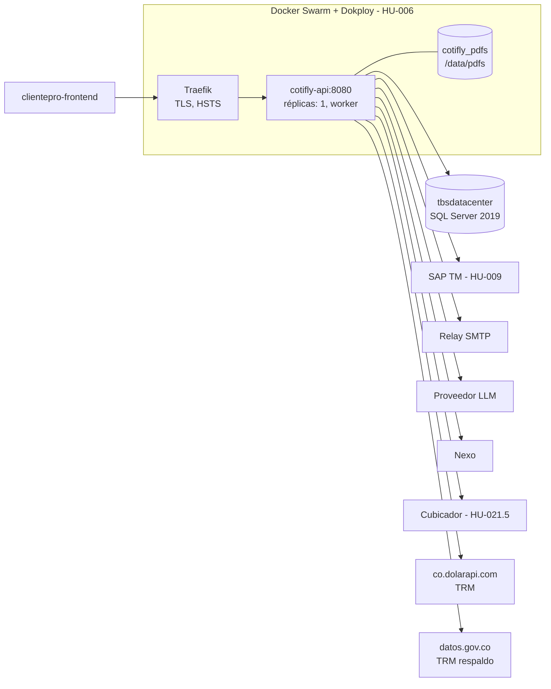

# 3. Infraestructura

> **Estado:** vigente · **Dueño:** Duban Guerra (backend) · **Actualizado:** 2026-10-15

Contenido:

- [3.1 Contenedor e imagen](#31-contenedor-e-imagen)
- [3.2 Variables de entorno y configuración](#32-variables-de-entorno-y-configuración)
- [3.3 Base de datos](#33-base-de-datos)
- [3.4 Configuración por área](#34-configuración-por-área)
- [3.5 Servicios externos](#35-servicios-externos)

## 3.1 Contenedor e imagen

- Un solo `Dockerfile` multi-stage y un único servicio expuesto: `Cotifly.Api` (ADR-007, #27). Sin `docker-compose` **para ejecución local** (desviación de lo que pide HU-003.8, #14, registrada en ADR-007).
- Despliegue: Docker Swarm + Dokploy (HU-006). Manifiestos de Swarm del backend .NET (formato compose para `docker stack deploy`/Dokploy, HU-006.6, #30): `infra/stack.dotnet.staging.yml` e `infra/stack.dotnet.dokploy.yml`. Los `infra/stack*.yml` y `deploy/docker-compose.swarm.yml` del Python quedan para rollback. Detalle en [`DEPLOY.md`](../../DEPLOY.md) §5.
- Nombre lógico de la imagen: **`cotifly-api`**. En local `cotifly-api:dev`; en el registry **`ghcr.io/innovacionia-proyectos/cotifly-backend`** con tags `X.Y.Z` (tag git `vX.Y.Z`), `sha-<corto>` y `qa`/`main`, nunca `latest` (HU-006.4, #28). La publican el job `publicar-imagen` del CI o `scripts/publicar-imagen.sh`/`.ps1`; release paso a paso en [`DEPLOY.md`](../../DEPLOY.md) §4.

**Imagen de contenedor (`Dockerfile`, #27):**

| Aspecto | Decisión |
|---|---|
| Etapa `build` | `mcr.microsoft.com/dotnet/sdk:10.0.401-noble` (tag fijo, `ARG SDK_VERSION`). Restore del proyecto Api en capa propia (solo `global.json`, `Directory.*.props`, `.editorconfig` y los `.csproj`), luego `dotnet publish` Release `--no-restore -r linux-x64 --self-contained false`, `UseAppHost=false`, sin `.pdb`, solo recursos `es`, sin `web.config`, `InformationalVersion=$VERSION` |
| Etapa `runtime` | `mcr.microsoft.com/dotnet/aspnet:10.0.12-noble-chiseled-extra` (tag fijo, `ARG ASPNET_VERSION`): Ubuntu 24.04 mínimo con ICU y tzdata, sin shell, sin `apt`, sin SDK |
| Metadatos | `ARG VERSION=dev`, `ARG VCS_REF=unknown`, `ARG BUILD_DATE` → etiquetas `org.opencontainers.image.{title,description,version,revision,created,source,vendor}`. Ej.: `--build-arg VERSION=1.0.0 --build-arg VCS_REF=$(git rev-parse --short HEAD) --build-arg BUILD_DATE=$(date -u +%Y-%m-%dT%H:%M:%SZ)` |
| Puerto | Kestrel en **8080** (`ASPNETCORE_HTTP_PORTS=8080`, `EXPOSE 8080`). No usar `ASPNETCORE_URLS` salvo necesidad; si se usa, la sonda lo respeta |
| Usuario | `app` (UID 1654, `$APP_UID`), no root. `/app` y sus binarios son de root (solo lectura para `app`) |
| Escritura | Solo `/data/pdfs` (dueño `app`), y solo aplica si los PDFs se guardan en modo volumen (HU-003.7 mantiene el volumen; S3/MinIO queda pendiente, ADR-012). Con varias réplicas un volumen local no se comparte entre nodos: lo decide HU-006.6 (ADR-012). No se declara `VOLUME` para no crear volúmenes anónimos en cada `docker run` |
| `HEALTHCHECK` | `dotnet /app/Cotifly.Api.dll --healthcheck` cada 30 s, timeout 5 s, 3 reintentos, `start-period` 20 s. `clsSondaSalud` hace `GET /health` y termina con 0/1 sin levantar el host web. Destino: primera URL `http://` de `ASPNETCORE_URLS` (comodines `+`, `*`, `0.0.0.0`, `[::]` → 127.0.0.1; `https://` se ignora), si no el primer puerto de `ASPNETCORE_HTTP_PORTS`, si no 8080; sin proxy |
| Arranque fallido | Cualquier excepción al construir o arrancar el host termina el contenedor con **código 1** y un solo registro del error (sin secretos), en vez del 139 de una excepción no controlada en el PID 1 |
| Zona y cultura | `Zona:ZonaHoraria=America/Bogota` se valida al arrancar (tzdata); `InvariantGlobalization=false` en `Cotifly.Api.csproj` para el formato es-CO (ICU). El contenedor y los logs quedan en UTC (sin `TZ`) |
| Fuera de la imagen | `tests/`, `specs/`, documentación, `bin/`/`obj/`, `.env` (`.dockerignore` es lista blanca: solo props, `global.json`, `.editorconfig` y `src/`) |

Por qué `chiseled-extra`: la variante `chiseled` sin `-extra` no trae ICU ni tzdata (la app no arrancaría: `America/Bogota` no existiría) y `aspnet:10.0` (Ubuntu completo) sí los trae pero pesa más y agrega shell y `apt`. Medido el 2026-09-24: imagen final **87,6 MB comprimida / ~304 MB en disco** (Docker Desktop), frente a 95,9 MB / 340 MB de la base `aspnet:10.0` sola y 70,7 MB comprimida de la base `chiseled-extra`.

- **Sin `.pdb`:** las trazas de excepción no traen número de línea. Evaluado en HU-006.4 (#28): se mantiene `DebugType=none`. `DebugType=embedded` + `PathMap` daría números de línea sin rutas del equipo de build, pero suma tamaño a cada `.dll` y las trazas ya traen tipo y método; se reconsidera si un incidente real lo pide.
- **Formato de moneda:** ICU da `3294798m.ToString("C0", es-CO)` = `$ 3.294.798` (con espacio). #11 usa un formateador propio, `clsFormatoMoneda`, que agrupa con la cultura invariante y cambia la coma por punto: `$3.294.798` exacto como el Python y sin depender de ICU ni de la cultura del proceso (probado con es-CO, en-US, de-DE, fr-FR, ja-JP e invariante). La fecha larga usa meses propios (`clsFormatoFecha`).
- **Fuentes y recursos del PDF (#11):** chiseled no trae fontconfig ni fuentes del sistema, así que todo va embebido en `Cotifly.Infraestructura.dll` y se carga con `IFontResolver` (`clsResolvedorFuentes`): Liberation Sans 2.1.5 (4 caras TTF, ~1,6 MB, **SIL Open Font License 1.1**, métricas de Arial; la licencia viaja en `/app/licencias/LiberationSans-OFL.txt`), el logo (`logo_botero_soto.png`) y las 7 imágenes por línea de `mcp_server/pdf/assets/imagenes del pdf`, renombradas a ASCII (`nacional.jpg`, `distribucion.jpg`, `almacenamiento.jpg`, `itr.jpg`, `importacion.jpg`, `exportacion.jpg`, `andino.jpg`) y reducidas de PNG de ~2 MB a JPEG de 1200 px de ancho (calidad 88, ~1,2 MB en total; en el PDF se ven a 122 mm, ~250 ppp). La fuente `Stilu` del CSS no tiene licencia disponible (pendiente de negocio, ADR-006). Imagen final medida el 2026-09-24: **94,6 MB comprimida / ~324 MB en disco** (+7 MB por PDFsharp-MigraDoc, MailKit/MimeKit/BouncyCastle, fuentes e imágenes).
- **Verificación dentro de la imagen (#11):** una sonda desechable (fuera del repo) cargó los ensamblados de `/app` con un `AssemblyLoadContext` sobre `Cotifly.Api.deps.json` y renderizó 3 PDF con `docker run --rm --entrypoint dotnet ... cotifly-api:dev /sonda/Sonda11.dll` como usuario `app`, sin `/etc/fonts` ni `/usr/share/fonts`: 3, 3 y 2 páginas, solo `Liberation Sans` y `Liberation Sans,Bold` embebidas como subconjunto (`/FontFile2`), "Cel" solo con teléfono, bloque aduanero solo en Internacional.
- **`ARG VERSION` y MSBuild (#11):** todo `ARG` de la etapa llega a los `RUN` como variable de entorno y MSBuild la lee como propiedad sin distinguir mayúsculas: `VERSION=dev` se volvía `$(Version)=dev` y el restore fallaba con `NU1105` ("dev" no es una versión válida). Estaba oculto porque la capa del restore venía de caché; apareció al cambiar los `.csproj`. Ahora el `ARG VERSION` se declara después del restore y el publish corre con `env -u VERSION` (el valor solo entra como `InformationalVersion`).

Las pruebas **no** corren dentro de `docker build`: el contexto no incluye `tests/` y las de integración necesitan el socket de Docker (Testcontainers), que no existe durante el build. Corren aparte ([06-ejecucion-local](06-ejecucion-local.md), [08-testing](08-testing.md) y en CI: `.github/workflows/backend-dotnet.yml`).

**Actualizar los tags de .NET** (parche mensual): leer el último parche en las [release notes de .NET 10](https://github.com/dotnet/core/blob/main/release-notes/10.0/releases.json) o con `docker pull mcr.microsoft.com/dotnet/sdk:10.0` + `docker image inspect` (`DOTNET_SDK_VERSION`, `ASPNET_VERSION`); cambiar `SDK_VERSION` y `ASPNET_VERSION` juntos en el `Dockerfile` (el runtime de la imagen debe ser el que trae ese SDK); reconstruir, correr las pruebas y repetir la verificación de [06-ejecucion-local](06-ejecucion-local.md). `global.json` (`10.0.100` + `latestFeature`) acepta cualquier SDK 10.0.x, no hace falta tocarlo.

**Vulnerabilidades de la imagen base y excepciones temporales de Trivy (#86).** El CI (job `imagen-docker`) y `scripts/publicar-imagen.sh`/`.ps1` escanean la imagen final con Trivy 0.74.0 (fijado por digest) y fallan ante cualquier HIGH o CRITICAL con parche disponible. Como los tags de .NET son fijos, un CVE nuevo en un paquete de Ubuntu de la imagen chiseled no se arregla con un rebuild: hay que esperar a que Microsoft republique la imagen (mismo tag con digest nuevo, o el parche siguiente) y la chiseled no tiene `apt` para parchar en el `Dockerfile`. Mientras tanto, y solo si el CVE no es explotable en Cotifly, se registra una excepción en `backend-dotnet/.trivyignore.yaml` (la leen los tres escaneos con `--ignorefile`):
- Una entrada por CVE (`id`), limitada con `purls` a la versión exacta del paquete instalado: si la imagen cambia de versión, la excepción deja de aplicar.
- `expired_at` obligatorio, como máximo 21 días. Vence a las **00:00 UTC** de esa fecha (19:00 del día anterior en Colombia, UTC-5): desde ese momento Trivy no la aplica y el escaneo vuelve a fallar. Planear la renovación o el retiro con al menos dos días de margen.
- **Aprobación humana:** agregar o prorrogar una excepción exige la aprobación explícita en el PR de un revisor humano distinto del autor (líder técnico o seguridad); la aprobación de un agente o del propio autor no cuenta. Hoy el repositorio no tiene `CODEOWNERS` que lo obligue: se sugiere crear uno con `/backend-dotnet/.trivyignore.yaml` asignado al líder técnico y a seguridad, y exigir su revisión en la protección de QA y `main`.
- Justificación (`statement` y comentario), dueño y vencimiento, y la fila correspondiente en [10-operacion §10.6](10-operacion.md#106-riesgos-y-limitaciones-conocidos).
- **Alcance:** mientras está vigente, la excepción aplica en todas las ramas y eventos, también en `main` y en los tags de release (`vX.Y.Z`): una release publicada en ese periodo sale con el CVE aceptado.
- Nunca `--severity` más laxa, `--exit-code 0`, comodines ni `.trivyignore` sin fecha: cualquier otro HIGH/CRITICAL con parche debe seguir rompiendo el job.

**Vigilancia semanal** (`.github/workflows/vigilancia-imagen-base.yml`, lunes 12:00 UTC y a mano con `workflow_dispatch`; solo lectura, `contents: read`): descarga la imagen base de `ASPNET_VERSION`, compara su digest con `DIGEST_FIJADO`, revisa si existe el parche siguiente (`10.0.<N+1>` con el mismo sufijo), escanea la imagen base con Trivy **sin** `--ignorefile` y cuenta los días hasta el `expired_at` más próximo. Deja todo en el resumen del job y **falla** si Microsoft republicó la imagen ("Microsoft republicó la imagen: actualizar y quitar la excepción de #86"), si salió el parche siguiente, si la imagen base ya no tiene HIGH/CRITICAL con parche, si una excepción vence en 7 días o menos, o si el escaneo no se pudo completar. Si nada cambió, termina bien con un aviso. Al actualizar la imagen base, actualizar también `DIGEST_FIJADO`.

**Sin excepción vigente.** Se investigó **CVE-2026-84782** (OpenSSL, divulgación de información en la retransmisión del handshake DTLS) en `libssl3t64`/`openssl` `3.0.13-0ubuntu3.15` de `aspnet:10.0.12-noble-chiseled-extra` (digest `sha256:6385dc0e…`, construida el 2026-09-04). Antes de mergear la excepción propuesta en #86, QA verificó el 2026-10-05 que Microsoft ya había republicado el mismo tag (digest `sha256:00e0ad6a…`, construida el 2026-10-02) con `openssl` ya parchado: `docker pull` + Trivy sin `--ignorefile` dan 0 hallazgos contra la imagen real de Cotifly. No se necesitó `.trivyignore.yaml` (queda con `vulnerabilities: []`, listo para una futura excepción si hiciera falta). Issue #86 cerrada.

**Para HU-006.6 (#30), manifiestos de Swarm/Dokploy** (condiciones que fijó #27; #30 las aplica en `infra/stack.dotnet.*.yml`, ver [`DEPLOY.md`](../../DEPLOY.md) §5). El Python (retirado en HU-022.1; tag `python-final`) exponía su orquestador en **8000** (publicado como `8091 → 8000`) y su servidor MCP en 8080 solo en la red interna. Con el backend .NET:
- Puerto **8080** en el `target` y en `traefik.http.services.<svc>.loadbalancer.server.port`.
- Si el stack redefine el healthcheck, en forma exec: `test: ["CMD", "dotnet", "/app/Cotifly.Api.dll", "--healthcheck"]`. Nunca `CMD-SHELL`: la imagen no tiene shell.
- Readiness con el healthcheck de Traefik contra `/health/ready`: saca la tarea del balanceo mientras la base no está lista, sin que Swarm la reinicie (el `HEALTHCHECK` de la imagen es solo de vida, `/health`).
- Memoria: cada sonda levanta un proceso `dotnet` aparte (~40–70 MB transitorios cada 30 s); contarlo en `resources.limits.memory`.
- Retirar `bot-mcp` (sus herramientas viven en el monolito, ADR-002).
- Variables: `ConnectionStrings__Cotifly` y `ConnectionStrings__Identidad` (HU-007 debe usar estos nombres, no `SQLSERVER_CONNECTION_STRING`).
- SAP TM: `SapTm__Modo`, `SapTm__ExportPath` (y el montaje de solo lectura del export) o `SapTm__Url`/`SapTm__User`/`SapTm__Pass` (secreto), en lugar de `SAP_TM_*` del Python (ver "Integraciones externas").
- Logs en UTC.

Medida del 2026-09-25 (#14, `docker build --no-cache` con el código de #16): **345 MB en disco** según `docker image ls`.

## 3.2 Variables de entorno y configuración

**Variables de entorno:** se documentan en `.env.example` (copiar a `.env`, que no se versiona). Ningún secreto va en `appsettings*.json` ni en el código.

ASP.NET Core traduce `__` (doble guion bajo) a `:`: `Jwt__SigningKey` es la clave `Jwt:SigningKey`, y `Cors__OrigenesPermitidos__0` el primer elemento de `Cors:OrigenesPermitidos`. En QA y producción los valores llegan por Dokploy (HU-006.5, #29, ADR-013): variables de entorno del stack para todo (el secreto de Docker Swarm `gchat_sa` de `GChat__SaJson` se retiró con Google Chat en HU-013.9, #105). Listado con dónde se carga cada una y la plantilla de la tabla de producción (HU-007.1, #33): [`DEPLOY.md`](../../DEPLOY.md) §2 y §3.

Resumen de todas las variables de [`.env.example`](../.env.example). "Production" indica si la API no arranca sin la variable (o con un valor de ejemplo) en ese entorno; las columnas de detalle enlazan a la tabla de cada área.

| Variable | Por defecto | Secreto | Obligatoria en Production | Detalle |
|---|---|---|---|---|
| `ASPNETCORE_ENVIRONMENT` | sin valor en la imagen (= `Production`) | no | — | Lo devuelve `GET /health` |
| `ASPNETCORE_HTTP_PORTS` | `8080` (fijado en la imagen) | no | no | [3.1](#31-contenedor-e-imagen) |
| `Zona__ZonaHoraria` | `America/Bogota` | no | no (debe existir en tzdata) | [3.1](#31-contenedor-e-imagen) |
| `ConnectionStrings__Cotifly` | vacío | **sí** | **sí** | [3.3](#33-base-de-datos) |
| `ConnectionStrings__Identidad` | vacío | **sí** | **sí** | [3.3](#33-base-de-datos) |
| `Identidad__Esquema`, `Identidad__TablaUsuarios`, `Identidad__TablaUsuarioRoles`, `Identidad__TablaRoles` | `dbo`, `tblSAPUsuariosApp`, `tblSAPUsuarioRoles`, `tblSAPRoles` | no | no | [Autenticación](#autenticación) |
| `Jwt__Issuer`, `Jwt__Audience` | `cotifly-api`, `clientepro` | no | no | [Autenticación](#autenticación) |
| `Jwt__SigningKey` | vacío (clave efímera fuera de Production) | **sí** (≥ 32 bytes) | **sí** | [Autenticación](#autenticación) |
| `Jwt__AccessMinutes`, `Jwt__RefreshDays` | `60`, `30` | no | no | [Autenticación](#autenticación) |
| `LimiteAuth__PeticionesPorVentana`, `LimiteAuth__VentanaSegundos` | `30`, `60` | no | no | [Autenticación](#autenticación) |
| `Cors__OrigenesPermitidos__N` | vacío | no | **sí** (al menos uno) | [Seguridad HTTP](#seguridad-http) |
| `ForwardedHeaders__Habilitado`, `ForwardedHeaders__ProxiesConocidos__N`, `ForwardedHeaders__RedesConocidas__N`, `ForwardedHeaders__LimiteSaltos` | `false`, vacío, vacío, `1` | no | no (con `Habilitado=true`, al menos un proxy o red) | [Seguridad HTTP](#seguridad-http) |
| `SeguridadHttp__LimiteCuerpoWebBytes` | `65536` | no | no | [Seguridad HTTP](#seguridad-http) |
| `SeguridadHttp__LimiteCuerpoLicitacionBytes` | `12582912` | no | no | [Seguridad HTTP](#seguridad-http) |
| `SapTm__SalesOrgDefault` | `50000005` | no | no | [SAP TM](#integraciones-externas-y-sap-tm) |
| `SapTm__Modo` | vacío (política de la línea) | no | no (aviso al arrancar) | [SAP TM](#integraciones-externas-y-sap-tm) |
| `SapTm__ExportPath` | vacío | no | con `export_json` | [SAP TM](#integraciones-externas-y-sap-tm) |
| `SapTm__Url`, `SapTm__User`, `SapTm__SapClient` | vacío | no | `Url` y `User` con `odata` | [SAP TM](#integraciones-externas-y-sap-tm) |
| `SapTm__Pass` | vacío | **sí** (≥ 8) | con `odata` | [SAP TM](#integraciones-externas-y-sap-tm) |
| `Pdf__StorageModo`, `Pdf__StorageDir`, `Pdf__BaseUrl` | `volumen`, `/data/pdfs`, vacío | no | no | [PDF y correo](#pdf-y-correo) |
| `Pdf__TiempoEsperaRenderSegundos` | `30` | no | no | [PDF y correo](#pdf-y-correo) |
| `Correo__Habilitado`, `Correo__Modo` | `false`, `smtp_relay` | no | no | [PDF y correo](#pdf-y-correo) |
| `Correo__SmtpRelay__Host`, `__Port`, `__FromFallback`, `__TimeoutSeg` | vacío, `25`, `notificaciones@boterosoto.com.co`, `20` | no | `Host` con el correo habilitado | [PDF y correo](#pdf-y-correo) |
| `IA__Proveedor`, `IA__Modelo`, `IA__Endpoint` | vacío (agente sin configurar) | no | no | [Agente de IA](#agente-de-ia) |
| `IA__ApiKey`, `IA__Fallbacks__N__ApiKey` | vacío | **sí** | según el proveedor | [Agente de IA](#agente-de-ia) |
| `IA__MaxTokens`, `IA__MaxIteraciones`, `IA__SoportaJsonSchema`, `IA__MinutosSinJsonSchema`, `IA__JsonSchemaEstricto`, `IA__Rpm`, `IA__TimeoutSeg`, `IA__PropuestaDirecta`, `IA__RespuestaFinalEnLoop` | `4096`, `12`, `true`, `30`, `false`, `8`, `60`, `true`, `true` | no | no | [Agente de IA](#agente-de-ia) |
| `IA__Fallbacks__N__Proveedor`, `__Modelo`, `__Endpoint` | vacío | no | no | [Agente de IA](#agente-de-ia) |
| `LimiteChat__PeticionesPorVentana`, `LimiteChat__VentanaSegundos` | `20`, `60` | no | no | [Agente de IA](#agente-de-ia) |
| `Sesiones__LimiteTokens`, `Sesiones__TtlHoras`, `Sesiones__BarridoMinutos`, `Sesiones__EsperaTurnoSegundos` | `6000`, `24`, `60`, `3` | no | no | [Agente de IA](#agente-de-ia) |
| `ConnectionStrings__Regional` | vacío (la regional sale de `UsuariosWeb.regional` y el login no consulta nada) | **sí** (opcional; con valor se valida como las otras) | no | [3.3](#33-base-de-datos) |
| `Regional__Esquema`, `Regional__Tabla`, `Regional__ColumnaUsuario`, `Regional__ColumnaRegional`, `Regional__TiempoEsperaSegundos`, `Regional__TiempoEsperaLoginSegundos`, `Regional__Dominio` | `dbo`, `DimEjecutivo`, `USUARIO`, `REGIONAL`, `10`, `3`, `boterosoto` | no | no (identificadores `^[A-Za-z_][A-Za-z0-9_]*$`, tiempo 2 a 60, tiempo del login 1 a 10, dominio `^[A-Za-z0-9_.-]*$` y vacío = cualquiera) | [3.3](#33-base-de-datos) |
| `Nexo__UrlBase` | vacío (clientes, municipios y catálogos de flete responden `*_NO_DISPONIBLE`) | no (sin token: `X-Portal-clsUsuario-Id`) | no | [Nexo](#nexo) |
| `Nexo__MinutosCacheCatalogos`, `Nexo__HorasCatalogosVencidos`, `Nexo__MinutosCacheMunicipios`, `Nexo__EnviarGrupoRutaId`, `Nexo__EnviarDatosCubicador`, `Nexo__EnviarCodigosCubicador` | `30`, `24`, `60`, `false`, `false`, `false` | no | no | [Nexo](#nexo) |
| `CosteoNexo__*` (polling: `IntervaloInicialSegundos`, `IntervaloMaximoMinutos`, `FactorEdad`, `EdadMaximaHoras`, `IntervaloTickSegundos`, `Lote`, `ReclamoSegundos`, `Habilitado`, `LecturaInmediataSegundos`, `MaximoFallosRelectura`) | ver la tabla de [Nexo](#nexo) | no | no (fuera de rango no arranca) | [Nexo](#nexo) |
| `CosteoNexo__MaximoReintentosConexos`, `CosteoNexo__IntervaloReintentoConexosMinutos`, `CosteoNexo__EsperaMaximaCatalogoConexosHoras` | `5`, `5`, `24` | no | no (rangos 1–100, 1–1440 y 1–720) | [Nexo](#nexo) |
| `Cubicador__UrlBase` | vacío (sin cubicador: cada ruta queda con un camión sin vehículo y el warning `CUBICADOR_SIN_CONFIGURAR`) | no | no | [Cubicador](#cubicador) |
| `Cubicador__ApiKey` | vacío | **sí** (≥ 16 en Production) | con `Cubicador__UrlBase` | [Cubicador](#cubicador) |
| `Cubicador__TiempoEsperaSegundos`, `Cubicador__MinutosCacheCatalogos`, `Cubicador__RespaldoSiFalla`, `Cubicador__PresupuestoCapturaSegundos`, `Cubicador__TiempoMaximoCatalogoSegundos` | `15`, `30`, `true`, `60`, `10` | no | no | [Cubicador](#cubicador) |
| `Captura__AceptarVehiculoCliente` | `false` | no | no | [Cubicador](#cubicador) |
| `Cubicacion__IncluirSugerenciaLegada` | `false` (plan B del corte de HU-023.2: `POST /web/cubicacion` agrega `sugerencia` con la forma anterior) | no | no | [Cubicador](#cubicador) |
| `Pdf__PermitirCotizacionChat` | `false` (`COTIZACION_CHAT_RETIRADA`) | no | no | [PDF y correo](#pdf-y-correo) |
| `Trm__Proveedor`, `Trm__UrlDolarApi`, `Trm__Url`, `Trm__TiempoEsperaSegundos`, `Trm__TiempoEsperaDolarApiSegundos` | `dolarapi_con_respaldo`, DolarApi, datos abiertos, `10`, `4` | no | no | [TRM](#trm-cotizaciones-en-usd) |
| `Grovity__*` | — | **sí** (claves) | no planeadas: la propuesta de usar Grovity desde el agente (ADR-005) quedó sin objeto con su retiro en HU-013.9. El código no las lee | [3.5](#35-servicios-externos) |

**Configuración validada al arrancar** (`src/Cotifly.Infraestructura/Configuracion/`): cada sección se enlaza a una clase `clsOpcionesXxx` con DataAnnotations y se registra con `AddOpcionesValidadas<T>()`, que agrega `ValidateOnStart` y el validador de secretos. En `Production`, una propiedad marcada con `[clsSecreto]` vacía, con placeholder (`<secreto>`, `cambiar…`, `changeme`, `dev`) o más corta que su mínimo impide arrancar; el mensaje nombra la clave, nunca el valor. Opciones actuales: `Zona:ZonaHoraria` (por defecto `America/Bogota`, debe existir en el sistema), `ConnectionStrings:Cotifly` / `ConnectionStrings:Identidad` (`[clsSecreto]` + `clsValidadorOpcionesConexiones`, ver [03-infraestructura](03-infraestructura.md)), `Identidad:Esquema` y `SapTm:SalesOrgDefault` (`clsOpcionesMargen`, definida en Aplicacion porque la consume el resolver de margen; por defecto `50000005`, obligatoria y de máximo 12 caracteres, #10) y `SapTm:Modo` / `ExportPath` / `Url` / `User` / `Pass` (`clsOpcionesSapTm` + `clsValidadorOpcionesSapTm`, #13: modo desconocido, `export_json` sin ruta u `odata` sin URL, usuario o clave impiden arrancar en cualquier entorno; `Pass` lleva `[clsSecreto(Opcional = true)]`, que en `Production` solo revisa el valor cuando existe, porque sin `odata` no hace falta clave; ver [03-infraestructura](03-infraestructura.md)), `Pdf:BaseUrl` (`clsOpcionesPdf`, Aplicacion) y `Pdf:StorageDir` / `StorageModo` (`clsOpcionesAlmacenPdf` + validador: solo `volumen`), y `Correo:Habilitado` (`clsOpcionesCorreo`, Aplicacion) y `Correo:Modo` / `SmtpRelay:*` (`clsOpcionesCorreoTransporte` + validador: con el correo habilitado exige `smtp_relay`, host, remitente de respaldo, puerto 1–65535 y tiempo 1–300 s) (#11, ver [03-infraestructura](03-infraestructura.md)), y `Jwt:*` (`clsOpcionesJwt`: `SigningKey` con `[clsSecreto(LargoMinimo = 32)]` más `clsValidadorOpcionesJwt`, que exige 32 bytes en cualquier entorno si tiene valor) e `Identidad:TablaUsuarios` / `TablaUsuarioRoles` / `TablaRoles` (#12, ver [03-infraestructura](03-infraestructura.md)). `LimiteAuth:*` se valida en la Api (`clsOpcionesLimiteAuth`, DataAnnotations + `ValidateOnStart`), igual que `Cors:OrigenesPermitidos` (`clsValidadorOpcionesCors`: obligatorio en Production, orígenes exactos), `ForwardedHeaders:*` (`clsValidadorOpcionesEncabezadosReenviados`: IPs y CIDR válidos, al menos uno si está habilitado) y `SeguridadHttp:LimiteCuerpoWebBytes` (#12 parte B, ver [03-infraestructura](03-infraestructura.md)). Desde #12 parte C: `IA:*` (`clsOpcionesIA` + `clsValidadorOpcionesIA`: proveedor conocido, modelo, clave y endpoint según el proveedor, también en los respaldos; `ApiKey` con `[clsSecreto(Opcional = true)]`) y `IA:MaxTokens` / `MaxIteraciones` (`clsOpcionesAgente`, Aplicación), `Sesiones:*` (`clsOpcionesSesiones`, Aplicación), y `LimiteChat:*` (Api, ver [03-infraestructura](03-infraestructura.md)); `GChat:*` (`clsOpcionesGoogleChat` + validador) se retiró en HU-013.9 y las variables `GChat__*` que queden en un despliegue se ignoran. Desde #20: `Nexo:UrlBase` (`clsOpcionesNexo`, sin validaciones; vacía es un valor válido, ver [Nexo](#nexo)). Desde #45: `ConnectionStrings:Regional` (`[clsSecreto(Opcional = true)]`, validada por `clsValidadorOpcionesConexiones` si tiene valor) y `Regional:*` (`clsOpcionesRegional`; desde #81, `ColumnaUsuario` por defecto `USUARIO` y `TiempoEsperaLoginSegundos` de 1 a 10). Desde HU-021: `Cubicador:*` (`clsOpcionesCubicador` + `clsValidadorOpcionesCubicador`: la llave es obligatoria con la URL), `Captura:AceptarVehiculoCliente` (`clsOpcionesCaptura`) y `Pdf:PermitirCotizacionChat` (`clsOpcionesPdf`), ver [Cubicador](#cubicador).

## 3.3 Base de datos

**Base de datos (ADR-008, #9).** SQL Server 2019 corporativo (`tbsdatacenter`), esquema `dbo_cotifly` dentro de `dbTarifario_Nexo_Pruebas`. EF Core **Database First**: `clsCotiflyDbContext` mapea a mano (Fluent API, `Comun/Persistence/Configurations/`) las tablas que crean los scripts; `HasDefaultSchema("dbo_cotifly")`, tablas PascalCase y columnas camelCase explícitas con su tipo SQL, `UseCompatibilityLevel(150)`. **No hay migraciones EF**: el esquema cambia solo con scripts `../db/migrations_mssql/000N_*.sql` idempotentes:

| Script | Contenido | Estado |
|---|---|---|
| `0001_script_bd_cotifly_sqlserver.sql` | 10 tablas, vistas y seed (HU-002.4) | aplicado en `tbsdatacenter` |
| `0002_identidad_estado_agente.sql` | `Sesiones.estadoAgente` (JSON) y `Sesiones.usuarioId`; `UsuariosWeb.idUsuarioExterno`; `Roles` (sembrada con `comercial` y `gerente_comercial` sin rol externo) y `UsuariosRoles` (en lugar de la `RolesMapeo` del borrador, #12); `TokensRefresco`, `TokensRevocados`; índices de consulta | **extensión aditiva pendiente de aprobación** (Sara + scalderon-bs). Paso de un solo sentido: después del 0002 **no** se re-ejecuta el 0001 (ver encabezado del 0002 y ADR-008) |
| `0003_metricas_reenviadas.sql` | `CREATE OR ALTER VIEW vActividadPorComercial`: `numCotizacionesEnviadas` cuenta `enviada` y `reenviada` (#12 parte B); mismas columnas, sin tocar tablas ni datos | **pendiente de aprobación**, idempotente |
| `0004_costeo_nexo.sql` | Costeo en Nexo (HU-005.8, #24; ADR-015): 29 columnas nuevas en `Cotizaciones` (formulario ampliado: tipo de solicitud, deadline, valor estimado, referencia, horas de cargue y descargue, origen, destino, vehículo, carrocería, tipología, clase de viaje, clase de contenedor, exclusivo, consolidado, retorno y levante del contenedor, aprovisionamiento, peso, valor de la mercancía; seguimiento: `cotizacionNexoId`, `motivoEstadoCosteo`, marcas del envío y del polling, `costeoConsultasFallidas`, `serviciosConexos` JSON), tabla `CotizacionPosiciones` (cubicaje, 1 a N) e índice filtrado de la agenda del polling. Todo nullable salvo `costeoConsultasFallidas` (DEFAULT 0) | **pendiente de aprobación** (scalderon-bs + DBA, coordinación con HU-002 como el 0002 y el 0003), idempotente. El 0009 movió estas columnas a la ruta y al camión, y borró `valorEstimado`, `referencia` y `costeoUltimaConsultaAt` |
| `0005_lineas_solicitud.sql` | Licitaciones multilínea (HU-011, ADR-017): `CotizacionLineasSolicitud` (1 a N), `CotizacionArchivosLicitacion` (el Excel original, `VARBINARY(MAX)`), FK de las posiciones a la línea y backfill | **pendiente de aprobación**, idempotente y no destructivo |
| `0006_textos_y_concurrencia.sql` | ADR-018: `versionNegocio` (ETag), `textosCotizacion`, `pdfDesactualizado`, margen sugerido, tabla `CotizacionPdfsHistorial` y `numAjustesBajoSugerido` en `vAjustesMargenPorComercial`. Reversa en `rollback/0006_textos_y_concurrencia_reversa.sql` | **pendiente de aprobación**, idempotente |
| `0007_captura_nexo_campos.sql` | HU-013.10: `notas` del encabezado y `origenMunicipioId`/`destinoMunicipioId` de la línea | **pendiente de aprobación**, idempotente, sin backfill |
| `0008_horas_por_linea.sql` | HU-013.11: `horasCargue`/`horasDescargue` por línea (CHECK de 0 a 240) | **pendiente de aprobación**, idempotente, sin backfill |
| `0009_reestructuracion_cotizaciones.sql` | HU-021 ([ADR-019](../specs/decisiones/ADR-019-reestructuracion-rutas-y-camiones.md)): `Cotizaciones` pasa a `CotizacionesSolicitud`; la línea pasa a ser la ruta; tablas nuevas `CotizacionVehiculosLineaSolicitud` (camión) y `CotizacionServiciosConexos`; `CotizacionPosiciones` pasa a `CotizacionMercancias`; `MargenAjustes.lineaSolicitudId`; vistas redefinidas. Respalda lo que toca en `Respaldo0009_*` y corre en una transacción. Requiere 0001 a 0007 | **pendiente de aprobación**; si ya se aplicó, no hace nada |
| `0010_nombres_municipio.sql` | Nombres de municipio de la ruta (`origenNombre`, `destinoNombre`, `ciudadDevolucionNombre`, `ciudadLevanteNombre`), `CotizacionesSolicitud.solicitudNexoId` (ex `costeoId`), `CotizacionServiciosConexos.nombreServicioConexo` y el CHECK `ck_cotizaciones_estadoEnvio` si falta. Requiere el 0009 | **borrador pendiente de revisión** de scalderon-bs y del DBA; idempotente y no destructivo |

**Instalación desde cero** (HU-021): `../db/scripts/01_crear_esquema.sql` crea el esquema ya en su forma final, igual al de `0001` a `0010` aplicados, y `../db/seeder/` siembra las líneas de negocio, el mapeo de SAP TM y los roles. Los corre el ejecutador `../db/ejecutar-bd.ps1` o `../db/ejecutar-bd.sh`. Una base instalada así no corre migraciones. Una prueba de integración (`clsEsquemaTests`) verifica que las dos vías dejan el mismo esquema. Detalle en [`db/README.md`](../../db/README.md) y [`BASE_DE_DATOS.md`](../../BASE_DE_DATOS.md).

**Precondición de despliegue:** `0001` a `0010` aplicados, o la instalación desde cero. Si falta algo, `/health/ready` responde 503 con `falta 0002`, `falta 0009`, `falta 0010` o `falta <Tabla.columna>` ([10-operacion](10-operacion.md#109-problemas-frecuentes)). **Pendiente HU-023:** el cubicador traerá `db/scripts/02_alter_cubicador.sql` (columnas del resultado de la cubicación y `codigoMercancia` en lugar de `idTipoMercancia`); todavía no está en esta rama y, cuando entre, se suma a la precondición.

- `updatedAt` (y `createdAt` si la entidad no lo trae) los fija `clsMarcasTiempoInterceptor` con `IClsReloj`: el esquema no tiene triggers.
- `Sesiones.estadoAgente` guarda `clsEstadoConversacion` como JSON camelCase (`clsConvertidorEstadoConversacion`).
- `clsIdentidadDbContext` (solo lectura, `NoTracking`, `SaveChanges` lanza) lee las tres tablas del login (#12) de la **base de identidad del portal, la misma que lee Nexo en cada ambiente** (#172, ADR-009): `dbSolucionesTI_Prueba` en QA; en producción, la que use Nexo en producción (por confirmar). Tablas: `tblSAPUsuariosApp` (`ID` `numeric(18,0)`, `NOMBREUSUARIO`, `DESCRIPCIONUSUARIO`, `EMAIL`; nunca `CLAVE`), `tblSAPUsuarioRoles` (`IDUSUARIO`, `IDROLES`, `int`; clave compuesta, sin leer ninguna columna `ID`) y `tblSAPRoles` (`IDROLES` `int`, `DESCRIPCION`). Son los tipos que Nexo verificó con `sys.columns` en `dbSolucionesTI_Prueba`. Esquema y tablas configurables (`Identidad:Esquema` = `dbo`, `Identidad:TablaUsuarios`, `Identidad:TablaUsuarioRoles`, `Identidad:TablaRoles`). Es el único consumidor de `ConnectionStrings:Identidad`: lo usa solo el login y el refresh (`clsVerificadorIdentidad`). La regional (ADR-016) sale de otra conexión (`ConnectionStrings:Regional`, `DWCubosEBSSAP`).
- **Permisos de `cotifly_app` en `dbTarifario_Nexo_Pruebas`** (pedir al DBA): la base es compartida con otras aplicaciones, así que los permisos van por **esquema**, no por base: `GRANT SELECT, INSERT, UPDATE, DELETE, EXECUTE ON SCHEMA::dbo_cotifly TO cotifly_app` (tablas y vistas de Cotifly; `EXECUTE` queda para procedimientos futuros del esquema). **Sin** `db_datareader` ni `db_datawriter`, que darían acceso a todos los esquemas. Los candados (`sp_getapplock`: folio, correo y turno de la sesión) solo exigen que `cotifly_app` sea usuario de la base (rol `public`). Nada de DDL: el esquema lo cambian los scripts `db/migrations_mssql/` con un usuario administrador.
- **Candado del folio (`CandadoSql`, `clsOpcionesCandadoSql`, #125).** `sp_getapplock` con dueño `Transaction` serializa el consecutivo (ADR-011); la sección crítica solo calcula el consecutivo e inserta (Nexo va después de confirmar). `CandadoSql:EsperaMilisegundos` (5000, de 100 a 60000) es el `@LockTimeout` de cada intento; `CandadoSql:MargenRespuestaMilisegundos` (15000) el margen para la respuesta del servidor; `CandadoSql:Intentos` (3, de 1 a 5) y `CandadoSql:PausaBaseMilisegundos` (200, se duplica en cada intento). Solo se reintenta la toma del candado, nunca la operación; agotados los intentos, `503 SERVICIO_OCUPADO` con `Retry-After: 1`, sin guardar nada. El límite del cliente es un temporizador monotónico, no `CommandTimeout`: SqlClient calcula ese plazo con el reloj de pared y un salto del reloj mayor que el plazo lo vence al instante (`Execution Timeout Expired`, visto en las suites con el reloj de Docker Desktop saltando unos 63–65 s). Respaldo doble si el servidor deja de responder con la conexión TCP viva: `CandadoSql:ComandoSegundos` (120, de 5 a 3600) como `CommandTimeout` y, si tras cancelar no llega el acuse en `CandadoSql:GraciaCancelacionMilisegundos` (5000), la conexión se cierra a la fuerza para que el servidor deshaga la transacción y suelte el candado. El candado del turno del asistente (`clsCandadoSesionSql`, toma y `sp_releaseapplock`) usa los mismos límites (120 s y 5 s fijos). Reloj de los nodos: ver [10-operacion §10.6](10-operacion.md#106-riesgos-y-limitaciones-conocidos).
- **Permisos de solo lectura para `cotifly_app` en la base de identidad** (`dbSolucionesTI_Prueba` en QA; pedir al DBA): `SELECT` por columna sobre `tblSAPUsuariosApp (ID, NOMBREUSUARIO, DESCRIPCIONUSUARIO, EMAIL)` —**sin `CLAVE`**, o una vista sin esa columna—, `tblSAPUsuarioRoles (IDUSUARIO, IDROLES)` y `tblSAPRoles (IDROLES, DESCRIPCION)`. Nada de INSERT/UPDATE/DELETE.
- **Antes de habilitar el login:** fijar los `IDROLES` de ClientePro en `dbo_cotifly.Roles` (`UPDATE dbo_cotifly.Roles SET idRolExterno = <IDROLES> WHERE codigo = 'comercial'`, ídem `gerente_comercial`). Sin eso nadie entra (fail-closed, ADR-009). **Con `sqlcmd` usar `-I`** (QUOTED_IDENTIFIER ON): `Roles` tiene un índice único filtrado y SQL Server rechaza el `UPDATE` con QUOTED_IDENTIFIER OFF, el valor por defecto de `sqlcmd` (SSMS lo trae activado). Igual al correr el 0002.
- **Regional del usuario (HU-010.1 y HU-003.6 #81, ADR-016).** Fuente: la tabla de ejecutivos de `DWCubosEBSSAP` (`ConnectionStrings:Regional`), verificada en #81: `dbo.DimEjecutivo(ID, NOMBRE, REGIONAL, CORREO, USUARIO, FECHACREACION, FECHAMODIFICACION)`. El cruce con `NOMBREUSUARIO` es `USUARIO`, que trae el dominio pegado (`boterosoto\usuario`): el adaptador parte el valor en SQL en la última `\`, limpia espacios, tabuladores y saltos de línea, compara el nombre sin distinguir mayúsculas con una lista de parámetros y exige que el dominio sea `Regional:Dominio` (por defecto `boterosoto`; una fila de otro dominio no cuenta y deja un warning, una sin dominio sí cuenta). Tabla y columnas siguen siendo configurables con `Regional:*`. No todos los usuarios de ClientePro están en la tabla (solo los ejecutivos). Usos:
  - **Login:** el alta JIT llena `UsuariosWeb.regional` y cada login siguiente la refresca (con nombre y correo del almacén). Quien no aparece conserva la que tenga. La consulta tiene un límite de `min(TiempoEsperaLoginSegundos, TiempoEsperaSegundos)` (3 s por defecto) y cualquier fallo solo deja un warning: nunca bloquea el login.
  - **Tablero del gerente:** consulta en vivo (caché de 60 s) con `UsuariosWeb.regional` como respaldo; con la fuente caída responde 503.
  - **Descarga de PDF ajenos y borrador `/web/metricas/actividad`:** leen `UsuariosWeb.regional`, refrescada en el último login de cada usuario.
  - **Sin la cadena** la regional sale solo de `UsuariosWeb.regional`, que llena el DBA (plantilla en [10-operacion](10-operacion.md#106-riesgos-y-limitaciones-conocidos)).
  - **Para activarla:** cargar `ConnectionStrings__Regional` en los secretos de Dokploy (usuario SQL de solo lectura con `SELECT` sobre `DimEjecutivo`) y abrir la salida de red del clúster al servidor del cubo, puerto 1433.

**Cadenas de conexión** (`clsOpcionesConexiones`, variables en `.env.example`):

| Clave | Uso | Variable |
|---|---|---|
| `ConnectionStrings:Cotifly` | `dbo_cotifly`, lectura y escritura | `ConnectionStrings__Cotifly` |
| `ConnectionStrings:Identidad` | base de identidad del portal, solo lectura (usuarios y roles de ClientePro). La misma que Nexo en cada ambiente: QA `dbSolucionesTI_Prueba`, producción por confirmar (#172) | `ConnectionStrings__Identidad` |

Siempre SQL login (`cotifly_app`, pendiente con el DBA): el contenedor Linux no admite autenticación integrada. En `Production` la API no arranca si una cadena falta, es un placeholder, usa `Trusted_Connection`/`Integrated Security` o su `Password` es de ejemplo. Fuera de `Production` pueden quedar vacías: la API arranca y `GET /health/ready` responde 503.

Para desarrollo local, `scripts/levantar-local.ps1` y `scripts/levantar-local.sh` crean las dos bases en un SQL Server 2019 en contenedor, llevan `dbo_cotifly` al esquema vigente `0001` a `0010` (instalación desde cero con `db/scripts/01_crear_esquema.sql`, migración `0002` a `0010` de un volumen con el esquema anterior o solo el `0010` si ya está migrada; se pueden repetir) y los seeders de `db/seeder/` y crean el login `cotifly_app` con exactamente los permisos de arriba (`SELECT`, `INSERT`, `UPDATE`, `DELETE` y `EXECUTE` sobre el esquema `dbo_cotifly`; `SELECT` por columna sin `CLAVE` en la base de identidad, que en local se llama `dbsolucionesti` e imita a `dbSolucionesTI_Prueba`) y los **verifican** conectados como `cotifly_app` (`scripts/sql/dev-04-verificar-permisos.sql`: lee y escribe en `dbo_cotifly`, lee las vistas y toma un `sp_getapplock`, pero recibe permiso denegado en otro esquema de la base y en la columna `CLAVE`). Ver [06-ejecucion-local](06-ejecucion-local.md#62-entorno-local-completo-con-sql-server).

## 3.4 Configuración por área

### PDF y correo

**PDF y correo (#11).**

| Clave | Por defecto | Uso | Variable |
|---|---|---|---|
| `Pdf:StorageDir` | `/data/pdfs` | Carpeta del almacén (volumen; en la imagen es la única carpeta escribible por `app`) | `Pdf__StorageDir` |
| `Pdf:StorageModo` | `volumen` | Único implementado; `s3` no arranca (diferido, ADR-012) | `Pdf__StorageModo` |
| `Pdf:BaseUrl` | vacío | Base de `pdf_url` (`{BaseUrl}/pdfs/{folio}.pdf`); vacía deja la URL relativa, servida por `GET /pdfs/{archivo}` (#12) | `Pdf__BaseUrl` |
| `Pdf:TiempoEsperaRenderSegundos` | `30` | Espera máxima del turno de render (1–600). El render es uno a la vez por proceso porque PDFsharp-MigraDoc no es thread-safe (#92, ADR-006). Agotada, responde 503 `PDF_RENDER_NO_DISPONIBLE` | `Pdf__TiempoEsperaRenderSegundos` |
| `Pdf:PermitirCotizacionChat` | `false` | HU-021.6: habilita `clsGenerarPdfService`, el camino legado que crea una cotización "del chat" sin municipios. Apagado responde `COTIZACION_CHAT_RETIRADA`; solo lo encienden las pruebas del PDF legado | `Pdf__PermitirCotizacionChat` |
| `Correo:Habilitado` | `false` | Sin habilitar, el envío responde `CORREO_DESHABILITADO` (vista previa y destinatarios previos funcionan) | `Correo__Habilitado` |
| `Correo:Modo` | `smtp_relay` | Único implementado; `wscorreos` y `smtp` no arrancan con el correo habilitado (D3) | `Correo__Modo` |
| `Correo:SmtpRelay:Host` | vacío | Relay interno (en el Python `10.10.40.62`); obligatorio con el correo habilitado | `Correo__SmtpRelay__Host` |
| `Correo:SmtpRelay:Port` | `25` | Puerto del relay | `Correo__SmtpRelay__Port` |
| `Correo:SmtpRelay:FromFallback` | `notificaciones@boterosoto.com.co` | Remitente si el comercial no tiene correo en `UsuariosWeb` | `Correo__SmtpRelay__FromFallback` |
| `Correo:SmtpRelay:TimeoutSeg` | `20` | Límite de cada operación con el relay | `Correo__SmtpRelay__TimeoutSeg` |

- Con varias réplicas, el candado de la deduplicación (`clsCandadoEnvios`) es por proceso: haría falta `sp_getapplock` (HU-006.6). Un volumen local de PDFs tampoco se comparte entre nodos (ADR-012).
- Activar el correo en producción: confirmar el transporte real con el equipo (D3), autorizar la IP del nodo en el relay y poner `Correo__Habilitado=true` y `Correo__SmtpRelay__Host`.
- **Operación (para HU-006):**
  - El `From` es el correo del comercial (`@boterosoto.com.co`) aunque sale por el relay: revisar con TI que SPF/DMARC del dominio autoricen al relay para no caer en spam.
  - `replicas: 1` en Dokploy mientras no haya `sp_getapplock` para la deduplicación ni un volumen compartido para los PDFs; con varios nodos, ambos son requisito.
  - `/data/pdfs` debe ser escribible por el UID 1654: con un volumen con nombre Docker copia el dueño de la imagen; con un bind mount, `chown 1654:1654` en el host.
  - `EventosHerramienta` guarda entradas con datos personales (correos de clientes, nombres, NIT): definir la retención y la purga con datos/seguridad.

### Autenticación

**Autenticación (#12, ADR-009).**

| Clave | Por defecto | Uso | Variable |
|---|---|---|---|
| `Jwt:Issuer` | `cotifly-api` | Claim `iss` emitido y exigido | `Jwt__Issuer` |
| `Jwt:Audience` | `clientepro` | Claim `aud` emitido y exigido | `Jwt__Audience` |
| `Jwt:SigningKey` | vacío | Clave HS256, **secreto**: al menos 32 bytes; en Production obligatoria y sin placeholders. Vacía fuera de Production: clave efímera por proceso (aviso en el log) | `Jwt__SigningKey` |
| `Jwt:AccessMinutes` | `60` | Vigencia del access (1–1440) | `Jwt__AccessMinutes` |
| `Jwt:RefreshDays` | `30` | Vigencia absoluta de la sesión de refresh desde el login (1–365) | `Jwt__RefreshDays` |
| `Identidad:Esquema` | `dbo` | Esquema de las tablas de la base de identidad (`dbSolucionesTI_Prueba` en QA) | `Identidad__Esquema` |
| `Identidad:TablaUsuarios` / `TablaUsuarioRoles` / `TablaRoles` | `tblSAPUsuariosApp` / `tblSAPUsuarioRoles` / `tblSAPRoles` | Nombres de las tablas | `Identidad__TablaUsuarios`... |
| `LimiteAuth:PeticionesPorVentana` / `VentanaSegundos` | `30` / `60` | Límite de `/api/auth/*` por IP (429 al pasarlo) | `LimiteAuth__PeticionesPorVentana`... |

- Con varias réplicas todas deben compartir `Jwt:SigningKey`; un logout tarda hasta 60 s en verse en las demás.
- Detrás de Traefik la IP que ve el límite es la del proxy mientras no se configuren los encabezados reenviados (`ForwardedHeaders:*`, abajo).

### Seguridad HTTP

**Seguridad HTTP (#12, parte B).** `clsOpcionesCors`, `clsOpcionesEncabezadosReenviados` y `clsOpcionesSeguridadHttp` (Api, `ValidateOnStart`):

| Clave | Por defecto | Uso | Variable |
|---|---|---|---|
| `Cors:OrigenesPermitidos[]` | vacío | Orígenes exactos del frontend de ClientePro (`https://host[:puerto]`, sin ruta, sin `/` final, sin comodines). **Obligatorio en Production** (no arranca vacío). Métodos GET/POST/PUT, encabezados `Authorization` y `Content-Type`, sin credenciales, preflight cacheado 10 min | `Cors__OrigenesPermitidos__0`, `__1`... |
| `ForwardedHeaders:Habilitado` | `false` | Toma la IP real de `X-Forwarded-For` (y el esquema de `X-Forwarded-Proto`) solo si la conexión viene de un proxy o red conocidos: la usa el límite de `/api/auth/*` | `ForwardedHeaders__Habilitado` |
| `ForwardedHeaders:ProxiesConocidos[]` / `RedesConocidas[]` | vacío | IPs de Traefik o redes CIDR (la overlay de Swarm, p. ej. `10.0.0.0/8`). Con `Habilitado=true` al menos una es obligatoria; una IP o CIDR inválido no arranca | `ForwardedHeaders__ProxiesConocidos__0`, `ForwardedHeaders__RedesConocidas__0` |
| `ForwardedHeaders:LimiteSaltos` | `1` | Saltos de proxy aceptados en `X-Forwarded-For` (1–10) | `ForwardedHeaders__LimiteSaltos` |
| `SeguridadHttp:LimiteCuerpoWebBytes` | `65536` | Tamaño máximo del cuerpo en `/web/*` (1 KB–10 MB); más grande → 413 `ErrorWeb` | `SeguridadHttp__LimiteCuerpoWebBytes` |
| `SeguridadHttp:LimiteCuerpoLicitacionBytes` | `12582912` | Tamaño máximo del cuerpo en `/web/licitaciones*` (HU-011, ADR-017): Excel de hasta 10 MB más el JSON de las líneas (1 KB–64 MB) | `SeguridadHttp__LimiteCuerpoLicitacionBytes` |

- Todas las respuestas llevan `X-Content-Type-Options: nosniff`, `X-Frame-Options: DENY`, `Referrer-Policy: no-referrer` y `Content-Security-Policy: default-src 'none'; frame-ancestors 'none'`; `/web/*` y `/pdfs/*` además `Cache-Control: no-store`. Kestrel no envía `Server`. HSTS lo pone Traefik (TLS termina ahí).
- Para HU-006.6: en Dokploy fijar `Cors__OrigenesPermitidos__0` con el dominio real de `clientepro-frontend` (pendiente, lo confirma frontend) y `ForwardedHeaders__Habilitado=true` con la red overlay de Traefik en `ForwardedHeaders__RedesConocidas__0`.

### Integraciones externas y SAP TM

**Integraciones externas (#13, HU-003.7).**

| Integración del Python | En .NET | Configuración |
|---|---|---|
| SAP TM, export JSON (`export_fuente.py`) | `clsFuenteMargenExportJson` | `SapTm__Modo=export_json`, `SapTm__ExportPath` |
| SAP TM, OData en vivo (`odata_fuente.py`) | `clsFuenteMargenOData` | `SapTm__Modo=odata`, `SapTm__Url`, `SapTm__User`, `SapTm__Pass` |
| Tarifario en Google Drive (`DriveFlatFileProvider`) | **No se porta**: retirado el 2026-09-23, el costeo vendrá de Nexo (HU-005.5 en adelante) | ninguna |
| Búsqueda de clientes (no existía en el Python) | `clsBuscadorClientesNexo`, más municipios y catálogos de flete de Nexo (la cubicación de Nexo se retiró en HU-023.2: "Calcular cubicaje" usa el cubicador, `Cubicador__UrlBase`) | `Nexo__UrlBase` ([Nexo](#nexo)) |
| Sincronización a Google Sheets (Looker Studio) | **Diferida**, pendiente en ADR-012 (Looker directo a SQL Server, port a .NET o tablero de HU-010) | ninguna |
| PDF en S3/MinIO (`almacen_pdf.py`) | **Diferido**: se mantiene el volumen `/data/pdfs` detrás de `IClsAlmacenPdf` (#11). S3 solo si HU-006.6 despliega varias réplicas sin volumen compartido (ADR-012) | ninguna |

SAP TM:
- **Sin `SapTm__Modo`** (valor por defecto) no se consulta SAP: `obtener_margen` usa la política de la línea con el detalle "SAP TM no configurado".
- **`export_json`**: el archivo tiene la forma `{"d":{"results":[{SalesOrgId, TrqType, OrderPartyId, Value}]}}` (en las pruebas, `backend-dotnet/tests/fixtures/sap/rentab_cliente_muestra.json`). Se monta en el contenedor (por ejemplo `-v <carpeta>:/data/sap:ro` y `SapTm__ExportPath=/data/sap/sap_export.json`). Para reemplazarlo sin que una consulta lea un archivo a medio escribir, copiarlo con otro nombre y renombrarlo; se ve en la siguiente consulta, sin reiniciar.
- **`odata`**: `GET {SapTm__Url}/RentabClienteSet?$filter=SalesOrgId eq '…' and TrqType eq '…' and OrderPartyId eq '…'&$format=json` con autenticación Basic y `Accept: application/json`. Se toma `d.results[0].Value`. `SapTm__Url` es la URL base del servicio (ej. `https://<host>/sap/opu/odata/sap/ZGW_RENTAB_CLI_SRV`), http o https, sin usuario ni `?consulta`. Si el servicio exige mandante, `SapTm__SapClient=100` (3 dígitos) agrega `&sap-client=100`. `SapTm__User` y `SapTm__Pass` son obligatorios en todo entorno; en `Production` la clave no puede ser un placeholder ni tener menos de 8 caracteres. Las credenciales nunca se registran: la cabecera se arma por petición y los logs de `IHttpClientFactory` ocultan todas las cabeceras.
- **SAP caído** (export ausente o ilegible, HTTP ≠ 2xx tras los reintentos, más de 10 s, respuesta inválida) → política de la línea con el detalle "SAP TM no disponible: se usa la política de la línea" y un warning en el log (decisión de #13, Gherkin "Resiliencia si SAP no responde" de HU-009). `MARGEN_FUENTE_NO_DISPONIBLE` solo si la línea tampoco tiene política.
- **Avisos al arrancar** (no impiden arrancar): en `Production` sin `SapTm__Modo`, "SAP TM no configurado (SapTm:Modo vacío): todos los márgenes salen de la política de la línea"; con `export_json` y un archivo que no existe, aviso con la ruta.
- **No dejar `SapTm__Pass` puesto si no se usa OData:** es opcional sin `odata`, pero si tiene un valor de ejemplo (`<secreto>`) o corto, `Production` no arranca.
- **Activar OData en vivo (HU-009):** el código ya está (la HU pide el cliente completo, no solo la interfaz). Falta lo externo, HU-009.1: ruta de red desde el contenedor de Dokploy hasta SAP y el usuario de servicio. Con eso, HU-009.2 cambia en Dokploy `SapTm__Modo=odata`, `SapTm__Url`, `SapTm__User` y `SapTm__Pass` (secreto), sin tocar código. Se valida con al menos 3 combinaciones reales de cliente y línea antes de dejarlo en producción; la prueba `clsSapTmRealTests` (`[Trait("Categoria","sap")]`, se omite si faltan las variables) lee `SapTm__Url`/`User`/`Pass`/`SapClient` y un caso conocido en `SAPTM_PRUEBA_TRQTYPE`, `SAPTM_PRUEBA_BP` y opcional `SAPTM_PRUEBA_VALUE` (`dotnet test --filter-trait "Categoria=sap"`).
- **Criterio para HU-009.1, formato de `OrderPartyId`:** SAP suele guardar el BP con ceros a la izquierda (conversión ALPHA, ej. `0000015927`), y el BP que entrega Nexo puede venir sin ellos (`15927`). Confirmar con SAP el formato exacto contra un caso real antes de activar. **No normalizar a ciegas** (rellenar o recortar ceros sin confirmarlo puede cruzar clientes). En HU-009.2, vigilar la tasa de respuestas "sin registro en SAP TM": si es alta, lo más probable es un desajuste de formato del BP, no clientes sin margen.

### Nexo

**Nexo (HU-005.2, HU-005.3, HU-005.4, HU-005.13, costeo HU-005.5 en adelante).** Dos opciones en `clsOpcionesNexo`: `Nexo:UrlBase` (sin validaciones: Nexo todavía no es obligatorio en todos los ambientes) y `Nexo:MinutosCacheMunicipios`; el ritmo del polling del costeo va en `CosteoNexo:*` (`clsOpcionesCosteoNexo`, validada al arrancar, ADR-015). Arquitectura de los adaptadores en [2.14](02-arquitectura.md#214-integración-con-nexo).

| Clave | Por defecto | Uso | Variable |
|---|---|---|---|
| `Nexo:UrlBase` | vacío | URL base de Nexo, sin barra final. Vacía: `GET /web/clientes?q=` responde `CLIENTE_BUSQUEDA_NO_DISPONIBLE`, `GET /web/municipios` `MUNICIPIOS_NO_DISPONIBLE`, `GET /web/catalogos-flete` `CATALOGOS_FLETE_NO_DISPONIBLE` (`POST /web/cubicacion` ya no depende de Nexo: con `Cubicador__UrlBase` vacía responde 503 `CUBICADOR_NO_DISPONIBLE`, HU-023.2); el envío a costeo deja la cotización en `error_envio` | `Nexo__UrlBase` |
| `Nexo:MinutosCacheCatalogos` | `30` | Minutos que se reutilizan en memoria los catálogos maestros de Nexo (`GET /api/catalogos/*`, HU-013.10; los usan `GET /web/catalogos-flete` y la validación de `POST /web/solicitudes-costeo`). Solo guarda los cuatro catálogos completos; `0` desactiva la caché y el respaldo; de 0 a 1440 | `Nexo__MinutosCacheCatalogos` |
| `Nexo:HorasCatalogosVencidos` | `24` | Horas que la última copia de los catálogos maestros sirve de respaldo si Nexo no responde al renovarla (warning en el log). Pasado ese límite, o sin copia, responde `CATALOGOS_FLETE_NO_DISPONIBLE`; `0` desactiva el respaldo; de 0 a 168 | `Nexo__HorasCatalogosVencidos` |
| `Nexo:EnviarGrupoRutaId` | `false` | Antes `Nexo:EnviarReferenciaRuta` (N1, #134). HU-023.4 (#159): cada línea de `POST /api/captura-solicitudes` lleva `grupoRutaId` (id de la ruta de Cotifly) y el emparejamiento lo usa cuando Nexo lo devuelve en `GET /api/solicitudes/{id}`. Encenderlo cuando Nexo despliegue su rama `QA` (su swagger declara `additionalProperties: false`) | `Nexo__EnviarGrupoRutaId` |
| `Nexo:EnviarCodigosCubicador` | `false` | Contrato Nexo #297: los códigos de vehículo y carrocería del cubicador viajan en la línea. Apagada, la línea del camión del cubicador va sin vehículo (la resuelve la Mesa); el vehículo digitado del respaldo sí viaja | `Nexo__EnviarCodigosCubicador` |
| `Nexo:EnviarDatosCubicador` | `false` | HU-023.4: `idRecomendacionVehiculo` (camión del cubicador) en cada línea (el código de mercancía no viaja, #297); con `grupoRutaId`, el polling empareja cada línea con su camión exacto | `Nexo__EnviarDatosCubicador` |
| `Nexo:MinutosCacheMunicipios` | `60` | Minutos que se reutiliza en memoria el catálogo de municipios (HU-005.13; lo usa `GET /web/municipios`; la herramienta `resolver_municipio` se retiró en HU-013.9). Solo guarda respuestas exitosas; `0` desactiva la caché; de 0 a 1440 (fuera de rango no arranca) | `Nexo__MinutosCacheMunicipios` |
| `CosteoNexo:IntervaloInicialSegundos` | 5 | Primera consulta del polling tras el envío y espera mínima entre consultas (1 a 3600 s) | `CosteoNexo__IntervaloInicialSegundos` |
| `CosteoNexo:IntervaloMaximoMinutos` | 15 | Espera máxima entre consultas de una cotización (1 a 1440; no menor que el inicial) | `CosteoNexo__IntervaloMaximoMinutos` |
| `CosteoNexo:FactorEdad` | 0.25 | Fracción de la edad de la solicitud que se espera hasta la siguiente consulta (0.01 a 1) | `CosteoNexo__FactorEdad` |
| `CosteoNexo:EdadMaximaHoras` | 72 | Pasada, una cotización sin costeo queda en `costeo_vencido` (1 a 720) | `CosteoNexo__EdadMaximaHoras` |
| `CosteoNexo:IntervaloTickSegundos` | 5 | Cada cuánto revisa el worker la agenda (1 a 300) | `CosteoNexo__IntervaloTickSegundos` |
| `CosteoNexo:Lote` | 20 | Cotizaciones por vuelta del worker (1 a 500) | `CosteoNexo__Lote` |
| `CosteoNexo:ReclamoSegundos` | 120 | Reclamo de una cotización mientras se consulta (61 a 3600; debe superar dos llamadas de 30 s) | `CosteoNexo__ReclamoSegundos` |
| `CosteoNexo:Habilitado` | `true` | Apaga el polling sin quitar `Nexo:UrlBase` | `CosteoNexo__Habilitado` |
| `CosteoNexo:LecturaInmediataSegundos` | 6 | Tiempo máximo de la lectura del costeo en la misma petición del alta, cuando Nexo ya costeó todo (HU-013.14; 1 a 30) | `CosteoNexo__LecturaInmediataSegundos` |
| `CosteoNexo:MaximoFallosRelectura` | 10 | Fallos seguidos con los que el polling deja de releer una cotización que solo se consulta para completar el precio (1 a 100) | `CosteoNexo__MaximoFallosRelectura` |
| `CosteoNexo:MaximoReintentosConexos` | 5 | Envío diferido de conexos a Nexo (HU-021.9, decisión 10): POST rechazados por Nexo antes de dejar el conexo `fallido_definitivo` (1 a 100) | `CosteoNexo__MaximoReintentosConexos` |
| `CosteoNexo:IntervaloReintentoConexosMinutos` | 5 | Espera entre reintentos de conexos de una cotización que el polling ya no consulta (entregada; 1 a 1440) | `CosteoNexo__IntervaloReintentoConexosMinutos` |
| `CosteoNexo:EsperaMaximaCatalogoConexosHoras` | 24 | Tope de la espera cuando el catálogo de conexos o la cotización de Nexo no responden antes del POST; pasado, `fallido_definitivo` con aviso (1 a 720) | `CosteoNexo__EsperaMaximaCatalogoConexosHoras` |

Los valores del polling (5 s al inicio, hasta 15 min, 72 h) quedan **pendientes de confirmar con el equipo de Nexo** (carga y rate limiting que acepta). Fuera de rango, la API no arranca.

- **Sin token ni usuario de servicio.** Cada petición lleva `X-Portal-clsUsuario-Id` con el `UsuariosWeb.idUsuarioExterno` del comercial; Nexo resuelve el rol contra el mismo almacén corporativo que ClientePro. El nombre del encabezado vive en un solo lugar (`clsIdentidadNexo`, HU-023.4): Nexo responde 401 a cualquier otro. Un comercial sin `idUsuarioExterno` no puede usar estas funciones (código "no disponible"), salvo el catálogo de municipios mientras haya una foto vigente en caché (`Nexo:MinutosCacheMunicipios`): esa foto se sirve a cualquier comercial autenticado, y solo la recarga exige su `idUsuarioExterno`. El encabezado no se registra en los logs.
- **Rutas:** el código arma `{Nexo__UrlBase}/api/captura-solicitudes/clientes?q=`, `/api/captura-solicitudes/municipios`, `/api/biblioteca-sap-historico/filtros` y las del costeo (`/api/captura-solicitudes`, `/api/solicitudes/{id}`, `/api/cotizaciones`). Por eso `Nexo__UrlBase` va **sin** `/api` al final (el host, ej. `https://<host-nexo>`). El ejemplo de `.env.example` se corrigió en HU-005.13 (antes terminaba en `/api`, lo que daba `/api/api/...`); las pruebas usan `http://nexo-test.local`, también sin `/api` (mismo criterio que el costeo, ADR-015). Falta confirmar con el equipo de Nexo el host real antes de configurarlo en QA.
- **Tiempos:** consultas (clientes, municipios, catálogos): 8 s en total, 3 s por intento y 2 reintentos (cliente HTTP `Nexo`). Costeo: 30 s en total y por intento, reintentos solo en GET (cliente HTTP `NexoCosteo`; el alta no se reintenta porque no es idempotente). No son configurables.
- **Cupo (429, HU-023.4):** Nexo limita por rol sus listados y responde `429` con `Retry-After: 30`. Un 429 no se reintenta. `clsCupoNexoHandler` (en los dos clientes): solo `/api/catalogos/*` y la bandeja `GET /api/solicitudes` (el listado) se bloquean hasta el `Retry-After` (fecha pasada = 0 s; sin encabezado, 30 s; tope 5 min); el polling (`/api/solicitudes/{id}`), las cotizaciones, los conexos, los clientes y los municipios no se congelan, y un 429 de catálogos no aumenta el backoff del polling. Los POST no se bloquean.
- **Activar en un ambiente:** fijar `Nexo__UrlBase` en Dokploy; los comerciales deben tener `idUsuarioExterno` (lo llena el login de ClientePro). No hay aviso al arrancar si falta.

### Cubicador

**Cubicador (HU-021.5, #133; [ADR-019](../specs/decisiones/ADR-019-reestructuracion-rutas-y-camiones.md)).** `clsOpcionesCubicador` (Infraestructura, validada al arrancar) y `clsOpcionesCaptura` (Aplicación). Por cada ruta de la captura, `POST {Cubicador:UrlBase}/recomendaciones` devuelve los camiones; `GET /tipos-mercancia` alimenta `GET /web/tipos-mercancia`. Desde HU-023 el contrato es el real del cubicador ([ADR-020](../specs/decisiones/ADR-020-conexion-con-el-cubicador.md)): `codigoMercancia`, respuesta por ruta y vehículos completos. "Calcular cubicaje" (`POST /web/cubicacion`, HU-023.2, #157) también llama a `POST /recomendaciones` y ya no usa Nexo.

| Clave | Por defecto | Uso | Variable |
|---|---|---|---|
| `Cubicador:UrlBase` | vacío | Raíz del API del cubicador, sin barra final. Vacía: no se llama al cubicador; cada ruta queda con un camión sin vehículo (lo resuelve la Mesa de Costeo de Nexo) y queda el warning `CUBICADOR_SIN_CONFIGURAR` (evento 2100) | `Cubicador__UrlBase` |
| `Cubicador:ApiKey` | vacío | **Secreto** (`Authorization: Bearer`). Obligatoria con la URL; en Production, al menos 16 caracteres | `Cubicador__ApiKey` |
| `Cubicador:TiempoEsperaSegundos` | `15` | Límite de cada petición (1 a 120). El POST nunca se reintenta | `Cubicador__TiempoEsperaSegundos` |
| `Cubicador:MinutosCacheCatalogos` | `30` | Caché del catálogo de tipos de mercancía (0 a 1440; 0 la desactiva) | `Cubicador__MinutosCacheCatalogos` |
| `Cubicador:RespaldoSiFalla` | `true` | Si el cubicador configurado falla: `true`, la ruta sigue con el camión del respaldo (warning `CUBICADOR_RESPALDO`, evento 2101); `false`, la captura responde 503 `CUBICADOR_NO_DISPONIBLE` y no guarda nada. Recomendado `false` en QA y producción en cuanto haya URL | `Cubicador__RespaldoSiFalla` |
| `Cubicador:PresupuestoCapturaSegundos` | `60` | Tiempo total de llamadas al cubicador en una captura (1 a 3600); agotado, las rutas restantes van al respaldo | `Cubicador__PresupuestoCapturaSegundos` |
| `Cubicador:TiempoMaximoCatalogoSegundos` | `10` | Tope de `GET /tipos-mercancia`, reintentos incluidos (1 a 120); agotado, se conserva el nombre que mandó el cliente | `Cubicador__TiempoMaximoCatalogoSegundos` |
| `Captura:AceptarVehiculoCliente` | `false` | Bandera de respaldo (HU-021.11, #138; HU-021-FE.2). Apagada rige la decisión 7. Encendida, `tipo_vehiculo` y `carroceria` de la ruta se validan contra el catálogo de Nexo y van solo en el camión del respaldo. Se retira cuando exista el cubicador | `Captura__AceptarVehiculoCliente` |
| `Cubicacion:IncluirSugerenciaLegada` | `false` | Plan B del corte de HU-023.2 (#157): `POST /web/cubicacion` ("Calcular cubicaje") agrega `sugerencia` con la forma anterior (`SugerenciaVehiculoLegada`, `deprecated`) derivada del primer vehículo, para un frontend que todavía no pinte `vehiculos[]`. Se retira cuando el frontend use `vehiculos[]` | `Cubicacion__IncluirSugerenciaLegada` |

### Licitaciones desde Excel (HU-011, ADR-017)

- **Análisis del pliego:** `POST /web/licitaciones/analizar-excel` reenvía el archivo a `POST {Nexo:UrlBase}/api/captura-solicitudes/analizar-excel` por el cliente HTTP `NexoCosteo` (30 s, un POST nunca se reintenta) con `X-Portal-clsUsuario-Id` del comercial. Sin `Nexo:UrlBase` responde `COSTEO_NEXO_NO_DISPONIBLE` (`clsAnalizadorExcelNoDisponible`). Ni Nexo ni Cotifly guardan el archivo en ese paso.
- **Excel original:** se guarda con la licitación en `dbo_cotifly.CotizacionArchivosLicitacion` (`VARBINARY(MAX)`, máximo 10 MB menos 64 KB, SHA-256 solo como trazabilidad, script 0005). Solo lo lee el dueño de la cotización (mismo aislamiento que `/web/cotizaciones`) y solo al exportar: la vista de la licitación proyecta nombre y hoja sin leer el contenido. No va a disco ni a un volumen: los respaldos de la base lo cubren (y lo conservan; ver la propuesta de retención en `10-operacion.md`).
- **Lectura acotada:** el lector local solo lee celdas con contenido de las primeras 200 columnas, no expande combinadas (más de 10.000 es `EXCEL_INVALIDO`) y ubica como máximo 1000 filas: un archivo malicioso (celda en `XFD3000`, combinada `A2:XFD1048576`) no consume segundos ni GB. ClosedXML 0.104.2, la versión de Nexo.
- **403 de Nexo** al analizar o al dar de alta: `NEXO_SIN_PERMISO` (rol del comercial en Cabina de Fletes), no `COSTEO_NEXO_NO_DISPONIBLE`.
- **Lectura local:** ClosedXML (MIT, ver `Directory.Packages.props`) con la misma regla de detección de encabezado y filas de Nexo (`clsLectorExcelLicitacionClosedXml`, puerto 1:1 de `ExcelSolicitudesAdapter`). `SixLabors.Fonts` queda fijado en 1.0.0 (Apache-2.0): la 2.x cambió de licencia.
- **Exportación (HU-011.3):** `GET /web/licitaciones/{folio}/excel` regenera el original en memoria con ClosedXML (`clsExportadorExcelLicitacionClosedXml`); no escribe a disco. Un pliego de 10 MB puede ocupar varias veces ese tamaño en memoria mientras se genera: vigilar el límite de memoria del contenedor si hay muchas exportaciones simultáneas.
- **Límite del cuerpo:** `SeguridadHttp:LimiteCuerpoLicitacionBytes` (12 MB) para `/web/licitaciones*`; el resto de `/web/*` sigue en 64 KB.

### TRM (cotizaciones en USD)

**TRM del día (HU-012.1, ADR-014).** Sección `Trm` (`clsOpcionesTrm` + `clsValidadorOpcionesTrm`), validada al arrancar. Arquitectura en [2.6](02-arquitectura.md#26-precio-margen-y-tarifas).

| Clave | Por defecto | Uso | Variable |
|---|---|---|---|
| `Trm:Proveedor` | `dolarapi_con_respaldo` | Cadena de fuentes: `dolarapi_con_respaldo` (DolarApi y, si falla, la Superintendencia), `dolarapi` o `superfinanciera`. Sin distinguir mayúsculas; otro valor no arranca | `Trm__Proveedor` |
| `Trm:UrlDolarApi` | `https://co.dolarapi.com/v1/trm` | TRM de DolarApi (fuente principal, agregador no oficial). https absoluta, sin usuario, consulta ni fragmento | `Trm__UrlDolarApi` |
| `Trm:Url` | `https://www.datos.gov.co/resource/32sa-8pi3.json` | Recurso SODA del conjunto "Tasa de Cambio Representativa del Mercado - Histórico" de la Superintendencia Financiera (respaldo). https absoluta, sin usuario, consulta ni fragmento | `Trm__Url` |
| `Trm:TiempoEsperaSegundos` | `10` | Límite de la consulta a la Superintendencia, reintentos incluidos (2 a 60). Cada intento tiene un tercio; 2 reintentos ante fallos transitorios (`clsResilienciaTrm`) | `Trm__TiempoEsperaSegundos` |
| `Trm:TiempoEsperaDolarApiSegundos` | `4` | Límite de la consulta a DolarApi, reintentos incluidos (2 a 60). Corto: con DolarApi caído el respaldo responde en unos 4 s más su propio tiempo | `Trm__TiempoEsperaDolarApiSegundos` |

- **Fuentes públicas:** sin credenciales ni datos personales. El contenedor necesita salida HTTPS a `co.dolarapi.com` y a `www.datos.gov.co`. Sin ninguna de las dos, las cotizaciones en COP siguen igual y las de USD responden `TRM_NO_DISPONIBLE`.
- **DolarApi:** `GET {Trm__UrlDolarApi}` → `{"unidad":"COP","nombre":"TRM","valor":3273.49,"fechaActualizacion":"2026-10-05T19:01:18.476Z"}`. Se exige `unidad = COP`, `nombre = TRM`, `valor` entre 500 y 20.000 (4 decimales, half-to-even) y a no más de ±10 % de la última TRM válida conocida, cuerpo de máximo 16 KB y `fechaActualizacion` del mismo día de negocio **antes de las 12:00 en Bogotá**: `fechaActualizacion` es la hora del refresco de DolarApi, no la vigencia, y en la tarde el valor puede ser ya la TRM de mañana (verificado el 2026-10-05, ADR-014 §1). Cualquier otra respuesta es un fallo y pasa al respaldo, que consulta la vigencia exacta.
- **Respaldo:** si DolarApi falla y la Superintendencia responde, queda un warning "TRM del ... tomada de la fuente de respaldo superfinanciera" con el motivo. La fuente usada viaja en `trm_fuente` de la salida de `calcular_precio` (auditoría).
- **Consulta a la Superintendencia:** `GET {Trm__Url}?$select=valor,vigenciadesde,vigenciahasta&$where=vigenciadesde <= 'AAAA-MM-DDT00:00:00' AND vigenciahasta >= 'AAAA-MM-DDT00:00:00'&$order=vigenciadesde DESC&$limit=1`, con la fecha de negocio de America/Bogota. La TRM de un sábado, domingo o festivo es la del rango que lo cubre.
- **Caché:** la primera TRM válida de un día queda fija hasta las 00:00 del día siguiente en Bogotá (mañana y tarde cotizan con la misma TRM), en memoria de cada réplica; una fecha ya pasada vive 6 horas. Las consultas simultáneas comparten una sola llamada (y su resultado, también un fallo). Un fallo se recuerda 20 s: pasado ese lapso, el siguiente intento vuelve a consultar.
- **Circuito:** abre con 5 intentos en 60 s si la mitad falla, y corta 30 s.
- **Logs:** un fallo de cada fuente deja una sola línea de warning con el motivo (`HTTP 503`, `tiempo agotado`, `JSON inválido`, `sin TRM vigente para la fecha`, `TRM desactualizada`, `valor fuera de rango`) y la fecha; los eventos de Polly de las tuberías `Trm-standard` y `TrmDolarApi-standard` bajan a Debug.
- **Límite de Socrata:** sin token de aplicación, Socrata limita las peticiones por IP. Con la caché el volumen es mínimo. Si hiciera falta, se agregaría un `X-App-Token` como secreto (ADR-014).

### Agente de IA

**Agente de IA (#12 parte C, ADR-003).** `clsOpcionesIA` (+ `clsValidadorOpcionesIA`) en Infraestructura y `clsOpcionesAgente` en Aplicación leen la misma sección `IA`:

| Clave | Por defecto | Uso | Variable |
|---|---|---|---|
| `IA:Proveedor` | vacío | `openai` \| `azure_openai` \| `openai_compatible` \| `gemini` \| `ollama` \| `anthropic`. Vacío: agente sin configurar (la API arranca; `/web/chat` responde 200 `{texto, error: true}`) | `IA__Proveedor` |
| `IA:Modelo` | vacío | Modelo, o deployment de Azure. Obligatorio con proveedor | `IA__Modelo` |
| `IA:ApiKey` | vacío | **Secreto**. Obligatoria con `openai`, `azure_openai`, `gemini` y `anthropic`; opcional con `ollama` y `openai_compatible` | `IA__ApiKey` |
| `IA:Endpoint` | vacío | Obligatorio con `azure_openai` (`https://<recurso>.openai.azure.com`, se usa su API v1 `/openai/v1/`) y `openai_compatible` (OpenRouter: `https://openrouter.ai/api/v1`; OmniRoute: `http://llm-services-omniroute.10-10-40-17.sslip.io/v1`, ver [OmniRoute](#omniroute)); `gemini` usa `https://generativelanguage.googleapis.com/v1beta/openai/` y `ollama` `http://localhost:11434/v1/` si no se indica | `IA__Endpoint` |
| `IA:MaxTokens` | `4096` | Tope de tokens de salida por respuesta (256–200000). Con OmniRoute u OpenRouter se recomienda `1500`: con 4096 OpenRouter respondió 402 porque reserva crédito por el máximo pedido ([OmniRoute](#omniroute)) | `IA__MaxTokens` |
| `IA:MaxIteraciones` | `12` | Llamadas con herramientas por turno antes de cortar (1–50). Al pasarlas, el comercial recibe `clsTextosAgente.MaxIteraciones` (#126) | `IA__MaxIteraciones` |
| `IA:EsperaMaximaRpmSegundos` | `20` | Espera máxima por cupo de `IA:Rpm` (1–60). Si el cupo tardaría más, la llamada falla con un 429 local y el comercial ve el texto del límite de peticiones (#126) | `IA__EsperaMaximaRpmSegundos` |
| `IA:PropuestaDirecta` | `true` | Tras una ronda que arma una propuesta, el turno va directo a la respuesta final, sin otra llamada con herramientas (#126, ADR-018 §19) | `IA__PropuestaDirecta` |
| `IA:RespuestaFinalEnLoop` | `true` | La respuesta del modelo sin herramientas se valida como respuesta final, con las mismas reglas; si pasa, no se hace la llamada final aparte (#126) | `IA__RespuestaFinalEnLoop` |
| `IA:SoportaJsonSchema` | `true` | La respuesta final se pide con `response_format` JSON Schema (#16). `false` para proveedores o modelos que no lo aceptan: se pide sin formato con el esquema en la instrucción y se valida igual. Si el proveedor lo rechaza en ejecución (400/422), el validador cambia a ese modo solo | `IA__SoportaJsonSchema` |
| `IA:MinutosSinJsonSchema` | `30` | Minutos sin JSON Schema tras un rechazo del proveedor; después vuelve a probar con esquema (1–1440) | `IA__MinutosSinJsonSchema` |
| `IA:JsonSchemaEstricto` | `false` | Modo estricto (`AdditionalProperties["strict"]`, lo lee Microsoft.Extensions.AI.OpenAI) con un esquema sin `minLength`/`maxLength`/`uniqueItems`. Solo proveedores del SDK de OpenAI; sin probar con Anthropic | `IA__JsonSchemaEstricto` |
| `IA:Rpm` | `8` | Peticiones por minuto al proveedor (limitador local; 0 lo desactiva) | `IA__Rpm` |
| `IA:TimeoutSeg` | `60` | Tiempo máximo de cada llamada (5–600 s) | `IA__TimeoutSeg` |
| `IA:Fallbacks[]` | vacío | Proveedores de respaldo (`Proveedor`, `Modelo`, `ApiKey`, `Endpoint`), en orden, ante 429, 5xx o red caída. En Production sus claves pasan la misma regla de secretos | `IA__Fallbacks__0__Proveedor`... |
| `Chat:CreacionHabilitada` | — | Retirada en HU-013.9 (#105) junto con el agente cotizador legado: `POST /web/chat` siempre exige `folio` (400 `FOLIO_REQUERIDO`) y solo corre el asistente de lectura y propuesta. Si la variable queda en un despliegue, se ignora | — |
| `LimiteChat:PeticionesPorVentana` / `VentanaSegundos` | `20` / `60` | Límite de `POST /web/chat` por comercial (429 de la propia API) | `LimiteChat__PeticionesPorVentana`... |
| `Sesiones:LimiteTokens` | `6000` | Ventana del historial que ve el modelo | `Sesiones__LimiteTokens` |
| `Sesiones:TtlHoras` | `24` | Horas de inactividad tras las que el barrido archiva la sesión | `Sesiones__TtlHoras` |
| `Sesiones:BarridoMinutos` | `60` | Minutos entre barridos (0 lo desactiva; el Python usaba `sesion_barrido_seg`) | `Sesiones__BarridoMinutos` |
| `Sesiones:EsperaTurnoSegundos` | `3` | Espera del candado por sesión antes de responder "todavía estoy respondiendo" (0–60) | `Sesiones__EsperaTurnoSegundos` |

- **Anthropic** usa el SDK oficial (`Anthropic` 12.50, MIT), que trae su `IChatClient` (`AsIChatClient`); no hace falta el camino compatible con OpenAI. Todos los demás proveedores usan el SDK de OpenAI (`OpenAI` 2.14 + `Microsoft.Extensions.AI.OpenAI`), así que el Python con LiteLLM se reemplaza por configuración: `gemini/gemini-2.5-flash` → `IA__Proveedor=gemini`, `IA__Modelo=gemini-2.5-flash`; `openrouter/...` → `openai_compatible` con el endpoint de OpenRouter.
- El SDK de OpenAI ya reintenta los 429 y 5xx con espera exponencial (como `llm_num_retries`); `IA:Fallbacks` actúa cuando esos reintentos se agotan.
- La API key nunca se registra: `UseLogging` de Microsoft.Extensions.AI solo escribe el contenido de los mensajes en nivel Trace (la configuración por defecto es Information).
- Pendiente de negocio (ADR-003): proveedor y modelo de producción y custodia de la clave (secreto en Dokploy, HU-006.5).

#### OmniRoute

**OmniRoute** es el gateway LLM interno compatible con OpenAI (HU-003.6, #84): `http://llm-services-omniroute.10-10-40-17.sslip.io/v1`, por HTTP dentro de la red interna. Lista sus modelos en `GET /v1/models` (598 el 2026-10-01) con el prefijo del proveedor (`gemini/...`, `openrouter/...`, `groq/...`). Configuración:

```
IA__Proveedor=openai_compatible
IA__Endpoint=http://llm-services-omniroute.10-10-40-17.sslip.io/v1
IA__Modelo=gemini/gemini-3.5-flash-lite
IA__ApiKey=<secreto de Dokploy>
IA__SoportaJsonSchema=false
IA__MaxTokens=1500
IA__Fallbacks__0__Proveedor=openai_compatible
IA__Fallbacks__0__Endpoint=http://llm-services-omniroute.10-10-40-17.sslip.io/v1
IA__Fallbacks__0__Modelo=gemini/gemini-3.5-flash
IA__Fallbacks__0__ApiKey=<secreto de Dokploy>
IA__Fallbacks__1__Proveedor=openai_compatible
IA__Fallbacks__1__Endpoint=http://llm-services-omniroute.10-10-40-17.sslip.io/v1
IA__Fallbacks__1__Modelo=gemini/gemini-3-flash-preview
IA__Fallbacks__1__ApiKey=<secreto de Dokploy>
```

> **Riesgo de seguridad.** OmniRoute va por HTTP sin cifrar: los nombres y NIT de los clientes, los precios, el correo del comercial y la clave `Bearer` viajan en claro por la red interna. Recomendado: publicarlo por HTTPS (Traefik con TLS, en la línea de #25/#26) o, como mínimo, aislar el tráfico worker → manager. La rotación de la clave y el detalle están en [DEPLOY.md](../../DEPLOY.md) §2.2.

Qué hace el backend para OmniRoute (ADR-003, "Implementación (#84)"):

- **`"stream": false` explícito.** Con `openai_compatible`, `clsPoliticaSinStreaming` lo agrega a cada `POST .../chat/completions`. Sin él, OmniRoute responde SSE (`text/event-stream`) y el SDK de OpenAI no lo puede leer.
- **Esquemas portables.** Las herramientas (hoy las 4 del asistente por folio; en #84 eran las 9 del agente legado) se declaran solo con `type`, `properties`, `required`, `description`, `enum`, `items` y `format` seguro (`clsEsquemaPortableHerramientas`). El esquema de Semantic Kernel traía `condition` y Gemini respondía `400 Unknown name "condition"`.
- **Payload de `generar_pdf` tipado** (`clsEsquemaPayloadPdf`, retirado con el agente legado en HU-013.9). Sin tipo, Gemini armaba `textos` y `tarifa` como texto y el PDF fallaba con `PDF_PAYLOAD_INVALIDO`.
- **Respuesta final.** Gemini vía OmniRoute ignora `response_format: json_schema` y responde prosa con un bloque `json`. Con `IA__SoportaJsonSchema=false` el validador toma el objeto embebido que cumple la forma y le aplica las mismas reglas. Solo lo toma si es el único distinto: con dos (un ejemplo citado, un JSON que pegó el comercial) responde `json_invalido` y fuerza el reintento de corrección.
- **`IA__MaxTokens=1500`.** Con 4096, OpenRouter respondió `402 payment_required`, porque reserva crédito por el máximo pedido. 1500 alcanza para la respuesta final (y alcanzaba para el payload de `generar_pdf` del agente legado).
- **Respaldo.** OmniRoute responde `400 No credentials for provider: <proveedor>` cuando no tiene credenciales utilizables (sin configurar o todas en enfriamiento). `clsChatClientConRespaldo` lo trata como indisponibilidad y pasa a `IA__Fallbacks`, igual que un 429 o un 5xx. Solo cuenta si el `error.message` del cuerpo **empieza** con `No credentials for provider:`; un 400 que solo cita la frase se propaga.
- **429 de enfriamiento sin reintentos.** Con `openai_compatible`, `clsPoliticaReintentoGateway` no reintenta un 429 con `code: model_cooldown`, o con `reset_seconds` mayor que `IA__TimeoutSeg`: pasa de inmediato al respaldo. Antes, los 3 reintentos del SDK sobre un enfriamiento de horas alargaban el turno 100 a 160 s. Un 429 corriente sigue con los reintentos del SDK.
- **Latencia.** `IA__TimeoutSeg` (60 s) limita cada llamada al modelo, no el turno. Un turno encadena hasta `IA__MaxIteraciones` (12) llamadas con herramientas, más la respuesta final y su reintento: en las pruebas, de 20 a 75 s por turno, y hasta 160 s con respaldos antes del arreglo del 429. El frontend de ClientePro debe esperar **al menos 120 s** a `POST /web/chat` (confirmar con frontend, [GUIA_FRONTEND_COTIFLY.md](../../docs/docs_front/GUIA_FRONTEND_COTIFLY.md) §2 y §6). Traefik no corta las respuestas largas con sus valores por defecto: `responseHeaderTimeout` de los *serversTransport* vale 0 y los `respondingTimeouts` de los *entryPoints* limitan la lectura de la petición, no la respuesta. Pendiente: verificar en la configuración estática de Traefik de Dokploy que nadie los cambió.

> Las pruebas de la matriz y de la conversación de punta a punta se hicieron con el agente cotizador legado (plugin `cotizador`), retirado en HU-013.9 (#105). Sirven de referencia del comportamiento de cada modelo y del gateway, no del flujo actual del asistente por folio.

**Matriz de proveedores (2026-10-01, entorno local, datos ficticios).** Cada modelo se probó con tres llamadas: texto, una herramienta (`calcular_precio`) y `response_format` con JSON Schema. Después, los que respondían corrieron la conversación de `/web/chat` de punta a punta.

| Modelo en OmniRoute | Texto | Herramientas | `json_schema` | Estado el 2026-10-01 |
|---|---|---|---|---|
| `gemini/gemini-3.5-flash` | sí (~1 s) | sí | no lo respeta (prosa + bloque `json`) | funciona; **enfriamiento de ~9 h** tras ~4 llamadas en la prueba de punta a punta |
| `gemini/gemini-3-flash-preview` | sí (~1 s) | sí | no (respuesta vacía) | funciona; enfriamiento de ~9 h tras ~8 llamadas |
| `gemini/gemini-3.5-flash-lite` | sí (~2 s) | sí (~1 s) | sí | funciona; el más rápido. Con el payload de `generar_pdf` sin tipo fallaba (`PDF_PAYLOAD_INVALIDO`); con el esquema tipado completó la cotización con PDF |
| `gemini/gemini-3.1-flash-lite`, `gemini/gemini-flash-lite-latest`, `gemini/gemini-3.1-flash-lite-preview` | sí | sí (3.1-flash-lite) | sin probar | funcionan; sirven de respaldo |
| `gemini/gemini-3.6-flash` | sí (~11 s) | sí (~24 s) | no (prosa + bloque `json`) | enfriamiento tras 4 llamadas |
| `gemini/gemini-3.7-flash`, `gemini/gemini-3.8-flash` | — | — | — | 503 "high demand" y enfriamiento |
| `gemini/gemini-2.5-flash` | — | — | — | 429, enfriamiento de ~10 h |
| `gemini/gemini-2.5-pro`, `gemini/gemini-2.5-flash-lite` | — | — | — | 404, retirados |
| `gemini/gemma-4-31b-it` | — | — | — | 500 |
| `openrouter/*` | — | — | — | 400 "No credentials for provider: openrouter" (antes, 402 con `max_tokens` 4096) |
| `groq/*` | — | — | — | 403 de Cloudflare |

**Conversación de punta a punta en `/web/chat`** (2026-10-01, imagen de la rama #84, comercial de desarrollo, cliente ficticio "Comercializadora Ficticia Andina SAS", Bogotá → Medellín, Nacional, 10000 kg, costo 2.850.000). Sin Nexo local, `buscar_cliente`, `resolver_municipio` y `buscar_tarifa` responden `*_NO_DISPONIBLE` (esperado). El precio siempre salió de `calcular_precio`: 3.352.941, con el margen de la política Nacional (15 % en la base local).

| Modelo | Herramientas llamadas | Precio de `calcular_precio` | PDF | Latencia por turno | Errores |
|---|---|---|---|---|---|
| `gemini/gemini-3.5-flash` | turno 1: `resolver_municipio` ×2 | no llegó (pidió el cliente) | no | ~20 s (turno 1) | turno 2 en adelante: `429 model_cooldown` (~9 h) |
| `gemini/gemini-3-flash-preview` | turnos 1 y 2: `resolver_municipio` ×2 y más llamadas del loop | no llegó | no | 58 s y 29 s | `429 model_cooldown` desde la octava llamada |
| `gemini/gemini-3.5-flash-lite` (esquema de `generar_pdf` sin tipo) | `buscar_cliente`, `resolver_municipio` ×2, `buscar_tarifa`, `obtener_margen`, `calcular_precio`; `generar_pdf` | sí, 3.352.941 | no: `PDF_PAYLOAD_INVALIDO` ×8 y tope de 12 iteraciones | 28 s, 16 s, 62–75 s | payload armado como texto |
| `gemini/gemini-3.5-flash-lite` (con `clsEsquemaPayloadPdf`) | `buscar_cliente`, `resolver_municipio` ×2, `obtener_margen`, `calcular_precio`; `generar_pdf` (pide confirmación); `generar_pdf` | sí, 3.352.941 | **sí**, folio `PCN-AP-01102026-001`, registrado en BD | 21 s, 19 s, 20 s | ninguno |
| `gemini/gemini-3.5-flash-lite` (corrida del validador, misma imagen) | el mismo flujo | sí, 3.352.941 | **sí**, folio `PCN-AP-01102026-002` | — | ninguno |
| `gemini/gemini-3.8-flash` con respaldos `3.7-flash` y `3.1-flash-lite` | turno 3 (respaldo `3.1-flash-lite`): `buscar_cliente`, `resolver_municipio` ×2, `obtener_margen`, `calcular_precio` | no: `PRECIO_INVALIDO` | no | 100–160 s | 429 y 503 del principal y el primer respaldo; 400 `No credentials for provider: gemini` antes del arreglo del respaldo |

**Criterio 4 de #84 ("conversación de punta a punta con al menos 2 modelos reales"): PARCIAL.**

- Solo `gemini/gemini-3.5-flash-lite` completó la cotización con PDF, dos veces (`-001` y `-002`).
- `gemini-3.5-flash` y `gemini-3-flash-preview` validaron las llamadas a herramientas (200 con el esquema portable y `"stream": false`), pero entraron en el enfriamiento de OmniRoute antes de llegar al precio. El corte fue por la cuota del gateway, no por el backend.
- Queda pendiente repetir la prueba con esos dos modelos cuando haya cuota.

- **No usar** los gateways web no oficiales que también lista OmniRoute (`duckduckgo-web`/`ddgw`, `theoldllm`/`tllm`, `veoaifree-web`/`veo-free`, `chipotle`): son un riesgo de confidencialidad para los datos del cliente.
- **Cuota.** Las credenciales de Gemini detrás de OmniRoute son de cuota limitada: tras 4 a 8 llamadas por modelo, OmniRoute responde `429 model_cooldown` con `reset_seconds` de unas 9 horas. Una cotización completa hace entre 6 y 15 llamadas, así que un solo modelo no alcanza para una jornada. Antes de producción hace falta una credencial con cuota de pago, o varios modelos en `IA__Fallbacks`, porque cada modelo tiene su propia cuota.
- **Recomendación** (pendiente de confirmar con el dueño de OmniRoute y negocio): principal `gemini/gemini-3.5-flash-lite`, respaldos `gemini/gemini-3.5-flash` y `gemini/gemini-3-flash-preview`, con `IA__SoportaJsonSchema=false` e `IA__MaxTokens=1500`. flash-lite va de principal porque es el único que completó la cotización con PDF, el único que respeta `json_schema` y el más rápido (1 a 2 s por llamada). Los otros dos validaron las herramientas, pero su cuota se agotó primero.
- **Datos y términos** (pendiente con negocio y legal). OmniRoute reenvía cada petición a Google, OpenRouter o Groq bajo los términos de la credencial que tenga cargada; con una clave gratuita de AI Studio, Google puede usar los datos para mejorar sus productos. Hay que confirmar qué credencial es, la residencia de los datos y si OmniRoute registra los prompts.

### Google Chat y enlace firmado del PDF (retirados)

Google Chat (webhook `POST /chat/events`, verificación del JWT, cola, worker, publicador con cuenta de servicio y opciones `GChat:*`) y el enlace firmado del PDF (`GET /pdfs/{archivo}?t=...`, `Pdf:ClaveFirmaUrl`, `Pdf:MinutosUrlFirmada`, ADR-011 §3), que solo emitía Google Chat, se retiraron en HU-013.9 (#105). El PDF se descarga siempre con Bearer. Si un entorno todavía trae esas variables, la API las ignora.

## 3.5 Servicios externos

| Servicio | Uso en Cotifly | Protocolo y autenticación | Estado | Si no está disponible |
|---|---|---|---|---|
| SQL Server 2019 corporativo (`tbsdatacenter`), base `dbTarifario_Nexo_Pruebas`, esquema `dbo_cotifly` | Datos propios: cotizaciones, márgenes, correos, sesiones, auditoría, identidad interna, tokens | TDS 1433, SQL login `cotifly_app` (cifrado por defecto) | Esquema de HU-021 (`0001` a `0010`, o la instalación desde cero); la base compartida se instaló desde cero el 2026-10-08 ([`db/README.md`](../../db/README.md)). El 0010 es un borrador pendiente de revisión | `/health/ready` 503; las operaciones fallan con error controlado |
| Base de identidad del portal, la misma que Nexo (QA: `dbSolucionesTI_Prueba`; producción por confirmar, #172) | Usuarios y roles de ClientePro para el login (solo lectura) | TDS, `cotifly_app` con `SELECT` por columna | Instancia y permisos de `cotifly_app` pendientes con el DBA; `Roles.idRolExterno` contra los IDROLES de esa base | Login y refresh responden 401 (fail-closed) |
| `DWCubosEBSSAP` | Regional del comercial (`DimEjecutivo`, ADR-016): login (#81) y tablero del gerente | TDS, solo lectura, `SELECT` parametrizado | Adaptador y login listos; tabla verificada en #81. Faltan la credencial en Dokploy y la salida de red del clúster (puerto 1433) | Sin cadena: `UsuariosWeb.regional` (sin ella, 409 `REGIONAL_NO_ASIGNADA` en el tablero del gerente). Con cadena y caída: el login entra sin refrescar la regional (warning) y el tablero responde 503 `REGIONAL_NO_DISPONIBLE` |
| SAP TM | Margen propuesto por cliente (`RentabClienteSet`) | Export JSON montado, u OData v2 con Basic auth y 10 s de límite | Código listo; activación en HU-009 (ruta de red y usuario de servicio) | Política de la línea con el motivo en `detalle` |
| Proveedor LLM (OpenAI, Azure OpenAI, compatible con OpenAI, Gemini, Ollama o Anthropic) | Redacción de los textos de la cotización y asistente por folio (ADR-018) | HTTPS con API key; OmniRoute (#84) por **HTTP** dentro de la red interna, con API key `Bearer` en claro (riesgo; ver [OmniRoute](#omniroute)); respaldos configurables | Proveedor de producción pendiente de negocio (ADR-003) | `/web/chat` 200 `{texto, error: true}`; la redacción de textos usa los estándar |
| Relay SMTP interno (en el Python `10.10.40.62`) | Envío de la cotización | SMTP 25 sin AUTH ni STARTTLS, control por IP | Deshabilitado por defecto; transporte real por confirmar (D3) | `CORREO_DESHABILITADO` (503) o `CORREO_ENVIO_FALLIDO` con la fila `fallido` |
| Volumen `/data/pdfs` | Almacén de los PDF | Sistema de archivos del contenedor (UID 1654) | Único adaptador; S3/MinIO diferido (ADR-012) | La generación del PDF falla sin registrar la cotización |
| Nexo: clientes, municipios y catálogos de flete | Búsqueda de clientes y prospectos del formulario, origen y destino, tipo de vehículo, carrocería y clase de viaje (la cubicación rápida de Nexo se retiró en HU-023.2) | HTTPS sin token, `X-Portal-clsUsuario-Id` del comercial; 8 s en total, 3 s por intento, 2 reintentos | Código listo (HU-005.2, HU-005.3, HU-005.4, HU-005.13); se activa con `Nexo__UrlBase` | `CLIENTE_BUSQUEDA_NO_DISPONIBLE`, `MUNICIPIOS_NO_DISPONIBLE`, `CATALOGOS_FLETE_NO_DISPONIBLE` |
| DolarApi (`co.dolarapi.com`) | TRM del día para cotizar en USD, fuente principal (HU-012, ADR-014, requisito de negocio del 2026-10-05) | HTTPS público sin credenciales; 10 s en total, 2 reintentos; caché por día | Código listo; agregador no oficial | Pasa al respaldo de la Superintendencia |
| Datos abiertos de la Superintendencia Financiera (`www.datos.gov.co`) | TRM oficial del día, respaldo de DolarApi (HU-012, ADR-014) | HTTPS público sin credenciales (API SODA); 10 s en total, 2 reintentos; caché por día | Código listo | Con las dos fuentes caídas, `TRM_NO_DISPONIBLE`: no se cotiza en USD, sí en COP |
| Nexo: costeo | Costeo de la ruta (reemplaza el tarifario de Drive) | HTTPS sin token, `X-Portal-clsUsuario-Id` del comercial; envío y polling ([Nexo](#nexo), ADR-015) | Código listo (HU-005.5 en adelante); se activa con `Nexo__UrlBase` | El envío a costeo deja la cotización en `error_envio` |
| Cubicador (HU-021.5) | Camiones de cada ruta (vehículo, carrocería, peso) y catálogo de tipos de mercancía | HTTPS con `Authorization: Bearer` (`Cubicador__ApiKey`); POST sin reintentos, GET con 2 | Contrato real (HU-023, ADR-020), probado contra un cubicador falso con ese contrato; también "Calcular cubicaje" (`POST /web/cubicacion`, HU-023.2) | Sin URL o caído con `Cubicador__RespaldoSiFalla=true`: un camión sin vehículo por ruta (lo resuelve la Mesa de Costeo de Nexo). Con `false`: 503 `CUBICADOR_NO_DISPONIBLE` |
| Grovity (ClientePro) | Validación y alta de prospectos del formulario | La resuelve `clientepro-frontend` contra el backend de ClientePro, no Cotifly (corrección del 2026-09-27 en ADR-005) | Sin adaptador en este backend; la propuesta de usarla desde el agente (ADR-005) quedó sin objeto con su retiro en HU-013.9 | No aplica |



Manifiestos de Swarm del backend .NET (HU-006.6, #30): `infra/stack.dotnet.staging.yml` e `infra/stack.dotnet.dokploy.yml`. Una réplica anclada al worker mientras el overlay entre nodos siga caído (HU-006.1), red `dokploy-network` solo para la entrada desde Traefik y una overlay propia con egreso para SQL Server y los servicios externos; SQL Server es externo, no un servicio del stack. Detalle y validación en [`DEPLOY.md`](../../DEPLOY.md) §5.
