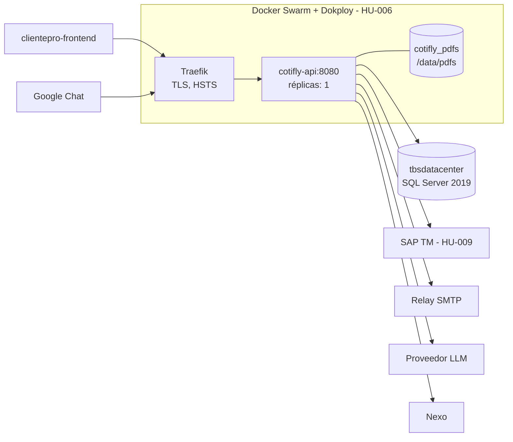

# 3. Infraestructura

Contenido:

- [3.1 Contenedor e imagen](#31-contenedor-e-imagen)
- [3.2 Variables de entorno y configuración](#32-variables-de-entorno-y-configuración)
- [3.3 Base de datos](#33-base-de-datos)
- [3.4 Configuración por área](#34-configuración-por-área)
- [3.5 Servicios externos](#35-servicios-externos)

## 3.1 Contenedor e imagen

- Un solo `Dockerfile` multi-stage y un único servicio expuesto: `Cotifly.Api` (ADR-007, #27). Sin `docker-compose` **para ejecución local** (desviación de lo que pide HU-003.8, #14, registrada en ADR-007).
- Despliegue: Docker Swarm + Dokploy (HU-006). El manifiesto de Swarm (`infra/stack*.yml`, formato compose para `docker stack deploy`/Dokploy) sí existe y lo adapta al backend .NET HU-006.6 (#30).
- Nombre lógico de la imagen: **`cotifly-api`**. En local `cotifly-api:dev`; en el registry `${REGISTRY}/cotifly-api:<versión>` (la convención de tags la fija HU-006.4, #28).

**Imagen de contenedor (`Dockerfile`, #27):**

| Aspecto | Decisión |
|---|---|
| Etapa `build` | `mcr.microsoft.com/dotnet/sdk:10.0.401-noble` (tag fijo, `ARG SDK_VERSION`). Restore del proyecto Api en capa propia (solo `global.json`, `Directory.*.props`, `.editorconfig` y los `.csproj`), luego `dotnet publish` Release `--no-restore -r linux-x64 --self-contained false`, `UseAppHost=false`, sin `.pdb`, solo recursos `es`, sin `web.config`, `InformationalVersion=$VERSION` |
| Etapa `runtime` | `mcr.microsoft.com/dotnet/aspnet:10.0.12-noble-chiseled-extra` (tag fijo, `ARG ASPNET_VERSION`): Ubuntu 24.04 mínimo con ICU y tzdata, sin shell, sin `apt`, sin SDK |
| Metadatos | `ARG VERSION=dev`, `ARG VCS_REF=unknown`, `ARG BUILD_DATE` → etiquetas `org.opencontainers.image.{title,description,version,revision,created,source,vendor}`. Ej.: `--build-arg VERSION=1.0.0 --build-arg VCS_REF=$(git rev-parse --short HEAD) --build-arg BUILD_DATE=$(date -u +%Y-%m-%dT%H:%M:%SZ)` |
| Puerto | Kestrel en **8080** (`ASPNETCORE_HTTP_PORTS=8080`, `EXPOSE 8080`). No usar `ASPNETCORE_URLS` salvo necesidad; si se usa, la sonda lo respeta |
| Usuario | `app` (UID 1654, `$APP_UID`), no root. `/app` y sus binarios son de root (solo lectura para `app`) |
| Escritura | Solo `/data/pdfs` (dueño `app`), y solo aplica si los PDFs se guardan en modo volumen (HU-003.7 mantiene el volumen; S3/MinIO queda pendiente, ADR-012). Con varias réplicas un volumen local no se comparte entre nodos: lo decide HU-006.6 (ADR-012). No se declara `VOLUME` para no crear volúmenes anónimos en cada `docker run` |
| `HEALTHCHECK` | `dotnet /app/Cotifly.Api.dll --healthcheck` cada 30 s, timeout 5 s, 3 reintentos, `start-period` 20 s. `clsSondaSalud` hace `GET /health` y termina con 0/1 sin levantar el host web. Destino: primera URL `http://` de `ASPNETCORE_URLS` (comodines `+`, `*`, `0.0.0.0`, `[::]` → 127.0.0.1; `https://` se ignora), si no el primer puerto de `ASPNETCORE_HTTP_PORTS`, si no 8080; sin proxy |
| Arranque fallido | Cualquier excepción al construir o arrancar el host termina el contenedor con **código 1** y un solo registro del error (sin secretos), en vez del 139 de una excepción no controlada en el PID 1 |
| Zona y cultura | `Zona:ZonaHoraria=America/Bogota` se valida al arrancar (tzdata); `InvariantGlobalization=false` en `Cotifly.Api.csproj` para el formato es-CO (ICU). El contenedor y los logs quedan en UTC (sin `TZ`) |
| Fuera de la imagen | `tests/`, `specs/`, documentación, `bin/`/`obj/`, `.env` (`.dockerignore` es lista blanca: solo props, `global.json`, `.editorconfig` y `src/`) |

Por qué `chiseled-extra`: la variante `chiseled` sin `-extra` no trae ICU ni tzdata (la app no arrancaría: `America/Bogota` no existiría) y `aspnet:10.0` (Ubuntu completo) sí los trae pero pesa más y agrega shell y `apt`. Medido el 2026-09-24: imagen final **87,6 MB comprimida / ~304 MB en disco** (Docker Desktop), frente a 95,9 MB / 340 MB de la base `aspnet:10.0` sola y 70,7 MB comprimida de la base `chiseled-extra`.

- **Sin `.pdb`:** las trazas de excepción no traen número de línea. Alternativa a evaluar en HU-006.4 (#28): `DebugType=embedded` + `PathMap` (símbolos dentro del `.dll`, sin rutas del equipo de build).
- **Formato de moneda:** ICU da `3294798m.ToString("C0", es-CO)` = `$ 3.294.798` (con espacio). #11 usa un formateador propio, `clsFormatoMoneda`, que agrupa con la cultura invariante y cambia la coma por punto: `$3.294.798` exacto como el Python y sin depender de ICU ni de la cultura del proceso (probado con es-CO, en-US, de-DE, fr-FR, ja-JP e invariante). La fecha larga usa meses propios (`clsFormatoFecha`).
- **Fuentes y recursos del PDF (#11):** chiseled no trae fontconfig ni fuentes del sistema, así que todo va embebido en `Cotifly.Infraestructura.dll` y se carga con `IFontResolver` (`clsResolvedorFuentes`): Liberation Sans 2.1.5 (4 caras TTF, ~1,6 MB, **SIL Open Font License 1.1**, métricas de Arial; la licencia viaja en `/app/licencias/LiberationSans-OFL.txt`), el logo (`logo_botero_soto.png`) y las 7 imágenes por línea de `mcp_server/pdf/assets/imagenes del pdf`, renombradas a ASCII (`nacional.jpg`, `distribucion.jpg`, `almacenamiento.jpg`, `itr.jpg`, `importacion.jpg`, `exportacion.jpg`, `andino.jpg`) y reducidas de PNG de ~2 MB a JPEG de 1200 px de ancho (calidad 88, ~1,2 MB en total; en el PDF se ven a 122 mm, ~250 ppp). La fuente `Stilu` del CSS no tiene licencia disponible (pendiente de negocio, ADR-006). Imagen final medida el 2026-09-24: **94,6 MB comprimida / ~324 MB en disco** (+7 MB por PDFsharp-MigraDoc, MailKit/MimeKit/BouncyCastle, fuentes e imágenes).
- **Verificación dentro de la imagen (#11):** una sonda desechable (fuera del repo) cargó los ensamblados de `/app` con un `AssemblyLoadContext` sobre `Cotifly.Api.deps.json` y renderizó 3 PDF con `docker run --rm --entrypoint dotnet ... cotifly-api:dev /sonda/Sonda11.dll` como usuario `app`, sin `/etc/fonts` ni `/usr/share/fonts`: 3, 3 y 2 páginas, solo `Liberation Sans` y `Liberation Sans,Bold` embebidas como subconjunto (`/FontFile2`), "Cel" solo con teléfono, bloque aduanero solo en Internacional.
- **`ARG VERSION` y MSBuild (#11):** todo `ARG` de la etapa llega a los `RUN` como variable de entorno y MSBuild la lee como propiedad sin distinguir mayúsculas: `VERSION=dev` se volvía `$(Version)=dev` y el restore fallaba con `NU1105` ("dev" no es una versión válida). Estaba oculto porque la capa del restore venía de caché; apareció al cambiar los `.csproj`. Ahora el `ARG VERSION` se declara después del restore y el publish corre con `env -u VERSION` (el valor solo entra como `InformationalVersion`).

Las pruebas **no** corren dentro de `docker build`: el contexto no incluye `tests/` y las de integración necesitan el socket de Docker (Testcontainers), que no existe durante el build. Corren aparte ([06-ejecucion-local](06-ejecucion-local.md), [08-testing](08-testing.md) y en CI: `.github/workflows/backend-dotnet.yml`).

**Actualizar los tags de .NET** (parche mensual): leer el último parche en las [release notes de .NET 10](https://github.com/dotnet/core/blob/main/release-notes/10.0/releases.json) o con `docker pull mcr.microsoft.com/dotnet/sdk:10.0` + `docker image inspect` (`DOTNET_SDK_VERSION`, `ASPNET_VERSION`); cambiar `SDK_VERSION` y `ASPNET_VERSION` juntos en el `Dockerfile` (el runtime de la imagen debe ser el que trae ese SDK); reconstruir, correr las pruebas y repetir la verificación de [06-ejecucion-local](06-ejecucion-local.md). `global.json` (`10.0.100` + `latestFeature`) acepta cualquier SDK 10.0.x, no hace falta tocarlo.

**Para HU-006.6 (#30), manifiestos de Swarm/Dokploy** (este issue no los toca). Hoy el Python expone `bot-orquestador` en **8000** (Traefik `loadbalancer.server.port=8000` en `infra/stack.dokploy.yml` e `infra/stack.staging.yml`; `deploy/docker-compose.swarm.yml` publica `8091 → 8000`) y `bot-mcp` en 8080 solo en la red interna. Con el backend .NET:
- Puerto **8080** en el `target` y en `traefik.http.services.<svc>.loadbalancer.server.port`.
- Si el stack redefine el healthcheck, en forma exec: `test: ["CMD", "dotnet", "/app/Cotifly.Api.dll", "--healthcheck"]`. Nunca `CMD-SHELL`: la imagen no tiene shell.
- Readiness con el healthcheck de Traefik contra `/health/ready`: saca la tarea del balanceo mientras la base no está lista, sin que Swarm la reinicie (el `HEALTHCHECK` de la imagen es solo de vida, `/health`).
- Memoria: cada sonda levanta un proceso `dotnet` aparte (~40–70 MB transitorios cada 30 s); contarlo en `resources.limits.memory`.
- Retirar `bot-mcp` (sus herramientas viven en el monolito, ADR-002).
- Variables: `ConnectionStrings__Cotifly` y `ConnectionStrings__Identidad` (HU-007 debe usar estos nombres, no `SQLSERVER_CONNECTION_STRING`).
- SAP TM: `SapTm__Modo`, `SapTm__ExportPath` (y el montaje de solo lectura del export) o `SapTm__Url`/`SapTm__User`/`SapTm__Pass` (secreto), en lugar de `SAP_TM_*` del Python (ver "Integraciones externas").
- Logs en UTC.

Medida del 2026-09-25 (#14, `docker build --no-cache` con el código de #16): **345 MB en disco** según `docker image ls`.

## 3.2 Variables de entorno y configuración

**Variables de entorno:** se documentan en `.env.example` (copiar a `.env`, que no se versiona). Ningún secreto va en `appsettings*.json` ni en el código.

ASP.NET Core traduce `__` (doble guion bajo) a `:`: `Jwt__SigningKey` es la clave `Jwt:SigningKey`, y `Cors__OrigenesPermitidos__0` el primer elemento de `Cors:OrigenesPermitidos`. En QA y producción los valores llegan por Dokploy (HU-006.5).

Resumen de todas las variables de [`.env.example`](../.env.example). "Production" indica si la API no arranca sin la variable (o con un valor de ejemplo) en ese entorno; las columnas de detalle enlazan a la tabla de cada área.

| Variable | Por defecto | Secreto | Obligatoria en Production | Detalle |
|---|---|---|---|---|
| `ASPNETCORE_ENVIRONMENT` | sin valor en la imagen (= `Production`) | no | — | Lo devuelve `GET /health` |
| `ASPNETCORE_HTTP_PORTS` | `8080` (fijado en la imagen) | no | no | [3.1](#31-contenedor-e-imagen) |
| `Zona__ZonaHoraria` | `America/Bogota` | no | no (debe existir en tzdata) | [3.1](#31-contenedor-e-imagen) |
| `ConnectionStrings__Cotifly` | vacío | **sí** | **sí** | [3.3](#33-base-de-datos) |
| `ConnectionStrings__Identidad` | vacío | **sí** | **sí** | [3.3](#33-base-de-datos) |
| `Identidad__Esquema`, `Identidad__TablaUsuarios`, `Identidad__TablaUsuarioRoles`, `Identidad__TablaRoles` | `dbo`, `tblSAPUsuariosApp`, `tblSAPUsuarioRoles`, `tblSAPRoles` | no | no | [Autenticación](#autenticación) |
| `Jwt__Issuer`, `Jwt__Audience` | `cotifly-api`, `clientepro` | no | no | [Autenticación](#autenticación) |
| `Jwt__SigningKey` | vacío (clave efímera fuera de Production) | **sí** (≥ 32 bytes) | **sí** | [Autenticación](#autenticación) |
| `Jwt__AccessMinutes`, `Jwt__RefreshDays` | `60`, `30` | no | no | [Autenticación](#autenticación) |
| `LimiteAuth__PeticionesPorVentana`, `LimiteAuth__VentanaSegundos` | `30`, `60` | no | no | [Autenticación](#autenticación) |
| `Cors__OrigenesPermitidos__N` | vacío | no | **sí** (al menos uno) | [Seguridad HTTP](#seguridad-http) |
| `ForwardedHeaders__Habilitado`, `ForwardedHeaders__ProxiesConocidos__N`, `ForwardedHeaders__RedesConocidas__N`, `ForwardedHeaders__LimiteSaltos` | `false`, vacío, vacío, `1` | no | no (con `Habilitado=true`, al menos un proxy o red) | [Seguridad HTTP](#seguridad-http) |
| `SeguridadHttp__LimiteCuerpoWebBytes` | `65536` | no | no | [Seguridad HTTP](#seguridad-http) |
| `SapTm__SalesOrgDefault` | `50000005` | no | no | [SAP TM](#integraciones-externas-y-sap-tm) |
| `SapTm__Modo` | vacío (política de la línea) | no | no (aviso al arrancar) | [SAP TM](#integraciones-externas-y-sap-tm) |
| `SapTm__ExportPath` | vacío | no | con `export_json` | [SAP TM](#integraciones-externas-y-sap-tm) |
| `SapTm__Url`, `SapTm__User`, `SapTm__SapClient` | vacío | no | `Url` y `User` con `odata` | [SAP TM](#integraciones-externas-y-sap-tm) |
| `SapTm__Pass` | vacío | **sí** (≥ 8) | con `odata` | [SAP TM](#integraciones-externas-y-sap-tm) |
| `Pdf__StorageModo`, `Pdf__StorageDir`, `Pdf__BaseUrl` | `volumen`, `/data/pdfs`, vacío | no | no | [PDF y correo](#pdf-y-correo) |
| `Correo__Habilitado`, `Correo__Modo` | `false`, `smtp_relay` | no | no | [PDF y correo](#pdf-y-correo) |
| `Correo__SmtpRelay__Host`, `__Port`, `__FromFallback`, `__TimeoutSeg` | vacío, `25`, `notificaciones@boterosoto.com.co`, `20` | no | `Host` con el correo habilitado | [PDF y correo](#pdf-y-correo) |
| `IA__Proveedor`, `IA__Modelo`, `IA__Endpoint` | vacío (agente sin configurar) | no | no | [Agente de IA](#agente-de-ia) |
| `IA__ApiKey`, `IA__Fallbacks__N__ApiKey` | vacío | **sí** | según el proveedor | [Agente de IA](#agente-de-ia) |
| `IA__MaxTokens`, `IA__MaxIteraciones`, `IA__SoportaJsonSchema`, `IA__MinutosSinJsonSchema`, `IA__JsonSchemaEstricto`, `IA__Rpm`, `IA__TimeoutSeg` | `4096`, `12`, `true`, `30`, `false`, `8`, `60` | no | no | [Agente de IA](#agente-de-ia) |
| `IA__Fallbacks__N__Proveedor`, `__Modelo`, `__Endpoint` | vacío | no | no | [Agente de IA](#agente-de-ia) |
| `LimiteChat__PeticionesPorVentana`, `LimiteChat__VentanaSegundos` | `20`, `60` | no | no | [Agente de IA](#agente-de-ia) |
| `Sesiones__LimiteTokens`, `Sesiones__TtlHoras`, `Sesiones__BarridoMinutos`, `Sesiones__EsperaTurnoSegundos` | `6000`, `24`, `60`, `3` | no | no | [Agente de IA](#agente-de-ia) |
| `GChat__ProjectNumber`, `GChat__SupportSpace`, `GChat__CapacidadCola` | vacío, vacío, `200` | no | no | [Google Chat](#google-chat) |
| `GChat__VerificarJwt` | `true` | no | `false` no arranca | [Google Chat](#google-chat) |
| `GChat__SaJson` | vacío | **sí** | no | [Google Chat](#google-chat) |
| `Pdf__ClaveFirmaUrl` | vacío (clave efímera fuera de Production) | **sí** (≥ 32) | con Google Chat configurado | [Google Chat](#google-chat) |
| `Pdf__MinutosUrlFirmada` | `15` | no | no | [Google Chat](#google-chat) |
| `ConnectionStrings__Regional` | — | **sí** | planeada (DWCubosEBSSAP) | [3.3](#33-base-de-datos) |
| `Nexo__UrlBase` | vacío (clientes, municipios, catálogos de flete y cubicación responden `*_NO_DISPONIBLE`) | no (sin token: `X-Portal-Usuario-Id`) | no | [Nexo](#nexo) |
| `Grovity__*` | — | **sí** (claves) | planeadas; solo si se aprueba Grovity desde el agente (ADR-005). El código no las lee | [3.5](#35-servicios-externos) |
| Costeo de Nexo | — | por definir | planeado (HU-005.5 en adelante); `.env.example` no declara variables todavía | [3.5](#35-servicios-externos) |

**Configuración validada al arrancar** (`src/Cotifly.Infraestructura/Configuracion/`): cada sección se enlaza a una clase `clsOpcionesXxx` con DataAnnotations y se registra con `AddOpcionesValidadas<T>()`, que agrega `ValidateOnStart` y el validador de secretos. En `Production`, una propiedad marcada con `[clsSecreto]` vacía, con placeholder (`<secreto>`, `cambiar…`, `changeme`, `dev`) o más corta que su mínimo impide arrancar; el mensaje nombra la clave, nunca el valor. Opciones actuales: `Zona:ZonaHoraria` (por defecto `America/Bogota`, debe existir en el sistema), `ConnectionStrings:Cotifly` / `ConnectionStrings:Identidad` (`[clsSecreto]` + `clsValidadorOpcionesConexiones`, ver [03-infraestructura](03-infraestructura.md)), `Identidad:Esquema` y `SapTm:SalesOrgDefault` (`clsOpcionesMargen`, definida en Aplicacion porque la consume el resolver de margen; por defecto `50000005`, obligatoria y de máximo 12 caracteres, #10) y `SapTm:Modo` / `ExportPath` / `Url` / `User` / `Pass` (`clsOpcionesSapTm` + `clsValidadorOpcionesSapTm`, #13: modo desconocido, `export_json` sin ruta u `odata` sin URL, usuario o clave impiden arrancar en cualquier entorno; `Pass` lleva `[clsSecreto(Opcional = true)]`, que en `Production` solo revisa el valor cuando existe, porque sin `odata` no hace falta clave; ver [03-infraestructura](03-infraestructura.md)), `Pdf:BaseUrl` (`clsOpcionesPdf`, Aplicacion) y `Pdf:StorageDir` / `StorageModo` (`clsOpcionesAlmacenPdf` + validador: solo `volumen`), y `Correo:Habilitado` (`clsOpcionesCorreo`, Aplicacion) y `Correo:Modo` / `SmtpRelay:*` (`clsOpcionesCorreoTransporte` + validador: con el correo habilitado exige `smtp_relay`, host, remitente de respaldo, puerto 1–65535 y tiempo 1–300 s) (#11, ver [03-infraestructura](03-infraestructura.md)), y `Jwt:*` (`clsOpcionesJwt`: `SigningKey` con `[clsSecreto(LargoMinimo = 32)]` más `clsValidadorOpcionesJwt`, que exige 32 bytes en cualquier entorno si tiene valor) e `Identidad:TablaUsuarios` / `TablaUsuarioRoles` / `TablaRoles` (#12, ver [03-infraestructura](03-infraestructura.md)). `LimiteAuth:*` se valida en la Api (`clsOpcionesLimiteAuth`, DataAnnotations + `ValidateOnStart`), igual que `Cors:OrigenesPermitidos` (`clsValidadorOpcionesCors`: obligatorio en Production, orígenes exactos), `ForwardedHeaders:*` (`clsValidadorOpcionesEncabezadosReenviados`: IPs y CIDR válidos, al menos uno si está habilitado) y `SeguridadHttp:LimiteCuerpoWebBytes` (#12 parte B, ver [03-infraestructura](03-infraestructura.md)). Desde #12 parte C: `IA:*` (`clsOpcionesIA` + `clsValidadorOpcionesIA`: proveedor conocido, modelo, clave y endpoint según el proveedor, también en los respaldos; `ApiKey` con `[clsSecreto(Opcional = true)]`) y `IA:MaxTokens` / `MaxIteraciones` (`clsOpcionesAgente`, Aplicación), `Sesiones:*` (`clsOpcionesSesiones`, Aplicación), `GChat:*` (`clsOpcionesGoogleChat` + validador: número de proyecto, URLs, cuenta de servicio legible, space de soporte; `SaJson` es secreto opcional), `Pdf:ClaveFirmaUrl` / `MinutosUrlFirmada` (`clsOpcionesFirmaUrlPdf`) y `LimiteChat:*` (Api, ver [03-infraestructura](03-infraestructura.md)). Desde #20: `Nexo:UrlBase` (`clsOpcionesNexo`, sin validaciones; vacía es un valor válido, ver [Nexo](#nexo)).

## 3.3 Base de datos

**Base de datos (ADR-008, #9).** SQL Server 2019 corporativo (`tbsdatacenter`), esquema `dbo_cotifly` dentro de `dbTarifario_Nexo_Pruebas`. EF Core **Database First**: `clsCotiflyDbContext` mapea a mano (Fluent API, `Comun/Persistence/Configurations/`) las tablas que crean los scripts; `HasDefaultSchema("dbo_cotifly")`, tablas PascalCase y columnas camelCase explícitas con su tipo SQL, `UseCompatibilityLevel(150)`. **No hay migraciones EF**: el esquema cambia solo con scripts `../db/migrations_mssql/000N_*.sql` idempotentes:

| Script | Contenido | Estado |
|---|---|---|
| `0001_script_bd_cotifly_sqlserver.sql` | 10 tablas, vistas y seed (HU-002.4) | aplicado en `tbsdatacenter` |
| `0002_identidad_estado_agente.sql` | `Sesiones.estadoAgente` (JSON) y `Sesiones.usuarioId`; `UsuariosWeb.idUsuarioExterno`; `Roles` (sembrada con `comercial` y `gerente_comercial` sin rol externo) y `UsuariosRoles` (en lugar de la `RolesMapeo` del borrador, #12); `TokensRefresco`, `TokensRevocados`; índices de consulta | **extensión aditiva pendiente de aprobación** (Sara + scalderon-bs). Paso de un solo sentido: después del 0002 **no** se re-ejecuta el 0001 (ver encabezado del 0002 y ADR-008) |
| `0003_metricas_reenviadas.sql` | `CREATE OR ALTER VIEW vActividadPorComercial`: `numCotizacionesEnviadas` cuenta `enviada` y `reenviada` (#12 parte B); mismas columnas, sin tocar tablas ni datos | **pendiente de aprobación**, idempotente |
| `0004_costeo_nexo.sql` | Costeo en Nexo (HU-005.8, #24; ADR-015): 29 columnas nuevas en `Cotizaciones` (formulario ampliado: tipo de solicitud, deadline, valor estimado, referencia, horas de cargue y descargue, origen, destino, vehículo, carrocería, tipología, clase de viaje, clase de contenedor, exclusivo, consolidado, retorno y levante del contenedor, aprovisionamiento, peso, valor de la mercancía; seguimiento: `cotizacionNexoId`, `motivoEstadoCosteo`, marcas del envío y del polling, `costeoConsultasFallidas`, `serviciosConexos` JSON), tabla `CotizacionPosiciones` (cubicaje, 1 a N) e índice filtrado de la agenda del polling. Todo nullable salvo `costeoConsultasFallidas` (DEFAULT 0) | **pendiente de aprobación** (scalderon-bs + DBA, coordinación con HU-002 como el 0002 y el 0003), idempotente. `/health/ready` responde 503 `esquema incompleto: falta 0004` si falta |

- `updatedAt` (y `createdAt` si la entidad no lo trae) los fija `clsMarcasTiempoInterceptor` con `IClsReloj`: el esquema no tiene triggers.
- `Sesiones.estadoAgente` guarda `clsEstadoConversacion` como JSON camelCase (`clsConvertidorEstadoConversacion`).
- `clsIdentidadDbContext` (solo lectura, `NoTracking`, `SaveChanges` lanza) lee de `dbsolucionesti` las tres tablas del login (#12): `tblSAPUsuariosApp` (`ID` NUMERIC, `NOMBREUSUARIO`, `DESCRIPCIONUSUARIO`, `EMAIL`; nunca `CLAVE`), `tblSAPUsuarioRoles` (`ID`, `IDUSUARIO`, `IDROLES`, INT) y `tblSAPRoles` (`IDROLES`, `DESCRIPCION`). Esquema y tablas configurables (`Identidad:Esquema` = `dbo`, `Identidad:TablaUsuarios`, `Identidad:TablaUsuarioRoles`, `Identidad:TablaRoles`) mientras el DBA confirma la ubicación real.
- **Permisos de `cotifly_app` en `dbTarifario_Nexo_Pruebas`** (pedir al DBA): la base es compartida con otras aplicaciones, así que los permisos van por **esquema**, no por base: `GRANT SELECT, INSERT, UPDATE, DELETE, EXECUTE ON SCHEMA::dbo_cotifly TO cotifly_app` (tablas y vistas de Cotifly; `EXECUTE` queda para procedimientos futuros del esquema). **Sin** `db_datareader` ni `db_datawriter`, que darían acceso a todos los esquemas. Los candados (`sp_getapplock`: folio, correo y turno de la sesión) solo exigen que `cotifly_app` sea usuario de la base (rol `public`). Nada de DDL: el esquema lo cambian los scripts `db/migrations_mssql/` con un usuario administrador.
- **Permisos de solo lectura para `cotifly_app` en `dbsolucionesti`** (pedir al DBA): `SELECT` por columna sobre `tblSAPUsuariosApp (ID, NOMBREUSUARIO, DESCRIPCIONUSUARIO, EMAIL)` —**sin `CLAVE`**, o una vista sin esa columna—, `tblSAPUsuarioRoles (ID, IDUSUARIO, IDROLES)` y `tblSAPRoles (IDROLES, DESCRIPCION)`. Nada de INSERT/UPDATE/DELETE.
- **Antes de habilitar el login:** fijar los `IDROLES` de ClientePro en `dbo_cotifly.Roles` (`UPDATE dbo_cotifly.Roles SET idRolExterno = <IDROLES> WHERE codigo = 'comercial'`, ídem `gerente_comercial`). Sin eso nadie entra (fail-closed, ADR-009). **Con `sqlcmd` usar `-I`** (QUOTED_IDENTIFIER ON): `Roles` tiene un índice único filtrado y SQL Server rechaza el `UPDATE` con QUOTED_IDENTIFIER OFF, el valor por defecto de `sqlcmd` (SSMS lo trae activado). Igual al correr el 0002.
- `DWCubosEBSSAP` (`ConnectionStrings:Regional`, regional del comercial desde `DimEjecutivo`) **todavía no está conectada**: la variable figura como planeada en `.env.example` y `UsuariosWeb.regional` queda nula (la descarga de PDF ajenos y las métricas del gerente son fail-closed mientras tanto, ver [10-operacion](10-operacion.md#106-riesgos-y-limitaciones-conocidos)).

**Cadenas de conexión** (`clsOpcionesConexiones`, variables en `.env.example`):

| Clave | Uso | Variable |
|---|---|---|
| `ConnectionStrings:Cotifly` | `dbo_cotifly`, lectura y escritura | `ConnectionStrings__Cotifly` |
| `ConnectionStrings:Identidad` | `dbsolucionesti`, solo lectura (usuarios y roles de ClientePro) | `ConnectionStrings__Identidad` |

Siempre SQL login (`cotifly_app`, pendiente con el DBA): el contenedor Linux no admite autenticación integrada. En `Production` la API no arranca si una cadena falta, es un placeholder, usa `Trusted_Connection`/`Integrated Security` o su `Password` es de ejemplo. Fuera de `Production` pueden quedar vacías: la API arranca y `GET /health/ready` responde 503.

Para desarrollo local, `scripts/levantar-local.ps1` y `scripts/levantar-local.sh` crean las dos bases en un SQL Server 2019 en contenedor, aplican `0001` a `0004` y crean el login `cotifly_app` con exactamente los permisos de arriba (`SELECT`, `INSERT`, `UPDATE`, `DELETE` y `EXECUTE` sobre el esquema `dbo_cotifly`; `SELECT` por columna sin `CLAVE` en `dbsolucionesti`) y los **verifican** conectados como `cotifly_app` (`scripts/sql/dev-04-verificar-permisos.sql`: lee y escribe en `dbo_cotifly`, lee las vistas y toma un `sp_getapplock`, pero recibe permiso denegado en otro esquema de la base y en la columna `CLAVE`). Ver [06-ejecucion-local](06-ejecucion-local.md#62-entorno-local-completo-con-sql-server).

## 3.4 Configuración por área

### PDF y correo

**PDF y correo (#11).**

| Clave | Por defecto | Uso | Variable |
|---|---|---|---|
| `Pdf:StorageDir` | `/data/pdfs` | Carpeta del almacén (volumen; en la imagen es la única carpeta escribible por `app`) | `Pdf__StorageDir` |
| `Pdf:StorageModo` | `volumen` | Único implementado; `s3` no arranca (diferido, ADR-012) | `Pdf__StorageModo` |
| `Pdf:BaseUrl` | vacío | Base de `pdf_url` (`{BaseUrl}/pdfs/{folio}.pdf`); vacía deja la URL relativa, servida por `GET /pdfs/{archivo}` (#12) | `Pdf__BaseUrl` |
| `Correo:Habilitado` | `false` | Sin habilitar, el envío responde `CORREO_DESHABILITADO` (vista previa y destinatarios previos funcionan) | `Correo__Habilitado` |
| `Correo:Modo` | `smtp_relay` | Único implementado; `wscorreos` y `smtp` no arrancan con el correo habilitado (D3) | `Correo__Modo` |
| `Correo:SmtpRelay:Host` | vacío | Relay interno (en el Python `10.10.40.62`); obligatorio con el correo habilitado | `Correo__SmtpRelay__Host` |
| `Correo:SmtpRelay:Port` | `25` | Puerto del relay | `Correo__SmtpRelay__Port` |
| `Correo:SmtpRelay:FromFallback` | `notificaciones@boterosoto.com.co` | Remitente si el comercial no tiene correo en `UsuariosWeb` | `Correo__SmtpRelay__FromFallback` |
| `Correo:SmtpRelay:TimeoutSeg` | `20` | Límite de cada operación con el relay | `Correo__SmtpRelay__TimeoutSeg` |

- Con varias réplicas, el candado de la deduplicación (`clsCandadoEnvios`) es por proceso: haría falta `sp_getapplock` (HU-006.6). Un volumen local de PDFs tampoco se comparte entre nodos (ADR-012).
- Activar el correo en producción: confirmar el transporte real con el equipo (D3), autorizar la IP del nodo en el relay y poner `Correo__Habilitado=true` y `Correo__SmtpRelay__Host`.
- **Operación (para HU-006):**
  - El `From` es el correo del comercial (`@boterosoto.com.co`) aunque sale por el relay: revisar con TI que SPF/DMARC del dominio autoricen al relay para no caer en spam.
  - `replicas: 1` en Dokploy mientras no haya `sp_getapplock` para la deduplicación ni un volumen compartido para los PDFs; con varios nodos, ambos son requisito.
  - `/data/pdfs` debe ser escribible por el UID 1654: con un volumen con nombre Docker copia el dueño de la imagen; con un bind mount, `chown 1654:1654` en el host.
  - `EventosHerramienta` guarda entradas con datos personales (correos de clientes, nombres, NIT): definir la retención y la purga con datos/seguridad.

### Autenticación

**Autenticación (#12, ADR-009).**

| Clave | Por defecto | Uso | Variable |
|---|---|---|---|
| `Jwt:Issuer` | `cotifly-api` | Claim `iss` emitido y exigido | `Jwt__Issuer` |
| `Jwt:Audience` | `clientepro` | Claim `aud` emitido y exigido | `Jwt__Audience` |
| `Jwt:SigningKey` | vacío | Clave HS256, **secreto**: al menos 32 bytes; en Production obligatoria y sin placeholders. Vacía fuera de Production: clave efímera por proceso (aviso en el log) | `Jwt__SigningKey` |
| `Jwt:AccessMinutes` | `60` | Vigencia del access (1–1440) | `Jwt__AccessMinutes` |
| `Jwt:RefreshDays` | `30` | Vigencia absoluta de la sesión de refresh desde el login (1–365) | `Jwt__RefreshDays` |
| `Identidad:Esquema` | `dbo` | Esquema de las tablas de `dbsolucionesti` | `Identidad__Esquema` |
| `Identidad:TablaUsuarios` / `TablaUsuarioRoles` / `TablaRoles` | `tblSAPUsuariosApp` / `tblSAPUsuarioRoles` / `tblSAPRoles` | Nombres de las tablas | `Identidad__TablaUsuarios`... |
| `LimiteAuth:PeticionesPorVentana` / `VentanaSegundos` | `30` / `60` | Límite de `/api/auth/*` por IP (429 al pasarlo) | `LimiteAuth__PeticionesPorVentana`... |

- Con varias réplicas todas deben compartir `Jwt:SigningKey`; un logout tarda hasta 60 s en verse en las demás.
- Detrás de Traefik la IP que ve el límite es la del proxy mientras no se configuren los encabezados reenviados (`ForwardedHeaders:*`, abajo).

### Seguridad HTTP

**Seguridad HTTP (#12, parte B).** `clsOpcionesCors`, `clsOpcionesEncabezadosReenviados` y `clsOpcionesSeguridadHttp` (Api, `ValidateOnStart`):

| Clave | Por defecto | Uso | Variable |
|---|---|---|---|
| `Cors:OrigenesPermitidos[]` | vacío | Orígenes exactos del frontend de ClientePro (`https://host[:puerto]`, sin ruta, sin `/` final, sin comodines). **Obligatorio en Production** (no arranca vacío). Métodos GET/POST/PUT, encabezados `Authorization` y `Content-Type`, sin credenciales, preflight cacheado 10 min | `Cors__OrigenesPermitidos__0`, `__1`... |
| `ForwardedHeaders:Habilitado` | `false` | Toma la IP real de `X-Forwarded-For` (y el esquema de `X-Forwarded-Proto`) solo si la conexión viene de un proxy o red conocidos: la usa el límite de `/api/auth/*` | `ForwardedHeaders__Habilitado` |
| `ForwardedHeaders:ProxiesConocidos[]` / `RedesConocidas[]` | vacío | IPs de Traefik o redes CIDR (la overlay de Swarm, p. ej. `10.0.0.0/8`). Con `Habilitado=true` al menos una es obligatoria; una IP o CIDR inválido no arranca | `ForwardedHeaders__ProxiesConocidos__0`, `ForwardedHeaders__RedesConocidas__0` |
| `ForwardedHeaders:LimiteSaltos` | `1` | Saltos de proxy aceptados en `X-Forwarded-For` (1–10) | `ForwardedHeaders__LimiteSaltos` |
| `SeguridadHttp:LimiteCuerpoWebBytes` | `65536` | Tamaño máximo del cuerpo en `/web/*` (1 KB–10 MB); más grande → 413 `ErrorWeb` | `SeguridadHttp__LimiteCuerpoWebBytes` |

- Todas las respuestas llevan `X-Content-Type-Options: nosniff`, `X-Frame-Options: DENY`, `Referrer-Policy: no-referrer` y `Content-Security-Policy: default-src 'none'; frame-ancestors 'none'`; `/web/*` y `/pdfs/*` además `Cache-Control: no-store`. Kestrel no envía `Server`. HSTS lo pone Traefik (TLS termina ahí).
- Para HU-006.6: en Dokploy fijar `Cors__OrigenesPermitidos__0` con el dominio real de `clientepro-frontend` (pendiente, lo confirma frontend) y `ForwardedHeaders__Habilitado=true` con la red overlay de Traefik en `ForwardedHeaders__RedesConocidas__0`.

### Integraciones externas y SAP TM

**Integraciones externas (#13, HU-003.7).**

| Integración del Python | En .NET | Configuración |
|---|---|---|
| SAP TM, export JSON (`export_fuente.py`) | `clsFuenteMargenExportJson` | `SapTm__Modo=export_json`, `SapTm__ExportPath` |
| SAP TM, OData en vivo (`odata_fuente.py`) | `clsFuenteMargenOData` | `SapTm__Modo=odata`, `SapTm__Url`, `SapTm__User`, `SapTm__Pass` |
| Tarifario en Google Drive (`DriveFlatFileProvider`) | **No se porta**: retirado el 2026-09-23, el costeo vendrá de Nexo (HU-005.5 en adelante) | ninguna |
| Búsqueda de clientes (no existía en el Python) | `clsBuscadorClientesNexo`, más municipios, catálogos de flete y cubicación de Nexo | `Nexo__UrlBase` ([Nexo](#nexo)) |
| Sincronización a Google Sheets (Looker Studio) | **Diferida**, pendiente en ADR-012 (Looker directo a SQL Server, port a .NET o tablero de HU-010) | ninguna |
| PDF en S3/MinIO (`almacen_pdf.py`) | **Diferido**: se mantiene el volumen `/data/pdfs` detrás de `IClsAlmacenPdf` (#11). S3 solo si HU-006.6 despliega varias réplicas sin volumen compartido (ADR-012) | ninguna |

SAP TM:
- **Sin `SapTm__Modo`** (valor por defecto) no se consulta SAP: `obtener_margen` usa la política de la línea con el detalle "SAP TM no configurado".
- **`export_json`**: el archivo tiene la forma `{"d":{"results":[{SalesOrgId, TrqType, OrderPartyId, Value}]}}` (referencia `datos/sap_export.json` del Python; en las pruebas, `tests/fixtures/sap/rentab_cliente_muestra.json`). Se monta en el contenedor (por ejemplo `-v <carpeta>:/data/sap:ro` y `SapTm__ExportPath=/data/sap/sap_export.json`). Para reemplazarlo sin que una consulta lea un archivo a medio escribir, copiarlo con otro nombre y renombrarlo; se ve en la siguiente consulta, sin reiniciar.
- **`odata`**: `GET {SapTm__Url}/RentabClienteSet?$filter=SalesOrgId eq '…' and TrqType eq '…' and OrderPartyId eq '…'&$format=json` con autenticación Basic y `Accept: application/json`. Se toma `d.results[0].Value`. `SapTm__Url` es la URL base del servicio (ej. `https://<host>/sap/opu/odata/sap/ZGW_RENTAB_CLI_SRV`), http o https, sin usuario ni `?consulta`. Si el servicio exige mandante, `SapTm__SapClient=100` (3 dígitos) agrega `&sap-client=100`. `SapTm__User` y `SapTm__Pass` son obligatorios en todo entorno; en `Production` la clave no puede ser un placeholder ni tener menos de 8 caracteres. Las credenciales nunca se registran: la cabecera se arma por petición y los logs de `IHttpClientFactory` ocultan todas las cabeceras.
- **SAP caído** (export ausente o ilegible, HTTP ≠ 2xx tras los reintentos, más de 10 s, respuesta inválida) → política de la línea con el detalle "SAP TM no disponible: se usa la política de la línea" y un warning en el log (decisión de #13, Gherkin "Resiliencia si SAP no responde" de HU-009). `MARGEN_FUENTE_NO_DISPONIBLE` solo si la línea tampoco tiene política.
- **Avisos al arrancar** (no impiden arrancar): en `Production` sin `SapTm__Modo`, "SAP TM no configurado (SapTm:Modo vacío): todos los márgenes salen de la política de la línea"; con `export_json` y un archivo que no existe, aviso con la ruta.
- **No dejar `SapTm__Pass` puesto si no se usa OData:** es opcional sin `odata`, pero si tiene un valor de ejemplo (`<secreto>`) o corto, `Production` no arranca.
- **Activar OData en vivo (HU-009):** el código ya está (la HU pide el cliente completo, no solo la interfaz). Falta lo externo, HU-009.1: ruta de red desde el contenedor de Dokploy hasta SAP y el usuario de servicio. Con eso, HU-009.2 cambia en Dokploy `SapTm__Modo=odata`, `SapTm__Url`, `SapTm__User` y `SapTm__Pass` (secreto), sin tocar código. Se valida con al menos 3 combinaciones reales de cliente y línea antes de dejarlo en producción; la prueba `clsSapTmRealTests` (`[Trait("Categoria","sap")]`, se omite si faltan las variables) lee `SapTm__Url`/`User`/`Pass`/`SapClient` y un caso conocido en `SAPTM_PRUEBA_TRQTYPE`, `SAPTM_PRUEBA_BP` y opcional `SAPTM_PRUEBA_VALUE` (`dotnet test --filter-trait "Categoria=sap"`).
- **Criterio para HU-009.1, formato de `OrderPartyId`:** SAP suele guardar el BP con ceros a la izquierda (conversión ALPHA, ej. `0000015927`), y el BP que entrega Nexo puede venir sin ellos (`15927`). Confirmar con SAP el formato exacto contra un caso real antes de activar. **No normalizar a ciegas** (rellenar o recortar ceros sin confirmarlo puede cruzar clientes). En HU-009.2, vigilar la tasa de respuestas "sin registro en SAP TM": si es alta, lo más probable es un desajuste de formato del BP, no clientes sin margen.

### Nexo

**Nexo (HU-005.2, HU-005.3, HU-005.4, HU-005.13, costeo HU-005.5 en adelante).** La URL es `Nexo:UrlBase` (`clsOpcionesNexo`, sin validaciones: Nexo todavía no es obligatorio en todos los ambientes); el ritmo del polling del costeo va en `CosteoNexo:*` (`clsOpcionesCosteoNexo`, validada al arrancar, ADR-015). Arquitectura de los adaptadores en [2.14](02-arquitectura.md#214-integración-con-nexo).

| Clave | Por defecto | Uso | Variable |
|---|---|---|---|
| `Nexo:UrlBase` | vacío | Raíz de Nexo **sin `/api`** ni barra final (ej. `https://nexo.boterosoto.com.co`). Vacía: `GET /web/clientes?q=` y `buscar_cliente` responden `CLIENTE_BUSQUEDA_NO_DISPONIBLE`, `GET /web/municipios` `MUNICIPIOS_NO_DISPONIBLE`, `GET /web/catalogos-flete` `CATALOGOS_FLETE_NO_DISPONIBLE`, `POST /web/cubicacion` `CUBICACION_NO_DISPONIBLE` y el envío a costeo deja la cotización en `error_envio` | `Nexo__UrlBase` |
| `CosteoNexo:IntervaloInicialSegundos` | 5 | Primera consulta del polling tras el envío y espera mínima entre consultas (1 a 3600 s) | `CosteoNexo__IntervaloInicialSegundos` |
| `CosteoNexo:IntervaloMaximoMinutos` | 15 | Espera máxima entre consultas de una cotización (1 a 1440; no menor que el inicial) | `CosteoNexo__IntervaloMaximoMinutos` |
| `CosteoNexo:FactorEdad` | 0.25 | Fracción de la edad de la solicitud que se espera hasta la siguiente consulta (0.01 a 1) | `CosteoNexo__FactorEdad` |
| `CosteoNexo:EdadMaximaHoras` | 72 | Pasada, una cotización sin costeo queda en `costeo_vencido` (1 a 720) | `CosteoNexo__EdadMaximaHoras` |
| `CosteoNexo:IntervaloTickSegundos` | 5 | Cada cuánto revisa el worker la agenda (1 a 300) | `CosteoNexo__IntervaloTickSegundos` |
| `CosteoNexo:Lote` | 20 | Cotizaciones por vuelta del worker (1 a 500) | `CosteoNexo__Lote` |
| `CosteoNexo:ReclamoSegundos` | 120 | Reclamo de una cotización mientras se consulta (61 a 3600; debe superar dos llamadas de 30 s) | `CosteoNexo__ReclamoSegundos` |
| `CosteoNexo:Habilitado` | `true` | Apaga el polling sin quitar `Nexo:UrlBase` | `CosteoNexo__Habilitado` |

Los valores del polling (5 s al inicio, hasta 15 min, 72 h) quedan **pendientes de confirmar con el equipo de Nexo** (carga y rate limiting que acepta). Fuera de rango, la API no arranca.

- **Sin token ni usuario de servicio.** Cada petición lleva `X-Portal-Usuario-Id` con el `UsuariosWeb.idUsuarioExterno` del comercial; Nexo resuelve el rol contra el mismo almacén corporativo que ClientePro. Un comercial sin `idUsuarioExterno` no puede usar estas funciones (código "no disponible"). El encabezado no se registra en los logs.
- **Rutas (resuelto en ADR-015 §8):** el código arma `{Nexo__UrlBase}/api/captura-solicitudes/clientes?q=`, `/api/captura-solicitudes/municipios`, `/api/biblioteca-sap-historico/filtros`, `/api/cubicacion` y `/api/captura-solicitudes` (alta del costeo): todas las rutas de `CONTRATO.md` de Nexo empiezan por `/api`, así que `Nexo__UrlBase` es la raíz del servicio **sin** `/api`. Se corrigieron el ejemplo de `.env.example` y la URL de las pruebas (`http://nexo-test.local`), que terminaban en `/api` y habrían dado `/api/api/...`; las rutas del código no cambiaron. La URL real de cada ambiente sigue pendiente de confirmar con el equipo de Nexo.
- **Tiempos:** consultas (clientes, municipios, catálogos, cubicación): 8 s en total, 3 s por intento y 2 reintentos (cliente HTTP `Nexo`). Costeo: 30 s en total y por intento, reintentos solo en GET (cliente HTTP `NexoCosteo`; el alta no se reintenta porque no es idempotente). No son configurables.
- **Activar en un ambiente:** fijar `Nexo__UrlBase` en Dokploy; los comerciales deben tener `idUsuarioExterno` (lo llena el login de ClientePro). No hay aviso al arrancar si falta.

### Agente de IA

**Agente de IA (#12 parte C, ADR-003).** `clsOpcionesIA` (+ `clsValidadorOpcionesIA`) en Infraestructura y `clsOpcionesAgente` en Aplicación leen la misma sección `IA`:

| Clave | Por defecto | Uso | Variable |
|---|---|---|---|
| `IA:Proveedor` | vacío | `openai` \| `azure_openai` \| `openai_compatible` \| `gemini` \| `ollama` \| `anthropic`. Vacío: agente sin configurar (la API arranca; `/web/chat` responde 200 `{texto, error: true}`) | `IA__Proveedor` |
| `IA:Modelo` | vacío | Modelo, o deployment de Azure. Obligatorio con proveedor | `IA__Modelo` |
| `IA:ApiKey` | vacío | **Secreto**. Obligatoria con `openai`, `azure_openai`, `gemini` y `anthropic`; opcional con `ollama` y `openai_compatible` | `IA__ApiKey` |
| `IA:Endpoint` | vacío | Obligatorio con `azure_openai` (`https://<recurso>.openai.azure.com`, se usa su API v1 `/openai/v1/`) y `openai_compatible` (OpenRouter: `https://openrouter.ai/api/v1`); `gemini` usa `https://generativelanguage.googleapis.com/v1beta/openai/` y `ollama` `http://localhost:11434/v1/` si no se indica | `IA__Endpoint` |
| `IA:MaxTokens` | `4096` | Tope de tokens de salida por respuesta (256–200000) | `IA__MaxTokens` |
| `IA:MaxIteraciones` | `12` | Llamadas con herramientas por turno antes de cortar (1–50) | `IA__MaxIteraciones` |
| `IA:SoportaJsonSchema` | `true` | La respuesta final se pide con `response_format` JSON Schema (#16). `false` para proveedores o modelos que no lo aceptan: se pide sin formato con el esquema en la instrucción y se valida igual. Si el proveedor lo rechaza en ejecución (400/422), el validador cambia a ese modo solo | `IA__SoportaJsonSchema` |
| `IA:MinutosSinJsonSchema` | `30` | Minutos sin JSON Schema tras un rechazo del proveedor; después vuelve a probar con esquema (1–1440) | `IA__MinutosSinJsonSchema` |
| `IA:JsonSchemaEstricto` | `false` | Modo estricto (`AdditionalProperties["strict"]`, lo lee Microsoft.Extensions.AI.OpenAI) con un esquema sin `minLength`/`maxLength`/`uniqueItems`. Solo proveedores del SDK de OpenAI; sin probar con Anthropic | `IA__JsonSchemaEstricto` |
| `IA:Rpm` | `8` | Peticiones por minuto al proveedor (limitador local; 0 lo desactiva) | `IA__Rpm` |
| `IA:TimeoutSeg` | `60` | Tiempo máximo de cada llamada (5–600 s) | `IA__TimeoutSeg` |
| `IA:Fallbacks[]` | vacío | Proveedores de respaldo (`Proveedor`, `Modelo`, `ApiKey`, `Endpoint`), en orden, ante 429, 5xx o red caída. En Production sus claves pasan la misma regla de secretos | `IA__Fallbacks__0__Proveedor`... |
| `LimiteChat:PeticionesPorVentana` / `VentanaSegundos` | `20` / `60` | Límite de `POST /web/chat` por comercial (429 de la propia API) | `LimiteChat__PeticionesPorVentana`... |
| `Sesiones:LimiteTokens` | `6000` | Ventana del historial que ve el modelo | `Sesiones__LimiteTokens` |
| `Sesiones:TtlHoras` | `24` | Horas de inactividad tras las que el barrido archiva la sesión | `Sesiones__TtlHoras` |
| `Sesiones:BarridoMinutos` | `60` | Minutos entre barridos (0 lo desactiva; el Python usaba `sesion_barrido_seg`) | `Sesiones__BarridoMinutos` |
| `Sesiones:EsperaTurnoSegundos` | `3` | Espera del candado por sesión antes de responder "todavía estoy respondiendo" (0–60) | `Sesiones__EsperaTurnoSegundos` |

- **Anthropic** usa el SDK oficial (`Anthropic` 12.50, MIT), que trae su `IChatClient` (`AsIChatClient`); no hace falta el camino compatible con OpenAI. Todos los demás proveedores usan el SDK de OpenAI (`OpenAI` 2.14 + `Microsoft.Extensions.AI.OpenAI`), así que el Python con LiteLLM se reemplaza por configuración: `gemini/gemini-2.5-flash` → `IA__Proveedor=gemini`, `IA__Modelo=gemini-2.5-flash`; `openrouter/...` → `openai_compatible` con el endpoint de OpenRouter.
- El SDK de OpenAI ya reintenta los 429 y 5xx con espera exponencial (como `llm_num_retries`); `IA:Fallbacks` actúa cuando esos reintentos se agotan.
- La API key nunca se registra: `UseLogging` de Microsoft.Extensions.AI solo escribe el contenido de los mensajes en nivel Trace (la configuración por defecto es Information).
- Pendiente de negocio (ADR-003): proveedor y modelo de producción y custodia de la clave (secreto en Dokploy, HU-006.5).

### Google Chat

**Google Chat (#12 parte C, ADR-011).** `clsOpcionesGoogleChat` (+ `clsValidadorOpcionesGoogleChat`) y `clsOpcionesFirmaUrlPdf`:

| Clave | Por defecto | Uso | Variable |
|---|---|---|---|
| `GChat:ProjectNumber` | vacío | Número del proyecto de Google Cloud de la app: audiencia del JWT. Sin él (con la verificación activa) todo evento responde 401 | `GChat__ProjectNumber` |
| `GChat:VerificarJwt` | `true` | `false` solo para pruebas con túnel (como `GCHAT_VERIFICAR_JWT`); en Production no arranca con `false` | `GChat__VerificarJwt` |
| `GChat:SaJson` | vacío | **Secreto**: JSON de la cuenta de servicio o ruta al archivo (secreto de Docker). Sin él las respuestas no se publican (warning) | `GChat__SaJson` |
| `GChat:SupportSpace` | vacío | `spaces/...` para las alertas de error del worker | `GChat__SupportSpace` |
| `GChat:CapacidadCola` | `200` | Eventos en cola; si se llena, el evento se acusa pero no se procesa | `GChat__CapacidadCola` |
| `GChat:UrlCertificados` / `GChat:ApiBase` | certificados de `chat@system.gserviceaccount.com` / `https://chat.googleapis.com/v1` | Solo se cambian en pruebas | — |
| `Pdf:ClaveFirmaUrl` | vacío | **Secreto** (≥ 32 caracteres) del enlace firmado del PDF. Obligatoria en Production con Google Chat configurado; fuera de Production, vacía = clave efímera por proceso (warning; no sirve con varias réplicas) | `Pdf__ClaveFirmaUrl` |
| `Pdf:MinutosUrlFirmada` | `15` | Vigencia del enlace firmado (1–120) | `Pdf__MinutosUrlFirmada` |

- Para abrir el PDF desde Chat, `Pdf:BaseUrl` debe ser la URL pública de la API (el enlace de la tarjeta es `{Pdf:BaseUrl}/pdfs/{folio}.pdf?t=...`).
- La cola y el worker viven en el proceso (como el Python): con varias réplicas cada una atiende los eventos que recibe; un reinicio pierde los eventos encolados sin procesar (el comercial los reenvía).
- **Activar Google Chat (HU-006):** crear la app de Chat (endpoint HTTP `https://<api>/chat/events`), la cuenta de servicio con el alcance `chat.bot`, y fijar `GChat__ProjectNumber`, `GChat__SaJson` (secreto), `Pdf__BaseUrl` y `Pdf__ClaveFirmaUrl`. Cada comercial debe haber entrado una vez desde ClientePro y su correo de Google debe coincidir con `UsuariosWeb.email`.

## 3.5 Servicios externos

| Servicio | Uso en Cotifly | Protocolo y autenticación | Estado | Si no está disponible |
|---|---|---|---|---|
| SQL Server 2019 corporativo (`tbsdatacenter`), base `dbTarifario_Nexo_Pruebas`, esquema `dbo_cotifly` | Datos propios: cotizaciones, márgenes, correos, sesiones, auditoría, identidad interna, tokens | TDS 1433, SQL login `cotifly_app` (cifrado por defecto) | Esquema 0001 aplicado; 0002 y 0003 pendientes de aprobación | `/health/ready` 503; las operaciones fallan con error controlado |
| `dbsolucionesti` (misma instancia) | Usuarios y roles de ClientePro para el login (solo lectura) | TDS, `cotifly_app` con `SELECT` por columna | Permisos pendientes con el DBA; IDROLES reales pendientes | Login y refresh responden 401 (fail-closed) |
| `DWCubosEBSSAP` | Regional del comercial (`DimEjecutivo`) | TDS, solo lectura | Planeada: no conectada | `UsuariosWeb.regional` nula: gerente limitado a su propia fila y sin PDF ajenos |
| SAP TM | Margen propuesto por cliente (`RentabClienteSet`) | Export JSON montado, u OData v2 con Basic auth y 10 s de límite | Código listo; activación en HU-009 (ruta de red y usuario de servicio) | Política de la línea con el motivo en `detalle` |
| Proveedor LLM (OpenAI, Azure OpenAI, compatible con OpenAI, Gemini, Ollama o Anthropic) | Redacción y elección de herramientas del agente | HTTPS con API key; respaldos configurables | Proveedor de producción pendiente de negocio (ADR-003) | `/web/chat` 200 `{texto, error: true}`; Google Chat publica el aviso |
| Google Chat | Canal conversacional alterno | Webhook con JWT RS256 de Google; publicación con cuenta de servicio (JWT-bearer) | Código listo; app de Chat por crear (HU-006) | El webhook responde 401; sin `GChat:SaJson` no se publica (warning) |
| Relay SMTP interno (en el Python `10.10.40.62`) | Envío de la cotización | SMTP 25 sin AUTH ni STARTTLS, control por IP | Deshabilitado por defecto; transporte real por confirmar (D3) | `CORREO_DESHABILITADO` (503) o `CORREO_ENVIO_FALLIDO` con la fila `fallido` |
| Volumen `/data/pdfs` | Almacén de los PDF | Sistema de archivos del contenedor (UID 1654) | Único adaptador; S3/MinIO diferido (ADR-012) | `generar_pdf` falla sin registrar la cotización |
| Nexo: clientes, municipios, catálogos de flete y cubicación | Búsqueda de clientes y prospectos (agente y formulario), origen y destino, tipo de vehículo, carrocería y clase de viaje, cubicación rápida | HTTPS sin token, `X-Portal-Usuario-Id` del comercial; 8 s en total, 3 s por intento, 2 reintentos | Código listo (HU-005.2, HU-005.3, HU-005.4, HU-005.13); se activa con `Nexo__UrlBase` | `CLIENTE_BUSQUEDA_NO_DISPONIBLE` (el agente sigue sin NIT, margen de la política), `MUNICIPIOS_NO_DISPONIBLE`, `CATALOGOS_FLETE_NO_DISPONIBLE`, `CUBICACION_NO_DISPONIBLE`; todos 400 en `/web/*` |
| Nexo: costeo | Costeo de la ruta (reemplaza el tarifario de Drive) | Por definir (HU-005.5 en adelante) | Planeado: `buscar_tarifa` responde `TARIFA_FUENTE_NO_DISPONIBLE` | El comercial escribe el costo |
| Grovity (ClientePro) | Validación y alta de prospectos del formulario | La resuelve `clientepro-frontend` contra el backend de ClientePro, no Cotifly (corrección del 2026-09-27 en ADR-005) | Sin adaptador en este backend; solo haría falta si se aprueba usarla desde el agente (propuesta de ADR-005) | No aplica |

El manifiesto de Swarm para el backend .NET lo define HU-006.6 (#30); las condiciones que debe cumplir están en [3.1](#31-contenedor-e-imagen) ("Para HU-006.6").
