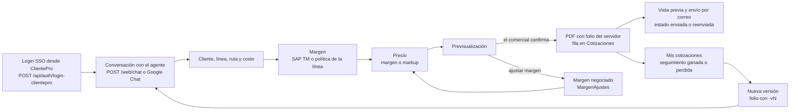
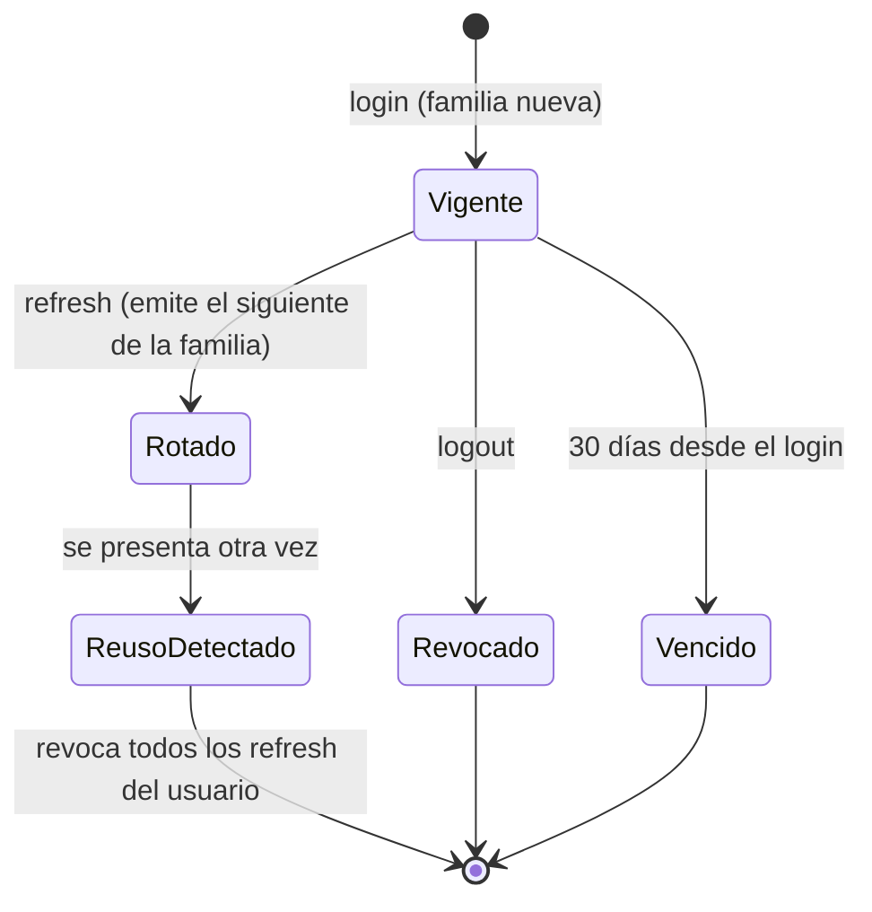
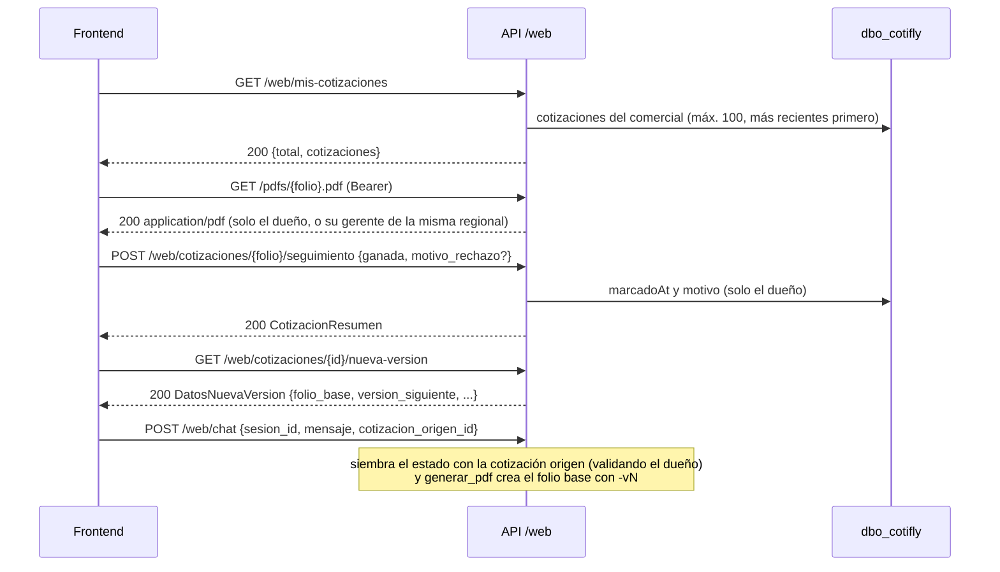
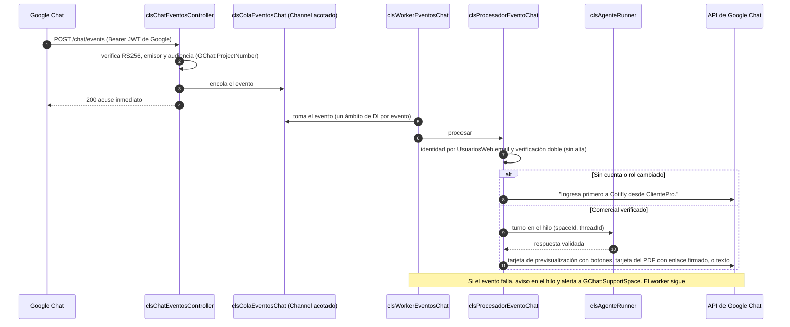
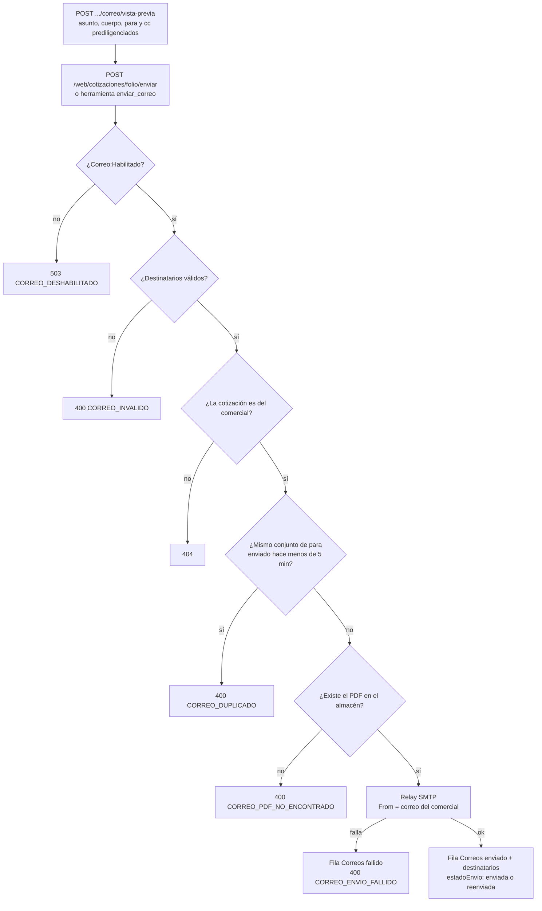
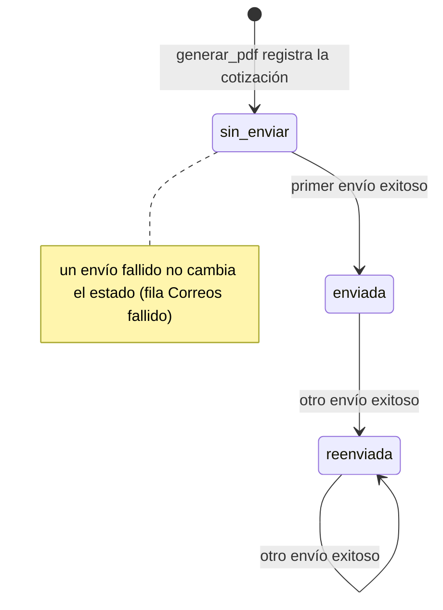

# 4. Flujo del sistema

Cómo se mueve una cotización por el sistema, desde el login hasta el correo. El detalle de cada pieza está en [02-arquitectura](02-arquitectura.md); el contrato HTTP, en [07-api](07-api.md).

Contenido:

- [4.1 Visión general](#41-visión-general)
- [4.2 Inicio de sesión y renovación](#42-inicio-de-sesión-y-renovación)
- [4.3 Nueva cotización en la consola web](#43-nueva-cotización-en-la-consola-web)
- [4.4 Mis cotizaciones, seguimiento y nueva versión](#44-mis-cotizaciones-seguimiento-y-nueva-versión)
- [4.5 Resolución del margen](#45-resolución-del-margen)
- [4.6 Google Chat](#46-google-chat)
- [4.7 Envío de correo](#47-envío-de-correo)
- [4.8 Estados](#48-estados)
- [4.9 Procesos en segundo plano](#49-procesos-en-segundo-plano)

## 4.1 Visión general

## 4.2 Inicio de sesión y renovación

1. ClientePro ya autenticó a la persona y llama `POST /api/auth/login-clientepro` con su `idUsuario`.
2. Cotifly revalida la persona y sus roles contra `dbsolucionesti`, aplica la verificación doble contra `UsuariosRoles` y, en el primer ingreso, crea el usuario (JIT). Secuencia completa en [2.9](02-arquitectura.md#29-identidad-login-sso-con-verificación-doble).
3. El frontend usa `Authorization: Bearer <access>` (60 minutos) en cada llamada a `/web/*`.
4. Ante un 401, el frontend llama una vez `POST /api/auth/refresh`; el refresh rota (familia y vencimiento absoluto heredados). Reutilizar un refresh ya rotado revoca todas las sesiones del usuario.
5. `POST /api/auth/logout` revoca el refresh y el `jti` del access (siempre 204).
6. Primer ingreso: si `GET /web/usuario/telefono` devuelve `null`, el frontend pide el teléfono (modal de HU-004.3) y lo guarda con `PUT`; es el único origen del "Cel" del PDF.

## 4.3 Nueva cotización en la consola web

Conversación típica (el texto lo redacta el LLM; los datos y los números salen de las herramientas y del estado de la conversación):

| Paso | El comercial | El sistema |
|---|---|---|
| 1 | "Cotiza un flete nacional de Cali a Bogotá para el cliente X, costo 2.850.000" | `buscar_cliente` en Nexo (HU-005.2: un único candidato → NIT, origen y BP en el estado; varios → candidatos para que el comercial elija; ninguno → sin cliente resuelto; sin `Nexo__UrlBase`, con Nexo caído o sin `idUsuarioExterno` → `CLIENTE_BUSQUEDA_NO_DISPONIBLE` y el nombre queda como referencia, sin NIT ni BP), `resolver_municipio` con el origen y con el destino (HU-005.13, ver 1b), `obtener_margen` (con BP: SAP TM si `SapTm__Modo` está configurado; sin BP: política de la línea), `calcular_precio` con el costo escrito por el comercial. Estado: línea, municipios, margen, método, costo y precio |
| 1b | "La de Nariño" | Solo si el origen o el destino coincidieron con varios municipios (ej. "La Unión" en Antioquia, Nariño y Valle del Cauca): el agente mostró los candidatos con su departamento y, mientras el comercial no elige, el filtro rechaza `buscar_tarifa`, `calcular_precio`, `registrar_ajuste_margen` y `generar_pdf` con `CONFIRMACION_REQUERIDA`. El servidor reconoce la elección por el departamento o, si no hay otra lista pendiente, por posición ("2", "la segunda"); si no, el agente vuelve a llamar a `resolver_municipio` con lo que escribió. Una sola coincidencia se usa directo (`Yumbo, Valle del Cauca`); ninguna se informa sin inventar un municipio. Sin catálogo (`MUNICIPIOS_NO_DISPONIBLE`: Nexo sin configurar o caído) la cotización sigue con el texto libre |
| 2 | — | El agente muestra la **previsualización** (precio, margen, método, origen del margen) y pide confirmación; `acciones_sugeridas`: `confirmar_pdf`, `ajustar_margen` |
| 3a | "Confirmo" | `generar_pdf`: el filtro exige la confirmación del turno y un precio calculado, reescribe el payload con el estado, el servidor genera el folio `PCN-[{nit}-]{INICIALES}-DDMMAAAA-{NNN}[-vN]` con las iniciales del comercial (ej. `PCN-DG-25092026-001`; [ADR-011](../specs/decisiones/ADR-011-folio-e-identidad-google-chat.md)), renderiza, guarda el PDF y registra la fila en `Cotizaciones`. La respuesta trae `pdf.url` |
| 3b | "Déjalo en 18 %" | `registrar_ajuste_margen` (margen negociado, auditado en `MargenAjustes`), nuevo precio y nueva previsualización |
| 4 | "Envíala a compras@cliente.com" | Con la confirmación o los destinatarios escritos por el comercial, `enviar_correo` (ver [4.7](#47-envío-de-correo)) |

Reglas que el flujo garantiza (pruebas en `chat_slot_filling.feature`, `chat_municipios.feature`, `chat_web.feature` y `validador_respuesta_ia.feature`):

- Un "sí" sin previsualización pendiente no confirma nada; elegir un cliente candidato o un municipio no confirma el PDF.
- Con un origen o destino ambiguo sin elegir no se busca tarifa, no se calcula precio y no hay previsualización.
- Si cambia el cliente, la línea o la ruta, la cotización en curso se descarta: la siguiente es nueva, no una versión de otra.
- Un costo que no viene de la fuente solo se acepta si el comercial lo escribió (`2.850.000`, `2,85 millones`...).
- Un turno a la vez por conversación; un segundo mensaje simultáneo recibe "Todavía estoy respondiendo tu mensaje anterior...".

El recorrido técnico de un turno (candado, filtros, validador) está en [2.12](02-arquitectura.md#212-turno-de-webchat-de-punta-a-punta).

El formulario de captura del frontend (HU-004) consulta a Nexo a través de la API, sin pasar por el agente: `GET /web/clientes?q=` (el mismo catálogo que `buscar_cliente`), `GET /web/municipios` (origen y destino), `GET /web/catalogos-flete` (tipo de vehículo, carrocería y clase de viaje) y `POST /web/cubicacion` (vehículo o flota sugeridos para los bultos). Respuestas y códigos en [7.3](07-api.md#73-endpoints).

## 4.4 Mis cotizaciones, seguimiento y nueva versión

Una cotización de otro comercial responde siempre `404 {"error":"Cotización no encontrada o no es tuya."}`, igual que una inexistente (`aislamiento_comercial.feature`).

## 4.5 Resolución del margen

Orden de `obtener_margen` (`clsMargenResolverService`, mismo orden que el Python salvo la resiliencia ante SAP caído, decisión de #13):

El margen negociado (`registrar_ajuste_margen`) no cambia la política: se registra en `MargenAjustes` con la referencia que propuso `obtener_margen` y queda `origenMargen = negociado` en la cotización.

## 4.6 Google Chat

Los clics en los botones de la tarjeta se convierten en "Confirmo" o "Quiero ajustar el margen.". El enlace del PDF (`/pdfs/{folio}.pdf?t=...`) vence a los `Pdf:MinutosUrlFirmada` minutos y solo sirve al dueño.

## 4.7 Envío de correo

`GET /web/clientes/{nit}/destinatarios-previos` prediligencia los destinatarios del último envío exitoso del comercial a ese NIT.

## 4.8 Estados

Estado de envío de una cotización (`Cotizaciones.estadoEnvio`):

Seguimiento comercial (independiente del envío): `ganada` verdadero o falso con `motivo_rechazo` y `marcadoAt`. Sesiones de conversación: `activa` → `archivada` tras `Sesiones:TtlHoras` de inactividad (barrido periódico).

## 4.9 Procesos en segundo plano

| Proceso | Clase | Frecuencia | Qué hace | Si falla |
|---|---|---|---|---|
| Worker de Google Chat | `clsWorkerEventosChat` | Continuo | Consume la cola de eventos, un ámbito por evento | Aviso en el hilo y alerta a soporte; sigue con el siguiente |
| Barrido de sesiones | `clsBarridoSesionesHostedService` | `Sesiones:BarridoMinutos` (60) | Archiva sesiones inactivas desde hace más de `Sesiones:TtlHoras` | Warning; reintenta en el siguiente ciclo |
| Limpieza de tokens | `clsLimpiezaTokensHostedService` | Cada hora | Purga `jti` vencidos y refresh vencidos hace más de un día | Warning |
| Caché de revocados | `clsCacheTokensRevocados` | Cada 60 s | Foto de `TokensRevocados`; sin foto de menos de 5 min, fail-closed | Las peticiones protegidas responden 401 hasta recuperar la foto |
| Avisos de arranque de SAP TM | `clsAvisosArranqueSapTm` | Al arrancar | Avisa si `Production` no tiene `SapTm:Modo` o si falta el export | No impide arrancar |
