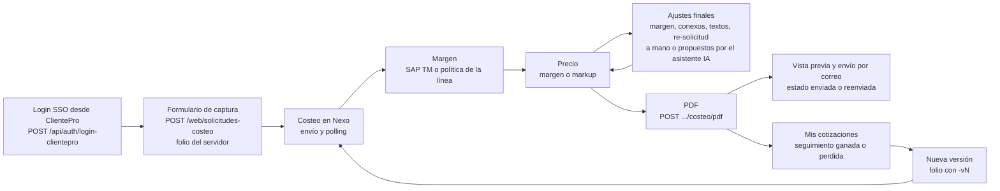
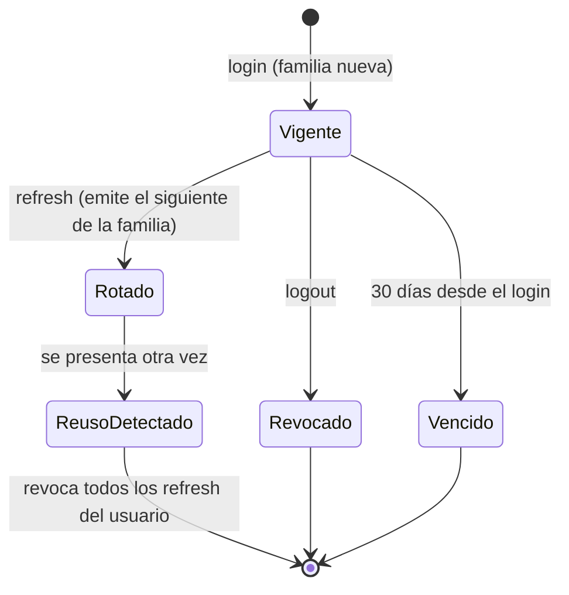
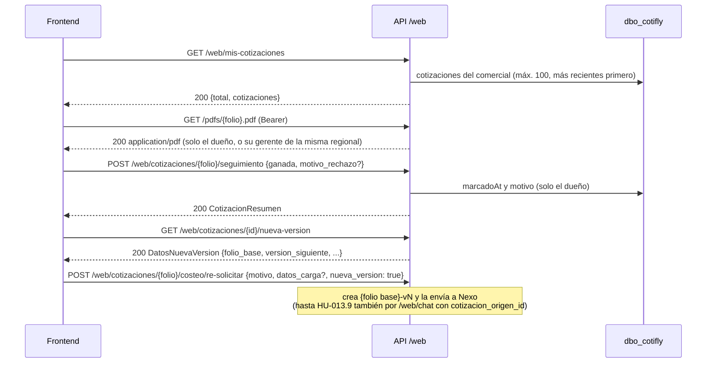
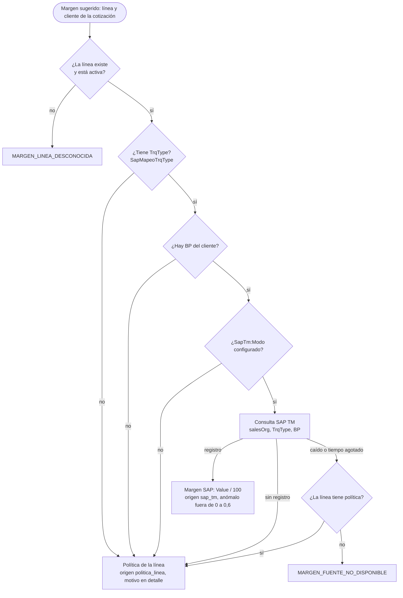
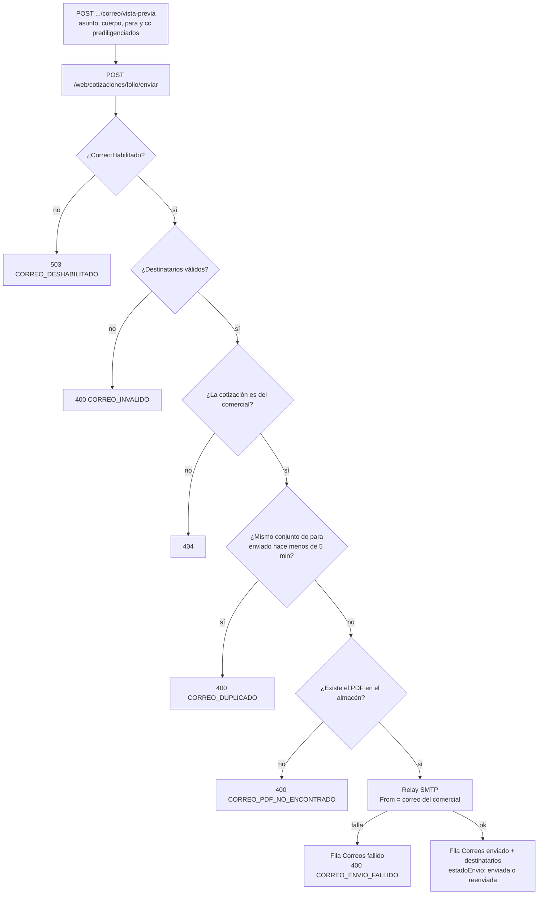
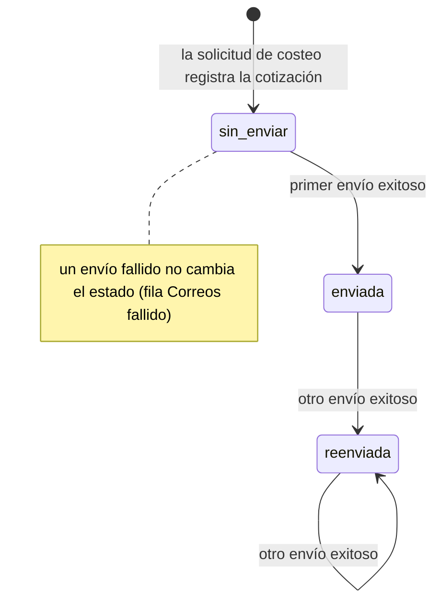

# 4. Flujo del sistema

> **Estado:** vigente · **Dueño:** Duban Guerra (backend) · **Actualizado:** 2026-10-15

Cómo se mueve una cotización por el sistema, desde el login hasta el correo. El detalle de cada pieza está en [02-arquitectura](02-arquitectura.md); el contrato HTTP, en [07-api](07-api.md).

Contenido:

- [4.1 Visión general](#41-visión-general)
- [4.2 Inicio de sesión y renovación](#42-inicio-de-sesión-y-renovación)
- [4.3 Nueva cotización en la consola web](#43-nueva-cotización-en-la-consola-web)
- [4.4 Mis cotizaciones, seguimiento y nueva versión](#44-mis-cotizaciones-seguimiento-y-nueva-versión)
- [4.5 Resolución del margen](#45-resolución-del-margen)
- [4.6 Asistente IA por folio](#46-asistente-ia-por-folio)
- [4.7 Envío de correo](#47-envío-de-correo)
- [4.8 Estados](#48-estados)
- [4.9 Procesos en segundo plano](#49-procesos-en-segundo-plano)

## 4.1 Visión general

## 4.2 Inicio de sesión y renovación

1. ClientePro ya autenticó a la persona y llama `POST /api/auth/login-clientepro` con su `idUsuario`.
2. Cotifly revalida la persona y sus roles contra `dbsolucionesti`, aplica la verificación doble contra `UsuariosRoles` y, en el primer ingreso, crea el usuario (JIT). Secuencia completa en [2.9](02-arquitectura.md#29-identidad-login-sso-con-verificación-doble).
3. El frontend usa `Authorization: Bearer <access>` (60 minutos) en cada llamada a `/web/*`.
4. Ante un 401, el frontend llama una vez `POST /api/auth/refresh`; el refresh rota (familia y vencimiento absoluto heredados). Reutilizar un refresh ya rotado revoca todas las sesiones del usuario.
5. `POST /api/auth/logout` revoca el refresh y el `jti` del access (siempre 204).
6. Primer ingreso: si `GET /web/usuario/telefono` devuelve `null`, el frontend pide el teléfono (modal de HU-004.3) y lo guarda con `PUT`; es el único origen del "Cel" del PDF.

## 4.3 Nueva cotización en la consola web

Desde HU-013 la cotización la arma un pipeline determinista: el formulario, Nexo, SAP y el código ([ADR-018](../specs/decisiones/ADR-018-pipeline-determinista-ia-etapa-final.md)). La IA no cotiza: solo redacta textos y asiste sobre una cotización ya hecha. Hasta HU-013.9 (#105) la cotización también podía armarse conversando con un agente (`POST /web/chat` sin folio o Google Chat); ese camino se retiró.

| Paso | El comercial | El sistema |
|---|---|---|
| 1 | Llena el formulario de captura (cliente, línea, origen, destino, vehículo, carga) | Catálogos de Nexo a través de la API (ver abajo) |
| 2 | Envía la solicitud | `POST /web/solicitudes-costeo`: folio del servidor `PCN-[{nit}-]{INICIALES}-DDMMAAAA-{NNN}[-vN]` con las iniciales del comercial ([ADR-011](../specs/decisiones/ADR-011-folio-e-identidad-google-chat.md)), fila en `Cotizaciones` y envío a Nexo ([ADR-015](../specs/decisiones/ADR-015-costeo-nexo.md)) |
| 3 | — | El polling (`clsWorkerCosteoNexo`) recoge el costeo, resuelve el margen ([4.5](#45-resolución-del-margen)) y calcula el precio en la moneda de la cotización; `GET /web/cotizaciones/{folio}/costeo` lo muestra sin el costo de Nexo |
| 4 | Ajusta si hace falta | Margen (`PUT .../costeo/margen`, negociado y auditado en `MargenAjustes`), servicios conexos, textos (`POST .../costeo/textos/redactar` con IA, o a mano) y re-solicitud del costeo; o le pide al asistente por folio que lo proponga ([4.6](#46-asistente-ia-por-folio)) |
| 5 | Genera el PDF | `POST /web/cotizaciones/{folio}/costeo/pdf` |
| 6 | Lo envía | [4.7](#47-envío-de-correo) |

El formulario de captura del frontend (HU-004) consulta a Nexo a través de la API: `GET /web/clientes?q=`, `GET /web/municipios` (origen y destino), `GET /web/catalogos-flete` (tipo de vehículo, carrocería y clase de viaje) y `POST /web/cubicacion` (vehículo o flota sugeridos para los bultos). Respuestas y códigos en [7.3](07-api.md#73-endpoints).

## 4.4 Mis cotizaciones, seguimiento y nueva versión

Una cotización de otro comercial responde siempre `404 {"error":"Cotización no encontrada o no es tuya."}`, igual que una inexistente (`aislamiento_comercial.feature`).

## 4.5 Resolución del margen

Orden de la resolución del margen sugerido (`clsMargenResolverService`, la antigua herramienta `obtener_margen`; mismo orden que el Python salvo la resiliencia ante SAP caído, decisión de #13):

El margen negociado (`PUT .../costeo/margen`) no cambia la política: se registra en `MargenAjustes` con el margen sugerido como referencia y queda `origenMargen = negociado` en la cotización.

## 4.6 Asistente IA por folio

Desde el detalle de una cotización, el comercial conversa con el asistente (`POST /web/chat` con `folio`, HU-013.6, ADR-018 §2b):

1. El asistente solo trabaja sobre esa cotización y solo si es del comercial (otra responde 404). Sin `folio`, 400 `FOLIO_REQUERIDO`.
2. Consulta la cotización (estado, ruta, márgenes como porcentaje, conexos) sin ver ningún monto y, si el comercial lo pide, propone una acción: ajustar el margen, re-solicitar el costeo o agregar un servicio conexo.
3. El servidor arma la propuesta (`accion_propuesta`: endpoint, cuerpo, `row_version` y resumen con precios) con las mismas reglas del endpoint destino. Nada cambia hasta que el comercial pulsa Confirmar y el frontend llama a ese endpoint.
4. Un turno a la vez por conversación; un segundo mensaje simultáneo recibe "Todavía estoy respondiendo tu mensaje anterior...".

El recorrido técnico de un turno (candado, herramientas, validador) está en [2.12](02-arquitectura.md#212-turno-de-webchat-de-punta-a-punta). Google Chat, el canal conversacional alterno que existía hasta HU-013.9 (#105), se retiró: `POST /chat/events` responde 404.

## 4.7 Envío de correo

`GET /web/clientes/{nit}/destinatarios-previos` prediligencia los destinatarios del último envío exitoso del comercial a ese NIT.

## 4.8 Estados

Estado de envío de una cotización (`Cotizaciones.estadoEnvio`):

Seguimiento comercial (independiente del envío): `ganada` verdadero o falso con `motivo_rechazo` y `marcadoAt`. Sesiones de conversación: `activa` → `archivada` tras `Sesiones:TtlHoras` de inactividad (barrido periódico).

## 4.9 Procesos en segundo plano

| Proceso | Clase | Frecuencia | Qué hace | Si falla |
|---|---|---|---|---|
| Polling del costeo | `clsWorkerCosteoNexo` | `CosteoNexo:IntervaloTickSegundos` | Consulta en Nexo las cotizaciones agendadas y aplica margen y precio ([2.14](02-arquitectura.md#214-integración-con-nexo)) | Se registra y el lote sigue con la siguiente cotización |
| Barrido de sesiones | `clsBarridoSesionesHostedService` | `Sesiones:BarridoMinutos` (60) | Archiva sesiones inactivas desde hace más de `Sesiones:TtlHoras` | Warning; reintenta en el siguiente ciclo |
| Limpieza de tokens | `clsLimpiezaTokensHostedService` | Cada hora | Purga `jti` vencidos y refresh vencidos hace más de un día | Warning |
| Caché de revocados | `clsCacheTokensRevocados` | Cada 60 s | Foto de `TokensRevocados`; sin foto de menos de 5 min, fail-closed | Las peticiones protegidas responden 401 hasta recuperar la foto |
| Avisos de arranque de SAP TM | `clsAvisosArranqueSapTm` | Al arrancar | Avisa si `Production` no tiene `SapTm:Modo` o si falta el export | No impide arrancar |
