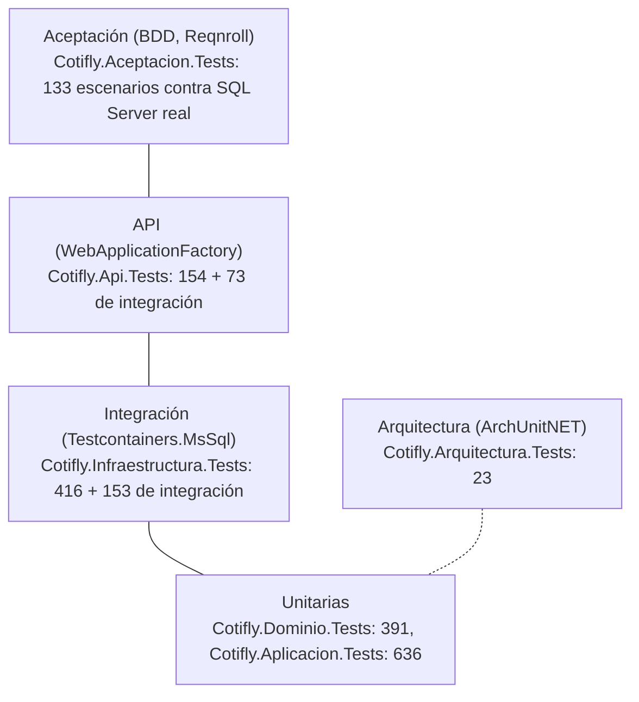

# 8. Testing

Metodología SDD + TDD + BDD ([ADR-010](../specs/decisiones/ADR-010-metodologia-sdd-tdd-bdd.md)): primero el contrato (`specs/openapi.yaml`) y los escenarios (`specs/features/*.feature`), luego la prueba en rojo, la implementación y el refactor.

Contenido:

- [8.1 Pirámide de pruebas](#81-pirámide-de-pruebas)
- [8.2 Proyectos y alcance](#82-proyectos-y-alcance)
- [8.3 Categorías (traits)](#83-categorías-traits)
- [8.4 Comandos](#84-comandos)
- [8.5 Testcontainers y Reqnroll](#85-testcontainers-y-reqnroll)
- [8.6 Cobertura](#86-cobertura)
- [8.7 Integración continua](#87-integración-continua)
- [8.8 Paridad con el Python](#88-paridad-con-el-python)
- [8.9 Pruebas manuales de QA](#89-pruebas-manuales-de-qa)

## 8.1 Pirámide de pruebas



| Nivel | Proyecto | Herramientas | Alcance |
|---|---|---|---|
| Unitario | `Cotifly.Dominio.Tests`, `Cotifly.Aplicacion.Tests` | xUnit v3, NSubstitute, AwesomeAssertions | Reglas puras (precio, margen, folio), casos de uso con puertos simulados, runner del agente con un `IChatClient` guionizado |
| Integración | `Cotifly.Infraestructura.Tests` | Testcontainers.MsSql | Repositorios, scripts `db/migrations_mssql/` aplicados, esquema igual al modelo EF, adaptadores (SAP TM, SMTP, PDF, IA, Google Chat) con dobles locales |
| API | `Cotifly.Api.Tests` | `WebApplicationFactory` | Forma exacta de las respuestas del contrato, autenticación, CORS, aislamiento por comercial |
| Aceptación | `Cotifly.Aceptacion.Tests` | Reqnroll (`Reqnroll.xunit.v3`) | Los `.feature` de `specs/features/` |
| Arquitectura | `Cotifly.Arquitectura.Tests` | ArchUnitNET | Dependencias entre capas, Dominio sin paquetes externos, convención `cls`/`ICls`, contexto de `docker build` |

- TDD: test en rojo, implementación, refactor (ADR-010).
- Las pruebas no llaman a proveedores de IA reales ni a SAP TM, Google o un relay reales: usan dobles locales (`clsChatClientGuionizado`, `clsSapTmFalso`, `clsGoogleFalso`, `clsServidorSmtpFalso`, `clsNexoClientesFalso` para Nexo y `clsTrmFalso` para los datos abiertos de la TRM, HU-012). Las pruebas con proveedores reales son manuales.

## 8.2 Proyectos y alcance

Conteos verificados el 2026-09-28 en #43 (HU-005.13), sobre #14, #12 (folio con iniciales), #16 y la integración de Nexo (#20, PR #65): **1979 pruebas**, de ellas **1620 sin la categoría `Integracion`** (1619 en el job `unitarias`, que además excluye la omitida `Categoria=sap`) y **359 de integración**; todas en verde. Por proyecto, en la tabla.

| Proyecto | Qué cubre hoy | Unitarias | Integración |
|---|---|---|---|
| `Cotifly.Dominio.Tests` | `clsResultado<T>`, `clsErrorDominio`, `clsCodigoEnum` (códigos de los enums) e invariantes de las entidades (cotización, correo, margen, sesión, identidad, tokens), regla de margen por método (`margen` < 1, `markup` ≥ 1, también en `clsMargenAjuste`). **#10:** `clsCalculadoraPrecio` (todos los casos de `test_precio.py`, grilla determinista en lugar del property test, puntos medios half-to-even, desbordamiento) y `clsReglasMargen` (normalización, anomalía, líneas sin tildes ni espacios), redondeo del ajuste a 4 decimales. **#12:** `clsRol`, `clsUsuarioRol` (asignación, retiro con revisión) y el vínculo `idUsuarioExterno`. **HU-012.2 (#51):** `clsConversorMoneda` (normalización, monedas no soportadas, conversión a 2 decimales half-to-even, TRM no positiva, decimales y redondeo por moneda). **#12 parte B:** `clsFolio` y `clsInicialesComercial` (formato con y sin NIT, iniciales: nombres compuestos, partículas, tildes y Ñ, texto libre de `DESCRIPCIONUSUARIO`, inicial abreviada, correo como usuario, guion bajo, limitaciones conocidas, una palabra, vacío → XX; regex del NIT amarrada a `LargoMaximoNit`; NIT solo dígitos y máximo 26 con `-v99` en 50 caracteres, 001–999, interpretación de folios nuevos y heredados, versiones ≤ 50 caracteres) y `clsMargenPolitica.Actualizar` | 462 | — |
| `Cotifly.Aplicacion.Tests` | Registro de dependencias de Aplicación; `clsPrecioService`; `clsMargenResolverService` y `clsAjusteMargenService` con puertos simulados (NSubstitute) y la muestra SAP del Python (`tests/Comun/clsFuenteMargenMuestra`), SAP no configurado → política, `AJUSTE_MARGEN_INVALIDO`. **#13:** SAP caído → política con warning (logger falso), sin política y SAP caído → `MARGEN_FUENTE_NO_DISPONIBLE`, detalle con el `Value` crudo (`5%`, `9.75%`, `-19.2%`). **#11:** formato de dinero y fecha exactos en 6 culturas, limpieza de texto, validador del payload, constructor del documento (datos del ejemplo, imagen y leyenda por línea, bloques condicionales, multi, tarifa con costo/margen y `markup`, USD, textos del payload, servicios conexos, celular del payload ignorado, determinismo), `clsGenerarPdfService` (trazabilidad persistida, firma y celular, folio desde `referencia`, folio inválido, línea desconocida y folio duplicado sin renderizar, archivo existente, compensación, render fallido, comercial inexistente, `BaseUrl`), `clsCorreoService` (port de `test_correo.py`: confirmación, dueño, PDF ausente, duplicado sin mayúsculas ni orden, ventana con el reloj, fallo del transporte → fila `fallido`, `reenviada`, correo deshabilitado, envío sin registro, destinatarios inválidos), vista previa y destinatarios previos, `clsAuditoriaService` (JSON snake_case, truncado válido, ámbito propio, nunca lanza, excepción auditada y propagada, decorador del ajuste), teléfono (patrón de `TelefonoComercial`), seguimiento y registro de decoradores; coherencia con la trazabilidad (tarifa impresa = `PrecioFinal`, `PrecioFinal` = costo/margen, varias tarifas con un precio, moneda de filas y servicios), folio obligatorio del servidor, `DesdeJson` sin lanzar (7 JSON inválidos), negativos rechazados, palabras largas partidas, recarga dentro del candado. **#12:** login (cada rama: cuerpo inválido, persona inexistente, almacén caído al buscar y al leer roles, sin rol mapeado, roles sin `idRolExterno`, roles del body ignorados, JIT con datos del almacén, precedencia del gerente auditada, segundo ingreso, rol externo cambiado, sin asignación, NOMBREUSUARIO cambiado, identidad inconsistente, vinculación, alta concurrente, error interno, cancelación), refresh (rotación con familia y vencimiento heredados, reuso → revoca al usuario, rotación concurrente, vencido, rol cambiado, almacén caído, usuario inexistente), logout (siempre sin error, jti en memoria y en base, repetido), caché de jti revocados (recarga de 60 s, tolerancia de 5 min, fail-closed) y refresh opaco. **#12 parte B:** generador de folio (iniciales desde `UsuariosWeb`, versión de un folio heredado sin iniciales, fecha de negocio, consecutivo y candado por iniciales, comercial inexistente, agotamiento, fallo de la creación, versiones, candado), mis cotizaciones y nueva versión, `clsUrlPdf`, administración de líneas (solo gerente revalidado, validación, auditoría con antes/después), alcance de métricas (comercial, gerente con y sin regional) y descarga del PDF (dueño, gerente por regional, nombres inválidos, auditoría). **#12 parte C:** runner con el modelo guionizado (turno sin herramientas y llamada final sin herramientas, dos herramientas encadenadas con la salida real devuelta al modelo, tope de iteraciones, herramienta inexistente → `HERRAMIENTA_DESCONOCIDA`, error estructurado que llega al modelo, contexto del comercial y estado resuelto en el sistema, eventos user/assistant/herramienta/assistant, memoria entre turnos, sesión ajena, comercial inexistente, `enviar_correo` oculto sin correo, validador de la respuesta final, fallo del proveedor), filtros (el hallazgo de ADR-004 entre turnos, números del estado aunque el LLM mande otros, sin margen no hay precio, costo de la fuente, sin cliente confirmado no se consulta SAP, PDF sin confirmación o sin precio, candidatos y elección por NIT, ajuste negociado, auditoría sin duplicar y con la entrada inyectada, correo con destinatarios del mensaje), estado de la conversación, ventana del historial, parseo de eventos de Chat (clásico, add-on, clics), acuses, tarjetas y procesamiento de un evento (identidad por email, hilo ajeno, fallo avisado). **Correcciones de la auditoría:** costo manual solo si el comercial lo escribió (formatos `2.850.000`, `2,85 millones`...), destinatarios con confirmación solo de la conversación, candado por sesión, nueva versión con `cotizacion_origen_id` (y origen ajeno), cotización en curso descartada al cambiar cliente/línea/ruta, línea inactiva (resolver y PDF), gerente sin regional sin PDF ajeno, verificación doble en Google Chat y auditoría del rechazo con el id interno. **#16:** validador de la respuesta final (esquema generado con enums, requeridos y sin propiedades adicionales; los 3 casos malformados del issue —JSON incompleto, campo con tipo incorrecto, herramienta o campo alucinado— y otros 20: enum desconocido, texto vacío o de 4001 caracteres, campo faltante o repetido, no objeto, vacío; coherencia de la confirmación, previsualización sin precio, acciones sin previsualización pendiente o sin herramienta; montos inventados y respaldados por herramientas, estado o comercial; folios inventados y del servidor; reintento que corrige con el mensaje de corrección; reintento que falla → respaldo; proveedor sin JSON Schema por configuración y por error en ejecución; 429 que se propaga; cancelación; métricas; logs sin el texto), runner con el validador (contexto, respaldo sin excepción, reintento en el turno) y tarjetas de Chat (botones de las acciones, respaldo sin botones); correcciones de la validación y la auditoría: `minLength`/`maxLength`/`maxItems`/`uniqueItems` y esquema estricto, instrucciones con y sin esquema, frases de la batería del validador (NIT, teléfono, unidades y fechas que no son montos; montos sin palabra clave, pegados a la moneda, con `M`/`MM` o después del primero; montos del comercial solo si los escribió como dinero), solo 400/422 apagan el esquema, re-sonda tras el TTL y contador `esquema_rechazado`. **HU-012.2 (#51):** `clsPrecioService` en COP y USD (TRM del día de negocio, markup, TRM caída, entrada inválida sin consultar la TRM, moneda no soportada, `EnMoneda`), `clsMonedaUsdTests` con el arnés del agente (selector en USD hasta el PDF, COP con TRM 0, el modelo no convierte si el comercial no lo pidió, dólares pedidos en el mensaje, el selector manda, TRM caída sin precio ni PDF, cambio de moneda que descarta el precio, ajuste negociado en USD y sin registrar si la TRM falla; auditoría: moneda nombrada en un turno anterior, TRM vencida al confirmar → recalcula y vuelve a previsualizar o descarta el precio, ajuste sin TRM válida → `TRM_NO_DISPONIBLE`, tarifa en USD → `TARIFA_CONFIG_INVALIDA`, `errores` de `RespuestaChat`; moneda nombrada y `TrmVencidaEn` en el estado; validador sin mezclar monedas; frases de elección de moneda —montos, "dolarizado", negación, preguntas, unidad del costo, ambas monedas con "mejor"—; recálculo por TRM vencida visible en `RespuestaChat`), estado (`ElegirMoneda`, la tarifa no cambia la moneda), coherencia del PDF en USD (precio convertido, centavos, sin TRM) y formato `US$` con 2 decimales y de la TRM. **HU-012.3 (#52):** aclaración del piso en el documento (piso exacto `PrecioCop` con los números del validador, 3.529.395 y TRM 3.306,86; sin valor en pesos o sin TRM → `PDF_PAYLOAD_INVALIDO`; `PrecioCop` incoherente con costo y margen rechazado) (USD con TRM, ninguna en COP o sin TRM, variante multi) y en el que arma `clsGenerarPdfService` con la TRM de la trazabilidad | 522 | — |recálculo por TRM vencida visible en `RespuestaChat`), estado (`ElegirMoneda`, la tarifa no cambia la moneda), coherencia del PDF en USD (precio convertido, centavos, sin TRM) y formato `US$` con 2 decimales y de la TRM | 522 | — |montos del comercial solo si los escribió como dinero), solo 400/422 apagan el esquema, re-sonda tras el TTL y contador `esquema_rechazado`. **HU-005.13 (#43):** `clsResolvedorMunicipiosTests` (única exacta, con departamento, con pista `Municipio, pista` o `(pista)`, por prefijo; "La Unión" y "San Pedro" en varios departamentos → candidatos; pista que no coincide; aproximada que siempre se pregunta; ninguna; recorte a 8 con el total; filas repetidas y sin nombre; clave sin tildes ni signos) y `clsResolverMunicipioTests` (estado: única, varias, ninguna, sin catálogo → texto libre, campo desconocido, cambio de ruta que descarta precio y cotización, el mismo municipio que no los descarta, elección por departamento, posición u ordinal femenino, posición ignorada con dos listas o con clientes candidatos, tarifa con otra ruta; validador: previsualización con municipio pendiente; turnos con el modelo guionizado: única → tarifa con el municipio canónico, varias → `CONFIRMACION_REQUERIDA` en `buscar_tarifa` y `calcular_precio` y, tras "La de Nariño", tarifa con `La Unión, Nariño`; sin catálogo → texto libre; salida sin id ni código Dane; prompt). **Correcciones de la validación y la auditoría de #43:** negación, otro lugar nombrado, campo nombrado y departamento en las dos listas no eligen; departamentos anidados (gana el más largo); "Confirmo" con municipio pendiente; `campo` o `texto` inválidos → `MUNICIPIO_ARGUMENTO_INVALIDO` sin consultar Nexo; el filtro bloquea las 4 herramientas; el PDF con origen y destino verificados; casi homónimos reales (Cali/Calima/California, Cartagena de Indias/del Chairá, Cúcuta, Barranquilla, Buenaventura, Armenia), `D.C.`, país al final y Bogotá sin departamento repetido; re-validación: mensajes en minúsculas sobre otro lugar no eligen, palabras de relleno ("Exacto", "Pues", "Elijo", "Mejor") sí, y `Santa`, `Juan` y `Puerto` se preguntan con la capital primera | 842 | — |
| `Cotifly.Infraestructura.Tests` | `clsRelojSistema`, registro de dependencias (puertos, contextos), validador de secretos, opciones `Zona` y `ConnectionStrings`, convertidores, traducción de violaciones de unicidad. **Integración:** scripts 0001+0002 aplicados (y 0002 idempotente), deriva modelo EF ↔ catálogo en ambos sentidos (tablas, columnas, tipos, nulabilidad, collation, nombres y columnas de PK/FK, índices únicos/filtrados/`ix_` con orden e `INCLUDE`, CHECK), idempotencia del 0002 con foto completa del esquema, cada método de cada repositorio, aislamiento por dueño, folio duplicado → `FOLIO_DUPLICADO`, dedupe de correo con reloj falso, interceptor de `updatedAt`, PK/FK compuestas, CHECK JSON, contexto de identidad de solo lectura, health check (incluye base con solo el 0001 → esquema incompleto, y límite de tiempo de la sonda). **#10:** fuente de margen no configurada, proveedor de tarifas no disponible, registro por defecto (`TryAdd`) y opción `SapTm:SalesOrgDefault`; **integración:** resolver y ajuste negociado con el registro real sobre la semilla del 0001 (todos los `requiere_pg` de `test_margen.py`, las 8 líneas, líneas con tildes, ajuste `markup` ≥ 1, cotización ajena, SAP no configurado con el registro por defecto). **#13:** `clsFuenteMargenExportJson` (encuentra y no encuentra, las 10 filas de la muestra con el `Value` crudo, archivo ausente, 8 formas de export malformado, `Value` numérico, filas repetidas, caché que no relee sin cambios y recarga al cambiar, recuperación tras archivo roto o borrado, concurrencia), `clsFuenteMargenOData` contra `clsSapTmFalso` (URL exacta, `Accept`, Basic auth, barra final, vacío → null, primera fila, `Value` numérico, inyección de comillas en BP, organización y TrqType, `&` y `#` codificados, HTTP 401/404/500/503, timeout, red, cancelación del llamador, 7 respuestas inválidas, mensajes sin credenciales), selección por `SapTm:Modo` y validación de `clsOpcionesSapTm` (modos, obligatorios, URL, clave solo con espacios, `SapClient` de 3 dígitos, clave en Production), `sap-client` en la URL exacta, `[clsSecreto(Opcional)]`, tubería de resiliencia (reintenta 503, agota reintentos con 500, no reintenta 401), logs (una línea de warning sin traza, excepción en Debug, eventos de Polly en Debug), avisos de arranque (`clsAvisosArranqueSapTm`); `clsSapTmRealTests` (`Categoria=sap`, se omite sin variables: 1 omitida); **integración:** resolver con `export_json` y `odata` reales sobre la semilla (SAP TM, sin registro, export ausente y OData caído → política, sin BP no llama a SAP) y conmutación export → OData con la misma salida para 13 consultas. **#11:** render real con PdfPig (3 páginas con cada bloque en su página, pie en todas, "Cel" solo con teléfono, aduana solo en Internacional, multi en 2 páginas, solo Liberation Sans embebida como subconjunto, logo en cada página e imagen de línea en la carta, `<script>` literal, tabla de 40 filas sin perder filas, render estable, palabras de 300 caracteres sin espacios que no tapan la tarifa ni agregan páginas) y los 3 PDF de la comparación visual en `tests/artefactos/`; almacén (nombres, traversal, sin reemplazar, lectura por referencia), recursos y licencia embebidos, resolvedor de fuentes, transporte MailKit contra `tests/Comun/clsServidorSmtpFalso` (port de `test_smtp_relay.py`: remitente comercial y `Reply-To`, To/Cc, asunto, texto + HTML + PDF base64, envelope, respaldo, relay que rechaza, relay inalcanzable, cancelación, destinatario mal formado), configuración de `Pdf`/`Correo` y fecha de negocio en Bogotá; **integración:** repositorio de correos (envíos desde un instante, destinatarios previos por comercial y NIT), generar PDF con el registro real (línea con tilde, archivo, fila, evento de auditoría que pasa `ISJSON`), envío por el relay falso (duplicado a los 4 min, `reenviada` a los 6), fila `fallido`, dos envíos simultáneos → `enviada` y luego `reenviada`, teléfono persistido y seguimiento con el caso de uso. **#12:** emisor JWT (HS256, claims, `exp`), opciones `Jwt` (32 bytes, secreto en Production, clave efímera); **integración:** almacén corporativo (nombre sin mayúsculas, ID numérico, IDs inválidos, roles con descripción, ID fuera de INT sin roles, sin `CLAVE` en el SQL, esquema y tablas configurables), `Roles`/`UsuariosRoles` (semilla, una asignación activa, retiro), vínculo único, rotación atómica (de dos simultáneas gana una), revocación por familia y por usuario, purga de jti y refresh (hosted service, sin base no lanza), deriva con 14 tablas y re-aplicación del 0002 sin pisar `idRolExterno`. **#12 parte B:** registro del candado y del repositorio de métricas; **integración:** folio con `sp_getapplock` (10 generaciones simultáneas del mismo comercial → 001…010, dos comerciales con iniciales distintas a la vez → ambos desde 001, dos con las mismas iniciales → 001 y 002, consecutivo por iniciales con y sin NIT que ignora versiones, otras iniciales y heredados, `-v2` de un folio heredado sin iniciales, transacción deshecha ante fallo, 5 versiones simultáneas → v2…v6, `LIKE` escapado, candado no anidable), listado con línea, vistas de métricas (enviadas + reenviadas del 0003, regional, ajustes). **#12 parte C:** fábrica de proveedores de IA sin red (6 proveedores, API v1 de Azure, sin proveedor, decoradores), validación de `IA`, respaldo ante 429/5xx y no ante 400/401, estado HTTP de las excepciones de los SDK, limitador de RPM, JWT de Google con las fixtures `jwt_valido.txt`/`jwt_invalido.txt` y certificados falsos (audiencia, emisor, vigencia, bearer mal formado, caché de certificados, verificación desactivada), token de la cuenta de servicio (aserción firmada y reutilizada), forma de la petición del publicador, space inválido, error de la API de Chat, worker que sobrevive a un fallo y alerta, cola llena, URL firmada (válida, vencida, alterada, de otro archivo o comercial, clave efímera), validación de `GChat` y registro real; **integración:** identidad por `UsuariosWeb.email` (mayúsculas, correo repetido), barrido de sesiones por TTL y estado con los campos nuevos; **auditoría:** reglas de Production de `GChat` (JWT y clave de firma), access sin `nbf`, candado por sesión con `sp_getapplock` (integración) **Nexo (#20):** `clsBuscadorClientesNexoTests`, `clsMunicipiosNexoTests`, `clsCatalogosFleteNexoTests` y `clsCubicacionNexoTests` contra `clsNexoClientesFalso` (URL exacta con `q` codificado, `X-Portal-Usuario-Id` con el id externo, mapeo de campos y filas descartadas, exacta solo con un candidato, campos omitidos de Nexo, cuerpo camelCase de la cubicación con `unidadIds` nulo, 400 de Nexo → `CUBICACION_DEMASIADO_GRANDE` con su mensaje, sin `UrlBase` o sin `idUsuarioExterno` sin llamar a Nexo, HTTP 500/401/404, JSON inválido, red, una línea de warning sin traza, cancelación del llamador) y `clsRegistroBuscadorClientesTests`, `clsRegistroMunicipiosTests`, `clsRegistroCatalogosFleteTests`, `clsRegistroCubicacionTests` (fábrica por `Nexo:UrlBase` vacía o con espacios, reintento de un error transitorio, reintentos agotados → código no disponible, el 400 de la cubicación no se reintenta). **PDF en USD (#52, HU-012.3):** render con PdfPig de la tarifa en `US$` con la aclaración del piso mínimo bajo la tabla (3 páginas), la variante multi en USD y el PDF en COP sin "TRM" ni "US$"; `dotnet-4-dolares-PCN-USD-1.pdf` en `tests/artefactos/`. **TRM (#50, HU-012.1):** `clsProveedorTrmSuperfinancieraTests` contra `clsTrmFalso` (consulta SoQL exacta y codificada, fin de semana y lunes con la TRM del rango que los cubre, valor como texto o número, 9 respuestas inválidas → `TRM_NO_DISPONIBLE` con el motivo, red, tiempo agotado, una línea de warning, cancelación del llamador, tiempos de la tubería), `clsProveedorTrmEnCacheTests` con reloj falso (una consulta por fecha, otra fecha es otra entrada, vencimiento a las 6 horas, fallos que no se guardan, consultas simultáneas que esperan la misma respuesta) y `clsRegistroTrmTests` (caché singleton, opciones por defecto, 5 opciones inválidas que impiden arrancar, reintento de un 503, reintentos agotados). **HU-005.13 (#43):** `clsMunicipiosEnCacheTests` (foto vigente para cualquier comercial, vencida → vuelve a Nexo, fallo no guardado, consultas simultáneas → una sola a Nexo) y en `clsRegistroMunicipiosTests` la caché por defecto, `Nexo:MinutosCacheMunicipios=0` sin caché, la foto compartida entre ámbitos y el rango 0–1440; catálogo vacío no guardado, fallo compartido con los que esperaban sin encolarse, cancelación de un llamador que no afecta a los demás, estado con municipios que sobrevive al JSON de `Sesiones`, y un 200 que no es arreglo → `MUNICIPIOS_NO_DISPONIBLE`; una excepción de la consulta compartida se registra una vez y llega a todos. | 525 (1 omitida) | 183 |
| `Cotifly.Api.Tests` | `GET /health`, `GET /health/ready` (503 sin cadena y con base inalcanzable; con SQL Server real: **200**, y 503 `esquema incompleto: falta 0002` en una base con solo el 0001), composition root, arranque con configuración inválida, contrato `specs/openapi.yaml` (`/health` y `/health/ready` declarados, respuestas reales cumplen el esquema), sonda del `HEALTHCHECK` (`clsSondaSalud`: argumento `--healthcheck`, puerto desde `ASPNETCORE_HTTP_PORTS`, 200 → 0, otro estado / sin conexión / tiempo agotado → 1, prioridad `ASPNETCORE_URLS` → `ASPNETCORE_HTTP_PORTS` → 8080 con comodines e https ignorado, sin proxy, contra la API en memoria). **#10:** `SalidaPrecio`/`SalidaMargen` en snake_case cumplen el esquema y cada `clsCodigosError` existe en `ErrorNegocio`. **#12, integración:** `/api/auth/*` por HTTP contra la base real: `LoginResponse`/`UsuarioSesion` cumplen el contrato, access abre un endpoint protegido de prueba (políticas `Comercial`/`GerenteComercial`, 403), 401 sin token o con otra clave, 401 genérico, 400 `ErrorWeb`, almacén caído, rotación y reuso, dos refresh simultáneos, refresh inválido, logout que revoca access y refresh (también visto por otra réplica), logout siempre 204, 429. **#12 parte B:** recorrido del contrato (cada operación de `openapi.yaml` expuesta salvo `/web/chat` y `/chat/events` marcadas como pendientes, ningún `/web/*` fuera del contrato, 401 `ErrorWeb` sin token en cada una), convención snake_case por controller y propiedades exactas de cada DTO contra su esquema, tabla de errores (`clsRespuestasWeb`), CORS (preflight permitido y rechazado, encabezado en 401 y 413), encabezados de seguridad, 413, encabezados reenviados (IP real en el límite de auth, proxy desconocido ignorado) y validadores de opciones; **integración:** cada endpoint de `/web/*` y `/pdfs` por HTTP con validación del cuerpo contra el esquema del contrato, aislamiento A/B en cada operación (404 idéntico al de uno inexistente, cotización intacta), 400/415/503, PDF por dueño y gerente de la regional (auditado), administración 403/400/404 y auditoría, métricas por rol y regional. **#12 parte C:** `POST /chat/events` (JWT válido de la fixture → acuse y encolado, sin JWT o inválido → 401, evento que no es mensaje, add-on, verificación desactivada, cuerpo que no es JSON, cola llena), DTOs de `RespuestaChat`, `RespuestaChatError` y `MensajeWeb` contra su esquema y el recorrido del contrato sin pendientes; **integración:** `POST /web/chat` (200 `RespuestaChat` con precio y margen de las herramientas, 400 por `sesion_id` y mensaje, 401, 404 con sesión ajena, 200 `error: true` con el texto del límite y el genérico, sin proveedor configurado, 429 propio) y `/pdfs` con el enlace firmado (válido sin Bearer, alterado → 401, de otro comercial → 404). **#16, integración:** `/web/chat` con una respuesta final malformada que se corrige con un reintento (JSON Schema pedido sin herramientas, respuesta persistida) y con dos malformadas → `RespuestaChatError` con el texto de respaldo; respaldo con precio y margen del turno → `RespuestaChat` con los datos y el texto de respaldo **Nexo (#20):** sin pruebas propias de los controllers; el recorrido del contrato cubre `buscarClientes`, `listarMunicipios`, `obtenerCatalogosFlete` y `cubicar` (expuestas y 401 sin token) y la prueba de `clsCodigosError` contra `ErrorNegocio` cubre los 5 códigos nuevos. **HU-012.2 (#51):** `SalidaPrecio` en USD contra el esquema, `ErrorHerramienta` y `errores` opcional de `RespuestaChat`; **integración:** `/web/chat` con `moneda: "USD"` (precio convertido con la TRM de `clsTrmFalso`) y `moneda` inválida → 400 | 180 | 108 |
| `Cotifly.Arquitectura.Tests` | Dependencias entre capas (ArchUnitNET + referencias de ensamblado), Dominio sin paquetes externos y prefijos `cls`/`ICls`. **#12:** el contexto de `docker build` (`.dockerignore` real con las reglas de Docker) incluye todo recurso de los `.csproj` de `src/` | 23 | — |
| `Cotifly.Aceptacion.Tests` | Reqnroll: `persistencia.feature` (guardar/recuperar, folio único, aislamiento por comercial, `updatedAt`), `precio.feature` (valores de la arquitectura, markup vs margen, half-to-even, rechazos) y `margen.feature` (SAP TM, sin BP, sin registro, anomalía, organización de ventas, tildes, línea desconocida, SAP caído → política, SAP no configurado, margen negociado; empates de medio peso documentados; **#13:** misma salida con los adaptadores reales `export_json` y `odata`, BP con comillas que no altera el filtro OData). **#11:** `pdf.feature` (10 escenarios: 3 páginas y fila registrada, sin teléfono sin "Cel", aduana solo en Internacional, multi, servicios conexos, folio duplicado sin reemplazar el PDF, línea desconocida sin PDF, línea con tilde, `<script>` literal, teléfono confirmado impreso), `correo.feature` (10: envío con remitente comercial y adjunto, `reenviada`, duplicado, fuera de ventana, cotización ajena, relay que rechaza → `fallido`, sin PDF, deshabilitado, destinatarios previos, vista previa) y `auditoria.feature` (4: PDF exitoso con folio, rechazo con código, envío, ajuste de margen). **#12:** `login_clientepro.feature` (13: JIT, por ID, segundo ingreso, rol externo cambiado, NOMBREUSUARIO cambiado, sin rol, roles del body, precedencia, inexistente, almacén caído; **#81:** regional desde `DimEjecutivo` con `BOTEROSOTO\USUARIO` y refresco en el siguiente login, usuario ausente con regional vacía, `DimEjecutivo` caída sin bloquear el login) y `refresh_logout.feature` (7: rotación, reuso, concurrencia, rol cambiado, vencido, logout, logout sin tokens). **#12 parte B:** `folio.feature` (9), `aislamiento_comercial.feature` (10, por HTTP), `web_cotizaciones.feature` (9, por HTTP) y `admin_lineas_negocio.feature` (9, por HTTP). **#12 parte C:** `chat_slot_filling.feature` (3: el hallazgo de ADR-004 de punta a punta con SAP TM de muestra y el PDF persistido con el NIT, la línea y el margen resueltos sin que el LLM los mande; PDF sin confirmación; sin búsqueda de clientes → sin NIT y política), `chat_web.feature` (4) y `google_chat.feature` (4, con Google falso: remitente sin cuenta, previsualización publicada en el hilo con sus botones, JWT inválido, rol externo cambiado → no cotiza). **#16:** `validador_respuesta_ia.feature` (4, por HTTP: respuesta válida pedida con el esquema, JSON incompleto corregido con un reintento, acción inventada dos veces → error controlado, precio inventado rechazado y corregido con el del servidor). **HU-012:** `moneda_trm.feature` (#50: TRM de fin de semana, una consulta por día, fuente caída → `TRM_NO_DISPONIBLE`; #51: precio en USD con la TRM, COP sin consultar la TRM, TRM caída sin precio, cotización guardada con `trmAplicada` en USD y 0 en COP; #52: PDF en USD con `US$996,35` y la aclaración del piso con la TRM, PDF en COP sin ninguna aclaración de TRM) | — | 130 |** `moneda_trm.feature` (#50: TRM de fin de semana, una consulta por día, fuente caída → `TRM_NO_DISPONIBLE`). **HU-005.13 (#43):** `chat_municipios.feature` (3, por HTTP con el catálogo de municipios falso: municipio único usado con su departamento; "La Unión" en tres departamentos → candidatos, `buscar_tarifa` rechazada y, tras "La de Nariño", tarifa y estado con `La Unión, Nariño`; sin catálogo → texto libre) | — | 165 |

**HU-003.6 (#81, regional en el login), suite completa del 2026-09-29 tras la validación y la auditoría (con #45 y QA hasta #78 integrados): 2488 pruebas, 2487 en verde y 1 omitida (`Categoria=sap`)**; Dominio 462, Aplicación 842, Infraestructura 708 (525 unitarias y 183 de integración), Api 288 (180 y 108), Arquitectura 23 y Aceptación 165.


**HU-010.1 (#45, tablero de métricas, ADR-016), suite completa del 2026-09-29 tras la validación y la auditoría (con QA integrado, #70 y #71): 2230 pruebas, 2229 en verde y 1 omitida (`Categoria=sap`)**; Dominio 431, Aplicación 745, Arquitectura 23. Pruebas agregadas:

- `Cotifly.Dominio.Tests/Metricas/clsCalculadoraMetricasTests`: una prueba por definición (partición `cantidad = ganadas + perdidas + sin_resultado + pendientes_por_cotizar`, conversión sobre el total y sobre las cerradas, USD con `trmAplicada` y redondeo por fila, costo nunca convertido, `costeo_ganadas` y `ganancias = valor_ganado_cop − costeo_ganadas`, USD sin TRM, versiones por cadena, margen, tiempo sin filas incoherentes, desviación con signo y absoluta, `deadline_vencidas`, serie con meses vacíos en fecha de Bogotá, concentración por destino y origen).
- `Cotifly.Aplicacion.Tests`: `clsTableroMetricasServiceTests` (periodo por defecto y validación, rol revalidado, 403/404/409/503, filtro por comercial) y `clsRegionalUsuarioServiceTests` (DimEjecutivo manda, respaldo `UsuariosWeb.regional`, fuente caída sin mezclar). **#81:** `clsLoginRegionalTests` (alta JIT con regional, usuario ausente con NULL, refresco de regional, nombre y correo en el login siguiente, ausente conserva la regional, fuente caída o lenta sin bloquear, sin conexión no consulta, login rechazado, refresh y Google Chat no consultan, cancelación, aviso sin valores cuando cambia el correo).
- `Cotifly.Infraestructura.Tests`: `clsMetricasTableroRepositoryTests` (una fila por cadena `(usuarioId, folio base)`, periodo por la primera creación, resultado más reciente de la cadena: v1 ganada + v2 sin marcar cuenta como ganada, moneda, ajustes con `OUTER APPLY`, ciudades y `deadline` con y sin las columnas del 0004 en la base auxiliar `dbCiudades_Pruebas`, rol desde `UsuariosRoles`), `clsDirectorioEjecutivosIntegracionTests` (`DWCubosEBSSAP.DimEjecutivo` falsa en el mismo contenedor con las columnas reales, base inalcanzable → 503, caché de 60 s; **#81:** dominio `boterosoto\` quitado, mayúsculas y tildes, dos filas del mismo usuario, usuario ausente, login que llena, refresca y conserva la regional, login con la base inalcanzable; corte en la última barra, dominio distinto ignorado, `Regional:Dominio` vacío, tabuladores y saltos de línea), `clsRegistroRegionalTests` (opciones por defecto `USUARIO` y `boterosoto`, límite del login, validación) y `clsCalendarioNegocioTests`.
- `Cotifly.Api.Tests`: `clsMetricasTableroEndpointsTests` (contrato de `/web/metricas/comercial` y `/regional`, 400/403/404/409) y los DTO nuevos en `clsContratoRutasTests`.
- `Cotifly.Aceptacion.Tests`: `specs/features/metricas_tablero.feature` (`clsPasosMetricas`).

## 8.3 Categorías (traits)

| Trait | Dónde | Necesita | En CI |
|---|---|---|---|
| `Categoria=Integracion` | Pruebas de integración de `Cotifly.Infraestructura.Tests` y `Cotifly.Api.Tests` (por clase) y todo `Cotifly.Aceptacion.Tests` (a nivel de ensamblado) | Docker (Testcontainers) | Job `integracion` |
| `Categoria=sap` | `clsSapTmRealTests` (SAP TM real, HU-009) | Red corporativa y `SapTm__*` / `SAPTM_PRUEBA_*`; sin variables se omite | Excluida siempre |
| (sin trait) | Todo lo demás | Nada | Job `unitarias` |

## 8.4 Comandos

Dentro del contenedor del SDK (ver [06-ejecucion-local](06-ejecucion-local.md#63-compilar-y-probar-en-el-contenedor-del-sdk) para el `docker run` completo, con el socket de Docker y la caché de NuGet), desde `backend-dotnet/`:

```bash
# Todo (unitarias + integración; necesita el socket de Docker)
dotnet build -c Release && dotnet test -c Release --no-build

# Solo unitarias, como el job "unitarias" del CI, con TRX y cobertura
dotnet test --solution Cotifly.sln -c Release --no-build \
  --filter-not-trait "Categoria=Integracion" --filter-not-trait "Categoria=sap" --ignore-exit-code 8 \
  --results-directory "$PWD/TestResults/unitarias" --report-trx \
  --coverage --coverage-output-format cobertura --coverage-settings "$PWD/tests/cobertura.config.xml"

# Solo integración y aceptación, como el job "integracion"
dotnet test --solution Cotifly.sln -c Release --no-build \
  --filter-trait "Categoria=Integracion" --filter-not-trait "Categoria=sap" --ignore-exit-code 8 \
  --results-directory "$PWD/TestResults/integracion" --report-trx \
  --coverage --coverage-output-format cobertura --coverage-settings "$PWD/tests/cobertura.config.xml"

# Una clase o un método
dotnet test -c Release --no-build --filter-class "*clsCalculadoraPrecioTests"
dotnet test -c Release --no-build --filter-method "*ValoresExactosDeLaArquitectura"

# SAP TM real (HU-009.1, desde una máquina con ruta a SAP)
dotnet test -c Release --no-build --filter-trait "Categoria=sap"
```

- Resultado: un `.trx` por proyecto (`<Proyecto>_net10.0_x64.trx`) y un `<guid>.cobertura.xml` por proyecto en la carpeta de `--results-directory` (en `.gitignore`).
- `--ignore-exit-code 8`: tras un filtro, algún proyecto queda con cero pruebas y MTP devuelve 8.

## 8.5 Testcontainers y Reqnroll

- **BDD (Reqnroll):** los `.feature` viven en `specs/features/` (fuente de verdad SDD) y `Cotifly.Aceptacion.Tests` los enlaza; el code-behind se genera en `obj/`. Se usa `Reqnroll.xunit.v3` (Reqnroll 3.x soporta xUnit v3 y corre sobre MTP como el resto), así que no hace falta MSTest. Los pasos usan el `AddInfraestructura` real contra SQL Server en Testcontainers.
- **Escenarios SDD sin implementar (`@pendiente @ignore`, HU-013.1, #97):** todo `.feature` de `specs/features/` se compila en `Cotifly.Aceptacion.Tests`. Un escenario escrito antes que su implementación lleva `@pendiente @ignore` a nivel de `Característica`: Reqnroll genera la prueba como omitida (`@ignore`) y no busca sus pasos, así que no falla por pasos sin enlazar. `@pendiente` es solo la marca para encontrarlos. La issue que lo implementa enlaza los pasos y quita las dos etiquetas. Hoy: `ajuste_margen_costeo` (#98), `servicios_conexos_nexo` (#99), `resolicitar_costeo` (#100), `redaccion_cotizacion` (#101), `asistente_folio` (#102), `moneda_formulario_costeo` (#103) y `catalogos_formulario_costeo` (issue de gaps de catálogos).
- **Contrato antes que el endpoint:** las operaciones del spec con `x-estado: pendiente` se listan con su issue en `clsContratoRutasTests.PendientesDeImplementar`, y las propiedades nuevas de un DTO existente en `PropiedadesPendientes`. La prueba falla si una entrada ya está implementada (hay que quitarla) o si deja de estar en el contrato.
- **Integración (Testcontainers.MsSql):** imagen `mcr.microsoft.com/mssql/server:2019-latest`. `tests/Comun/clsBaseDatosPruebas` crea `dbTarifario_Nexo_Pruebas`, aplica `0001`, `0002`, `0003` y `0004` partidos por líneas `GO` (como sqlcmd) y crea una `dbsolucionesti` falsa con las tres tablas del login y sus tipos reales (`tblSAPUsuariosApp` con `ID` NUMERIC y `CLAVE`, `tblSAPUsuarioRoles`, `tblSAPRoles` con los roles de prueba 34 Comercial, 35 Gerente Comercial y 40 Consulta), fija `Roles.idRolExterno` a 34 y 35 y ofrece `CrearPersonaExternaAsync`, `CambiarRolesExternosAsync` y `RenombrarPersonaExternaAsync` (#12). Un contenedor por proyecto de pruebas (colección xUnit `SqlServer`), que solo se crea si corre alguna prueba de integración. Cada prueba usa datos propios (folios y usuarios únicos). Las cadenas de prueba llevan `Command Timeout=120` (`clsBaseDatosPruebas.TiempoMaximoOrdenSeg`): el SQL Server del contenedor corre sobre el disco virtual de Docker Desktop (WSL2) y a veces se detiene en E/S más de los 30 s por defecto (visto en #10: `CREATE DATABASE` del fixture y consultas sueltas con "Execution Timeout Expired (258)", en pruebas distintas y sin relación con los datos). La API conserva el valor por defecto.
- Los proyectos con integración declaran `<UsaSqlServerPruebas>true</UsaSqlServerPruebas>`: `tests/Directory.Build.props` agrega Testcontainers, PdfPig (#11), el soporte compartido de `tests/Comun/` (contenedor, reloj falso, DI de pruebas con los PDF en una carpeta temporal propia, relay SMTP falso `clsServidorSmtpFalso`, lector de PDF `clsLectorPdf`) y copia `../db/migrations_mssql/*.sql` y `tests/fixtures/**/*.json` a la salida.
- Las pruebas de integración y de aceptación llevan `[Trait("Categoria","Integracion")]` (en aceptación, a nivel de ensamblado).
- `global.json` activa Microsoft.Testing.Platform (MTP) para `dotnet test` (obligatorio con xUnit v3 en el SDK 10).
- Filtros con opciones de MTP: `dotnet test --filter-not-trait "Categoria=Integracion" --ignore-exit-code 8` (sin integración: no necesita Docker) o `--filter-trait "Categoria=Integracion" --ignore-exit-code 8` (solo integración). `--ignore-exit-code 8` evita que falle la corrida por los proyectos que quedan con cero pruebas tras el filtro. Por clase o método: `--filter-class` / `--filter-method`.
- Auditoría NuGet: las advertencias de vulnerabilidades (NU1900–NU1904) siguen visibles pero no rompen el build local ni el de Docker (`WarningsNotAsErrors` en `Directory.Build.props`). El job `auditoria-nuget` del CI (#14) sí es estricto: cualquier paquete vulnerable, directo o transitivo, lo hace fallar (ver [8.7](#87-integración-continua)).
- Reportes TRX: desde #14 los proyectos de prueba traen `Microsoft.Testing.Extensions.TrxReport` (`--report-trx`, un `.trx` por proyecto). El reporte nativo de xUnit v3 (`dotnet test -- --report-xunit-trx`) sigue disponible. Cobertura con `Microsoft.Testing.Extensions.CodeCoverage` (`--coverage`, ver [8.6](#86-cobertura)).

**Ejecutar Testcontainers desde el contenedor del SDK** (Docker Desktop en Windows, PowerShell). Comando verificado:

```powershell
docker pull mcr.microsoft.com/mssql/server:2019-latest   # una vez
docker run --rm `
  -v //var/run/docker.sock:/var/run/docker.sock `
  -e TESTCONTAINERS_HOST_OVERRIDE=host.docker.internal `
  -e REQNROLL_TELEMETRY_ENABLED=0 `
  -v "C:\...\Cotifly\Cotifly:/repo" `
  -v cotifly-nuget:/root/.nuget/packages `
  -w /repo/backend-dotnet mcr.microsoft.com/dotnet/sdk:10.0 `
  sh -c "dotnet build -c Release && dotnet test -c Release --no-build"
```

- `//var/run/docker.sock` (doble barra en PowerShell) da acceso al Docker del host: SQL Server corre como contenedor hermano.
- `TESTCONTAINERS_HOST_OVERRIDE=host.docker.internal` hace que las pruebas se conecten al puerto publicado en el host y no a `localhost` del contenedor del SDK.
- Si `host.docker.internal` no resuelve (Docker en Linux sin Desktop), agregar `--add-host=host.docker.internal:host-gateway`, o usar `--network host` sin la variable. Si el contenedor Ryuk (limpieza de Testcontainers) no logra conectarse, `-e TESTCONTAINERS_RYUK_DISABLED=true` (los contenedores de prueba se borran igual al terminar, salvo que la corrida se aborte).
- `REQNROLL_TELEMETRY_ENABLED=0` desactiva la telemetría anónima de Reqnroll. Sin `APPDATA` (contenedor del SDK) Reqnroll puede dejar `tests/Cotifly.Aceptacion.Tests/Reqnroll/userid`; está en `.gitignore`.

## 8.6 Cobertura

`Microsoft.Testing.Extensions.CodeCoverage` mide solo los ensamblados de `src/` (`tests/cobertura.config.xml`: `Cotifly.Dominio`, `Aplicacion`, `Infraestructura` y `Api`; excluye código generado y `[ExcludeFromCodeCoverage]`). El CI une los reportes de unitarias e integración con ReportGenerator y publica el resumen en el job.

Medición del 2026-09-25 (#14, unitarias + integración unidas, con #12 y #16 integrados):

| Ensamblado | Líneas | Umbral |
|---|---|---|
| `Cotifly.Dominio` | **99,3 %** | **90 %, obligatorio** (ADR-010): el job `cobertura` falla por debajo |
| `Cotifly.Aplicacion` | 96,2 % | solo se reporta |
| `Cotifly.Infraestructura` | 98,4 % | solo se reporta |
| `Cotifly.Api` | 98,7 % | solo se reporta |
| **Total** | **97,5 %** de líneas (4636 de 4752), 89,2 % de ramas (2215 de 2482) | — |

Decisión (#14): solo Dominio tiene umbral, porque es la única meta que fija ADR-010 y la que protege las reglas de negocio puras. Para las demás capas se publica la cifra sin romper el build: un umbral sin acuerdo previo tiende a producir pruebas de relleno. El umbral lo aplica `scripts/verificar-cobertura.sh <reporte> <ensamblado> <umbral>` sobre el Cobertura unido (sale con 1 por debajo y con 2 si el ensamblado no aparece).

Cobertura local unida, con ReportGenerator en el contenedor del SDK:

```bash
dotnet tool install --global dotnet-reportgenerator-globaltool --version 5.5.11
export PATH="$PATH:/root/.dotnet/tools"
reportgenerator "-reports:TestResults/*/*.cobertura.xml" "-targetdir:TestResults/cobertura" "-reporttypes:Cobertura;HtmlInline;MarkdownSummaryGithub"
sh scripts/verificar-cobertura.sh TestResults/cobertura/Cobertura.xml Cotifly.Dominio 90
```

## 8.7 Integración continua

Workflow `.github/workflows/backend-dotnet.yml` (GitHub Actions, `ubuntu-latest`). Se dispara en pull requests y pushes hacia `QA` y `main` que toquen `backend-dotnet/**`, `db/migrations_mssql/**` o el propio workflow, en tags de release `vX.Y.Z` (HU-006.4, #28; GitHub no evalúa `paths` en los tags) y a mano (`workflow_dispatch`). Permisos de solo lectura, salvo `packages: write` en `publicar-imagen`; en un PR una ejecución nueva cancela la anterior, en un push no (para no cortar una publicación). **Hoy GitHub Actions está bloqueado en la organización por facturación** (2026-09-28): la imagen se publica con `scripts/publicar-imagen.sh` ([DEPLOY.md](../../DEPLOY.md) §4).

| Job | Qué hace | Falla si | Artefactos |
|---|---|---|---|
| `unitarias` | .NET de `global.json` (`actions/setup-dotnet`), restore, build Release con warnings como errores, pruebas sin `Integracion` ni `sap` | Error de build o de estilo, warning, prueba fallida, o menos de 1300 pruebas ejecutadas según los TRX | `trx-unitarias`, `cobertura-unitarias` |
| `integracion` | Descarga `mssql/server:2019-latest`, build, pruebas `Integracion` (Testcontainers usa el Docker del runner) | Prueba fallida, o menos de 330 pruebas ejecutadas según los TRX | `trx-integracion`, `cobertura-integracion` |
| `cobertura` | Tras los dos anteriores: une la cobertura con ReportGenerator, publica el resumen en el job y aplica el umbral de Dominio | `Cotifly.Dominio` < 90 % de líneas | `cobertura-reporte` (HTML y Cobertura unidos) |
| `auditoria-nuget` | `dotnet list package --vulnerable --include-transitive --format json` | Cualquier paquete vulnerable, directo o transitivo, de cualquier severidad, o una auditoría incompleta (`problems` no vacío en el JSON, por ejemplo una fuente sin datos de vulnerabilidades) | — |
| `imagen-docker` | `docker build` del `Dockerfile` con `VERSION` (según el evento: `X.Y.Z`, `qa-<corto>`, `main-<corto>` o `ci-<corto>`), `VCS_REF` y `BUILD_DATE`; prueba de humo: el contenedor en `Development` llega a `healthy`, `/health` 200 y `/health/ready` 503; escaneo con Trivy 0.74.0 (fijado por digest) con las excepciones temporales y con vencimiento de `.trivyignore.yaml` (#86, ver [03-infraestructura §3.1](03-infraestructura.md#31-contenedor-e-imagen)). En push guarda la imagen probada | Build fallido, sonda que no llega a `healthy` en 60 s, vulnerabilidad HIGH/CRITICAL con parche disponible, o tag de release que no apunta a un commit de `main` | `imagen-cotifly-api` (solo push, 1 día) |
| `contrato-openapi` | `redocly lint specs/openapi.yaml` (Redocly CLI 2.54.2) | Errores del lint (los warnings se muestran como anotaciones) | — |
| `publicar-imagen` | Solo push a `QA`/`main` o tag `vX.Y.Z`, después de todos los demás jobs: carga la imagen probada (sin reconstruirla) y la sube a `ghcr.io/innovacionia-proyectos/cotifly-backend` con `GITHUB_TOKEN`. Push de rama: `sha-<corto>` (solo si no existe) y `qa` o `main`; tag git: solo `X.Y.Z`, creado con `docker buildx imagetools create --prefer-index=false` sobre el digest de `sha-<corto>` (sin reconstruir, mismo digest; si `sha-<corto>` no existe, una versión final falla). Nunca `latest` ([DEPLOY.md](../../DEPLOY.md) §4.1) | Login o push fallido, `X.Y.Z` ya publicado, `sha-<corto>` ausente en un tag final o error del registry | — (resumen con tags y digest) |

- El build local y el de Docker no fallan por avisos de vulnerabilidades (NU1900–NU1904 en `WarningsNotAsErrors`): el job `auditoria-nuget` es el control estricto.
- El workflow se valida con `actionlint` (incluye `shellcheck` de los bloques `run`): `docker run --rm -v "<repo>:/repo" -w /repo rhysd/actionlint:latest`.
- Pendiente de ADR-007: si el CI corporativo no es GitHub Actions, el runner necesita Docker para el job `integracion`; sin Docker se corre solo `unitarias`.
- **Mínimo de pruebas descubiertas:** las corridas filtradas usan `--ignore-exit-code 8` (proyectos que quedan con cero pruebas tras el filtro), lo que también ocultaría un filtro mal escrito que no descubra ninguna. Por eso cada job suma las pruebas ejecutadas de sus TRX (`scripts/contar-pruebas-trx.sh`) y exige un mínimo: 1300 unitarias y 330 de integración (hoy 1488 y 356). Subir los mínimos cuando crezca la suite.
- **Filtro `paths` y protección de rama:** el workflow solo corre si el cambio toca `backend-dotnet/**`, `db/migrations_mssql/**` o el propio workflow. Si sus jobs se exigen como verificación obligatoria en la protección de `QA` o `main`, un PR que no toque esas rutas quedaría esperando checks que nunca corren: en ese caso exigirlos con reglas por ruta, o agregar un job liviano sin filtro que informe "no aplica".
- **Vigilancia de la imagen base (#86):** workflow aparte `.github/workflows/vigilancia-imagen-base.yml` (lunes 12:00 UTC y `workflow_dispatch`, solo lectura). Compara el digest de la imagen base con el fijado, busca el parche siguiente, escanea la imagen base con Trivy sin excepciones y avisa los vencimientos de `.trivyignore.yaml` (ver [03-infraestructura §3.1](03-infraestructura.md#31-contenedor-e-imagen)).
- **Relación con HU-006:** HU-006.4 (#28) extendió el job `imagen-docker` (versión del evento, escaneo con Trivy, imagen guardada) y agregó `publicar-imagen` (tags por versión y push al registry) en el mismo workflow, sin crear otro pipeline. Convención de tags y release: [DEPLOY.md](../../DEPLOY.md) §4. La prueba de humo del CI (arranque, `HEALTHCHECK`, `/health`) no reemplaza las pruebas de humo del despliegue de HU-006.8, que pueden reutilizar los casos RM de [qa/regresion-manual.md](qa/regresion-manual.md) contra el entorno desplegado.

- **Scripts de despliegue (HU-006, fuera del CI):** `sh scripts/respaldo/probar-respaldo-local.sh` prueba de punta a punta la exportación y el restore de `dbo_cotifly` con dos SQL Server 2019 en contenedores (datos ficticios, login de solo `SELECT`, retención, controles del restore y SHA-256 del contenido de cada tabla); `sh scripts/publicar-imagen.sh --sin-push` construye, prueba (humo) y escanea la imagen. Los manifiestos se validan con `docker stack config -c infra/stack.dotnet.*.yml`. Ver [DEPLOY.md](../../DEPLOY.md) §4 a §6. Los scripts de shell se revisan con `shellcheck` (`docker run --rm -v "<repo>/backend-dotnet/scripts:/mnt" -w /mnt koalaman/shellcheck:stable -x -s sh ...`).

## 8.8 Paridad con el Python

- **Paridad con el Python (#10, #13).** Cada caso de `tests/test_precio.py` y `tests/test_margen.py` tiene su prueba .NET (el comentario sobre cada prueba nombra el test de origen):

| Test Python | Prueba .NET |
|---|---|
| `test_valores_exactos_arquitectura` | `clsCalculadoraPrecioTests.ValoresExactosDeLaArquitectura`; `precio.feature` |
| `test_markup_vs_margen` | `clsCalculadoraPrecioTests.MarkupRindeMenosPrecioQueMargen`; `precio.feature` |
| `test_borde_margen_cero` | `clsCalculadoraPrecioTests.ConMargenCeroElPrecioEsElCosto`; `precio.feature` |
| `test_borde_margen_uno_division_por_cero` | `clsCalculadoraPrecioTests.ConMetodoMargenUnMargenDeUnoSeRechaza`; `precio.feature` |
| `test_markup_admite_margen_alto` | `clsCalculadoraPrecioTests.MarkupAdmiteUnMargenAlto`; `precio.feature` |
| `test_rechaza_margen_negativo` | `clsCalculadoraPrecioTests.RechazaMargenNegativo`; `precio.feature` |
| `test_rechaza_costo_no_positivo` | `clsCalculadoraPrecioTests.RechazaCostoNoPositivo`; `precio.feature` |
| `test_rechaza_metodo_desconocido` | `clsCalculadoraPrecioTests.RechazaMetodoDesconocido`; `precio.feature` |
| `test_property_precio_no_menor_que_costo` (hypothesis) | `clsCalculadoraPrecioTests.ElPrecioNuncaEsMenorQueElCostoYLaUtilidadEsLaDiferencia` (grilla determinista de 112 casos, sin FsCheck) |
| `test_normalizar_value` | `clsReglasMargenTests.NormalizaElValueDeSapAFraccionConSeisDecimales` |
| `test_es_anomalo` | `clsReglasMargenTests.MarcaAnomaloFueraDeCeroASesentaPorCiento` |
| `test_resolver_sap_tm` | `clsMargenResolverServiceTests.ConBpYRegistroEnSapElOrigenEsSapTm`; `clsMargenResolverIntegracionTests` (mismo nombre); `margen.feature` |
| `test_resolver_fallback_cliente_nuevo` | `clsMargenResolverServiceTests.SinBpNoSeConsultaSapYSeUsaLaPoliticaDeLaLinea`; `clsMargenResolverIntegracionTests.SinBpSeUsaLaPoliticaSembrada`; `margen.feature` |
| `test_resolver_fallback_cliente_sin_registro` | `ConBpSinRegistroEnSapSeUsaLaPolitica` (unitaria e integración); `margen.feature` |
| `test_resolver_marca_anomalo_negativo` | `UnMargenSapNegativoSeMarcaAnomalo` (unitaria e integración); `margen.feature` |
| `test_resolver_marca_anomalo_atipico` | `UnMargenSapAtipicoSeMarcaAnomalo` (unitaria e integración); `margen.feature` |
| `test_resolver_respeta_sales_org` | `SeRespetaLaOrganizacionDeVentasPedida` (unitaria e integración); `margen.feature` |
| `test_resolver_linea_desconocida` | `UnaLineaDesconocidaDevuelveMargenLineaDesconocida` (unitaria e integración); `margen.feature` |
| `test_mapeo_todas_las_lineas` | `clsMargenResolverIntegracionTests.CadaLineaSembradaTieneSuTrqTypeYSuPolitica` |
| `test_export_encuentra_y_no_encuentra` | `clsFuenteMargenExportJsonTests.EncuentraElValueDelClienteYDevuelveNullSiNoExiste` (+ `DevuelveElValueCrudoDeCadaFilaSinDividirPorCien` para las 10 filas); `clsMargenFuentesSapIntegracionTests.ConExportJsonUnClienteConRegistroObtieneElMargenDeSap` |
| `test_export_archivo_ausente` | `clsFuenteMargenExportJsonTests.UnArchivoAusenteEsFuenteNoDisponibleSinExponerLaRuta`; `clsMargenFuentesSapIntegracionTests.ConExportJsonAusenteElResolverUsaLaPoliticaConElMotivo` |
| `test_export_json_malformado` | `clsFuenteMargenExportJsonTests.UnExportMalformadoEsFuenteNoDisponible` (8 casos: JSON roto, sin `d.results`, fila sin `Value`, `Value` no numérico o nulo, id numérico) |
| `test_odata_encuentra` | `clsFuenteMargenODataTests.EncuentraElValueConLaConsultaExactaDeRentabClienteSet` (URL exacta, filtro y `Accept`) |
| `test_odata_cliente_inyectado` | `clsFuenteMargenODataTests.EnviaAutenticacionBasicConUsuarioYClave` (el cliente siempre se inyecta: `IHttpClientFactory`) |
| `test_odata_vacio_devuelve_none` | `clsFuenteMargenODataTests.SinResultadosDevuelveNull` |
| `test_odata_error_500_es_estructurado` | `clsFuenteMargenODataTests.UnErrorHttpEsFuenteNoDisponibleSinExponerCredenciales` (500, 503, 404, 401); `clsRegistroFuenteMargenTests.ElClienteODataAgotaLosReintentosYReportaFuenteNoDisponible`; `clsMargenFuentesSapIntegracionTests.ConODataCaidoElResolverUsaLaPoliticaSinRomperLaCotizacion` |
| `test_odata_timeout_es_estructurado` | `clsFuenteMargenODataTests.UnTimeoutEsFuenteNoDisponible` (+ `UnErrorDeRedEsFuenteNoDisponible`, `LaCancelacionDelLlamadorNoSeDisfrazaDeCaidaDeSap`) |
| `test_construir_resolver_export` | `clsRegistroFuenteMargenTests.ConModoExportJsonLaFuenteEsElExport` |
| `test_construir_resolver_odata` | `clsRegistroFuenteMargenTests.ConModoODataLaFuenteEsElClienteOData` |
| `test_conmutacion_export_a_odata_misma_salida` | `clsMargenFuentesSapIntegracionTests.ConmutarDeExportJsonAODataDaLaMismaSalida` (13 consultas: las 10 filas, organización equivocada, sin registro, sin BP); `margen.feature` |
| (sin equivalente en Python: inyección en el `$filter`, corregida) | `clsFuenteMargenODataTests.EscapaLasComillasDelBpParaQueNoAltereElFiltro`, `CodificaLaUrlParaQueElBpNoAgregueParametros`, `EscapaTambienLaOrganizacionYElTrqType`; `margen.feature` |
| (sin equivalente en Python: caché del export, validación de `SapTm`, resiliencia) | `clsFuenteMargenExportJsonTests.NoReleeElArchivoMientrasNoCambieSuFechaNiSuTamano`, `RecargaElArchivoCuandoCambia`, `SiElArchivoDesapareceODejaDeSerLegibleDespuesDeCargarLoReporta`; `clsRegistroFuenteMargenTests` (modos y validación; `ElClienteODataReintentaUnErrorTransitorio`) |
| (sin equivalente en Python: SAP no configurado → política) | `clsMargenResolverServiceTests.ConLaFuenteNoConfiguradaSeUsaLaPoliticaSinError`; `clsMargenSapNoConfiguradoIntegracionTests`; `margen.feature` |
| `registrar_ajuste_margen` (`server.py`, sin test propio) | `clsAjusteMargenServiceTests`; `clsMargenResolverIntegracionTests.ElAjusteNegociadoSePersisteConElComercialYLaCotizacion`; `margen.feature`; auditado: `clsAuditoriaServiceTests.ElAjusteDeMargenNegociadoSeAudita`, `auditoria.feature` |
| `test_html_contiene_datos_de_la_cotizacion` | `clsConstructorDocumentoCotizacionTests.ElDocumentoTieneLosDatosDeLaCotizacion`; `clsGeneradorPdfMigraDocTests.LaSolicitudDeEjemploTieneTresPaginasConLosBloquesEnSuSitio`; `pdf.feature` |
| `test_html_determinista` | `clsConstructorDocumentoCotizacionTests.ElDocumentoEsDeterminista`; `clsGeneradorPdfMigraDocTests.ElRenderEsEstableEnPaginasYTexto` |
| `test_bloque_aduanero_solo_internacional` | `clsConstructorDocumentoCotizacionTests.ElBloqueAduaneroSoloApareceEnLaLineaInternacional`; `clsGeneradorPdfMigraDocTests.ElBloqueAduaneroSoloApareceEnInternacional`; `pdf.feature` |
| `test_bloque_extradimensionada_y_refrigerada` | `clsConstructorDocumentoCotizacionTests.LosBloquesExtradimensionadaYRefrigeradaMuestranSoloLoQueTraen`; `clsGeneradorPdfMigraDocTests.ElBloqueAduaneroSoloApareceEnInternacional` |
| `test_multi_seccion_usa_armar_multi` | `clsConstructorDocumentoCotizacionTests.ConSeccionesSeUsaLaVarianteMulti`; `clsGeneradorPdfMigraDocTests.LaVarianteMultiTieneDosPaginasConLasCondicionesEnLaPrimera`; `pdf.feature` |
| `test_render_pdf_genera_archivo_y_paginas` (weasyprint) | `clsGeneradorPdfMigraDocTests.LaSolicitudDeEjemploTieneTresPaginasConLosBloquesEnSuSitio` (exactamente 3 páginas; el Python pedía ≥ 3) |
| `test_folio_versionado` | Sin equivalente a propósito: el folio lo genera #12 (ADR-011); aquí la colisión es `FOLIO_DUPLICADO` (`clsGenerarPdfServiceTests.UnFolioExistenteEsFolioDuplicadoSinRenderizar`, `pdf.feature`) |
| (sin equivalente en Python: folio con las iniciales del comercial, ADR-011) | Iniciales: `clsInicialesComercialTests` (primer nombre y primer apellido, tildes y Ñ, tres palabras, una palabra, respaldo `nombreUsuario` sin dominio, `XX`, partículas, guion bajo, texto libre de `DESCRIPCIONUSUARIO` entre paréntesis o tras ` - `, inicial abreviada, `LimitacionesConocidasDocumentadasEnElAdr`); formato: `clsFolioTests`; generador: `clsGeneradorFolioServiceTests.LaPrimeraCotizacionDelDiaEsLa001ConLasInicialesYElCandadoDeLasInicialesDelDia`, `ElConsecutivoSigueAlUltimoDeLasInicialesEseDiaYLlevaElNit`, `UnComercialQueNoExisteEnUsuariosWebNoRecibeFolio`; integración: `clsFolioIntegracionTests.DosComercialesConInicialesDistintasEmpiezanAmbosEn001AunqueGenerenALaVez`, `DosComercialesConLasMismasInicialesCompartenElConsecutivoSinColisionar`, `ElConsecutivoEsPorInicialesYCuentaLosFoliosConYSinNit`, `ElUltimoConsecutivoNoCuentaVersionesNiFoliosDeOtrasInicialesODiasNiHeredados`, `DiezGeneracionesSimultaneasDelMismoComercialObtienenConsecutivosUnicos`; `folio.feature` (9 escenarios) |
| (sin equivalente en Python: versión de un folio heredado sin iniciales) | `clsGeneradorFolioServiceTests.LaVersionNuevaDeUnFolioHeredadoSinInicialesLlevaV2SobreSuBase`; `clsFolioIntegracionTests.LaVersionNuevaDeUnFolioHeredadoSinInicialesEsV2SobreSuBase`, `LaVersionMaximaDeUnFolioHeredadoEscapaLosComodinesDeLike` |
| `test_generar_pdf_dod_via_mcp` | `clsGenerarPdfServiceTests.GeneraGuardaYRegistraLaCotizacionConSuTrazabilidad`; `clsPdfCorreoIntegracionTests.GenerarElPdfRegistraLaCotizacionGuardaElArchivoYAudita`; `pdf.feature` |
| `test_generar_pdf_linea_negocio_desconocida_hoy_falla_entero` (pin del bug #44) | Corregido: `clsGenerarPdfServiceTests.UnaLineaDesconocidaSeRechazaAntesDeRenderizar`; con tilde se resuelve: `clsPdfCorreoIntegracionTests`, `pdf.feature` |
| `test_generar_pdf_idempotencia_versiona` | Reemplazado por `FOLIO_DUPLICADO` sin sobrescribir el PDF: `clsGenerarPdfServiceTests.SiElArchivoYaExisteEnElAlmacenNoSeReemplazaYEsFolioDuplicado`, `pdf.feature` |
| `test_generar_pdf_persiste_trazabilidad_completa` | `clsGenerarPdfServiceTests.GeneraGuardaYRegistraLaCotizacionConSuTrazabilidad` (la trazabilidad llega del estado, no del payload) |
| `test_generar_pdf_tolera_cliente_como_objeto` | Sin equivalente: el payload es tipado; el cliente se resuelve por catálogo (HU-005.2) y el NIT llega en la trazabilidad |
| `test_generar_pdf_sin_referencia_error` | `clsGenerarPdfServiceTests.SinFolioNiReferenciaEsPayloadInvalido` |
| `test_generar_pdf_render_no_disponible_error` | `clsGenerarPdfServiceTests.UnFalloDelRenderEsPdfRenderNoDisponible` |
| `test_envio_ok_adjunta_pdf_y_persiste` | `clsCorreoServiceTests.ElEnvioAdjuntaElPdfSaleDelComercialYQuedaRegistrado`; `correo.feature` |
| `test_sin_confirmado_por_rechaza_y_no_envia` | `clsCorreoServiceTests.SinComercialAutenticadoNoSeEnvia` |
| `test_cotizacion_no_encontrada` | `clsCorreoServiceTests.UnaCotizacionAjenaOInexistenteNoSeEnvia`; `correo.feature` |
| `test_pdf_no_encontrado` | `clsCorreoServiceTests.SinPdfEnElAlmacenNoSeEnvia`; `correo.feature` |
| `test_duplicado_menos_5min_rechaza` | `clsCorreoServiceTests.UnEnvioALosMismosDestinatariosEnMenosDeCincoMinutosEsDuplicado`; `clsPdfCorreoIntegracionTests.ElEnvioDeduplicaConElRelojDeLaAplicacionYPasaAReenviada`; `correo.feature` |
| `test_duplicado_mas_5min_permite` | `clsCorreoServiceTests.LaVentanaDeDeduplicacionSeMideConElRelojDeLaAplicacion`; `clsCorreoRepositoryTests.UnEnvioAnteriorAlInstanteNoSeLista`; `correo.feature` |
| `test_distintos_destinatarios_no_es_duplicado` | `clsCorreoServiceTests.OtroConjuntoDeDestinatariosNoEsDuplicado` |
| `test_fallo_smtp_eleva_envio_smtp_error` | `clsCorreoServiceTests.UnFalloDelTransporteQuedaRegistradoComoFallidoYNoCambiaElEstado`; `clsTransporteSmtpRelayTests.UnRelayInalcanzableEsEnvioFallido`; `correo.feature` |
| `test_now_estable_en_transaccion` (Postgres) | Sin equivalente: la ventana se mide con `IClsReloj` (el interceptor fija `createdAt` con el mismo reloj) |
| `test_relay_arma_mensaje_con_remitente_comercial_y_adjunto` | `clsTransporteSmtpRelayTests.ArmaElMensajeConElRemitenteComercialElCuerpoYElAdjunto` |
| `test_relay_sin_confirmado_usa_fallback` | `clsTransporteSmtpRelayTests.SinCorreoDelComercialUsaElRemitenteDeRespaldo` |
| `test_relay_fallo_de_red_eleva_error` | `clsTransporteSmtpRelayTests.UnRelayInalcanzableEsEnvioFallido` (+ `SiElRelayRechazaLosDestinatariosPideAutorizarLaIpDelServidor`) |
| `tests/test_ws_correos.py` (WSCorreos SOAP) | Sin equivalente: `wscorreos` no se porta hasta confirmar el transporte real (D3) |
| Middleware de auditoría (`mcp_server/auditoria.py`, cubierto por `test_generar_pdf_dod_via_mcp`) | `clsAuditoriaServiceTests`; `clsPdfCorreoIntegracionTests`; `auditoria.feature`; en el agente, `clsInyeccionEstadoTests.LaAuditoriaDelFiltroNoDuplicaLaDeLosCasosDeUso` |
| `test_loop_tool_use_invoca_mcp_y_cierra` | `clsAgenteRunnerTests.DosHerramientasEncadenadasDevuelvenSuSalidaRealAlModelo` (+ `SinHerramientasElTurnoCierraConLaRespuestaDeLaLlamadaFinal`) |
| `test_tools_declaradas_excluyen_ping` | `clsAgenteRunnerTests.SinHerramientasElTurnoCierraConLaRespuestaDeLaLlamadaFinal` (las 7 declaradas, sin `ping`) y `EnviarCorreoSoloSeDeclaraConElCorreoHabilitado` |
| `test_max_iteraciones_excedidas` | `clsAgenteRunnerTests.SiElModeloNuncaCierraElLoopCortaEnElTope` |
| `test_registra_cada_turno_en_conversacion` | `clsAgenteRunnerTests.CadaTurnoQuedaEnLaConversacionConLasHerramientasYSusSalidas` |
| `test_memoria_entre_turnos_alimenta_contexto` | `clsAgenteRunnerTests.ElSegundoTurnoLlevaLaSolicitudOriginalYLasRespuestasPrevias` |
| `test_integracion_llm_flujo_cotizacion` (marca `llm`, tokens reales) | Sin equivalente automático: las pruebas no consumen tokens (ADR-003); validación manual con el proveedor de producción (pendiente) |
| `test_contexto_antepone_identidad_del_comercial`, `test_ejecutar_turno_envia_system_con_contexto` | `clsAgenteRunnerTests.ElSistemaLlevaElContextoDelComercialYElEstadoResuelto` |
| `test_contexto_vacio_no_modifica_la_skill` | Sin equivalente: el comercial siempre existe (token o email) y el bloque de contexto siempre va |
| `test_invocar_inyecta_space_y_thread_en_tools_que_los_aceptan` | `clsInyeccionEstadoTests.ElClienteIdentificadoEnElTurnoUnoLlegaAlPdfDelTurnoDosSinQueElLlmLoMande` (hilo, comercial, NIT, BP) |
| `test_invocar_no_pisa_valores_del_llm_ni_agrega_no_aceptados` | Invertido a propósito (ADR-004): el estado **sí** pisa lo que manda el LLM: `CalcularPrecioUsaElMargenYElMetodoDelEstadoAunqueElLlmMandeOtros`, `SinClienteConfirmadoObtenerMargenNoConsultaSapConLoQueMandeElLlm` |
| (sin equivalente en Python: el hallazgo del cliente entre turnos) | `clsInyeccionEstadoTests.ElClienteIdentificadoEnElTurnoUnoLlegaAlPdfDelTurnoDosSinQueElLlmLoMande`; `chat_slot_filling.feature` |
| `test_jwt_valido_ack_200`, `test_jwt_ausente_401`, `test_jwt_invalido_401`, `test_bearer_malformado_401` | `clsChatEventosEndpointTests.ConElJwtValidoAcusaDeInmediatoYEncolaElMensaje`, `SinJwtOConUnoInvalidoEs401YNoEncola`; `clsGoogleChatInfraestructuraTests.ElJwtValidoDeLaFixturePasa`, `ElJwtConLaFirmaDeOtraClaveNoPasa`, `SinBearerNoPasa`; `google_chat.feature` |
| `test_ack_no_espera_procesamiento` | `clsChatEventosEndpointTests.ConElJwtValidoAcusaDeInmediatoYEncolaElMensaje` (cola falsa sin worker) |
| `test_evento_no_mensaje_no_encola` | `clsChatEventosEndpointTests.UnEventoQueNoEsMensajeAcusaSinCuerpoYNoEncola`; `clsGoogleChatTests.UnEventoQueNoEsMensajeNoDisparaTurno` |
| `test_parsear_evento_real`, `test_parsear_captura_nombre_del_comercial`, `test_parsear_formato_nuevo_chat_messagepayload` | `clsGoogleChatTests.ParseaElEventoRealDelFormatoClasico`, `CapturaElNombreDelComercial`, `ParseaElFormatoAddOnConElTipoInferido` |
| `test_webhook_sin_jwt_cuando_verificacion_desactivada`, `test_webhook_formato_addon_ack_hostappdataaction` | `clsChatEventosEndpointTests.ElFormatoAddOnAcusaConHostAppDataActionYSinVerificacionNoPideJwt`; `clsGoogleChatInfraestructuraTests.ConLaVerificacionDesactivadaTodoPasa` |
| `test_worker_procesa_encolados`, `test_worker_sobrevive_a_evento_que_falla` | `clsGoogleChatInfraestructuraTests.ElWorkerConsumeLaColaEnSegundoPlano`, `ElWorkerSobreviveAUnEventoQueFallaYAlertaAlSoporte` |
| `test_worker_dispara_runner_y_crea_sesion` | `google_chat.feature` ("El comercial cotiza por Google Chat..."), sesión ligada al comercial |
| `test_google_verifier_pasa_audience_y_certs`, `test_google_verifier_emisor_inesperado`, `test_google_verifier_firma_invalida`, `test_google_verifier_sin_project_number` | `clsGoogleChatInfraestructuraTests.ExigeLaAudienciaDelProyectoElEmisorDeChatYLaVigencia`, `ElJwtConLaFirmaDeOtraClaveNoPasa`, `SinNumeroDeProyectoNadaPasa` |
| `test_formato_cop_y_pct` | `clsGoogleChatTests.FormateaPesosYPorcentajes` |
| `test_mensaje_previsualizacion_desde_calcular_precio`, `test_runner_final_publica_card_previsualizacion` | `clsGoogleChatTests.ConPrecioSePublicaLaPrevisualizacionConLosBotonesDeControlHumano`; `google_chat.feature` |
| `test_mensaje_pdf_desde_generar_pdf` | `clsGoogleChatTests.ConPdfSePublicaLaTarjetaConElEnlaceFirmado` (enlace firmado, ADR-011) |
| `test_mensaje_texto_cuando_no_hay_precio_ni_pdf`, `test_mensaje_ignora_salida_con_error` | `clsGoogleChatTests.SinPrecioNiPdfOConErrorSePublicaTexto` |
| `test_card_pdf_sin_url` | `clsGoogleChatTests.LaTarjetaDelPdfSinUrlNoTieneBoton` |
| `test_publicador_agrega_hilo_y_envia`, `test_construir_publicador_postea_a_chat_api` | `clsGoogleChatInfraestructuraTests.ElPublicadorPosteaALaApiDeChatConElTokenDeLaCuentaDeServicioYElHilo` (+ `LaAsercionDeLaCuentaDeServicioVaFirmadaConSuClave`) |
| `test_publicador_sin_space_falla` | `clsGoogleChatInfraestructuraTests.UnSpaceInvalidoSeRechaza` |
| `test_gating_sin_confirmacion_no_envia_correo` | `clsInyeccionEstadoTests.ElCorreoExigeDestinatariosEscritosPorElComercialYUsaLaCotizacionDelEstado`, `ElPdfSinConfirmacionRespondeConfirmacionRequeridaYNoSeGenera` |
| `test_procesador_no_mensaje_no_publica`, `test_procesador_corre_turno_y_publica` | `clsGoogleChatTests.UnEventoQueNoEsMensajeNoPublica`, `UnComercialConocidoCotizaYLaRespuestaSePublicaEnElHilo` |
| `test_flujo_ajuste_margen_republica` | `clsInyeccionEstadoTests.ElAjusteNegociadoTomaLaReferenciaYElCostoDelEstado` |
| (sin equivalente en Python: identidad de Chat por email, ADR-011) | `clsGoogleChatTests.UnRemitenteSinCuentaRecibeElAvisoYNoCotiza`; `clsAgentePersistenciaTests.ElComercialDeGoogleChatSeEncuentraPorSuCorreoSinDistinguirMayusculas`; `google_chat.feature` |
| `test_recuperar_o_crear_y_aislamiento`, `test_registrar_mensaje_actualiza_actividad` | `clsSesionRepositoryTests` (#9); sesión ligada al comercial: `clsAgenteRunnerTests.LaSesionDeOtroUsuarioNoSeContinua`, `clsChatWebEndpointTests.LaSesionDeOtroComercialEs404` |
| `test_historial_completo_si_cabe`, `test_historial_trunca_conservando_primero`, `test_historial_vacio`, `test_estimar_tokens` | `clsVentanaHistorialTests.SiCabeSeEntregaCompleto`, `TruncaConservandoElPrimeroYLosMasRecientes`, `UnHistorialVacioQuedaVacio`, `EstimaUnTokenCadaCuatroCaracteres` |
| `test_historial_conserva_primero_aunque_exceda` | `clsVentanaHistorialTests.ConservaElPrimeroYElUltimoAunqueExcedan` (el mensaje actual también se conserva) |
| `test_archivar_inactivas_por_timeout` | `clsAgentePersistenciaTests.ElBarridoArchivaLasSesionesInactivasDesdeHaceMasDelTtl` |
| `test_e2e_feliz_cotizar_y_enviar` | `chat_slot_filling.feature` (solicitud → previsualización → confirmación → PDF persistido); el envío, `correo.feature` y `clsInyeccionEstadoTests.ElCorreoExigeDestinatarios...` |
| `test_e2e_sin_tarifa_pide_candidatas_no_inventa` | La fuente de tarifas ya no existe (Drive retirado): `TARIFA_FUENTE_NO_DISPONIBLE` llega al modelo como error estructurado (`clsAgenteRunnerTests.ElErrorEstructuradoDeUnaHerramientaLlegaAlModelo`) y sin margen no hay precio (`SinMargenResueltoCalcularPrecioSeRechazaSinInventarlo`) |
| `test_e2e_margen_anomalo_se_reporta` | `obtener_margen` devuelve `anomalo` tal cual (`clsMargenResolverServiceTests`, #10); el agente lo recibe en `SalidaMargen` |
| `web_chat` (`orquestador/web.py`, sin test propio) | `clsChatWebEndpointTests` (200, 400, 401, 404, `error: true`, 429, respuesta final corregida con un reintento y respaldo de #16); `chat_web.feature`, `validador_respuesta_ia.feature` |

## 8.9 Pruebas manuales de QA

| Documento | Para qué | Estado |
|---|---|---|
| [qa/regresion-manual.md](qa/regresion-manual.md) | Ronda de regresión de los 3 flujos principales (nueva cotización, mis cotizaciones, envío de correo) contra el backend .NET desplegado en pruebas (HU-003.8) | Pendiente: la ejecuta Kevin (QA) |
| [qa/paridad-python-dotnet.md](qa/paridad-python-dotnet.md) | Al menos 10 casos reales comparados entre el Python y el .NET, y prueba de los endpoints `/web/*` con Postman (HU-003.9, #15) | Plantilla lista; la define y ejecuta Kevin (QA) |

## 8.10 Licitaciones desde Excel (HU-011, ADR-017)

| Prueba | Proyecto | Qué cubre |
|---|---|---|
| `clsLineasSolicitudTests` | Dominio | Errores por campo de una línea (todos, no el primero), regla de peso de Nexo, encabezado, entidad de línea, derivación por línea, posiciones de varias líneas y validación del archivo |
| `clsValidadorLicitacionTests` | Aplicacion | Reporte por fila: índice, fila, campo y código; hoja y fila con archivo; tope de 1000 líneas |
| `clsPrecioCosteoLineasTests` | Aplicacion | Precio por línea, total solo con todas costeadas, ids por orden, entrega sin flete, PDF ya generado y **equivalencia con la regla de una línea** de HU-005.7 |
| `clsExcelLicitacionTests` | Infraestructura | Detección de filas con la regla de Nexo (portada combinada, fila vacía, subencabezado), análisis multipart contra el Nexo falso y traducción de errores, alta con N líneas |
| `clsLectorExcelAcotadoTests` | Infraestructura | Archivos maliciosos (celda en `XFD3000`, combinadas `A2:XFD400` y `A2:XFD1048576`) terminan en menos de 10 s y con menos de 400 MB, cancelación, y **paridad con Nexo**: las filas ubicadas son las de `hojas[h].filas` de un oráculo copiado del `ExcelSolicitudesAdapter` de Nexo, con su pliego de 300 líneas (`tests/fixtures/licitaciones/pliego-300-lineas.xlsx`), uno sintético y uno con subencabezado |
| `clsLineasSolicitudTests` (emparejador) y `clsPrecioCosteoLineasTests` (asociación) | Dominio, Aplicacion | Asociación por contenido con Nexo devolviendo las líneas en otro orden y con fletes distintos, líneas idénticas sin asociar, otro número de líneas, costo negativo sin lanzar (también en la equivalencia de una línea) |
| `clsEsquemaTests` (0005) | Infraestructura (Testcontainers) | Idempotencia, CHECK, columnas obsoletas conservadas y **backfill** sobre una base auxiliar con 0001 a 0004 y filas del esquema anterior |
| `clsBaseDatosHealthCheckTests` | Infraestructura (Testcontainers) | `/health/ready` con `falta 0005` y `falta 0006` |
| `clsEsquemaTests` (0006) y `clsConcurrenciaCotizacionTests` | Infraestructura (Testcontainers) | Idempotencia del 0006 en base aislada (sin tocar `rowVersion`), CHECK de `textosCotizacion` y del motivo del historial, la vista con `numAjustesBajoSugerido`, la `rowVersion` que EF relee y `GuardarCambiosSiVersionAsync` (versión vigente, vencida e inexistente) |
| `clsAjusteMargenCotizacionTests`, `clsAjusteMargenCosteoServiceTests` y `ajuste_margen_costeo.feature` | Dominio, Aplicación y Aceptación | HU-013.2: invariantes del ajuste, equivalencia con `clsPrecioService`, regla del PDF, `If-Match` (428/409) y `ETag` |
| `clsLicitacionesEndpointsTests` | Api (Testcontainers) | Análisis, alta multipart y JSON, reporte por fila sin nada guardado, hoja inexistente, polling línea por línea, más de 10 líneas (costeo en segundo plano), aislamiento por dueño y la línea del formulario de una línea |
| `clsExportadorExcelLicitacionTests` | Infraestructura | Exportación (HU-011.3): celdas del cliente intactas, columnas nuevas, `SIN COSTEO` en amarillo, `Sin enviar`, resumen con total y conexos, USD con TRM, sin original |
| `clsExportadorExcelFidelidadTests` | Infraestructura | Originales difíciles: `.xlsm` convertido a `.xlsx` real sin macros, textos con `=` que no se vuelven fórmulas, fidelidad (fórmulas, formatos, validaciones, comentarios, nombres, tablas, hojas ocultas), datos a la derecha intactos, fila de totales sin "Sin enviar", 1000 líneas, línea sin fila en el resumen y ningún costo en todo el paquete |
| `clsLicitacionesEndpointsTests` (exportación) | Api (Testcontainers) | `GET .../excel` de punta a punta: precios, pendientes, ningún número del archivo es un costo de Nexo, solo el dueño |
| `clsPdfPliegoTests` | Infraestructura | PDF de pliego renderizado y leído con PdfPig: 12 rutas con su precio, resumen y total sin conexos, agrupación por origen, solo conexos incluidos, sin costos de Nexo, encabezado del resumen en cada página (60 rutas), pliegos compactos de 61, 300 y 1000 rutas (tiempo y páginas), 21 orígenes, ciudades largas, licitación de una línea, USD rechazado y total que no cuadra (409) |
| `clsLicitacionesEndpointsTests` (PDF) | Api (Testcontainers) | `POST .../costeo/pdf` de una licitación: 409 mientras falten líneas, 201 con el layout de pliego, descarga y texto sin fletes de Nexo |
| `licitaciones_excel.feature` | Aceptacion | Los mismos flujos en Gherkin, con reintento tras un 503 de Nexo y la exportación |

El pliego de prueba es `tests/Comun/clsPliegoMuestra.cs`: un Excel generado con ClosedXML con plantilla "de cliente" (portada combinada, encabezado en la fila 3, una fila vacía en medio y una columna sin mapear). El Nexo falso (`clsNexoFalso`) ahora maneja solicitudes de N líneas (`CostearLinea`, `LineasDe`) y `analizar-excel`, y devuelve las líneas **al revés** del orden de captura (como Nexo, que no las ordena), con su contenido en `lineas[]` de primer nivel. `clsApiWebPruebas.ProcesarPollingAsync` procesa solo la cotización de la prueba (antes procesaba el lote de la agenda compartida y, con escenarios en paralelo, consultaba cotizaciones de otra prueba contra un Nexo falso que no las conocía).
