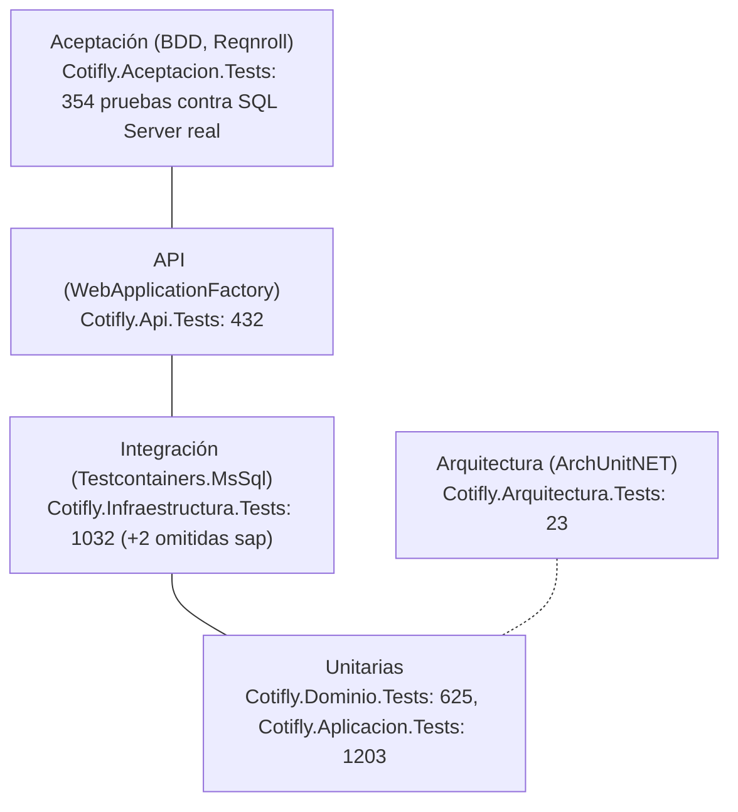

# 8. Testing

> **Estado:** vigente · **Dueño:** Duban Guerra (backend) · **Actualizado:** 2026-10-15

Metodología SDD + TDD + BDD ([ADR-010](../specs/decisiones/ADR-010-metodologia-sdd-tdd-bdd.md)): primero el contrato (`specs/openapi.yaml`) y los escenarios (`specs/features/*.feature`), luego la prueba en rojo, la implementación y el refactor.

Contenido:

- [8.1 Pirámide de pruebas](#81-pirámide-de-pruebas)
- [8.2 Proyectos y alcance](#82-proyectos-y-alcance)
- [8.3 Categorías (traits)](#83-categorías-traits)
- [8.4 Comandos](#84-comandos)
- [8.5 Testcontainers y Reqnroll](#85-testcontainers-y-reqnroll)
- [8.6 Cobertura](#86-cobertura)
- [8.7 Integración continua](#87-integración-continua)
- [8.8 Paridad con el Python](#88-paridad-con-el-python)
- [8.9 Pruebas manuales de QA](#89-pruebas-manuales-de-qa)
- [8.10 Licitaciones desde Excel (HU-011, ADR-017)](#810-licitaciones-desde-excel-hu-011-adr-017)
- [8.11 Matrices de QA de HU-021 y HU-023](#811-matrices-de-qa-de-hu-021-y-hu-023)

## 8.1 Pirámide de pruebas



Conteos de la corrida del 2026-10-09 de la [matriz de HU-021](qa/MATRIZ_PRUEBAS_HU021.md#1-corridas-y-cobertura) (3669 ejecutadas, 0 fallos). Con #138 y `origin/QA` integrados (2026-10-13) la suite completa ejecuta **3723 pruebas (+2 omitidas `sap`), 0 fallos**; la matriz no trae ese conteo por proyecto. Infraestructura y Api mezclan pruebas unitarias y de integración ([8.3](#83-categorías-traits)).

| Nivel | Proyecto | Herramientas | Alcance |
|---|---|---|---|
| Unitario | `Cotifly.Dominio.Tests`, `Cotifly.Aplicacion.Tests` | xUnit v3, NSubstitute, AwesomeAssertions | Reglas puras (precio, margen, folio), casos de uso con puertos simulados, runner del asistente por folio con un `IChatClient` guionizado |
| Integración | `Cotifly.Infraestructura.Tests` | Testcontainers.MsSql | Repositorios, scripts `db/migrations_mssql/` aplicados, esquema igual al modelo EF, adaptadores (SAP TM, SMTP, PDF, IA, Nexo) con dobles locales |
| API | `Cotifly.Api.Tests` | `WebApplicationFactory` | Forma exacta de las respuestas del contrato, autenticación, CORS, aislamiento por comercial |
| Aceptación | `Cotifly.Aceptacion.Tests` | Reqnroll (`Reqnroll.xunit.v3`) | Los `.feature` de `specs/features/` |
| Arquitectura | `Cotifly.Arquitectura.Tests` | ArchUnitNET | Dependencias entre capas, Dominio sin paquetes externos, convención `cls`/`ICls`, contexto de `docker build` |

- TDD: test en rojo, implementación, refactor (ADR-010).
- Las pruebas no llaman a proveedores de IA reales ni a SAP TM o un relay reales: usan dobles locales (`clsChatClientGuionizado`, `clsSapTmFalso`, `clsServidorSmtpFalso`, `clsNexoClientesFalso` para Nexo y `clsTrmFalso` para los datos abiertos de la TRM, HU-012). Las pruebas con proveedores reales son manuales.

## 8.2 Proyectos y alcance

| Proyecto | Qué cubre | Tipo |
|---|---|---|
| `Cotifly.Dominio.Tests` | Reglas puras: invariantes de las entidades (solicitud, ruta, camión, correo, margen, identidad, tokens), precio y margen por método, folio, estados del costeo y sus resúmenes, métricas | Unitarias |
| `Cotifly.Aplicacion.Tests` | Casos de uso con puertos simulados (NSubstitute): login SSO, captura y envío a Nexo, polling y emparejamiento, conexos, re-solicitud y `-vN`, margen (SAP TM y política), PDF, correo, textos con IA, asistente por folio, licitaciones, cubicación, TRM y métricas | Unitarias |
| `Cotifly.Infraestructura.Tests` | Adaptadores: EF Core contra SQL Server real (Testcontainers), esquema de `db/` (instalación desde cero frente a la cadena `0001`–`0010` más el `02`), clientes HTTP de Nexo, cubicador, SAP TM y TRM contra servidores falsos, PDF (MigraDoc), correo, configuración y secretos | Unitarias e integración |
| `Cotifly.Api.Tests` | Endpoints con `WebApplicationFactory`: forma exacta de las respuestas frente a `specs/openapi.yaml` y a los ejemplos de `docs/docs_front/CONTRATO_API_WEB.md`, autenticación, CORS, `If-Match`, idempotencia, aislamiento por comercial y los E2E por flujo de HU-021 y HU-023 | Integración |
| `Cotifly.Aceptacion.Tests` | Los escenarios BDD de `specs/features/*.feature` (Reqnroll) contra SQL Server real | Aceptación |
| `Cotifly.Arquitectura.Tests` | Dependencias entre capas (ArchUnitNET), Dominio sin paquetes externos, prefijos `cls`/`ICls` y el contexto de `docker build` | Arquitectura |

Los conteos vigentes están en [8.1](#81-pirámide-de-pruebas). El detalle por funcionalidad y por issue está en las matrices de
QA ([8.11](#811-matrices-de-qa-de-hu-021-y-hu-023)); el desglose histórico de cada issue (HU-003 a HU-013) queda en el
historial de git de este documento. Las pruebas de Google Chat y del agente cotizador legado se retiraron con ellos en
HU-013.9 (#105).

## 8.3 Categorías (traits)

| Trait | Dónde | Necesita | En CI |
|---|---|---|---|
| `Categoria=Integracion` | Pruebas de integración de `Cotifly.Infraestructura.Tests` y `Cotifly.Api.Tests` (por clase) y todo `Cotifly.Aceptacion.Tests` (a nivel de ensamblado) | Docker (Testcontainers) | Job `integracion` |
| `Categoria=sap` | `clsSapTmRealTests` (SAP TM real, HU-009) | Red corporativa y `SapTm__*` / `SAPTM_PRUEBA_*`; sin variables se omite | Excluida siempre |
| (sin trait) | Todo lo demás | Nada | Job `unitarias` |

## 8.4 Comandos

Dentro del contenedor del SDK (ver [06-ejecucion-local](06-ejecucion-local.md#63-compilar-y-probar-en-el-contenedor-del-sdk) para el `docker run` completo, con el socket de Docker y la caché de NuGet), desde `backend-dotnet/`:

```bash
# Todo (unitarias + integración; necesita el socket de Docker)
dotnet build -c Release && dotnet test -c Release --no-build

# Solo unitarias, como el job "unitarias" del CI, con TRX y cobertura
dotnet test --solution Cotifly.sln -c Release --no-build \
  --filter-not-trait "Categoria=Integracion" --filter-not-trait "Categoria=sap" --ignore-exit-code 8 \
  --results-directory "$PWD/TestResults/unitarias" --report-trx \
  --coverage --coverage-output-format cobertura --coverage-settings "$PWD/tests/cobertura.config.xml"

# Solo integración y aceptación, como el job "integracion"
dotnet test --solution Cotifly.sln -c Release --no-build \
  --filter-trait "Categoria=Integracion" --filter-not-trait "Categoria=sap" --ignore-exit-code 8 \
  --results-directory "$PWD/TestResults/integracion" --report-trx \
  --coverage --coverage-output-format cobertura --coverage-settings "$PWD/tests/cobertura.config.xml"

# Una clase o un método
dotnet test -c Release --no-build --filter-class "*clsCalculadoraPrecioTests"
dotnet test -c Release --no-build --filter-method "*ValoresExactosDeLaArquitectura"

# Un proyecto (por ejemplo, solo la aceptación BDD) o una sola feature
dotnet test --project tests/Cotifly.Aceptacion.Tests -c Release --no-build
dotnet test --project tests/Cotifly.Aceptacion.Tests -c Release --no-build --filter-class "*Persistencia*"

# Contrato: OpenAPI ↔ controllers y DTOs (Cotifly.Api.Tests/Contrato) y lint del spec (como el job contrato-openapi)
dotnet test --project tests/Cotifly.Api.Tests -c Release --no-build --filter-class "*Contrato*"
npx --yes @redocly/cli@2.54.2 lint specs/openapi.yaml   # necesita Node; no viene en la imagen del SDK

# SAP TM real (HU-009.1, desde una máquina con ruta a SAP)
dotnet test -c Release --no-build --filter-trait "Categoria=sap"
```

Por suite:

| Suite | Proyecto o filtro | Necesita |
|---|---|---|
| Unitarias | `--filter-not-trait "Categoria=Integracion" --filter-not-trait "Categoria=sap"` (Dominio, Aplicacion, Arquitectura y las clases sin trait de Infraestructura y Api) | Nada |
| Integración (Testcontainers) | `--filter-trait "Categoria=Integracion"`: repositorios, scripts de esquema, endpoints por HTTP | Docker |
| Aceptación (Reqnroll) | `--project tests/Cotifly.Aceptacion.Tests` (todo el ensamblado lleva `Categoria=Integracion`) | Docker |
| Contrato | `--filter-class "*Contrato*"` en `Cotifly.Api.Tests` (`clsContratoRutasTests`, `clsContratoDocumentoTests`...) y `redocly lint` | Nada |

**Scripts por área** (`scripts/correr-tests.sh` y `scripts/correr-tests.ps1`, mismos comandos y filtros): compilan en Release (salvo `--no-build` / `-NoBuild`) y dejan un `.trx` por proyecto en `TestResults/<área o suite>-<unitarias|integracion>/`.

```bash
sh scripts/correr-tests.sh listar                          # áreas: conexos, usd-trm, redactor-ia, asistente-folio, ...
sh scripts/correr-tests.sh area licitaciones --integracion
sh scripts/correr-tests.sh suite                           # unitarias, como el job "unitarias"
sh scripts/correr-tests.sh todo                            # unitarias y luego integración
```

```powershell
.\backend-dotnet\scripts\correr-tests.ps1 -Listar
.\backend-dotnet\scripts\correr-tests.ps1 -Area conexos -Integracion
.\backend-dotnet\scripts\correr-tests.ps1 -Todo
```

- Resultado: un `.trx` por proyecto (`<Proyecto>_net10.0_x64.trx`) y un `<guid>.cobertura.xml` por proyecto en la carpeta de `--results-directory` (en `.gitignore`).
- `--ignore-exit-code 8`: tras un filtro, algún proyecto queda con cero pruebas y MTP devuelve 8.

## 8.5 Testcontainers y Reqnroll

- **BDD (Reqnroll):** los `.feature` viven en `specs/features/` (fuente de verdad SDD) y `Cotifly.Aceptacion.Tests` los enlaza; el code-behind se genera en `obj/`. Se usa `Reqnroll.xunit.v3` (Reqnroll 3.x soporta xUnit v3 y corre sobre MTP como el resto), así que no hace falta MSTest. Los pasos usan el `AddInfraestructura` real contra SQL Server en Testcontainers.
- **Escenarios SDD sin implementar (`@pendiente @ignore`, HU-013.1, #97):** todo `.feature` de `specs/features/` se compila en `Cotifly.Aceptacion.Tests`. Un escenario escrito antes que su implementación lleva `@pendiente @ignore` a nivel de `Característica`: Reqnroll genera la prueba como omitida (`@ignore`) y no busca sus pasos, así que no falla por pasos sin enlazar. `@pendiente` es solo la marca para encontrarlos. La issue que lo implementa enlaza los pasos y quita las dos etiquetas. Hoy (2026-10-13) ningún `.feature` lleva `@pendiente`: los de HU-013 (`ajuste_margen_costeo`, `servicios_conexos_nexo`, `resolicitar_costeo`, `redaccion_cotizacion`, `asistente_folio`, `moneda_formulario_costeo`, `catalogos_formulario_costeo`) ya están implementados.
- **Contrato antes que el endpoint:** las operaciones del spec con `x-estado: pendiente` se listan con su issue en `clsContratoRutasTests.PendientesDeImplementar`, y las propiedades nuevas de un DTO existente en `PropiedadesPendientes`. La prueba falla si una entrada ya está implementada (hay que quitarla) o si deja de estar en el contrato.
- **Integración (Testcontainers.MsSql):** imagen `mcr.microsoft.com/mssql/server:2019-latest`. `tests/Comun/clsBaseDatosPruebas` crea `dbTarifario_Nexo_Pruebas`, aplica `0001` a `0010` partidos por líneas `GO` (como sqlcmd) y crea una `dbsolucionesti` falsa con las tres tablas del login y sus tipos reales (`tblSAPUsuariosApp` con `ID` NUMERIC y `CLAVE`, `tblSAPUsuarioRoles`, `tblSAPRoles` con los roles de prueba 32 ClienteProComercial, 31 ClienteProGerencial y 40 sin mapeo, los mismos IDROLES de `dbSolucionesTI_Prueba`, #173), fija `Roles.idRolExterno` a 32 y 31 y ofrece `CrearPersonaExternaAsync`, `CambiarRolesExternosAsync` y `RenombrarPersonaExternaAsync` (#12). Con `InstalacionDesdeCero = true` (HU-021.12) arma la base con `db/scripts/01_crear_esquema.sql` y los seeders de `db/seeder/` en lugar de las migraciones (lo usa `clsRegistrosBdFlujoCompletoTests`), y `CrearBaseInstaladaAsync` crea una base auxiliar instalada desde cero: `clsEsquemaTests` verifica que las dos vías dejan el mismo esquema y que el `0010` no hace nada sobre una instalación desde cero. `ScriptsAntesDeHu021` (0001 a 0008) sirve para probar el `0009` sobre filas del esquema anterior. Un contenedor por proyecto de pruebas (colección xUnit `SqlServer`), que solo se crea si corre alguna prueba de integración. Cada prueba usa datos propios (folios y usuarios únicos). Las cadenas de prueba llevan `Command Timeout=120` (`clsBaseDatosPruebas.TiempoMaximoOrdenSeg`): el SQL Server del contenedor corre sobre el disco virtual de Docker Desktop (WSL2) y a veces se detiene en E/S más de los 30 s por defecto (visto en #10: `CREATE DATABASE` del fixture y consultas sueltas con "Execution Timeout Expired (258)", en pruebas distintas y sin relación con los datos). La API conserva el valor por defecto.
- Los proyectos con integración declaran `<UsaSqlServerPruebas>true</UsaSqlServerPruebas>`: `tests/Directory.Build.props` agrega Testcontainers, PdfPig (#11), el soporte compartido de `tests/Comun/` (contenedor, reloj falso, DI de pruebas con los PDF en una carpeta temporal propia, relay SMTP falso `clsServidorSmtpFalso`, lector de PDF `clsLectorPdf`) y copia a la salida `../db/migrations_mssql/*.sql` (y `rollback/`), `../db/scripts/*.sql` y `../db/seeder/*.sql` (en `scripts_bd/`) y `tests/fixtures/**/*.json`.
- Las pruebas de integración y de aceptación llevan `[Trait("Categoria","Integracion")]` (en aceptación, a nivel de ensamblado).
- `global.json` activa Microsoft.Testing.Platform (MTP) para `dotnet test` (obligatorio con xUnit v3 en el SDK 10).
- Filtros con opciones de MTP: `dotnet test --filter-not-trait "Categoria=Integracion" --ignore-exit-code 8` (sin integración: no necesita Docker) o `--filter-trait "Categoria=Integracion" --ignore-exit-code 8` (solo integración). `--ignore-exit-code 8` evita que falle la corrida por los proyectos que quedan con cero pruebas tras el filtro. Por clase o método: `--filter-class` / `--filter-method`.
- Auditoría NuGet: las advertencias de vulnerabilidades (NU1900–NU1904) siguen visibles pero no rompen el build local ni el de Docker (`WarningsNotAsErrors` en `Directory.Build.props`). El job `auditoria-nuget` del CI (#14) sí es estricto: cualquier paquete vulnerable, directo o transitivo, lo hace fallar (ver [8.7](#87-integración-continua)).
- Reportes TRX: desde #14 los proyectos de prueba traen `Microsoft.Testing.Extensions.TrxReport` (`--report-trx`, un `.trx` por proyecto). El reporte nativo de xUnit v3 (`dotnet test -- --report-xunit-trx`) sigue disponible. Cobertura con `Microsoft.Testing.Extensions.CodeCoverage` (`--coverage`, ver [8.6](#86-cobertura)).

**Ejecutar Testcontainers desde el contenedor del SDK** (Docker Desktop en Windows, PowerShell). Comando verificado:

```powershell
docker pull mcr.microsoft.com/mssql/server:2019-latest   # una vez
docker run --rm `
  -v //var/run/docker.sock:/var/run/docker.sock `
  -e TESTCONTAINERS_HOST_OVERRIDE=host.docker.internal `
  -e REQNROLL_TELEMETRY_ENABLED=0 `
  -v "C:\...\Cotifly\Cotifly:/repo" `
  -v cotifly-nuget:/root/.nuget/packages `
  -w /repo/backend-dotnet mcr.microsoft.com/dotnet/sdk:10.0 `
  sh -c "dotnet build -c Release && dotnet test -c Release --no-build"
```

- `//var/run/docker.sock` (doble barra en PowerShell) da acceso al Docker del host: SQL Server corre como contenedor hermano.
- `TESTCONTAINERS_HOST_OVERRIDE=host.docker.internal` hace que las pruebas se conecten al puerto publicado en el host y no a `localhost` del contenedor del SDK.
- Si `host.docker.internal` no resuelve (Docker en Linux sin Desktop), agregar `--add-host=host.docker.internal:host-gateway`, o usar `--network host` sin la variable. Si el contenedor Ryuk (limpieza de Testcontainers) no logra conectarse, `-e TESTCONTAINERS_RYUK_DISABLED=true` (los contenedores de prueba se borran igual al terminar, salvo que la corrida se aborte).
- `REQNROLL_TELEMETRY_ENABLED=0` desactiva la telemetría anónima de Reqnroll. Sin `APPDATA` (contenedor del SDK) Reqnroll puede dejar `tests/Cotifly.Aceptacion.Tests/Reqnroll/userid`; está en `.gitignore`.

## 8.6 Cobertura

`Microsoft.Testing.Extensions.CodeCoverage` mide solo los ensamblados de `src/` (`tests/cobertura.config.xml`: `Cotifly.Dominio`, `Aplicacion`, `Infraestructura` y `Api`; excluye código generado y `[ExcludeFromCodeCoverage]`). El CI une los reportes de unitarias e integración con ReportGenerator y publica el resumen en el job.

Cómo se mide: cada corrida de `dotnet test` con `--coverage --coverage-output-format cobertura --coverage-settings tests/cobertura.config.xml` deja un `<guid>.cobertura.xml` por proyecto (con MTP no aplica `--collect:"XPlat Code Coverage"`); ReportGenerator 5.5.11 los une y `scripts/verificar-cobertura.sh` lee el `line-rate` del ensamblado en el reporte unido.

Medición vigente: matriz de HU-021, corrida del 2026-10-09 (unitarias + integración + BDD unidas; [qa/MATRIZ_PRUEBAS_HU021.md §1.1](qa/MATRIZ_PRUEBAS_HU021.md#11-cobertura-corrida-final-1-unitarias--integración--bdd-unidas)):

| Ensamblado | Líneas | Umbral |
|---|---|---|
| `Cotifly.Dominio` | **97,44 %** | **90 %, obligatorio** (ADR-010): el job `cobertura` falla por debajo |
| `Cotifly.Aplicacion` | 96,80 % | solo se reporta |
| `Cotifly.Infraestructura` | 97,65 % | solo se reporta |
| `Cotifly.Api` | 97,24 % | solo se reporta |
| **Total** | **97,22 %** de líneas (10007 de 10293), 88,88 % de ramas (5269 de 5928) | — |

La primera medición (2026-09-25, #14) daba Dominio 99,3 % y 97,5 % en total (4636 de 4752 líneas).

Decisión (#14): solo Dominio tiene umbral, porque es la única meta que fija ADR-010 y la que protege las reglas de negocio puras. Para las demás capas se publica la cifra sin romper el build: un umbral sin acuerdo previo tiende a producir pruebas de relleno. El umbral lo aplica `scripts/verificar-cobertura.sh <reporte> <ensamblado> <umbral>` sobre el Cobertura unido (sale con 1 por debajo y con 2 si el ensamblado no aparece).

Cobertura local unida, con ReportGenerator en el contenedor del SDK:

```bash
dotnet tool install --global dotnet-reportgenerator-globaltool --version 5.5.11
export PATH="$PATH:/root/.dotnet/tools"
reportgenerator "-reports:TestResults/*/*.cobertura.xml" "-targetdir:TestResults/cobertura" "-reporttypes:Cobertura;HtmlInline;MarkdownSummaryGithub"
sh scripts/verificar-cobertura.sh TestResults/cobertura/Cobertura.xml Cotifly.Dominio 90
```

## 8.7 Integración continua

Workflow `.github/workflows/backend-dotnet.yml` (GitHub Actions, `ubuntu-latest`). Se dispara en pull requests y pushes hacia `QA` y `main` que toquen `backend-dotnet/**`, `db/migrations_mssql/**` o el propio workflow, en tags de release `vX.Y.Z` (HU-006.4, #28; GitHub no evalúa `paths` en los tags) y a mano (`workflow_dispatch`). Permisos de solo lectura, salvo `packages: write` en `publicar-imagen`; en un PR una ejecución nueva cancela la anterior, en un push no (para no cortar una publicación). **Hoy GitHub Actions está bloqueado en la organización por facturación** (2026-09-28): la imagen se publica con `scripts/publicar-imagen.sh` ([DEPLOY.md](../../DEPLOY.md) §4).

| Job | Qué hace | Falla si | Artefactos |
|---|---|---|---|
| `unitarias` | .NET de `global.json` (`actions/setup-dotnet`), restore, build Release con warnings como errores, pruebas sin `Integracion` ni `sap` | Error de build o de estilo, warning, prueba fallida, o menos de 1300 pruebas ejecutadas según los TRX | `trx-unitarias`, `cobertura-unitarias` |
| `integracion` | Descarga `mssql/server:2019-latest`, build, pruebas `Integracion` (Testcontainers usa el Docker del runner) | Prueba fallida, o menos de 330 pruebas ejecutadas según los TRX | `trx-integracion`, `cobertura-integracion` |
| `cobertura` | Tras los dos anteriores: une la cobertura con ReportGenerator, publica el resumen en el job y aplica el umbral de Dominio | `Cotifly.Dominio` < 90 % de líneas | `cobertura-reporte` (HTML y Cobertura unidos) |
| `auditoria-nuget` | `dotnet list package --vulnerable --include-transitive --format json` | Cualquier paquete vulnerable, directo o transitivo, de cualquier severidad, o una auditoría incompleta (`problems` no vacío en el JSON, por ejemplo una fuente sin datos de vulnerabilidades) | — |
| `imagen-docker` | `docker build` del `Dockerfile` con `VERSION` (según el evento: `X.Y.Z`, `qa-<corto>`, `main-<corto>` o `ci-<corto>`), `VCS_REF` y `BUILD_DATE`; prueba de humo: el contenedor en `Development` llega a `healthy`, `/health` 200 y `/health/ready` 503; escaneo con Trivy 0.74.0 (fijado por digest) con las excepciones temporales y con vencimiento de `.trivyignore.yaml` (#86, ver [03-infraestructura §3.1](03-infraestructura.md#31-contenedor-e-imagen)). En push guarda la imagen probada | Build fallido, sonda que no llega a `healthy` en 60 s, vulnerabilidad HIGH/CRITICAL con parche disponible, o tag de release que no apunta a un commit de `main` | `imagen-cotifly-api` (solo push, 1 día) |
| `contrato-openapi` | `redocly lint specs/openapi.yaml` (Redocly CLI 2.54.2) | Errores del lint (los warnings se muestran como anotaciones) | — |
| `publicar-imagen` | Solo push a `QA`/`main` o tag `vX.Y.Z`, después de todos los demás jobs: carga la imagen probada (sin reconstruirla) y la sube a `ghcr.io/innovacionia-proyectos/cotifly-backend` con `GITHUB_TOKEN`. Push de rama: `sha-<corto>` (solo si no existe) y `qa` o `main`; tag git: solo `X.Y.Z`, creado con `docker buildx imagetools create --prefer-index=false` sobre el digest de `sha-<corto>` (sin reconstruir, mismo digest; si `sha-<corto>` no existe, una versión final falla). Nunca `latest` ([DEPLOY.md](../../DEPLOY.md) §4.1) | Login o push fallido, `X.Y.Z` ya publicado, `sha-<corto>` ausente en un tag final o error del registry | — (resumen con tags y digest) |

- El build local y el de Docker no fallan por avisos de vulnerabilidades (NU1900–NU1904 en `WarningsNotAsErrors`): el job `auditoria-nuget` es el control estricto.
- El workflow se valida con `actionlint` (incluye `shellcheck` de los bloques `run`): `docker run --rm -v "<repo>:/repo" -w /repo rhysd/actionlint:latest`.
- Pendiente de ADR-007: si el CI corporativo no es GitHub Actions, el runner necesita Docker para el job `integracion`; sin Docker se corre solo `unitarias`.
- **Mínimo de pruebas descubiertas:** las corridas filtradas usan `--ignore-exit-code 8` (proyectos que quedan con cero pruebas tras el filtro), lo que también ocultaría un filtro mal escrito que no descubra ninguna. Por eso cada job suma las pruebas ejecutadas de sus TRX (`scripts/contar-pruebas-trx.sh`) y exige un mínimo: 1300 unitarias y 330 de integración (mínimos fijados en #14; la suite de HU-021 ejecuta 3723 pruebas en total). Subir los mínimos cuando crezca la suite.
- **Filtro `paths` y protección de rama:** el workflow solo corre si el cambio toca `backend-dotnet/**`, `db/migrations_mssql/**` o el propio workflow. Un cambio solo en `db/scripts/` o `db/seeder/` no lo dispara, aunque las pruebas los usan desde HU-021 (`clsEsquemaTests`, `InstalacionDesdeCero`): conviene agregar esas rutas al filtro. Si sus jobs se exigen como verificación obligatoria en la protección de `QA` o `main`, un PR que no toque esas rutas quedaría esperando checks que nunca corren: en ese caso exigirlos con reglas por ruta, o agregar un job liviano sin filtro que informe "no aplica".
- **Vigilancia de la imagen base (#86):** workflow aparte `.github/workflows/vigilancia-imagen-base.yml` (lunes 12:00 UTC y `workflow_dispatch`, solo lectura). Compara el digest de la imagen base con el fijado, busca el parche siguiente, escanea la imagen base con Trivy sin excepciones y avisa los vencimientos de `.trivyignore.yaml` (ver [03-infraestructura §3.1](03-infraestructura.md#31-contenedor-e-imagen)).
- **Relación con HU-006:** HU-006.4 (#28) extendió el job `imagen-docker` (versión del evento, escaneo con Trivy, imagen guardada) y agregó `publicar-imagen` (tags por versión y push al registry) en el mismo workflow, sin crear otro pipeline. Convención de tags y release: [DEPLOY.md](../../DEPLOY.md) §4. La prueba de humo del CI (arranque, `HEALTHCHECK`, `/health`) no reemplaza las pruebas de humo del despliegue de HU-006.8, que pueden reutilizar los casos RM de [qa/regresion-manual.md](qa/regresion-manual.md) contra el entorno desplegado.

- **Scripts de despliegue (HU-006, fuera del CI):** `sh scripts/respaldo/probar-respaldo-local.sh` prueba de punta a punta la exportación y el restore de `dbo_cotifly` con dos SQL Server 2019 en contenedores (datos ficticios, login de solo `SELECT`, retención, controles del restore y SHA-256 del contenido de cada tabla); `sh scripts/publicar-imagen.sh --sin-push` construye, prueba (humo) y escanea la imagen. Los manifiestos se validan con `docker stack config -c infra/stack.dotnet.*.yml`. Ver [DEPLOY.md](../../DEPLOY.md) §4 a §6. Los scripts de shell se revisan con `shellcheck` (`docker run --rm -v "<repo>/backend-dotnet/scripts:/mnt" -w /mnt koalaman/shellcheck:stable -x -s sh ...`).

## 8.8 Paridad con el Python

> **Histórico. HU-003.9 (#15) cerrada por decisión del usuario (2026-10-13, HU-022.1): el Python se retiró del repositorio (tag `python-final`), así que ya no hay contra qué comparar.** Esta sección queda como trazabilidad: los `test_*.py` que cita
> están en el tag `python-final`.

> Las filas del agente conversacional y de Google Chat (`clsAgenteRunnerTests`, `clsInyeccionEstadoTests`, `clsGoogleChat*Tests`, `clsChatEventosEndpointTests`, `chat_slot_filling.feature`, `google_chat.feature`, `chat_web.feature`) son históricas: esas pruebas se borraron con el retiro de HU-013.9 (#105) y el comportamiento del Python que verificaban ya no existe en Cotifly.

- **Paridad con el Python (#10, #13).** Cada caso de `tests/test_precio.py` y `tests/test_margen.py` tiene su prueba .NET (el comentario sobre cada prueba nombra el test de origen):

| Test Python | Prueba .NET |
|---|---|
| `test_valores_exactos_arquitectura` | `clsCalculadoraPrecioTests.ValoresExactosDeLaArquitectura`; `precio.feature` |
| `test_markup_vs_margen` | `clsCalculadoraPrecioTests.MarkupRindeMenosPrecioQueMargen`; `precio.feature` |
| `test_borde_margen_cero` | `clsCalculadoraPrecioTests.ConMargenCeroElPrecioEsElCosto`; `precio.feature` |
| `test_borde_margen_uno_division_por_cero` | `clsCalculadoraPrecioTests.ConMetodoMargenUnMargenDeUnoSeRechaza`; `precio.feature` |
| `test_markup_admite_margen_alto` | `clsCalculadoraPrecioTests.MarkupAdmiteUnMargenAlto`; `precio.feature` |
| `test_rechaza_margen_negativo` | `clsCalculadoraPrecioTests.RechazaMargenNegativo`; `precio.feature` |
| `test_rechaza_costo_no_positivo` | `clsCalculadoraPrecioTests.RechazaCostoNoPositivo`; `precio.feature` |
| `test_rechaza_metodo_desconocido` | `clsCalculadoraPrecioTests.RechazaMetodoDesconocido`; `precio.feature` |
| `test_property_precio_no_menor_que_costo` (hypothesis) | `clsCalculadoraPrecioTests.ElPrecioNuncaEsMenorQueElCostoYLaUtilidadEsLaDiferencia` (grilla determinista de 112 casos, sin FsCheck) |
| `test_normalizar_value` | `clsReglasMargenTests.NormalizaElValueDeSapAFraccionConSeisDecimales` |
| `test_es_anomalo` | `clsReglasMargenTests.MarcaAnomaloFueraDeCeroASesentaPorCiento` |
| `test_resolver_sap_tm` | `clsMargenResolverServiceTests.ConBpYRegistroEnSapElOrigenEsSapTm`; `clsMargenResolverIntegracionTests` (mismo nombre); `margen.feature` |
| `test_resolver_fallback_cliente_nuevo` | `clsMargenResolverServiceTests.SinBpNoSeConsultaSapYSeUsaLaPoliticaDeLaLinea`; `clsMargenResolverIntegracionTests.SinBpSeUsaLaPoliticaSembrada`; `margen.feature` |
| `test_resolver_fallback_cliente_sin_registro` | `ConBpSinRegistroEnSapSeUsaLaPolitica` (unitaria e integración); `margen.feature` |
| `test_resolver_marca_anomalo_negativo` | `UnMargenSapNegativoSeMarcaAnomalo` (unitaria e integración); `margen.feature` |
| `test_resolver_marca_anomalo_atipico` | `UnMargenSapAtipicoSeMarcaAnomalo` (unitaria e integración); `margen.feature` |
| `test_resolver_respeta_sales_org` | `SeRespetaLaOrganizacionDeVentasPedida` (unitaria e integración); `margen.feature` |
| `test_resolver_linea_desconocida` | `UnaLineaDesconocidaDevuelveMargenLineaDesconocida` (unitaria e integración); `margen.feature` |
| `test_mapeo_todas_las_lineas` | `clsMargenResolverIntegracionTests.CadaLineaSembradaTieneSuTrqTypeYSuPolitica` |
| `test_export_encuentra_y_no_encuentra` | `clsFuenteMargenExportJsonTests.EncuentraElValueDelClienteYDevuelveNullSiNoExiste` (+ `DevuelveElValueCrudoDeCadaFilaSinDividirPorCien` para las 10 filas); `clsMargenFuentesSapIntegracionTests.ConExportJsonUnClienteConRegistroObtieneElMargenDeSap` |
| `test_export_archivo_ausente` | `clsFuenteMargenExportJsonTests.UnArchivoAusenteEsFuenteNoDisponibleSinExponerLaRuta`; `clsMargenFuentesSapIntegracionTests.ConExportJsonAusenteElResolverUsaLaPoliticaConElMotivo` |
| `test_export_json_malformado` | `clsFuenteMargenExportJsonTests.UnExportMalformadoEsFuenteNoDisponible` (8 casos: JSON roto, sin `d.results`, fila sin `Value`, `Value` no numérico o nulo, id numérico) |
| `test_odata_encuentra` | `clsFuenteMargenODataTests.EncuentraElValueConLaConsultaExactaDeRentabClienteSet` (URL exacta, filtro y `Accept`) |
| `test_odata_cliente_inyectado` | `clsFuenteMargenODataTests.EnviaAutenticacionBasicConUsuarioYClave` (el cliente siempre se inyecta: `IHttpClientFactory`) |
| `test_odata_vacio_devuelve_none` | `clsFuenteMargenODataTests.SinResultadosDevuelveNull` |
| `test_odata_error_500_es_estructurado` | `clsFuenteMargenODataTests.UnErrorHttpEsFuenteNoDisponibleSinExponerCredenciales` (500, 503, 404, 401); `clsRegistroFuenteMargenTests.ElClienteODataAgotaLosReintentosYReportaFuenteNoDisponible`; `clsMargenFuentesSapIntegracionTests.ConODataCaidoElResolverUsaLaPoliticaSinRomperLaCotizacion` |
| `test_odata_timeout_es_estructurado` | `clsFuenteMargenODataTests.UnTimeoutEsFuenteNoDisponible` (+ `UnErrorDeRedEsFuenteNoDisponible`, `LaCancelacionDelLlamadorNoSeDisfrazaDeCaidaDeSap`) |
| `test_construir_resolver_export` | `clsRegistroFuenteMargenTests.ConModoExportJsonLaFuenteEsElExport` |
| `test_construir_resolver_odata` | `clsRegistroFuenteMargenTests.ConModoODataLaFuenteEsElClienteOData` |
| `test_conmutacion_export_a_odata_misma_salida` | `clsMargenFuentesSapIntegracionTests.ConmutarDeExportJsonAODataDaLaMismaSalida` (13 consultas: las 10 filas, organización equivocada, sin registro, sin BP); `margen.feature` |
| (sin equivalente en Python: inyección en el `$filter`, corregida) | `clsFuenteMargenODataTests.EscapaLasComillasDelBpParaQueNoAltereElFiltro`, `CodificaLaUrlParaQueElBpNoAgregueParametros`, `EscapaTambienLaOrganizacionYElTrqType`; `margen.feature` |
| (sin equivalente en Python: caché del export, validación de `SapTm`, resiliencia) | `clsFuenteMargenExportJsonTests.NoReleeElArchivoMientrasNoCambieSuFechaNiSuTamano`, `RecargaElArchivoCuandoCambia`, `SiElArchivoDesapareceODejaDeSerLegibleDespuesDeCargarLoReporta`; `clsRegistroFuenteMargenTests` (modos y validación; `ElClienteODataReintentaUnErrorTransitorio`) |
| (sin equivalente en Python: SAP no configurado → política) | `clsMargenResolverServiceTests.ConLaFuenteNoConfiguradaSeUsaLaPoliticaSinError`; `clsMargenSapNoConfiguradoIntegracionTests`; `margen.feature` |
| `registrar_ajuste_margen` (`server.py`, sin test propio) | `clsAjusteMargenServiceTests`; `clsMargenResolverIntegracionTests.ElAjusteNegociadoSePersisteConElComercialYLaCotizacion`; `margen.feature`; auditado: `clsAuditoriaServiceTests.ElAjusteDeMargenNegociadoSeAudita`, `auditoria.feature` |
| `test_html_contiene_datos_de_la_cotizacion` | `clsConstructorDocumentoCotizacionTests.ElDocumentoTieneLosDatosDeLaCotizacion`; `clsGeneradorPdfMigraDocTests.LaSolicitudDeEjemploTieneTresPaginasConLosBloquesEnSuSitio`; `pdf.feature` |
| `test_html_determinista` | `clsConstructorDocumentoCotizacionTests.ElDocumentoEsDeterminista`; `clsGeneradorPdfMigraDocTests.ElRenderEsEstableEnPaginasYTexto` |
| `test_bloque_aduanero_solo_internacional` | `clsConstructorDocumentoCotizacionTests.ElBloqueAduaneroSoloApareceEnLaLineaInternacional`; `clsGeneradorPdfMigraDocTests.ElBloqueAduaneroSoloApareceEnInternacional`; `pdf.feature` |
| `test_bloque_extradimensionada_y_refrigerada` | `clsConstructorDocumentoCotizacionTests.LosBloquesExtradimensionadaYRefrigeradaMuestranSoloLoQueTraen`; `clsGeneradorPdfMigraDocTests.ElBloqueAduaneroSoloApareceEnInternacional` |
| `test_multi_seccion_usa_armar_multi` | `clsConstructorDocumentoCotizacionTests.ConSeccionesSeUsaLaVarianteMulti`; `clsGeneradorPdfMigraDocTests.LaVarianteMultiTieneDosPaginasConLasCondicionesEnLaPrimera`; `pdf.feature` |
| `test_render_pdf_genera_archivo_y_paginas` (weasyprint) | `clsGeneradorPdfMigraDocTests.LaSolicitudDeEjemploTieneTresPaginasConLosBloquesEnSuSitio` (exactamente 3 páginas; el Python pedía ≥ 3) |
| `test_folio_versionado` | Sin equivalente a propósito: el folio lo genera #12 (ADR-011); aquí la colisión es `FOLIO_DUPLICADO` (`clsGenerarPdfServiceTests.UnFolioExistenteEsFolioDuplicadoSinRenderizar`, `pdf.feature`) |
| (sin equivalente en Python: folio con las iniciales del comercial, ADR-011) | Iniciales: `clsInicialesComercialTests` (primer nombre y primer apellido, tildes y Ñ, tres palabras, una palabra, respaldo `nombreUsuario` sin dominio, `XX`, partículas, guion bajo, texto libre de `DESCRIPCIONUSUARIO` entre paréntesis o tras ` - `, inicial abreviada, `LimitacionesConocidasDocumentadasEnElAdr`); formato: `clsFolioTests`; generador: `clsGeneradorFolioServiceTests.LaPrimeraCotizacionDelDiaEsLa001ConLasInicialesYElCandadoDeLasInicialesDelDia`, `ElConsecutivoSigueAlUltimoDeLasInicialesEseDiaYLlevaElNit`, `UnComercialQueNoExisteEnUsuariosWebNoRecibeFolio`; integración: `clsFolioIntegracionTests.DosComercialesConInicialesDistintasEmpiezanAmbosEn001AunqueGenerenALaVez`, `DosComercialesConLasMismasInicialesCompartenElConsecutivoSinColisionar`, `ElConsecutivoEsPorInicialesYCuentaLosFoliosConYSinNit`, `ElUltimoConsecutivoNoCuentaVersionesNiFoliosDeOtrasInicialesODiasNiHeredados`, `DiezGeneracionesSimultaneasDelMismoComercialObtienenConsecutivosUnicos`; `folio.feature` (9 escenarios) |
| (sin equivalente en Python: versión de un folio heredado sin iniciales) | `clsGeneradorFolioServiceTests.LaVersionNuevaDeUnFolioHeredadoSinInicialesLlevaV2SobreSuBase`; `clsFolioIntegracionTests.LaVersionNuevaDeUnFolioHeredadoSinInicialesEsV2SobreSuBase`, `LaVersionMaximaDeUnFolioHeredadoEscapaLosComodinesDeLike` |
| `test_generar_pdf_dod_via_mcp` | `clsGenerarPdfServiceTests.GeneraGuardaYRegistraLaCotizacionConSuTrazabilidad`; `clsPdfCorreoIntegracionTests.GenerarElPdfRegistraLaCotizacionGuardaElArchivoYAudita`; `pdf.feature` |
| `test_generar_pdf_linea_negocio_desconocida_hoy_falla_entero` (pin del bug #44) | Corregido: `clsGenerarPdfServiceTests.UnaLineaDesconocidaSeRechazaAntesDeRenderizar`; con tilde se resuelve: `clsPdfCorreoIntegracionTests`, `pdf.feature` |
| `test_generar_pdf_idempotencia_versiona` | Reemplazado por `FOLIO_DUPLICADO` sin sobrescribir el PDF: `clsGenerarPdfServiceTests.SiElArchivoYaExisteEnElAlmacenNoSeReemplazaYEsFolioDuplicado`, `pdf.feature` |
| `test_generar_pdf_persiste_trazabilidad_completa` | `clsGenerarPdfServiceTests.GeneraGuardaYRegistraLaCotizacionConSuTrazabilidad` (la trazabilidad llega del estado, no del payload) |
| `test_generar_pdf_tolera_cliente_como_objeto` | Sin equivalente: el payload es tipado; el cliente se resuelve por catálogo (HU-005.2) y el NIT llega en la trazabilidad |
| `test_generar_pdf_sin_referencia_error` | `clsGenerarPdfServiceTests.SinFolioNiReferenciaEsPayloadInvalido` |
| `test_generar_pdf_render_no_disponible_error` | `clsGenerarPdfServiceTests.UnFalloDelRenderEsPdfRenderNoDisponible` |
| `test_envio_ok_adjunta_pdf_y_persiste` | `clsCorreoServiceTests.ElEnvioAdjuntaElPdfSaleDelComercialYQuedaRegistrado`; `correo.feature` |
| `test_sin_confirmado_por_rechaza_y_no_envia` | `clsCorreoServiceTests.SinComercialAutenticadoNoSeEnvia` |
| `test_cotizacion_no_encontrada` | `clsCorreoServiceTests.UnaCotizacionAjenaOInexistenteNoSeEnvia`; `correo.feature` |
| `test_pdf_no_encontrado` | `clsCorreoServiceTests.SinPdfEnElAlmacenNoSeEnvia`; `correo.feature` |
| `test_duplicado_menos_5min_rechaza` | `clsCorreoServiceTests.UnEnvioALosMismosDestinatariosEnMenosDeCincoMinutosEsDuplicado`; `clsPdfCorreoIntegracionTests.ElEnvioDeduplicaConElRelojDeLaAplicacionYPasaAReenviada`; `correo.feature` |
| `test_duplicado_mas_5min_permite` | `clsCorreoServiceTests.LaVentanaDeDeduplicacionSeMideConElRelojDeLaAplicacion`; `clsCorreoRepositoryTests.UnEnvioAnteriorAlInstanteNoSeLista`; `correo.feature` |
| `test_distintos_destinatarios_no_es_duplicado` | `clsCorreoServiceTests.OtroConjuntoDeDestinatariosNoEsDuplicado` |
| `test_fallo_smtp_eleva_envio_smtp_error` | `clsCorreoServiceTests.UnFalloDelTransporteQuedaRegistradoComoFallidoYNoCambiaElEstado`; `clsTransporteSmtpRelayTests.UnRelayInalcanzableEsEnvioFallido`; `correo.feature` |
| `test_now_estable_en_transaccion` (Postgres) | Sin equivalente: la ventana se mide con `IClsReloj` (el interceptor fija `createdAt` con el mismo reloj) |
| `test_relay_arma_mensaje_con_remitente_comercial_y_adjunto` | `clsTransporteSmtpRelayTests.ArmaElMensajeConElRemitenteComercialElCuerpoYElAdjunto` |
| `test_relay_sin_confirmado_usa_fallback` | `clsTransporteSmtpRelayTests.SinCorreoDelComercialUsaElRemitenteDeRespaldo` |
| `test_relay_fallo_de_red_eleva_error` | `clsTransporteSmtpRelayTests.UnRelayInalcanzableEsEnvioFallido` (+ `SiElRelayRechazaLosDestinatariosPideAutorizarLaIpDelServidor`) |
| `tests/test_ws_correos.py` (WSCorreos SOAP) | Sin equivalente: `wscorreos` no se porta hasta confirmar el transporte real (D3) |
| Middleware de auditoría (`mcp_server/auditoria.py`, cubierto por `test_generar_pdf_dod_via_mcp`) | `clsAuditoriaServiceTests`; `clsPdfCorreoIntegracionTests`; `auditoria.feature`; en el agente, `clsInyeccionEstadoTests.LaAuditoriaDelFiltroNoDuplicaLaDeLosCasosDeUso` |
| `test_loop_tool_use_invoca_mcp_y_cierra` | `clsAgenteRunnerTests.DosHerramientasEncadenadasDevuelvenSuSalidaRealAlModelo` (+ `SinHerramientasElTurnoCierraConLaRespuestaDeLaLlamadaFinal`) |
| `test_tools_declaradas_excluyen_ping` | `clsAgenteRunnerTests.SinHerramientasElTurnoCierraConLaRespuestaDeLaLlamadaFinal` (las 7 declaradas, sin `ping`) y `EnviarCorreoSoloSeDeclaraConElCorreoHabilitado` |
| `test_max_iteraciones_excedidas` | `clsAgenteRunnerTests.SiElModeloNuncaCierraElLoopCortaEnElTope` |
| `test_registra_cada_turno_en_conversacion` | `clsAgenteRunnerTests.CadaTurnoQuedaEnLaConversacionConLasHerramientasYSusSalidas` |
| `test_memoria_entre_turnos_alimenta_contexto` | `clsAgenteRunnerTests.ElSegundoTurnoLlevaLaSolicitudOriginalYLasRespuestasPrevias` |
| `test_integracion_llm_flujo_cotizacion` (marca `llm`, tokens reales) | Sin equivalente automático: las pruebas no consumen tokens (ADR-003); validación manual con el proveedor de producción (pendiente) |
| `test_contexto_antepone_identidad_del_comercial`, `test_ejecutar_turno_envia_system_con_contexto` | `clsAgenteRunnerTests.ElSistemaLlevaElContextoDelComercialYElEstadoResuelto` |
| `test_contexto_vacio_no_modifica_la_skill` | Sin equivalente: el comercial siempre existe (token o email) y el bloque de contexto siempre va |
| `test_invocar_inyecta_space_y_thread_en_tools_que_los_aceptan` | `clsInyeccionEstadoTests.ElClienteIdentificadoEnElTurnoUnoLlegaAlPdfDelTurnoDosSinQueElLlmLoMande` (hilo, comercial, NIT, BP) |
| `test_invocar_no_pisa_valores_del_llm_ni_agrega_no_aceptados` | Invertido a propósito (ADR-004): el estado **sí** pisa lo que manda el LLM: `CalcularPrecioUsaElMargenYElMetodoDelEstadoAunqueElLlmMandeOtros`, `SinClienteConfirmadoObtenerMargenNoConsultaSapConLoQueMandeElLlm` |
| (sin equivalente en Python: el hallazgo del cliente entre turnos) | `clsInyeccionEstadoTests.ElClienteIdentificadoEnElTurnoUnoLlegaAlPdfDelTurnoDosSinQueElLlmLoMande`; `chat_slot_filling.feature` |
| `test_jwt_valido_ack_200`, `test_jwt_ausente_401`, `test_jwt_invalido_401`, `test_bearer_malformado_401` | `clsChatEventosEndpointTests.ConElJwtValidoAcusaDeInmediatoYEncolaElMensaje`, `SinJwtOConUnoInvalidoEs401YNoEncola`; `clsGoogleChatInfraestructuraTests.ElJwtValidoDeLaFixturePasa`, `ElJwtConLaFirmaDeOtraClaveNoPasa`, `SinBearerNoPasa`; `google_chat.feature` |
| `test_ack_no_espera_procesamiento` | `clsChatEventosEndpointTests.ConElJwtValidoAcusaDeInmediatoYEncolaElMensaje` (cola falsa sin worker) |
| `test_evento_no_mensaje_no_encola` | `clsChatEventosEndpointTests.UnEventoQueNoEsMensajeAcusaSinCuerpoYNoEncola`; `clsGoogleChatTests.UnEventoQueNoEsMensajeNoDisparaTurno` |
| `test_parsear_evento_real`, `test_parsear_captura_nombre_del_comercial`, `test_parsear_formato_nuevo_chat_messagepayload` | `clsGoogleChatTests.ParseaElEventoRealDelFormatoClasico`, `CapturaElNombreDelComercial`, `ParseaElFormatoAddOnConElTipoInferido` |
| `test_webhook_sin_jwt_cuando_verificacion_desactivada`, `test_webhook_formato_addon_ack_hostappdataaction` | `clsChatEventosEndpointTests.ElFormatoAddOnAcusaConHostAppDataActionYSinVerificacionNoPideJwt`; `clsGoogleChatInfraestructuraTests.ConLaVerificacionDesactivadaTodoPasa` |
| `test_worker_procesa_encolados`, `test_worker_sobrevive_a_evento_que_falla` | `clsGoogleChatInfraestructuraTests.ElWorkerConsumeLaColaEnSegundoPlano`, `ElWorkerSobreviveAUnEventoQueFallaYAlertaAlSoporte` |
| `test_worker_dispara_runner_y_crea_sesion` | `google_chat.feature` ("El comercial cotiza por Google Chat..."), sesión ligada al comercial |
| `test_google_verifier_pasa_audience_y_certs`, `test_google_verifier_emisor_inesperado`, `test_google_verifier_firma_invalida`, `test_google_verifier_sin_project_number` | `clsGoogleChatInfraestructuraTests.ExigeLaAudienciaDelProyectoElEmisorDeChatYLaVigencia`, `ElJwtConLaFirmaDeOtraClaveNoPasa`, `SinNumeroDeProyectoNadaPasa` |
| `test_formato_cop_y_pct` | `clsGoogleChatTests.FormateaPesosYPorcentajes` |
| `test_mensaje_previsualizacion_desde_calcular_precio`, `test_runner_final_publica_card_previsualizacion` | `clsGoogleChatTests.ConPrecioSePublicaLaPrevisualizacionConLosBotonesDeControlHumano`; `google_chat.feature` |
| `test_mensaje_pdf_desde_generar_pdf` | `clsGoogleChatTests.ConPdfSePublicaLaTarjetaConElEnlaceFirmado` (enlace firmado, ADR-011) |
| `test_mensaje_texto_cuando_no_hay_precio_ni_pdf`, `test_mensaje_ignora_salida_con_error` | `clsGoogleChatTests.SinPrecioNiPdfOConErrorSePublicaTexto` |
| `test_card_pdf_sin_url` | `clsGoogleChatTests.LaTarjetaDelPdfSinUrlNoTieneBoton` |
| `test_publicador_agrega_hilo_y_envia`, `test_construir_publicador_postea_a_chat_api` | `clsGoogleChatInfraestructuraTests.ElPublicadorPosteaALaApiDeChatConElTokenDeLaCuentaDeServicioYElHilo` (+ `LaAsercionDeLaCuentaDeServicioVaFirmadaConSuClave`) |
| `test_publicador_sin_space_falla` | `clsGoogleChatInfraestructuraTests.UnSpaceInvalidoSeRechaza` |
| `test_gating_sin_confirmacion_no_envia_correo` | `clsInyeccionEstadoTests.ElCorreoExigeDestinatariosEscritosPorElComercialYUsaLaCotizacionDelEstado`, `ElPdfSinConfirmacionRespondeConfirmacionRequeridaYNoSeGenera` |
| `test_procesador_no_mensaje_no_publica`, `test_procesador_corre_turno_y_publica` | `clsGoogleChatTests.UnEventoQueNoEsMensajeNoPublica`, `UnComercialConocidoCotizaYLaRespuestaSePublicaEnElHilo` |
| `test_flujo_ajuste_margen_republica` | `clsInyeccionEstadoTests.ElAjusteNegociadoTomaLaReferenciaYElCostoDelEstado` |
| (sin equivalente en Python: identidad de Chat por email, ADR-011) | `clsGoogleChatTests.UnRemitenteSinCuentaRecibeElAvisoYNoCotiza`; `clsAgentePersistenciaTests.ElComercialDeGoogleChatSeEncuentraPorSuCorreoSinDistinguirMayusculas`; `google_chat.feature` |
| `test_recuperar_o_crear_y_aislamiento`, `test_registrar_mensaje_actualiza_actividad` | `clsSesionRepositoryTests` (#9); sesión ligada al comercial: `clsAgenteRunnerTests.LaSesionDeOtroUsuarioNoSeContinua`, `clsChatWebEndpointTests.LaSesionDeOtroComercialEs404` |
| `test_historial_completo_si_cabe`, `test_historial_trunca_conservando_primero`, `test_historial_vacio`, `test_estimar_tokens` | `clsVentanaHistorialTests.SiCabeSeEntregaCompleto`, `TruncaConservandoElPrimeroYLosMasRecientes`, `UnHistorialVacioQuedaVacio`, `EstimaUnTokenCadaCuatroCaracteres` |
| `test_historial_conserva_primero_aunque_exceda` | `clsVentanaHistorialTests.ConservaElPrimeroYElUltimoAunqueExcedan` (el mensaje actual también se conserva) |
| `test_archivar_inactivas_por_timeout` | `clsAgentePersistenciaTests.ElBarridoArchivaLasSesionesInactivasDesdeHaceMasDelTtl` |
| `test_e2e_feliz_cotizar_y_enviar` | `chat_slot_filling.feature` (solicitud → previsualización → confirmación → PDF persistido); el envío, `correo.feature` y `clsInyeccionEstadoTests.ElCorreoExigeDestinatarios...` |
| `test_e2e_sin_tarifa_pide_candidatas_no_inventa` | La fuente de tarifas ya no existe (Drive retirado): `TARIFA_FUENTE_NO_DISPONIBLE` llega al modelo como error estructurado (`clsAgenteRunnerTests.ElErrorEstructuradoDeUnaHerramientaLlegaAlModelo`) y sin margen no hay precio (`SinMargenResueltoCalcularPrecioSeRechazaSinInventarlo`) |
| `test_e2e_margen_anomalo_se_reporta` | `obtener_margen` devuelve `anomalo` tal cual (`clsMargenResolverServiceTests`, #10); el agente lo recibe en `SalidaMargen` |
| `web_chat` (`orquestador/web.py`, sin test propio) | `clsChatWebEndpointTests` (200, 400, 401, 404, `error: true`, 429, respuesta final corregida con un reintento y respaldo de #16); `chat_web.feature`, `validador_respuesta_ia.feature` |

## 8.9 Pruebas manuales de QA

| Documento | Para qué | Estado |
|---|---|---|
| [qa/regresion-manual.md](qa/regresion-manual.md) | Ronda de regresión de los 3 flujos principales (nueva cotización, mis cotizaciones, envío de correo) contra el backend .NET desplegado en pruebas (HU-003.8) | Pendiente: la ejecuta Kevin (QA) |
| [qa/paridad-python-dotnet.md](../../docs/archivo/paridad-python-dotnet.md) | Al menos 10 casos reales comparados entre el Python y el .NET, y prueba de los endpoints `/web/*` con Postman (HU-003.9, #15) | Cerrada por decisión del usuario (2026-10-13): el Python se retiró; la plantilla queda como histórico |

## 8.10 Licitaciones desde Excel (HU-011, ADR-017)

| Prueba | Proyecto | Qué cubre |
|---|---|---|
| `clsLineasSolicitudTests` | Dominio | Errores por campo de una línea (todos, no el primero), regla de peso de Nexo, encabezado, entidad de línea, derivación por línea, posiciones de varias líneas y validación del archivo |
| `clsValidadorLicitacionTests` | Aplicacion | Reporte por fila: índice, fila, campo y código; hoja y fila con archivo; tope de 1000 líneas |
| `clsPrecioCosteoLineasTests` | Aplicacion | Precio por línea, total solo con todas costeadas, ids por orden, entrega sin flete, PDF ya generado y **equivalencia con la regla de una línea** de HU-005.7 |
| `clsExcelLicitacionTests` | Infraestructura | Detección de filas con la regla de Nexo (portada combinada, fila vacía, subencabezado), análisis multipart contra el Nexo falso y traducción de errores, alta con N líneas |
| `clsLectorExcelAcotadoTests` | Infraestructura | Archivos maliciosos (celda en `XFD3000`, combinadas `A2:XFD400` y `A2:XFD1048576`) terminan en menos de 10 s y con menos de 400 MB, cancelación, y **paridad con Nexo**: las filas ubicadas son las de `hojas[h].filas` de un oráculo copiado del `ExcelSolicitudesAdapter` de Nexo, con su pliego de 300 líneas (`tests/fixtures/licitaciones/pliego-300-lineas.xlsx`), uno sintético y uno con subencabezado |
| `clsLineasSolicitudTests` (emparejador) y `clsPrecioCosteoLineasTests` (asociación) | Dominio, Aplicacion | Asociación por contenido con Nexo devolviendo las líneas en otro orden y con fletes distintos, líneas idénticas sin asociar, otro número de líneas, costo negativo sin lanzar (también en la equivalencia de una línea) |
| `clsEsquemaTests` (0005) | Infraestructura (Testcontainers) | Idempotencia, CHECK, columnas obsoletas conservadas y **backfill** sobre una base auxiliar con 0001 a 0004 y filas del esquema anterior |
| `clsBaseDatosHealthCheckTests` | Infraestructura (Testcontainers) | `/health/ready`: hoy `falta 0002`, `falta 0009` (esquema anterior a HU-021, también sin el 0004), `falta 0010` (también sin el CHECK de `estadoEnvio`), `falta <Tabla.columna>` y la instalación desde cero sana. Los mensajes `falta 0005` y `falta 0006` ya no existen |
| `clsEsquemaTests` (0006) y `clsConcurrenciaCotizacionTests` | Infraestructura (Testcontainers) | Idempotencia del 0006 en base aislada, backfill del margen sugerido, reversa y re-aplicación, CHECK de `textosCotizacion`, `versionNegocio`, `origenMargenSugerido` y del motivo del historial, la vista con `numAjustesBajoSugerido` y `GuardarCambiosSiVersionAsync` (versión vigente, vencida, inexistente, y un polling que leyó antes de un ajuste no pisa el precio) |
| `clsAjusteMargenCotizacionTests`, `clsAjusteMargenCosteoServiceTests` y `ajuste_margen_costeo.feature` | Dominio, Aplicación y Aceptación | HU-013.2: invariantes del ajuste, equivalencia con `clsPrecioService`, regla del PDF, `If-Match` (428/409) y `ETag` |
| `clsLicitacionesEndpointsTests` | Api (Testcontainers) | Análisis, alta multipart y JSON, reporte por fila sin nada guardado, hoja inexistente, polling línea por línea, más de 10 líneas (costeo en segundo plano), aislamiento por dueño y la línea del formulario de una línea |
| `clsExportadorExcelLicitacionTests` | Infraestructura | Exportación (HU-011.3): celdas del cliente intactas, columnas nuevas, `SIN COSTEO` en amarillo, `Sin enviar`, resumen con total y conexos, USD con TRM, sin original |
| `clsExportadorExcelFidelidadTests` | Infraestructura | Originales difíciles: `.xlsm` convertido a `.xlsx` real sin macros, textos con `=` que no se vuelven fórmulas, fidelidad (fórmulas, formatos, validaciones, comentarios, nombres, tablas, hojas ocultas), datos a la derecha intactos, fila de totales sin "Sin enviar", 1000 líneas, línea sin fila en el resumen y ningún costo en todo el paquete |
| `clsLicitacionesEndpointsTests` (exportación) | Api (Testcontainers) | `GET .../excel` de punta a punta: precios, pendientes, ningún número del archivo es un costo de Nexo, solo el dueño |
| `clsPdfPliegoTests` | Infraestructura | PDF de pliego renderizado y leído con PdfPig: 12 rutas con su precio, resumen y total sin conexos, agrupación por origen, solo conexos incluidos, sin costos de Nexo, encabezado del resumen en cada página (60 rutas), pliegos compactos de 61, 300 y 1000 rutas (tiempo y páginas), 21 orígenes, ciudades largas, licitación de una línea, USD rechazado y total que no cuadra (409) |
| `clsLicitacionesEndpointsTests` (PDF) | Api (Testcontainers) | `POST .../costeo/pdf` de una licitación: 409 mientras falten líneas, 201 con el layout de pliego, descarga y texto sin fletes de Nexo |
| `licitaciones_excel.feature` | Aceptacion | Los mismos flujos en Gherkin, con reintento tras un 503 de Nexo y la exportación |

El pliego de prueba es `tests/Comun/clsPliegoMuestra.cs`: un Excel generado con ClosedXML con plantilla "de cliente" (portada combinada, encabezado en la fila 3, una fila vacía en medio y una columna sin mapear). El Nexo falso (`clsNexoFalso`) ahora maneja solicitudes de N líneas (`CostearLinea`, `LineasDe`) y `analizar-excel`, y devuelve las líneas **al revés** del orden de captura (como Nexo, que no las ordena), con su contenido en `lineas[]` de primer nivel. `clsApiWebPruebas.ProcesarPollingAsync` procesa solo la cotización de la prueba (antes procesaba el lote de la agenda compartida y, con escenarios en paralelo, consultaba cotizaciones de otra prueba contra un Nexo falso que no las conocía).

## 8.11 Matrices de QA de HU-021 y HU-023

La campaña de la integración de HU-023 (#159, #160 y #172) sigue en [qa/MATRIZ_PRUEBAS_HU023.md](qa/MATRIZ_PRUEBAS_HU023.md): un E2E por flujo sobre la base instalada desde cero (`clsE2EFlujosHU023Tests`), el alineamiento con el event storming de HU-023 y los bugs encontrados.

[qa/MATRIZ_PRUEBAS_HU021.md](qa/MATRIZ_PRUEBAS_HU021.md) (#139, HU-021.12) es la matriz de pruebas de la reestructuración por rutas y camiones ([ADR-019](../specs/decisiones/ADR-019-reestructuracion-rutas-y-camiones.md)). Corre con el SDK 10 en contenedor, Testcontainers (SQL Server 2019), el Nexo falso (`tests/Comun/clsNexoFalso.cs`) y el cubicador falso (`tests/Comun/clsCubicadorFalso.cs`); no incluye Nexo QA ni la base compartida.

Qué trae:

- **Corridas y cobertura (§1).** Conteos por proyecto de cada corrida, sin fallos ni inestabilidad, y la cobertura unida ([8.6](#86-cobertura)). La última, con #138 y `origin/QA` integrados (2026-10-13): 3723 pruebas ejecutadas (+2 omitidas `sap`), 0 fallos.
- **Resumen por funcionalidad (§2).** 22 funcionalidades (login, captura con rutas, licitación, cubicador, envío por camión, polling y emparejamiento, estados agregados, margen por ruta, conexos y envío diferido, levante, TRM, PDF y pliego, textos IA, asistente, re-solicitud y `-vN`, "Mis cotizaciones", resultado, métricas, concurrencia, `/health/ready`, correo y administración de líneas), cada una con su cobertura unitaria, de integración y BDD: 10 en verde, 12 con huecos y 0 en rojo.
- **Detalle (§3)** con las reglas y las pruebas representativas de cada funcionalidad.
- **Pruebas nuevas de #139 (§4).** Entre ellas `clsRegistrosBdFlujoCompletoTests`: un flujo completo por HTTP sobre una base instalada desde cero que verifica fila por fila las tablas del agregado, los totales guardados, `precioFinal` = Σ `precioFinalLinea`, `versionNegocio` y 15 FK, CHECK y UNIQUE violados a propósito.
- **Alineamiento con el event storming (§5)** (comandos, eventos y políticas) y **bugs (§6)**.

Los huecos de la matriz son la lista de pruebas pendientes de HU-021.
