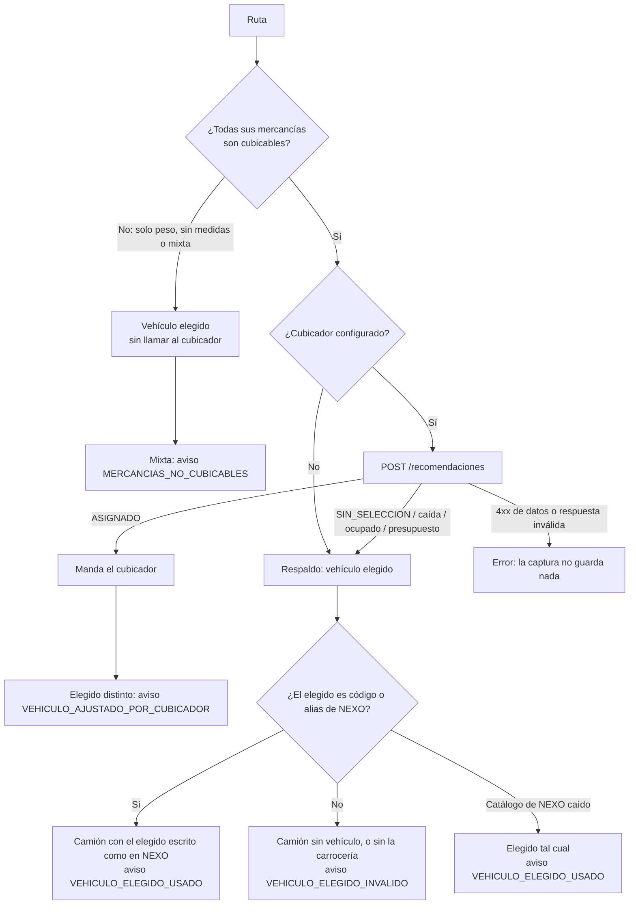

# ADR-022 — Vehículo elegido como respaldo del cubicador (HU-032)

- **Estado:** Aceptada (2026-10-21, decisión del líder técnico). Issue #197 (HU-032).
- **Reemplaza en parte:** la **decisión 7 de HU-021** (ADR-019: "el comercial ya no digita vehículo ni carrocería") y la bandera de
  respaldo de #138 tal como la describen ADR-019 y ADR-020. El resto de ADR-019/020 sigue vigente.
- **Origen:** Hallazgo 1 de QA (Kevin): el cubicador sobreescribía en silencio el vehículo digitado, y una ruta sin medidas no se podía
  capturar.

## Contexto

Con la decisión 7 de HU-021 el vehículo lo definía el cubicador o la Mesa de Costeo de NEXO. La bandera `Captura:AceptarVehiculoCliente`
(#138, encendida desde #188) dejaba pasar el vehículo del frontend solo al camión del respaldo, y lo validaba contra NEXO **antes** de saber
si se iba a usar. En la práctica:

- una ruta sin medidas (solo peso o mercancías con descripción y peso) respondía 400 (`POSICION_INVALIDA` o `CAMPO_REQUERIDO`);
- con "sin selección automática" el camión iba sin vehículo aunque el comercial hubiera elegido uno (los comentarios decían otra cosa);
- con `ASIGNADO` el vehículo elegido se ignoraba sin avisar;
- la edición y la re-solicitud borraban el vehículo;
- un vehículo elegido que NEXO no conoce tumbaba una captura que el cubicador iba a resolver.

NEXO (COTIFLY-CONTRATO §4): una línea de **Cupo** sin `tipoVehiculo` no se autocostea (queda `PorCostear`); en **Contenedor** NEXO deduce el
vehículo por peso y clase de contenedor. La carrocería no condiciona el autocosteo.

## Decisión

### 1. Clasificación de cubicabilidad (por mercancía y por ruta)

| Mercancía | Clasificación |
|---|---|
| Código (o el `id_tipo_mercancia` de la transición), las 3 medidas > 0 y peso por unidad > 0 | **Cubicable** |
| Sin **ninguna** medida y sin código | **No cubicable** (válida): se guarda, no viaja a NEXO como posición |
| Medidas parciales (por ejemplo, largo sin ancho) | **400** `POSICION_INVALIDA` en la primera medida que falta ("faltan medidas"): es un dato mal digitado |
| Código sin medidas | **400** `POSICION_INVALIDA` en `largo_cm` ("trae el tipo de mercancía pero no sus medidas") |
| Medidas sin código, con el cubicador configurado | **400** `CAMPO_REQUERIDO` en `codigo_mercancia` (como antes) |

**Código sin medidas es error, no "no cubicable"** (decisión propia, pedida por el líder): el código solo se escoge en el catálogo del
cubicador para cubicar; si llega sin medidas, el comercial empezó a cubicar y no terminó. Tratarla como no cubicable descartaría en silencio
lo que eligió (el mismo fallo silencioso que originó la HU). Es además lo que ya pasaba (rango de `largo_cm`), ahora con un mensaje claro.
Si no conoce las medidas, quita el código.

La ruta (`clsLineaSolicitudCosteo.Cubicabilidad`): `Cubicable` (todas cubicables), `NoCubicable` (ninguna), `Mixta` o `SinMercancias`.

### 2. Orden de decisión por ruta (`clsPlanificadorCamionesCubicador`)

Sin vehículo elegido, el respaldo es un camión sin vehículo (lo resuelve la Mesa), sin aviso.

### 3. Vehículo obligatorio sin cubicación: `VEHICULO_REQUERIDO`

Una ruta que no se puede cubicar (`Cubicabilidad` distinta de `Cubicable`) y **no es de Contenedor** debe traer `tipo_vehiculo`: 400
`SOLICITUD_COSTEO_INVALIDA` con `detalle.errores[] = {ruta, campo: "tipo_vehiculo", codigo: "VEHICULO_REQUERIDO"}` (y `detalle.motivo =
VEHICULO_REQUERIDO` si es el primer error), junto con los demás errores de la captura, como el resto de reglas por ruta. En la re-solicitud
con `datos_carga` es el mismo código en `detalle.motivo` con `detalle.ruta = 0`.

- **La carrocería es opcional**: NEXO autocostea Cupo con el tipo de vehículo (§4); exigirla sumaría fricción sin cambiar el costeo.
- Solo **Contenedor** puede ir sin vehículo (decisión del líder). NEXO también costea Carga suelta y Extradimensionado sin vehículo
  ("sin cambios", §4), pero se exige igual: es más seguro para el precio y el comercial siempre puede elegirlo.
- No se exige mientras una mercancía de la ruta tenga su propio error (se corrige primero), ni con la bandera apagada.
- Una ruta que va al cubicador no lo exige: si el cubicador no escoge, el camión va sin vehículo como antes.

### 4. Validación contra NEXO (M1, catálogo y alias) solo si se va a usar

- **Sin mercancías cubicables o sin cubicador configurado**: se sabe que se usa; se valida **antes** de guardar (400 `CODIGO_NO_CATALOGO`).
- **Con todas cubicables**: no se valida en la captura (`clsCapturaRutasService` lo aparta de la línea que valida el catálogo y lo
  devuelve tal cual). Si el cubicador asigna, nunca se valida. Si cae al respaldo, se valida **tarde** en el planificador con el mismo
  validador (`IClsValidadorCatalogosCaptura.ValidarLineasAsync`): válido → viaja escrito como en NEXO; tipo inválido → camión sin vehículo;
  solo carrocería inválida → camión sin carrocería; en los dos casos `VEHICULO_ELEGIDO_INVALIDO` y la captura **no** se pierde.
- **Catálogo maestro de NEXO caído en ese punto** (sin copia utilizable): el elegido va **tal cual**, con `VEHICULO_ELEGIDO_USADO` y un
  warning. Por qué no "sin vehículo según `Nexo:EnviarCodigosCubicador`": (a) ese modo gobierna los códigos del **cubicador**; el camión
  del respaldo viaja siempre (`clsCosteoNexo.VehiculoLinea`) y el envío vuelve a resolverlo contra la copia vencida del catálogo
  (`Nexo:HorasCatalogosVencidos`) y el alias; (b) desde #194/#322 NEXO recibe un código desconocido en su bandeja de normalización en vez de
  rechazarlo; (c) quitarlo convertiría una línea de Cupo en `PorCostear` con seguridad, que es peor que un código que la Mesa normaliza.

### 5. Avisos por ruta

Usan el mecanismo que ya existía para el cubicador: `clsAdvertenciaCubicador` en `avisosCubicacion` de la ruta (se guarda; script
`pendientes/04`), con `vehiculo_elegido` y `vehiculos_finales` (nuevos, `null` en las demás advertencias). Salen en `cubicacion[]` de la
respuesta de la captura, de la licitación (por fila, `linea_orden`) y de la edición (`cotizacion.cubicacion`), y en
`rutas[].avisos_cubicacion.advertencias` de `GET .../costeo`. `cubicacion[]` incluye ahora también las rutas que no llamaron al cubicador
pero tienen avisos. Códigos: `VEHICULO_AJUSTADO_POR_CUBICADOR`, `VEHICULO_ELEGIDO_USADO`, `MERCANCIAS_NO_CUBICABLES`,
`VEHICULO_ELEGIDO_INVALIDO` (`clsAvisosVehiculo`). Al volver a planificar una ruta se reemplazan.

### 6. Persistencia (script `db/scripts/12_vehiculo_elegido.sql`)

- `CotizacionLineasSolicitud.tipoVehiculoElegido` / `carroceriaElegida` (NVARCHAR(100) NULL): el elegido se guarda **en la ruta**, aparte
  del camión. El camión guarda lo que viaja (cubicador, elegido o lo que puso la Mesa, D2); el elegido es la intención del comercial que
  conservan la edición y la re-solicitud. Una ruta anterior al 12 toma como elegido el vehículo de su único camión del respaldo.
- `CotizacionMercancias.largoCm/anchoCm/altoCm` pasan a NULL, con el CHECK "las tres NULL o las tres > 0".
- `/health/ready` responde "esquema incompleto: falta 12" sin él.

### 7. Lo que viaja a NEXO

Una ruta con alguna mercancía sin medidas viaja **sin posiciones** (`clsLineaSolicitudCosteo.PosicionesParaNexo`): mandar solo las que
tienen medidas descuadraría el peso de la línea contra la suma de sus posiciones (`PESO_INCONSISTENTE` de NEXO, 1 %). A NEXO va el peso de la
ruta. La validación de peso de Cotifly (`PESO_REQUERIDO`/`PESO_INCONSISTENTE`, con todas las mercancías) se mantiene.

### 8. Edición y re-solicitud

- Aplican la misma regla y **conservan** el vehículo elegido (se quitó el `SinVehiculo` sin bandera). El `GET .../solicitud` lo devuelve
  en `rutas[].tipo_vehiculo`/`carroceria`.
- Cambiar el elegido **es un cambio** (se replanifica la ruta y viaja: reemplazo en NEXO o `-vN`, según el modo) solo si los camiones
  dependen de él (`clsLineaSolicitud.UsaVehiculoElegido`: la ruta no la asignó el cubicador). En una ruta `ASIGNADO` el elegido es solo el
  respaldo: cambiarlo no dispara nada (`sin_cambios` sigue siendo por valor).
- Se compara contra el **elegido guardado**, no contra el camión: un cambio de la Mesa en NEXO (D2) no se confunde con uno del comercial.
- Se respetan los rechazados no reenviados (#183), la tara (#184), el alias (#194) y "la Mesa manda" (D2) en los camiones conservados.
- Re-solicitud: `datos_carga.tipo_vehiculo`/`carroceria` cambian el elegido; `VEHICULO_REQUERIDO` y la validación previa aplican solo en ese
  camino. La `-vN` sin `datos_carga` copia las rutas sin exigir el vehículo (rutas anteriores a la regla).

### 9. Licitación

Las filas con todas sus mercancías cubicables se cubican en segundo plano (HU-023.5) con un camión provisional **sin** vehículo (el elegido
aún no se validó) y la ruta guarda el elegido para el respaldo. Las filas sin mercancías cubicables no esperan al cubicador: se planifican al
crearlas con el elegido.

### 10. Emparejamiento del camión del respaldo

Un camión sin `idRecomendacionVehiculo` se asocia **por ruta y peso** cuando esa combinación es única en la cotización (un solo camión
pendiente puede ser su dueño y una sola línea libre sin recomendación la tiene, y lo mismo contando **todos** los camiones y **todas** las
líneas de la lectura, no solo los que van quedando), aunque el vehículo o la carrocería ya no cuadren: la Mesa pudo cambiarlos antes del
primer polling. La unicidad global evita la cascada que encontró la validación: dos rutas con el mismo origen, destino y peso (línea
suelta, sin `grupoRutaId`) en las que un par por contenido equivocado dejaba "única" la línea de la otra ruta. Un camión del cubicador cuenta como posible dueño de una línea sin recomendación (NEXO puede no
devolverla), así que la unicidad nunca le quita su línea. Si no es única, queda sin asociar como antes.

### 11. La bandera `Captura:AceptarVehiculoCliente`

**Se mantiene como interruptor de reversa** (por defecto `true`). Encendida rige esta ADR. Apagada vuelve el comportamiento anterior: el
elegido se ignora con un warning (captura, licitación, edición y re-solicitud), no se exige `VEHICULO_REQUERIDO` y el respaldo va sin
vehículo. Las mercancías sin medidas se siguen aceptando. Retirarla obligaría a desplegar para volver atrás si NEXO o la Mesa reportan un
problema con los vehículos elegidos; mantenerla cuesta una condición por camino.

## Alternativas consideradas

- **Tratar el código sin medidas como no cubicable**: descartada (fallo silencioso, ver §1).
- **Mandar a NEXO solo las posiciones con medidas** en una ruta mixta: descartada por `PESO_INCONSISTENTE`.
- **No persistir el elegido** y tomarlo del camión: descartada; tras `ASIGNADO` o un cambio de la Mesa el elegido se perdía y la edición
  comparaba contra lo que viajó.
- **Exigir también la carrocería**: descartada; NEXO no la necesita para autocostear.
- **Retirar la bandera**: descartada por ahora (§11).

## Consecuencias

- El comercial vuelve a ver y elegir el vehículo; el resultado es explicable con los avisos.
- El frontend debe volver a mostrar el selector, exigirlo sin mercancías cubicables (salvo Contenedor) y mostrar el vehículo final con su
  aviso (guía del frontend y contrato).
- Despliegue: el script 12 va **antes** de la imagen.
- Las pruebas y fixtures que capturaban rutas de Cupo sin vehículo ni mercancías ahora mandan `tipo_vehiculo`.

## Pendientes

| Pendiente | Dueño |
|---|---|
| Aprobar y aplicar `db/scripts/12_vehiculo_elegido.sql` en la base compartida | DBA / @scalderon-bs |
| Selector de vehículo y avisos en el frontend | Frontend |
| Evaluar retirar la bandera cuando el frontend y NEXO estén estables con la regla | Líder técnico |
