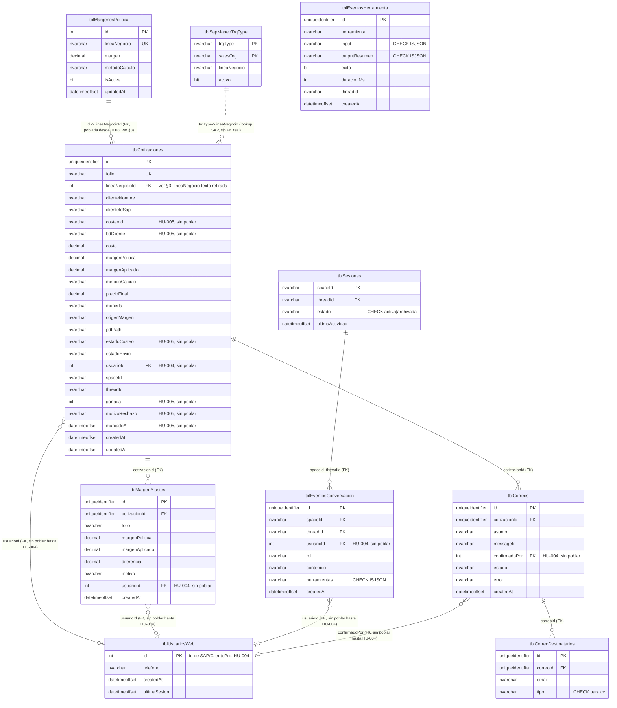

# Esquema objetivo — SQL Server 2019 (HU-002.3)

Entrega el esquema objetivo de Cotifly para SQL Server 2019, como insumo directo para
HU-003.3 (`DbContext` de EF Core). No es una nueva evaluación de diseño — toma las
decisiones ya cerradas en `docs/PROPUESTA_REFACTOR_BD_COTIFLY.md` (§2, §3.2, §3.5) y las
aplica sobre el esquema **real** vigente hoy (post HU-002.2, migraciones `0006`/`0007`),
con la convención de nombres `tbl`/`tblSap` pedida en HU-002.3.

## 0. Fuente de verdad usada y 2 discrepancias encontradas

Se usó como fuente de verdad **`shared/models.py` + `migrations/versions/0006_*.py` y
`0007_*.py`** (esquema corriendo de verdad), no la prosa de `BASE_DE_DATOS.md` /
`docs/DICCIONARIO_BASE_DE_DATOS.md` a ciegas. Dos hallazgos que afectan este mapeo:

1. **`docs/DICCIONARIO_BASE_DE_DATOS.md` §3.1-3.9 tiene las tablas columna-por-columna
   desactualizadas.** Los recuadros de advertencia arriba de cada sección sí mencionan
   los cambios de HU-002.2, pero las tablas de detalle debajo siguen documentando el
   esquema pre-migración (`comercial_email`, `estado`, `efectiva`,
   `usuarios_web.email`/`nombre` como PK). No se usaron esas tablas para este mapeo.
   **Recomendación aparte de este issue:** vale la pena una tarea corta de
   documentación para corregirlas, no se tocan acá porque HU-002.3 es solo diseño de
   esquema SQL Server.
2. **`usuarios_web` hoy es más angosta que lo que describe la propuesta.** §2.6/§3.5 de
   `PROPUESTA_REFACTOR_BD_COTIFLY.md` diseñan `usuariosWeb` con `nombreUsuario`,
   `nombreCompleto` y `email` (poblados desde `tblSAPUsuariosApp` vía ClientePro). Eso
   **no se ejecutó** en la migración `0006` — solo se agregaron `id` (entero SAP) y
   `telefono`; `email`/`nombre` (los campos viejos) se eliminaron y no se reemplazaron
   todavía. Ese rediseño más completo depende de HU-004 (ClientePro) y sigue sin
   construirse. Este documento mapea `tblUsuariosWeb` **tal como existe hoy** (4
   columnas), no el diseño completo de §2.6 — cuando HU-004 aterrice, hará falta una
   migración adicional para agregar `nombreUsuario`/`nombreCompleto`/`email`, fuera del
   alcance de HU-002.3.

## 1. Equivalencia de tipos

| Postgres (hoy) | SQL Server 2019 | Nota |
|---|---|---|
| `UUID` + `gen_random_uuid()` | `uniqueidentifier` + `DEFAULT NEWID()` | PK de `tblCotizaciones`, `tblMargenAjustes`, `tblCorreos`, `tblEventosConversacion`, `tblEventosHerramienta`, `tblCorreoDestinatarios` (nueva) |
| `Integer` (serial o entero de SAP) | `int IDENTITY(1,1)` (serial: `tblMargenesPolitica.id`) / `int` simple, sin identity (SAP: `tblUsuariosWeb.id`) y en toda FK que apunte a esos dos | No confundir los dos casos — el de SAP nunca autoincrementa en Cotifly |
| `JSONB` | `nvarchar(max)` + `CHECK (ISJSON(columna) = 1)` | SQL Server 2019 no tiene tipo `JSON` nativo (llega en 2022) |
| `ARRAY(Text)` (`para`/`cc`) | *(no existe array nativo)* → tabla `tblCorreoDestinatarios` | Decisión ya cerrada en §2.3/§3.5, no se rediseña |
| `TIMESTAMP(timezone=True)` | `datetimeoffset` | `DEFAULT SYSDATETIMEOFFSET()` donde hoy hay `server_default=func.now()` |
| `Text` / `String(N)` | `nvarchar(max)` / `nvarchar(N)` | |
| `Boolean` | `bit` | |
| `Numeric` (sin precisión, Postgres arbitrario) | **`decimal(p,s)` — requiere precisión explícita** | Ver nota abajo, riesgo real no cubierto por las reglas generales |

**Nota — riesgo real en `Numeric` (no cubierto por "reglas generales" del issue):**
Postgres `Numeric` sin precisión declarada es de precisión arbitraria; SQL Server no
tiene equivalente sin precisión — si se declara `decimal` sin `(p,s)` explícito, el
default es `decimal(18,0)`, **sin decimales**, lo que truncaría silenciosamente
`margen_politica`/`margen_aplicado` (valores como `0.15`) a `0`. **Confirmado con el
equipo (2026-09-22):** se avanza con esta precisión tal cual, sin más ajustes:

| Columna | Precisión propuesta |
|---|---|
| `costo`, `precioFinal` | `decimal(18,2)` (pesos COP, hasta centavos) |
| `margenPolitica`, `margenAplicado`, `diferencia` | `decimal(9,4)` (decimal 0–1, ej. `0.135`) |
| `margen` (en `tblMargenesPolitica`) | `decimal(9,4)` |

## 2. Convención de nombres

- **Tablas:** prefijo `tbl`/`tblSap` (estándar `dotnet-enterprise-architect`, HU-003) —
  mapeo completo en la §4/§5.
- **Columnas:** camelCase, ya cerrado en §3.5 de la propuesta — se aplica sobre el
  nombre **real** de cada columna hoy (no sobre el diseño aspiracional de §3.5 que
  asumía columnas de Nexo/ClientePro que aún no existen, ver §0).
- **Constraints:** `pk_`, `fk_`, `ck_`, `uq_` + `nombreTablaSinTbl` + campo, siguiendo el
  patrón ya usado en Postgres (`ck_sesiones_estado`, `uq_margenes_politica_linea_negocio`).

## 3. FK duplicada `lineaNegocio`/`lineaNegocioId` — resuelto, se retira la de texto (2026-09-22)

La premisa original (`linea_negocio_id` dependía de Nexo/HU-005) era incorrecta: en
realidad apunta a `margenes_politica`, sembrada localmente desde la migración
`0002_seed_config` — no tiene relación con Nexo. Se corrigió en el esquema actual
(Postgres):

- `mcp_server/server.py` (`generar_pdf`) ahora resuelve y guarda `linea_negocio_id` en
  cada cotización nueva, cruzando por el mismo texto (`linea_negocio`) que ya usa el
  flujo de negocio.
- `migrations/versions/0008_backfill_linea_negocio_id.py` rellenó las filas históricas.
- Verificado end-to-end: ambas columnas quedan pobladas y consistentes hoy en Postgres.

**Decisión para el esquema objetivo de SQL Server: se retira `lineaNegocio` (texto),
queda solo `lineaNegocioId`.** Ya no hay riesgo de romper nada (ambas están pobladas y
consistentes) y mantener las dos sería la misma redundancia (mismo dato en 2 columnas)
que esta iniciativa viene corrigiendo desde la auditoría de HU-002.1. Quien necesite el
nombre legible de la línea (tablero de Sheets, un admin viendo la tabla) lo saca con un
`JOIN` a `tblMargenesPolitica` — ver §6, donde las 2 vistas ya se ajustaron a esto.

**Nota de implementación (no bloquea cerrar este documento, es para quien ejecute):**
esto es una decisión sobre el esquema **objetivo** de SQL Server, no una acción sobre el
Postgres que corre hoy — la columna `linea_negocio` (texto) sigue viva en Postgres. El
código que en su momento hable con SQL Server (probablemente ya el backend .NET de
HU-003, no el Python actual) debe leer/escribir la línea de negocio por
`lineaNegocioId`, no por texto. Queda como nota para quien ejecute la migración física
(HU-002.4) o construya el `DbContext` (HU-003.3).

## 4. Diagrama ER (nombres finales)



## 5. Tablas — detalle

### 5.1 `tblCotizaciones` (antes `cotizaciones`)

| Columna | Tipo SQL Server | Nulo | Default / constraint |
|---|---|---|---|
| `id` | `uniqueidentifier` | NOT NULL | PK, `DEFAULT NEWID()` |
| `folio` | `nvarchar(max)` | NOT NULL | `UNIQUE` (`uq_cotizaciones_folio`) |
| `lineaNegocioId` | `int` | NULL | FK → `tblMargenesPolitica.id` (poblada, ver §3 — `lineaNegocio` en texto se retira, no se migra) |
| `clienteNombre` | `nvarchar(max)` | NULL | |
| `clienteIdSap` | `nvarchar(max)` | NULL | |
| `costeoId` | `nvarchar(max)` | NULL | HU-005, sin poblar |
| `bdCliente` | `nvarchar(max)` | NULL | HU-005, sin poblar |
| `costo` | `decimal(18,2)` | NULL | |
| `margenPolitica` | `decimal(9,4)` | NULL | |
| `margenAplicado` | `decimal(9,4)` | NULL | |
| `metodoCalculo` | `nvarchar(max)` | NULL | |
| `precioFinal` | `decimal(18,2)` | NULL | |
| `moneda` | `nvarchar(max)` | NULL | `DEFAULT 'COP'` |
| `origenMargen` | `nvarchar(max)` | NULL | |
| `pdfPath` | `nvarchar(max)` | NULL | |
| `estadoCosteo` | `nvarchar(max)` | NULL | HU-005, sin poblar |
| `estadoEnvio` | `nvarchar(max)` | NULL | |
| `usuarioId` | `int` | NULL | FK → `tblUsuariosWeb.id`, HU-004 sin poblar |
| `spaceId` | `nvarchar(max)` | NULL | |
| `threadId` | `nvarchar(max)` | NULL | |
| `ganada` | `bit` | NULL | HU-005, sin poblar |
| `motivoRechazo` | `nvarchar(max)` | NULL | HU-005, sin poblar |
| `marcadoAt` | `datetimeoffset` | NULL | HU-005, sin poblar |
| `createdAt` | `datetimeoffset` | NOT NULL | `DEFAULT SYSDATETIMEOFFSET()` |
| `updatedAt` | `datetimeoffset` | NOT NULL | `DEFAULT SYSDATETIMEOFFSET()` — ver nota |

> **Nota `updatedAt`:** hoy `onupdate=func.now()` lo maneja SQLAlchemy a nivel de
> aplicación (no es un trigger de Postgres). En SQL Server/EF Core (HU-003.3) hay que
> replicar el mismo patrón a nivel de aplicación (ej. interceptor de `SaveChanges`), no
> agregar un trigger nuevo que no existe hoy.

### 5.2 `tblMargenAjustes` (antes `ajustes_margen`)

| Columna | Tipo | Nulo | Constraint |
|---|---|---|---|
| `id` | `uniqueidentifier` | NOT NULL | PK, `DEFAULT NEWID()` |
| `cotizacionId` | `uniqueidentifier` | NULL | FK → `tblCotizaciones.id` |
| `folio` | `nvarchar(max)` | NULL | |
| `margenPolitica` | `decimal(9,4)` | NULL | |
| `margenAplicado` | `decimal(9,4)` | NULL | |
| `diferencia` | `decimal(9,4)` | NULL | |
| `motivo` | `nvarchar(max)` | NULL | |
| `usuarioId` | `int` | NULL | FK → `tblUsuariosWeb.id`, HU-004 sin poblar |
| `createdAt` | `datetimeoffset` | NOT NULL | `DEFAULT SYSDATETIMEOFFSET()` |

### 5.3 `tblCorreos` (antes `correos_enviados`)

| Columna | Tipo | Nulo | Constraint |
|---|---|---|---|
| `id` | `uniqueidentifier` | NOT NULL | PK, `DEFAULT NEWID()` |
| `cotizacionId` | `uniqueidentifier` | NOT NULL | FK → `tblCotizaciones.id` |
| `asunto` | `nvarchar(max)` | NULL | |
| `messageId` | `nvarchar(max)` | NULL | |
| `confirmadoPor` | `int` | NULL | FK → `tblUsuariosWeb.id`, HU-004 sin poblar |
| `estado` | `nvarchar(max)` | NULL | `enviado`/`fallido` |
| `error` | `nvarchar(max)` | NULL | |
| `createdAt` | `datetimeoffset` | NOT NULL | `DEFAULT SYSDATETIMEOFFSET()` |

`para`/`cc` (arrays en Postgres) se eliminan de esta tabla — se mudan a
`tblCorreoDestinatarios` (§5.4), decisión ya cerrada en §2.3/§3.5 de la propuesta.

### 5.4 `tblCorreoDestinatarios` (tabla nueva)

| Columna | Tipo | Nulo | Constraint |
|---|---|---|---|
| `id` | `uniqueidentifier` | NOT NULL | PK, `DEFAULT NEWID()` |
| `correoId` | `uniqueidentifier` | NOT NULL | FK → `tblCorreos.id` |
| `email` | `nvarchar(320)` | NOT NULL | |
| `tipo` | `nvarchar(10)` | NOT NULL | `CHECK (tipo IN ('para','cc'))` (`ck_correoDestinatarios_tipo`) |

> **Invariante de negocio que no se puede expresar como `CHECK` de tabla:** debe existir
> al menos un `tipo='para'` por `correoId` (hoy `para` era `NOT NULL` en el array). Con
> la normalización a filas, eso pasa a ser una validación de aplicación (HU-003.5), no
> del esquema.

### 5.5 `tblEventosConversacion` (antes `eventos_conversacion`)

| Columna | Tipo | Nulo | Constraint |
|---|---|---|---|
| `id` | `uniqueidentifier` | NOT NULL | PK, `DEFAULT NEWID()` |
| `spaceId` | `nvarchar(max)` | NULL | FK compuesta → `tblSesiones(spaceId, threadId)` |
| `threadId` | `nvarchar(max)` | NULL | (misma FK compuesta) |
| `usuarioId` | `int` | NULL | FK → `tblUsuariosWeb.id`, HU-004 sin poblar |
| `rol` | `nvarchar(max)` | NOT NULL | `user`/`assistant` |
| `contenido` | `nvarchar(max)` | NULL | |
| `herramientas` | `nvarchar(max)` | NULL | `CHECK (ISJSON(herramientas) = 1)` |
| `createdAt` | `datetimeoffset` | NOT NULL | `DEFAULT SYSDATETIMEOFFSET()` |

### 5.6 `tblEventosHerramienta` (antes `eventos_herramienta`)

| Columna | Tipo | Nulo | Constraint |
|---|---|---|---|
| `id` | `uniqueidentifier` | NOT NULL | PK, `DEFAULT NEWID()` |
| `herramienta` | `nvarchar(max)` | NOT NULL | |
| `input` | `nvarchar(max)` | NULL | `CHECK (ISJSON(input) = 1)` |
| `outputResumen` | `nvarchar(max)` | NULL | `CHECK (ISJSON(outputResumen) = 1)` |
| `exito` | `bit` | NULL | |
| `duracionMs` | `int` | NULL | |
| `threadId` | `nvarchar(max)` | NULL | *(sin índice — se eliminó en `0006`, no se recrea salvo nuevo caso de uso)* |
| `createdAt` | `datetimeoffset` | NOT NULL | `DEFAULT SYSDATETIMEOFFSET()` |

### 5.7 `tblSesiones` (antes `sesiones`)

| Columna | Tipo | Nulo | Constraint |
|---|---|---|---|
| `spaceId` | `nvarchar(max)` | NOT NULL | PK (compuesta) |
| `threadId` | `nvarchar(max)` | NOT NULL | PK (compuesta) |
| `estado` | `nvarchar(max)` | NULL | `CHECK (estado IN ('activa','archivada'))` (`ck_sesiones_estado`) |
| `ultimaActividad` | `datetimeoffset` | NOT NULL | `DEFAULT SYSDATETIMEOFFSET()` |

### 5.8 `tblUsuariosWeb` (antes `usuarios_web`)

| Columna | Tipo | Nulo | Constraint |
|---|---|---|---|
| `id` | `int` | NOT NULL | PK, **sin** `IDENTITY` (lo asigna SAP/ClientePro) |
| `telefono` | `nvarchar(max)` | NULL | |
| `createdAt` | `datetimeoffset` | NOT NULL | `DEFAULT SYSDATETIMEOFFSET()` |
| `ultimaSesion` | `datetimeoffset` | NULL | |

Ver §0 — no incluye `nombreUsuario`/`nombreCompleto`/`email` (diseño de §2.6, no
ejecutado todavía).

### 5.9 `tblMargenesPolitica` (antes `margenes_politica`)

| Columna | Tipo | Nulo | Constraint |
|---|---|---|---|
| `id` | `int` | NOT NULL | PK, `IDENTITY(1,1)` |
| `lineaNegocio` | `nvarchar(40)` | NOT NULL | `UNIQUE` (`uq_margenesPolitica_lineaNegocio`) |
| `margen` | `decimal(9,4)` | NOT NULL | |
| `metodoCalculo` | `nvarchar(max)` | NOT NULL | `DEFAULT 'margen'` — ver nota abajo |
| `isActive` | `bit` | NOT NULL | `DEFAULT 1` |
| `updatedAt` | `datetimeoffset` | NOT NULL | `DEFAULT SYSDATETIMEOFFSET()` (ver nota `updatedAt` en §5.1, mismo patrón) |

> **`metodoCalculo` — decisión abierta heredada, se mantiene por ahora.** Detectada en
> la auditoría de HU-002.1 (`docs/HU_Backlog_Cotifly_ClientePro.md:157`): es una columna
> **sin uso real** — el cálculo de precio usa el `metodo_calculo` que llega en el
> payload de cada cotización (`cotizaciones.metodo_calculo`), no este valor de
> configuración por línea. Nunca hubo una recomendación explícita de eliminarla en la
> propuesta, así que se migra tal cual (no se rediseña acá) y queda con el mismo hilo
> abierto: alguien tiene que decidir en algún momento si se conecta de verdad al cálculo
> o se retira. No bloquea este documento.

### 5.10 `tblSapMapeoTrqType` (antes `mapeo_trqtype`)

| Columna | Tipo | Nulo | Constraint |
|---|---|---|---|
| `trqType` | `nvarchar(8)` | NOT NULL | PK (compuesta) |
| `salesOrg` | `nvarchar(12)` | NOT NULL | PK (compuesta), `DEFAULT ''` (comodín "todas") |
| `lineaNegocio` | `nvarchar(40)` | NOT NULL | |
| `activo` | `bit` | NOT NULL | `DEFAULT 1` |

> El modelo Postgres actual tiene además un `UNIQUE(trqType, salesOrg)`
> (`uq_trqtype_salesorg`) redundante con la propia PK compuesta — se puede omitir en
> SQL Server (limpieza menor, no afecta comportamiento) o mantenerse por paridad
> literal; no bloquea el diseño.

## 6. Vistas — T-SQL

Se migran las 2 vistas reales que sobreviven (fuente: SQL exacto de `0006_hu002_2_esquema_completo.py`, traducido). `v_trazabilidad_cotizaciones` se descartó en HU-002.2, no se migra.

```sql
CREATE VIEW dbo.vAjustesMargenPorComercial AS
SELECT
    a.usuarioId,
    mp.lineaNegocio,
    COUNT(*)            AS numAjustes,
    AVG(a.diferencia)   AS diferenciaPromedio,
    MIN(a.diferencia)   AS diferenciaMin,
    MAX(a.diferencia)   AS diferenciaMax,
    MAX(a.createdAt)    AS ultimoAjuste
FROM tblMargenAjustes a
LEFT JOIN tblCotizaciones c ON c.id = a.cotizacionId
LEFT JOIN tblMargenesPolitica mp ON mp.id = c.lineaNegocioId
GROUP BY a.usuarioId, mp.lineaNegocio;
GO

CREATE VIEW dbo.vActividadPorComercial AS
SELECT
    c.usuarioId,
    COUNT(DISTINCT c.id)                                       AS numCotizaciones,
    SUM(CASE WHEN c.estadoEnvio = 'enviada' THEN 1 ELSE 0 END) AS numCotizacionesEnviadas,
    COALESCE(SUM(sub.numAjustes), 0)                           AS numAjustes,
    MAX(c.createdAt)                                           AS ultimaCotizacion
FROM tblCotizaciones c
LEFT JOIN (
    SELECT cotizacionId, COUNT(*) AS numAjustes
    FROM tblMargenAjustes
    WHERE cotizacionId IS NOT NULL
    GROUP BY cotizacionId
) sub ON sub.cotizacionId = c.id
WHERE c.usuarioId IS NOT NULL
GROUP BY c.usuarioId;
GO
```

> `COUNT(*) FILTER (WHERE ...)` (Postgres, no soportado en SQL Server) se reemplazó por
> `SUM(CASE WHEN ... THEN 1 ELSE 0 END)`, tal como decidido en §3.3 de la propuesta.
>
> **`vAjustesMargenPorComercial` sí necesitó un `JOIN` nuevo que la versión real de
> `0006` no tenía:** al retirarse `tblCotizaciones.lineaNegocio` (texto, ver §3), el
> nombre legible de la línea ya no viene directo de `tblCotizaciones` — se agregó
> `LEFT JOIN tblMargenesPolitica mp ON mp.id = c.lineaNegocioId` para recuperarlo. No se
> agregó un `JOIN` equivalente a `usuariosWeb` (para mostrar nombre de comercial en vez
> de `usuarioId`) porque ese diseño completo (§2.6) no se ejecutó todavía (ver §0).

## 7. Collation y driver de conexión

- **Collation: `Latin1_General_100_CI_AS_SC_UTF8`** (UTF-8, novedad de SQL Server 2019)
  a nivel de base de datos, para columnas de texto con tildes/ñ. **Confirmado con el DBA
  (2026-09-22):** ni Nexo ni ClientePro fijan una collation explícita — usan la del
  servidor por defecto — así que no hay con qué chocar al cruzar datos entre bases (ej.
  conexión directa a Nexo, HU-005). Se avanza con esta collation tal cual.
- **Driver:** `ODBC Driver 17 for SQL Server` (no 18) — el 18 exige `Encrypt=yes` por
  defecto y falla contra una instancia sin certificado TLS propio. Aplica a la cadena de
  conexión de HU-002.4/HU-003.2 (`mssql+pyodbc://...?driver=ODBC+Driver+17+for+SQL+Server`
  o el equivalente .NET).

## 8. Checklist de cobertura

Todas las tablas del esquema actual (9 + `alembic_version`, que no aplica a SQL Server)
quedan mapeadas:

| Tabla actual | Tabla objetivo | Estado |
|---|---|---|
| `cotizaciones` | `tblCotizaciones` | Mapeada (§5.1) |
| `ajustes_margen` | `tblMargenAjustes` | Mapeada (§5.2) |
| `correos_enviados` | `tblCorreos` + `tblCorreoDestinatarios` (nueva) | Mapeada (§5.3/§5.4) |
| `eventos_conversacion` | `tblEventosConversacion` | Mapeada (§5.5) |
| `eventos_herramienta` | `tblEventosHerramienta` | Mapeada (§5.6) |
| `sesiones` | `tblSesiones` | Mapeada (§5.7) |
| `usuarios_web` | `tblUsuariosWeb` | Mapeada (§5.8) |
| `margenes_politica` | `tblMargenesPolitica` | Mapeada (§5.9) |
| `mapeo_trqtype` | `tblSapMapeoTrqType` | Mapeada (§5.10) |
| `v_ajustes_margen_por_comercial` | `dbo.vAjustesMargenPorComercial` | Migrada (§6) |
| `v_actividad_por_comercial` | `dbo.vActividadPorComercial` | Migrada (§6) |
| `v_trazabilidad_cotizaciones` | — | Descartada en HU-002.2, no se migra |

## 9. Estado de las decisiones

**Cerradas (2026-09-22):**

1. **§3** — FK duplicada `lineaNegocio`/`lineaNegocioId`: resuelto. En Postgres ambas
   columnas quedan pobladas y consistentes (migración `0008` + ajuste en `generar_pdf`),
   pero en el **esquema objetivo de SQL Server se retira `lineaNegocio` (texto)** y
   queda solo `lineaNegocioId` — sin la redundancia. Las 2 vistas (§6) ya se ajustaron
   con el `JOIN` a `tblMargenesPolitica` para el nombre legible.
2. **§1** — Precisión/escala de las columnas `decimal`: confirmada, `(18,2)` para
   montos, `(9,4)` para márgenes.
3. **§7** — Collation: confirmada con el DBA, `Latin1_General_100_CI_AS_SC_UTF8`, sin
   conflicto con Nexo/ClientePro.

**Pendientes, no bloqueantes, fuera del alcance de este documento:**

4. **§3** — Nota de implementación (no bloquea el documento): quien ejecute HU-002.4 o
   construya el `DbContext` de HU-003.3 debe leer/escribir la línea de negocio por
   `lineaNegocioId`, no por texto — la columna de texto no se migra a SQL Server.
5. **§0** — Cuándo se agrega `nombreUsuario`/`nombreCompleto`/`email` a `tblUsuariosWeb`
   (depende de HU-004, migración adicional fuera de este alcance).
6. Corrección de documentación fuera de alcance: actualizar las tablas columna-por-columna
   de `docs/DICCIONARIO_BASE_DE_DATOS.md` §3.1-3.9 al esquema real post-`0006`/`0007`/`0008`.
7. **§5.9** — `tblMargenesPolitica.metodoCalculo`: decisión abierta heredada de la
   auditoría de HU-002.1 (`docs/HU_Backlog_Cotifly_ClientePro.md:157`), nunca resuelta —
   columna sin uso real, se mantiene y se migra tal cual por ahora.
