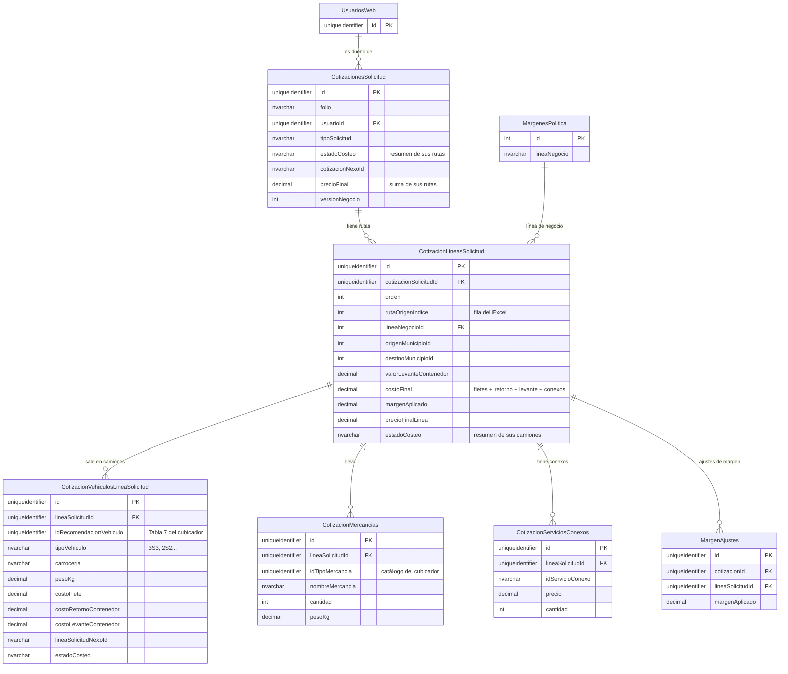

# Propuesta de reestructuración de `Cotizaciones` y tablas relacionadas (HU-021)

**Estado: propuesta — NO ejecutada.** Mismo patrón que `PROPUESTA_REFACTOR_BD_COTIFLY.md` (HU-002.1): primero se
aprueba el diseño completo acá, y solo después se escribe el script de migración (`000N_*.sql`) contra
`tbsdatacenter`. Los cambios que esto le pide al backend están en
`docs/CAMBIOS_BACKEND_REESTRUCTURACION_COTIZACIONES.md`.

**Contexto:** las migraciones 0001 a 0007 ya corrieron contra la base real. `Cotizaciones` y sus tablas satélite
crecieron HU tras HU hasta volverse difíciles de seguir, y ahora llega el cubicador, que puede recomendar varios
camiones para una misma ruta. Esta propuesta reordena todo partiendo del estado actual.

---

## Índice

1. [Ideas base del diseño](#1-ideas-base-del-diseño)
2. [Tablas sin cambios y tablas con ajustes menores](#2-tablas-sin-cambios-y-tablas-con-ajustes-menores)
3. [`CotizacionesSolicitud` (ex `Cotizaciones`)](#3-cotizacionessolicitud-ex-cotizaciones)
4. [`CotizacionLineasSolicitud` — la ruta](#4-cotizacionlineassolicitud--la-ruta)
5. [`CotizacionVehiculosLineaSolicitud` — los camiones (tabla nueva)](#5-cotizacionvehiculoslineasolicitud--los-camiones-tabla-nueva)
6. [`CotizacionMercancias` (ex `CotizacionPosiciones`)](#6-cotizacionmercancias-ex-cotizacionposiciones)
7. [`CotizacionServiciosConexos` (tabla nueva)](#7-cotizacionserviciosconexos-tabla-nueva)
8. [Cómo se calculan los valores](#8-cómo-se-calculan-los-valores)
9. [Flujo completo: del comercial a Nexo y de vuelta](#9-flujo-completo-del-comercial-a-nexo-y-de-vuelta)
10. [`MargenesPolitica` — solo cambia el seed](#10-margenespolitica--solo-cambia-el-seed)
11. [Migración de los datos que ya existen](#11-migración-de-los-datos-que-ya-existen)
12. [Acuerdos pendientes con otros equipos](#12-acuerdos-pendientes-con-otros-equipos)
13. [Resumen de decisiones](#13-resumen-de-decisiones)
14. [Diagrama entidad-relación](#14-diagrama-entidad-relación)

---

## 1. Ideas base del diseño

1. **Línea de solicitud = ruta.** Una fila de `CotizacionLineasSolicitud` es una ruta que pidió el comercial
   (origen, destino, línea de negocio, mercancías…). Viene de una fila del Excel de licitación o del formulario
   simple.
2. **Cada ruta puede salir en varios camiones.** Los camiones van en una tabla aparte,
   `CotizacionVehiculosLineaSolicitud`: una fila por camión. Si el cubicador recomienda 7 camiones, son 7 filas
   que apuntan a la misma ruta.
3. **Las mercancías y los conexos son de la ruta, no del camión.** El comercial declara qué va a mandar y qué
   servicios necesita para toda la ruta. En qué camión queda cada caja lo sabe el cubicador, no Cotifly.
4. **Los costos son por camión y el precio es por ruta.** Nexo cotiza cada camión. La ruta suma sus camiones,
   aplica un solo margen (el margen depende de la línea de negocio) y saca su precio. La cabecera suma sus rutas.
5. **Cubica el sistema donde nace la solicitud.** Si nace en Cotifly, Cotifly llama al cubicador. Si nace en Nexo,
   Nexo. Nexo nunca vuelve a cubicar lo que le llega de Cotifly.
6. **Lo que la cotización comprometió se copia.** El código del vehículo, la carrocería, el nombre de la mercancía
   y el precio de cada conexo se guardan en Cotifly, para que la cotización no cambie si después cambian los
   catálogos del cubicador o de Nexo.

---

## 2. Tablas sin cambios y tablas con ajustes menores

**Sin cambios de estructura:** `SapMapeoTrqType`, `UsuariosWeb`, `Correos`, `CorreoDestinatarios`, `Sesiones`,
`EventosConversacion`, `EventosHerramienta`, `Roles`, `UsuariosRoles`, `TokensRefresco`, `TokensRevocados`,
`CotizacionArchivosLicitacion`, `CotizacionPdfsHistorial`.

`Correos`, `CotizacionArchivosLicitacion` y `CotizacionPdfsHistorial` tienen un FK `cotizacionId` a la cabecera.
Con el renombre de la tabla el FK sigue funcionando igual. La columna conserva el nombre `cotizacionId` para no
tocar esas tablas.

**`MargenesPolitica`:** solo cambia el seed (§10).

**`MargenAjustes` (ajuste menor):** como el margen pasa a ser por ruta, cada ajuste tiene que decir de qué ruta
es.

| Columna | Tipo | Qué significa | De dónde viene |
|---|---|---|---|
| `lineaSolicitudId` | UNIQUEIDENTIFIER NULL | Ruta a la que se le ajustó el margen | Nueva. FK a `CotizacionLineasSolicitud`. Los ajustes viejos se apuntan a la ruta 1 de su cotización (§11) |

El resto de columnas (`cotizacionId`, `margenPolitica`, `margenAplicado`, `diferencia`, `motivo`, `usuarioId`…)
sigue igual.

**Vistas:**
- `vAjustesMargenPorComercial` hoy saca la línea de negocio de `Cotizaciones.lineaNegocioId`, que se elimina.
  Pasa a sacarla de la ruta: `MargenAjustes.lineaSolicitudId` → `CotizacionLineasSolicitud.lineaNegocioId`.
- `vActividadPorComercial` solo cambia el nombre de la tabla.

---

## 3. `CotizacionesSolicitud` (ex `Cotizaciones`)

La cabecera de la solicitud: el cliente, el estado general, el PDF y el seguimiento del costeo con Nexo.

### 3.1 Estructura final (29 columnas)

| Columna | Tipo | Qué significa | De dónde viene |
|---|---|---|---|
| `id` | UNIQUEIDENTIFIER | Identificador único de la solicitud | Ya existía |
| `folio` | NVARCHAR(50) | Folio visible de la cotización | Ya existía |
| `clienteNombre` | NVARCHAR(MAX) | Nombre del cliente | Ya existía |
| `nitCliente` | NVARCHAR(MAX) | NIT del cliente | Ya existía |
| `origenCliente` | NVARCHAR(20) | `cliente` (real) o `prospecto` (sin BP todavía) | Ya existía |
| `tipoSolicitud` | NVARCHAR(20) | Tipo de solicitud (simple, licitación…) | Ya existía, se reordena junto a `origenCliente` |
| `deadline` | DATETIMEOFFSET | Fecha límite de la solicitud | Ya existía, se reordena junto a `origenCliente` |
| `precioFinal` | DECIMAL(18,2) | Precio al cliente de toda la solicitud | Ya existía, se reordena justo después de `deadline`. Pasa a ser la **suma** de `precioFinalLinea` de sus rutas |
| `moneda` | NVARCHAR(MAX) | Moneda (COP por defecto) | Ya existía |
| `trmAplicada` | DECIMAL(18,4) | TRM usada cuando la moneda es USD | Ya existía |
| `pdfPath` | NVARCHAR(MAX) | Ruta del PDF generado | Ya existía |
| `pdfDesactualizado` | BIT | Si el PDF quedó viejo por un cambio posterior (distinto de "nunca se generó") | Ya existía |
| `usuarioId` | UNIQUEIDENTIFIER | Comercial dueño | Ya existía |
| `spaceId` / `threadId` | NVARCHAR(MAX) | Hilo de Google Chat de donde salió | Ya existía |
| `ganada` | BIT | Si el cliente aceptó | Ya existía |
| `motivoRechazo` | NVARCHAR(MAX) | Motivo cuando no se ganó | Ya existía |
| `version` | INT | Versión de la cotización (v2+ reusa el folio con `-vN`) | Ya existía |
| `versionNegocio` | INT | Contador de concurrencia: sube solo con cambios que ve el negocio (margen, PDF, conexos) | Ya existía |
| `marcadoAt` | DATETIMEOFFSET | Cuándo se marcó como ganada o rechazada | Ya existía |
| `costeoListoAt` | DATETIMEOFFSET | Cuándo quedó costeada | Ya existía |
| `createdAt` / `updatedAt` | DATETIMEOFFSET | Auditoría | Ya existía |
| `estadoEnvio` | NVARCHAR(MAX) | Estado del correo al cliente | Ya existía |
| `estadoCosteo` | NVARCHAR(MAX) | Estado del costeo de **toda** la solicitud: resumen de sus rutas (§8) | Ya existía |
| `cotizacionNexoId` | NVARCHAR(64) | Id de la solicitud en Nexo | Ya existía. Absorbe a `costeoId`, que nunca se usó |
| `motivoEstadoCosteo` | NVARCHAR(1000) | Por qué el costeo quedó en ese estado | Ya existía |
| `costeoEnviadoAt` | DATETIMEOFFSET | Cuándo se envió la solicitud a Nexo | Ya existía |
| `costeoSiguienteConsultaAt` | DATETIMEOFFSET | Cuándo toca la siguiente consulta a Nexo | Ya existía |
| `costeoConsultasFallidas` | INT | Consultas seguidas a Nexo que fallaron | Ya existía |
| `textosCotizacion` | NVARCHAR(MAX) (JSON) | Asunto e introducción del PDF | Ya existía |
| `notas` | NVARCHAR(2000) | Nota para la Mesa de Nexo | Ya existía |

El seguimiento del costeo (`costeoEnviadoAt`, `costeoSiguienteConsultaAt`, `costeoConsultasFallidas`,
`motivoEstadoCosteo`) se queda en la cabecera porque Cotifly consulta a Nexo una vez por solicitud completa
(`GET /api/solicitudes/{id}`), no por ruta ni por camión.

### 3.2 Lo que sale de la cabecera

**Pasa a la ruta (§4):** `lineaNegocioId`, `margenPolitica`, `margenAplicado`, `origenMargen`, `metodoCalculo`,
`horasCargue`, `horasDescargue`, `origen`, `destino`, `tipologia`, `claseViaje`, `claseContenedor`, `exclusivo`,
`consolidado`, `retornaContenedor`, `ciudadDevolucionContenedor`, `levanteContenedorDiferente`,
`ciudadLevanteContenedor`, `valorAprovisionamiento`, `pesoKg`, `valorMercancia`.

**Pasa al camión (§5):** `tipoVehiculo`, `carroceria`.

**Se elimina:**
- `costo`: el costo ahora es por camión y se suma por ruta.
- `costeoId`: se fusiona en `cotizacionNexoId`.
- `valorEstimado`, `referencia`.
- `serviciosConexos` (JSON): lo reemplaza la tabla `CotizacionServiciosConexos` (§7).
- `costeoUltimaConsultaAt`: se escribe en cada consulta a Nexo pero nunca se lee.
- `margenSugerido`, `origenMargenSugerido`: los reemplazan `margenPoliticaSugerido` y `margenSAPSugerido` en la
  ruta.

---

## 4. `CotizacionLineasSolicitud` — la ruta

Una fila por ruta que pidió el comercial. Tiene todo lo que es igual para todos los camiones de esa ruta, los
totales de costo, el margen y el precio.

### 4.1 Estructura final

| Columna | Tipo | Qué significa | De dónde viene |
|---|---|---|---|
| `id` | UNIQUEIDENTIFIER | Identificador de la ruta | Ya existía |
| `cotizacionSolicitudId` | UNIQUEIDENTIFIER | Solicitud a la que pertenece | Ya existía como `cotizacionId`, se renombra |
| `orden` | INT | Posición de la ruta dentro de la solicitud (1, 2, 3…) | Ya existía |
| `rutaOrigenIndice` | INT NULL | De qué fila del Excel salió la ruta. `0` en una cotización simple | Ya existía como `filaOrigen`, se renombra |
| `lineaNegocioId` | INT | Línea de negocio (Nacional, Importación…). FK a `MargenesPolitica` | Nueva en la ruta, antes estaba en la cabecera |
| `origenMunicipioId` | INT | Municipio de origen (id del catálogo de Nexo) | Ya existía. Reemplaza al texto `origen` |
| `destinoMunicipioId` | INT | Municipio de destino (id del catálogo de Nexo) | Ya existía. Reemplaza al texto `destino` |
| `tipologia` | NVARCHAR(50) | Tipología de carga que pide Nexo por línea (código de Nexo) | Ya existía |
| `claseViaje` | NVARCHAR(50) | Clase de viaje (código de Nexo) | Ya existía |
| `claseContenedor` | NVARCHAR(20) | Clase de contenedor, si aplica | Ya existía |
| `exclusivo` | BIT | Si el camión va exclusivo | Ya existía |
| `consolidado` | BIT | Si la carga va consolidada | Ya existía |
| `retornaContenedor` | BIT NOT NULL DEFAULT 0 | Si el contenedor se devuelve | Ya existía. Deja de aceptar vacío: siempre sí o no |
| `levanteContenedorDiferente` | BIT NOT NULL DEFAULT 0 | Si el contenedor se levanta en otra ciudad | Ya existía. Mismo cambio |
| `ciudadDevolucionMunicipioId` | INT NULL | Municipio donde se devuelve el contenedor | Nueva. Reemplaza al texto `ciudadDevolucionContenedor` |
| `ciudadLevanteMunicipioId` | INT NULL | Municipio donde se levanta el contenedor | Nueva. Reemplaza al texto `ciudadLevanteContenedor` |
| `horasCargue` | DECIMAL(6,2) | Horas de cargue de la ruta | Nueva en la ruta, antes estaba en la cabecera |
| `horasDescargue` | DECIMAL(6,2) | Horas de descargue de la ruta | Nueva en la ruta, antes estaba en la cabecera |
| `pesoKg` | DECIMAL(12,2) | Peso total que declaró el comercial para la ruta | Ya existía |
| `valorMercancia` | DECIMAL(18,2) | Cuánto vale la mercancía de la ruta (no es un costo) | Ya existía |
| `valorLevanteContenedor` | DECIMAL(18,2) NULL | Lo que vale **un** levante de contenedor en esta ruta. Lo digita el comercial y se copia a cada camión | Ya existía como `valorAprovisionamiento`, se renombra |
| `costoFletesTotal` | DECIMAL(18,2) | Suma del flete de sus camiones | Nueva |
| `costoRetornoContenedorTotal` | DECIMAL(18,2) | Suma del retorno de contenedor de sus camiones | Nueva |
| `costoLevanteContenedorTotal` | DECIMAL(18,2) | Suma del levante de sus camiones | Nueva |
| `costoServiciosConexos` | DECIMAL(18,2) | Suma de los conexos de la ruta (`precio × cantidad`) | Nueva |
| `costoFinal` | DECIMAL(18,2) | Costo total de la ruta: fletes + retorno + levante + conexos | Nueva. Reemplaza al `costo` de antes |
| `margenPoliticaSugerido` | DECIMAL(9,4) | Margen de la política de su línea de negocio, al momento de costear | Nueva en la ruta |
| `margenSAPSugerido` | DECIMAL(9,4) NULL | Margen negociado en SAP TM, si aplicó | Nueva en la ruta |
| `margenAplicado` | DECIMAL(9,4) | Margen que usó el comercial | Nueva en la ruta, antes estaba en la cabecera |
| `origenMargen` | NVARCHAR(20) | De dónde salió el margen: `sap_tm`, `politica_linea` o `negociado` | Nueva en la ruta, antes estaba en la cabecera |
| `metodoCalculo` | NVARCHAR(20) | Método de `MargenesPolitica` vigente al calcular | Nueva en la ruta, antes estaba en la cabecera |
| `precioFinalLinea` | DECIMAL(18,2) | Precio al cliente de la ruta: `costoFinal` con el margen aplicado | Ya existía como `precioFinal`, se renombra |
| `estadoCosteo` | NVARCHAR(30) | Estado del costeo de la ruta: resumen de sus camiones (§8) | Ya existía |
| `createdAt` / `updatedAt` | DATETIMEOFFSET | Auditoría | Ya existía |

### 4.2 Lo que sale de la ruta

- **Pasa al camión (§5):** `tipoVehiculo`, `carroceria`, `lineaSolicitudNexoId`.
- **Se reemplaza por su id de municipio:** `origen`, `destino`, `ciudadDevolucionContenedor`,
  `ciudadLevanteContenedor` (texto).
- **Se desglosa:** `costo` pasa a `costoFletesTotal` + `costoRetornoContenedorTotal` +
  `costoLevanteContenedorTotal` + `costoServiciosConexos` = `costoFinal`.
- **Se elimina:** `serviciosConexos` (JSON). Hoy siempre está vacío. Lo reemplaza `CotizacionServiciosConexos`.

### 4.3 Cómo se llena `rutaOrigenIndice`

- **Licitación por Excel:** el índice de la fila en la hoja analizada (0, 1, 2…). Es el mismo dato que ya calcula
  hoy el análisis del Excel.
- **Cotización simple:** `0`.

Ya no se usa para agrupar camiones. Eso lo hace el FK de la tabla de camiones (§5).

---

## 5. `CotizacionVehiculosLineaSolicitud` — los camiones (tabla nueva)

Una fila por camión. Si el cubicador recomienda 7 camiones para una ruta, son 7 filas con el mismo
`lineaSolicitudId`.

### 5.1 Estructura

| Columna | Tipo | Qué significa | De dónde viene |
|---|---|---|---|
| `id` | UNIQUEIDENTIFIER | Identificador del camión | Nueva |
| `lineaSolicitudId` | UNIQUEIDENTIFIER | Ruta a la que pertenece. FK a `CotizacionLineasSolicitud` | Nueva |
| `idRecomendacionVehiculo` | UNIQUEIDENTIFIER NULL | Id de la fila de la Tabla 7 del cubicador (`recomendacionVehiculo`) de la que salió este camión | Nueva |
| `tipoVehiculo` | NVARCHAR(100) NULL | Código del vehículo (`3S3`, `2S2`…). Vacío si el cubicador no pudo recomendar | Nueva en esta tabla, antes estaba en la línea |
| `carroceria` | NVARCHAR(100) NULL | Carrocería. Vacía si el cubicador no pudo recomendar | Nueva en esta tabla, antes estaba en la línea |
| `pesoKg` | DECIMAL(12,2) NULL | Peso que lleva este camión, según el cubicador. Es el que se le manda a Nexo. Acepta vacío solo por las filas migradas que no tenían peso | Nueva |
| `costoFlete` | DECIMAL(18,2) NULL | Flete de este camión, devuelto por Nexo | Nueva |
| `costoRetornoContenedor` | DECIMAL(18,2) NULL | Retorno de contenedor de este camión, devuelto por Nexo | Nueva |
| `costoLevanteContenedor` | DECIMAL(18,2) NULL | Levante de este camión. Es una copia del `valorLevanteContenedor` de la ruta | Nueva |
| `lineaSolicitudNexoId` | NVARCHAR(64) NULL | Id de la línea de Nexo que corresponde a este camión | Nueva en esta tabla, antes estaba en la línea |
| `estadoCosteo` | NVARCHAR(30) NULL | Estado del costeo de este camión en Nexo | Nueva |
| `createdAt` / `updatedAt` | DATETIMEOFFSET | Auditoría | Nueva |

### 5.2 Notas

- **Se copia el código del vehículo y la carrocería** aunque exista `idRecomendacionVehiculo`, para que la
  cotización no cambie si el cubicador cambia sus catálogos.
- **`idRecomendacionVehiculo` apunta a la recomendación exacta que se usó.** Si el cubicador recalcula, crea
  filas nuevas, y la cotización sigue apuntando a la suya. También deja listo el punto de `PROXIMOS_ALCANCES.md`
  (ver qué cajas lleva cada camión).
- **Si el cubicador no puede recomendar** (resultado "sin selección automática"), el camión queda con
  `tipoVehiculo` y `carroceria` vacíos y se manda así a Nexo. El admin de fletes lo resuelve en la Mesa de
  Costeo poniendo el precio.
- **El levante es por camión:** cada camión lleva su contenedor, así que cada uno paga su levante.

---

## 6. `CotizacionMercancias` (ex `CotizacionPosiciones`)

Lo que el comercial declara que va a mandar en la ruta. Es lo que se le envía al cubicador.

### 6.1 Estructura final

| Columna | Tipo | Qué significa | De dónde viene |
|---|---|---|---|
| `id` | UNIQUEIDENTIFIER | Identificador de la fila | Ya existía |
| `lineaSolicitudId` | UNIQUEIDENTIFIER NOT NULL | Ruta a la que pertenece. FK a `CotizacionLineasSolicitud` | Ya existía. Deja de aceptar vacío |
| `orden` | INT | Orden en que se capturó dentro de la ruta | Ya existía |
| `idTipoMercancia` | UNIQUEIDENTIFIER | Id del tipo de mercancía en el catálogo del cubicador (`tiposMercancia`). Es lo que se le manda al cubicador | Nueva |
| `nombreMercancia` | NVARCHAR(200) | Nombre de la mercancía, copiado del catálogo al escogerla en el desplegable | Ya existía como `descripcion`, se renombra |
| `cantidad` | INT | Unidades | Ya existía |
| `largoCm` / `anchoCm` / `altoCm` | DECIMAL(10,2) | Medidas de la unidad, en cm | Ya existía |
| `pesoKg` | DECIMAL(12,2) | Peso de la unidad, en kg | Ya existía |
| `createdAt` | DATETIMEOFFSET | Auditoría | Ya existía |

### 6.2 Lo que sale

- **Se elimina `cotizacionId`.** La mercancía cuelga de la ruta, y la ruta ya dice de qué solicitud es.
- El `UNIQUE (cotizacionId, orden)` pasa a ser `UNIQUE (lineaSolicitudId, orden)`.

### 6.3 Por qué cuelga de la ruta y no del camión

El comercial declara las mercancías de la ruta **antes** de saber cuántos camiones salen, y se las manda así al
cubicador. El reparto ("el camión 1 lleva 10 cajas de naranja y 30 de aguacate") lo guarda el cubicador en su
Tabla 8 (`recomendacionVehiculoMercancia`). Cotifly no lo copia: a Nexo le basta el peso total de cada camión.

---

## 7. `CotizacionServiciosConexos` (tabla nueva)

Los servicios conexos de la ruta. Son globales para la ruta: no se reparten por camión, la `cantidad` ya dice
cuántos son.

| Columna | Tipo | Qué significa | De dónde viene |
|---|---|---|---|
| `id` | UNIQUEIDENTIFIER | Identificador de la fila | Nueva |
| `lineaSolicitudId` | UNIQUEIDENTIFIER | Ruta a la que se aplica. FK a `CotizacionLineasSolicitud` | Nueva |
| `idServicioConexo` | NVARCHAR(64) | Servicio, según el catálogo de Nexo (`GET /api/servicios-conexos`) | Nueva |
| `precio` | DECIMAL(18,2) | Precio unitario al momento de aplicarlo (el costo de Nexo, antes del margen). No se recalcula si Nexo lo cambia después | Nueva |
| `cantidad` | DECIMAL(10,2) | Cuántas unidades del servicio. Decimal porque Nexo maneja la cantidad de los conexos con decimales | Nueva |
| `createdAt` / `updatedAt` | DATETIMEOFFSET | Auditoría | Nueva |

Reemplaza a los dos JSON `serviciosConexos` que existen hoy, uno en la cabecera y otro en la línea. Ambos se
eliminan.

**En Nexo:** Nexo guarda los conexos pegados a una línea, y allá cada línea es un camión. Si hay que enviarle
los conexos de una ruta, se pegan a la primera línea (camión) de esa ruta.

---

## 8. Cómo se calculan los valores

**Por camión (lo llena Nexo, salvo el levante):**
- `costoFlete` y `costoRetornoContenedor`: los devuelve Nexo.
- `costoLevanteContenedor` = `valorLevanteContenedor` de su ruta.

**Por ruta:**
- `costoFletesTotal` = suma de `costoFlete` de sus camiones.
- `costoRetornoContenedorTotal` = suma de `costoRetornoContenedor` de sus camiones.
- `costoLevanteContenedorTotal` = suma de `costoLevanteContenedor` de sus camiones.
- `costoServiciosConexos` = suma de `precio × cantidad` de sus conexos.
- `costoFinal` = `costoFletesTotal` + `costoRetornoContenedorTotal` + `costoLevanteContenedorTotal` +
  `costoServiciosConexos`.
- `precioFinalLinea` = `costoFinal` con `margenAplicado`, según el `metodoCalculo` de la línea de negocio (la
  misma fórmula que se usa hoy).

**Por solicitud:**
- `precioFinal` = suma de `precioFinalLinea` de sus rutas.

**Los totales se guardan, no se calculan al vuelo.** Cada vez que cambia un camión o un conexo, el backend
recalcula la ruta y la cabecera.

**Estado del costeo:**
- Cada camión tiene su `estadoCosteo`, que viene de Nexo.
- La ruta resume a sus camiones, y la cabecera resume a sus rutas, con la misma regla: si todos están en el mismo
  estado, toma ese estado; si no, toma el estado del que esté más atrás en el proceso. La regla exacta está en
  `CAMBIOS_BACKEND_REESTRUCTURACION_COTIZACIONES.md`.

---

## 9. Flujo completo: del comercial a Nexo y de vuelta

1. **El comercial captura la solicitud.** Por cada ruta: origen, destino, línea de negocio, condiciones del
   contenedor, horas, valor del levante, conexos y mercancías (escogidas del catálogo del cubicador, con medidas y
   cantidad).
2. **Cotifly le pide la recomendación al cubicador**, una vez por ruta: `POST /recomendaciones` con
   `IdLineaSolicitud` = id de la ruta, `OrigenSistema = COTIFLY` y las mercancías (`idTipoMercancia`, medidas,
   cantidad, peso).
3. **Cotifly crea un camión por cada vehículo recomendado** (Tabla 7 del cubicador): código del vehículo,
   carrocería, peso y el id de la recomendación. A cada camión le copia el valor del levante de la ruta.
4. **Cotifly le manda la solicitud completa a Nexo, con una línea por camión.** Cada línea lleva:
   - Los datos de su ruta: origen y destino (el nombre del municipio, resuelto desde su id), tipología, clase de
     viaje, condiciones del contenedor, valor de la mercancía, levante.
   - Los datos del camión: código del vehículo, carrocería y peso.
   - Un campo que identifica la ruta, para que la Mesa sepa que esas líneas son la misma ruta partida. Esto es un
     cambio en Nexo (§12).
5. **Si hay mercancía condicionada** (pendiente de aprobación de AdminTarifas), o un camión sin vehículo, no se
   parte nada: la solicitud se manda completa y esas líneas terminan en la Mesa de Costeo.
6. **Nexo cotiza:** autocosteo o Mesa de Costeo, como hoy.
7. **Cotifly consulta a Nexo** (`GET /api/solicitudes/{id}`) y, por cada línea, actualiza el camión que le
   corresponde (`lineaSolicitudNexoId`): flete, retorno y estado. Si la Mesa le puso un vehículo a una línea que
   iba vacía, Cotifly lo copia.
8. **Cotifly recalcula** los totales de la ruta, su precio y el precio de la cabecera (§8).

**Horas de cargue y descargue:** en Cotifly son por ruta, pero hoy Nexo las recibe una sola vez para toda la
solicitud. Mientras Nexo no las reciba por línea, se le manda el **mayor** valor entre las rutas de la solicitud,
para no quedarse corto en tiempo de planta (§12).

---

## 10. `MargenesPolitica` — solo cambia el seed

Ya aplicado en el script `0001` de esta rama (falta reflejarlo en la base real):

- **Se retiran:** `Almacenamiento`, `Almacenamiento3PL` e `ITR`, que no tienen equivalente en las líneas de
  negocio de Nexo.
- **Se agrega:** `DevolucionContenedor`, confirmado contra el código de Nexo
  (`public enum LineaNegocio { PuertoAInterior, InteriorAPuerto, Nacional, DevolucionContenedor, Andino,
  Licitaciones }`, en `NEXO/src/Nexo.Domain/Enums/Enums.cs`, y el catálogo `dbsolucionesTI.tblSAPLineaNegocio`,
  ID 6). `Licitaciones` no se mapea porque es un tipo de solicitud, no una línea de negocio.

**En la base real (`tbsdatacenter`):**
- `Almacenamiento` y `Almacenamiento3PL` no tienen cotizaciones. Se borran sin riesgo.
- `ITR` tiene una cotización de prueba. Se borra esa cotización y después `ITR`.

---

## 11. Migración de los datos que ya existen

La base es de pruebas (`dbTarifario_Nexo_Pruebas`), pero el script igual tiene que dejar los datos actuales
consistentes. Lo hace `db/migrations_mssql/0008_reestructuracion_cotizaciones.sql`, en una sola transacción y
después de respaldar las tablas que toca en tablas `Respaldo0008_*`:

0. **Las cotizaciones que no tienen línea** (las que crea el agente de chat) reciben una ruta 1 armada con los
   datos de su cabecera.
1. **Cada línea actual pasa a ser una ruta con un camión.** El camión toma `tipoVehiculo`, `carroceria`,
   `lineaSolicitudNexoId` y `estadoCosteo` de la línea. Su `pesoKg` es el de la línea.
2. **El costo actual no se puede desglosar exacto.** Hoy `costo` junta flete, aprovisionamiento y retorno. Se
   migra así: `costoLevanteContenedor` = `valorAprovisionamiento` (o 0) y `costoFlete` = `costo` − levante. El
   retorno queda en 0.
3. **El margen de la cabecera se copia a cada ruta** de esa cotización: `lineaNegocioId`, `margenAplicado`,
   `origenMargen`, `metodoCalculo`. `margenSugerido` va a `margenPoliticaSugerido` o a `margenSAPSugerido`, según
   su `origenMargenSugerido`.
4. **Las horas de la cabecera se copian a cada ruta.**
5. **Las posiciones ya tienen su línea** (las asignó el backfill del 0005). Las que no tengan `idTipoMercancia`
   quedan con ese campo vacío: el campo se crea `NULL` y se vuelve obligatorio solo para las mercancías nuevas,
   desde el backend.
6. **Los conexos del JSON de la cabecera** pasan a filas de `CotizacionServiciosConexos` en la ruta 1 de su
   cotización. Solo los que el comercial tenía incluidos. `precio` = costo ÷ cantidad, para que la suma dé lo
   mismo que antes.
7. **Los ajustes de margen** se apuntan a la ruta 1 de su cotización.
8. **Se calculan los totales de costo** de cada ruta. El `precioFinalLinea` de cada ruta y el `precioFinal` de
   cada cabecera **se conservan como estaban**: el precio viejo de la cabecera podía incluir conexos con margen,
   y recalcularlo en SQL lo cambiaría. El backend los recalcula la próxima vez que algo cambie.

**Lo que sale de las tablas vivas** (queda solo en los respaldos): el texto de origen, destino y ciudades del
contenedor (solo quedan los ids de municipio, y las ciudades del contenedor nunca tuvieron id), `valorEstimado`,
`referencia`, `costeoUltimaConsultaAt` y los conexos que el comercial había marcado como no incluidos.

---

## 12. Acuerdos pendientes con otros equipos

No son decisiones de diseño de Cotifly: hay que pedirlas o confirmarlas.

**Con el equipo del cubicador:**
1. **Que no sobrescriba recomendaciones.** Si se recalcula una ruta, que cree filas nuevas en las Tablas 7 y 8.
2. **Que use los mismos códigos de vehículo y carrocería que Nexo**, o que tenga una sola tabla de equivalencias
   de su lado. Ojo: en Nexo el vehículo es una sola combinación del catálogo (tipo + carrocería + rango de peso,
   `tbl_configuraciones_vehiculo`). El cubicador los maneja por separado.

**Con el equipo de Nexo:**
3. **Un campo en la línea que identifique la ruta**, para que la Mesa de Costeo sepa qué líneas son la misma
   ruta partida en camiones. Puede ser solo para mostrar.
4. **(Opcional) Recibir las horas de cargue y descargue por línea**, en vez de una sola vez por solicitud.
   Mientras no exista, Cotifly manda el mayor valor (§9).

**Con SAP / negocio:**
5. **El `TrqType` de SAP para `DevolucionContenedor`**, para sembrarlo en `SapMapeoTrqType`. No se debe inventar.

---

## 13. Resumen de decisiones

1. La línea de solicitud es la ruta. Los camiones van en una tabla nueva, una fila por camión.
2. Las mercancías y los conexos cuelgan de la ruta. Los conexos son globales para la ruta, con su cantidad.
3. Los costos son por camión. La ruta suma, aplica un solo margen (por línea de negocio) sobre flete + retorno +
   levante + conexos, y saca su precio. La cabecera suma sus rutas.
4. El levante es por camión: cada camión paga el suyo, con el valor que digita el comercial en la ruta.
5. El camión guarda el código del vehículo, la carrocería y el id de la recomendación del cubicador.
6. La mercancía guarda el id del catálogo del cubicador (para enviarlo) y el nombre (copia, para mostrarlo).
7. Si el cubicador no puede recomendar, el camión queda sin vehículo y lo resuelve la Mesa de Costeo.
8. Si hay algo condicionado, la solicitud va completa a la Mesa de Costeo.
9. Cubica el sistema donde nace la solicitud. Nexo no vuelve a cubicar lo que manda Cotifly.
10. En Nexo, una línea por camión más un campo que identifica la ruta (la opción con menos cambios en Nexo).
11. Origen, destino y ciudades del contenedor se guardan como id de municipio. El nombre se resuelve al enviar a
    Nexo.
12. `rutaOrigenIndice` solo dice de qué fila del Excel salió la ruta (0 en una cotización simple).
13. `notas` se queda en la cabecera. `costeoUltimaConsultaAt` se elimina.
14. `ITR`, `Almacenamiento` y `Almacenamiento3PL` salen del catálogo. Entra `DevolucionContenedor`.

---

## 14. Diagrama entidad-relación

**Lectura rápida:**
- Una solicitud tiene N rutas.
- Una ruta sale en N camiones y tiene N mercancías y N conexos.
- Los camiones tienen los costos de Nexo. La ruta los suma, aplica el margen y tiene el precio. La solicitud suma
  sus rutas.
