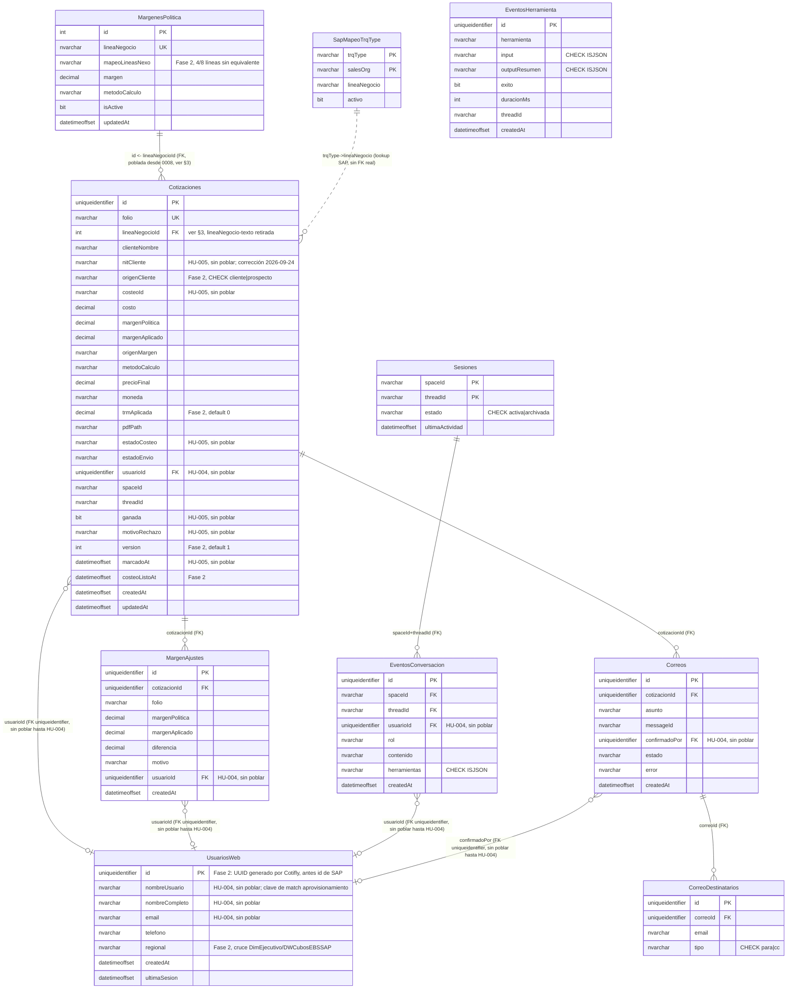

# Esquema objetivo SQL Server — Parte B: diseño original de HU-002.3 (histórico)

> **ARCHIVADO — NO VIGENTE.** Este documento se movió a `docs/archivo/` en HU-022.1 (#146, 2026-10-13). Se conserva
> solo como registro histórico: no describe el sistema actual y no se mantiene. Lo vigente está en la Parte A de [`docs/database/ESQUEMA_OBJETIVO_SQLSERVER.md`](../database/ESQUEMA_OBJETIVO_SQLSERVER.md).

> **Histórico.** Esta parte describe el mapeo de Postgres a SQL Server de HU-002.3 (2026-09-22), anterior a los scripts
> `0002` a `0010`. Las tablas `Cotizaciones`, el `costeoId` y los demás nombres de cotizaciones que aparecen aquí ya no
> existen: el esquema vigente es la [Parte A de `ESQUEMA_OBJETIVO_SQLSERVER.md`](../database/ESQUEMA_OBJETIVO_SQLSERVER.md). Se conserva porque `0001`, ADR-002 y
> ADR-016 citan sus secciones; HU-022.1 (#146) la archivó.

**Título original:** Esquema objetivo — SQL Server 2019 (HU-002.3)

Entrega el esquema objetivo de Cotifly para SQL Server 2019, como insumo directo para
HU-003.3 (`DbContext` de EF Core). No es una nueva evaluación de diseño — toma las
decisiones ya cerradas en `docs/archivo/PROPUESTA_REFACTOR_BD_COTIFLY.md` (§2, §3.2, §3.5) y las
aplica sobre el esquema **real** vigente hoy (post HU-002.2, migraciones `0006`/`0007`).

> **Nota de nombres (2026-09-22, revertido después de crear las tablas):** HU-002.3
> pedía originalmente el prefijo `tbl`/`tblSap` (estándar `dotnet-enterprise-architect`,
> HU-003) — se aplicó y las tablas se crearon así en `dbo_cotifly`. El equipo decidió
> después quitarlo (ese estándar no está documentado como archivo en este repo, solo
> mencionado por nombre en el backlog). Este documento ya refleja los nombres **sin**
> prefijo; `db/migrations_mssql/0001_script_bd_cotifly_sqlserver.sql` (reescrito, no un script
> aparte) suelta los objetos `tbl*` que hayan quedado de la corrida anterior antes
> de crear las tablas con el nombre correcto.

## 0. Fuente de verdad usada y 2 discrepancias encontradas

Se usó como fuente de verdad **`shared/models.py` + `db/migrations/versions/0006_*.py` y
`0007_*.py`** (esquema corriendo de verdad), no la prosa de `BASE_DE_DATOS.md` /
`docs/database/DICCIONARIO_BASE_DE_DATOS.md` a ciegas. Dos hallazgos que afectan este mapeo:

1. **`docs/database/DICCIONARIO_BASE_DE_DATOS.md` §3.1-3.9 tiene las tablas columna-por-columna
   desactualizadas.** Los recuadros de advertencia arriba de cada sección sí mencionan
   los cambios de HU-002.2, pero las tablas de detalle debajo siguen documentando el
   esquema pre-migración (`comercial_email`, `estado`, `efectiva`,
   `usuarios_web.email`/`nombre` como PK). No se usaron esas tablas para este mapeo.
   **Recomendación aparte de este issue:** vale la pena una tarea corta de
   documentación para corregirlas, no se tocan acá porque HU-002.3 es solo diseño de
   esquema SQL Server.
2. **`usuarios_web` en Postgres era más angosta que lo que describe la propuesta**
   (histórico, ya resuelto). §2.6/§3.5 de `docs/archivo/PROPUESTA_REFACTOR_BD_COTIFLY.md` diseñan
   `usuariosWeb` con `nombreUsuario`, `nombreCompleto` y `email` (poblados desde
   `tblSAPUsuariosApp` vía ClientePro). Eso no se ejecutó en la migración `0006`
   original. **Corrección 2026-09-22 (en paralelo, en ambos motores):** se agregaron
   estas 3 columnas ya, sin poblar hasta HU-004 — en Postgres vía
   `db/migrations/versions/0009_usuarios_web_clientepro.py`
   (`nombre_usuario`/`nombre_completo`/`email`), y en este esquema objetivo de SQL
   Server vía `db/migrations_mssql/0001_script_bd_cotifly_sqlserver.sql` (§5.8, camelCase). Mismo
   criterio que `costeoId`/`nitCliente`/`lineaNegocioId` en `Cotizaciones`. Sin
   asimetría entre los dos motores.

## 1. Equivalencia de tipos

| Postgres (hoy) | SQL Server 2019 | Nota |
|---|---|---|
| `UUID` + `gen_random_uuid()` | `uniqueidentifier` + `DEFAULT NEWID()` | PK de `Cotizaciones`, `MargenAjustes`, `Correos`, `EventosConversacion`, `EventosHerramienta`, `CorreoDestinatarios` (nueva) |
| `Integer` (serial o entero de SAP) | `int IDENTITY(1,1)` (serial: `MargenesPolitica.id`) / `int` simple, sin identity (SAP: `UsuariosWeb.id`) y en toda FK que apunte a esos dos | No confundir los dos casos — el de SAP nunca autoincrementa en Cotifly |
| `JSONB` | `nvarchar(max)` + `CHECK (ISJSON(columna) = 1)` | SQL Server 2019 no tiene tipo `JSON` nativo (llega en 2022) |
| `ARRAY(Text)` (`para`/`cc`) | *(no existe array nativo)* → tabla `CorreoDestinatarios` | Decisión ya cerrada en §2.3/§3.5, no se rediseña |
| `TIMESTAMP(timezone=True)` | `datetimeoffset` | `DEFAULT SYSDATETIMEOFFSET()` donde hoy hay `server_default=func.now()` |
| `Text` / `String(N)` | `nvarchar(max)` / `nvarchar(N)` | |
| `Boolean` | `bit` | |
| `Numeric` (sin precisión, Postgres arbitrario) | **`decimal(p,s)` — requiere precisión explícita** | Ver nota abajo, riesgo real no cubierto por las reglas generales |

**Nota — riesgo real en `Numeric` (no cubierto por "reglas generales" del issue):**
Postgres `Numeric` sin precisión declarada es de precisión arbitraria; SQL Server no
tiene equivalente sin precisión — si se declara `decimal` sin `(p,s)` explícito, el
default es `decimal(18,0)`, **sin decimales**, lo que truncaría silenciosamente
`margen_politica`/`margen_aplicado` (valores como `0.15`) a `0`. **Confirmado con el
equipo (2026-09-22):** se avanza con esta precisión tal cual, sin más ajustes:

| Columna | Precisión propuesta |
|---|---|
| `costo`, `precioFinal` | `decimal(18,2)` (pesos COP, hasta centavos) |
| `margenPolitica`, `margenAplicado`, `diferencia` | `decimal(9,4)` (decimal 0–1, ej. `0.135`) |
| `margen` (en `MargenesPolitica`) | `decimal(9,4)` |

## 2. Convención de nombres

- **Tablas:** PascalCase, sin prefijo (ej. `Cotizaciones`, `MargenAjustes`) — mapeo
  completo en §4/§5. Se probó el prefijo `tbl`/`tblSap` del estándar
  `dotnet-enterprise-architect` (HU-003) primero, pero el equipo decidió retirarlo
  después de crear las tablas (ver nota al inicio del documento).
- **Columnas:** camelCase, ya cerrado en §3.5 de la propuesta — se aplica sobre el
  nombre **real** de cada columna hoy (no sobre el diseño aspiracional de §3.5 que
  asumía columnas de Nexo/ClientePro que aún no existen, ver §0).
- **Constraints:** `pk_`, `fk_`, `ck_`, `uq_` + `nombreTabla` (en minúscula inicial) + campo, siguiendo el
  patrón ya usado en Postgres (`ck_sesiones_estado`, `uq_margenes_politica_linea_negocio`).

## 3. FK duplicada `lineaNegocio`/`lineaNegocioId` — resuelto, se retira la de texto (2026-09-22)

La premisa original (`linea_negocio_id` dependía de Nexo/HU-005) era incorrecta: en
realidad apunta a `margenes_politica`, sembrada localmente desde la migración
`0002_seed_config` — no tiene relación con Nexo. Se corrigió en el esquema actual
(Postgres):

- `mcp_server/server.py` (`generar_pdf`) ahora resuelve y guarda `linea_negocio_id` en
  cada cotización nueva, cruzando por el mismo texto (`linea_negocio`) que ya usa el
  flujo de negocio.
- `db/migrations/versions/0008_backfill_linea_negocio_id.py` rellenó las filas históricas.
- Verificado end-to-end: ambas columnas quedan pobladas y consistentes hoy en Postgres.

**Decisión para el esquema objetivo de SQL Server: se retira `lineaNegocio` (texto),
queda solo `lineaNegocioId`.** Ya no hay riesgo de romper nada (ambas están pobladas y
consistentes) y mantener las dos sería la misma redundancia (mismo dato en 2 columnas)
que esta iniciativa viene corrigiendo desde la auditoría de HU-002.1. Quien necesite el
nombre legible de la línea (tablero de Sheets, un admin viendo la tabla) lo saca con un
`JOIN` a `MargenesPolitica` — ver §6, donde las 2 vistas ya se ajustaron a esto.

**Nota de implementación (no bloquea cerrar este documento, es para quien ejecute):**
esto es una decisión sobre el esquema **objetivo** de SQL Server, no una acción sobre el
Postgres que corre hoy — la columna `linea_negocio` (texto) sigue viva en Postgres. El
código que en su momento hable con SQL Server (probablemente ya el backend .NET de
HU-003, no el Python actual) debe leer/escribir la línea de negocio por
`lineaNegocioId`, no por texto. Queda como nota para quien ejecute la migración física
(HU-002.4) o construya el `DbContext` (HU-003.3).

## 4. Diagrama ER (nombres finales)



## 5. Tablas — detalle

### 5.1 `Cotizaciones` (antes `cotizaciones`)

| Columna | Tipo SQL Server | Nulo | Default / constraint |
|---|---|---|---|
| `id` | `uniqueidentifier` | NOT NULL | PK, `DEFAULT NEWID()` |
| `folio` | `nvarchar(50)` | NOT NULL | `UNIQUE` (`uq_cotizaciones_folio`) — ver nota abajo |
| `lineaNegocioId` | `int` | NULL | FK → `MargenesPolitica.id` (poblada, ver §3 — `lineaNegocio` en texto se retira, no se migra) |
| `clienteNombre` | `nvarchar(max)` | NULL | |
| `nitCliente` | `nvarchar(max)` | NULL | HU-005, sin poblar — **corrección 2026-09-24**, ver nota abajo |
| `origenCliente` | `nvarchar(20)` | NULL | `CHECK (origenCliente IN ('cliente','prospecto'))` — **Fase 2:** si el cliente vino de `DimBPSolicitante` (real) o `tblProspectos` (prospecto), según el endpoint de clientes de Nexo |
| `costeoId` | `nvarchar(max)` | NULL | HU-005, sin poblar |
| `costo` | `decimal(18,2)` | NULL | |
| `margenPolitica` | `decimal(9,4)` | NULL | |
| `margenAplicado` | `decimal(9,4)` | NULL | |
| `origenMargen` | `nvarchar(max)` | NULL | |
| `metodoCalculo` | `nvarchar(max)` | NULL | |
| `precioFinal` | `decimal(18,2)` | NULL | |
| `moneda` | `nvarchar(max)` | NULL | `DEFAULT 'COP'` |
| `trmAplicada` | `decimal(18,4)` | NOT NULL | `DEFAULT 0` — **Fase 2:** TRM vigente cuando `moneda='USD'`; queda en `0` (no `NULL`) cuando `moneda='COP'` |
| `pdfPath` | `nvarchar(max)` | NULL | |
| `estadoCosteo` | `nvarchar(max)` | NULL | HU-005, sin poblar |
| `estadoEnvio` | `nvarchar(max)` | NULL | |
| `usuarioId` | `uniqueidentifier` | NULL | FK → `UsuariosWeb.id`, HU-004 sin poblar — `uniqueidentifier` desde el diseño Fase 2 (2026-09-23), ver §5.8 |
| `spaceId` | `nvarchar(max)` | NULL | |
| `threadId` | `nvarchar(max)` | NULL | |
| `ganada` | `bit` | NULL | HU-005, sin poblar |
| `motivoRechazo` | `nvarchar(max)` | NULL | HU-005, sin poblar |
| `version` | `int` | NOT NULL | `DEFAULT 1` — **Fase 2:** versionado de cotizaciones, resuelve el formato de folio (`-vN`, ver comentario ya existente en `shared/models.py:49`) |
| `marcadoAt` | `datetimeoffset` | NULL | HU-005, sin poblar |
| `costeoListoAt` | `datetimeoffset` | NULL | **Fase 2 (2026-09-23):** momento en que la cotización pasó a costeado/autocosteo, ver HU-005.7 |
| `createdAt` | `datetimeoffset` | NOT NULL | `DEFAULT SYSDATETIMEOFFSET()` |
| `updatedAt` | `datetimeoffset` | NOT NULL | `DEFAULT SYSDATETIMEOFFSET()` — ver nota |

> **Nota `updatedAt`:** hoy `onupdate=func.now()` lo maneja SQLAlchemy a nivel de
> aplicación (no es un trigger de Postgres). En SQL Server/EF Core (HU-003.3) hay que
> replicar el mismo patrón a nivel de aplicación (ej. interceptor de `SaveChanges`), no
> agregar un trigger nuevo que no existe hoy.

> **Nota `nitCliente` — bug corregido (2026-09-24):** el rename original
> `clienteIdSap`→`bdCliente` (propuesta §2.1) no soltó la columna vieja al ejecutarse —
> quedaron las dos, duplicadas, en la instancia real. Se corrigió contra
> `dbTarifario_Nexo_Pruebas`: se eliminó `clienteIdSap` y se renombró `bdCliente` a
> `nitCliente`. Cambio de fondo además del nombre: ya no guarda el `clienteId` interno
> que devuelve Nexo (formato inconsistente — `BP` para clientes reales de
> `DimBpSolicitante`, `UUID` random para prospectos de `tblProspectos`, sin relación
> entre sí), sino el **NIT**, estable y presente en ambos casos.

> **Nota `folio` — corrección de tipo (2026-09-22, HU-002.4):** SQL Server no permite
> `nvarchar(max)` en una columna con `UNIQUE`/PK o referenciada por FK (el límite de
> índice es ~900 bytes) — `nvarchar(max)` haría fallar el `CREATE TABLE`. Se acota a
> `nvarchar(50)`, de sobra para el formato real (`PCN-DDMMAAAA[-vN]`). El resto de
> columnas de texto sin `UNIQUE`/FK sí se quedan en `nvarchar(max)` sin problema.

### 5.2 `MargenAjustes` (antes `ajustes_margen`)

| Columna | Tipo | Nulo | Constraint |
|---|---|---|---|
| `id` | `uniqueidentifier` | NOT NULL | PK, `DEFAULT NEWID()` |
| `cotizacionId` | `uniqueidentifier` | NULL | FK → `Cotizaciones.id` |
| `folio` | `nvarchar(max)` | NULL | |
| `margenPolitica` | `decimal(9,4)` | NULL | |
| `margenAplicado` | `decimal(9,4)` | NULL | |
| `diferencia` | `decimal(9,4)` | NULL | |
| `motivo` | `nvarchar(max)` | NULL | |
| `usuarioId` | `uniqueidentifier` | NULL | FK → `UsuariosWeb.id`, HU-004 sin poblar — tipo cambiado de `int` en Fase 2, ver §5.8 |
| `createdAt` | `datetimeoffset` | NOT NULL | `DEFAULT SYSDATETIMEOFFSET()` |

### 5.3 `Correos` (antes `correos_enviados`)

| Columna | Tipo | Nulo | Constraint |
|---|---|---|---|
| `id` | `uniqueidentifier` | NOT NULL | PK, `DEFAULT NEWID()` |
| `cotizacionId` | `uniqueidentifier` | NOT NULL | FK → `Cotizaciones.id` |
| `asunto` | `nvarchar(max)` | NULL | |
| `messageId` | `nvarchar(max)` | NULL | |
| `confirmadoPor` | `uniqueidentifier` | NULL | FK → `UsuariosWeb.id`, HU-004 sin poblar — tipo cambiado de `int` en Fase 2, ver §5.8 |
| `estado` | `nvarchar(max)` | NULL | `enviado`/`fallido` |
| `error` | `nvarchar(max)` | NULL | |
| `createdAt` | `datetimeoffset` | NOT NULL | `DEFAULT SYSDATETIMEOFFSET()` |

`para`/`cc` (arrays en Postgres) se eliminan de esta tabla — se mudan a
`CorreoDestinatarios` (§5.4), decisión ya cerrada en §2.3/§3.5 de la propuesta.

### 5.4 `CorreoDestinatarios` (tabla nueva)

| Columna | Tipo | Nulo | Constraint |
|---|---|---|---|
| `id` | `uniqueidentifier` | NOT NULL | PK, `DEFAULT NEWID()` |
| `correoId` | `uniqueidentifier` | NOT NULL | FK → `Correos.id` |
| `email` | `nvarchar(320)` | NOT NULL | |
| `tipo` | `nvarchar(10)` | NOT NULL | `CHECK (tipo IN ('para','cc'))` (`ck_correoDestinatarios_tipo`) |

> **Invariante de negocio que no se puede expresar como `CHECK` de tabla:** debe existir
> al menos un `tipo='para'` por `correoId` (hoy `para` era `NOT NULL` en el array). Con
> la normalización a filas, eso pasa a ser una validación de aplicación (HU-003.5), no
> del esquema.

### 5.5 `EventosConversacion` (antes `eventos_conversacion`)

| Columna | Tipo | Nulo | Constraint |
|---|---|---|---|
| `id` | `uniqueidentifier` | NOT NULL | PK, `DEFAULT NEWID()` |
| `spaceId` | `nvarchar(128)` | NULL | FK compuesta → `Sesiones(spaceId, threadId)` — ver nota de tipo en §5.7 |
| `threadId` | `nvarchar(128)` | NULL | (misma FK compuesta) |
| `usuarioId` | `uniqueidentifier` | NULL | FK → `UsuariosWeb.id`, HU-004 sin poblar — tipo cambiado de `int` en Fase 2, ver §5.8 |
| `rol` | `nvarchar(max)` | NOT NULL | `user`/`assistant` |
| `contenido` | `nvarchar(max)` | NULL | |
| `herramientas` | `nvarchar(max)` | NULL | `CHECK (ISJSON(herramientas) = 1)` |
| `createdAt` | `datetimeoffset` | NOT NULL | `DEFAULT SYSDATETIMEOFFSET()` |

### 5.6 `EventosHerramienta` (antes `eventos_herramienta`)

| Columna | Tipo | Nulo | Constraint |
|---|---|---|---|
| `id` | `uniqueidentifier` | NOT NULL | PK, `DEFAULT NEWID()` |
| `herramienta` | `nvarchar(max)` | NOT NULL | |
| `input` | `nvarchar(max)` | NULL | `CHECK (ISJSON(input) = 1)` |
| `outputResumen` | `nvarchar(max)` | NULL | `CHECK (ISJSON(outputResumen) = 1)` |
| `exito` | `bit` | NULL | |
| `duracionMs` | `int` | NULL | |
| `threadId` | `nvarchar(max)` | NULL | *(sin índice — se eliminó en `0006`, no se recrea salvo nuevo caso de uso)* |
| `createdAt` | `datetimeoffset` | NOT NULL | `DEFAULT SYSDATETIMEOFFSET()` |

### 5.7 `Sesiones` (antes `sesiones`)

| Columna | Tipo | Nulo | Constraint |
|---|---|---|---|
| `spaceId` | `nvarchar(128)` | NOT NULL | PK (compuesta) — ver nota abajo |
| `threadId` | `nvarchar(128)` | NOT NULL | PK (compuesta) |
| `estado` | `nvarchar(max)` | NULL | `CHECK (estado IN ('activa','archivada'))` (`ck_sesiones_estado`) |
| `ultimaActividad` | `datetimeoffset` | NOT NULL | `DEFAULT SYSDATETIMEOFFSET()` |

> **Nota `spaceId`/`threadId` — corrección de tipo (2026-09-22, HU-002.4):** mismo caso
> que `folio` (§5.1) — no pueden ser `nvarchar(max)` al ser PK, y `EventosConversacion`
> los referencia por FK compuesta, así que su tipo debe coincidir exactamente. Se acotan
> a `nvarchar(128)`, de sobra para los ids reales de Google Chat (`spaces/AAAA1234`,
> `threads/BBBB5678`) o `web/<uuid>`.

### 5.8 `UsuariosWeb` (antes `usuarios_web`)

| Columna | Tipo | Nulo | Constraint |
|---|---|---|---|
| `id` | `uniqueidentifier` | NOT NULL | PK, `DEFAULT NEWID()` — **Fase 2 (2026-09-23):** cambió de `int` (id de SAP) a UUID generado por Cotifly, ver nota abajo |
| `nombreUsuario` | `nvarchar(255)` | NULL | HU-004, sin poblar — clave real de match en el aprovisionamiento (índice único filtrado, ver nota abajo). Acotado: no puede ser `nvarchar(max)` al ser clave de índice (mismo caso que `folio`/`spaceId`/`threadId`, §5.1/§5.7) |
| `nombreCompleto` | `nvarchar(max)` | NULL | HU-004, sin poblar |
| `email` | `nvarchar(max)` | NULL | HU-004, sin poblar |
| `telefono` | `nvarchar(max)` | NULL | |
| `regional` | `nvarchar(max)` | NULL | **Fase 2:** cruce de `nombreUsuario` contra `DimEjecutivo.ID`/`REGIONAL` en `DWCubosEBSSAP` (tercera conexión externa de solo lectura) |
| `createdAt` | `datetimeoffset` | NOT NULL | `DEFAULT SYSDATETIMEOFFSET()` |
| `ultimaSesion` | `datetimeoffset` | NULL | |

**Actualización 2026-09-22** (ver §0, hallazgo 2): `nombreUsuario`/`nombreCompleto`/
`email` (mapeo de `tblSAPUsuariosApp`, §2.6 de la propuesta) sí se construyen en este
esquema objetivo, sin poblar hasta HU-004 — mismo criterio que las columnas
equivalentes de `Cotizaciones`. Postgres tiene el equivalente exacto desde
`db/migrations/versions/0009_usuarios_web_clientepro.py` (snake_case:
`nombre_usuario`/`nombre_completo`/`email`) — sin asimetría entre motores.

**Fase 2 (2026-09-23) — `id` deja de ser el id de SAP:** pasa a ser un
`uniqueidentifier` generado por Cotifly (consolidado en
`db/migrations_mssql/0001_script_bd_cotifly_sqlserver.sql`, ver §9 ítem 13).
**No se agrega ninguna columna de id de SAP** — decisión confirmada: el
aprovisionamiento (HU-003.6) hace match contra `tblSAPUsuariosApp` y contra
`DimEjecutivo` (para `regional`) por `nombreUsuario`, no por ningún id numérico
externo. Cascada obligatoria: `Cotizaciones.usuarioId`, `MargenAjustes.usuarioId`,
`EventosConversacion.usuarioId` y `Correos.confirmadoPor` cambian de `int` a
`uniqueidentifier` (mismas FK). Se agrega un índice único filtrado sobre
`nombreUsuario` (`WHERE nombreUsuario IS NOT NULL`, no un `UNIQUE` de tabla — este
último en SQL Server solo permite una fila con `NULL`, y varias filas sin
`nombreUsuario` todavía conviven mientras HU-004 no las puebla). El rol (Comercial
/ Gerente Comercial) **no se persiste aquí** — se consulta en vivo desde los roles
que ya expone la sesión de ClientePro (HU-004.3).

### 5.9 `MargenesPolitica` (antes `margenes_politica`)

| Columna | Tipo | Nulo | Constraint |
|---|---|---|---|
| `id` | `int` | NOT NULL | PK, `IDENTITY(1,1)` |
| `lineaNegocio` | `nvarchar(40)` | NOT NULL | `UNIQUE` (`uq_margenesPolitica_lineaNegocio`) |
| `mapeoLineasNexo` | `nvarchar(max)` | NULL | **Fase 2 (2026-09-23):** nombre equivalente de la línea en el enum de Nexo (`PuertoAInterior`, `InteriorAPuerto`, `Nacional`, `Andino`) — 4 de las 8 líneas (`Distribucion`, `Almacenamiento`, `Almacenamiento3PL`, `ITR`) no tienen equivalente y quedan `NULL` a propósito |
| `margen` | `decimal(9,4)` | NOT NULL | |
| `metodoCalculo` | `nvarchar(max)` | NOT NULL | `DEFAULT 'margen'` — ver nota abajo |
| `isActive` | `bit` | NOT NULL | `DEFAULT 1` |
| `updatedAt` | `datetimeoffset` | NOT NULL | `DEFAULT SYSDATETIMEOFFSET()` (ver nota `updatedAt` en §5.1, mismo patrón) |

> **`metodoCalculo` — decisión abierta heredada, se mantiene por ahora.** Detectada en
> la auditoría de HU-002.1 (`docs/backlog/2026-09-21_HU_Backlog_Cotifly_ClientePro.md:157`): es una columna
> **sin uso real** — el cálculo de precio usa el `metodo_calculo` que llega en el
> payload de cada cotización (`cotizaciones.metodo_calculo`), no este valor de
> configuración por línea. Nunca hubo una recomendación explícita de eliminarla en la
> propuesta, así que se migra tal cual (no se rediseña acá) y queda con el mismo hilo
> abierto: alguien tiene que decidir en algún momento si se conecta de verdad al cálculo
> o se retira. No bloquea este documento.

### 5.10 `SapMapeoTrqType` (antes `mapeo_trqtype`)

| Columna | Tipo | Nulo | Constraint |
|---|---|---|---|
| `trqType` | `nvarchar(8)` | NOT NULL | PK (compuesta) |
| `salesOrg` | `nvarchar(12)` | NOT NULL | PK (compuesta), `DEFAULT ''` (comodín "todas") |
| `lineaNegocio` | `nvarchar(40)` | NOT NULL | |
| `activo` | `bit` | NOT NULL | `DEFAULT 1` |

> El modelo Postgres actual tiene además un `UNIQUE(trqType, salesOrg)`
> (`uq_trqtype_salesorg`) redundante con la propia PK compuesta — se puede omitir en
> SQL Server (limpieza menor, no afecta comportamiento) o mantenerse por paridad
> literal; no bloquea el diseño.

## 6. Vistas — T-SQL

Se migran las 2 vistas reales que sobreviven (fuente: SQL exacto de `0006_hu002_2_esquema_completo.py`, traducido). `v_trazabilidad_cotizaciones` se descartó en HU-002.2, no se migra.

```sql
CREATE VIEW dbo_cotifly.vAjustesMargenPorComercial AS
SELECT
    a.usuarioId,
    mp.lineaNegocio,
    COUNT(*)            AS numAjustes,
    AVG(a.diferencia)   AS diferenciaPromedio,
    MIN(a.diferencia)   AS diferenciaMin,
    MAX(a.diferencia)   AS diferenciaMax,
    MAX(a.createdAt)    AS ultimoAjuste
FROM dbo_cotifly.MargenAjustes a
LEFT JOIN dbo_cotifly.Cotizaciones c ON c.id = a.cotizacionId
LEFT JOIN dbo_cotifly.MargenesPolitica mp ON mp.id = c.lineaNegocioId
GROUP BY a.usuarioId, mp.lineaNegocio;
GO

CREATE VIEW dbo_cotifly.vActividadPorComercial AS
SELECT
    c.usuarioId,
    COUNT(DISTINCT c.id)                                       AS numCotizaciones,
    SUM(CASE WHEN c.estadoEnvio = 'enviada' THEN 1 ELSE 0 END) AS numCotizacionesEnviadas,
    COALESCE(SUM(sub.numAjustes), 0)                           AS numAjustes,
    MAX(c.createdAt)                                           AS ultimaCotizacion
FROM dbo_cotifly.Cotizaciones c
LEFT JOIN (
    SELECT cotizacionId, COUNT(*) AS numAjustes
    FROM dbo_cotifly.MargenAjustes
    WHERE cotizacionId IS NOT NULL
    GROUP BY cotizacionId
) sub ON sub.cotizacionId = c.id
WHERE c.usuarioId IS NOT NULL
GROUP BY c.usuarioId;
GO
```

> `COUNT(*) FILTER (WHERE ...)` (Postgres, no soportado en SQL Server) se reemplazó por
> `SUM(CASE WHEN ... THEN 1 ELSE 0 END)`, tal como decidido en §3.3 de la propuesta.
>
> **`vAjustesMargenPorComercial` sí necesitó un `JOIN` nuevo que la versión real de
> `0006` no tenía:** al retirarse `Cotizaciones.lineaNegocio` (texto, ver §3), el
> nombre legible de la línea ya no viene directo de `Cotizaciones` — se agregó
> `LEFT JOIN MargenesPolitica mp ON mp.id = c.lineaNegocioId` para recuperarlo. No se
> agregó un `JOIN` equivalente a `usuariosWeb` (para mostrar nombre de comercial en vez
> de `usuarioId`) porque ese diseño completo (§2.6) no se ejecutó todavía (ver §0).

## 7. Collation y driver de conexión

- **Destino real (aclaración del equipo, 2026-09-22 — corrección sobre lo asumido antes):**
  no es una base de datos nueva dedicada a Cotifly. Es un **schema nuevo** (`dbo_cotifly`)
  dentro de una base que **ya existe**: `dbTarifario_Nexo_Pruebas`. Como esa base no la
  creamos nosotros, puede tener su propia collation ya fijada — no se puede asumir ni
  cambiar a nivel de base de datos.
- **Collation: `Latin1_General_100_CI_AS_SC_UTF8`** (UTF-8, novedad de SQL Server 2019),
  declarada **explícitamente en cada columna de texto (`nvarchar`) del `CREATE TABLE`**,
  no a nivel de base de datos — así funciona sin importar qué tenga configurado hoy
  `dbTarifario_Nexo_Pruebas`. La confirmación previa con el DBA (ni Nexo ni ClientePro
  fijan una collation explícita) seguía siendo válida en general, pero era sobre esas
  bases, no específicamente sobre `dbTarifario_Nexo_Pruebas` — de ahí el cambio a
  declararla por columna en vez de asumirla a nivel de base.
- **Driver:** `ODBC Driver 17 for SQL Server` (no 18) — el 18 exige `Encrypt=yes` por
  defecto y falla contra una instancia sin certificado TLS propio. Aplica a la cadena de
  conexión de HU-002.4/HU-003.2 (`mssql+pyodbc://...?driver=ODBC+Driver+17+for+SQL+Server`
  o el equivalente .NET).

## 8. Checklist de cobertura

Todas las tablas del esquema actual (9 + `alembic_version`, que no aplica a SQL Server)
quedan mapeadas:

| Tabla actual | Tabla objetivo | Estado |
|---|---|---|
| `cotizaciones` | `Cotizaciones` | Mapeada (§5.1) |
| `ajustes_margen` | `MargenAjustes` | Mapeada (§5.2) |
| `correos_enviados` | `Correos` + `CorreoDestinatarios` (nueva) | Mapeada (§5.3/§5.4) |
| `eventos_conversacion` | `EventosConversacion` | Mapeada (§5.5) |
| `eventos_herramienta` | `EventosHerramienta` | Mapeada (§5.6) |
| `sesiones` | `Sesiones` | Mapeada (§5.7) |
| `usuarios_web` | `UsuariosWeb` | Mapeada (§5.8) |
| `margenes_politica` | `MargenesPolitica` | Mapeada (§5.9) |
| `mapeo_trqtype` | `SapMapeoTrqType` | Mapeada (§5.10) |
| `v_ajustes_margen_por_comercial` | `dbo_cotifly.vAjustesMargenPorComercial` | Migrada (§6) |
| `v_actividad_por_comercial` | `dbo_cotifly.vActividadPorComercial` | Migrada (§6) |
| `v_trazabilidad_cotizaciones` | — | Descartada en HU-002.2, no se migra |

## 9. Estado de las decisiones

**Cerradas (2026-09-22):**

1. **§3** — FK duplicada `lineaNegocio`/`lineaNegocioId`: resuelto. En Postgres ambas
   columnas quedan pobladas y consistentes (migración `0008` + ajuste en `generar_pdf`),
   pero en el **esquema objetivo de SQL Server se retira `lineaNegocio` (texto)** y
   queda solo `lineaNegocioId` — sin la redundancia. Las 2 vistas (§6) ya se ajustaron
   con el `JOIN` a `MargenesPolitica` para el nombre legible.
2. **§1** — Precisión/escala de las columnas `decimal`: confirmada, `(18,2)` para
   montos, `(9,4)` para márgenes.
3. **§7** — Collation: confirmada, `Latin1_General_100_CI_AS_SC_UTF8` — **corregido
   2026-09-22:** se declara por columna en el `CREATE TABLE`, no a nivel de base de
   datos, porque el destino real (`dbTarifario_Nexo_Pruebas`, ver §7) ya existe y no es
   nuestra para fijarle una collation de base.
4. **§5.1/§5.5/§5.7 (2026-09-22, detectado al preparar el script T-SQL de HU-002.4)** —
   `folio`, `spaceId` y `threadId` estaban como `nvarchar(max)`, tipo no permitido en
   columnas `PK`/`UNIQUE`/referenciadas por FK en SQL Server (límite de índice ~900
   bytes) — habría hecho fallar el `CREATE TABLE`. Se acotaron a `nvarchar(50)` y
   `nvarchar(128)` respectivamente.
5. **§0/§7 (2026-09-22)** — El destino no es una base de datos nueva dedicada a
   Cotifly, es un schema nuevo (`dbo_cotifly`) dentro de `dbTarifario_Nexo_Pruebas`
   (base ya existente). Afecta la calificación de todos los objetos en el script
   (`dbo_cotifly.Cotizaciones`, no `dbo.Cotizaciones`) — ver
   `db/migrations_mssql/0001_script_bd_cotifly_sqlserver.sql`.
6. **§2 (2026-09-22, después de crear las tablas en la BD real)** — Se retira el
   prefijo `tbl`/`tblSap` que pedía originalmente HU-002.3
   (`docs/backlog/2026-09-21_HU_Backlog_Cotifly_ClientePro.md:174`). Las 10 tablas se llegaron a crear
   con el prefijo en una primera corrida de `db/migrations_mssql/0001_script_bd_cotifly_sqlserver.sql`
   — ese mismo script se reescribió (no se agregó uno aparte) para soltar esos objetos
   `tbl*` como primer paso y crear las tablas ya con el nombre correcto. Este documento
   ya quedó actualizado con los nombres sin prefijo en todas las secciones.

**Pendientes, no bloqueantes, fuera del alcance de este documento:**

7. **§3** — Nota de implementación (no bloquea el documento): quien ejecute HU-002.4 o
   construya el `DbContext` de HU-003.3 debe leer/escribir la línea de negocio por
   `lineaNegocioId`, no por texto — la columna de texto no se migra a SQL Server.
8. ~~**§0** — Cuándo se agrega `nombreUsuario`/`nombreCompleto`/`email` a `UsuariosWeb`~~
   — **Resuelto 2026-09-22:** se agregaron ya, sin poblar hasta HU-004, en paralelo en
   ambos motores (Postgres: migración `0009`; SQL Server: §5.8). Sin asimetría.
9. Corrección de documentación fuera de alcance: actualizar las tablas columna-por-columna
   de `docs/database/DICCIONARIO_BASE_DE_DATOS.md` §3.1-3.9 al esquema real post-`0006`/`0007`/`0008`.
10. **§5.9** — `MargenesPolitica.metodoCalculo`: decisión abierta heredada de la
    auditoría de HU-002.1 (`docs/backlog/2026-09-21_HU_Backlog_Cotifly_ClientePro.md:157`), nunca resuelta —
    columna sin uso real, se mantiene y se migra tal cual por ahora.
11. **Confirmar el nombre de base por entorno:** `dbTarifario_Nexo_Pruebas` suena a
    instancia de pruebas por el nombre — confirmar con el equipo si producción usa el
    mismo nombre de base o uno distinto antes de correr el script de HU-002.4 contra el
    entorno real.
12. **Conexión real (2026-09-22):** host `tbsdatacenter`, autenticación Windows
    (`trusted_connection=yes`, sin usuario/contraseña). `shared/config.py` ya tiene
    `sqlserver_database_url` separado de `database_url` (Postgres, no se toca), y
    `.env.example` documenta el formato. **Restricción real:** Windows Authentication
    solo funciona ejecutando `db/migrations_mssql/0001_script_bd_cotifly_sqlserver.sql` directo desde
    Windows (`sqlcmd -E` o un runner Python local) — no desde los contenedores Docker
    (Linux) del proyecto, que no soportan Windows Auth sin configurar Kerberos aparte.
13. **Fase 2 (2026-09-23) — rol Gerente Comercial, tablero de métricas, versionado —
    consolidada en `0001` (2026-09-24):** originalmente se armó como script `0003`
    aparte (ALTER sobre el esquema ya creado por `0001`/`0002`), pero como nada de
    esto está en producción todavía, se consolidó todo en un único
    `db/migrations_mssql/0001_script_bd_cotifly_sqlserver.sql` que crea el esquema ya en su forma
    final desde el inicio — `0002`/`0003` se eliminaron, no quedó rastro de la forma
    intermedia. Cambios: `UsuariosWeb.id` es `uniqueidentifier` generado por Cotifly
    (nunca fue el id de SAP en la versión final) — **no existe columna de id de SAP**,
    el aprovisionamiento matchea por `nombreUsuario` (índice único filtrado);
    `Cotizaciones.usuarioId`/`MargenAjustes.usuarioId`/
    `EventosConversacion.usuarioId`/`Correos.confirmadoPor` son `uniqueidentifier`
    desde su creación; `UsuariosWeb.regional` (cruce contra `DimEjecutivo`/
    `DWCubosEBSSAP`, tercera conexión externa de solo lectura); `MargenesPolitica.
    mapeoLineasNexo` (4/8 líneas sin equivalente, `NULL` a propósito, poblado en el
    mismo `INSERT` del seed); en `Cotizaciones`: `costeoListoAt`, `trmAplicada`,
    `version` y `origenCliente` (`cotizacionOrigenId` se agregó y se retiró después,
    ver ítem 17 más abajo).
    **Hallazgo técnico real que sí quedó documentado** (relevante para quien altere
    este esquema más adelante con datos reales ya cargados): SQL Server no tiene
    conversión `int`→`uniqueidentifier` — un `ALTER COLUMN` directo entre esos dos
    tipos falla siempre, incluso en una tabla vacía; hay que pasar por
    `DROP COLUMN`+`ADD COLUMN` (solo válido sin datos que perder) o por una migración
    de datos explícita si ya hay filas reales.
14. **Bug real encontrado al ejecutar contra la instancia real (2026-09-24):**
    `nombreUsuario` (`UsuariosWeb`) estaba como `nvarchar(max)` — mismo error que
    `folio`/`spaceId`/`threadId` (§9 ítem 4), esta vez en una columna con índice único
    filtrado (`uq_usuariosWeb_nombreUsuario`). SQL Server rechazó el `CREATE INDEX`
    con `Msg 1919`. Se acotó a `nvarchar(255)` (§5.8) y se separó la creación del
    índice en su propio batch, con su propio chequeo de idempotencia
    (`sys.indexes`), en vez de vivir dentro del mismo `BEGIN...END` que el
    `CREATE TABLE`.
15. **Segundo bug real encontrado en la misma corrida (2026-09-24):** el índice
    filtrado también falló con `Msg 1934` — SQL Server exige `QUOTED_IDENTIFIER ON`
    (y de paso `ANSI_NULLS ON`) para crear índices filtrados, y el default de
    `sqlcmd` en esta instancia vino en `OFF`. Se agregó `SET QUOTED_IDENTIFIER ON;`
    y `SET ANSI_NULLS ON;` al inicio del script — son opciones de sesión que
    persisten entre batches (`GO`), así que basta con fijarlas una vez.
16. **Bug de migración corregido contra la instancia real (2026-09-24):** el rename
    `clienteIdSap`→`bdCliente` (propuesta §2.1) nunca soltó la columna vieja —
    quedaron las dos duplicadas en `Cotizaciones`. Se corrió un script de corrección
    directo contra `dbTarifario_Nexo_Pruebas` (`DROP COLUMN clienteIdSap` +
    `sp_rename bdCliente → nitCliente`, tabla vacía verificada antes de ejecutar) y
    se sincronizó `db/migrations_mssql/0001_script_bd_cotifly_sqlserver.sql` + este documento
    (§5.1) con el resultado. Cambio de fondo: la columna pasa a guardar el **NIT**
    (estable, existe para clientes reales y prospectos) en vez del `clienteId`
    interno de Nexo (formato inconsistente según el origen) — ver nota en §5.1.
17. **Reorden físico de columnas + retiro de `cotizacionOrigenId` (2026-09-24):** a
    pedido del equipo, el orden de columnas de `Cotizaciones` en el `CREATE TABLE`
    (y por lo tanto el orden físico real de la tabla) se ajustó para agrupar mejor
    los campos relacionados: `nitCliente` y `origenCliente` quedan justo después de
    `clienteNombre`; `origenMargen` justo después de `margenAplicado`; `trmAplicada`
    justo después de `moneda`; `version` justo después de `motivoRechazo`. SQL
    Server no tiene un `ALTER TABLE` que reordene columnas directamente — se
    resolvió editando el orden en el `CREATE TABLE` y dejando que el script (que ya
    borra y recrea todo desde cero) lo aplicara de nuevo, mismo patrón que el resto
    de este documento. De paso se **retiró `cotizacionOrigenId`** (la FK
    auto-referenciada a la v1 de una cotización versionada) — el versionado queda
    solo con la columna `version` y la convención de sufijo `-vN` en `folio`
    (`shared/models.py:49`), sin un enlace de FK explícito entre versiones.
