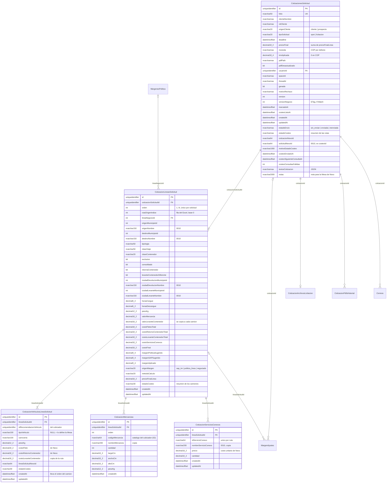
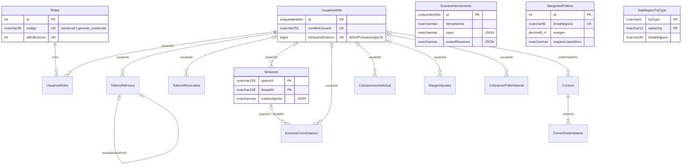

# Esquema de la base de datos — SQL Server 2019 (`dbo_cotifly`)

> **Estado:** vigente desde HU-021 · **Dueño:** Duban Guerra (backend) y scalderon-bs (datos) · **Actualizado:** 2026-10-22 (ajustes `02` a `13`, HU-033)

Este documento describe la Parte A; la Parte B se archivó:

- **Parte A — Esquema vigente.** Lo que crean `db/scripts/01_crear_esquema.sql` o las migraciones
  `db/migrations_mssql/0001` a `0010`, más los ajustes `db/scripts/02` a `13` y `db/scripts/pendientes/04`, y lo que mapea el
  modelo EF Core
  (`backend-dotnet/src/Cotifly.Infraestructura/Comun/Persistence/Configurations/`). Es la referencia para el backend.
- **Parte B — Diseño original de HU-002.3 (histórico).** El mapeo de Postgres a SQL Server que dio origen al `0001`.
  **No está vigente** y se archivó en HU-022.1 (#146) en
  [`docs/archivo/ESQUEMA_OBJETIVO_SQLSERVER_PARTE_B.md`](../archivo/ESQUEMA_OBJETIVO_SQLSERVER_PARTE_B.md), con sus
  secciones originales (§5.8, §9 y demás), que citan el `0001`, ADR-002 y ADR-016.

Documentos relacionados: el significado de cada columna está en [`DICCIONARIO_BASE_DE_DATOS.md`](DICCIONARIO_BASE_DE_DATOS.md);
cómo instalar y migrar, en [`db/README.md`](../../db/README.md); la decisión de las tres capas, en
[ADR-019](../../backend-dotnet/specs/decisiones/ADR-019-reestructuracion-rutas-y-camiones.md); el diseño de HU-021, en
[`PROPUESTA_REESTRUCTURACION_COTIZACIONES.md`](PROPUESTA_REESTRUCTURACION_COTIZACIONES.md).

---

# Parte A — Esquema vigente (0001 a 0010 y ajustes 02 a 13)

## A.1 Resumen

- **Motor:** SQL Server 2019. **Base:** `dbTarifario_Nexo_Pruebas` (compartida, en `tbsdatacenter`). **Schema:** `dbo_cotifly`.
- **21 tablas, sin vistas:** las 20 que crea el `01` (o el `0001` a `0010`) y `CapturasIdempotentes`, que crea
  `db/scripts/06_idempotencia_captura.sql` (las 2 vistas del borrador de métricas se retiraron en HU-014.3, #152, con el `08`).
  EF Core es *Database First*: el esquema solo cambia con scripts SQL (ADR-008): las migraciones `db/migrations_mssql/000N_*.sql`
  hasta el `0010` y, desde HU-023, los ajustes `db/scripts/02` a `13` (más `pendientes/04`), que todavía no están consolidados en
  `db/scripts/01_crear_esquema.sql`.
- **Collation** `Latin1_General_100_CI_AS_SC_UTF8` explícita en cada columna de texto. Única excepción:
  `TokensRefresco.tokenHash` (`Latin1_General_100_BIN2`).
- **Nombres de restricciones:** las tablas renombradas por el `0009` conservan los nombres viejos en sus restricciones
  (`pk_cotizaciones`, `pk_cotizacionPosiciones`, `df_cotizaciones_*`). Es a propósito: así una base migrada y una instalada
  desde cero quedan idénticas.
- **Las FK son `NO ACTION`.** El borrado en cascada de rutas, camiones, mercancías y conexos lo hace EF del lado del cliente
  (`ClientCascade`) dentro del agregado.

## A.2 Las tres capas: solicitud → ruta → camión

Una cotización de Cotifly es una **solicitud** (cabecera) con una o varias **rutas**. Cada ruta sale en uno o varios
**camiones** (uno por fila; si el cubicador recomienda 7, son 7 filas). Las **mercancías** y los **servicios conexos** son de
la ruta, no del camión. Los costos son por camión, el margen y el precio por ruta, y la cabecera suma sus rutas.

El diagrama muestra solo las columnas de `0001` a `0010` (lo que crea el `01`); las de los ajustes `02` a `13` y
`pendientes/04` están en las tablas de §A.4.

Los tipos del diagrama van sin paréntesis porque Mermaid no los admite: `nvarchar50` es `NVARCHAR(50)`, `decimal18_2` es
`DECIMAL(18,2)` y `nvarcharmax` es `NVARCHAR(MAX)`.

### Reglas que el esquema no expresa (las aplica el dominio, ADR-019)

- **Totales guardados.** `costoFletesTotal`, `costoRetornoContenedorTotal` y `costoLevanteContenedorTotal` son la suma de
  los camiones que cuentan (los `descartada` no cuentan, salvo que lo estén todos). `costoServiciosConexos` = Σ precio ×
  cantidad. `costoFinal` = la suma de los cuatro. `precioFinalLinea` = `costoFinal` con el margen y el método de la ruta, en
  la moneda y la TRM de la cabecera. `precioFinal` = Σ `precioFinalLinea` (NULL mientras alguna ruta no tenga precio).
- **Estado agregado.** El `estadoCosteo` del camión se resume en la ruta y el de las rutas en la cabecera ("el más atrasado").
- **Margen vigente** de la ruta: `margenSAPSugerido` si existe; si no, `margenPoliticaSugerido`. El ajuste del comercial
  queda en `margenAplicado` (`origenMargen = negociado`) y en `MargenAjustes` con la ruta.
- **Orden de los camiones.** `ordenVehiculo` (script `03`, HU-014 #188) guarda el orden del camión en su ruta (1..n, el de la
  recomendación del cubicador; el primero lleva los conexos en Nexo). El backend ordena por `ordenVehiculo` y, si es NULL (filas
  anteriores), por `createdAt`.
- **`idServicioConexo`** guarda el id del catálogo de Nexo (conexos capturados o copiados a una `-vN`) o el id de la fila de
  la cotización de Nexo (agregados o importados desde Nexo). Desde el `03` (HU-014 #188), `idServicioConexoCatalogo` guarda
  aparte el id del catálogo (NULL en las filas anteriores: el backend las resuelve por id o por nombre).

## A.3 El resto del esquema

`EventosHerramienta`, `MargenesPolitica` y `SapMapeoTrqType` no tienen FK. `EventosHerramienta` guarda además los registros
de proceso del backend (por ejemplo `conexos_envio_nexo`, `conexos_pendientes_nexo`, `cambiar_servicios_conexos`), sin
columnas propias.

## A.4 Tablas — columnas, restricciones e índices

Tipos: `uid` = `UNIQUEIDENTIFIER`, `dto` = `DATETIMEOFFSET`, `nv(N)` = `NVARCHAR(N)`, `dec(p,s)` = `DECIMAL(p,s)`. "Def." es
el valor por defecto de la base. Todas las columnas de texto llevan la collation de A.1.

### A.4.1 `CotizacionesSolicitud` — la cabecera (ex `Cotizaciones`)

| Columna | Tipo | Nulo | Def. | Nota |
|---|---|---|---|---|
| `id` | uid | no | `NEWID()` | PK `pk_cotizaciones` |
| `folio` | nv(50) | no | | Único (`uq_cotizaciones_folio`). `PCN-[{nit}-]{INICIALES}-DDMMAAAA-{NNN}[-vN]` (ADR-011, decisión 11) |
| `clienteNombre`, `nitCliente` | nv(max) | sí | | |
| `origenCliente` | nv(20) | sí | | CHECK `cliente` \| `prospecto` |
| `tipoSolicitud` | nv(20) | sí | | CHECK `spot` \| `licitacion` |
| `deadline` | dto | sí | | |
| `precioFinal` | dec(18,2) | sí | | Σ `precioFinalLinea` |
| `moneda` | nv(max) | sí | `'COP'` | `COP` o `USD` (ADR-014) |
| `trmAplicada` | dec(18,4) | no | `0` | 0 en COP |
| `pdfPath` | nv(max) | sí | | PDF vigente |
| `pdfDesactualizado` | bit | no | `0` | Regla del PDF (ADR-018) |
| `usuarioId` | uid | sí | | FK `UsuariosWeb` |
| `spaceId`, `threadId` | nv(max) | sí | | Hilo de origen (legado del chat) |
| `ganada`, `motivoRechazo`, `marcadoAt` | bit / nv(max) / dto | sí | | Resultado |
| `version` | int | no | `1` | Número de versión del folio (`-vN`) |
| `versionNegocio` | int | no | `0` | Concurrencia optimista, CHECK ≥ 0 |
| `costeoListoAt`, `createdAt`, `updatedAt` | dto | `costeoListoAt` sí | `SYSDATETIMEOFFSET()` en `createdAt`/`updatedAt` | |
| `estadoEnvio` | nv(max) | sí | | CHECK `sin_enviar` \| `enviada` \| `reenviada` |
| `estadoCosteo` | nv(max) | sí | | CHECK de los 8 estados (abajo) |
| `cotizacionNexoId` | nv(64) | sí | | Id de la **cotización** de Nexo |
| `solicitudNexoId` | nv(64) | sí | | Id de la **solicitud** de Nexo (0010) |
| `motivoEstadoCosteo` | nv(1000) | sí | | |
| `costeoEnviadoAt`, `costeoSiguienteConsultaAt` | dto | sí | | Agenda del polling |
| `costeoConsultasFallidas` | int | no | `0` | |
| `textosCotizacion` | nv(max) | sí | | JSON (CHECK `ISJSON`): asunto e introducción del PDF |
| `notas` | nv(2000) | sí | | Nota para la Mesa de Nexo |
| `scorePrioridad` | dec(9,4) | sí | | **`09`.** `scorePrioridad` que devuelve Nexo al crear la solicitud. NULL = Nexo no lo mandó o la solicitud es anterior |
| `sincronizacionResultadoNexo` | nv(20) | sí | | **`13`.** CHECK `pendiente` \| `sincronizado` \| `no_sincronizable`. Resultado (ganada/perdida) marcado antes de que Nexo entregue la cotización: el polling lo envía a Nexo cuando la Mesa la entregue (HU-033). NULL = sin resultado o anterior al `13` |
| `comentarioResultadoPendiente` | nv(500) | sí | | **`13`.** Comentario para Nexo mientras el resultado está pendiente |
| `resultadoSincronizadoAt` | dto | sí | | **`13`.** Cuándo Nexo aceptó el resultado |
| `errorSincronizacionResultado` | nv(1000) | sí | | **`13`.** Último error, o por qué ya no se puede enviar |
| `intentosSincronizacionResultado` | int | no | `0` | **`13`.** CHECK ≥ 0 |

Estados de costeo (cabecera, ruta y camión, 8): `pendiente_envio`, `error_envio`, `pendiente_costeo`, `autocosteo`, `entregada`,
`descartada`, `costeo_vencido` y `rechazada` (agregado por el `10`, HU-028: la Mesa de Costeo rechazó el camión; la ruta queda
`rechazada` si lo están todos sus camiones vigentes; la cabecera no lo escribe, pero comparte la misma lista en su CHECK).

Índices: `ix_cotizaciones_usuarioId_createdAt` (`usuarioId`, `createdAt DESC`) y `ix_cotizaciones_costeoSiguienteConsultaAt`
(filtrado `IS NOT NULL`).

### A.4.2 `CotizacionLineasSolicitud` — la ruta

| Columna | Tipo | Nulo | Def. | Nota |
|---|---|---|---|---|
| `id` | uid | no | `NEWID()` | PK |
| `cotizacionSolicitudId` | uid | no | | FK cabecera |
| `orden` | int | no | | CHECK ≥ 1; único con `cotizacionSolicitudId` |
| `rutaOrigenIndice` | int | sí | | CHECK ≥ 0. Posición en el formulario o fila del Excel (base 0) |
| `lineaNegocioId` | int | sí | | FK `MargenesPolitica` |
| `origenMunicipioId`, `destinoMunicipioId` | int | sí | | Id de `tbl_municipios` de Nexo (sin FK, otra base). CHECK > 0 |
| `origenNombre`, `destinoNombre` | nv(150) | sí | | Copia del nombre (0010) |
| `tipologia`, `claseViaje` | nv(50) | sí | | |
| `claseContenedor` | nv(20) | sí | | |
| `exclusivo`, `consolidado` | bit | sí | | |
| `retornaContenedor`, `levanteContenedorDiferente` | bit | no | `0` | |
| `ciudadDevolucionMunicipioId`, `ciudadLevanteMunicipioId` | int | sí | | CHECK > 0 |
| `ciudadDevolucionNombre`, `ciudadLevanteNombre` | nv(150) | sí | | Copia del nombre (0010) |
| `horasCargue`, `horasDescargue` | dec(6,2) | sí | | CHECK 0 a 240 |
| `pesoKg` | dec(12,2) | sí | | Peso total declarado de la ruta |
| `valorMercancia` | dec(18,2) | sí | | Valor de la mercancía (no es costo) |
| `valorLevanteContenedor` | dec(18,2) | sí | | Un levante; se copia a cada camión |
| `costoFletesTotal`, `costoRetornoContenedorTotal`, `costoLevanteContenedorTotal`, `costoServiciosConexos`, `costoFinal` | dec(18,2) | sí | | Totales guardados. CHECK ≥ 0 |
| `margenPoliticaSugerido`, `margenSAPSugerido`, `margenAplicado` | dec(9,4) | sí | | Fracción (0.15 = 15 %) |
| `origenMargen` | nv(20) | sí | | CHECK `sap_tm` \| `politica_linea` \| `negociado` |
| `metodoCalculo` | nv(20) | sí | | |
| `precioFinalLinea` | dec(18,2) | sí | | CHECK ≥ 0 |
| `estadoCosteo` | nv(30) | sí | | 8 estados |
| `createdAt`, `updatedAt` | dto | no | `SYSDATETIMEOFFSET()` | |
| `idRecomendacion` | uid | sí | | **`02`.** Corrida del cubicador, para reconsultarla |
| `resultadoCubicacion` | nv(30) | sí | | **`02`.** CHECK `ASIGNADO` \| `SIN_SELECCION_AUTOMATICA` |
| `motivoSinSeleccion` | nv(40) | sí | | **`02`, `03`/`07`.** CHECK `EXTRADIMENSIONADO` \| `SIN_CANDIDATOS_DIMENSIONALES` \| `SUPERA_K_MAX` \| `SIN_CARROCERIA_COMPATIBLE` \| `BUSQUEDA_AGOTADA` (el quinto lo agregan el `03` y el `07`), solo con `ISNULL(resultadoCubicacion, '') = 'SIN_SELECCION_AUTOMATICA'` |
| `condicionada` | bit | no | `0` | **`02`.** La ruta lleva mercancías condicionadas |
| `estadoCubicacion` | nv(20) | sí | | **`pendientes/04`.** CHECK `pendiente` \| `cubicada` \| `fallida`. NULL = se cubicó al guardarla. Índice filtrado `ix_cotizacionLineasSolicitud_cubicacionPendiente` (`cubicacionDisponibleAt`, `createdAt`) `WHERE estadoCubicacion = 'pendiente'` |
| `cubicacionIntentos` | int | no | `0` | **`pendientes/04`.** Intentos fallidos. CHECK ≥ 0 |
| `cubicacionDisponibleAt` | dto | sí | | **`pendientes/04`.** Desde cuándo una réplica puede tomar la ruta |
| `errorCubicacion` | nv(500) | sí | | **`pendientes/04`.** Último error de la cubicación |
| `avisosCubicacion` | nv(max) | sí | | **`pendientes/04`.** JSON (CHECK `ISJSON`): advertencias, extradimensión y mercancías condicionadas |
| `pesoConTaraKg` | dec(12,2) | sí | | **`11`.** Peso con la tara de los contenedores (ruta `Contenedor`). CHECK NULL o > 0 |
| `tipoVehiculoElegido`, `carroceriaElegida` | nv(100) | sí | | **`12`.** Vehículo elegido por el comercial: respaldo del cubicador (HU-032, ADR-022). NULL = no eligió o la ruta es anterior al `12` |

### A.4.3 `CotizacionVehiculosLineaSolicitud` — el camión (nueva en el 0009)

| Columna | Tipo | Nulo | Def. | Nota |
|---|---|---|---|---|
| `id` | uid | no | `NEWID()` | PK |
| `lineaSolicitudId` | uid | no | | FK ruta; índice `ix_cotizacionVehiculosLineaSolicitud_lineaSolicitudId` |
| `idRecomendacionVehiculo` | uid | sí | | Fila de la recomendación del cubicador |
| `tipoVehiculo`, `carroceria` | nv(100) | sí | | NULL = sin selección automática (lo resuelve la Mesa de Costeo) |
| `pesoKg` | dec(12,2) | sí | | CHECK ≥ 0 |
| `costoFlete`, `costoRetornoContenedor` | dec(18,2) | sí | | Los devuelve Nexo. CHECK ≥ 0 |
| `costoLevanteContenedor` | dec(18,2) | sí | | Copia de `valorLevanteContenedor` de la ruta. CHECK ≥ 0 |
| `lineaSolicitudNexoId` | nv(64) | sí | | Línea de Nexo emparejada |
| `estadoCosteo` | nv(30) | sí | | 8 estados |
| `createdAt`, `updatedAt` | dto | no | `SYSDATETIMEOFFSET()` | |
| `volumenTotalM3` | dec(12,3) | sí | | **`02`.** CHECK `ck_cotizacionVehiculosLineaSolicitud_llenado`: NULL o ≥ 0 |
| `porcentajeLlenadoVolumen`, `porcentajeLlenadoPeso` | dec(5,2) | sí | | **`02`.** Mismo CHECK: NULL o 0 a 100 |
| `ordenVehiculo` | int | sí | | **`03`.** Orden del camión en la ruta. CHECK NULL o ≥ 1; único filtrado `uq_cotizacionVehiculosLineaSolicitud_lineaSolicitudId_ordenVehiculo` (`lineaSolicitudId`, `ordenVehiculo`) `WHERE ordenVehiculo IS NOT NULL` |
| `motivoRechazo` | nv(500) | sí | | **`10`.** Motivo con que la Mesa de Costeo de Nexo rechazó la línea (HU-028) |
| `rechazadaAt` | dto | sí | | **`10`.** Cuándo vio Cotifly el rechazo. CHECK `ck_cotizacionVehiculosLineaSolicitud_rechazo`: `ISNULL(estadoCosteo, '') = 'rechazada' OR (motivoRechazo IS NULL AND rechazadaAt IS NULL)` |

### A.4.4 `CotizacionMercancias` (ex `CotizacionPosiciones`)

| Columna | Tipo | Nulo | Def. | Nota |
|---|---|---|---|---|
| `id` | uid | no | `NEWID()` | PK `pk_cotizacionPosiciones` |
| `lineaSolicitudId` | uid | no | | FK ruta |
| `orden` | int | no | | Único con `lineaSolicitudId` |
| `codigoMercancia` | nv(64) | sí | | Código del catálogo del cubicador (por ejemplo `BEBIDAS`). Lo agrega el `02` en lugar de `idTipoMercancia` (uuid). La captura lo exige solo en las mercancías cubicables (con medidas) y con el cubicador configurado; queda NULL en las no cubicables (HU-032), sin cubicador y en las filas anteriores al `02` |
| `nombreMercancia` | nv(200) | sí | | Copia del nombre del catálogo |
| `cantidad` | int | no | `1` | CHECK ≥ 1 |
| `largoCm`, `anchoCm`, `altoCm` | dec(10,2) | sí | | NULL desde el `12` (HU-032). CHECK `ck_cotizacionPosiciones_medidas`: las tres NULL (mercancía no cubicable) o las tres no nulas y > 0 |
| `pesoKg` | dec(12,2) | sí | | CHECK ≥ 0 |
| `createdAt` | dto | no | `SYSDATETIMEOFFSET()` | |

### A.4.5 `CotizacionServiciosConexos` (nueva en el 0009; reemplaza el JSON de conexos)

| Columna | Tipo | Nulo | Def. | Nota |
|---|---|---|---|---|
| `id` | uid | no | `NEWID()` | PK |
| `lineaSolicitudId` | uid | no | | FK ruta |
| `idServicioConexo` | nv(64) | no | | Único con `lineaSolicitudId` |
| `nombreServicioConexo` | nv(200) | sí | | Copia del nombre (0010) |
| `precio` | dec(18,2) | no | | Costo unitario de Nexo al capturar (antes del margen). CHECK ≥ 0 |
| `cantidad` | dec(10,2) | no | | CHECK > 0 |
| `createdAt`, `updatedAt` | dto | no | `SYSDATETIMEOFFSET()` | |
| `idServicioConexoCatalogo` | nv(64) | sí | | **`03`.** Id del catálogo de Nexo del conexo. NULL en las filas anteriores a HU-014 (#188) |
| `categoriaServicioConexo` | nv(20) | sí | | **`05`.** Categoría del catálogo de Nexo (`logistico`, `adicional`...). Sin CHECK: el catálogo puede crecer |

### A.4.6 Otras tablas de cotizaciones

| Tabla | Columnas | Restricciones |
|---|---|---|
| `CotizacionArchivosLicitacion` | `cotizacionId` (PK y FK), `nombreArchivo` nv(255), `tipoContenido` nv(100), `tamanoBytes` int, `sha256` nv(64), `hoja` nv(31), `contenido` varbinary(max), `createdAt` | CHECK tamaño 1 a 10.485.760 bytes y `DATALENGTH(contenido) = tamanoBytes` |
| `CotizacionPdfsHistorial` | `id`, `cotizacionId` (FK), `pdfPath` nv(400), `motivo` nv(30), `usuarioId` (FK), `createdAt` | CHECK `motivo` en `ajuste_margen`, `servicios_conexos`, `textos`, `re_solicitud`; índice por `cotizacionId` |
| `MargenAjustes` | `id`, `cotizacionId` (FK), `folio`, `margenPolitica`, `margenAplicado`, `diferencia` dec(9,4), `motivo`, `usuarioId` (FK), `createdAt`, `lineaSolicitudId` (FK ruta) | Índices por `cotizacionId` y por `lineaSolicitudId` (filtrado) |
| `Correos` | `id`, `cotizacionId` (FK, no nulo), `asunto`, `messageId`, `confirmadoPor` (FK), `estado`, `error`, `createdAt`; del `13` (HU-033, MailSender), todas NULL: `idMailSender` uid, `redirigidoA` nv(320), `intentosEntrega` int, `enviadoAt`, `estadoActualizadoAt`, `siguienteConsultaAt` y `encoladoAt` dto | Índice (`cotizacionId`, `createdAt DESC`); del `13`: CHECK `ck_correos_estado` (NULL o `encolado` \| `enviando` \| `enviado` \| `fallido`), único filtrado `ux_correos_idMailSender` e índice filtrado `ix_correos_siguienteConsultaAt` (`IS NOT NULL`) |
| `CorreoDestinatarios` | `id`, `correoId` (FK), `email` nv(320), `tipo` nv(10) | CHECK `tipo` en `para`, `cc` |

### A.4.6.1 `CapturasIdempotentes` — claves de idempotencia (script `06`, #191)

Una fila por clave `Idempotency-Key`, comercial y operación (deuda ADR-018 §12). Sin FK a propósito: la fila se reserva antes de
que exista el folio y la API purga las vencidas.

| Columna | Tipo | Nulo | Def. | Nota |
|---|---|---|---|---|
| `id` | uid | no | `NEWID()` | PK `pk_capturasIdempotentes` |
| `usuarioId` | uid | no | | El comercial (`UsuariosWeb.id`, sin FK) |
| `operacion` | nv(40) | no | | `capturar_costeo` \| `conexos` \| `re_solicitar_costeo` \| `editar_solicitud` (sin CHECK de valores). CHECK largo 1 a 40 |
| `clave` | nv(64) | no | | `Idempotency-Key`, collation `Latin1_General_100_BIN2`. CHECK largo 8 a 64 |
| `huella` | char(64) | no | | SHA-256 (hex) del cuerpo, collation `Latin1_General_100_BIN2` |
| `estado` | nv(20) | no | | CHECK `en_curso` \| `terminada` \| `libre` |
| `tomadaPor` | uid | sí | | La petición que la tiene o la tuvo |
| `enCursoHasta` | dto | sí | | Vence la toma. CHECK: `en_curso` exige `tomadaPor` y `enCursoHasta` |
| `resultado` | nv(max) | sí | | JSON (CHECK `ISJSON`) de la respuesta guardada. CHECK: `terminada` exige `resultado` |
| `cotizacionId` | uid | sí | | Captura: el folio confirmado |
| `folio` | nv(50) | sí | | |
| `solicitudNexoId` | nv(64) | sí | | Captura: id de Nexo en cuanto se conoce |
| `scorePrioridad` | dec(9,4) | sí | | Captura: el que devolvió Nexo con el id |
| `createdAt`, `updatedAt` | dto | no | `SYSDATETIMEOFFSET()` | |
| `expiraAt` | dto | no | | 24 h |

Restricciones e índices: único `uq_capturasIdempotentes_usuarioId_operacion_clave` (`usuarioId`, `operacion`, `clave`),
`ix_capturasIdempotentes_expiraAt` (`expiraAt`) e `ix_capturasIdempotentes_folio` (`folio`) `INCLUDE (solicitudNexoId,
scorePrioridad, expiraAt)` filtrado `WHERE folio IS NOT NULL`.

### A.4.7 Configuración, identidad y conversación

Sin cambios de estructura en HU-021 (salvo el catálogo de líneas de negocio del `0009`). Columnas completas en
`db/scripts/01_crear_esquema.sql` §1 a §3.

| Tabla | Clave | Columnas |
|---|---|---|
| `MargenesPolitica` | `id` int identity; único `lineaNegocio` | `mapeoLineasNexo`, `margen` dec(9,4), `metodoCalculo` (`'margen'`), `isActive`, `updatedAt` |
| `SapMapeoTrqType` | (`trqType`, `salesOrg`) | `lineaNegocio`, `activo` |
| `UsuariosWeb` | `id` uid | `nombreUsuario` (único filtrado), `nombreCompleto`, `email`, `telefono`, `regional`, `createdAt`, `ultimaSesion`, `idUsuarioExterno` bigint (único filtrado) |
| `Roles` | `id` int identity; único `codigo` | CHECK `codigo` en `comercial`, `gerente_comercial`; `descripcion`, `idRolExterno` (único filtrado), `activo`, `updatedAt` |
| `UsuariosRoles` | `id` int identity; único (`usuarioId`, `rolId`) | `asignadoAt`, `activo` (una activa por usuario, índice filtrado), `revisadoPor`, `revisadoAt` |
| `TokensRefresco` | `id` uid; único `tokenHash` char(64) BIN2 | `usuarioId`, `familiaId`, `createdAt`, `expiraAt` (CHECK > `createdAt`), `revocadoAt`, `reemplazadoPorId` |
| `TokensRevocados` | `jti` nv(64) | `usuarioId`, `expiraAt` (índice), `createdAt` |
| `Sesiones` | (`spaceId`, `threadId`) | `estado` (CHECK `activa` \| `archivada`), `ultimaActividad`, `estadoAgente` (JSON), `usuarioId` |
| `EventosConversacion` | `id` uid | `spaceId`, `threadId` (FK a `Sesiones`), `usuarioId`, `rol`, `contenido`, `herramientas` (JSON), `createdAt` |
| `EventosHerramienta` | `id` uid | `herramienta`, `input` (JSON), `outputResumen` (JSON), `exito`, `duracionMs`, `threadId`, `createdAt` |

### A.4.8 Vistas

Ninguna. `vAjustesMargenPorComercial` y `vActividadPorComercial` (las del borrador del tablero, `0001`, `0003`, `0006` y `0009`) se
retiraron en HU-014.3 (#152) con `db/scripts/08_retirar_vistas_actividad.sql`, junto con `GET /web/metricas/actividad` y
`/ajustes-margen`. El tablero de métricas (ADR-016) no usa vistas: calcula en memoria.

## A.5 Scripts

| Script | Qué hace |
|---|---|
| `0001_script_bd_cotifly_sqlserver.sql` | Esquema inicial (HU-002.4): 10 tablas, vistas y configuración |
| `0002_identidad_estado_agente.sql` | `Sesiones.estadoAgente` y `usuarioId`, `UsuariosWeb.idUsuarioExterno`, `Roles`, `UsuariosRoles`, `TokensRefresco`, `TokensRevocados` |
| `0003_metricas_reenviadas.sql` | `vActividadPorComercial` cuenta también `reenviada` |
| `0004_costeo_nexo.sql` | Costeo en Nexo (ADR-015): formulario ampliado, `CotizacionPosiciones`, agenda del polling |
| `0005_lineas_solicitud.sql` | `CotizacionLineasSolicitud` y `CotizacionArchivosLicitacion` (licitaciones, ADR-017) |
| `0006_textos_y_concurrencia.sql` | `versionNegocio`, `textosCotizacion`, `pdfDesactualizado`, margen sugerido, `CotizacionPdfsHistorial` (ADR-018). Tiene reversa en `rollback/` |
| `0007_captura_nexo_campos.sql` | `notas` y ids de municipio de origen y destino |
| `0008_horas_por_linea.sql` | Horas de cargue y descargue por línea |
| `0009_reestructuracion_cotizaciones.sql` | **HU-021:** cabecera → rutas → camiones, mercancías y conexos en filas; respaldo `Respaldo0009_*`; catálogo de líneas de negocio |
| `0010_nombres_municipio.sql` | Nombres de municipio de la ruta, `solicitudNexoId`, `nombreServicioConexo` y el CHECK de `estadoEnvio` si falta. **Borrador pendiente de revisión de scalderon-bs** |
| `db/scripts/01_crear_esquema.sql` | Instalación desde cero: equivale a `0001` a `0010` aplicados. Las pruebas de integración verifican que dejan el mismo esquema |
| `db/scripts/02_alter_cubicador.sql` | **HU-023.3 (#158):** `CotizacionMercancias.codigoMercancia` en lugar de `idTipoMercancia`; en el camión `volumenTotalM3`, `porcentajeLlenadoVolumen` y `porcentajeLlenadoPeso`; en la ruta `idRecomendacion`, `resultadoCubicacion`, `motivoSinSeleccion` y `condicionada`. Idempotente; lo corre el ejecutador después del `01` |
| `db/scripts/03_orden_vehiculo_y_conexo_catalogo.sql` | **HU-023.3 (#158), mapeado en HU-014 (#188):** `CotizacionVehiculosLineaSolicitud.ordenVehiculo INT NULL` (CHECK `>= 1`, índice único filtrado `(lineaSolicitudId, ordenVehiculo)`), `CotizacionServiciosConexos.idServicioConexoCatalogo NVARCHAR(64) NULL` y el CHECK del motivo del `07`. Idempotente; lo corre el ejecutador después del `02`; el backend lo exige (`falta 03`) |
| `db/scripts/pendientes/04_cubicacion_segundo_plano.sql` | **HU-023.5 (#160):** cola de la cubicación de la licitación en la ruta (`estadoCubicacion`, `cubicacionIntentos`, `cubicacionDisponibleAt`, `errorCubicacion`, `avisosCubicacion`). Pendiente de scalderon-bs y del DBA; el backend lo exige (`falta 04`) |
| `db/scripts/05_categoria_conexo.sql` | **#173, mapeado en HU-014 (#188):** `CotizacionServiciosConexos.categoriaServicioConexo NVARCHAR(20) NULL`. Idempotente; el backend lo exige (`falta 05`) |
| `db/scripts/06_idempotencia_captura.sql` | **#191 (HU-026.1):** tabla `CapturasIdempotentes` (claves `Idempotency-Key` persistentes, §A.4.6.1). Idempotente; el backend la exige (`falta 06`): no degrada a memoria |
| `db/scripts/07_motivo_busqueda_agotada.sql` | **HU-023 (#176):** quinto motivo `BUSQUEDA_AGOTADA` en `ck_cotizacionLineasSolicitud_motivoSinSeleccion` (mismo CHECK que deja el `03`). Opcional: sin él el backend guarda el motivo en NULL con un aviso y `/health/ready` solo lo advierte |
| `db/scripts/08_retirar_vistas_actividad.sql` | **HU-014.3 (#152):** `DROP VIEW` de `vActividadPorComercial` y `vAjustesMargenPorComercial`. Se aplica DESPUÉS de desplegar la imagen sin los endpoints del borrador |
| `db/scripts/09_score_prioridad.sql` | **HU-018.1 (#155):** `CotizacionesSolicitud.scorePrioridad DECIMAL(9,4) NULL` (el `scorePrioridad` del alta en Nexo). Idempotente; lo corre el ejecutador después del `08`; el backend lo exige (`falta 09`) |
| `db/scripts/10_rechazo_linea.sql` | **HU-028.2 (#182) / HU-028.1 (#183):** rechazo de la línea por la Mesa de Costeo de Nexo (#320) en el camión: `CotizacionVehiculosLineaSolicitud.motivoRechazo NVARCHAR(500) NULL` y `rechazadaAt DATETIMEOFFSET NULL`, `'rechazada'` en los tres CHECK de `estadoCosteo` y `ck_cotizacionVehiculosLineaSolicitud_rechazo` (motivo y fecha solo con el camión rechazado). Idempotente; lo corre el ejecutador después del `09`; el backend lo exige (`falta 10`). Pendiente de revisión de @scalderon-bs |
| `db/scripts/11_peso_con_tara.sql` | **HU-030.1 (#184):** `CotizacionLineasSolicitud.pesoConTaraKg DECIMAL(12,2) NULL` con el CHECK `ck_cotizacionLineasSolicitud_pesoConTaraKg` (> 0): el peso con tara de una ruta `Contenedor`. Idempotente; lo corre el ejecutador después del `09`; el backend lo exige (`falta 11`) |
| `db/scripts/12_vehiculo_elegido.sql` | **HU-032 (#197):** `CotizacionLineasSolicitud.tipoVehiculoElegido`/`carroceriaElegida NVARCHAR(100) NULL` y medidas de `CotizacionMercancias` en NULL (CHECK: las tres NULL o las tres > 0). Idempotente; lo corre el ejecutador después del `11`; el backend lo exige (`falta 12`) |
| `db/scripts/13_correo_mailsender.sql` | **HU-033 (#199):** `Correos.idMailSender UNIQUEIDENTIFIER NULL` (índice único filtrado `ux_correos_idMailSender`), `redirigidoA NVARCHAR(320)`, `intentosEntrega INT`, `enviadoAt`, `estadoActualizadoAt`, `siguienteConsultaAt DATETIMEOFFSET` (índice filtrado `ix_correos_siguienteConsultaAt`), `encoladoAt DATETIMEOFFSET` (última aceptación de MailSender, auditoría #199) y el CHECK `ck_correos_estado`; `CotizacionesSolicitud.sincronizacionResultadoNexo NVARCHAR(20)` (CHECK `pendiente`/`sincronizado`/`no_sincronizable`), `comentarioResultadoPendiente NVARCHAR(500)`, `resultadoSincronizadoAt`, `errorSincronizacionResultado NVARCHAR(1000)` e `intentosSincronizacionResultado INT NOT NULL DEFAULT 0` (CHECK ≥ 0). Idempotente; obligatorio ("falta 13") |
| `db/scripts/14_cotizacion_finalizada.sql` | **HU-036 (#205, #206):** `CotizacionesSolicitud.finalizadaAt DATETIMEOFFSET NULL` y `finalizadaPor UNIQUEIDENTIFIER NULL` (FK `fk_cotizaciones_finalizadaPor` a `UsuariosWeb(id)`, el tipo de su PK), con el CHECK `ck_cotizaciones_finalizada` (las dos NULL o las dos con valor). Aparte de `estadoCosteo` a propósito: el polling lo deriva de Nexo en cada vuelta. Sin backfill. Idempotente; obligatorio ("falta 14"). Propuesta pendiente de revisión de @scalderon-bs |

Las columnas de los ajustes `02`, `03`, `pendientes/04`, `05`, `09`, `10`, `11`, `12`, `13` y `14` están en las tablas de §A.4 (marcadas
con el número del script) y la tabla del `06` en §A.4.6.1; el detalle de cada cambio está en la cabecera de su script. Además,
`db/scripts/operacion/` guarda scripts de operación puntual (no cambian el esquema) y `db/migrations_mssql/rollback/` la reversa
del `0006`.

**Orden del release** (base ya migrada): `03` → `pendientes/04` → `05` → `06` → `07` → `09` → `10` → `11` → `12` → `13` →
imagen → `08`. Los `03`, `04`, `05`, `06`, `09`, `10`, `11`, `12` y `13` son obligatorios para la imagen (`/health/ready` responde
"falta NN" con el primero que falte); el `07` es opcional y el `08` va después de la imagen.

**Deuda de esquema propuesta (`db/scripts/pendientes/`, revisión de scalderon-bs y del DBA):** solo el `04` (cubicación de la
licitación en segundo plano). El `03` y el `05` pasaron a `db/scripts/` en HU-014 (#188) y el `06` en #191.
