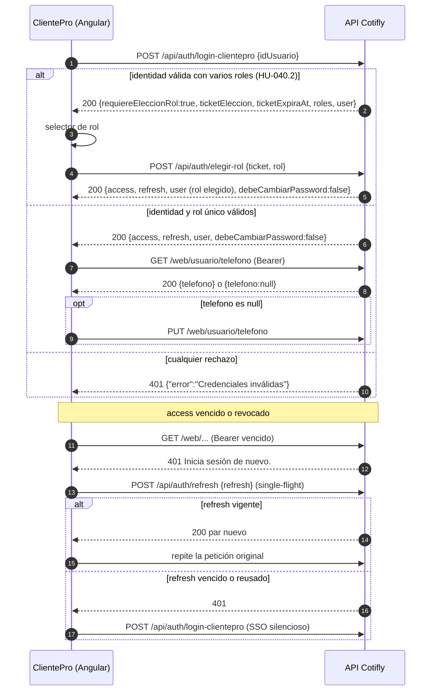
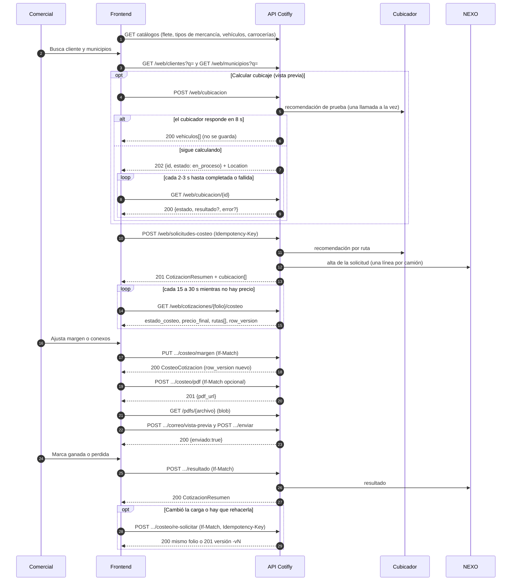
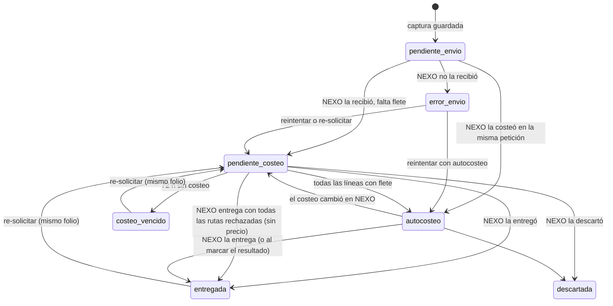
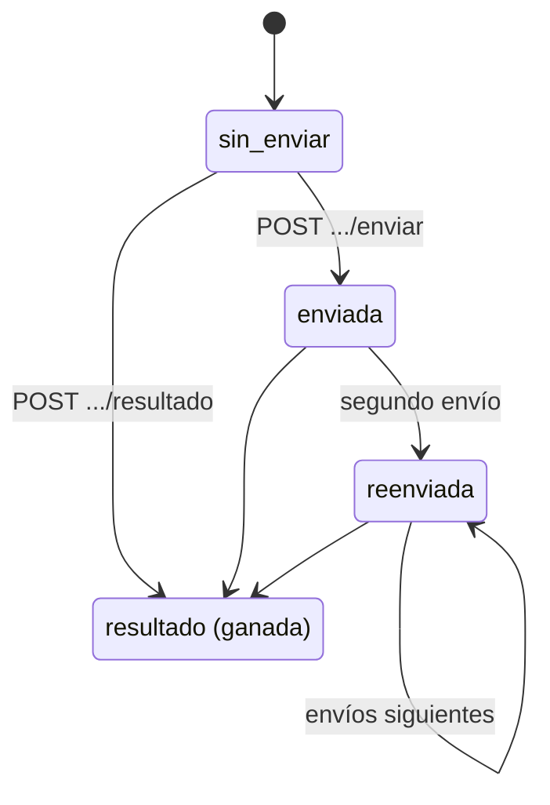
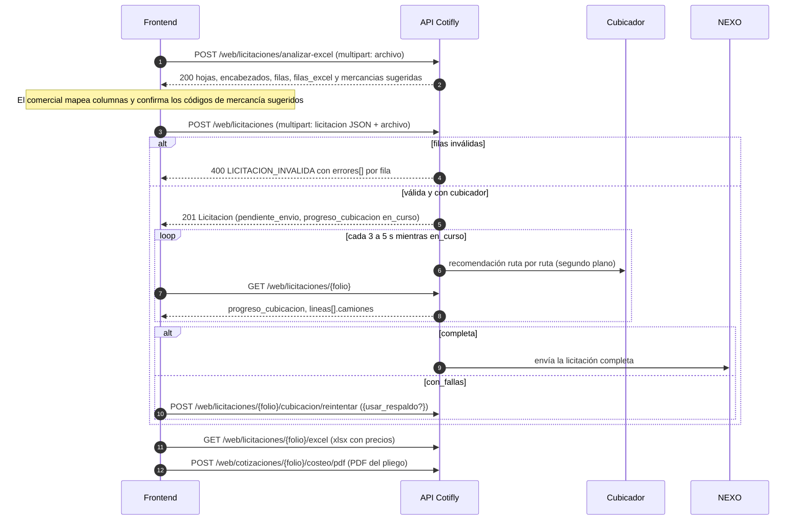
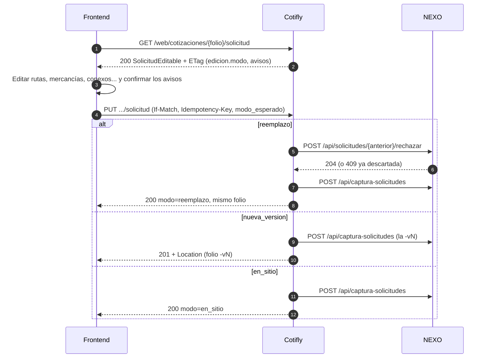
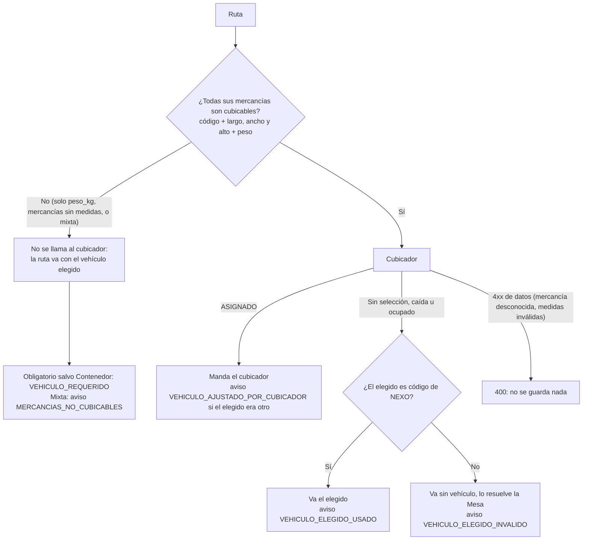

# Contratos de la API web de Cotifly: referencia para el frontend

| | |
|---|---|
| **Fecha** | 2026-10-27 |
| **Versión de referencia** | Rama `integracion-1019`: QA (PR #185, rama `hu-023-defectos-e2e-1016`, con D-1019-1) más #179 (HU-027.1, clases de contenedor), #180 (HU-025.1, textos de roles), #187 (HU-010.5, métricas por año y mes), #188 (HU-014, columnas 03/05 y "solo códigos conocidos") y #186 (HU-028, editar la solicitud); más la rama `179-detalle-por-folio` (#179 parte A, `GET /web/cotizaciones/{folio}`); más #181 (motivo pendiente), #183 (HU-028.1, rechazo de línea), #184 (HU-030.1, peso con tara), #191 (`Idempotency-Key` persistente), #194 (HU-031.1, alias de NEXO) y #197 (HU-032, vehículo elegido); más la rama `199-correo-mailsender` (HU-033, #199: correo por MailSender, total sin desglose y resultado diferido a NEXO), con los endurecimientos A y B de #199 integrados; más la rama `202-excel-mercancias` (HU-035.1, #202: Excel de mercancías de una ruta leído en Cotifly, sin NEXO); más las ramas `210-rol-director-permisos` y `211-director-todas-regionales` (HU-037: rol `director` y todas las regionales); más la rama `231-margen-conexos-masivos` (HU-041.1, #231: margen y conexos de varias rutas en una operación); más las ramas `229-multiples-roles-activos` y `230-elegir-rol-login` (HU-040: multi-rol, elegir el rol al entrar) |
| **Audiencia** | Equipo de frontend del módulo Cotifly dentro de ClientePro (Angular 17.3.8) |
| **Fuente de verdad** | El código del backend .NET y `backend-dotnet/specs/openapi.yaml`. Si este documento y el código no coinciden, manda el código. Los cambios de esta versión están en la sección 9 |

---

## Índice

1. [Introducción y convenciones](#1-introducción-y-convenciones)
   - 1.1 Qué es Cotifly · 1.2 Arquitectura · 1.3 URL base · 1.4 Nombres de campos · 1.5 Fechas · 1.6 Números y montos · 1.7 Formatos de error · 1.8 Concurrencia: `row_version`, `ETag`, `If-Match`, 412/428 · 1.9 `Idempotency-Key` · 1.10 CORS · 1.11 Límites de tamaño y de peticiones · 1.12 Folio
2. [Autenticación y sesión](#2-autenticación-y-sesión)
3. [Flujo de negocio de punta a punta](#3-flujo-de-negocio-de-punta-a-punta)
4. [Referencia de endpoints](#4-referencia-de-endpoints)
   - 4.1 Autenticación · 4.2 Catálogos · 4.3 Cubicación · 4.4 Captura y costeo · 4.5 Cotizaciones · 4.6 Licitaciones · 4.7 PDF · 4.8 Correo · 4.9 Asistente IA · 4.10 Métricas · 4.11 Regional · 4.12 Administración y usuario · 4.13 Health
5. [Modelos y enums](#5-modelos-y-enums)
6. [Catálogo completo de códigos de error](#6-catálogo-completo-de-códigos-de-error)
7. [Cambios recientes que rompen o agregan](#7-cambios-recientes-que-rompen-o-agregan)
8. [Checklist de integración](#8-checklist-de-integración)
9. [Notas de versión](#9-notas-de-versión)

---

## 1. Introducción y convenciones

### 1.1 Qué es Cotifly

Cotifly es el cotizador de fletes de Botero Soto. El comercial captura una solicitud de transporte (una o varias **rutas**, cada
una con sus **mercancías** y sus **servicios conexos**). Cotifly le pide al **cubicador** los camiones que hacen falta, envía la
solicitud a **NEXO** para que la costee y, con el costo de NEXO, aplica el margen (sugerido por SAP TM o por la política de la línea
de negocio) y calcula el precio. Luego genera el PDF, lo envía al cliente por correo y registra el resultado (ganada o perdida).

El pipeline es **determinista**: el costo sale de NEXO, el margen sugerido de SAP TM o de la política, y el precio y el PDF los
calcula el código. La IA solo redacta el asunto y la introducción del PDF y **propone** acciones que el comercial confirma con un
botón. La IA nunca escribe datos de negocio.

### 1.2 Arquitectura

```
Angular (módulo Cotifly en ClientePro) ──► API Cotifly (.NET 10) ──► NEXO (clientes, municipios, catálogos, costeo)
                                                                 ──► Cubicador (tipos de mercancía, vehículos, recomendación)
                                                                 ──► TRM, proveedor de IA, MailSender (correo)
                                                                 ──► SQL Server: dbo_cotifly (incluye la copia local del margen de SAP TM)
```

- El navegador **solo** habla con la API de Cotifly. **Nunca** llama a NEXO, al cubicador, a SAP, a la TRM ni a la IA.
- La API llama a NEXO en nombre del comercial con su identidad corporativa, que el servidor obtiene del token. El frontend no envía
  ningún dato de identidad de NEXO.
- El estado del costeo en NEXO lo consulta el servidor (un proceso de polling). El frontend solo consulta la base de Cotifly
  (`GET /web/cotizaciones/{folio}/costeo`), así que su polling no le cuesta nada a NEXO.
- Solo REST sobre HTTPS con JSON. No hay WebSocket, SSE ni SignalR.

Contexto de NEXO y del cubicador que conviene conocer (el frontend no habla con ellos, pero ve sus efectos):

| Hecho | Efecto en la UI |
|---|---|
| NEXO crea **una línea por camión**. Una ruta puede tener varios camiones (flota mixta). | `rutas[].camiones[]` puede traer varios camiones. |
| Una línea **sin vehículo** en clase de viaje "Cupo" no se autocostea en NEXO: la costea a mano la Mesa de Costeo. | Esas rutas tardan más en tener precio. Es normal. |
| Cotifly manda a NEXO el vehículo del cubicador **solo si NEXO conoce el código** (está en su catálogo de tipos de vehículo; decisión del 2026-10-19, HU-014 #188). Si no lo conoce, el camión viaja sin vehículo (así no queda en cuarentena) y lo resuelve la Mesa de Costeo. | `camiones[]` sigue mostrando el vehículo del cubicador. Un camión con un código que NEXO no conoce tarda más en tener precio, como uno sin vehículo. |
| NEXO autocostea en la misma petición hasta 10 líneas; con más, el costeo sigue en segundo plano. | La captura puede salir en `autocosteo` con precio o en `pendiente_costeo`. |
| El cubicador responde `SIN_SELECCION_AUTOMATICA` cuando no puede escoger vehículo. Es una respuesta válida, no un error. | La ruta queda con un camión sin vehículo que resuelve la Mesa de Costeo. |
| `BUSQUEDA_AGOTADA` es un límite del algoritmo del cubicador, **no de la carga**. | Nunca decirle al comercial que su carga no cabe. |
| El cubicador acepta como máximo **10.000 unidades** por cálculo y exige peso por unidad **mayor que 0**. | Pedir el peso por unidad y partir cargas grandes en varias rutas. |
| NEXO no tiene DELETE de servicios conexos. | Quitar un conexo en Cotifly no lo borra en NEXO; el precio al cliente siempre es el de Cotifly. |

### 1.3 URL base

| Ambiente | URL base |
|---|---|
| Local (contenedor) | `http://localhost:8080` |
| QA | `<URL_API_COTIFLY_QA>` (la entrega infraestructura) |
| Producción | `<URL_API_COTIFLY_PROD>` (la entrega infraestructura) |

Usar una variable propia, por ejemplo `environment.cotiflyApiUrl`, sin barra final y distinta de la URL del backend de ClientePro.
Las rutas de este documento son relativas a esa URL base (`/web/...`, `/api/auth/...`, `/pdfs/...`, `/health`).

### 1.4 Nombres de campos

| Grupo | Convención | Ejemplos |
|---|---|---|
| `/web/*` (petición **y** respuesta) | **snake_case** | `nit_cliente`, `motivo_rechazo`, `linea_orden`, `row_version` |
| `/api/auth/*` | **camelCase** fijo, con una excepción | `idUsuario`, `nombreUsuario`, `debeCambiarPassword`; excepción: `user.nombre_completo` |
| `/health`, `/health/ready` | camelCase por defecto | `status`, `servicio`, `entorno`, `detalle` |

Reglas de serialización de `/web/*` (verificadas en el código, `clsJsonWeb`):

- La lectura no distingue mayúsculas, pero el guion bajo sí cuenta: `motivoRechazo` **no** llega a `motivo_rechazo` y se ignora en
  silencio. Enviar siempre snake_case.
- Los campos que el contrato declara `nullable` **siempre vienen** en la respuesta, con `null` si no tienen valor. Las excepciones,
  que se **omiten** cuando no tienen valor, están marcadas en la sección 5 (por ejemplo `comercial`, `cubicacion`, `avisos`,
  `conexos_conservados`, `avisos_cubicacion`, `sugerencia`).
- Los números son estrictos: `"margen": "0.2"` (número como texto) es un cuerpo inválido (400).
- Los enums viajan como texto: `sin_enviar`, `politica_linea`, `pendiente_costeo`, `ASIGNADO`.
- Las tildes no se escapan.

### 1.5 Fechas

| Tipo | Formato | Ejemplo |
|---|---|---|
| Fecha y hora que **escribe** el servidor | ISO-8601 en UTC, con desfase `+00:00` | `"2026-10-09T15:20:11.532+00:00"` |
| Fecha sola | `AAAA-MM-DD` | `"2026-10-01"` (parámetros de métricas, `vigencia` de conexos) |
| Mes | `AAAA-MM` | `"2026-09"` (serie mensual de métricas) |

- La zona de negocio es **America/Bogota** (UTC-05:00, sin horario de verano). Mostrar siempre convirtiendo a Bogotá
  (`Intl.DateTimeFormat('es-CO', { timeZone: 'America/Bogota' })` o `DatePipe` con `'-0500'`).
- `deadline` de entrada: ISO-8601. Enviarlo **con desfase** (`"2026-10-15T17:00:00-05:00"`). Si llega sin zona
  (`"2026-10-15T17:00:00"`) o como fecha sola (`"2026-10-15"`), el servidor lo interpreta en hora de Bogotá; una fecha sola es el
  **inicio** de ese día en Bogotá. Un texto que no es ISO-8601 es un cuerpo inválido (400).
- `deadline` de salida: siempre en UTC (`"2026-10-15T22:00:00+00:00"` para las 17:00 de Bogotá).
- Los parámetros `desde` y `hasta` de métricas son fechas de Bogotá.

### 1.6 Números y montos

**El frontend nunca calcula precios.** Todo monto que se muestra viene del servidor. No se suma, no se aplica margen y no se convierte
moneda en el cliente.

| Dato | Formato |
|---|---|
| Precio en COP | Número entero de pesos (redondeo half-to-even). Mostrar como `$ 8.823.530` (locale `es-CO`, sin decimales) |
| Precio en USD | Número con 2 decimales. Mostrar como `US$ 996,35` |
| TRM (`trm_aplicada`) | COP por USD; `0` en COP |
| Margen | Fracción decimal: `0.18` = 18 %. La UI trabaja en porcentaje y envía la fracción |
| Medidas, pesos, valores y horas de entrada | Máximo 2 decimales |
| Métricas | Montos en COP con 2 decimales; fracciones de 0 a 1 con 4 decimales |

Reglas de dinero que la UI debe respetar:

- **`precio_final` de una cotización YA INCLUYE los servicios conexos.** Es la suma de `rutas[].precio_final_linea`, y cada ruta es
  fletes + retorno + levante + conexos, con el margen de la ruta. **No sumarle** el `precio` de `servicios_conexos`: ese `precio` es
  solo el desglose. Si se suma, se cobra dos veces.
- Excepción: en la **vista de la licitación** (`Licitacion.precio_final`, `lineas[].precio_final`) y en su **Excel**, cada fila es la
  tarifa del transporte **sin** conexos; los conexos se listan aparte. Tarifa + conexos = precio de la ruta. **Es una diferencia
  intencional (decisión del usuario, endurecimiento B de #199, ADR-023 §8):** la vista y el Excel son internos y siguen desglosados; el
  PDF y el correo, que ve el cliente, muestran el valor final. La UI no debe "corregir" una contra la otra: en la vista de la licitación,
  si muestra un total por ruta comparable con el PDF, es `lineas[].precio_final` + sus conexos.
- El **PDF** (de una ruta o del pliego) ya no sigue esa excepción (HU-033, #199): muestra el **valor final de cada ruta** (transporte y
  conexos incluidos, sin desglose; los conexos se listan como incluidos, sin precio) y el total general "VALOR TOTAL DE LA COTIZACIÓN"
  (en el resumen del pliego, "VALOR TOTAL DE LA COTIZACIÓN (N RUTAS)").
- El costo de NEXO **nunca** llega al frontend (salvo `costo` de `DatosNuevaVersion`, que es informativo, los agregados de las
  métricas y, desde HU-039.1, #218, el costo bruto de cada ruta en `rutas[].costo_final` del costeo, solo para el dueño).
- **`rutas[].costo_final` va SIEMPRE en COP, también en una cotización en USD** (el costeo de NEXO es en pesos y no se convierte):
  formatearlo como pesos (`$ 4.500.000`), nunca con la moneda de la cotización, y no compararlo con `precio_final_linea` en USD sin
  convertir. Es el costo bruto (sin margen) y sale `null` cuando la ruta no tiene precio.
- En USD, `precio_final` y el `precio` de los conexos llegan en dólares, convertidos con la `trm_aplicada` fijada al crear la
  cotización.

### 1.7 Formatos de error

Hay dos formas. Distinguirlas por el tipo de `error`:

```json
{ "error": "Cotización no encontrada o no es tuya." }
```

```json
{
  "error": {
    "codigo": "SOLICITUD_COSTEO_INVALIDA",
    "mensaje": "Ruta 1: el municipio 'Cartago' es ambiguo: Cartago, Valle del Cauca (id 76147); Cartago, Cartago (Costa Rica) (id 99001).",
    "detalle": { "motivo": "MUNICIPIO_AMBIGUO", "errores": [ { "ruta": 0, "campo": "destino", "codigo": "MUNICIPIO_AMBIGUO", "mensaje": "..." } ] }
  }
}
```

```typescript
export interface ErrorWeb { error: string; }
export interface ErrorNegocio { error: { codigo: string; mensaje: string; detalle?: Record<string, unknown> }; }
export const esErrorNegocio = (b: unknown): b is ErrorNegocio =>
  !!b && typeof (b as any).error === 'object' && typeof (b as any).error?.codigo === 'string';
```

**`ErrorWeb` (`{"error": "texto"}`), sin código.** Lo usan:

| HTTP | Cuándo | Texto exacto |
|---|---|---|
| 400 | Cuerpo inválido (JSON mal formado, tipo erróneo, número como texto, falta un campo obligatorio del esquema) y validaciones simples (teléfono, correo, seguimiento, `Idempotency-Key` fuera de 8 a 64 caracteres). La misma clave con otro cuerpo **no** es 400: es 409 `IDEMPOTENCY_KEY_REUTILIZADA` (sección 1.9) | `Cuerpo inválido.` o `Cuerpo inválido. Revisa: campo1, campo2.`, o el mensaje de la validación |
| 401 | Sin token, token vencido o revocado | `Inicia sesión de nuevo.` (en el login: `Credenciales inválidas`) |
| 403 | El rol no permite la operación | `No tienes permiso para esta operación.` |
| 404 | La cotización no existe **o no es tuya** (indistinguibles a propósito) | `Cotización no encontrada o no es tuya.` |
| 404 | Ruta inexistente o parámetro con forma inválida (por ejemplo un `id` no entero en `/web/admin/lineas-negocio/{id}`) | `Recurso no encontrado.` |
| 413 | Cuerpo demasiado grande | `El cuerpo de la petición es demasiado grande.` |
| 415 | Falta `Content-Type: application/json` | `Cuerpo inválido: envía JSON con Content-Type: application/json.` |
| 429 | Límite de peticiones | `Demasiadas peticiones. Intenta de nuevo en unos segundos.` |

**`ErrorNegocio` (`{"error": {"codigo", "mensaje", "detalle?"}}`).** Todo error de negocio de `/web/*` que no sea de los casos de
arriba. `detalle` es opcional y es un objeto: por lo general `{"motivo": "<código o texto>"}` más datos estructurados según el código
(`errores`, `rutas`, `margen_sugerido`, `folio`, `agregado_en_nexo`...). Se omite si no hay nada. Mapeo HTTP del servidor:

| HTTP | Códigos |
|---|---|
| 400 | Todos los códigos de negocio no listados abajo (`SOLICITUD_COSTEO_INVALIDA`, `RUTA_REQUERIDA`, `JUSTIFICACION_REQUERIDA`, `MERCANCIA_DESCONOCIDA`, `TRM_NO_DISPONIBLE`, `POSICION_INVALIDA`, `CUBICADOR_PETICION_RECHAZADA`...) |
| 403 | `NEXO_SIN_PERMISO`, `REGIONAL_NO_PERMITIDA` (fila 64) |
| 409 | `COSTEO_NO_REINTENTABLE`, `COSTEO_NO_LISTO`, `PDF_YA_GENERADO`, `TEXTOS_EDITADOS`, `RESULTADO_YA_DEFINIDO`, `COTIZACION_NO_ENTREGADA`, `USAR_RESULTADO_NEXO`, `SOLICITUD_NO_TRANSICIONABLE`, `CONFLICTO_CONCURRENCIA`, `PDF_YA_ENVIADO`, `LINEA_SIN_COTIZACION_NEXO`, `ESTADO_NO_PERMITE`, `RUTA_RECHAZADA`, `SIN_RUTAS_COTIZABLES`, `REGIONAL_NO_ASIGNADA`, `IDEMPOTENCY_KEY_REUTILIZADA`, `CORREO_NO_REINTENTABLE`, `COTIZACION_NO_FINALIZABLE`, `COTIZACION_NO_FINALIZADA` |
| 428 | `PRECONDICION_REQUERIDA` |
| 500 | `ERROR_INTERNO` (fila 57; en `/api/auth/*` es `ErrorWeb`) |
| 503 | `CORREO_DESHABILITADO`, `COSTEO_NEXO_NO_DISPONIBLE`, `COSTEO_NEXO_TIEMPO_AGOTADO`, `REGIONAL_NO_DISPONIBLE`, `CATALOGOS_FLETE_NO_DISPONIBLE`, `NEXO_NO_DISPONIBLE`, `MUNICIPIOS_NO_DISPONIBLE`, `CLIENTE_BUSQUEDA_NO_DISPONIBLE`, `PDF_RENDER_NO_DISPONIBLE`, `CUBICADOR_NO_DISPONIBLE`, `CUBICADOR_RESPUESTA_INVALIDA`, `CUBICADOR_NO_AUTORIZADO`, `SERVICIO_OCUPADO` (con `Retry-After: 1`), `CUBICADOR_OCUPADO` (con `Retry-After: 10`) |

Casos especiales:

- `POST /web/licitaciones` con filas inválidas responde 400 `ReporteLicitacionInvalida`: `{"error": {...LICITACION_INVALIDA...}, "errores": [...]}`.
  Los errores por fila van en `errores` de la raíz, no en `detalle`.
- `POST /web/chat` responde **200** con `{"texto", "error": true, "codigo"}` cuando falla el asistente o el proveedor de IA. Solo
  los errores de la petición (folio, sesión, cuerpo) son HTTP de error.
- `GET /pdfs/{archivo}` responde los errores como JSON aunque se haya pedido un blob: leer el blob como texto y parsearlo.

### 1.8 Concurrencia: `row_version`, `ETag`, `If-Match`, 412/428

Las mutaciones de la etapa final usan concurrencia optimista sobre la **versión de negocio** de la cotización (`versionNegocio` en
la base).

| Pieza | Regla |
|---|---|
| `row_version` | Campo del cuerpo de `CosteoCotizacion` (`GET .../costeo` y respuestas de margen, conexos y recálculo de vehículos) y de `accion_propuesta` del asistente. Texto opaco (hoy un entero como `"7"`). |
| `ETag` | Encabezado con el mismo valor entre comillas (`"7"`). Lo envían `GET .../costeo`, `GET /web/cotizaciones/{folio}`, `GET` y `PUT .../solicitud` y las respuestas 2xx de las mutaciones de la etapa final, de `re-solicitar`, de `/resultado`, de `.../costeo/pdf` y de los textos. |
| `If-Match` | Encabezado de la petición con ese valor, con o sin comillas (también se acepta `W/"7"`). |
| Cuándo cambia | Solo con cambios de negocio: margen, conexos, textos, re-solicitud, PDF, resultado, o cuando el polling trae un estado, un costo o un precio nuevos. No cambia con cada consulta. |

Uso de `If-Match` por endpoint:

| Endpoint | `If-Match` | Sin él | Si no coincide |
|---|---|---|---|
| `PUT .../costeo/margen` | Obligatorio | 428 `PRECONDICION_REQUERIDA` | 409 `CONFLICTO_CONCURRENCIA` |
| `POST .../costeo/servicios-conexos` | Obligatorio | 428 | 409 |
| `PUT .../costeo/servicios-conexos` | Obligatorio | 428 | 409 |
| `POST .../costeo/re-solicitar` | Obligatorio | 428 | 409 |
| `POST .../costeo/textos/redactar` | Obligatorio | 428 | 409 |
| `PUT .../costeo/textos` | Obligatorio | 428 | 409 |
| `POST .../rutas/{rutaId}/recalcular-vehiculos` | Obligatorio | 428 | 409 |
| `PUT .../solicitud` (HU-028) | Obligatorio | 428 | 409 |
| `POST .../costeo/pdf` | Opcional | Se genera igual | 409 |
| `POST .../resultado` | Opcional, salvo en la **perdida sin costeo**, donde es obligatorio | 428 solo en la perdida sin costeo | 409 |
| `POST .../enviar` | No se usa | — | El servidor confirma internamente; si la cotización cambió o el PDF quedó desactualizado, 409 `CONFLICTO_CONCURRENCIA` |
| `POST /web/cubicacion` | No se usa (no toca ninguna cotización) | — | — |

- **No hay 412.** El servidor nunca responde 412 Precondition Failed: el conflicto es **409 `CONFLICTO_CONCURRENCIA`** y la falta del
  encabezado es **428 `PRECONDICION_REQUERIDA`**. Un `If-Match` que no es un entero (por ejemplo `*`) siempre responde 409.
- Ante 409 `CONFLICTO_CONCURRENCIA`: recargar `GET .../costeo`, mostrar el estado nuevo y pedir al comercial que repita la acción
  (o, si venía del asistente, pedirle una propuesta nueva). Nada cambió en el servidor.
- Ante 428: es un error de programación del frontend (falta el encabezado). Recargar el costeo y repetir con `If-Match`.
- **De dónde sacar el `If-Match`:** del encabezado **`ETag` de la última respuesta** de esa cotización. El servidor lo expone por
  CORS (sección 1.10), así que se lee con `HttpClient` y `observe: 'response'` (`respuesta.headers.get('ETag')`) y se reenvía tal
  cual, con sus comillas. Así no hace falta volver a leer `GET .../costeo` después de `re-solicitar`, `/resultado`,
  `.../costeo/pdf` o los textos, cuyas respuestas traen el `ETag` nuevo aunque su cuerpo no tenga `row_version`. En las respuestas
  `CosteoCotizacion` el `row_version` del cuerpo tiene el mismo valor: cualquiera de los dos sirve.
- En el 201 de `re-solicitar` (versión `-vN`) el `ETag` es el de la **cotización nueva**; la original no cambia.

```typescript
this.http.put<CosteoCotizacion>(url, cuerpo, { headers: { 'If-Match': etag }, observe: 'response' })
  .subscribe(r => { this.etag = r.headers.get('ETag') ?? `"${r.body?.row_version}"`; this.costeo = r.body!; });
```

### 1.9 `Idempotency-Key`

Encabezado opcional que protege del doble clic y de los reintentos por red.

| Regla | Valor |
|---|---|
| Formato | Texto de 8 a 64 caracteres. Usar un UUID (`crypto.randomUUID()`). Fuera de ese largo: 400 `ErrorWeb` |
| Alcance | Por usuario y por endpoint, durante 24 h |
| Repetición con la misma clave y el mismo cuerpo | Devuelve la respuesta guardada de la primera petición sin volver a ejecutarla |
| Misma clave con otro cuerpo | **409** `ErrorNegocio` con `codigo = IDEMPOTENCY_KEY_REUTILIZADA` y `mensaje = Esta Idempotency-Key ya se usó con otra petición: genera una clave nueva para cada intención.` (desde 2026-10-16, D4; antes era 400 `ErrorWeb`). No se ejecuta nada: generar una clave nueva para la nueva intención |
| Dónde se acepta | `POST /web/solicitudes-costeo`, `POST .../costeo/servicios-conexos`, `POST .../costeo/re-solicitar` y `PUT .../solicitud` (HU-028). `POST /web/cubicacion` no la usa |
| Cuándo generar una nueva | Una clave por **intención** del usuario (al pulsar Enviar o Confirmar). Reutilizarla tal cual en los reintentos de red de esa misma intención |

Diferencias por endpoint:

- **Captura (`POST /web/solicitudes-costeo`)**: toda respuesta 201 consume la clave, también la que quedó en `error_envio` (esa se
  reintenta con `.../costeo/reintentar`, no repitiendo el POST). Si la primera petición confirmó el folio pero no alcanzó a registrar
  el envío a NEXO, la repetición responde **409 `ESTADO_NO_PERMITE`** con `detalle.motivo = CAPTURA_EN_CURSO`, `detalle.folio` y
  `detalle.solicitud_nexo_id`: no reintentar; llevar al comercial a "Mis cotizaciones" con ese folio.
- **Re-solicitar, agregar conexos y editar la solicitud (`PUT .../solicitud`)**: solo los éxitos consumen la clave. En `re-solicitar`, un 200 con `error_envio` (NEXO falló)
  tampoco la consume: repetirla vuelve a ejecutar, y con el mismo `If-Match` responde `CONFLICTO_CONCURRENCIA` (recargar y reintentar).
- Desde #191 la clave se guarda en la base: sobrevive a un reinicio y la comparten las réplicas (sección 7, fila 48).

### 1.10 CORS

Configuración actual del servidor (código, `clsSeguridadHttp`):

| Regla | Valor |
|---|---|
| Orígenes | Lista exacta por configuración (`https://host[:puerto]`, sin rutas ni comodines). El equipo de frontend debe entregar los dominios de ClientePro por ambiente, incluido el de desarrollo |
| Métodos | `GET`, `POST`, `PUT` |
| Encabezados permitidos en la petición | `Authorization`, `Content-Type`, `If-Match` e `Idempotency-Key` (lista explícita, sin comodín) |
| Encabezados expuestos en la respuesta | `ETag`, `Location`, `Retry-After` y `Content-Disposition` (`Access-Control-Expose-Headers`) |
| Credenciales | No (sin cookies; `withCredentials: false`) |
| Caché del preflight | 10 minutos |

Consecuencias:

- Las mutaciones con `If-Match` y las peticiones con `Idempotency-Key` pasan el preflight desde el dominio de ClientePro.
- El frontend puede leer:

  | Encabezado | Dónde viene | Para qué |
  |---|---|---|
  | `ETag` | `GET .../costeo` y las respuestas 2xx de las mutaciones de la etapa final | El `If-Match` de la siguiente mutación (sección 1.8) |
  | `Location` | 201 de `POST .../costeo/re-solicitar` y de `PUT .../solicitud` con `nueva_version` (versión `-vN`), y 202 de `POST /web/cubicacion` | Ruta del costeo de la versión nueva (`/web/cotizaciones/{folio nuevo}/costeo`) o de la cubicación en proceso (`/web/cubicacion/{id}`) |
  | `Retry-After` | 429 (segundos de la ventana), 503 `SERVICIO_OCUPADO` (`1`), 503 `CUBICADOR_OCUPADO` (`10`), 202 de `POST /web/cubicacion` y `GET /web/cubicacion/{id}` en proceso (`2`) | Cuánto esperar antes de reintentar o de volver a consultar |
  | `Content-Disposition` | `GET /pdfs/{archivo}`, `GET /web/licitaciones/{folio}/excel` y `GET /web/cotizaciones/{folio}/excel` | Nombre del archivo descargado |

- Los encabezados CORS también van en las respuestas de error (401, 409, 413, 428, 429, 503...): el frontend puede leer el cuerpo
  y el estado de cualquier error.
- No enviar **otros** encabezados propios (`X-Request-Id`, `X-Correlation-Id`, encabezados del canal cifrado de ClientePro,
  `Cache-Control`...): el preflight falla y la petición no sale. Si el interceptor global de ClientePro agrega encabezados, excluir las
  URL de Cotifly. La API no tiene id de correlación (sección 9).
- `WWW-Authenticate` no está expuesto: el 401 se reconoce por el estado y el cuerpo (sección 2.7).

### 1.11 Límites de tamaño y de peticiones

| Límite | Valor | Respuesta |
|---|---|---|
| Cuerpo de cualquier petición a `/web/*` | 64 KB | 413 `ErrorWeb` |
| Cuerpo de `/web/licitaciones*` y de `POST /web/mercancias/analizar-excel` | 12 MB | 413 `ErrorWeb` |
| Archivo Excel de la licitación o de mercancías | 10 MB menos 64 KB (unos 9,9 MB) | 400 `ARCHIVO_DEMASIADO_GRANDE` |
| Excel de mercancías descomprimido (HU-035.1) | 64 MB o 1.000.000 de elementos XML (unas 300.000 celdas) | 400 `ARCHIVO_DEMASIADO_GRANDE` (`detalle.motivo = DESCOMPRIMIDO_EXCEDE_LIMITE`) |
| `/api/auth/*` (login, refresh y logout juntos) | 30 peticiones por minuto por IP | 429 `ErrorWeb` |
| `POST /web/chat` | 20 turnos por minuto por comercial | 429 `ErrorWeb` |
| Resto de `/web/*` | Sin límite propio | — |

Ante un 429, esperar los segundos de `Retry-After` (CORS lo expone) antes de reintentar; si no viene, esperar la ventana completa (hasta 60 s).

### 1.12 Folio

- Lo genera **siempre** el servidor: `PCN-[{nitCliente}-]{INICIALES}-DDMMAAAA-{NNN}[-vN]`, hasta 50 caracteres. Ejemplos:
  `PCN-DG-25092026-001`, `PCN-9000472281-DG-25092026-002`, `PCN-9000472281-DG-25092026-002-v2`.
- Hay folios heredados con otro formato (`PCN-23072026`). **No validar ni parsear el folio**: solo mostrarlo.
- En las rutas, codificarlo con `encodeURIComponent`.
- `-vN` marca una versión nueva (v2, v3...), creada con `re-solicitar`.

---

## 2. Autenticación y sesión

### 2.1 Modelo

Cotifly no tiene usuarios ni contraseñas propias. ClientePro ya autenticó a la persona; el frontend le pasa su identidad a Cotifly
(`POST /api/auth/login-clientepro`) y Cotifly emite su propia sesión:

- un **access token** JWT (`Authorization: Bearer <access>` en toda llamada a `/web/*` y `/pdfs/*`);
- un **refresh token** opaco para renovarlo.

En el servidor, el login revalida la identidad contra el almacén corporativo de usuarios, traduce sus roles corporativos a un rol de
Cotifly y ubica o crea al usuario en Cotifly. Cualquier rechazo responde el mismo 401 genérico (anti-enumeración). La verificación se
repite en cada refresh.

**Multi-rol (HU-040, #230, ADR-025, fila 70 de §7).** Una persona con varios roles en Cotifly (por ejemplo comercial y gerente comercial)
**elige** con cuál entra: el login no emite tokens sino un ticket de elección, y la sesión la emite `POST /api/auth/elegir-rol`. Con un
solo rol todo es igual que antes.

### 2.2 Login con ClientePro

`POST /api/auth/login-clientepro` con `{"idUsuario": "...", "nombreUsuario": "...", "roles": [...]}`. Solo `idUsuario` decide: el
servidor lo busca primero como nombre de usuario corporativo y, si no aparece y es un entero, como id numérico. `nombreUsuario` y
`roles` son informativos y **nunca** deciden el acceso. Detalle en la sección 4.1.

La respuesta 200 tiene **dos formas** (HU-040.2):

| Forma | Cuándo | Qué hacer |
|---|---|---|
| `LoginResponse` (`access`, `refresh`, `user`, `debeCambiarPassword`) | La persona tiene un solo rol (el caso de casi todos) | Igual que antes: guardar los tokens y `user` |
| `EleccionRolRequerida` (`requiereEleccionRol: true`, `ticketEleccion`, `ticketExpiraAt`, `roles[]`, `user`) | La persona tiene dos o más roles | Mostrar el selector con `roles[].descripcion` y llamar a `POST /api/auth/elegir-rol` con `{ticket: ticketEleccion, rol: roles[i].codigo}` (4.1.4). **No trae tokens** |

Distinguirlas por `requiereEleccionRol === true` (o por la ausencia de `access`). El ticket vence a los **5 minutos** (`ticketExpiraAt`) y
es de **un solo uso**: si vence, se usó o la elección responde 401, volver a llamar al login (es silencioso: la identidad la da
ClientePro). El ticket no es un access: no abre ningún endpoint. Guardarlo solo en memoria, nunca en la URL ni en logs.

### 2.3 JWT

| Propiedad | Valor |
|---|---|
| Algoritmo | HS256 |
| Vigencia del access | 60 minutos (configurable de 1 a 1440). Tolerancia de reloj del servidor: 30 s |
| Claims propios | `sub` (UUID del usuario en Cotifly, el mismo `user.id`), `jti` (id del token), `username`, `rol` (`comercial`, `gerente_comercial` o `director`, fila 64; con multi-rol, el **elegido**, fila 70) |
| Claims estándar | `iss`, `aud`, `exp` (y los de tiempo que agregue el emisor) |
| Revocación | Por `jti` en el logout |

El frontend puede decodificar el payload (sin validar la firma) para leer `exp`. El rol autoritativo es `user.rol` de la respuesta del
login (o el claim `rol`), no los roles de ClientePro.

### 2.4 Refresh y rotación

| Regla | Consecuencia |
|---|---|
| El refresh vence a los **30 días del login** (configurable). La rotación **no** extiende la vigencia | A los 30 días hay que volver a hacer login SSO aunque se use a diario |
| Se rota en cada uso: `POST /api/auth/refresh` devuelve un par nuevo y el refresh anterior deja de servir | Reemplazar **los dos** tokens con la respuesta |
| Reusar un refresh ya rotado se trata como robo de sesión | 401. Hacer el refresh en *single-flight* (una sola petición en vuelo) y no compartir el refresh entre pestañas sin coordinarlo |
| HU-040.2: el refresh **conserva el rol de la sesión** (el elegido); no vuelve a preguntar | Si le quitaron ese rol, 401: volver a entrar (el login ofrecerá los roles que le queden) |

Recomendación de almacenamiento: access en memoria (o `sessionStorage` si debe sobrevivir a un F5) y refresh en `sessionStorage`
(una sesión por pestaña). Nunca en la URL, en logs ni en cookies. La API no usa cookies.

### 2.5 Logout

`POST /api/auth/logout` con `{"refresh": "..."}` en el cuerpo y, si lo hay, el `Authorization: Bearer` vigente. Responde **siempre
204** (salvo 429). Revoca el refresh y el `jti` del access. Borrar los tokens locales aunque la llamada falle.

### 2.6 Roles

| Rol | Puede |
|---|---|
| `comercial` | Toda la consola del comercial (`/web/*`) sobre **sus** cotizaciones; su tablero (`/web/metricas/comercial`); descargar sus PDF |
| `gerente_comercial` | Todo lo del comercial (también cotiza y ve lo suyo) **más**: listado de cotizaciones de su regional (`/web/cotizaciones/regional`), tablero de la regional (`/web/metricas/regional`), políticas de margen (`/web/admin/lineas-negocio`) y descargar los PDF de los comerciales de su regional |
| `director` (HU-037, fila 64) | Todo lo del gerente comercial, pero sobre **todas** las regionales: tablero y listado de todas o de la que elija (`?regional=`, opciones de `GET /web/regionales`), detalle y PDF de cotizaciones de cualquier regional (solo consulta), políticas de margen y su propia consola de comercial |

**No existe un rol `admin`.** La administración de márgenes es del `gerente_comercial` y del `director`. Un usuario que no resuelve a
uno de estos tres roles no puede iniciar sesión (401). **Rol único** (una asignación en Cotifly): con varios roles de ClientePro gana el de
mayor alcance, `director` > `gerente_comercial` > `comercial`. **Multi-rol** (HU-040, fila 70): quien tiene varias asignaciones en
Cotifly (o entra por primera vez con varios roles de ClientePro) elige el rol al entrar y la sesión queda limitada a ese rol; para
cambiarlo, cerrar sesión y volver a entrar.

Las acciones sobre una cotización (costeo, margen, conexos, PDF, envío, resultado, nueva versión) exigen ser el **dueño**: el gerente
recibe 404 sobre una cotización de otro comercial, aunque sea de su regional. La única excepción es la descarga del PDF.

### 2.7 Manejo de 401 y 403

| Respuesta | Qué hacer |
|---|---|
| 401 `Inicia sesión de nuevo.` en `/web/*` o `/pdfs/*` | Refresh **una sola vez** (single-flight) y repetir la petición original |
| 401 en `/api/auth/refresh` | Hacer login SSO silencioso (`login-clientepro` con la identidad de ClientePro) |
| 401 `Credenciales inválidas` en `/api/auth/login-clientepro` | No reintentar. Mostrar "No tienes acceso a Cotifly con tu usuario de ClientePro" |
| 401 `Inicia sesión de nuevo.` en `/api/auth/elegir-rol` (HU-040.2) | Ticket vencido o ya usado, o el rol ya no está disponible: volver a llamar al login (una vez) y mostrar el selector de nuevo |
| 403 `No tienes permiso para esta operación.` | No refrescar. Ocultar la opción para ese rol |
| 503 `CUBICADOR_NO_AUTORIZADO` | **No** es la sesión del comercial (es la llave de Cotifly ante el cubicador). No cerrar sesión |

Refresco proactivo recomendado: si faltan menos de 60 s para `exp`, refrescar antes de enviar.

### 2.8 Sesión actual

**No existe un endpoint `sesion/actual` ni `GET /me`.** Los datos de la sesión son los de la respuesta del login (o del refresh):
`user.id`, `user.username`, `user.email`, `user.nombre_completo`, `user.rol` y `user.ubicacion` (regional). Guardarlos con los
tokens. El único dato del usuario que se consulta aparte es el teléfono (`GET /web/usuario/telefono`), que se pide en el primer ingreso
si viene en `null`.

### 2.9 Secuencia



---

## 3. Flujo de negocio de punta a punta

### 3.1 Formulario por rutas

1. **Cargar catálogos** (una vez por sesión, con caché en el cliente): `GET /web/catalogos-flete` (clases de viaje),
   `GET /web/tipos-mercancia`, `GET /web/tipos-vehiculo`, `GET /web/tipos-carroceria`. El municipio se busca a demanda con
   `GET /web/municipios?q=` y el cliente con `GET /web/clientes?q=`. Los conexos con `GET /web/servicios-conexos?q=`.
2. **Capturar** la solicitud: cliente (NIT del buscador), línea de negocio, `deadline`, notas, moneda y una o varias **rutas**. Cada
   ruta: origen y destino con **id de municipio + nombre**, condiciones del contenedor, horas, valor de la mercancía, peso,
   **mercancías** (con `codigo_mercancia`, medidas en cm y peso por unidad en kg mayor que 0) y **servicios conexos** (id y cantidad).
3. **Calcular cubicaje** (opcional, vista previa): `POST /web/cubicacion` con las mercancías de una ruta. Muestra los vehículos que
   recomendaría el cubicador. No guarda nada. Si el cubicador tarda más de 8 s responde **202** y el resultado se consulta con
   `GET /web/cubicacion/{id}` cada 2-3 s, con un tope de 4 minutos (sección 4.3.2).
4. **Enviar a costeo**: `POST /web/solicitudes-costeo` con `Idempotency-Key`. Cotifly cubica cada ruta, guarda todo, envía a NEXO y
   responde **201 aunque NEXO falle** (`estado_costeo = error_envio`). La respuesta trae `cubicacion[]` con los avisos del cubicador
   por ruta: mostrarlos en ese momento. La petición es síncrona y puede tardar unos **3,6 minutos** por ruta y hasta unos **6,5 minutos**
   en el peor caso (varias rutas con el cubicador lento): el cliente HTTP no debe cortar antes (sección 4.4.1).
5. **Polling del costeo**: `GET /web/cotizaciones/{folio}/costeo` cada 15 a 30 s mientras la vista está abierta y el costeo no está
   listo (ver 3.4). Si quedó en `error_envio`, ofrecer `POST .../costeo/reintentar`.
6. **Margen y ajustes** (con `If-Match`): ajustar el margen de una ruta (`PUT .../costeo/margen`), agregar conexos
   (`POST .../costeo/servicios-conexos`), quitar o cambiar cantidades de conexos (`PUT .../costeo/servicios-conexos`), redactar o
   editar los textos del PDF (`POST .../costeo/textos/redactar`, `PUT .../costeo/textos`). Antes de enviar a NEXO se pueden recalcular
   los camiones de una ruta (`POST .../rutas/{rutaId}/recalcular-vehiculos`). El asistente IA (`POST /web/chat`) puede **proponer**
   estas acciones; el comercial las confirma.
7. **PDF**: confirmar el teléfono y `POST .../costeo/pdf`. Descargar con `GET /pdfs/{archivo}` como blob. Cada ajuste posterior (antes
   de enviar) deja `pdf_desactualizado = true` y hay que regenerarlo.
8. **Enviar al cliente**: `GET /web/clientes/{nit}/destinatarios-previos`, `POST .../correo/vista-previa` y `POST .../enviar`.
9. **Resultado**: `POST .../resultado` (`ganada` o `perdida`) cuando NEXO entregó la cotización.
10. **Re-solicitar o versión nueva**: `POST .../costeo/re-solicitar`. En el mismo folio si el costeo venció, se entregó o falló el
    envío (y no se ha enviado al cliente); como versión `-vN` si cambia la carga, si ya se envió o si tiene resultado.

### 3.2 Secuencia



### 3.3 Estados del costeo (`estado_costeo`)



`null` = cotización antigua del chat (no pasa por NEXO). La versión nueva (`-vN`) arranca su propio ciclo en `pendiente_envio`.

| `estado_costeo` | Etiqueta sugerida | Precio | Acciones habilitadas | Polling |
|---|---|---|---|---|
| `null` | "Chat" | `precio_final` | PDF, Enviar, resultado por `/seguimiento` | No |
| `pendiente_envio` | "Enviando a NEXO" (licitación cubicándose: "Calculando vehículos") | — | Reintentar envío pasados unos minutos (no mientras la licitación se cubica); recalcular vehículos | Sí |
| `error_envio` | "No llegó a NEXO" + `motivo_estado_costeo` | — | Reintentar o re-solicitar (no si el motivo empieza por "Rechazo definitivo de Nexo"); perdida solo en Cotifly | No |
| `pendiente_costeo` | "En costeo" | "Pendiente" | Resultado por `/resultado` (perdida solo en Cotifly si NEXO no la entregó; ganada pendiente de sincronizar); ajustar el margen de una ruta que ya tenga precio | Sí |
| `autocosteo` | "Costeada" | `precio_final` | Margen, conexos, textos, PDF, enviar, resultado (pendiente de sincronizar mientras NEXO no la entregue) | Hasta tener `precio_final` |
| `entregada` | "Entregada" | `precio_final` | Margen, conexos, textos, PDF, enviar, resultado, re-solicitar | No (solo si `precio_final` es `null`) |
| `descartada` | "Descartada por NEXO" | — | Resultado por `/seguimiento` (solo en Cotifly) | No |
| `costeo_vencido` | "Costeo vencido" + motivo | — | Re-solicitar; resultado por `/seguimiento` | No |

**Ruta o camión `rechazada` (HU-028.1, #183, NEXO #320).** Solo en `rutas[]`, `rutas[].camiones[]` y las líneas y camiones de la
licitación (la cabecera nunca): la Mesa de Costeo rechazó la línea con un motivo (`motivo_rechazo`). Etiqueta sugerida "Rechazada en
NEXO" + motivo; sin precio; no suma en el total ni es pendiente; margen y conexos en esa ruta → 409 `RUTA_RECHAZADA`. Con todas las
rutas rechazadas la cotización queda `entregada` sin `precio_final` (y `motivo_estado_costeo` lo explica) y el PDF → 409
`SIN_RUTAS_COTIZABLES`. Antes de que NEXO entregue la Mesa puede deshacerlo (vuelve a `pendiente_costeo`); entregada, es definitivo.
**Decisión del 2026-10-20: no se reenvían los camiones rechazados por defecto.** Al re-solicitar (mismo folio o `-vN`) o editar la solicitud (`en_sitio`, `reemplazo`, `nueva_version`), un camión que la Mesa rechazó **no viaja** a NEXO: sigue rechazado (con su `motivo_rechazo` y `rechazada_at`) y la `-vN` lo copia como rechazado. Una ruta con todos sus camiones rechazados no se envía (no se manda a NEXO una ruta sin camiones): queda visible, `rechazada` y sin precio. La respuesta trae `aviso_rechazos` con lo que se omitió (rutas, camiones y motivos); en la edición también el aviso `RECHAZADOS_OMITIDOS`. Si no queda ningún camión que viaje: 409 `SIN_RUTAS_COTIZABLES` con `detalle.motivo = TODOS_RECHAZADOS`. Para que la Mesa los reconsidere: `PUT .../solicitud` con `reincluir_rechazados: true` en la ruta (vuelven a viajar tal como están, sin volver a cubicar).

### 3.4 Reglas de polling

- **Costeo** (`GET /web/cotizaciones/{folio}/costeo`, o la lista): cada **15 a 30 s**, solo con la vista abierta y la pestaña visible
  (`document.visibilityState`), mientras `estado_costeo` sea `pendiente_envio` o `pendiente_costeo`, o sea `autocosteo`/`entregada`
  con `precio_final` en `null` **y** sin `motivo_estado_costeo`. Detenerlo en `error_envio`, `descartada`, `costeo_vencido`, al tener
  `precio_final`, o tras una perdida solo en Cotifly. El servidor consulta a NEXO con un espaciado que va de 5 s a 15 min durante
  72 h: consultar más seguido no acelera nada.
- `autocosteo` o `entregada` **con** `precio_final` en `null` y **con** `motivo_estado_costeo` significa que falta el margen: no esperar
  que el precio llegue solo; mostrar el motivo.
- **Cubicación de una licitación** (`GET /web/licitaciones/{folio}`): cada **3 a 5 s** mientras `progreso_cubicacion.estado` sea
  `en_curso`. Después, pasar al ritmo del costeo.
- **"Calcular cubicaje" en proceso** (`GET /web/cubicacion/{id}`, tras un 202): cada **2-3 s** (el `Retry-After`) mientras `estado` sea
  `en_proceso`, con un tope de **4 minutos** (una cubicación puede esperar 60 s el cupo del cubicador, 90 s su respuesta y 65 s la
  reconsulta: unos 217 s con la configuración por defecto). Detenerlo con `completada`, `fallida` o 404, o si el comercial cambia la carga.
- Usar el `row_version` de cada respuesta del polling como `If-Match` de la siguiente mutación.

### 3.5 Ciclo comercial (envío y resultado)



- `estado_envio`: `sin_enviar` → `enviada` → `reenviada`. HU-033 (#199): cambia cuando MailSender **acepta** el correo (queda `encolado`);
  la entrega real se ve en el historial de envíos (`GET .../correos`: `encolado` → `enviando` → `enviado` o `fallido`). Un `fallido`
  posterior no devuelve `estado_envio`: se reintenta el mismo envío (`POST .../correos/{id}/reintentar`).
- `ganada`: `null` (sin resultado), `true` (ganada, `motivo_rechazo = "No aplica"`) o `false` (perdida, `motivo_rechazo` = el motivo).
- HU-033 (#199): `sincronizacion_resultado_nexo` dice si el resultado ya está en NEXO: `pendiente` ("pendiente de sincronizar con NEXO":
  se marcó antes de que la Mesa entregara la cotización; Cotifly lo envía solo cuando la entregue), `sincronizado`, `no_sincronizable`
  (ya no se podrá enviar: `error_sincronizacion_resultado_nexo`) o `solo_cotifly` (nunca va a NEXO). Ver 4.5.2.
- Una vez enviada o con resultado, margen, conexos, textos, PDF y re-solicitud en el mismo folio responden **409 `PDF_YA_ENVIADO`**:
  el cambio se hace en una versión nueva (`re-solicitar` con `nueva_version: true`, cuyo cuerpo viene en `detalle`).
- **HU-036 (cotización finalizada).** Con el costeo listo (`autocosteo` o `entregada`) el comercial acepta el precio con
  `POST .../finalizar` (4.5.6): `finalizada_at` deja de ser `null` en `CotizacionResumen`, `CosteoCotizacion` y el detalle
  (`fechas.finalizada_at`). La finalización no es un `estado_costeo`: el estado sigue avanzando con NEXO.
- **HU-036.3 (#207), candados.** Orden del cierre: costeo listo → **Finalizar** → textos y PDF → envío → resultado. Sin finalizar, el
  PDF, los textos, el envío y el resultado (con el costeo listo) responden **409 `COTIZACION_NO_FINALIZADA`**. Ya finalizada, lo que
  cambia el precio (margen, conexos, re-solicitar en el mismo folio, recalcular camiones, editar en sitio) responde **409
  `PDF_YA_ENVIADO`** con la versión nueva en `detalle` (la edición pasa a `nueva_version`). Las enviadas o con resultado de antes de
  HU-036 siguen como siempre.
- **HU-036.4 (#208), precio congelado.** Con la cotización finalizada, si NEXO trae otro costo el precio NO cambia: el estado sigue
  avanzando y `motivo_estado_costeo` avisa qué ruta cambió (sin montos). Para cotizar con el costeo nuevo, versión nueva.

### 3.6 Licitación por Excel



- Sin cubicador configurado, la licitación se envía a NEXO de una vez con un camión sin vehículo por ruta y no trae
  `progreso_cubicacion`.
- Con una ruta `fallida`, la licitación **no sale a NEXO** hasta reintentar. `usar_respaldo: true` acepta con el respaldo solo las rutas
  que fallaron porque el cubicador no respondió (`error_cubicacion` empieza por `CUBICADOR_NO_DISPONIBLE`); un rechazo de la mercancía o
  de las medidas no se acepta con respaldo. Endurecimiento B (#199): el respaldo usa el **vehículo elegido** de la ruta, como el
  segundo plano (HU-032): si es de NEXO, el camión lo lleva con `VEHICULO_ELEGIDO_USADO`; si no, va sin vehículo con
  `VEHICULO_ELEGIDO_INVALIDO`; sin elegido, sin vehículo.
- Las licitaciones no admiten conexos por `POST .../costeo/servicios-conexos` (409 `ESTADO_NO_PERMITE`, `detalle.motivo = LICITACION`).

### 3.7 Editar la solicitud (HU-028, #186)

Pantalla **"Editar solicitud"**: reutiliza el formulario por rutas de la captura, prellenado con `GET .../solicitud`, con el cliente, el
tipo y la línea de negocio de cada ruta guardada en solo lectura.

| Modo (`edicion.modo`) | Cuándo | Qué pasa al guardar | Confirmación sugerida |
|---|---|---|---|
| `en_sitio` | La solicitud nunca llegó a NEXO (`error_envio` o `pendiente_envio` abandonado) | Se edita la misma cotización y se envía a NEXO | Ninguna |
| `reemplazo` | Está en NEXO, sin entregar al cliente y sin resultado | Cotifly rechaza la solicitud anterior en NEXO y captura de nuevo **en el mismo folio**; el precio se limpia y el PDF queda desactualizado | "Se reemplazará la solicitud en NEXO" (+ "la Mesa está costeando: se pierde su trabajo" en `pendiente_costeo`) |
| `nueva_version` | Ya se envió al cliente o tiene resultado | Se crea la `-vN` con lo editado; la original no cambia | "Se creará la versión -vN" |
| `permitida: false` | Licitación (fase 2), chat, envío o cubicación en curso | — | Mostrar `edicion.mensaje` y no abrir el formulario |



Si el rechazo en NEXO falla, **no** se captura otra solicitud (nunca quedan dos vivas): 503 `NEXO_NO_DISPONIBLE` (o 403
`NEXO_SIN_PERMISO`) con `detalle.motivo = RECHAZO_NEXO_FALLIDO` (siempre ese valor: el texto técnico de NEXO ya no lo pisa,
endurecimiento B de #199); la versión subió, así que hay que recargar antes de reintentar. En `nueva_version`, un 503
`SERVICIO_OCUPADO` ya no sube la versión de la original: el `If-Match` sigue valiendo. Las rutas que se conservan no se
reordenan; las nuevas pueden ir en cualquier posición. El margen negociado de una ruta que se conserva sobrevive. Solo se recubican las
rutas nuevas y las que cambian peso, mercancías o clase de viaje y, HU-032 (#197), las que cambian el vehículo elegido cuando sus camiones
salen de él (no los asignó el cubicador). El `GET` trae el vehículo elegido de cada ruta (`tipo_vehiculo`, `carroceria`): reenviarlo.

### 3.8 Peso con tara de las cargas contenerizadas (HU-030.1, #184)

Solo para rutas con `clase_viaje = Contenedor`. NEXO necesita el peso de cada línea **con** la tara de los contenedores (NEXO no la
suma) y el cubicador necesita el peso de la carga **sin** tara. El comercial escribe en la ruta el **peso total con tara**
(`peso_con_tara_kg`, campo "Peso total con tara" de clientepro-frontend#107); Cotifly guarda los dos pesos.

- **Dónde se escribe:** en la ruta, no en el camión, porque los camiones salen del cubicador en la misma petición de la captura y el
  comercial no sabe cuántos habrá. Valor inicial sugerido: `peso_kg` (el comercial le suma la tara de todos los contenedores de la
  ruta). Se puede corregir después en "Editar solicitud" (`PUT .../solicitud`, sin volver a cubicar) y en una fila de la licitación.
- **Qué viaja a NEXO:** con un camión, la línea lleva `peso = peso_con_tara_kg`. Con varios, cada línea lleva el peso de carga de su
  camión más una parte igual de la tara (`peso_con_tara_kg` menos la suma de los pesos de carga de los camiones, un contenedor por camión); el último camión se queda con el resto
  del redondeo, así que la suma es exactamente `peso_con_tara_kg`. En los dos casos la línea va **sin posiciones**: NEXO valida que el peso
  de una línea con posiciones coincida al 1 % con su suma (`PESO_INCONSISTENTE`) y la tara la descuadraría.
- **Fórmula final con camiones rechazados (integración 1021, #184 con #183):** con `N` = número **total** de camiones de la ruta (un
  contenedor por camión, también los rechazados) y `carga_i` = el peso de carga de la línea de cada camión (con un camión, el peso de la
  ruta; con varios, el del camión):
  - `tara_total = max(0, peso_con_tara_kg − Σ carga_i)` (la suma sobre los `N` camiones);
  - `tara_contenedor = truncar(tara_total / N, 2 decimales)`;
  - cada camión que **viaja** manda `carga_i + tara_contenedor`, y el **último que viaja** suma además el resto del redondeo
    (`tara_total − tara_contenedor × N`);
  - un camión rechazado por la Mesa que quedó **fuera del envío** (al re-solicitar, editar o en la `-vN`, decisión del 2026-10-20) no
    viaja ni lleva tara: su `camiones[].peso_con_tara_kg` llega en `null`, y su contenedor no se reparte entre los demás. Si se reincluye
    (`reincluir_rechazados`), vuelve a llevar su parte.
  Sin rechazados es la regla anterior: la suma de las líneas es exactamente `peso_con_tara_kg`. Con rechazados, la suma de las líneas que
  viajan es `peso_con_tara_kg` menos la carga y la tara de los contenedores rechazados. Un camión rechazado en la solicitud **actual**
  (todavía con su línea en NEXO) conserva lo que ya viajó.
- **Qué ve el comercial:** `GET .../costeo` trae `rutas[].peso_con_tara_kg` y, por camión, `camiones[].peso_con_tara_kg` (lo que viajó).
- **Errores (400 `SOLICITUD_COSTEO_INVALIDA`, en `detalle.errores`):** `CAMPO_NO_APLICA` en `peso_con_tara_kg` con otra clase de viaje;
  `PESO_CON_TARA_MENOR_QUE_CARGA` si es menor que el peso de carga; `VALOR_FUERA_DE_RANGO` fuera de 0 a 999.999,99 o con más de 2
  decimales.
- Sin `peso_con_tara_kg`, todo sigue como antes (con un camión, la línea lleva el peso de carga y las posiciones).

### 3.9 Vehículo elegido o cubicador (HU-032, #197)

El comercial **vuelve a elegir el vehículo** de cada ruta (`tipo_vehiculo` y, opcional, `carroceria`, de `GET /web/catalogos-flete`).
Ese vehículo es el **respaldo del cubicador** (ADR-022; revierte en parte la decisión 7 de HU-021). La regla es por ruta:



- **Mercancías sin medidas.** Una mercancía **sin ninguna medida y sin `codigo_mercancia`** (solo `nombre_mercancia`, `cantidad` o
  `peso_kg`) se acepta como "no cubicable": se guarda, **no viaja a NEXO como posición** (la línea de esa ruta va solo con el peso) y la
  ruta no se cubica. **Medidas parciales** (largo sin ancho, por ejemplo) y **código sin medidas** son `POSICION_INVALIDA`. La regla de
  peso (`PESO_REQUERIDO`, `PESO_INCONSISTENTE`) cuenta todas las mercancías.
- **Cuándo es obligatorio el vehículo.** Si la ruta no se puede cubicar y su `clase_viaje` **no** es una de las exentas: 400
  `SOLICITUD_COSTEO_INVALIDA` con `{ruta, campo: "tipo_vehiculo", codigo: "VEHICULO_REQUERIDO"}` en `detalle.errores[]`. Las clases
  exentas las configura el backend (`Captura:ClasesSinVehiculoObligatorio`); **por defecto solo `Contenedor`** (NEXO deduce el vehículo).
  Si negocio exime otra (por ejemplo `Carga Suelta`), el backend la agrega a esa lista: el frontend no debe fijar la regla en el código
  sin una forma de cambiarla (una constante de configuración del frontend, alineada con el ambiente). La carrocería nunca es obligatoria. Si la ruta va al cubicador, el vehículo es opcional (sin él, si el cubicador no escoge, el
  camión va sin vehículo y lo resuelve la Mesa).
- **Cuándo se valida contra NEXO.** Solo si se va a usar: sin mercancías cubicables, antes de guardar (`CODIGO_NO_CATALOGO`); con todas
  cubicables, solo si el cubicador no escoge (entonces un código inválido NO tumba la captura: la ruta va sin vehículo con su aviso). Se
  aceptan alias de NEXO (#194) y se guarda escrito como en NEXO.
- **Avisos por ruta.** En `cubicacion[].advertencias[]` de la respuesta de la captura (y de la edición, en `cotizacion.cubicacion`; en la
  licitación, `Licitacion.cubicacion[]` por `linea_orden`) y en `rutas[].avisos_cubicacion.advertencias[]` de `GET .../costeo`. Cada aviso
  del vehículo trae `codigo`, `mensaje` (texto listo para mostrar), `vehiculo_elegido` y `vehiculos_finales` (`{tipo_vehiculo,
  carroceria}`). `cubicacion[]` trae también las rutas que no llamaron al cubicador si tienen avisos (con `resultado: null`).
- **Edición y re-solicitud.** `GET .../solicitud` devuelve el elegido en `rutas[].tipo_vehiculo`/`carroceria`: reenviarlo tal cual. En una
  ruta cuyos camiones salen del elegido (no los asignó el cubicador), **cambiar solo el vehículo es un cambio** que viaja a NEXO
  (reemplazo o `-vN`). `datos_carga.tipo_vehiculo` también cambia el elegido.
- **Ruta asignada por el cubicador: cambiar solo el vehículo NO se guarda (B2).** En una ruta con `resultado_cubicacion = ASIGNADO`
  (`GET .../costeo`) el elegido es solo el respaldo: si lo único que cambia es `tipo_vehiculo`/`carroceria`, el PUT responde 200 con
  `sin_cambios: true` y el vehículo elegido **no** se actualiza (manda el cubicador). El frontend debe **deshabilitar** el selector en esa
  ruta o **explicarlo** ("El cubicador asignó el vehículo; cambia la carga para volver a cubicar"). Si cambia también la carga (peso,
  mercancías o clase de viaje), la ruta se vuelve a cubicar y el elegido nuevo sí se guarda.
- **`VEHICULO_REQUERIDO` en la edición: solo rutas nuevas o que cambian (B3).** Una ruta guardada que **no cambia** no exige el vehículo:
  reenviar el GET de un folio anterior a HU-032 (Cupo solo con peso, sin vehículo) da `sin_cambios`, no 400. Si cambia la carga de esa ruta
  (peso, mercancías o clase de viaje; se compara por valor: `9000.00` es `9000`) o se quita el vehículo, o es una ruta nueva, sí lo exige.
  Lo mismo en la re-solicitud con `datos_carga`: lo exige solo si la ruta cambia. La `-vN` sin `datos_carga` no lo exige.
- **Qué hacer en el frontend:**
  1. **Volver a mostrar el selector** de vehículo (y de carrocería, opcional) en cada ruta: captura, licitación y "Editar solicitud".
  2. **Exigirlo** cuando la ruta no tenga mercancías cubicables (solo peso, o alguna mercancía sin medidas), salvo en las clases exentas
     (por defecto `clase_viaje = Contenedor`). En "Editar solicitud", solo en rutas nuevas o cuya carga cambió. Permitir mercancías sin
     medidas (las tres vacías, `null` u omitidas; `0` también es "sin medida"); si escribe una medida, pedir las tres, mayores que 0.
  2b. En una ruta `ASIGNADO`, deshabilitar o explicar el cambio de solo el vehículo (no se guarda: `sin_cambios`).
  3. **Mostrar el vehículo final** de cada camión (`GET .../costeo`, `rutas[].camiones[]`) con el aviso de la ruta al lado (por ejemplo
     "El cubicador asignó 3S3 - FURGON en lugar del vehículo elegido (2S2)").

---

## 4. Referencia de endpoints

Convenciones de esta sección:

- **Rol "ambos"** = `comercial`, `gerente_comercial` o `director`. "Dueño" = solo el comercial que creó la cotización (una ajena responde 404,
  igual que una inexistente).
- Todo `/web/*` y `/pdfs/*` exige `Authorization: Bearer <access>` y responde **401** `ErrorWeb` sin token o con uno vencido. Ese 401
  no se repite en cada tabla.
- Todo `/web/*` con cuerpo exige `Content-Type: application/json` (salvo los multipart de licitaciones y del Excel de mercancías). Sin él: 415. Un cuerpo de
  más de 64 KB: 413. Un JSON mal formado o con tipos erróneos: 400 `ErrorWeb`. Tampoco se repiten.
- `{folio}` es el folio de la cotización (hasta 50 caracteres), codificado con `encodeURIComponent`.

Resumen (62 endpoints):

| # | Método y ruta | Rol | Módulo |
|---|---|---|---|
| 1 | `POST /api/auth/login-clientepro` | Público | Autenticación |
| 2 | `POST /api/auth/refresh` | Público | Autenticación |
| 3 | `POST /api/auth/logout` | Público (Bearer opcional) | Autenticación |
| 4 | `GET /web/catalogos-flete` | Ambos | Catálogos |
| 5 | `GET /web/municipios` | Ambos | Catálogos |
| 6 | `GET /web/clientes` | Ambos | Catálogos |
| 7 | `GET /web/tipos-mercancia` | Ambos | Catálogos |
| 8 | `GET /web/tipos-carroceria` | Ambos | Catálogos |
| 9 | `GET /web/tipos-vehiculo` | Ambos | Catálogos |
| 10 | `GET /web/servicios-conexos` | Ambos | Catálogos |
| 11 | `POST /web/cubicacion` | Ambos | Cubicación |
| 12 | `GET /web/cubicacion/{id}` | Ambos (dueño) | Cubicación |
| 13 | `POST /web/cotizaciones/{folio}/rutas/{rutaId}/recalcular-vehiculos` | Ambos (dueño) | Cubicación |
| 14 | `POST /web/solicitudes-costeo` | Ambos | Captura y costeo |
| 15 | `POST /web/cotizaciones/{folio}/costeo/reintentar` | Ambos (dueño) | Captura y costeo |
| 16 | `GET /web/cotizaciones/{folio}/costeo` | Ambos (dueño) | Captura y costeo |
| 17 | `PUT /web/cotizaciones/{folio}/costeo/margen` | Ambos (dueño) | Captura y costeo |
| 18 | `POST /web/cotizaciones/{folio}/costeo/servicios-conexos` | Ambos (dueño) | Captura y costeo |
| 19 | `PUT /web/cotizaciones/{folio}/costeo/servicios-conexos` | Ambos (dueño) | Captura y costeo |
| 20 | `POST /web/cotizaciones/{folio}/costeo/re-solicitar` | Ambos (dueño) | Captura y costeo |
| 21 | `POST /web/cotizaciones/{folio}/costeo/textos/redactar` | Ambos (dueño) | Captura y costeo |
| 22 | `PUT /web/cotizaciones/{folio}/costeo/textos` | Ambos (dueño) | Captura y costeo |
| 23 | `GET /web/mis-cotizaciones` | Ambos | Cotizaciones |
| 24 | `POST /web/cotizaciones/{folio}/resultado` | Ambos (dueño) | Cotizaciones |
| 25 | `POST /web/cotizaciones/{folio}/seguimiento` (obsoleto) | Ambos (dueño) | Cotizaciones |
| 26 | `GET /web/cotizaciones/{id}/nueva-version` | Ambos (dueño) | Cotizaciones |
| 27 | `POST /web/licitaciones/analizar-excel` | Ambos | Licitaciones |
| 28 | `POST /web/licitaciones` | Ambos | Licitaciones |
| 29 | `GET /web/licitaciones/{folio}` | Dueño, gerente de su regional o director (solo consulta) | Licitaciones |
| 30 | `POST /web/licitaciones/{folio}/cubicacion/reintentar` | Ambos (dueño) | Licitaciones |
| 31 | `GET /web/licitaciones/{folio}/excel` | Dueño, gerente de su regional o director (solo consulta) | Licitaciones |
| 32 | `POST /web/cotizaciones/{folio}/costeo/pdf` | Ambos (dueño) | PDF |
| 33 | `GET /pdfs/{archivo}` | Dueño o gerente de su regional | PDF |
| 34 | `GET /web/clientes/{nit}/destinatarios-previos` | Ambos | Correo |
| 35 | `POST /web/cotizaciones/{folio}/correo/vista-previa` | Ambos (dueño) | Correo |
| 36 | `POST /web/cotizaciones/{folio}/enviar` | Ambos (dueño) | Correo |
| 37 | `POST /web/chat` | Ambos | Asistente IA |
| 38 | `GET /web/metricas/comercial` | Ambos | Métricas |
| 39 | `GET /web/metricas/regional` | `gerente_comercial` o `director` | Regional |
| 40 | `GET /web/cotizaciones/regional` | `gerente_comercial` o `director` | Regional |
| 41 | `GET /web/admin/lineas-negocio` | `gerente_comercial` o `director` | Administración |
| 42 | `PUT /web/admin/lineas-negocio/{id}` | `gerente_comercial` o `director` | Administración |
| 43 | `GET /web/usuario/telefono` | Ambos | Usuario |
| 44 | `PUT /web/usuario/telefono` | Ambos | Usuario |
| 45 | `GET /health` | Público | Health |
| 46 | `GET /health/ready` | Público | Health |
| 47 | `GET /web/cotizaciones/{folio}/solicitud` | Ambos (dueño) | Captura y costeo (HU-028) |
| 48 | `PUT /web/cotizaciones/{folio}/solicitud` | Ambos (dueño) | Captura y costeo (HU-028) |
| 49 | `GET /web/cotizaciones/{folio}` | Dueño, gerente de su regional o director (solo consulta) | Cotizaciones (HU-027.1, #179) |
| 50 | `GET /web/alias/resolver` | Ambos | Catálogos (HU-031.1, #194) |
| 51 | `GET /web/cotizaciones/{folio}/correos` | Ambos (dueño) | Correo (HU-033, #199) |
| 52 | `POST /web/cotizaciones/{folio}/correos/{correoId}/reintentar` | Ambos (dueño) | Correo (HU-033, #199) |
| 53 | `POST /web/mercancias/analizar-excel` | Ambos | Captura y costeo (HU-035.1, #202) |
| 54 | `GET /web/regionales` | `gerente_comercial` o `director` | Regional (HU-037.3, #211) |
| 55 | `POST /web/cotizaciones/{folio}/finalizar` | Ambos (dueño) | Cotizaciones (HU-036.2, #206) |
| 56 | `GET /web/lineas-negocio` | Ambos | Catálogos (HU-016.1, #154) |
| 57 | `GET /web/motivos-perdida` | Ambos | Cotizaciones (HU-018.1, #155) |
| 58 | `GET /web/cotizaciones/{folio}/excel` | Dueño (interno), gerente de su regional o director (sin costos) | Cotizaciones (HU-018.1, #155) |
| 59 | `PUT /web/cotizaciones/{folio}/costeo/margen/lineas` | Ambos (dueño) | Captura y costeo (HU-041.1, #231) |
| 60 | `POST /web/cotizaciones/{folio}/costeo/servicios-conexos/lineas` | Ambos (dueño) | Captura y costeo (HU-041.1, #231) |
| 61 | `POST /web/cotizaciones/{folio}/costeo/servicios-conexos/lineas/quitar` | Ambos (dueño) | Captura y costeo (HU-041.1, #231) |
| 62 | `POST /api/auth/elegir-rol` | Público (el ticket de elección) | Autenticación (HU-040.2, #230) |

Retirados (responden 404): `GET /web/metricas/actividad`, `GET /web/metricas/ajustes-margen`, `POST /chat/events`, `POST /web/login`.

### 4.1 Autenticación

#### 4.1.1 `POST /api/auth/login-clientepro`

- **Rol:** público. Límite de `/api/auth/*`. **camelCase.**
- **Headers:** `Content-Type: application/json`.

| Campo | Tipo | Obligatorio | Reglas |
|---|---|---|---|
| `idUsuario` | string | Sí | 1 a 100 caracteres. Identidad que el servidor revalida (nombre de usuario corporativo o id numérico) |
| `nombreUsuario` | string o null | No | Hasta 200. Informativo |
| `roles` | string[] o null | No | Informativo. Nunca decide el acceso |

```json
{ "idUsuario": "APEREZ", "nombreUsuario": "Ana Pérez", "roles": ["32"] }
```

Respuesta **200** con un solo rol (`LoginResponse`):

```json
{
  "access": "eyJhbGciOiJIUzI1NiIsInR5cCI6IkpXVCJ9...",
  "refresh": "fI1FJv7TFUPtgck3URCDw-VCYq0m3u9yY8x0l3yq1sE",
  "user": {
    "id": "968c9f61-b1f1-44a8-bb23-7a3d31d7d602",
    "username": "APEREZ",
    "email": "aperez@empresa.com",
    "nombre_completo": "Ana Pérez",
    "rol": "comercial",
    "ubicacion": "ANTIOQUIA"
  },
  "debeCambiarPassword": false
}
```

Respuesta **200** con varios roles (`EleccionRolRequerida`, HU-040.2): sin tokens.

```json
{
  "requiereEleccionRol": true,
  "ticketEleccion": "eyJhbGciOiJIUzI1NiIsInR5cCI6ImVsZWNjaW9uLXJvbCtqd3QifQ...",
  "ticketExpiraAt": "2026-10-27T15:05:00+00:00",
  "roles": [
    { "codigo": "comercial", "descripcion": "Comercial" },
    { "codigo": "gerente_comercial", "descripcion": "Gerente comercial" }
  ],
  "user": { "id": "968c9f61-b1f1-44a8-bb23-7a3d31d7d602", "username": "APEREZ", "nombre_completo": "Ana Pérez" }
}
```

| HTTP | Cuerpo | UI |
|---|---|---|
| 200 | `LoginResponse` | Guardar los tokens y `user`. Si `user.ubicacion` es `null`, el gerente no tiene regional (sus vistas regionales responderán 409) |
| 200 | `EleccionRolRequerida` (HU-040.2, `requiereEleccionRol: true`, sin tokens) | Selector de rol y `POST /api/auth/elegir-rol` (4.1.4) antes de `ticketExpiraAt` |
| 400 | `ErrorWeb` (falta `idUsuario`, JSON inválido) | Error de programación |
| 401 | `{"error":"Credenciales inválidas"}` (cualquier rechazo: usuario inexistente, sin rol autorizado, almacén caído) | "No tienes acceso a Cotifly". No reintentar en bucle |
| 429 | `ErrorWeb` | Esperar 60 s |

#### 4.1.2 `POST /api/auth/refresh`

- **Rol:** público (no requiere Bearer). Límite de `/api/auth/*`.
- **Cuerpo:** `{"refresh": "<refresh>"}` (obligatorio, texto no vacío; un cuerpo de más de 4096 bytes se trata como ausente).

| HTTP | Cuerpo | UI |
|---|---|---|
| 200 | `LoginResponse` con un par **nuevo** | Reemplazar access **y** refresh |
| 401 | `{"error":"Inicia sesión de nuevo."}` (vencido, revocado, ya rotado, cuerpo inválido o la revalidación falló) | Login SSO silencioso |
| 429 | `ErrorWeb` | Esperar |

#### 4.1.3 `POST /api/auth/logout`

- **Rol:** público. **Headers:** `Authorization: Bearer <access>` opcional (si viene y es válido, se revoca su `jti`).
- **Cuerpo opcional:** `{"refresh": "<refresh>"}`.

| HTTP | UI |
|---|---|
| 204 | Siempre (exista o no el token). Borrar los tokens locales |
| 429 | Borrar los tokens igual |

#### 4.1.4 `POST /api/auth/elegir-rol` (HU-040.2, #230)

- **Rol:** público (no requiere Bearer). Mismo límite de `/api/auth/*` que el login. **camelCase.**
- **Cuerpo:** `{"ticket": "<ticketEleccion del login>", "rol": "<roles[i].codigo>"}`.

| Campo | Tipo | Obligatorio | Reglas |
|---|---|---|---|
| `ticket` | string | Sí | El `ticketEleccion` de `EleccionRolRequerida`. Opaco; de un solo uso; vence a los 5 minutos |
| `rol` | string | Sí | `comercial`, `gerente_comercial` o `director`, y uno de los `roles[].codigo` que ofreció el login |

```json
{ "ticket": "eyJhbGciOiJIUzI1NiIsInR5cCI6ImVsZWNjaW9uLXJvbCtqd3QifQ...", "rol": "gerente_comercial" }
```

| HTTP | Cuerpo | UI |
|---|---|---|
| 200 | `LoginResponse` con `user.rol` = el elegido | Guardar los tokens y `user` como en el login. El refresh conserva este rol |
| 400 | `ErrorWeb` (falta `ticket`, o `rol` no es un código de rol) | Error de programación |
| 401 | `{"error":"Inicia sesión de nuevo."}` (ticket vencido, alterado o ya usado; rol no ofrecido; le quitaron el rol entre el login y la elección) | Volver a llamar al login una vez y mostrar el selector de nuevo. El ticket queda gastado aunque la elección falle |
| 429 | `ErrorWeb` | Esperar |

### 4.2 Catálogos

#### 4.2.1 `GET /web/catalogos-flete`

Opciones del formulario a partir de los catálogos maestros de NEXO. El servidor los guarda en caché (30 min) y, si NEXO cae, usa una
copia de hasta 24 h.

- **Rol:** ambos. **Parámetros:** ninguno.

```json
{
  "tipos_vehiculo": [ { "valor": "3S3", "etiqueta": "Tractocamión 3S3" } ],
  "tipos_carroceria": [ { "valor": "FURGON", "etiqueta": "Furgón" } ],
  "clases_viaje": [
    { "valor": "Contenedor", "etiqueta": "Contenedor" },
    { "valor": "Cupo", "etiqueta": "Cupo" },
    { "valor": "Carga Suelta", "etiqueta": "Carga Suelta" },
    { "valor": "Extradimensionado", "etiqueta": "Extradimensionado" }
  ],
  "clases_contenedor": [
    { "valor": "CNT20.IT", "etiqueta": "CNT20.IT" },
    { "valor": "CNT20.RE", "etiqueta": "CNT20.RE" },
    { "valor": "CNT20.ST", "etiqueta": "CNT20.ST" },
    { "valor": "CNT40.HC", "etiqueta": "CNT40.HC" },
    { "valor": "CNT40.RE", "etiqueta": "CNT40.RE" }
  ]
}
```

| HTTP | Código | UI |
|---|---|---|
| 200 | `CatalogosFlete` | Mostrar `etiqueta`, enviar `valor`. Hoy el formulario usa `clases_viaje` y `clases_contenedor` (el vehículo y la carrocería los define el cubicador) |
| 503 | `CATALOGOS_FLETE_NO_DISPONIBLE` | Deshabilitar los selects y ofrecer Reintentar. **Nunca** ofrecer texto libre |

**`clases_contenedor` (HU-027.1, #179).** Sale de `GET /api/catalogos/clases-contenedor` de NEXO. En NEXO la `descripcion` de cada
clase **es el código** (`CNT40.HC`; no hay un campo `codigo` aparte), así que `valor` = `etiqueta` = ese código, y es exactamente el
texto con que la captura valida `clase_contenedor`: todo `valor` de la lista se acepta tal cual. El frontend puede mostrar su propio
texto amigable para cada código, pero debe enviar el `valor`.

- Solo trae los valores de NEXO. La lista provisional de extradimensionado (`CNT20.FT`, `CNT20.OP`, `CNT40.FT`, `CNT40.OP`) **no**
  viene aquí, aunque la captura la sigue aceptando (sección 5.4).
- **Puede venir vacía** (`[]`) con 200: NEXO responde `[]` si su base de SAP no está configurada, y si ese catálogo falla también
  queda vacío. No es un error del endpoint. Con la lista vacía, deshabilitar el selector de clase de contenedor y ofrecer Reintentar:
  una captura `Contenedor` con una clase que no sea provisional respondería 503 `CATALOGOS_FLETE_NO_DISPONIBLE`.
- Reemplaza el catálogo fijo que tenía el frontend.

Notas: `tipologia` (7 valores fijos) no viene aquí; ver la sección 5.4.

#### 4.2.2 `GET /web/municipios`

Buscador de ciudades para origen, destino, devolución y levante. De aquí salen los `*_municipio_id`.

- **Rol:** ambos.

| Parámetro | En | Obligatorio | Reglas |
|---|---|---|---|
| `q` | query | No | Texto dentro del nombre del municipio, sin tildes ni mayúsculas. Se recorta a 100 caracteres |
| `departamento` | query | No | Departamento exacto, sin tildes ni mayúsculas |

Con `q` o `departamento`: búsqueda en NEXO, solo Colombia, ordenada por nombre, **máximo 50 filas**. Sin filtros: el catálogo completo
(sin paginar).

```json
[
  { "id": 76892, "codigo_dane": "76892", "municipio": "YUMBO", "departamento": "VALLE DEL CAUCA", "pais": "COLOMBIA" },
  { "id": 11001, "codigo_dane": "11001", "municipio": "BOGOTA, D.C.", "departamento": "BOGOTA, D.C.", "pais": "COLOMBIA" }
]
```

| HTTP | Código | UI |
|---|---|---|
| 200 | `Municipio[]` (vacío si no hay coincidencias) | Mostrar "Municipio, Departamento" (hay nombres repetidos entre departamentos). Guardar el `id` y el `municipio` elegidos |
| 503 | `MUNICIPIOS_NO_DISPONIBLE` | Deshabilitar el buscador y ofrecer Reintentar. Reintentar es seguro (no consume cupo en NEXO). **Antes era 400**: tratar 400 y 503 igual mientras conviva el frontend anterior |

UX: autocompletado con debounce (300 ms), desde 3 letras y cancelando la búsqueda anterior (`switchMap`).

#### 4.2.3 `GET /web/clientes`

Buscador de clientes y prospectos del catálogo de NEXO.

- **Rol:** ambos.

| Parámetro | En | Obligatorio | Reglas |
|---|---|---|---|
| `q` | query | Sí | Nombre o NIT tal como lo escribió el comercial (mínimo 1 carácter) |

```json
{
  "exacta": false,
  "candidatos": [
    { "nit_cliente": "9000472281", "nombre": "ALMACENES EXITO S.A.", "origen_cliente": "cliente", "bp": "1000234" },
    { "nit_cliente": "9014433221", "nombre": "EXITO LOGISTICA SAS", "origen_cliente": "prospecto", "bp": null }
  ]
}
```

| HTTP | Código | UI |
|---|---|---|
| 200 | `ResultadoBusquedaClientes` | `candidatos: []` = sin coincidencias (no es error). `exacta = true` solo si hay un único candidato. **Nunca mostrar `bp`**. El NIT sale solo de `candidatos`, nunca del texto buscado. Etiqueta "Prospecto" si `origen_cliente = prospecto` |
| 400 | `ErrorWeb` `Falta el texto de búsqueda (q).` | No llamar sin texto |
| 503 | `CLIENTE_BUSQUEDA_NO_DISPONIBLE` | "Buscador de clientes no disponible" con Reintentar, y dejar ingresar el NIT a mano. Mostrar `mensaje`: dice qué falta (NEXO sin configurar, `Nexo:UrlBase`; el usuario sin vincular a NEXO; o NEXO no respondió). **Antes era 400** (fila 54 de la sección 7): tratar 400 y 503 igual mientras conviva el frontend anterior |

UX: debounce de 300 ms, desde 3 letras. Cada búsqueda llega a NEXO (puede tardar varios segundos). Un prospecto sin BP puede quedar en
`error_envio` al enviar a costeo: advertirlo.

#### 4.2.4 `GET /web/tipos-mercancia`

Catálogo del cubicador para el desplegable de mercancías. Ordenado por nombre, incluye inactivos.

- **Rol:** ambos.

```json
[
  { "codigo": "CAFE_EN_ESTIBAS", "nombre": "Estiba de café", "categoria": "GENERAL", "cubicable": true, "condicionada_cubicacion": false, "comentario_condicion": null, "activo": true, "id": "6f1c2a52-8d1e-4f5b-9a63-0c1b2d3e4f50" },
  { "codigo": "QUIMICOS", "nombre": "Tambor de químicos", "categoria": "PELIGROSA", "cubicable": true, "condicionada_cubicacion": true, "comentario_condicion": "Requiere aprobación de AdminTarifas", "activo": true, "id": null }
]
```

| HTTP | Código | UI |
|---|---|---|
| 200 | `TipoMercancia[]` | Ofrecer solo `activo = true` y `cubicable = true`. Si `condicionada_cubicacion = true`, avisar con `comentario_condicion` (la ruta irá a la Mesa de Costeo). Enviar `codigo` en `codigo_mercancia`. `id` está obsoleto |
| 503 | `CUBICADOR_NO_DISPONIBLE` | El formulario puede seguir con los tipos que ya conoce; sin cubicador la captura acepta mercancías sin código |

#### 4.2.5 `GET /web/tipos-carroceria`

- **Rol:** ambos.

```json
[ { "codigo": "FURGON", "nombre": "Furgón", "activo": true }, { "codigo": "ESTACAS", "nombre": "Estacas", "activo": true } ]
```

| HTTP | Código | UI |
|---|---|---|
| 200 | `TipoCarroceria[]` | Para mostrar el nombre de `carroceria` de los camiones |
| 503 | `CUBICADOR_NO_DISPONIBLE` | Mostrar el código |

#### 4.2.6 `GET /web/tipos-vehiculo`

Catálogo canónico de vehículos del cubicador. Cotifly no guarda el nombre del vehículo: la pantalla lo saca de aquí por el código.

- **Rol:** ambos.

```json
[ { "codigo": "3S3", "nombre": "Tractocamión 3S3", "carrocerias": ["FURGON", "ESTACAS"], "activo": true } ]
```

| HTTP | Código | UI |
|---|---|---|
| 200 | `TipoVehiculo[]` | Traducir `tipo_vehiculo` de los camiones a `nombre` (comparar códigos sin distinguir mayúsculas) |
| 503 | `CUBICADOR_NO_DISPONIBLE` | Mostrar el código |

#### 4.2.7 `GET /web/servicios-conexos`

Catálogo de servicios conexos de NEXO, **sin costos**. Solo servicios activos.

- **Rol:** ambos.

| Parámetro | En | Obligatorio | Reglas |
|---|---|---|---|
| `q` | query | No | Texto en el nombre o el código. Hasta 100 caracteres. Vacío = todos |
| `categoria` | query | No | `logistico` o `adicional`. Hasta 20 caracteres |
| `page` | query | No | Entero desde 1. Por defecto 1 |
| `page_size` | query | No | Entero de 1 a 50. Por defecto 20 |

```json
{
  "total": 1,
  "page": 1,
  "page_size": 20,
  "items": [
    { "id": "6f1c2a9e-3b7d-4c55-9a0e-1d2f3a4b5c6d", "codigo": "ALM-01", "nombre": "Almacenamiento", "categoria": "logistico", "unidad": "Viaje",
      "origen": null, "destino": null, "puerto": null, "ruta": null, "tipo_maquina": null, "vigencia": null }
  ]
}
```

| HTTP | Código | UI |
|---|---|---|
| 200 | `PaginaServiciosConexos` (puede venir vacía) | Usar `id` como `id_servicio_conexo` (captura) o `servicio_id` (agregar) |
| 400 | `ErrorWeb` | Filtro fuera de límites |
| 403 | `NEXO_SIN_PERMISO` | El comercial no tiene el rol requerido en NEXO: avisar a soporte |
| 503 | `NEXO_NO_DISPONIBLE` | Reintentar |

#### 4.2.8 `GET /web/alias/resolver` (HU-031.1, #194)

Traduce un **tipo de vehículo** o una **clase de contenedor** escritos a mano (por ejemplo, las columnas del Excel de una licitación) al
código oficial de NEXO, con la misma regla que usa el servidor al validar la captura y al enviar a NEXO: primero el catálogo oficial y,
si no está, el **diccionario de alias** de NEXO ("TB", "T.B", "Turbo" → `2L2`; "40 HC" → `CNT40.HC`). El frontend no puede llamar a
NEXO directamente; este endpoint es el intermediario.

- **Rol:** ambos.

| Parámetro | En | Obligatorio | Reglas |
|---|---|---|---|
| `tipo` | query | Sí | `vehiculo` o `contenedor` (sin distinguir mayúsculas) |
| `texto` | query, repetible | Sí | Uno o varios: `?tipo=vehiculo&texto=TB&texto=3s3`. Hasta 200 por llamada, cada uno de hasta 100 caracteres, ninguno vacío |

**En lote:** manda todas las filas en una sola llamada (no una por fila). La respuesta trae un resultado por `texto`, en el mismo orden
(los repetidos también).

```json
{
  "tipo": "vehiculo",
  "resultados": [
    { "texto": "TB", "reconocido": true, "codigo": "2L2", "fuente": "alias" },
    { "texto": "3s3", "reconocido": true, "codigo": "3S3", "fuente": "catalogo" },
    { "texto": "Tractomula", "reconocido": false, "codigo": null, "fuente": null }
  ]
}
```

- `codigo` es lo que hay que guardar en la fila y enviar en `tipo_vehiculo`/`clase_contenedor`. `fuente`: `catalogo` (ya era un
  código oficial, quizá con otra escritura), `alias` (lo tradujo el diccionario) o `null`.
- `reconocido: false`: ni el catálogo ni el diccionario lo conocen. Marcar la celda: la captura lo rechazaría (400
  `CODIGO_NO_CATALOGO`). Para que el texto se reconozca, el administrador de tarifas de NEXO debe crear el alias.
- Para el contenedor también reconoce la lista provisional de extradimensionado (`CNT20.FT`, `CNT20.OP`, `CNT40.FT`, `CNT40.OP`).
- La captura (`POST /web/solicitudes-costeo`, `POST /web/licitaciones`) ya acepta el alias directamente y lo guarda con el código
  oficial: llamar a este endpoint sirve para **avisar antes** al comercial, no es obligatorio.

| HTTP | Código | UI |
|---|---|---|
| 200 | `AliasResueltos` | Reemplazar el texto por `codigo` cuando `reconocido`; marcar los no reconocidos |
| 400 | `ErrorWeb` | `tipo` inválido, sin `texto`, uno vacío, más de 200 o uno de más de 100 caracteres: error de programación |
| 503 | `CATALOGOS_FLETE_NO_DISPONIBLE` | No se pudo consultar NEXO (ni hay copia): no marcar nada como "no reconocido"; ofrecer Reintentar |

#### 4.2.9 `GET /web/lineas-negocio` (HU-016.1, #154)

Líneas de negocio **activas** de Cotifly para el desplegable "Línea de negocio" de cada ruta en "Nueva solicitud". Reemplaza el
catálogo fijo del frontend (que no traía, por ejemplo, "Devolución Contenedor"). **No trae el margen ni el método de la política**
(decisión de la Gerencia Comercial del 2026-10-27): la política solo se ve en la administración (4.12.1).

- **Rol:** ambos. **Parámetros:** ninguno.
- Ordenadas por `linea_negocio`. `linea_negocio` es el valor que se envía en `rutas[].linea_negocio` de la captura; `etiqueta` es el
  texto para mostrar (con tildes y espacios; si una línea nueva no tiene uno conocido, el mismo nombre).
- Se lee de la base en cada petición: una línea que la administración desactiva desaparece del desplegable de inmediato. Se puede
  guardar en memoria durante la sesión.

```json
[
  { "linea_negocio": "DevolucionContenedor", "etiqueta": "Devolución Contenedor" },
  { "linea_negocio": "Distribucion", "etiqueta": "Distribución" },
  { "linea_negocio": "Exportacion", "etiqueta": "Exportación" },
  { "linea_negocio": "Importacion", "etiqueta": "Importación" },
  { "linea_negocio": "Internacional", "etiqueta": "Internacional" },
  { "linea_negocio": "Nacional", "etiqueta": "Nacional" }
]
```

| HTTP | Código | UI |
|---|---|---|
| 200 | `LineaNegocioOpcion[]` | Llenar el desplegable con `etiqueta` y enviar `linea_negocio` |
| 403 | `ErrorWeb` | Sin rol de Cotifly: no mostrar la captura |

### 4.3 Cubicación

#### 4.3.1 `POST /web/cubicacion` ("Calcular cubicaje")

Vista previa: pregunta al cubicador qué vehículos haría falta para unos bultos. **No guarda nada** y no tiene respaldo.

- **Rol:** ambos. **Headers:** `Content-Type: application/json`.

Cuerpo `CubicacionRequest`:

| Campo | Tipo | Obligatorio | Reglas |
|---|---|---|---|
| `items` | `ItemCubicacion[]` | Sí | Al menos uno (si no, 400 `ITEMS_REQUERIDOS`). La suma de `cantidad` no puede pasar de 10.000 (400 `CUBICACION_DEMASIADO_GRANDE`) |
| `items[].codigo_mercancia` | string o null | Uno de los dos | Código de `GET /web/tipos-mercancia`. Gana sobre `descripcion`. Se valida contra ese catálogo **antes** de llamar al cubicador, sin distinguir mayúsculas: desconocido o inactivo, 400 `MERCANCIA_DESCONOCIDA`; con `cubicable: false`, 400 `MERCANCIA_NO_CUBICABLE`; los dos con `detalle.item` y `detalle.campo = "codigo_mercancia"` (D-1019-1) |
| `items[].descripcion` | string o null | Uno de los dos | Texto libre mientras no haya desplegable: el servidor lo resuelve al tipo activo y cubicable más parecido; si no hay uno claro, 400 `MERCANCIA_DESCONOCIDA` |
| `items[].cantidad` | entero | Sí | Bultos idénticos, de 1 a 100.000 (si no, 400 `POSICION_INVALIDA` con `detalle.item` y `detalle.campo = "cantidad"`) |
| `items[].largo_cm`, `ancho_cm`, `alto_cm` | número | Sí | Centímetros, de 0,1 a 999.999 con hasta 2 decimales (si no, 400 `DIMENSIONES_INVALIDAS` con `detalle.item` y `detalle.campo`) |
| `items[].peso_kg` | número | Sí | Peso **por bulto** en kg, **mayor que 0** (si no, 400 `DIMENSIONES_INVALIDAS` con `detalle.item` y `detalle.campo = "peso_kg"`) |
| `clase_viaje` | string o null | No | Preferencia para el cubicador (valor de `clases_viaje`) |

D1 (E2E 2026-10-16): las medidas, el peso y la cantidad se validan con **las mismas reglas de la captura** y **antes** de llamar al
cubicador (después de comprobar que está configurado). `detalle.item` es el índice **base 0** del ítem en `items` y `detalle.campo` el
campo (`largo_cm`, `ancho_cm`, `alto_cm`, `peso_kg` o `cantidad`): marcar ese campo de ese ítem.

D-1019-1 (E2E 2026-10-19): el `codigo_mercancia` de cada ítem también se valida antes de llamar al cubicador, contra el catálogo de
`GET /web/tipos-mercancia` (el mismo, con caché). Sin distinguir mayúsculas, y viaja el código como está en el catálogo:

- Si no está o está inactivo, responde 400 `MERCANCIA_DESCONOCIDA`.
- Si tiene `cubicable: false`, responde 400 `MERCANCIA_NO_CUBICABLE`.
- Los dos traen `detalle.item` (base 0) y `detalle.campo = "codigo_mercancia"`. El cubicador no se llama.
- Si el catálogo no responde, no se bloquea: decide el cubicador. Su rechazo trae `detalle.item` y `detalle.campo` cuando se sabe qué
  mercancía es; si no, viene sin ellos.

```json
{
  "error": {
    "codigo": "MERCANCIA_DESCONOCIDA",
    "mensaje": "La mercancía del ítem 2 ('NO_EXISTE_XYZ') no está activa en el catálogo del cubicador: escógela del catálogo.",
    "detalle": { "item": 1, "campo": "codigo_mercancia" }
  }
}
```

Ejemplo de error **400** de D1:

```json
{
  "error": {
    "codigo": "DIMENSIONES_INVALIDAS",
    "mensaje": "Mercancía 2: el peso por unidad (peso_kg) debe ser mayor que 0: el cubicador lo exige.",
    "detalle": { "item": 1, "campo": "peso_kg" }
  }
}
```

Ejemplo de petición:

```json
{
  "clase_viaje": "Contenedor",
  "items": [
    { "codigo_mercancia": "CAFE_EN_ESTIBAS", "cantidad": 20, "largo_cm": 120, "ancho_cm": 100, "alto_cm": 150, "peso_kg": 1000 },
    { "descripcion": "Bobinas de acero", "cantidad": 2, "largo_cm": 180, "ancho_cm": 180, "alto_cm": 120, "peso_kg": 2250.25 }
  ]
}
```

Respuesta **200** (`ResultadoCubicacion`), con vehículos:

```json
{
  "resultado": "ASIGNADO",
  "motivo_sin_seleccion": null,
  "condicionada": false,
  "vehiculos": [
    {
      "codigo_vehiculo": "3S3", "nombre_vehiculo": "Tractocamión 3S3", "codigo_carroceria": "FURGON", "nombre_carroceria": "Furgón",
      "peso_total_kg": 20000, "volumen_total_m3": 36, "porcentaje_llenado_volumen": 46.15, "porcentaje_llenado_peso": 58.82,
      "numero_vehiculo": 1, "alerta_bajo_llenado": false, "heterogenea": false,
      "mercancias": [
        { "indice_posicion": 0, "id_tipo_mercancia": "2B21A9C4-7E55-4D7B-9A10-3C1F0E2D4B6A", "codigo_mercancia": "CAFE_EN_ESTIBAS", "cantidad": 20, "peso_kg": 20000, "volumen_m3": 36 }
      ]
    },
    {
      "codigo_vehiculo": "C2", "nombre_vehiculo": "Sencillo C2", "codigo_carroceria": "ESTACAS", "nombre_carroceria": "Estacas",
      "peso_total_kg": 4500.5, "volumen_total_m3": 7.78, "porcentaje_llenado_volumen": 25.5, "porcentaje_llenado_peso": 50.01,
      "numero_vehiculo": 2, "alerta_bajo_llenado": true, "heterogenea": false,
      "mercancias": [
        { "indice_posicion": 1, "id_tipo_mercancia": null, "codigo_mercancia": "BOBINAS_ACERO", "cantidad": 2, "peso_kg": 4500.5, "volumen_m3": 7.78 }
      ]
    }
  ],
  "mercancias_condicionadas": [],
  "advertencias": [ { "codigo": "REFRIGERADO", "mensaje": "La mercancía refrigerada va en FURGON: confirmar el equipo de frío." } ],
  "extradimension": null,
  "mercancias": [
    { "codigo_mercancia": "CAFE_EN_ESTIBAS", "nombre": null, "descripcion": null, "sugerida": false },
    { "codigo_mercancia": "BOBINAS_ACERO", "nombre": "Bobinas de acero", "descripcion": "Bobinas de acero", "sugerida": true }
  ],
  "mensaje_sin_seleccion": null
}
```

Respuesta **200** sin selección automática (es válida, no es un error):

```json
{
  "resultado": "SIN_SELECCION_AUTOMATICA",
  "motivo_sin_seleccion": "EXTRADIMENSIONADO",
  "condicionada": false,
  "vehiculos": [],
  "mercancias_condicionadas": [],
  "advertencias": [ { "codigo": null, "mensaje": "1 pieza(s) exceden las medidas estándar." } ],
  "extradimension": {
    "hay_extradimension": true,
    "medidas_estandar": { "largo_max_cm": 1220, "ancho_max_cm": 260, "alto_max_cm": 300, "peso_max_kg": 34000 },
    "piezas": [ { "indice_posicion": 0, "id_tipo_mercancia": "9F2C4A6E-1D3B-4F5A-8C7E-0B1D2F3A4C5E", "codigo_mercancia": "BOBINAS_ACERO", "excesos": ["alto 320.0 cm > 300.0 cm"] } ]
  },
  "mercancias": [ { "codigo_mercancia": "BOBINAS_ACERO", "nombre": null, "descripcion": null, "sugerida": false } ],
  "mensaje_sin_seleccion": "Hay piezas que exceden las medidas estándar: la Mesa de Costeo escoge el vehículo."
}
```

| HTTP | Código | UI |
|---|---|---|
| 200 | `ResultadoCubicacion` | Una fila por vehículo (pueden ser de tipos distintos). Con `SIN_SELECCION_AUTOMATICA`, mostrar `mensaje_sin_seleccion` tal cual. Con `condicionada = true`, mostrar `mercancias_condicionadas[].comentario`. Con `mercancias[].sugerida = true`, pedir que el comercial confirme la mercancía. Si se agrupa `vehiculos[].mercancias` por código, **sumar** |
| 400 | `ITEMS_REQUERIDOS` | Deshabilitar el botón sin bultos |
| 400 | `MERCANCIA_DESCONOCIDA` (`detalle.item` base 0; `detalle.descripcion` si vino por descripción o `detalle.campo = "codigo_mercancia"` si el código es desconocido o inactivo) | Pedir que escoja la mercancía del catálogo en ese ítem. Con un código, Cotifly no llamó al cubicador |
| 400 | `MERCANCIA_NO_CUBICABLE` (`detalle.item`, `detalle.campo = "codigo_mercancia"`) | El tipo tiene `cubicable: false`: pedir otra mercancía en ese ítem. Cotifly no llamó al cubicador |
| 400 | `DIMENSIONES_INVALIDAS` (`detalle.item` y `detalle.campo`: medida fuera de 0,1 a 999.999 o peso ≤ 0) | Marcar ese campo del ítem. Cotifly no llamó al cubicador |
| 400 | `POSICION_INVALIDA` (`detalle.item`, `detalle.campo = "cantidad"`) | Marcar la cantidad del ítem (1 a 100.000) |
| 400 | `DIMENSIONES_INVALIDAS` o `POSICION_INVALIDA` (con `detalle.item` si el cubicador señala una mercancía) o `CUBICADOR_PETICION_RECHAZADA` (si no la señala) | El cubicador respondió 422 (su validación de esquema). Antes era 503 `CUBICADOR_RESPUESTA_INVALIDA`. Mostrar `mensaje` y pedir que revise la carga; no es una caída, no ofrecer Reintentar sin cambios |
| 400 | `MERCANCIA_DESCONOCIDA`, `MERCANCIA_NO_CUBICABLE`, `MERCANCIAS_REQUERIDAS` (rechazo del cubicador, por ejemplo con el catálogo caído) | Mostrar `mensaje`; marcar el ítem si viene `detalle.item` |
| 400 | `CUBICACION_DEMASIADO_GRANDE` | "Parte la carga en varias rutas" |
| 202 | `CubicacionEnProceso` `{id, estado: "en_proceso", consultar_en}` con `Location` y `Retry-After: 2` | El cubicador no terminó en 8 s: mostrar "Calculando…" y consultar `GET /web/cubicacion/{id}` (4.3.2) |
| 503 | `CUBICADOR_NO_DISPONIBLE` | Mostrar el mensaje y Reintentar. También llega, con el mensaje "Cotifly se está reiniciando…", si la petición entra mientras el servidor se apaga (nunca un 500) |
| 503 | `CUBICADOR_OCUPADO` (con `Retry-After: 10`) | El cubicador está calculando otras cargas (Cotifly hace una llamada a la vez) o hay demasiadas cubicaciones en curso: esperar el `Retry-After` y Reintentar |
| 503 | `CUBICADOR_NO_AUTORIZADO`, `CUBICADOR_RESPUESTA_INVALIDA` | "Avisa a soporte". No cerrar sesión |

Respuesta **202** (desde 2026-10-19; el motor del cubicador tarda 26-31 s con cargas grandes y bloquea su API mientras calcula). Los 400
de los ítems siempre son síncronos; el cálculo sigue en el servidor aunque el navegador corte la conexión:

```json
{ "id": "7d5c2c9e-1b8a-4f0e-9c3a-2f6b8e1d4a90", "estado": "en_proceso", "consultar_en": "/web/cubicacion/7d5c2c9e-1b8a-4f0e-9c3a-2f6b8e1d4a90" }
```

Notas: `sugerencia` (forma anterior) solo aparece si el servidor enciende un plan de contingencia; con la configuración por defecto no
viene. Ya no llegan clase de viaje ni clase de contenedor sugeridas.

#### 4.3.2 `GET /web/cubicacion/{id}` (cubicación en proceso)

Estado de una cubicación que respondió **202**. Solo la ve el comercial que la pidió. Se guarda en la memoria del servidor **15 minutos**
desde su último cambio; si Cotifly se reinicia, se pierde.

- **Rol:** ambos (dueño). **Sin cuerpo.**

| Parámetro | En | Reglas |
|---|---|---|
| `id` | ruta | UUID del 202 (`id` o el final de `consultar_en`) |

Respuesta **200** (`EstadoCubicacion`): `{id, estado, resultado?, error?}`. `resultado` solo con `completada`; `error` solo con `fallida`.

```json
{ "id": "7d5c2c9e-1b8a-4f0e-9c3a-2f6b8e1d4a90", "estado": "en_proceso" }
```

```json
{
  "id": "7d5c2c9e-1b8a-4f0e-9c3a-2f6b8e1d4a90",
  "estado": "fallida",
  "error": { "codigo": "MERCANCIA_NO_CUBICABLE", "mensaje": "Una de las mercancías no se puede cubicar: revisa el tipo de mercancía." }
}
```

| HTTP | `estado` / Código | UI |
|---|---|---|
| 200 | `en_proceso` (con `Retry-After: 2`) | Seguir mostrando "Calculando…" y volver a consultar en 2-3 s |
| 200 | `completada` | Pintar `resultado` igual que el 200 de `POST /web/cubicacion` |
| 200 | `fallida` | Tratar `error` (`{codigo, mensaje, detalle?}`) como los errores del `POST`: marcar el ítem con `detalle.item` (y `detalle.campo` si viene); con `CUBICADOR_PETICION_RECHAZADA`, pedir que revise la carga; con `CUBICADOR_NO_DISPONIBLE` (también si Cotifly se reinició durante el cálculo) o `CUBICADOR_OCUPADO`, Reintentar |
| 404 | `ErrorWeb` | No existe, venció, se perdió al reiniciar Cotifly o es de otro comercial: volver a calcular (no es un error del comercial) |

Polling: cada 2-3 s (el `Retry-After`) con un tope de **4 minutos** (sección 3.4). Pasado el tope, mostrar "El cubicador no respondió" y
ofrecer volver a calcular.

#### 4.3.3 `POST /web/cotizaciones/{folio}/rutas/{rutaId}/recalcular-vehiculos`

Vuelve a pedir al cubicador los camiones de **una** ruta (cuando cambiaron sus mercancías o su peso) y reemplaza los anteriores. Solo
si la solicitud **nunca llegó a NEXO** y no hay un envío en curso.

- **Rol:** ambos (dueño). **Headers:** `If-Match` **obligatorio**. **Sin cuerpo.**

| Parámetro | En | Reglas |
|---|---|---|
| `folio` | ruta | Folio |
| `rutaId` | ruta | UUID: `rutas[].linea_solicitud_id` del costeo |

Respuesta **200**: `CosteoCotizacion` (sección 4.4.3) con los camiones nuevos; la ruta recalculada trae además `avisos_cubicacion`.

| HTTP | Código | UI |
|---|---|---|
| 200 | `CosteoCotizacion` | Pintar los camiones nuevos y los avisos. Guardar `row_version` |
| 400 | `SOLICITUD_COSTEO_INVALIDA` (mercancías antiguas sin código) | Pedir que vuelva a escoger las mercancías |
| 400 | `RUTA_INEXISTENTE` | Recargar el costeo |
| 400 | `MERCANCIAS_REQUERIDAS`, `MERCANCIA_DESCONOCIDA`, `MERCANCIA_NO_CUBICABLE`, `DIMENSIONES_INVALIDAS`, `CUBICACION_DEMASIADO_GRANDE` | Mostrar `mensaje` |
| 400 | `POSICION_INVALIDA`, `CUBICADOR_PETICION_RECHAZADA` | D1: el cubicador respondió 422 (antes 503 `CUBICADOR_RESPUESTA_INVALIDA`). Mostrar `mensaje`; nada cambió |
| 404 | `ErrorWeb` | No es tuya o no existe |
| 409 | `ESTADO_NO_PERMITE` | Ya está en NEXO (o el envío está en curso): usar `re-solicitar` |
| 409 | `CONFLICTO_CONCURRENCIA` | Recargar el costeo y repetir |
| 428 | `PRECONDICION_REQUERIDA` | Falta `If-Match` |
| 503 | `CUBICADOR_NO_DISPONIBLE`, `CUBICADOR_NO_AUTORIZADO`, `CUBICADOR_RESPUESTA_INVALIDA` | Reintentar o avisar a soporte |

UX: es síncrono y, con el cubicador lento, puede tardar hasta unos **3,6 minutos** (217 s). El cliente HTTP no debe cortar antes. Aquí un
`CUBICADOR_OCUPADO` no llega como tal: cuenta como una caída del cubicador.

### 4.4 Captura y costeo

#### 4.4.1 `POST /web/solicitudes-costeo`

Crea la cotización con el formulario por rutas y la envía a costeo en NEXO. Es el **único** camino para crear una cotización (fuera de
la licitación por Excel).

- **Rol:** ambos.
- **Headers:** `Content-Type: application/json`; `Idempotency-Key` (opcional en el contrato, **muy recomendado**: generarla al pulsar
  Enviar y reutilizarla en los reintentos de esa captura).

Cuerpo `SolicitudCosteoWeb` (encabezado):

| Campo | Tipo | Obligatorio | Reglas |
|---|---|---|---|
| `tipo` | `"spot"` o `"licitacion"` | Sí | En minúscula |
| `nit_cliente` | string | Sí | Hasta 20. NIT elegido en `GET /web/clientes`. El servidor resuelve el BP en NEXO |
| `cliente_nombre` | string o null | No | Hasta 300. Referencia; se reemplaza por el nombre del catálogo |
| `linea_negocio` | string | Sí, si alguna ruta no trae la suya | Nombre de la línea de negocio de Cotifly (da el margen). Inexistente o inactiva: 400 `MARGEN_LINEA_DESCONOCIDA` |
| `deadline` | fecha y hora o null | No | ISO-8601 con desfase (sección 1.5) |
| `notas` | string o null | No | Hasta 2000. Nota para la Mesa de NEXO (no va al PDF) |
| `horas_cargue`, `horas_descargue` | número o null | No | 0 a 240. Valen para las rutas que no traen las suyas |
| `moneda` | `"COP"`, `"USD"` o null | No | COP por defecto. Sin distinguir mayúsculas. En USD la TRM del día se fija al crear; sin TRM, 400 `TRM_NO_DISPONIBLE` |
| `rutas` | `RutaCapturaWeb[]` | Sí (formato vigente) | 1 a 100 rutas |

Cada ruta (`RutaCapturaWeb`):

| Campo | Tipo | Obligatorio | Reglas |
|---|---|---|---|
| `linea_negocio` | string o null | No | Sin ella, la del encabezado. Se aceptan líneas distintas por ruta |
| `origen_municipio_id` | entero | Sí | Id de `GET /web/municipios`. Si falta, el servidor resuelve `origen` y, si es ambiguo, `MUNICIPIO_AMBIGUO` |
| `origen` | string o null | Recomendado | Hasta 150. Copia del nombre; el nombre que se guarda sale siempre del catálogo por el id |
| `destino_municipio_id`, `destino` | entero; string | Sí; recomendado | Igual que el origen |
| `tipologia` | string o null | No | Hasta 50. `Contenedor`, `CargaSuelta`, `GranelSolido`, `GranelLiquido`, `Alimentos`, `Refrigerados`, `CargaSeca` |
| `clase_viaje` | string o null | No | Hasta 50. `valor` de `clases_viaje` de `GET /web/catalogos-flete` (`Contenedor`, `Cupo`, `Carga Suelta`, `Extradimensionado`) |
| `clase_contenedor` | string o null | Condicional | Hasta 20. **Obligatoria** con `clase_viaje = Contenedor` y **solo** admitida con ella. `CNT20.IT`, `CNT20.RE`, `CNT20.ST`, `CNT40.HC`, `CNT40.RE`, `CNT20.FT`, `CNT20.OP`, `CNT40.FT`, `CNT40.OP` |
| `exclusivo`, `consolidado` | bool o null | No | — |
| `retorna_contenedor` | bool o null | No | — |
| `ciudad_devolucion_municipio_id`, `ciudad_devolucion_contenedor` | entero; string (hasta 150) | Condicional | Con `retorna_contenedor`. Id + nombre, como el origen |
| `levante_contenedor_diferente` | bool o null | No | — |
| `ciudad_levante_municipio_id`, `ciudad_levante_contenedor` | entero; string (hasta 150) | Condicional | Con `levante_contenedor_diferente` |
| `valor_levante_contenedor` | número o null | Condicional | 0 a 9.999.999.999.999,99. Valor de UN levante. **Solo** con una ciudad de levante distinta del origen (si no, `CAMPO_NO_APLICA`) |
| `horas_cargue`, `horas_descargue` | número o null | No | 0 a 240 |
| `valor_mercancia` | número o null | No | 0 a 9.999.999.999.999,99 |
| `peso_kg` | número o null | Condicional | 0 a 999.999,99. Peso total de la ruta. Puede faltar si las mercancías traen peso (`PESO_REQUERIDO` si ninguno). Si vienen los dos, deben coincidir dentro del 1 % con `sum(cantidad × peso_kg)` (`PESO_INCONSISTENTE`) |
| `peso_con_tara_kg` | número o null | No | **Solo con `clase_viaje = Contenedor`** (HU-030.1, #184). 0 a 999.999,99 con 2 decimales. Peso total de la ruta **con la tara** de los contenedores, que escribe el comercial (campo "Peso total con tara"; valor inicial sugerido: `peso_kg`). No puede ser menor que el peso de carga (`peso_kg` o la suma de las mercancías): `PESO_CON_TARA_MENOR_QUE_CARGA`. Con otra clase de viaje: `CAMPO_NO_APLICA`. No va al cubicador; va a NEXO como peso de las líneas de la ruta (ver 3.8) |
| `mercancias` | `PosicionCargaWeb[]` o null | No | Hasta 200 |
| `servicios_conexos` | `ConexoCapturaWeb[]` o null | No | Hasta 20 por ruta, sin repetir el mismo servicio |
| `tipo_vehiculo` | string o null | **Sí sin mercancías cubicables, salvo Contenedor** | HU-032 (#197): el **vehículo elegido** (ver 3.9). Hasta 100. Código del catálogo de tipos de vehículo de NEXO (`GET /web/catalogos-flete`), con otras mayúsculas, sin tildes o con `_`/`-` en vez de espacio, o un **alias** de NEXO (#194, "TB" → `2L2`); se guarda escrito como en NEXO. Sin mercancías cubicables se valida antes de guardar (`CODIGO_NO_CATALOGO`) y es obligatorio salvo Contenedor (`VEHICULO_REQUERIDO`). Con todas cubicables es el respaldo del cubicador: no se valida antes; si el cubicador asigna, manda el cubicador |
| `carroceria` | string o null | No | HU-032 (#197): la carrocería elegida, opcional. Lista de carrocerías de NEXO (`ESTACAS`, `FURGON`, `FURGON REFRIGERADO`...). Misma regla que `tipo_vehiculo` |

Cada mercancía (`PosicionCargaWeb`):

| Campo | Tipo | Obligatorio | Reglas |
|---|---|---|---|
| `codigo_mercancia` | string o null | **Sí en una mercancía con medidas** (con el cubicador configurado) | Hasta 64. `codigo` de `GET /web/tipos-mercancia`, activo y cubicable (`MERCANCIA_DESCONOCIDA`, `MERCANCIA_NO_CUBICABLE`). HU-032 (#197): una mercancía sin medidas no lo lleva (si lo trae sin medidas es `POSICION_INVALIDA`) |
| `nombre_mercancia` | string o null | No | Hasta 200. Copia del nombre; con catálogo, se toma el del catálogo |
| `cantidad` | entero | No | 1 a 100.000. Por defecto 1 |
| `largo_cm`, `ancho_cm`, `alto_cm` | número o null | Las tres o ninguna | Con valor, 0,1 a 999.999. Ausentes, `null` o `0` = sin medida (B5). HU-032 (#197): sin ninguna (y sin código) la mercancía es **no cubicable**: se guarda, no viaja a NEXO como posición y la ruta usa el vehículo elegido. Medidas parciales: `POSICION_INVALIDA` ("faltan medidas") |
| `peso_kg` | número o null | Sí si lleva `codigo_mercancia` | **Por unidad**, 0 a 999.999,99 y **mayor que 0** cuando la mercancía viaja al cubicador (si no, `POSICION_INVALIDA` en `mercancias[i].peso_kg`) |
| `id_tipo_mercancia` | — | No enviar | Obsoleto (uuid). Se traduce al código durante la transición |
| `descripcion` | — | No enviar | Nombre anterior de `nombre_mercancia` |

Cada conexo (`ConexoCapturaWeb`):

| Campo | Tipo | Obligatorio | Reglas |
|---|---|---|---|
| `id_servicio_conexo` | string | Sí | Hasta 64. `id` de `GET /web/servicios-conexos` (activo; si no, `CONEXO_NO_ENCONTRADO`) |
| `cantidad` | número | Sí | Mayor que 0 y hasta 99.999,99, con hasta 2 decimales |

Errores de una mercancía (D6, E2E 2026-10-16): `POSICION_INVALIDA` llega en `detalle.errores[]` con `campo = mercancias[i].<subcampo>`
(índice **base 0**, igual que `ruta`; `<subcampo>` es `cantidad`, `largo_cm`, `ancho_cm`, `alto_cm`, `peso_kg`, `descripcion` o
`codigo_mercancia`) y un `mensaje` que nombra la mercancía en **base 1** sin índices (`Mercancía 1: el peso por unidad (peso_kg) debe ser mayor que 0: el cubicador lo exige.`).
`DEMASIADAS_POSICIONES` llega en `mercancias`. Antes el campo era `posiciones[i]`. Para marcar el campo, usar el índice de `campo`, no el
número del mensaje.

Retirados del contrato: `valor_estimado` y `referencia` (si llegan, se ignoran sin error). El **formato plano** anterior (campos de una
sola ruta en la raíz: `origen`, `destino`, `posiciones`...) se sigue aceptando sin `rutas`, pero está obsoleto; mezclar `rutas` con
campos de ruta en la raíz es 400 con `CAMPO_NO_APLICA`.

```json
{
  "tipo": "spot",
  "nit_cliente": "900555111",
  "cliente_nombre": "Longyin",
  "linea_negocio": "Importacion",
  "deadline": "2026-10-15T17:00:00-05:00",
  "horas_cargue": 4,
  "horas_descargue": 6.5,
  "notas": "Cita previa en puerto",
  "moneda": "COP",
  "rutas": [
    {
      "origen_municipio_id": 76109,
      "origen": "Buenaventura",
      "destino_municipio_id": 11001,
      "destino": "Bogotá D.C.",
      "tipologia": "Contenedor",
      "clase_viaje": "Contenedor",
      "clase_contenedor": "CNT40.HC",
      "exclusivo": true,
      "consolidado": false,
      "retorna_contenedor": true,
      "ciudad_devolucion_municipio_id": 76109,
      "ciudad_devolucion_contenedor": "Buenaventura",
      "levante_contenedor_diferente": false,
      "peso_kg": 28500,
      "valor_mercancia": 250000000,
      "mercancias": [
        { "codigo_mercancia": "CAFE_EN_ESTIBAS", "nombre_mercancia": "Estiba de café", "cantidad": 20, "largo_cm": 120, "ancho_cm": 100, "alto_cm": 150, "peso_kg": 1425 }
      ],
      "servicios_conexos": [ { "id_servicio_conexo": "3f2b9c1e-7a4d-4e8b-9c6f-1a2b3c4d5e6f", "cantidad": 2 } ]
    },
    {
      "linea_negocio": "Nacional",
      "origen_municipio_id": 76001,
      "origen": "Cali",
      "destino_municipio_id": 76892,
      "destino": "Yumbo",
      "tipologia": "CargaSeca",
      "clase_viaje": "Cupo",
      "horas_cargue": 2,
      "peso_kg": 9000,
      "valor_mercancia": 180000000,
      "mercancias": [
        { "codigo_mercancia": "CAFE_EN_ESTIBAS", "nombre_mercancia": "Estiba de cajas", "cantidad": 20, "largo_cm": 120, "ancho_cm": 100, "alto_cm": 150, "peso_kg": 450 }
      ]
    }
  ]
}
```

Respuesta **201** (`CotizacionResumen` + `cubicacion`):

```json
{
  "id": "5b0f8a3e-2c1d-4e6f-9a7b-3c2d1e0f9a8b",
  "folio": "PCN-900555111-DG-15102026-001",
  "version": 1,
  "nit_cliente": "900555111",
  "origen_cliente": "cliente",
  "origen_margen": null,
  "cliente": "LONGYIN S.A.S.",
  "linea_negocio": "Varias",
  "precio_final": null,
  "margen_aplicado": null,
  "moneda": "COP",
  "estado_costeo": "pendiente_costeo",
  "motivo_estado_costeo": null,
  "estado_envio": "sin_enviar",
  "ganada": null,
  "motivo_rechazo": null,
  "pdf_url": null,
  "created_at": "2026-10-15T15:20:11.532+00:00",
  "trm_aplicada": 0,
  "deadline": "2026-10-15T22:00:00+00:00",
  "score_prioridad": 62.5,
  "cubicacion": [
    {
      "linea_orden": 1,
      "linea_solicitud_id": "0c9e7f3a-5b2d-4c1e-8f6a-9b8c7d6e5f4a",
      "resultado": "ASIGNADO",
      "motivo_sin_seleccion": null,
      "condicionada": false,
      "mercancias_condicionadas": [],
      "advertencias": [],
      "extradimension": null
    },
    {
      "linea_orden": 2,
      "linea_solicitud_id": "7d6c5b4a-3e2f-4a1b-9c8d-0e1f2a3b4c5d",
      "resultado": "SIN_SELECCION_AUTOMATICA",
      "motivo_sin_seleccion": "BUSQUEDA_AGOTADA",
      "condicionada": false,
      "mercancias_condicionadas": [],
      "advertencias": [],
      "extradimension": null
    }
  ]
}
```

Error **400** con todos los errores juntos (nada queda guardado):

```json
{
  "error": {
    "codigo": "SOLICITUD_COSTEO_INVALIDA",
    "mensaje": "Ruta 1: el municipio 'Cartago' es ambiguo: Cartago, Valle del Cauca (id 76147); Cartago, Cartago (Costa Rica) (id 99001).",
    "detalle": {
      "motivo": "MUNICIPIO_AMBIGUO",
      "errores": [
        { "ruta": 0, "campo": "destino", "codigo": "MUNICIPIO_AMBIGUO", "mensaje": "Ruta 1: el municipio 'Cartago' es ambiguo: Cartago, Valle del Cauca (id 76147); Cartago, Cartago (Costa Rica) (id 99001)." },
        { "ruta": 1, "campo": "mercancias[0].codigo_mercancia", "codigo": "MERCANCIA_DESCONOCIDA", "mensaje": "Ruta 2: la mercancía 'ACERO' no está activa en el catálogo del cubicador." },
        { "ruta": 1, "campo": "mercancias[1].peso_kg", "codigo": "POSICION_INVALIDA", "mensaje": "Mercancía 2: el peso por unidad (peso_kg) debe ser mayor que 0: el cubicador lo exige." }
      ]
    }
  }
}
```

Error **409** de la clave de idempotencia:

```json
{
  "error": {
    "codigo": "ESTADO_NO_PERMITE",
    "mensaje": "La captura de esta Idempotency-Key ya creó el folio PCN-900555111-DG-15102026-001 y su envío a Nexo no terminó de registrarse. No la repitas: revisa el folio en Mis cotizaciones.",
    "detalle": { "folio": "PCN-900555111-DG-15102026-001", "solicitud_nexo_id": null, "motivo": "CAPTURA_EN_CURSO" }
  }
}
```

| HTTP | Código | UI |
|---|---|---|
| 201 | `CotizacionResumen` | Leer `estado_costeo`: `pendiente_costeo` (iniciar polling), `autocosteo` con `precio_final` (listo), `autocosteo` sin precio con `motivo_estado_costeo` (falta el margen: mostrar motivo), `error_envio` (mostrar `motivo_estado_costeo` y Reintentar salvo "Rechazo definitivo de Nexo"). Mostrar los avisos de `cubicacion[]`: no se vuelven a ver igual |
| 201 con `avisos: ["RESUMEN_INCOMPLETO"]` | — | La cotización **sí** se creó (falta `linea_negocio`). No reenviar: recargar "Mis cotizaciones" |
| 400 | `SOLICITUD_COSTEO_INVALIDA` con `detalle.errores[]` | Pintar cada error en su ruta (`ruta`, base 0; `null` = encabezado) y campo. `error.mensaje` es solo el primero. Con `MUNICIPIO_AMBIGUO`, ofrecer los candidatos del mensaje y repetir con el id |
| 400 | `MARGEN_LINEA_DESCONOCIDA` | Marcar la línea de negocio |
| 400 | `FOLIO_CONSECUTIVO_AGOTADO` | "Límite diario de folios alcanzado. Contacta a soporte" |
| 400 | `TRM_NO_DISPONIBLE` | "No se pudo obtener la TRM": botones Reintentar y Cambiar a COP |
| 400 | `MERCANCIAS_REQUERIDAS`, `MERCANCIA_DESCONOCIDA`, `MERCANCIA_NO_CUBICABLE`, `DIMENSIONES_INVALIDAS`, `CUBICACION_DEMASIADO_GRANDE` | El cubicador rechazó una ruta: mostrar `mensaje`. Nada se guardó. Cuando se sabe qué mercancía es (D-1019-1), vienen `detalle.ruta` y `detalle.item` (base 0) y `detalle.campo`: marcar esa mercancía |
| 400 | `POSICION_INVALIDA`, `CUBICADOR_PETICION_RECHAZADA` (como `error.codigo`) | D1: el cubicador respondió 422 a una ruta (antes 503 `CUBICADOR_RESPUESTA_INVALIDA`). Mostrar `mensaje`; nada se guardó. Corregir la carga antes de reenviar |
| 400 | `ErrorWeb` | JSON inválido, o `Idempotency-Key` fuera de 8 a 64 caracteres |
| 403 | `NEXO_SIN_PERMISO` | Rol del comercial en NEXO (al leer el costo de los conexos): avisar a soporte. Nada se guardó. Declarado en el openapi desde el endurecimiento B (#199) |
| 409 | `ESTADO_NO_PERMITE` + `detalle.motivo = CAPTURA_EN_CURSO` | No reintentar. Llevar a "Mis cotizaciones" con `detalle.folio` |
| 409 | `IDEMPOTENCY_KEY_REUTILIZADA` | La misma clave llegó con otro cuerpo (antes 400 `ErrorWeb`). Nada se ejecutó: generar una clave nueva y reenviar |
| 503 | `CATALOGOS_FLETE_NO_DISPONIBLE`, `MUNICIPIOS_NO_DISPONIBLE`, `NEXO_NO_DISPONIBLE` | Nada se guardó. Reintentar (con la **misma** `Idempotency-Key`) |
| 503 | `CUBICADOR_NO_DISPONIBLE`, `CUBICADOR_RESPUESTA_INVALIDA`, `CUBICADOR_NO_AUTORIZADO` | Nada se guardó. Reintentar o avisar a soporte |
| 503 | `SERVICIO_OCUPADO` | Reintentar en 1 s con la misma clave |

UX: la petición es **síncrona** y cubica cada ruta antes de ir a NEXO. Con el cubicador lento (una llamada a la vez, opción C), una ruta
puede tardar unos **3,6 minutos** (217 s: 60 s de espera por el cupo + 90 s de la recomendación + 5 s + 60 s de la reconsulta) y una
captura de varias rutas, en el peor caso, el presupuesto de la captura (180 s) más una llamada completa: unos **6,5 minutos**. A eso se
suma NEXO (hasta unos 30 s). **El cliente HTTP del frontend debe tener un timeout mayor** (por ejemplo 7 minutos con
`timeout(420000)` en el `HttpClient` de esta llamada) y no reintentar por su cuenta antes. Spinner largo con un texto como "Calculando
vehículos y enviando a costeo…" y bloqueo del doble clic. Si aun así se corta la conexión, reintentar con la **misma** `Idempotency-Key`.
Sin `Idempotency-Key`, un segundo POST crea **otra** cotización.

#### 4.4.2 `POST /web/cotizaciones/{folio}/costeo/reintentar`

Reenvía a NEXO la solicitud guardada (no hay que volver a llenar el formulario). Se conserva por compatibilidad: `re-solicitar` lo amplía.

- **Rol:** ambos (dueño). **Sin cuerpo.** No exige `If-Match`.
- Permitido solo sin resultado y con `estado_costeo = error_envio` (salvo un rechazo definitivo de NEXO) o `pendiente_envio` antiguo.
  Una licitación que todavía se cubica responde 409.

| HTTP | Código | UI |
|---|---|---|
| 200 | `CotizacionResumen` | Otra vez `pendiente_costeo`/`autocosteo`, o `error_envio` con un motivo nuevo |
| 400 | `SOLICITUD_COSTEO_INVALIDA` | Lo guardado ya no cumple las reglas: corregir en una versión nueva |
| 400 | `LICITACION_INVALIDA` + `detalle.motivo = LICITACION_REQUIERE_NUEVA_CARGA` + `detalle.errores[]` | Crear una licitación nueva |
| 404 | `ErrorWeb` | — |
| 409 | `COSTEO_NO_REINTENTABLE` | Refrescar la fila y ocultar Reintentar |
| 503 | `CATALOGOS_FLETE_NO_DISPONIBLE`, `MUNICIPIOS_NO_DISPONIBLE` | Reintentar más tarde |

UX: si el motivo anterior fue tiempo agotado, NEXO pudo haber creado la solicitud: advertir "Verifica en NEXO antes de reintentar".
Si `motivo_estado_costeo` empieza por `Rechazo definitivo de Nexo`, ocultar Reintentar.

#### 4.4.3 `GET /web/cotizaciones/{folio}/costeo`

Estado del costeo, precio final, rutas, camiones, mercancías y conexos de una cotización. Lee la base de Cotifly: es el endpoint del
polling.

- **Rol:** ambos (dueño). **Respuesta:** encabezado `ETag` y `row_version` en el cuerpo.

```json
{
  "folio": "PCN-900555111-DG-15102026-001",
  "estado_costeo": "autocosteo",
  "motivo_estado_costeo": null,
  "costeo_listo_at": "2026-10-15T15:24:40.118+00:00",
  "precio_final": 8823530,
  "margen_aplicado": 0.15,
  "moneda": "COP",
  "servicios_conexos": [
    { "id": "3f2b9c1e-7a4d-4e8b-9c6f-1a2b3c4d5e6f", "nombre": "Cargue con montacargas", "categoria": "logistico", "cantidad": 2, "precio": 470588, "incluido": true, "linea_orden": 1, "estado_nexo": "enviado", "servicio_id": "3f2b9c1e-7a4d-4e8b-9c6f-1a2b3c4d5e6f" }
  ],
  "pdf_url": null,
  "margen_sugerido": 0.15,
  "origen_margen": "politica_linea",
  "pdf_desactualizado": false,
  "row_version": "7",
  "textos": null,
  "trm_aplicada": 0,
  "deadline": "2026-10-15T22:00:00+00:00",
  "score_prioridad": 62.5,
  "rutas": [
    {
      "linea_orden": 1,
      "linea_solicitud_id": "0c9e7f3a-5b2d-4c1e-8f6a-9b8c7d6e5f4a",
      "origen": "Buenaventura",
      "destino": "Bogotá D.C.",
      "estado_costeo": "autocosteo",
      "precio_final_linea": 5294118,
      "costo_final": 4500000,
      "margen_aplicado": 0.15,
      "margen_sugerido": 0.15,
      "origen_margen": "politica_linea",
      "servicios_conexos": [
        { "id": "3f2b9c1e-7a4d-4e8b-9c6f-1a2b3c4d5e6f", "nombre": "Cargue con montacargas", "categoria": "logistico", "cantidad": 2, "precio": 470588, "incluido": true, "linea_orden": 1, "estado_nexo": "enviado", "servicio_id": "3f2b9c1e-7a4d-4e8b-9c6f-1a2b3c4d5e6f" }
      ],
      "linea_negocio_id": 3,
      "peso_kg": 28500,
      "camiones": [
        { "tipo_vehiculo": "3S3", "carroceria": "PORTACONTENEDORES", "peso_kg": 28500, "estado_costeo": "autocosteo", "volumen_total_m3": 36, "porcentaje_llenado_volumen": 53.1, "porcentaje_llenado_peso": 83.82, "estado_linea_nexo": "auto_resuelta", "motivo_pendiente": null }
      ],
      "vehiculos": "1 × 3S3 - PORTACONTENEDORES (28500 KG)",
      "mercancias": [
        { "orden": 1, "codigo_mercancia": "CAFE_EN_ESTIBAS", "nombre_mercancia": "Estiba de café", "cantidad": 20, "largo_cm": 120, "ancho_cm": 100, "alto_cm": 150, "peso_kg": 1425 }
      ],
      "resultado_cubicacion": "ASIGNADO",
      "motivo_sin_seleccion": null,
      "condicionada": false,
      "mensaje_sin_seleccion": null,
      "aviso_conexos_nexo": null,
      "margen_sap_anomalo": false,
      "aviso_margen": null
    },
    {
      "linea_orden": 2,
      "linea_solicitud_id": "7d6c5b4a-3e2f-4a1b-9c8d-0e1f2a3b4c5d",
      "origen": "Cali",
      "destino": "Yumbo",
      "estado_costeo": "autocosteo",
      "precio_final_linea": 3529412,
      "costo_final": 3000000,
      "margen_aplicado": 0.15,
      "margen_sugerido": 0.18,
      "origen_margen": "negociado",
      "servicios_conexos": [],
      "linea_negocio_id": 1,
      "peso_kg": 9000,
      "camiones": [
        { "tipo_vehiculo": null, "carroceria": null, "peso_kg": 9000, "estado_costeo": "autocosteo", "volumen_total_m3": null, "porcentaje_llenado_volumen": null, "porcentaje_llenado_peso": null }
      ],
      "vehiculos": "Vehículo por definir",
      "mercancias": [
        { "orden": 1, "codigo_mercancia": "CAFE_EN_ESTIBAS", "nombre_mercancia": "Estiba de cajas", "cantidad": 20, "largo_cm": 120, "ancho_cm": 100, "alto_cm": 150, "peso_kg": 450 }
      ],
      "resultado_cubicacion": "SIN_SELECCION_AUTOMATICA",
      "motivo_sin_seleccion": "BUSQUEDA_AGOTADA",
      "condicionada": false,
      "mensaje_sin_seleccion": "El cubicador no alcanzó a terminar la búsqueda de vehículos (es un límite de su algoritmo, no de tu carga): la Mesa de Costeo escoge el vehículo.",
      "aviso_conexos_nexo": null,
      "margen_sap_anomalo": false,
      "aviso_margen": null
    }
  ]
}
```

| HTTP | Código | UI |
|---|---|---|
| 200 | `CosteoCotizacion` | Mostrar `precio_final` como total (ya incluye conexos). Mostrar margen y sugerido **por ruta**. Guardar `row_version`. Mostrar `aviso_margen`, `aviso_conexos_nexo` y `mensaje_sin_seleccion` cuando vengan. `pdf_desactualizado = true`: botón "Regenerar PDF" |
| 404 | `ErrorWeb` | No existe o no es tuya |

Notas:

- `margen_aplicado`, `margen_sugerido` y `origen_margen` de primer nivel son los de la **ruta 1** (compatibilidad). Usar los de `rutas[]`.
- `servicios_conexos` de primer nivel es la lista de todos los conexos; cada ruta trae los suyos.
- Un camión con `tipo_vehiculo` y `carroceria` en `null` lo resuelve la Mesa de Costeo. Un camión con `estado_costeo = descartada` no
  cuenta en el precio ni sale en el PDF.
- **La Mesa manda en el vehículo (decisión del 2026-10-19).** "Si la Mesa de Costeo realiza un cambio, nos acogemos a dichos cambios,
  incluido el tipo de vehículo." Lo que la Mesa deje en NEXO se copia a `camiones[]` (y al texto `vehiculos` y al PDF) **también en los
  camiones que recomendó el cubicador**: si cambia `2S2` por `3S3` o `FURGON` por `ESTACAS`, se muestra lo de la Mesa. Una diferencia
  solo de escritura (`Furgón` por `FURGON`, `FURGON REFRIGERADO` por `FURGON_REFRIGERADO`) no es un cambio y se conserva el código del
  cubicador; un valor vacío de NEXO no borra el de Cotifly. Puede llegar el nombre de NEXO (`Estacas`) en vez del código: mostrarlo tal cual.
- **Porcentajes de llenado en `null` (regla D2: la Mesa manda).** Si la Mesa cambia de verdad el vehículo o la carrocería de un camión
  que ya tenía, `porcentaje_llenado_volumen` y `porcentaje_llenado_peso` de ese camión llegan en **`null`**: el cubicador los calculó
  para el vehículo anterior. La UI debe mostrar **"—"** (u ocultar la barra de llenado), **nunca 0 %**. `peso_kg` y `volumen_total_m3`
  siguen con valor (son de la carga). Un cambio solo de escritura o un camión vacío que la Mesa llena no los toca, y si la Mesa vuelve al
  vehículo original no se recuperan. Tampoco salen en el Excel de la licitación. Lo mismo aplica a `lineas[].camiones[]` de la licitación.
- `estado_nexo` de un conexo (`pendiente`, `enviado`, `incierto`, `fallido_definitivo`) y `aviso_conexos_nexo` son informativos: no
  reintentar nada desde el frontend.
- `servicio_id` de un conexo (HU-041.1, #231) es el id del **catálogo** de NEXO: el mismo servicio en varias rutas tiene el mismo
  `servicio_id` (el `id` puede ser el de la fila de NEXO y cambiar entre rutas). Usarlo para agrupar y para 4.4.13 y 4.4.14; `null` en
  conexos guardados antes de #188.
- `avisos_cubicacion` aparece solo si la ruta tiene avisos del cubicador; si no, se omite.

#### 4.4.4 `PUT /web/cotizaciones/{folio}/costeo/margen`

Ajusta el margen de **una ruta** y recalcula el precio de esa ruta y el total.

- **Rol:** ambos (dueño). **Headers:** `If-Match` **obligatorio**.

| Campo | Tipo | Obligatorio | Reglas |
|---|---|---|---|
| `margen` | número | Sí | Fracción de 0 a 0,99 (0.18 = 18 %). Fuera de rango o ausente: 400 `AJUSTE_MARGEN_INVALIDO` |
| `justificacion` | string o null | Condicional | Hasta 500. **Obligatoria** si `margen` queda por debajo del `margen_sugerido` de esa ruta |
| `linea_orden` | entero o null | Con varias rutas | `rutas[].linea_orden`. Con una sola ruta se puede omitir |
| `linea_solicitud_id` | UUID o null | Alternativa | `rutas[].linea_solicitud_id` |

```json
{ "margen": 0.12, "justificacion": "Cliente estratégico; competencia cotizó 8 % por debajo.", "linea_orden": 2 }
```

Error de ruta requerida:

```json
{
  "error": {
    "codigo": "RUTA_REQUERIDA",
    "mensaje": "La cotización PCN-900555111-DG-15102026-001 tiene 2 rutas: indica a cuál aplica (linea_orden o linea_solicitud_id).",
    "detalle": {
      "rutas": [
        { "linea_orden": 1, "linea_solicitud_id": "0c9e7f3a-5b2d-4c1e-8f6a-9b8c7d6e5f4a", "origen": "Buenaventura", "destino": "Bogotá D.C." },
        { "linea_orden": 2, "linea_solicitud_id": "7d6c5b4a-3e2f-4a1b-9c8d-0e1f2a3b4c5d", "origen": "Cali", "destino": "Yumbo" }
      ]
    }
  }
}
```

Error `PDF_YA_ENVIADO` (trae la llamada para crear la versión nueva):

```json
{
  "error": {
    "codigo": "PDF_YA_ENVIADO",
    "mensaje": "La cotización ya se envió al cliente: crea una versión nueva para cambiarla.",
    "detalle": {
      "accion": "nueva_version",
      "metodo": "POST",
      "endpoint": "/web/cotizaciones/PCN-900555111-DG-15102026-001/costeo/re-solicitar",
      "cuerpo": { "motivo": "Ajuste de margen después del envío", "nueva_version": true }
    }
  }
}
```

| HTTP | Código | UI |
|---|---|---|
| 200 | `CosteoCotizacion` | Refrescar la vista con la respuesta. Guardar `row_version`. Si había PDF, ahora `pdf_desactualizado = true` |
| 400 | `AJUSTE_MARGEN_INVALIDO` | "El margen debe estar entre 0 % y 99 %" |
| 400 | `JUSTIFICACION_REQUERIDA` (`detalle.margen_sugerido`, `detalle.linea_orden`, `detalle.linea_solicitud_id`) | Abrir el campo de justificación |
| 400 | `RUTA_REQUERIDA` (`detalle.rutas`) | Mostrar un selector de ruta y repetir |
| 400 | `RUTA_INEXISTENTE` | Recargar el costeo |
| 404 | `ErrorWeb` | — |
| 409 | `COSTEO_NO_LISTO` | Esa ruta todavía no tiene precio |
| 409 | `PDF_YA_ENVIADO` | Ofrecer "Crear versión nueva" con `detalle.metodo`, `detalle.endpoint` y `detalle.cuerpo` (con `If-Match` e `Idempotency-Key`) |
| 409 | `CONFLICTO_CONCURRENCIA` | Recargar y repetir |
| 428 | `PRECONDICION_REQUERIDA` | Falta `If-Match` |

Para aplicar el mismo margen a varias rutas (o volver al sugerido) en una sola operación: 4.4.12 (HU-041.1).

Notas: ajustar al mismo margen vigente responde 200 sin registrar un ajuste ni invalidar el PDF. El margen ajustado deja
`origen_margen = negociado` (badge "Ajuste fuera de política"). Si otras rutas siguen en costeo, `precio_final` queda en `null` hasta
que todas tengan precio.

#### 4.4.5 `POST /web/cotizaciones/{folio}/costeo/servicios-conexos`

Agrega conexos del catálogo a una ruta. Se agregan en NEXO (fuente del costo) y vuelven con su precio.

- **Rol:** ambos (dueño). **Headers:** `If-Match` **obligatorio**; `Idempotency-Key` recomendada (un UUID por clic).

| Campo | Tipo | Obligatorio | Reglas |
|---|---|---|---|
| `items` | array | Sí | 1 a 20. Todos de la **misma** ruta |
| `items[].linea_orden` | entero | Con varias rutas | `rutas[].linea_orden` (o `linea_solicitud_id`) |
| `items[].linea_solicitud_id` | UUID | Alternativa | — |
| `items[].servicio_id` | string (UUID) | Sí | `id` de `GET /web/servicios-conexos` |
| `items[].cantidad` | número | Sí | 0,01 a 999.999,99, hasta 2 decimales |

```json
{ "items": [ { "linea_orden": 1, "servicio_id": "6f1c2a9e-3b7d-4c55-9a0e-1d2f3a4b5c6d", "cantidad": 2 } ] }
```

| HTTP | Código | UI |
|---|---|---|
| 200 | `CosteoCotizacion` | Refrescar. El conexo nuevo queda en `servicios_conexos` con su `precio` e `incluido = true`; cada conexo trae el mismo `estado_nexo` que `GET .../costeo` (DEF-1027-3 de #226) |
| 400 | `ErrorWeb` | `items` vacío, más de 20, fuera de rango o de rutas distintas; `Idempotency-Key` fuera de 8 a 64 caracteres |
| 400 | `CONEXO_INVALIDO` (`detalle.motivo` = código de NEXO) | El servicio no se pudo agregar. **Recargar el costeo** antes de reintentar (el `row_version` ya cambió) |
| 400 | `RUTA_REQUERIDA`, `RUTA_INEXISTENTE` | Selector de ruta |
| 403 | `NEXO_SIN_PERMISO` | Avisar a soporte. Recargar el costeo |
| 404 | `ErrorWeb` | — |
| 409 | `COSTEO_NO_LISTO` | Sin precio todavía |
| 409 | `LINEA_SIN_COTIZACION_NEXO` | Esa ruta aún no tiene línea en la cotización de NEXO: esperar el costeo |
| 409 | `PDF_YA_ENVIADO` | Versión nueva |
| 409 | `ESTADO_NO_PERMITE` (`detalle.motivo = LICITACION`) | Las licitaciones no admiten conexos |
| 409 | `CONFLICTO_CONCURRENCIA` | Recargar. Si trae `detalle.agregado_en_nexo = true`, no volver a agregar |
| 409 | `IDEMPOTENCY_KEY_REUTILIZADA` | La misma clave con otro cuerpo (antes 400 `ErrorWeb`): nada se ejecutó; generar una clave nueva |
| 428 | `PRECONDICION_REQUERIDA` | — |
| 503 | `NEXO_NO_DISPONIBLE` | Sin `agregado_en_nexo`: recargar y reintentar. Con `detalle.agregado_en_nexo = true`: "El conexo se agregó; su precio aparecerá en unos segundos", **no** reintentar, seguir el polling. Con `"desconocido"`: "No sabemos si se agregó; revisa en unos minutos", no reintentar hasta recargar |

Nota importante: la versión se reserva **antes** de llamar a NEXO. Tras un 400 `CONEXO_INVALIDO`, un 403 o un 503, el `row_version`
ya cambió aunque no se haya agregado nada: recargar `GET .../costeo` antes de reintentar.

#### 4.4.6 `PUT /web/cotizaciones/{folio}/costeo/servicios-conexos`

Quita conexos de una ruta o cambia su cantidad. Debe venir **exactamente una** de las dos formas.

- **Rol:** ambos (dueño). **Headers:** `If-Match` **obligatorio**.

| Campo | Tipo | Obligatorio | Reglas |
|---|---|---|---|
| `linea_orden` / `linea_solicitud_id` | entero / UUID | Con varias rutas (forma `conexos`) | Ruta a la que aplica |
| `conexos` | array o null | Una de las dos | Los conexos que **quedan** en la ruta: `{id, cantidad}`. `id` = `servicios_conexos[].id`; `cantidad` 0,01 a 999.999,99. Los que no vienen se **borran** |
| `incluidos` | string[] o null | Una de las dos | Compatibilidad: ids que se conservan sin cambiar cantidades (con ruta, en esa ruta; sin ruta, en todas). `[]` quita todos |

```json
{ "linea_orden": 2, "conexos": [ { "id": "3f2b9c1e-7a4d-4e8b-9c6f-1a2b3c4d5e6f", "cantidad": 1 } ] }
```

| HTTP | Código | UI |
|---|---|---|
| 200 | `CosteoCotizacion` | Refrescar. La misma selección responde 200 sin cambiar nada |
| 400 | `ErrorWeb` | Las dos formas juntas o ninguna (`{"linea_orden": 2}` solo no borra nada), cantidad fuera de rango o id repetido |
| 400 | `SOLICITUD_COSTEO_INVALIDA` | Un id no es conexo de esa ruta (para agregar se usa el `POST`) |
| 400 | `RUTA_REQUERIDA`, `RUTA_INEXISTENTE` | Selector de ruta |
| 404 | `ErrorWeb` | — |
| 409 | `COSTEO_NO_LISTO`, `PDF_YA_ENVIADO`, `CONFLICTO_CONCURRENCIA` | Ver la tabla del margen |
| 428 | `PRECONDICION_REQUERIDA` | — |

Nota: quitar o cambiar un conexo no lo cambia en NEXO; el precio al cliente es el de Cotifly. Para agregar o quitar el mismo conexo
en varias rutas en una sola operación: 4.4.13 y 4.4.14 (HU-041.1).

#### 4.4.7 `POST /web/cotizaciones/{folio}/costeo/re-solicitar` ("Cotizar costo")

Vuelve a pedir el costeo a NEXO, en el mismo folio o en una versión nueva.

- **Rol:** ambos (dueño). **Headers:** `If-Match` **obligatorio**; `Idempotency-Key` recomendada.

| Campo | Tipo | Obligatorio | Reglas |
|---|---|---|---|
| `motivo` | string | Sí | 1 a 300. Queda en la auditoría |
| `datos_carga` | objeto o null | No | Solo los campos que cambian (al menos uno). Con datos = **siempre versión nueva** |
| `nueva_version` | bool | No | Por defecto `false`. `true` crea la `-vN` aunque no cambie la carga |

Campos admitidos en `datos_carga` (`DatosCargaWeb`, mismos límites de la captura): `tipologia`, `clase_viaje`, `clase_contenedor`,
`exclusivo`, `consolidado`, `retorna_contenedor`, `ciudad_devolucion_contenedor`, `levante_contenedor_diferente`,
`ciudad_levante_contenedor`, `valor_aprovisionamiento`, `horas_cargue`, `horas_descargue`, `peso_kg`, `valor_mercancia`,
`peso_con_tara_kg` (HU-030.1), `posiciones` (reemplaza todas), `tipo_vehiculo` y `carroceria` (HU-032, #197: cambian el vehículo elegido; sin mercancías cubicables se validan, se guardan escritos como en NEXO y el vehículo es obligatorio salvo en las clases exentas, por defecto Contenedor, si la ruta cambia: `detalle.motivo = VEHICULO_REQUERIDO`). Origen, destino, cliente y línea de negocio **no** se
cambian aquí (400). Un campo en `null` se borra.

**Obsoleto (HU-028, #186):** para cambiar la carga usar `PUT /web/cotizaciones/{folio}/solicitud` (4.4.10). Mientras el frontend migra,
`datos_carga` se sigue aceptando: las `posiciones` conservan `codigo_mercancia` y `nombre_mercancia`, se aceptan
`ciudad_devolucion_municipio_id` y `ciudad_levante_municipio_id` (un nombre nuevo sin id borra el id anterior), y un cambio de
`clase_viaje` vuelve a pedir los camiones al cubicador.

```json
{ "motivo": "El cliente cambió el peso de la carga", "datos_carga": { "peso_kg": 28400, "valor_mercancia": 150000000 } }
```

| Modo | Cuándo se permite | Respuesta |
|---|---|---|
| Mismo folio (sin `datos_carga` ni `nueva_version`) | `estado_costeo` en `costeo_vencido`, `entregada` o `error_envio`, sin envío al cliente ni resultado | **200** `CotizacionResumen` en `pendiente_costeo` (o `autocosteo`, o `error_envio` si NEXO falla). Precio anterior limpio; conexos y margen ajustado se conservan; el PDF queda desactualizado |
| Versión nueva (`datos_carga` o `nueva_version: true`) | Cualquier estado salvo `pendiente_envio` y `pendiente_costeo` | **201** `CotizacionResumen` con el folio `-vN`. La original no cambia |

Respuesta (los dos casos traen siempre `conexos_conservados` y `conexos_descartados`):

```json
{
  "id": "8e1d2c3b-4a5f-4e6d-9c8b-7a6f5e4d3c2b",
  "folio": "PCN-900555111-DG-15102026-001-v2",
  "version": 2,
  "nit_cliente": "900555111",
  "origen_cliente": "cliente",
  "origen_margen": "negociado",
  "cliente": "LONGYIN S.A.S.",
  "linea_negocio": "Importacion",
  "precio_final": null,
  "margen_aplicado": 0.12,
  "moneda": "COP",
  "estado_costeo": "pendiente_costeo",
  "motivo_estado_costeo": null,
  "estado_envio": "sin_enviar",
  "ganada": null,
  "motivo_rechazo": null,
  "pdf_url": null,
  "created_at": "2026-10-15T18:02:10.004+00:00",
  "trm_aplicada": 0,
  "conexos_descartados": [],
  "conexos_conservados": ["Cargue con montacargas"],
  "deadline": "2026-10-15T22:00:00+00:00",
  "score_prioridad": 58
}
```

| HTTP | Código | UI |
|---|---|---|
| 200 | `CotizacionResumen` | Mismo folio. Reanudar el polling. Guardar el `ETag` de la respuesta como el `If-Match` siguiente |
| 201 | `CotizacionResumen` | Navegar a la versión nueva: el encabezado `Location` trae `/web/cotizaciones/{folio nuevo}/costeo` (también se puede armar con `folio`). El `ETag` es el de la versión nueva. Mostrar `conexos_conservados` como aviso informativo |
| 400 | `SOLICITUD_COSTEO_INVALIDA` | `motivo` vacío o largo, `datos_carga` vacío o con un campo no permitido, o reglas de la captura (peso, contenedor) |
| 400 | `TRM_NO_DISPONIBLE` | Versión nueva en USD sin TRM: no se creó nada |
| 400 | `LICITACION_INVALIDA` + `detalle.motivo = LICITACION_REQUIERE_NUEVA_CARGA` | Crear una licitación nueva |
| 400 | `FOLIO_INVALIDO` | Versión nueva: el folio de la original no tiene la forma de ADR-011 (p. ej. migrado) o el `-vN` pasaría de 50 caracteres. Nada se creó: avisar a soporte (endurecimiento B, #199) |
| 400 | `ErrorWeb` | JSON inválido o `Idempotency-Key` fuera de 8 a 64 caracteres |
| 403 | `NEXO_SIN_PERMISO` | Versión nueva con conexos: NEXO respondió 403 al leer su costo. Nada se creó: avisar a soporte (endurecimiento B, #199) |
| 404 | `ErrorWeb` | — |
| 409 | `ESTADO_NO_PERMITE` | Estado que no lo permite. Con `detalle.motivo = VARIAS_RUTAS` (formulario) o `LICITACION`: no se admiten `datos_carga` con varias rutas; usar `nueva_version: true` sin `datos_carga` |
| 409 | `PDF_YA_ENVIADO` | En el mismo folio tras el envío o con resultado: repetir con `nueva_version: true` |
| 409 | `CONFLICTO_CONCURRENCIA` | Recargar y repetir |
| 409 | `IDEMPOTENCY_KEY_REUTILIZADA` | La misma clave con otro cuerpo (antes 400 `ErrorWeb`): nada se ejecutó; generar una clave nueva |
| 428 | `PRECONDICION_REQUERIDA` | — |
| 503 | `CATALOGOS_FLETE_NO_DISPONIBLE`, `MUNICIPIOS_NO_DISPONIBLE` | Licitación que no se pudo revalidar: reintentar |
| 503 | `SERVICIO_OCUPADO` | Reintentar en 1 s. Endurecimiento B (#199): en la versión nueva nada cambió, tampoco la versión de la original: reintentar con el mismo `If-Match` |

UX: antes de confirmar, si la cotización tiene conexos, se puede mostrar "Se conservan los servicios conexos «...» con su costo y siguen
en el precio" (mismo folio) o "La versión nueva copia los servicios conexos «...»" (versión nueva).

#### 4.4.8 `POST /web/cotizaciones/{folio}/costeo/textos/redactar`

La IA redacta el asunto y la introducción del PDF. Nunca falla por la IA: si tarda más de 15 s, falla o su texto no pasa la validación,
responde los textos estándar (`fuente = estandar`).

- **Rol:** ambos (dueño). **Headers:** `If-Match` **obligatorio**. **Sin cuerpo.**

| Parámetro | En | Reglas |
|---|---|---|
| `sobrescribir` | query | `true` reemplaza textos editados por el comercial. Por defecto `false` |

```json
{
  "asunto": "Cotización de transporte Buenaventura - Bogotá D.C.",
  "introduccion": "Respetados señores:\n\nNos permitimos presentar nuestra propuesta de transporte de carga para su operación.",
  "fuente": "ia",
  "editado": false,
  "actualizado_at": "2026-10-15T16:10:02.771+00:00"
}
```

| HTTP | Código | UI |
|---|---|---|
| 200 | `TextosCotizacion` | Mostrar en el editor. Con `fuente = estandar`, avisar que se usó el texto estándar. Guardar el `ETag` de la respuesta |
| 404 | `ErrorWeb` | — |
| 409 | `TEXTOS_EDITADOS` | Preguntar "¿Reemplazar tus textos?" y repetir con `?sobrescribir=true` |
| 409 | `PDF_YA_ENVIADO`, `CONFLICTO_CONCURRENCIA` | Versión nueva / recargar |
| 428 | `PRECONDICION_REQUERIDA` | — |

#### 4.4.9 `PUT /web/cotizaciones/{folio}/costeo/textos`

El comercial edita el asunto y la introducción del PDF.

- **Rol:** ambos (dueño). **Headers:** `If-Match` **obligatorio**.

| Campo | Tipo | Obligatorio | Reglas |
|---|---|---|---|
| `asunto` | string | Sí | 1 a 120 caracteres, sin URL ni correos |
| `introduccion` | string | Sí | 1 a 1100 caracteres, sin URL ni correos. Párrafos separados por una línea en blanco. Los montos sí se permiten |

```json
{ "asunto": "Propuesta de transporte octubre", "introduccion": "Respetados señores:\n\nAdjuntamos la propuesta solicitada." }
```

| HTTP | Código | UI |
|---|---|---|
| 200 | `TextosCotizacion` con `editado = true` | Guardado. Si había PDF, queda desactualizado |
| 400 | `TEXTOS_COTIZACION_INVALIDOS` | Marcar el campo (vacío, largo, con URL o correo) |
| 404 | `ErrorWeb` | — |
| 409 | `PDF_YA_ENVIADO`, `CONFLICTO_CONCURRENCIA` | Versión nueva / recargar |
| 428 | `PRECONDICION_REQUERIDA` | — |

#### 4.4.10 `GET` y `PUT /web/cotizaciones/{folio}/solicitud` ("Editar solicitud", HU-028, #186)

El comercial edita la solicitud: **todo menos el cliente, el tipo (spot/licitación) y la línea de negocio de cada ruta**. El modo lo
decide el servidor según el estado y el `GET` lo anuncia (ver 3.7).

**`GET /web/cotizaciones/{folio}/solicitud`** — Rol: ambos (dueño). **200** `SolicitudEditable` con `ETag`; 404 si es ajena.

| Campo | Qué trae |
|---|---|
| `folio`, `version`, `version_negocio` | Identidad y versión de negocio (la misma del `ETag`) |
| `bloqueados` | `tipo`, `nit_cliente`, `cliente_nombre`, `origen_cliente` con su valor: **solo lectura** |
| `campos_bloqueados` | `["tipo", "nit_cliente", "cliente_nombre", "origen_cliente", "rutas[].linea_negocio"]` |
| `edicion` | `modo` (`en_sitio`, `reemplazo`, `nueva_version` o `null`), `permitida`, `motivo_no_permitida` (`LICITACION`, `SIN_FORMULARIO`, `ENVIO_EN_CURSO`, `CUBICACION_EN_CURSO`), `mensaje` y `avisos[]` (`codigo` y `mensaje`) |
| `deadline`, `notas`, `moneda`, `linea_negocio` | Encabezado (la línea es la de la ruta 1) |
| `lineas_negocio_disponibles` | Las líneas de la solicitud: las únicas que puede usar una ruta nueva |
| `rutas[]` (`RutaEditable`) | `linea_solicitud_id`, `linea_orden`, `linea_negocio` (+ `linea_negocio_bloqueada: true`), origen, destino y ciudades del contenedor **por id y nombre**, condiciones, horas, `valor_levante_contenedor`, `valor_mercancia`, `peso_kg`, `peso_con_tara_kg` (HU-030.1; `null` = sin tara), `tipo_vehiculo` y `carroceria` (HU-032, #197: el vehículo elegido, no el de los camiones), `mercancias[]` (con `codigo_mercancia`; medidas `null` en una mercancía sin medidas), `servicios_conexos[]` (`id_servicio_conexo` del catálogo de NEXO, `nombre`, `cantidad`; sin precio; una fila por servicio, con las cantidades sumadas si se agregó también en NEXO), `margen_aplicado`, `origen_margen`, `margen_negociado`; HU-028.1 (#183, solo lectura): `camiones_rechazados` (camiones rechazados por la Mesa de Costeo) y `motivo_rechazo` |

Sin costos de NEXO ni precios.

**`PUT /web/cotizaciones/{folio}/solicitud`** — Rol: ambos (dueño). **Headers:** `If-Match` **obligatorio** (428 sin él, 409 si es
viejo); `Idempotency-Key` recomendada.

| Campo | Tipo | Obligatorio | Reglas |
|---|---|---|---|
| `rutas[]` | `RutaEdicionWeb` | Sí (1 a 100) | Los campos de `RutaCapturaWeb` más `linea_solicitud_id` (la ruta guardada que se edita; sin él, ruta nueva). Las guardadas que no vienen se quitan. Las que se conservan **no se reordenan** |
| `rutas[].reincluir_rechazados` | boolean | No | HU-028.1 (#183). `true`: los camiones de la ruta que rechazó la Mesa de Costeo vuelven a viajar sin el rechazo (tal como están, sin recubicar). Ausente/`false`: no viajan (decisión del 2026-10-20) |
| `tipo`, `nit_cliente`, `cliente_nombre`, `origen_cliente` | string | No | Bloqueados: si vienen, con el valor guardado (si no, 400 `CAMPO_NO_EDITABLE`) |
| `linea_negocio` | string | No | Línea por defecto de una ruta nueva (una de `lineas_negocio_disponibles`) |
| `deadline`, `notas`, `horas_cargue`, `horas_descargue` | — | No | Como en la captura. Ausente = vacío (es un reemplazo completo) |
| `moneda` | `COP` o `USD` | No | Ausente conserva la guardada; si cambia, TRM del día |
| `motivo` | string | No | Hasta 300. Auditoría y comentario del rechazo en NEXO |
| `modo_esperado` | string | No | El `edicion.modo` mostrado; si cambió, 409 `ESTADO_NO_PERMITE` (`MODO_CAMBIO`) |

El JSON del `GET` sirve tal cual como cuerpo del `PUT` (los campos que no son de entrada se ignoran).

Respuesta `EdicionSolicitudResultado`: `modo`, `folio` (el resultante), `folio_origen`, `sin_cambios`, `cotizacion`
(`CotizacionResumen`), `avisos[]`, `rutas_replanificadas[]` (orden de las rutas recubicadas), `rutas_agregadas[]` (orden),
`rutas_quitadas[]` (ids), `solicitud_nexo_reemplazada` (`descartada`, `ya_descartada`, `no_encontrada` o `null`) y, HU-028.1 (#183),
`aviso_rechazos` (lo que se omitió del envío por estar rechazado por la Mesa; también en `cotizacion.aviso_rechazos` y en el aviso
`RECHAZADOS_OMITIDOS`; no viene si no se omitió nada ni con `sin_cambios`).

| HTTP | Código | UI |
|---|---|---|
| 200 | `EdicionSolicitudResultado` | `en_sitio`, `reemplazo` o `sin_cambios`: refrescar la cotización. Guardar el `ETag` nuevo |
| 201 | `EdicionSolicitudResultado` | `nueva_version`: navegar a `folio` (o al `Location`) |
| 400 | `CAMPO_NO_EDITABLE` | Restaurar el campo de `detalle.campo` (todos en `detalle.campos`) |
| 400 | `SOLICITUD_COSTEO_INVALIDA` | Marcar `detalle.errores[]` (reglas de la captura, `RUTA_INEXISTENTE`, `RUTA_REPETIDA`, `RUTAS_REORDENADAS`) |
| 400 | `FOLIO_INVALIDO` | `nueva_version`: el folio de la original no tiene la forma de ADR-011 o el `-vN` pasaría de 50 caracteres. Nada cambió: avisar a soporte (endurecimiento B, #199) |
| 403 | `NEXO_SIN_PERMISO` (`detalle.motivo = RECHAZO_NEXO_FALLIDO`) | NEXO no deja rechazar la solicitud anterior; no se capturó otra. La versión subió: recargar. Sin `RECHAZO_NEXO_FALLIDO`, el 403 es del catálogo de conexos; nada cambió |
| 409 | `ESTADO_NO_PERMITE` | Mostrar el mensaje; con `MODO_CAMBIO`, recargar y confirmar de nuevo |
| 409 | `SIN_RUTAS_COTIZABLES` (`detalle.motivo = TODOS_RECHAZADOS`) | HU-028.1 (#183): ninguna ruta mandaría camiones a NEXO (todos rechazados por la Mesa). Ofrecer `reincluir_rechazados`; nada cambió |
| 409 | `CONFLICTO_CONCURRENCIA`, `IDEMPOTENCY_KEY_REUTILIZADA` | Recargar |
| 503 | `NEXO_NO_DISPONIBLE` (`detalle.motivo = RECHAZO_NEXO_FALLIDO`) | "NEXO no respondió; no se cambió nada". La versión subió: recargar antes de reintentar |
| 503 | `CATALOGOS_FLETE_NO_DISPONIBLE`, `MUNICIPIOS_NO_DISPONIBLE`, `CUBICADOR_NO_DISPONIBLE`, `TRM_NO_DISPONIBLE` | Reintentar; nada se guardó |
| 503 | `SERVICIO_OCUPADO` | `nueva_version`: el candado del folio `-vN` siguió ocupado. Nada cambió, tampoco la versión de la original (endurecimiento B, #199): reintentar con el mismo `If-Match` |

#### 4.4.11 `POST /web/mercancias/analizar-excel` (Excel de mercancías de una ruta, HU-035.1, #202)

Lee el Excel con las mercancías de **una ruta** para llenar sus filas (tipo, cantidad, largo, ancho, alto, peso). **Cotifly lo lee
localmente y nunca llama a NEXO** (no usar `POST /web/licitaciones/analizar-excel`, que reenvía el archivo a NEXO y espera un pliego).
No guarda nada. La respuesta tiene la forma de `AnalisisExcel` (4.6.1) más los indicadores de truncado: el frontend reutiliza su
pantalla de mapeo y **mapea las columnas a los campos de la mercancía**.

- **Rol:** ambos (el de la captura). **Cuerpo:** `multipart/form-data` con la parte `archivo` (`.xlsx` o `.xlsm`, hasta unos 9,9 MB;
  las macros nunca se ejecutan). Límite del cuerpo completo: 12 MB. Sin multipart: 415 `ErrorWeb`.
- **Encabezado:** la primera de las 15 primeras filas usadas con al menos 3 valores distintos; si ninguna, la primera fila con datos.
  `filas` son las filas no vacías debajo del encabezado, cada una del ancho de `encabezados` (celda vacía = `""`); `filas_excel[i]` es el
  número de fila de Excel de `filas[i]` (mostrarlo al comercial). Las celdas combinadas no se expanden. Las hojas sin datos no vienen.
- **Hojas ocultas:** las hojas ocultas en Excel (`hidden` o `veryHidden`, p. ej. las listas de validación) **se leen igual** y vienen
  con `oculta = true` (las visibles, `false`). Sugerencia: preseleccionar la primera hoja visible y mostrar las ocultas al final, marcadas.
- **Formato de las celdas** (estable, sin cultura): números con punto decimal y sin miles (`850.5`; un 15 % llega `0.15`), fechas
  `yyyy-MM-dd` (con hora, `yyyy-MM-ddTHH:mm:ss`), duraciones `HH:mm:ss`, booleanos `true`/`false`, errores de Excel con su texto
  (`#DIV/0!`), texto sin espacios al borde y con los saltos de línea como un espacio. **Una fórmula trae el valor que Excel guardó**
  (Cotifly nunca evalúa fórmulas; sin valor guardado, `""`).
- **Topes:** 20 hojas (`hojas_truncadas`, `total_hojas`), 1000 filas por hoja (`filas_truncadas`, `total_filas` real), 50 columnas
  (`columnas_truncadas`, `total_columnas` real), 500 caracteres por celda (`celdas_recortadas`) y 100.000 celdas en toda la respuesta.
  Si algo vino truncado, avisarlo ("Se muestran las primeras 1000 de N filas").
- **Código de mercancía (opcional):** igual que en la licitación (HU-023.5): `columna_mercancia`, `columna_codigo_mercancia` y
  `mercancias[]` con el código sugerido por fila (`sugerido = true` se confirma o se cambia). Con el cubicador caído no falla:
  `catalogo_mercancias_disponible = false` y sin sugerencias.

```json
{
  "archivo": "mercancias-ruta-1.xlsx",
  "hojas": [
    {
      "nombre": "Mercancías",
      "fila_encabezado": 1,
      "encabezados": ["Tipo de mercancía", "Cantidad", "Largo (m)", "Ancho (m)", "Alto (m)", "Peso (kg)"],
      "filas": [ ["Cafe en estiba", "10", "1.2", "1", "1.5", "850.5"] ],
      "filas_excel": [2],
      "total_filas": 1,
      "filas_truncadas": false,
      "total_columnas": 6,
      "columnas_truncadas": false,
      "celdas_recortadas": false,
      "oculta": false,
      "columna_mercancia": "Tipo de mercancía",
      "columna_codigo_mercancia": null,
      "mercancias": [
        { "fila": 0, "texto": "Cafe en estiba", "codigo_mercancia": "CAFE_EN_ESTIBAS", "nombre_mercancia": "Café en estibas", "sugerido": true, "origen": "parecido", "similitud": 0.93 }
      ]
    }
  ],
  "total_hojas": 1,
  "hojas_truncadas": false,
  "catalogo_mercancias_disponible": true
}
```

| HTTP | Código | UI |
|---|---|---|
| 200 | `AnalisisExcelMercancias` | Pantalla de mapeo de columnas a tipo, cantidad, largo, ancho, alto y peso; mostrar `filas_excel[i]`; avisar si algo vino truncado |
| 400 | `ARCHIVO_REQUERIDO`, `FORMATO_NO_SOPORTADO`, `ARCHIVO_DEMASIADO_GRANDE` (también `detalle.motivo = DESCOMPRIMIDO_EXCEDE_LIMITE`), `EXCEL_INVALIDO` (`detalle.motivo`: `NO_ES_XLSX`, `CIFRADO_O_XLS`, `ZIP_INVALIDO`, `SIN_LIBRO`, `DEMASIADAS_ENTRADAS`, `LIBRO_ILEGIBLE`), `EXCEL_SIN_DATOS` | Mostrar `mensaje` y pedir otro archivo. Con `CIFRADO_O_XLS`: "Guárdalo como .xlsx sin contraseña" |
| 413 | `ErrorWeb` | Más de 12 MB |
| 415 | `ErrorWeb` | No se mandó como `multipart/form-data` |
| 503 | `SERVICIO_OCUPADO` (con `Retry-After`) | Cotifly ya analiza 4 archivos y el cupo no se liberó en 15 s: reintentar |

#### 4.4.12 `PUT /web/cotizaciones/{folio}/costeo/margen/lineas` (margen de varias rutas, HU-041.1, #231)

Aplica el **mismo margen** a varias rutas (o a todas) o las **devuelve a su margen sugerido**, en una sola operación atómica. Las mismas
reglas que `PUT .../costeo/margen` por ruta (4.4.4): si una ruta no admite el cambio, **no cambia ninguna** y el error dice cuál la bloqueó
en `detalle.linea_orden` y `detalle.linea_solicitud_id` (más los datos propios del error, p. ej. `detalle.margen_sugerido`).

- **Rol:** ambos (dueño). **Headers:** `If-Match` **obligatorio**; `Idempotency-Key` opcional (un UUID por clic).

| Campo | Tipo | Obligatorio | Reglas |
|---|---|---|---|
| `lineas` | entero[] o null | Una de las dos | Los `rutas[].linea_orden` (1 a 1000, sin repetir) |
| `todas` | bool o null | Una de las dos | `true`: todas las rutas cotizables (las rechazadas por la Mesa no cuentan) |
| `margen` | número o null | Uno de los dos | Fracción de 0 a 0,99, el mismo para todas las rutas elegidas |
| `revertir_sugerido` | bool o null | Uno de los dos | `true`: cada ruta vuelve a SU `margen_sugerido` y `origen_margen` deja de ser `negociado` |
| `justificacion` | string o null | Condicional | Hasta 500. **Obligatoria** si `margen` queda por debajo del sugerido de alguna ruta elegida |

```json
{ "lineas": [1, 2, 4], "margen": 0.2 }
```

```json
{ "todas": true, "revertir_sugerido": true }
```

Error de la ruta que bloquea (ninguna ruta cambió):

```json
{
  "error": {
    "codigo": "COSTEO_NO_LISTO",
    "mensaje": "La cotización PCN-900555111-DG-15102026-001 todavía no tiene el costeo de Nexo con margen aplicado.",
    "detalle": { "linea_orden": 2, "linea_solicitud_id": "7d6c5b4a-3e2f-4a1b-9c8d-0e1f2a3b4c5d" }
  }
}
```

| HTTP | Código | UI |
|---|---|---|
| 200 | `CosteoCotizacion` | Refrescar con la respuesta y guardar el `ETag`. Si ninguna ruta cambia (ya tenían ese margen), 200 sin invalidar el PDF ni subir la versión |
| 400 | `ErrorWeb` | `lineas` y `todas` juntas o ninguna; `margen` y `revertir_sugerido` juntos o ninguno; `lineas` vacía, repetida o con más de 1000; `Idempotency-Key` fuera de 8 a 64 |
| 400 | `AJUSTE_MARGEN_INVALIDO` | Fuera de 0 a 0,99, o (al revertir) una ruta sin sugerido (`detalle.linea_orden`) |
| 400 | `JUSTIFICACION_REQUERIDA` (`detalle.margen_sugerido`, `detalle.linea_orden`, `detalle.linea_solicitud_id`) | Abrir el campo de justificación |
| 400 | `RUTA_INEXISTENTE` (`detalle.linea_orden`) | Recargar el costeo |
| 404 | `ErrorWeb` | — |
| 409 | `COSTEO_NO_LISTO`, `RUTA_RECHAZADA` (con la ruta en `detalle`) | Señalar la ruta que bloquea; ninguna cambió |
| 409 | `SIN_RUTAS_COTIZABLES` | Con `todas`: la Mesa rechazó todas las rutas |
| 409 | `PDF_YA_ENVIADO` | Enviada, con resultado o finalizada: "Crear versión nueva" con `detalle` |
| 409 | `CONFLICTO_CONCURRENCIA`, `IDEMPOTENCY_KEY_REUTILIZADA` | Recargar y repetir / generar otra clave |
| 428 | `PRECONDICION_REQUERIDA` | Falta `If-Match` |

Notas: con `margen`, cada ruta que cambia deja su fila en `MargenAjustes` (como por ruta) y queda `negociado`. Volver al sugerido no
cuenta como ajuste negociado. El PDF vigente se invalida **una vez** y queda **una** entrada de auditoría por operación.

#### 4.4.13 `POST /web/cotizaciones/{folio}/costeo/servicios-conexos/lineas` (un conexo en varias rutas, HU-041.1, #231)

Agrega el servicio `servicio_id` del catálogo (`GET /web/servicios-conexos`), con la misma `cantidad`, a varias rutas o a todas, en una
operación atómica. Las mismas reglas que el `POST` por ruta (4.4.5). Si una ruta no lo admite, no cambia ninguna (`detalle.linea_orden`).

- **Rol:** ambos (dueño). **Headers:** `If-Match` **obligatorio**; `Idempotency-Key` opcional.

| Campo | Tipo | Obligatorio | Reglas |
|---|---|---|---|
| `lineas` / `todas` | entero[] / bool | Una de las dos | Como en 4.4.12 |
| `servicio_id` | string (UUID) | Sí | `id` de `GET /web/servicios-conexos` |
| `cantidad` | número | Sí | 0,01 a 999.999,99, hasta 2 decimales |

```json
{ "todas": true, "servicio_id": "6f1c2a9e-3b7d-4c55-9a0e-1d2f3a4b5c6d", "cantidad": 1 }
```

| HTTP | Código | UI |
|---|---|---|
| 200 | `CosteoCotizacion` | Refrescar. El conexo aparece en cada ruta con su `precio`, su `servicio_id` y **`estado_nexo = pendiente`**: el envío diferido lo lleva a NEXO en segundos (Cotifly adelanta la siguiente consulta del polling) y pasa a `enviado`. Las rutas que ya lo tenían no cambian |
| 400 | `ErrorWeb` | Forma (`lineas`/`todas`, `servicio_id` no UUID, `cantidad` fuera de rango) |
| 400 | `CONEXO_INVALIDO` (`detalle.motivo = CONEXO_NO_ENCONTRADO`) | El servicio no está activo en el catálogo de NEXO |
| 400 | `RUTA_INEXISTENTE` (`detalle.linea_orden`) | Recargar el costeo |
| 403 | `NEXO_SIN_PERMISO` | Avisar a soporte (nada cambió) |
| 404 | `ErrorWeb` | — |
| 409 | `COSTEO_NO_LISTO`, `RUTA_RECHAZADA`, `LINEA_SIN_COTIZACION_NEXO` (con la ruta en `detalle`) | Señalar la ruta que bloquea; ninguna cambió |
| 409 | `ESTADO_NO_PERMITE` (`detalle.motivo = LICITACION`), `SIN_RUTAS_COTIZABLES`, `PDF_YA_ENVIADO`, `CONFLICTO_CONCURRENCIA`, `IDEMPOTENCY_KEY_REUTILIZADA` | Como en el `POST` por ruta |
| 428 | `PRECONDICION_REQUERIDA` | — |
| 503 | `NEXO_NO_DISPONIBLE` | No se pudo leer el catálogo de NEXO; nada cambió: reintentar |

Diferencias con el `POST` por ruta (ADR-026): Cotifly **no** llama a NEXO dentro de la petición (no podría deshacer un éxito parcial). El
precio del conexo es el costo del catálogo de NEXO (como un conexo capturado con la ruta). Mientras quede alguno `pendiente`, "Finalizar"
responde 409 `COTIZACION_NO_FINALIZABLE` (`conexos_pendientes_en_nexo`): esperar el refresco del costeo. A diferencia del `POST` por ruta, el
`row_version` **no** cambia si la operación falla.

#### 4.4.14 `POST /web/cotizaciones/{folio}/costeo/servicios-conexos/lineas/quitar` (quitar un conexo de varias rutas, HU-041.1, #231)

Quita de varias rutas (o de todas) el conexo con ese `servicio_id` (`servicios_conexos[].servicio_id`): se borra su fila, como el `PUT` por
ruta (4.4.6). NEXO no cambia. Atómica, con `detalle.linea_orden` de la ruta que bloquea.

- **Rol:** ambos (dueño). **Headers:** `If-Match` **obligatorio**; `Idempotency-Key` opcional.

| Campo | Tipo | Obligatorio | Reglas |
|---|---|---|---|
| `lineas` / `todas` | entero[] / bool | Una de las dos | Como en 4.4.12 |
| `servicio_id` | string (UUID) | Sí | `servicios_conexos[].servicio_id` |

```json
{ "lineas": [1, 3], "servicio_id": "6f1c2a9e-3b7d-4c55-9a0e-1d2f3a4b5c6d" }
```

| HTTP | Código | UI |
|---|---|---|
| 200 | `CosteoCotizacion` | Refrescar. Las rutas sin ese conexo no cambian; si ninguna lo tenía, 200 sin cambios |
| 400 | `ErrorWeb`, `RUTA_INEXISTENTE` | Forma / recargar |
| 404 | `ErrorWeb` | — |
| 409 | `COSTEO_NO_LISTO`, `RUTA_RECHAZADA`, `SIN_RUTAS_COTIZABLES`, `PDF_YA_ENVIADO`, `CONFLICTO_CONCURRENCIA`, `IDEMPOTENCY_KEY_REUTILIZADA` | Como en 4.4.12 |
| 428 | `PRECONDICION_REQUERIDA` | — |

Un conexo guardado antes de #188 trae `servicio_id = null`: no se puede quitar en lote; usar el `PUT` por ruta con su `id`.

### 4.5 Cotizaciones

#### 4.5.1 `GET /web/mis-cotizaciones`

Cotizaciones del usuario autenticado (también para el gerente: aquí ve solo las suyas). Máximo 100, de la más reciente a la más
antigua. Sin filtros ni paginación en el servidor: filtrar y ordenar en el cliente.

- **Rol:** ambos.

```json
{
  "total": 1,
  "cotizaciones": [
    {
      "id": "5b0f8a3e-2c1d-4e6f-9a7b-3c2d1e0f9a8b",
      "folio": "PCN-900555111-DG-15102026-001",
      "version": 1,
      "nit_cliente": "900555111",
      "origen_cliente": "cliente",
      "origen_margen": "politica_linea",
      "cliente": "LONGYIN S.A.S.",
      "linea_negocio": "Varias",
      "precio_final": 8823530,
      "margen_aplicado": 0.15,
      "moneda": "COP",
      "estado_costeo": "entregada",
      "motivo_estado_costeo": null,
      "estado_envio": "enviada",
      "ganada": true,
      "motivo_rechazo": "No aplica",
      "pdf_url": "/pdfs/PCN-900555111-DG-15102026-001.pdf",
      "created_at": "2026-10-15T15:20:11.532+00:00",
      "trm_aplicada": 0,
      "deadline": "2026-10-15T22:00:00+00:00",
      "score_prioridad": 62.5
    }
  ]
}
```

| HTTP | UI |
|---|---|
| 200 | Tabla. `linea_negocio = "Varias"` si las rutas tienen líneas distintas (mostrarlo tal cual). `margen_aplicado` y `origen_margen` son los de la ruta 1. Mostrar "v2", "v3" si `version > 1`. Badge "Ajuste fuera de política" con `origen_margen = negociado`. No trae costo |

Acciones por fila:

| Acción | Habilitada cuando | Endpoint |
|---|---|---|
| Ver detalle | Siempre | `GET .../costeo` (o `GET /web/licitaciones/{folio}` si es licitación) |
| Descargar PDF | `pdf_url` no es `null` | `GET /pdfs/{archivo}` como blob |
| Enviar correo | `pdf_url` no es `null` | Vista previa y envío |
| Ganada / Perdida | `ganada` es `null` y `estado_costeo = entregada` | `POST .../resultado` |
| Perdida solo en Cotifly | `ganada` es `null` y `estado_costeo` en `error_envio` o `pendiente_costeo` | `POST .../resultado` con `perdida`, `motivo` e `If-Match` |
| Ganada / Perdida (antiguas) | `estado_costeo` es `null`, `descartada` o `costeo_vencido` | `POST .../seguimiento` |
| Reintentar envío | `error_envio` sin "Rechazo definitivo de Nexo", o `pendiente_envio` antiguo, y `ganada` `null` | `POST .../costeo/reintentar` |
| Cotizar costo / Versión nueva | Ver 4.4.7 | `POST .../costeo/re-solicitar` |

#### 4.5.2 `POST /web/cotizaciones/{folio}/resultado`

Marca la cotización como ganada o perdida en NEXO y, solo si NEXO responde bien, en Cotifly. HU-033 (#199): si NEXO todavía no la
tiene entregada, el resultado se guarda **solo en Cotifly** como pendiente y se envía a NEXO cuando la Mesa la entregue.

- **Rol:** ambos (dueño).
- **Headers:** `If-Match` opcional (si viene y no coincide, 409); **obligatorio en la perdida solo en Cotifly**.

| Campo | Tipo | Obligatorio | Reglas |
|---|---|---|---|
| `resultado` | `"ganada"` o `"perdida"` | Sí | — |
| `motivo` | string o null | **En toda perdida** (HU-018.1, #155) | Perdida: uno de `GET /web/motivos-perdida` (sin distinguir mayúsculas; viaja a NEXO y se guarda en `motivo_rechazo` con la escritura de la lista). Ganada: no se valida ni se guarda (`motivo_rechazo` queda `"No aplica"`) |
| `comentario` | string o null | **Con el motivo `Otro`** (HU-018.1) | Hasta 500. Viaja a NEXO aparte. Con `Otro` Cotifly lo guarda en `motivo_rechazo` como `"Otro: {comentario}"`; con otro motivo solo se guarda (hasta enviarlo) mientras el resultado está pendiente |

```json
{ "resultado": "perdida", "motivo": "Valor muy alto", "comentario": "El cliente cerró con otro proveedor." }
```

**Motivo de pérdida de la lista (HU-018.1, #155).** Al marcar `perdida` el motivo es **obligatorio** y sale de la lista de
`GET /web/motivos-perdida` (sección 4.5.7; por defecto la de NEXO: `Valor muy alto`, `Flete fuera de rango de plaza`,
`Cliente desistió del servicio`, `Tiempo de respuesta vencido` y `Otro`). `Otro` exige `comentario`. Si no, **400
`MOTIVO_NO_PERMITIDO`** con `detalle.motivos_permitidos` (la lista) y `detalle.requiere_comentario` (`true` si solo faltó el comentario),
sin llamar a NEXO. Aplica también a la perdida solo en Cotifly y a la pendiente de sincronizar. Las cotizaciones marcadas antes con un
motivo libre o sin motivo siguen igual: no se revalidan. El motivo se valida **después** de los errores que no dependen de él (404, 409
`CONFLICTO_CONCURRENCIA`, `COSTEO_NO_LISTO` de las que se marcan con `/seguimiento`, `COTIZACION_NO_FINALIZADA`, `RESULTADO_YA_DEFINIDO`)
y de la idempotencia: repetir la misma perdida ya registrada (sincronizada o pendiente) responde 200 sin cambios aunque no traiga motivo.

Casos:

- **Entregada en NEXO**: se registra en NEXO y en Cotifly. Si NEXO entrega la cotización al marcar el resultado, `estado_costeo` pasa a
  `entregada`.
- **Precio aún no leído**: si NEXO ya entregó pero Cotifly no había leído el costeo, la respuesta trae el precio. Si esa lectura falla,
  el resultado queda igual y `precio_final` llega con el polling: seguir consultando `GET .../costeo` mientras sea `null`.
- **Resultado diferido (HU-033, #199)**: si NEXO todavía no tiene la cotización Entregada (en `autocosteo`, o una `ganada` en
  `pendiente_costeo`), responde **200** con `sincronizacion_resultado_nexo = "pendiente"`: mostrar "Pendiente de sincronizar con NEXO".
  Cotifly sigue consultando NEXO y, cuando la Mesa la entregue, le envía el resultado **una sola vez** (`sincronizado`). Cotifly nunca
  entrega la cotización en NEXO. Si NEXO la descarta, vence o pasan 30 días, queda `no_sincronizable` con el motivo en
  `error_sincronizacion_resultado_nexo` (registrarlo con la Mesa). Mientras esté pendiente, repetir el mismo resultado es 200 sin
  cambios; otro resultado es 409 `RESULTADO_YA_DEFINIDO`. Antes esto era 409 `COTIZACION_NO_ENTREGADA`.
- **Perdida solo en Cotifly** (#127): en `error_envio`, o en `pendiente_costeo` cuando NEXO confirma que no la tiene entregada, una
  `perdida` exige `motivo` e `If-Match`. No va a NEXO **nunca** (el cliente desistió antes del costeo), el polling se detiene,
  `motivo_estado_costeo` empieza por "Perdida solo en Cotifly" y `sincronizacion_resultado_nexo` es `solo_cotifly`. Una `ganada` en
  `error_envio` es 409 `COTIZACION_NO_ENTREGADA` (NEXO no recibió la solicitud). Endurecimiento B (#199): lo mismo si NEXO ya no
  reconoce la solicitud (404) en `pendiente_costeo`: la `perdida` queda `solo_cotifly` (antes 400 `COSTEO_NEXO_SOLICITUD_NO_ENCONTRADA`).
- **Mismo resultado ya sincronizado (endurecimiento B, #199, OBS-C-2)**: repetir el resultado que NEXO ya tiene responde **200 sin
  cambios** y sin llamar a NEXO (mismo `ETag`).
- **Sin escrituras de más en NEXO (DEF-C-1)**: ante `RESULTADO_YA_DEFINIDO`, Cotifly **lee** el resultado de NEXO con
  `GET /api/cotizaciones/{id}` (o `/por-solicitud/{id}`); ya no hace `POST /api/cotizaciones`. No cambia la respuesta.

| HTTP | Código | UI |
|---|---|---|
| 200 | `CotizacionResumen` | Refrescar la fila. Deshabilitar los botones (`ganada` ya tiene valor). Guardar el `ETag` de la respuesta |
| 400 | `ErrorWeb` | `resultado` inválido, `motivo` de más de 100 en una perdida o `comentario` de más de 500 |
| 400 | `MOTIVO_NO_PERMITIDO` (`detalle.motivos_permitidos`, `detalle.requiere_comentario`) | HU-018.1 (#155): perdida sin motivo, con un motivo fuera de la lista o con `Otro` sin `comentario`. Marcar el campo; con `requiere_comentario`, pedir el comentario. Nada cambió |
| 400 | `COSTEO_NEXO_RECHAZADA` (`detalle.motivo` = código de NEXO) | Mostrar el mensaje. Nada cambió |
| 404 | `ErrorWeb` | — |
| 409 | `RESULTADO_YA_DEFINIDO` (`detalle.motivo` = `ganada` o `perdida`, el de NEXO) | Cotifly ya quedó con el resultado de NEXO: mostrar el mensaje y recargar |
| 409 | `COTIZACION_NO_ENTREGADA` | Solo una `ganada` en `error_envio` (NEXO no recibió la solicitud), una cotización en `pendiente_envio` que ya tiene solicitud en NEXO (no se le pide el resultado) y una `ganada` en `pendiente_costeo` si la lectura del costeo de NEXO falla con un error que no es de disponibilidad (si NEXO no responde, 503): "NEXO todavía no tiene la cotización; reintenta el envío o espera el costeo" |
| 409 | `SOLICITUD_NO_TRANSICIONABLE` | Mostrar `mensaje` |
| 409 | `COTIZACION_NEXO_NO_ENCONTRADA` (`detalle.motivo = COTIZACION_NO_ENCONTRADA`) | Endurecimiento B (#199): NEXO no reconoce la cotización de NEXO del folio. Nada cambió. Mostrar `mensaje` ("recarga; si persiste, avisa a la Mesa de Costeo"). Antes salía como el 404 "no es tuya" |
| 409 | `COSTEO_NO_LISTO` | La cotización no está en NEXO (chat, descartada, costeo vencido o no enviada): usar `/seguimiento` |
| 409 | `CONFLICTO_CONCURRENCIA` | Recargar y repetir |
| 428 | `PRECONDICION_REQUERIDA` | Perdida sin costeo sin `If-Match` |
| 503 | `COSTEO_NEXO_NO_DISPONIBLE`, `COSTEO_NEXO_TIEMPO_AGOTADO` | "NEXO no responde, intenta más tarde". Nada cambió |

#### 4.5.3 `POST /web/cotizaciones/{folio}/seguimiento` (obsoleto)

Marca ganada o perdida **solo** las cotizaciones que no pasan por NEXO: `estado_costeo` `null` (chat anterior), `descartada` o
`costeo_vencido`. Cualquier otra responde 409 `USAR_RESULTADO_NEXO`.

- **Rol:** ambos (dueño).

| Campo | Tipo | Obligatorio | Reglas |
|---|---|---|---|
| `ganada` | bool o null | No | `null` limpia el resultado |
| `motivo_rechazo` | string o null | **Con `ganada = false`** (HU-018.1, #155) | Hasta 2000. Solo se guarda con `ganada = false`, y entonces es uno de `GET /web/motivos-perdida` |
| `comentario` | string o null | **Con el motivo `Otro`** (HU-018.1) | Hasta 500. Con `Otro` se guarda en `motivo_rechazo` como `"Otro: {comentario}"` |

```json
{ "ganada": false, "motivo_rechazo": "Otro", "comentario": "El cliente eligió otro proveedor por precio." }
```

HU-018.1 (#155): la perdida exige un motivo de la lista, como `/resultado` (400 `MOTIVO_NO_PERMITIDO`). Este sigue siendo el camino de
las cotizaciones del chat, `descartada` y `costeo_vencido`; como nunca van a NEXO, el comentario de `Otro` queda en `motivo_rechazo`.

| HTTP | Código | UI |
|---|---|---|
| 200 | `CotizacionResumen` | Refrescar la fila |
| 400 | `ErrorWeb` | Motivo de más de 2000, comentario de más de 500 o cuerpo inválido |
| 400 | `MOTIVO_NO_PERMITIDO` (`detalle.motivos_permitidos`, `detalle.requiere_comentario`) | HU-018.1 (#155): perdida sin motivo de la lista o `Otro` sin comentario |
| 404 | `ErrorWeb` | — |
| 409 | `USAR_RESULTADO_NEXO` (`detalle.metodo`, `detalle.endpoint`, `detalle.requiere_if_match`) | Error de ruteo del frontend: llamar a `detalle.endpoint` con `If-Match` |

```json
{
  "error": {
    "codigo": "USAR_RESULTADO_NEXO",
    "mensaje": "La cotización PCN-900555111-DG-15102026-001 está en Nexo: marca el resultado con POST /web/cotizaciones/PCN-900555111-DG-15102026-001/resultado (con If-Match).",
    "detalle": { "metodo": "POST", "endpoint": "/web/cotizaciones/PCN-900555111-DG-15102026-001/resultado", "requiere_if_match": true }
  }
}
```

#### 4.5.4 `GET /web/cotizaciones/{id}/nueva-version`

Datos de lectura de una cotización existente para prellenar un formulario. No modifica nada. La versión nueva se crea con
`POST .../costeo/re-solicitar` (`nueva_version: true` o `datos_carga`).

- **Rol:** ambos (dueño). **Parámetro:** `id` = UUID de la cotización (`CotizacionResumen.id`, no el folio).

```json
{
  "cotizacion_origen_id": "5b0f8a3e-2c1d-4e6f-9a7b-3c2d1e0f9a8b",
  "folio_base": "PCN-900555111-DG-15102026-001",
  "version_siguiente": 2,
  "cliente_nombre": "LONGYIN S.A.S.",
  "nit_cliente": "900555111",
  "origen_cliente": "cliente",
  "linea_negocio": "Varias",
  "costo": null,
  "margen_politica": 0.15,
  "margen_aplicado": 0.15,
  "origen_margen": "politica_linea",
  "metodo_calculo": "margen",
  "moneda": "COP",
  "rutas": [
    { "linea_orden": 1, "linea_negocio_id": 3, "linea_negocio": "Importacion", "origen": "Buenaventura", "destino": "Bogotá D.C.", "margen_politica": 0.15, "margen_aplicado": 0.15, "origen_margen": "politica_linea", "metodo_calculo": "margen" },
    { "linea_orden": 2, "linea_negocio_id": 1, "linea_negocio": "Nacional", "origen": "Cali", "destino": "Yumbo", "margen_politica": 0.18, "margen_aplicado": 0.15, "origen_margen": "negociado", "metodo_calculo": "margen" }
  ]
}
```

| HTTP | UI |
|---|---|
| 200 | Prellenar. `version_siguiente` es informativa (la asigna el servidor). Los datos de primer nivel son los de la ruta 1 |
| 404 | `ErrorWeb`: no existe, no es tuya o el `id` no es un UUID |

#### 4.5.5 `GET /web/cotizaciones/{folio}` ("Ver detalle", HU-027.1, #179)

El detalle completo de una cotización en **una sola llamada**, para "Ver detalle" (HU-021-FE.7, #75) y para recargar esa página. Ya no
hace falta combinar `GET /web/mis-cotizaciones` (cliente, NIT, `estado_envio`, `ganada`) con `GET .../costeo`. Ejemplo completo en
`CONTRATO_API_WEB.md` §8.14.

- **Rol:** el dueño; o un `gerente_comercial` cuya regional efectiva incluye al dueño (la misma regla que 4.11.2 y que la descarga del
  PDF); o un `director`, de cualquier regional (fila 64). Siempre en **solo consulta**. Cualquier otro usuario: 404, igual que si no
  existiera.
- **Solo lectura de lo guardado:** no consulta NEXO ni dispara el polling.

**200 `DetalleCotizacion`** con `ETag` (= `row_version`). Es una composición de modelos que el frontend ya conoce:

| Campo | Modelo | Contenido |
|---|---|---|
| `cotizacion` | `CotizacionResumen` (4.5.1) | Cabecera: folio, versión, cliente y NIT, `estado_envio`, `estado_costeo`, `ganada` y `motivo_rechazo`, `deadline` (UTC), `score_prioridad`, moneda y TRM, `pdf_url`; `comercial` (el dueño) siempre viene |
| `costeo` | `CosteoCotizacion` (4.4.3) | Rutas con camiones (vehículo, porcentajes de llenado, estado), mercancías, conexos con precio y `estado_nexo`, margen, precio, costo bruto en COP (`costo_final`, HU-039.1: `null` siempre para el gerente en `solo_lectura`) y avisos; `pdf_desactualizado`, `textos`, `row_version` |
| `captura` | `RutaEditable[]` (4.4.10) | Cada ruta como se capturó: municipios por id y nombre y condiciones. Se cruza con `costeo.rutas[]` por `linea_solicitud_id` |
| `tipo`, `notas` | | `spot` / `licitacion` (`null` en las del chat) y las notas |
| `fechas` | `FechasCotizacion` | `created_at`, `updated_at`, `costeo_enviado_at`, `costeo_listo_at`, `marcado_at` y `finalizada_at` (HU-036.2; UTC, `null` si no aplica) |
| `totales` | `TotalesCotizacion` | `rutas`, `camiones` (los que cuentan en el precio), `peso_kg`, `precio_transporte`, `precio_conexos`, `precio_final` (`transporte + conexos = final`; los precios en `null` sin costeo) |
| `row_version` | | Para el `If-Match` de las acciones que siguen |
| `solo_lectura` | | `true` si lo ve un gerente: esconder las acciones (le responden 404); descargar el PDF sí puede |

Diferencias con los endpoints de origen, por no consultar NEXO: en `captura[].servicios_conexos[]` el `id_servicio_conexo` es el
guardado con la ruta (el `GET .../solicitud` lo resuelve contra el catálogo de NEXO para editar), y un conexo anterior a HU-014 sin
categoría guardada puede salir con la de respaldo (`logistico`).

Qué fuente usar cuando un dato viene repetido (tabla completa en `CONTRATO_API_WEB.md` §8.14): estado, precio y conexos con precio, de
`costeo` (por ruta, `costeo.rutas[]`); municipios y condiciones, de `captura`; resultado, envío, cliente y dueño, de `cotizacion`; totales,
de `totales`. Para prellenar "Editar solicitud" y armar el `PUT`, `GET .../solicitud`, no `captura`.

| HTTP | UI |
|---|---|
| 200 | Pintar la cabecera, las rutas (`costeo.rutas[]` + `captura[]` por `linea_solicitud_id`) y los totales. Guardar el `ETag` |
| 404 | `ErrorWeb`: no existe, no es tuya o no es de tu regional |

#### 4.5.6 `POST /web/cotizaciones/{folio}/finalizar` (HU-036.2, #206)

El comercial **acepta el precio** y finaliza la cotización. Desde ahí el precio queda congelado (ver 3.5).

- **Rol:** ambos (dueño). Una ajena responde 404.
- **Headers:** `If-Match` **obligatorio** (el `ETag`/`row_version` de `GET .../costeo` o del detalle). Sin cuerpo.
- Solo con el costeo de NEXO listo: `estado_costeo` en `autocosteo` o `entregada`, con `precio_final` (una `entregada` sin precio
  espera la relectura del polling).
- La finalización no cambia `estado_costeo`: sigue avanzando con NEXO (p. ej. `autocosteo` → `entregada`).

| HTTP | Código | UI |
|---|---|---|
| 200 | — | `CotizacionResumen` con `finalizada_at` y el `ETag` nuevo. Re-finalizar una ya finalizada es 200 **sin cambios** (mismo `finalizada_at`, mismo `ETag`) |
| 404 | `ErrorWeb` | No existe o no es tuya |
| 409 | `COTIZACION_NO_FINALIZABLE` | `estado_costeo` distinto de `autocosteo` y `entregada` (`detalle.estado_costeo` trae el actual), un conexo de Nexo pendiente de leer (`detalle.motivo = conexos_pendientes_de_leer`) o, desde #228, conexos que todavía no están en Nexo (`servicios_conexos[].estado_nexo = pendiente`; `detalle.motivo = conexos_pendientes_en_nexo`, `detalle.conexos_pendientes`): deshabilitar "Finalizar" hasta que haya precio o hasta la siguiente actualización del costeo |
| 409 | `CONFLICTO_CONCURRENCIA` | El `If-Match` no es la versión vigente (por ejemplo, el polling cambió el precio después de que lo leíste): recargar el costeo, mostrar el precio nuevo y volver a pedir la confirmación |
| 428 | `PRECONDICION_REQUERIDA` | Falta `If-Match` |

#### 4.5.7 `GET /web/motivos-perdida` (HU-018.1, #155)

La lista **obligatoria** de motivos de pérdida, en su orden, para el selector de "Marcar perdida". Por defecto la de NEXO; se configura
con `Resultado:MotivosPerdida` (la configuración reemplaza a la lista) y `Resultado:MotivoConComentario` (por defecto `Otro`). No
consulta NEXO ni depende de él: se puede pedir una vez por sesión.

- **Rol:** todos. **Respuesta:** `MotivosPerdida`.

```json
{
  "motivos": [
    { "motivo": "Valor muy alto", "requiere_comentario": false },
    { "motivo": "Flete fuera de rango de plaza", "requiere_comentario": false },
    { "motivo": "Cliente desistió del servicio", "requiere_comentario": false },
    { "motivo": "Tiempo de respuesta vencido", "requiere_comentario": false },
    { "motivo": "Otro", "requiere_comentario": true }
  ]
}
```

Enviar `motivo` (en `/resultado`) o `motivo_rechazo` (en `/seguimiento`) con el texto exacto de `motivo`; con `requiere_comentario`,
pedir y enviar `comentario`.

#### 4.5.8 `GET /web/cotizaciones/{folio}/excel` (HU-018.1, #155)

El Excel de la cotización desde "Ver detalle" (ClosedXML, como el de la licitación). Cuatro hojas: `Resumen` (cabecera, estado,
resultado, si está finalizada y con el precio congelado, la versión del archivo y los totales), `Rutas` (una fila por ruta y una fila
`Total`), `Camiones` (una fila por camión, con el precio de su transporte) y `Conexos` (una fila por servicio conexo). Precios en la
moneda de la cotización; `Sin precio` donde no hay.

- **Dueño:** versión **interna**: además, por ruta, los costos de NEXO (`Costo fletes`, `Costo retorno`, `Costo levante`,
  `Costo conexos`, `Costo bruto`, siempre en COP), `Margen aplicado`, `Margen sugerido`, `Origen del margen` y `Método de cálculo`; por
  camión, sus costos y el margen; por conexo, su costo; y el `Costo bruto total (COP)`. Nunca un costo sin su precio (una ruta rechazada
  o un camión que no cuenta salen sin costos).
- **Gerente comercial de la regional del dueño y director (HU-037):** el mismo Excel en **solo lectura, sin ninguna columna de costo ni
  de margen** (con el margen y el precio se deduce el costo). Cada descarga queda en la auditoría.
- Respeta el precio congelado (HU-036) y las rutas rechazadas por la Mesa (sin precio, sin conexos, no suman). Solo lee lo guardado.
- **Respuesta:** `application/vnd.openxmlformats-officedocument.spreadsheetml.sheet`, como blob; nombre `{folio}.xlsx` en
  `Content-Disposition`.

| HTTP | Código | UI |
|---|---|---|
| 200 | Binario xlsx | Descargar |
| 404 | `ErrorWeb` (JSON) | No es tuya ni de tu alcance, o no tiene rutas |
| 409 | `COSTEO_NO_LISTO` (JSON) | Sin `precio_final`: deshabilitar "Exportar Excel" hasta que el costeo esté listo |

### 4.6 Licitaciones

#### 4.6.1 `POST /web/licitaciones/analizar-excel`

Analiza el Excel del pliego para mapear sus columnas. No guarda nada.

- **Rol:** ambos. **Cuerpo:** `multipart/form-data` con la parte `archivo` (`.xlsx` o `.xlsm`, hasta unos 9,9 MB). Límite del cuerpo
  completo: 12 MB.
- **Controles del archivo (HU-035.2, #213):** antes de enviarlo a NEXO, Cotifly revisa el archivo con los mismos controles del Excel de
  mercancías (4.4.11): un archivo corrupto o malicioso (bomba zip, libro con millones de celdas, entidad externa, `.xls` antiguo o
  cifrado renombrado) es 400 `EXCEL_INVALIDO` o `ARCHIVO_DEMASIADO_GRANDE` con `detalle.motivo` y **nunca llega a NEXO**. Si Cotifly ya
  analiza 4 archivos (de licitación o de mercancías) y el cupo no se libera en 15 s: 503 `SERVICIO_OCUPADO` con `Retry-After`.

```json
{
  "archivo": "pliego-octubre.xlsx",
  "hojas": [
    {
      "nombre": "Tarifas",
      "fila_encabezado": 3,
      "encabezados": ["Origen", "Destino", "Mercancía", "Peso (kg)"],
      "filas": [ ["Cali", "Bogotá", "Estibas de café", "12000"] ],
      "total_filas": 1,
      "filas_excel": [4],
      "columna_mercancia": "Mercancía",
      "columna_codigo_mercancia": null,
      "mercancias": [
        { "fila": 0, "texto": "Estibas de café", "codigo_mercancia": "CAFE_EN_ESTIBAS", "nombre_mercancia": "Estiba de café", "sugerido": true, "origen": "parecido", "similitud": 0.86 }
      ]
    }
  ],
  "catalogo_mercancias_disponible": true
}
```

| HTTP | Código | UI |
|---|---|---|
| 200 | `AnalisisExcel` | Pantalla de mapeo. Mostrar al comercial `filas_excel[i]` (número de fila del Excel), no el índice. Las mercancías con `sugerido = true` se muestran como sugeridas: el comercial las confirma o las cambia. Con `catalogo_mercancias_disponible = false` no hay sugerencias |
| 400 | `ARCHIVO_REQUERIDO`, `FORMATO_NO_SOPORTADO`, `ARCHIVO_DEMASIADO_GRANDE` (también `detalle.motivo = DESCOMPRIMIDO_EXCEDE_LIMITE`), `EXCEL_INVALIDO` (de Cotifly con `detalle.motivo`: `NO_ES_XLSX`, `CIFRADO_O_XLS`, `ZIP_INVALIDO`, `SIN_LIBRO`, `DEMASIADAS_ENTRADAS`, `LIBRO_ILEGIBLE`; o de NEXO), `EXCEL_SIN_DATOS`, `COSTEO_NEXO_RECHAZADA` | Mostrar `mensaje`. Con `CIFRADO_O_XLS`: "Guárdalo como .xlsx sin contraseña" |
| 403 | `NEXO_SIN_PERMISO` | El comercial no tiene el rol requerido en NEXO |
| 413 | `ErrorWeb` | Más de 12 MB |
| 503 | `COSTEO_NEXO_NO_DISPONIBLE`, `COSTEO_NEXO_TIEMPO_AGOTADO`; `SERVICIO_OCUPADO` (con `Retry-After`, HU-035.2) | Reintentar (con `SERVICIO_OCUPADO`, tras `Retry-After`) |

#### 4.6.2 `POST /web/licitaciones`

Crea la licitación con sus líneas mapeadas (cada línea es una ruta) y la envía a NEXO como una sola solicitud. Valida **todas** las
filas antes de guardar.

- **Rol:** ambos.
- **Cuerpo:** `multipart/form-data` con la parte `licitacion` (texto JSON `LicitacionWeb`) y, opcional, la parte `archivo` (el Excel
  original, para exportarlo después con precios); o `application/json` con el `LicitacionWeb` sin archivo.

`LicitacionWeb`:

| Campo | Tipo | Obligatorio | Reglas |
|---|---|---|---|
| `nit_cliente` | string | Sí | Hasta 20 |
| `cliente_nombre` | string o null | No | Hasta 300 |
| `linea_negocio` | string | Sí | Línea de Cotifly (da el margen de toda la licitación). "Licitaciones" no es una línea de Cotifly: 400 `MARGEN_LINEA_DESCONOCIDA` con `detalle.motivo = LINEA_DE_NEXO` y `detalle.lineas_validas` |
| `deadline` | fecha y hora o null | No | ISO-8601 con desfase. En la respuesta (`Licitacion.deadline`) llega **en UTC** (`+00:00`), como en la captura y el costeo (D5, E2E 2026-10-16; antes llegaba con `-05:00`) |
| `notas` | string o null | No | Hasta 2000 |
| `horas_cargue`, `horas_descargue` | número o null | No | 0 a 240 |
| `hoja` | string o null | Con archivo | Hasta 31. `hojas[h].nombre` |
| `moneda` | `"COP"`, `"USD"` o null | No | COP por defecto |
| `lineas` | `LineaLicitacionWeb[]` | Sí | 1 a 1000 |

`LineaLicitacionWeb` (cada fila; mismas reglas que una ruta de la captura):

| Campo | Tipo | Obligatorio | Reglas |
|---|---|---|---|
| `fila` | entero o null | Con archivo | Índice base 0 en `hojas[h].filas`. Único por licitación |
| `linea_negocio` | string o null | No | Sin ella, la de la licitación |
| `origen`, `destino` | string | Sí | Hasta 150. Texto del pliego; sin id, el servidor lo resuelve (`MUNICIPIO_AMBIGUO`, `MUNICIPIO_NO_ENCONTRADO`) |
| `origen_municipio_id`, `destino_municipio_id` | entero o null | Recomendado | Si vienen, se respetan |
| `tipologia`, `clase_viaje`, `clase_contenedor` | string o null | No | Códigos de catálogo (texto libre del pliego = `CODIGO_NO_CATALOGO`) |
| `exclusivo`, `consolidado`, `retorna_contenedor`, `levante_contenedor_diferente` | bool o null | No | — |
| `ciudad_devolucion_contenedor` + `ciudad_devolucion_municipio_id` | string; entero | Condicional | — |
| `ciudad_levante_contenedor` + `ciudad_levante_municipio_id` | string; entero | Condicional | — |
| `valor_levante_contenedor` | número o null | Condicional | Solo con levante distinto del origen. Nombre nuevo de `valor_aprovisionamiento` (si llegan los dos, vale este) |
| `horas_cargue`, `horas_descargue` | número o null | No | 0 a 240 |
| `peso_kg`, `valor_mercancia` | número o null | Condicional | Regla de peso como en la captura |
| `peso_con_tara_kg` | número o null | No | HU-030.1 (#184): como en la captura (solo en una fila `Contenedor`, nunca menor que la carga) |
| `mercancias` | `PosicionCargaWeb[]` o null | No | Hasta 200. Nombre nuevo de `posiciones` (si llegan las dos, valen estas) |
| `servicios_conexos` | `ConexoCapturaWeb[]` o null | No | Hasta 20 |
| `tipo_vehiculo`, `carroceria` | string o null | Como en la captura | HU-032 (#197): el vehículo elegido de la fila (ver 3.9). Fila sin mercancías cubicables: obligatorio salvo Contenedor y se planifica al crearla; fila con todas cubicables: respaldo del cubicador en segundo plano |

```json
{
  "nit_cliente": "900555111",
  "cliente_nombre": "Agencia JF",
  "linea_negocio": "Nacional",
  "deadline": "2026-10-20T12:00:00-05:00",
  "notas": "Pliego de octubre",
  "hoja": "Tarifas",
  "moneda": "COP",
  "lineas": [
    {
      "fila": 0,
      "origen": "Cali",
      "origen_municipio_id": 76001,
      "destino": "Bogotá D.C.",
      "destino_municipio_id": 11001,
      "tipologia": "CargaSeca",
      "clase_viaje": "Cupo",
      "peso_kg": 12000,
      "mercancias": [
        { "codigo_mercancia": "CAFE_EN_ESTIBAS", "nombre_mercancia": "Estiba de cajas", "cantidad": 24, "largo_cm": 120, "ancho_cm": 100, "alto_cm": 150, "peso_kg": 500 }
      ]
    }
  ]
}
```

Respuesta **201** (`Licitacion`), con el cubicador configurado (cubicación en segundo plano):

```json
{
  "folio": "PCN-900555111-DG-15102026-002",
  "cliente_nombre": "AGENCIA JF S.A.S.",
  "nit_cliente": "900555111",
  "deadline": "2026-10-20T17:00:00+00:00",
  "estado_costeo": "pendiente_envio",
  "motivo_estado_costeo": null,
  "moneda": "COP",
  "trm_aplicada": 0,
  "precio_final": null,
  "lineas_costeadas": 0,
  "lineas_pendientes": 1,
  "archivo_nombre": null,
  "hoja": "Tarifas",
  "lineas": [
    {
      "orden": 1, "fila": 0, "origen": "Cali", "destino": "Bogotá D.C.", "tipo_vehiculo": null, "peso_kg": 12000,
      "estado_costeo": "pendiente_envio", "precio_final": null,
      "estado_cubicacion": "pendiente", "error_cubicacion": null, "resultado_cubicacion": null, "motivo_sin_seleccion": null,
      "condicionada": false,
      "camiones": [
        { "orden": 1, "tipo_vehiculo": null, "carroceria": null, "peso_kg": 12000, "volumen_total_m3": null, "porcentaje_llenado_volumen": null, "porcentaje_llenado_peso": null }
      ]
    }
  ],
  "finalizada_at": null,
  "solo_lectura": false,
  "progreso_cubicacion": { "estado": "en_curso", "total": 1, "cubicadas": 0, "pendientes": 1, "fallidas": 0 },
  "cubicacion": null
}
```

Error **400** por filas (`ReporteLicitacionInvalida`, nada queda guardado):

```json
{
  "error": { "codigo": "LICITACION_INVALIDA", "mensaje": "Fila 5 del Excel: 'Tractomula' no es un código del catálogo de tipología." },
  "errores": [
    { "indice": 0, "fila": 0, "fila_excel": 5, "campo": "tipologia", "codigo": "CODIGO_NO_CATALOGO", "mensaje": "Fila 5 del Excel: 'Tractomula' no es un código del catálogo de tipología." },
    { "indice": 0, "fila": 0, "fila_excel": 5, "campo": "destino", "codigo": "MUNICIPIO_AMBIGUO", "mensaje": "Fila 5 del Excel: el municipio 'Cartago' es ambiguo: Cartago, Valle del Cauca (id 76147); Cartago, Cartago (Costa Rica) (id 99001)." }
  ]
}
```

| HTTP | Código | UI |
|---|---|---|
| 201 | `Licitacion` | Con `progreso_cubicacion.estado = en_curso`: mostrar el avance (`cubicadas` de `total`) y consultar `GET /web/licitaciones/{folio}` cada 3 a 5 s. Sin `progreso_cubicacion` (sin cubicador): ya salió a NEXO; seguir con el polling del costeo. `estado_costeo = error_envio` (también con un 403 de NEXO): mostrar el motivo y Reintentar |
| 400 | `LICITACION_INVALIDA` con `errores[]` | Pintar cada error en su fila: usar `fila_excel` (fila que ve el comercial) o, si es `null`, "línea `indice + 1`". `indice = null` = error del encabezado. Si `error.detalle.motivo` trae `CATALOGOS_FLETE_NO_DISPONIBLE` o `MUNICIPIOS_NO_DISPONIBLE`, lo que dependía de ese catálogo se valida al reenviar |
| 400 | `ARCHIVO_REQUERIDO`, `FORMATO_NO_SOPORTADO`, `ARCHIVO_DEMASIADO_GRANDE`, `EXCEL_INVALIDO`, `EXCEL_SIN_DATOS`, `FOLIO_CONSECUTIVO_AGOTADO`, `TRM_NO_DISPONIBLE` | Mostrar `mensaje` |
| 400 | `MARGEN_LINEA_DESCONOCIDA` (`detalle.lineas_validas`, `detalle.motivo`) | Ofrecer las líneas válidas. Si además hay errores de fila, llega dentro del `LICITACION_INVALIDA`: en `errores[]` con `campo = linea_negocio` (`indice = null` = la del encabezado) y `error.detalle.lineas_validas` (OBS-1027-4 de #226) |
| 400 | `ErrorWeb` | JSON inválido |
| 403 | `NEXO_SIN_PERMISO` | Filas con `servicios_conexos`: NEXO respondió 403 al leer su costo. Nada se creó: avisar a soporte. Un 403 en el **alta** sí crea la licitación en `error_envio` (201) (endurecimiento B, #199) |
| 413 | `ErrorWeb` | Excel + JSON de más de 12 MB |
| 503 | `CATALOGOS_FLETE_NO_DISPONIBLE`, `MUNICIPIOS_NO_DISPONIBLE`, `SERVICIO_OCUPADO` | Nada se guardó: reintentar |

#### 4.6.3 `GET /web/licitaciones/{folio}`

Estado y precio de cada línea, camiones y progreso de la cubicación. Endpoint del polling de la licitación.

- **Rol:** el dueño; también el gerente de la regional del dueño o el director (HU-034.1, #201), en solo consulta: `solo_lectura = true`
  (esconder "Reintentar cubicación", "Enviar sin vehículo", reintentar el envío y "Finalizar": a ellos les responden 404). La misma
  regla del detalle por folio (4.5) y del PDF: si la regional del gerente no se puede comprobar, 404. **Respuesta:** `Licitacion` (misma
  forma del 201). `deadline` en UTC (D5). Nunca trae costos, tampoco para el dueño.
- Si el cubicador está ocupado (otro "Calcular cubicaje" o una captura tienen la única llamada), la ruta **vuelve a la cola** sin gastar
  un intento y sin pasar al camión de respaldo: el progreso solo avanza más despacio. No es una falla ni aparece como `CUBICADOR_OCUPADO`.

| HTTP | UI |
|---|---|
| 200 | `progreso_cubicacion.estado`: `en_curso` (seguir consultando cada 3 a 5 s), `con_fallas` (ofrecer "Reintentar cubicación" y, si el error es de disponibilidad, "Enviar sin vehículo"; solo con `solo_lectura = false`), `completa` o `null`. `precio_final` total solo cuando todas las líneas tienen flete (sin conexos). `cubicacion[]` trae los avisos del cubicador por ruta ya cubicada. `solo_lectura` (HU-034.1): `false` para el dueño, `true` para el gerente o el director |
| 404 | `ErrorWeb` (no existe, no es licitación o no la puede ver) |

#### 4.6.4 `POST /web/licitaciones/{folio}/cubicacion/reintentar`

Reintenta las rutas con `estado_cubicacion = fallida`. Solo antes de enviar la licitación a NEXO.

- **Rol:** ambos (dueño). **Cuerpo opcional:**

| Campo | Tipo | Obligatorio | Reglas |
|---|---|---|---|
| `usar_respaldo` | bool o null | No | `true` = aceptar con el respaldo las rutas que fallaron porque el cubicador no respondió (`error_cubicacion` empieza por `CUBICADOR_NO_DISPONIBLE`) y, si no queda nada pendiente, enviar a NEXO en la misma petición. El respaldo (endurecimiento B, #199, HU-032) es el vehículo elegido de la ruta si es de NEXO (aviso `VEHICULO_ELEGIDO_USADO`) o, si no, sin vehículo (`VEHICULO_ELEGIDO_INVALIDO`); sin elegido, sin vehículo. Sin `usar_respaldo`, las fallidas vuelven a la cola |

```json
{ "usar_respaldo": true }
```

| HTTP | Código | UI |
|---|---|---|
| 200 | `Licitacion` | Volver al polling |
| 400 | `ErrorWeb` | Cuerpo no es JSON válido |
| 404 | `ErrorWeb` | No es una licitación tuya |
| 409 | `ESTADO_NO_PERMITE` | No hay rutas fallidas, ya salió a NEXO, o con `usar_respaldo` las fallidas son rechazos de mercancía o medidas (se corrigen en una versión nueva) |

#### 4.6.5 `GET /web/licitaciones/{folio}/excel`

Descarga el Excel original del cliente con columnas agregadas: `Precio final Cotifly ({moneda})`, `Estado costeo Cotifly`,
`Servicios conexos Cotifly` y `Camiones Cotifly`, más las hojas `Resumen Cotifly` y `Camiones Cotifly`. Sin archivo original, una hoja
`Licitación` con los campos mapeados. Nunca incluye costos de NEXO. Se puede exportar en cualquier momento.

- **Rol:** el dueño; también el gerente de la regional del dueño o el director (HU-034.1, #201), que reciben **el mismo archivo** (el
  Excel nunca tuvo costos: no hay columnas que quitar). **Respuesta:** `application/vnd.openxmlformats-officedocument.spreadsheetml.sheet`. Descargar como blob. El nombre
  (`{folio}.xlsx`) viene en `Content-Disposition` (`attachment`), que CORS expone; si no se puede leer, usar `{folio}.xlsx`.

| HTTP | Código | UI |
|---|---|---|
| 200 | Binario xlsx | Descargar |
| 400 | `EXCEL_INVALIDO`, `EXCEL_SIN_DATOS` (JSON) | El original guardado ya no se puede leer |
| 400 | `EXCEL_INVALIDO` o `ARCHIVO_DEMASIADO_GRANDE` con `detalle.motivo` (HU-035.2, #213) | El original guardado no pasa los controles del Excel subido (por ejemplo, uno guardado antes de esos controles): "No se puede exportar el Excel original de esta licitación" |
| 404 | `ErrorWeb` (JSON) | No es licitación o no la puede ver |
| 503 | `SERVICIO_OCUPADO` con `Retry-After` (HU-035.2, #213) | Cupo de lecturas de Excel lleno: reintentar tras `Retry-After` |

### 4.7 PDF

#### 4.7.1 `POST /web/cotizaciones/{folio}/costeo/pdf`

Genera el PDF de la cotización. El servidor arma todo: tarifas, camiones, conexos con su precio y los textos guardados (o los estándar).
Nunca llama a la IA y nunca imprime costos de NEXO. Con una ruta sale el PDF de una ruta; con varias (formulario o licitación) sale el
layout de pliego (resumen y una sección por ruta; con más de 20 rutas, solo el resumen). En USD lleva la nota de TRM mínima.
Endurecimiento B (#199, OBS-C-3): los textos de varias rutas dependen del tipo. Licitación: "… para su licitación (N rutas)", "RESUMEN DEL
PLIEGO" y "RUTA n: PLIEGO DE TRANSPORTE …". Spot de varias rutas: "… de Transporte (N rutas)", "RESUMEN DE LAS RUTAS" y "RUTA n: TARIFA
DE TRANSPORTE …". Este endpoint no responde `FOLIO_INVALIDO`.

- **Rol:** ambos (dueño). **Headers:** `If-Match` opcional. **Sin cuerpo.**

```json
{ "cotizacion_id": "5b0f8a3e-2c1d-4e6f-9a7b-3c2d1e0f9a8b", "folio": "PCN-900555111-DG-15102026-001", "pdf_url": "/pdfs/PCN-900555111-DG-15102026-001.pdf", "registrada_en_bd": true }
```

| HTTP | Código | UI |
|---|---|---|
| 201 | `SalidaPdf` | Descargar con `pdf_url`. Guardar el `ETag` de la respuesta (la versión cambió) |
| 400 | `PDF_PAYLOAD_INVALIDO` | "No se pudo generar el PDF: faltan datos" |
| 404 | `ErrorWeb` | — |
| 409 | `COSTEO_NO_LISTO` | Todas las rutas deben tener precio |
| 409 | `PDF_YA_GENERADO` | Ya hay un PDF vigente: descargarlo. Solo se regenera con `pdf_desactualizado = true` |
| 409 | `PDF_YA_ENVIADO` | Ya enviada o con resultado: versión nueva. Gana sobre `PDF_YA_GENERADO` (OBS-1027-6 de #226). Desde #228 (DEF-1027B-1) trae `detalle` como el margen y los conexos: `accion = nueva_version`, `metodo = POST`, `endpoint` = `.../costeo/re-solicitar` y `cuerpo = {motivo: "Generar el PDF después del envío", nueva_version: true}` |
| 409 | `CONFLICTO_CONCURRENCIA` | Solo si se envió `If-Match`: recargar |
| 503 | `PDF_RENDER_NO_DISPONIBLE` | Transitorio (los PDF se generan uno a la vez, con espera de hasta 30 s): Reintentar. No se guardó nada |

UX: antes de generarlo, confirmar el teléfono del comercial (`GET`/`PUT /web/usuario/telefono`), que se imprime como "Cel".

#### 4.7.2 `GET /pdfs/{archivo}`

Descarga el PDF (inline).

- **Rol:** el dueño, un `gerente_comercial` cuya regional incluye al dueño (si la regional del gerente no se conoce o la fuente está
  caída, 404 para el gerente) o un `director`, de cualquier regional (fila 64).
- **Parámetro:** `archivo` con patrón `^[A-Za-z0-9_-]+\.pdf$`. Tomarlo de `pdf_url`, nunca construirlo a mano.

| HTTP | Cuerpo | UI |
|---|---|---|
| 200 | `application/pdf` | Mostrar con `URL.createObjectURL` o descargar. `Content-Disposition` (`inline`) trae el nombre del archivo; si no, usar `'{folio}.pdf'` |
| 401 | `ErrorWeb` (JSON) | Refresh |
| 404 | `ErrorWeb` (JSON) | Leer el blob como texto para ver el error |

Requiere `Authorization`, así que un `<a href>` directo no sirve (401). Además `X-Frame-Options: DENY` impide incrustar la URL de la API
en un iframe: descargar siempre como blob con `HttpClient` (`responseType: 'blob'`). Si `pdf_url` es relativa, anteponer la URL base.

### 4.8 Correo

HU-033 (#199, ADR-023): el correo sale por el microservicio interno **MailSender**. Cotifly le entrega el correo (202) y queda
`encolado`; MailSender lo entrega al relay corporativo y lo reintenta solo (hasta 5 veces). Cotifly consulta su estado cada 30 s y
lo muestra en el historial (4.8.4). El comercial va en **copia oculta**. El cuerpo es HTML: el texto del comercial y, después, un
bloque fijo con el **precio de cada ruta y el VALOR TOTAL** de la cotización, sin desglose (nunca costo, margen ni conexos con precio),
con la leyenda de impuestos del PDF. **Por defecto, en todos los ambientes**, todo correo va al buzón de pruebas (`[QA]` en el asunto,
sin CC ni CCO, con los destinatarios originales en el cuerpo, y `redirigido_a` con el buzón); la vista previa lo avisa
(`entorno_pruebas`). Solo producción con `Correo:Proteccion:Modo=ninguno` **y** `Correo:Proteccion:PermitirEnvioReal=true` escribe a
los destinatarios reales.

#### 4.8.1 `GET /web/clientes/{nit}/destinatarios-previos`

Destinatarios del último envío (enviado o en curso) **de este comercial** a ese cliente.

- **Rol:** ambos. **Parámetro:** `nit` (hasta 20 caracteres).

```json
{ "para": ["compras@cliente.com"], "cc": ["gerente@empresa.com"] }
```

| HTTP | UI |
|---|---|
| 200 | Prellenar `para` y `cc`. Listas vacías si nunca le envió |
| 400 | `ErrorWeb`: NIT de más de 20 caracteres |

#### 4.8.2 `POST /web/cotizaciones/{folio}/correo/vista-previa`

Renderiza el correo sin enviarlo.

- **Rol:** ambos (dueño). **Cuerpo opcional:** `EnvioWeb` parcial (lo que el comercial ya escribió).

```json
{
  "asunto": "Cotización PCN-900555111-DG-15102026-001 — Botero Soto",
  "cuerpo": "Buenos días,\n\nAdjunto la cotización ...",
  "para": ["compras@cliente.com"],
  "cc": [],
  "adjunto": "PCN-900555111-DG-15102026-001.pdf",
  "cuerpo_html": "<div ...>Buenos días,<br>...<table>...</table>...</div>",
  "resumen": {
    "moneda": "COP",
    "total": 3617647,
    "total_texto": "$3.617.647",
    "rutas": [
      { "orden": 1, "ruta": "Buenaventura → Bogotá, D.C.", "precio": 2294118, "precio_texto": "$2.294.118" },
      { "orden": 2, "ruta": "Cali → Cartagena", "precio": 823529, "precio_texto": "$823.529" },
      { "orden": 3, "ruta": "Cúcuta → Bogotá, D.C.", "precio": 500000, "precio_texto": "$500.000" }
    ],
    "leyenda": "Valores por viaje según las rutas cotizadas, con los servicios conexos incluidos. No incluyen impuestos, ...",
    "nota_moneda": null
  },
  "copia_oculta": null,
  "entorno_pruebas": true,
  "redirigido_a": "<buzón de pruebas>",
  "aviso": "Ambiente de pruebas: el correo NO llegará a los destinatarios; se redirige al buzón de pruebas ... con el asunto marcado [QA], sin CC ni CCO (tampoco la copia oculta al comercial)."
}
```

| Campo nuevo (HU-033) | UI |
|---|---|
| `cuerpo_html` | Vista previa fiel de lo que recibe el cliente (renderizar en un `iframe` sin scripts o como HTML confiable del backend) |
| `resumen` | Precio por ruta y total, sin desglose; `null` si la cotización todavía no tiene total. Una ruta rechazada trae `precio = null` y `precio_texto = "Sin costeo"` |
| `copia_oculta` | "Recibirás una copia oculta en ..." solo si no es `null`. Con `entorno_pruebas = true` siempre es `null`: el correo redirigido sale sin CC ni CCO (OBS-1027-5 de #226, ADR-023) |
| `entorno_pruebas`, `redirigido_a`, `aviso` | Con `entorno_pruebas = true`, mostrar `aviso` tal cual en un recuadro de advertencia |

| HTTP | UI |
|---|---|
| 200 | Modal de confirmación con `VistaPreviaCorreo` |
| 400 | #228: el borrador no pasaría el envío; se valida igual que en 4.8.3. `ErrorWeb` (asunto o dirección con saltos de línea u otros caracteres de control, dirección mal formada, largos): mostrar `error` junto al campo. `CORREO_DEMASIADOS_DESTINATARIOS`: más destinatarios entre `para` y `cc` que el tope (máximo 10 por defecto, configurable; `detalle.maximo`, `detalle.recibidos`) |
| 404 | `ErrorWeb` |

#### 4.8.3 `POST /web/cotizaciones/{folio}/enviar`

Envía la cotización por correo con el PDF adjunto. El remitente es el comercial del token (va también en copia oculta y en la firma del
cuerpo); si su correo no es del dominio corporativo, o el ambiente usa el remitente corporativo (`Correo:MailSender:ModoRemitente`), el
`From` es el buzón corporativo. Por defecto, en todos los ambientes, el correo se redirige al buzón de pruebas (`redirigido_a`): solo
producción, con la configuración explícita, escribe a los destinatarios reales.

- **Rol:** ambos (dueño).

| Campo | Tipo | Obligatorio | Reglas |
|---|---|---|---|
| `para` | string[] | Sí | Al menos uno. Correos de hasta 320 caracteres. **#228:** destinatarios entre `para` y `cc` juntos: máximo 10 por defecto, configurable en el servidor (el tope vigente llega en `detalle.maximo` del 400); cada entrada es UNA dirección simple (sin comas, punto y coma, espacios, comillas, ángulos ni saltos de línea; parte local de hasta 64 y dominio con al menos un punto) |
| `cc` | string[] | No | Por defecto `[]`. Mismas reglas que `para` |
| `asunto` | string o null | No | Hasta 300. Por defecto "Cotización {folio} — Botero Soto". **#228 (DEF-1027B-2):** una sola línea, sin saltos de línea (CR, LF), tabuladores ni otros caracteres de control, tampoco al final: si no, 400 |
| `cuerpo` | string o null | No | Hasta 5000. El resumen con el total se agrega solo, después de este texto |

```json
{ "para": ["compras@cliente.com"], "cc": ["gerente@empresa.com"], "asunto": null, "cuerpo": null }
```

```json
{
  "enviado": true,
  "message_id": "6d1a0f4e-3b2c-4c1d-9e8f-0a1b2c3d4e5f",
  "correo_id": "0d6c1f8a-1111-2222-3333-444455556666",
  "estado": "encolado",
  "redirigido_a": null
}
```

`enviado = true` significa que MailSender **aceptó** el correo: decir "Correo en camino" y seguir el estado en el historial (4.8.4).
`message_id` es el id del correo en MailSender; `correo_id`, el del envío en Cotifly. `redirigido_a` trae el buzón de pruebas fuera de
producción.

| HTTP | Código | UI |
|---|---|---|
| 200 | `RespuestaEnvio` | "Correo en camino". Refrescar la fila (`estado_envio` pasa a `enviada` o `reenviada`) y el historial |
| 400 | `ErrorWeb` | Destinatarios, asunto o cuerpo inválidos: validar en el formulario. #228: también un asunto o una dirección con saltos de línea u otros caracteres de control (se rechaza, no se limpia) y una dirección que no es una sola dirección simple |
| 400 | `CORREO_DEMASIADOS_DESTINATARIOS` | #228: más destinatarios entre `para` y `cc` que el tope (máximo 10 por defecto, configurable). `detalle = {maximo: 10, recibidos: N}`: "Puedes enviar a máximo {maximo} destinatarios" (limitar los chips del formulario a 10 y, tras un 400, a `detalle.maximo`) |
| 400 | `CORREO_DUPLICADO` | "Ya enviaste esta cotización a esos destinatarios hace menos de 5 minutos" (cuenta también un envío todavía en curso) |
| 400 | `CORREO_PDF_NO_ENCONTRADO` | Sin PDF: deshabilitar Enviar si `pdf_url` es `null` |
| 400 | `CORREO_ENVIO_FALLIDO` | MailSender lo rechazó o no está disponible: mostrar `mensaje`. Si dice que no respondió a tiempo, el correo pudo quedar encolado: la cotización **queda enviada** y, durante 5 minutos, reenviar a los mismos destinatarios responde `CORREO_DUPLICADO` (la fila del historial es `fallido` con un `error` que empieza por "Resultado incierto:"). También llega si el ambiente redirige y no tiene buzón de pruebas: no salió nada |
| 404 | `ErrorWeb` | — |
| 409 | `CONFLICTO_CONCURRENCIA` | La cotización cambió o el PDF quedó desactualizado: recargar y regenerar el PDF |
| 503 | `CORREO_DESHABILITADO` | "El envío de correo no está habilitado en este ambiente" |

#### 4.8.4 `GET /web/cotizaciones/{folio}/correos` (HU-033, #199)

Historial de envíos de la cotización, del más reciente al más antiguo, con el estado de MailSender.

- **Rol:** ambos (dueño). Una cotización ajena es 404.

```json
{
  "folio": "PCN-900555111-DG-15102026-001",
  "correos": [
    {
      "id": "0d6c1f8a-1111-2222-3333-444455556666",
      "created_at": "2026-10-22T15:04:05+00:00",
      "estado": "fallido",
      "para": ["compras@cliente.com"],
      "cc": ["gerente@empresa.com"],
      "asunto": "Cotización PCN-900555111-DG-15102026-001 — Botero Soto",
      "error": "550 5.7.1 Unable to relay",
      "intentos": 5,
      "enviado_at": null,
      "estado_actualizado_at": "2026-10-22T15:12:40+00:00",
      "redirigido_a": null,
      "id_mail_sender": "6d1a0f4e-3b2c-4c1d-9e8f-0a1b2c3d4e5f",
      "reintentable": true
    }
  ]
}
```

| `estado` | Significado | UI |
|---|---|---|
| `encolado` | MailSender lo aceptó y no lo ha entregado | "En cola" (spinner) |
| `enviando` | MailSender lo está entregando o programó un reintento por un error transitorio (`error` trae el último) | "Enviando…" |
| `enviado` | El relay lo aceptó (`enviado_at`) | "Enviado" ✓ |
| `fallido` | Rechazado al encolarlo, reintentos agotados o sin confirmación en 24 h desde el último envío o reintento (`error`) | "No se pudo enviar" + `error`; botón "Reintentar" solo con `reintentable = true`; si no, ofrecer enviar de nuevo. Con `error` que empieza por "Resultado incierto:" el correo pudo salir: pedir que revise el buzón antes de enviarlo de nuevo |

Mientras haya envíos `encolado` o `enviando`, refrescar el historial cada 10 a 30 s. Los destinatarios son los originales aunque el
correo se haya redirigido al buzón de pruebas (`redirigido_a`).

#### 4.8.5 `POST /web/cotizaciones/{folio}/correos/{correoId}/reintentar` (HU-033, #199)

Pide a MailSender que reintente un envío `fallido` (`reintentable = true`). Sin cuerpo. El envío vuelve a `encolado`.

| HTTP | Código | UI |
|---|---|---|
| 200 | `EnvioCorreo` | Reemplazar la fila del historial y seguir su estado |
| 400 | `CORREO_ENVIO_FALLIDO` | MailSender no respondió: "Intenta más tarde" |
| 404 | `ErrorWeb` | La cotización no es suya o el envío no es de ella |
| 409 | `CORREO_NO_REINTENTABLE` | El envío no está fallido, ya se está reintentando (doble clic: solo el primero llega a MailSender), nunca llegó a MailSender o MailSender ya no lo conoce: recargar el historial; ofrecer enviar de nuevo si sigue `fallido` sin `reintentable` |
| 503 | `CORREO_DESHABILITADO` | "El envío de correo no está habilitado en este ambiente" |

### 4.9 Asistente IA

#### 4.9.1 `POST /web/chat`

Un turno del asistente sobre **una** cotización ya creada. El asistente lee la cotización y **propone** acciones (ajustar margen,
re-solicitar el costeo, agregar un conexo); nunca las ejecuta. No crea cotizaciones, no genera ni envía PDF.

- **Rol:** ambos. **Límite:** 20 turnos por minuto por comercial (429).

| Campo | Tipo | Obligatorio | Reglas |
|---|---|---|---|
| `mensaje` | string | Sí | 1 a 8000 caracteres |
| `sesion_id` | string | Sí | `^[A-Za-z0-9_-]{8,64}$`. La genera el cliente (`crypto.randomUUID().replaceAll('-', '')`), una por conversación |
| `folio` | string | Sí | Folio de la cotización abierta (hasta 50) |
| `cotizacion_origen_id`, `moneda` | — | No enviar | Obsoletos: se ignoran |

```json
{ "mensaje": "Súbele el margen al 18 % porque el cliente acepta el valor", "sesion_id": "3f2a9c1b7e4d4a6f9b0c2d1e5f6a7b8c", "folio": "PCN-900555111-DG-15102026-001" }
```

Respuesta **200** (`RespuestaChat`):

```json
{
  "texto": "Te propongo subir el margen de 15 % a 18 %. Revisa el resumen y, si estás de acuerdo, confírmalo.",
  "herramientas": ["consultar_cotizacion", "proponer_ajuste_margen"],
  "precio": null,
  "margen": null,
  "pdf": null,
  "errores": [],
  "accion_propuesta": {
    "tipo": "ajustar_margen",
    "metodo": "PUT",
    "endpoint": "/web/cotizaciones/PCN-900555111-DG-15102026-001/costeo/margen",
    "cuerpo": { "margen": 0.18, "justificacion": null, "linea_orden": 1 },
    "resumen": "Ajustar el margen de 15 % a 18 % (precio estimado 3.109.756 COP).",
    "row_version": "7"
  }
}
```

Respuesta **200** con fallo controlado (`RespuestaChatError`):

```json
{ "texto": "El asistente no está disponible en este momento. Intenta de nuevo en unos minutos.", "error": true, "codigo": "IA_NO_DISPONIBLE" }
```

| HTTP | Código | UI |
|---|---|---|
| 200 | `RespuestaChat` | Mostrar `texto` (markdown simple). Si viene `accion_propuesta`, mostrar `resumen` con un botón **Confirmar** (ver abajo). `precio`, `margen` y `pdf` siempre `null`: no leerlos. `errores[]` = `{herramienta, codigo}` informativos |
| 200 | `RespuestaChatError` (`error: true`) | Burbuja de aviso con `texto`; decidir por `codigo` (sección 5.12) |
| 400 | `ErrorWeb` `sesion_id inválido`, `folio inválido` (más de 50), `Cuerpo inválido. Revisa: mensaje.` | Error de programación |
| 400 | `FOLIO_REQUERIDO` | Abrir el asistente solo desde una cotización |
| 404 | `ErrorWeb` `Sesión no encontrada.` | El `sesion_id` es de otro usuario: generar uno nuevo |
| 404 | `ErrorWeb` `Cotización no encontrada o no es tuya.` | — |
| 429 | `ErrorWeb` | Límite de la API (no del proveedor de IA). Esperar |

Patrón **propuesta → Confirmar**:

1. Mostrar `accion_propuesta.resumen` (lo arma el servidor; el `texto` del asistente nunca trae montos). En `ajustar_margen`, dejar
   editar la `justificacion` antes de confirmar.
2. Solo al pulsar Confirmar: llamar `accion_propuesta.metodo` sobre `accion_propuesta.endpoint` (relativo a la URL base) con
   `accion_propuesta.cuerpo` tal cual e `If-Match: "<accion_propuesta.row_version>"`. En `re_solicitar_costeo` y
   `agregar_servicios_conexos`, agregar `Idempotency-Key` (UUID nuevo por clic).
3. La respuesta y los errores son los del endpoint normal. Ante 409 `CONFLICTO_CONCURRENCIA`, la cotización cambió: recargar y pedir una
   propuesta nueva.
4. Cancelar no llama a nada. Conversar nunca cambia la cotización.

UX: un turno puede tardar de 20 a 75 s (más si el modelo principal falla y pasa al respaldo). Usar un timeout de cliente de al menos
120 s, mostrar "escribiendo..." y no reenviar mientras el turno está en curso. Un `sesion_id` por cotización abierta.

### 4.10 Métricas

Definiciones comunes (aplican a los dos tableros):

- **Unidad: la cadena de versiones** (mismo comercial y mismo folio base sin `-vN`). Cada cadena cuenta una vez, con los valores de la
  versión vigente; el periodo y el mes son los de su **primera creación** (Bogotá); el resultado es el más reciente de la cadena.
- `cantidad = ganadas + perdidas + sin_resultado + pendientes_por_cotizar`, siempre.
- `conversion = ganadas / cantidad`; `conversion_sobre_cerradas = ganadas / (ganadas + perdidas)`; `null` con denominador 0.
- Montos en COP con 2 decimales (USD × TRM por fila). `valor_ganado_cop` es valor **cotizado** de las ganadas, no dinero recaudado:
  rotularlo "Valor ganado (COP)".
- Conteos por cotización; valores por ruta (`por_linea_negocio` abre por ruta: su suma puede superar `cantidad`).
- `serie_mensual` (HU-034.1, #201): un punto por mes del periodo (`AAAA-MM`, mes de Bogotá de la primera creación, también los meses
  en 0) con `cantidad`, `ganadas`, `perdidas`, `valor_cotizado_cop`, `valor_ganado_cop` y, **nuevos**, `costeo_total`,
  `costeo_ganadas` y `ganancias`, con la misma definición que en `indicadores` (COP o USD × TRM, sin rutas rechazadas, versión
  vigente, lo ganado de la versión ganada). La suma de los meses es **exactamente** el valor de `indicadores` del mismo periodo.
  "Ganancias por mes" = `ganancias` de cada punto; "mes actual vs. mes anterior" = los puntos cuyo `mes` es el mes en curso y el
  anterior, buscados por `mes` y no por posición (con `anio` la serie llega hasta diciembre, con los meses futuros en 0; en enero el
  mes anterior es del año pasado: pedir `desde`/`hasta` que cubran los dos meses).
- **Margen contra la política (HU-016.1, #154, nuevo):** `indicadores` (y `comerciales[].indicadores`) trae cinco campos que comparan
  el margen aplicado con la política de margen de las **mismas rutas** (el `margenPoliticaSugerido` que cada ruta guardó al cotizarse;
  la tabla de políticas no se expone). Rutas comparables: versión vigente, sin las rechazadas por la Mesa, con margen aplicado y con
  política. `margen_politica_promedio` = promedio simple de su política; `margen_aplicado_promedio` = promedio simple de su margen
  aplicado (las **mismas** rutas: es el par directo de `margen_politica_promedio`); `margen_politica_ponderado` = política ponderada por
  `costoFinal` (las de costo > 0); `desviacion_margen_politica` = SUM((aplicado − política) × costo) / SUM(costo) de esas mismas rutas,
  es decir, el aplicado ponderado por costo menos la política ponderada. **Semáforo con el ponderado:** verde si
  `desviacion_margen_politica ≥ 0`, rojo si es negativa; el aplicado ponderado por costo para mostrar es
  `margen_politica_ponderado + desviacion_margen_politica`. `rutas_sin_margen_politica` = rutas con margen aplicado y sin política
  (anteriores a HU-021), que no entran: si es > 0, avisar que la comparación está incompleta. Fracciones con 4 decimales; `null` sin
  rutas comparables (o, el ponderado y la desviación, sin rutas con costo). La moneda no los cambia (el costo siempre está en COP).
  Para comparar en simple usar `margen_aplicado_promedio` contra `margen_politica_promedio` (mismas rutas, se pueden restar);
  `margen_promedio` sigue siendo el promedio por cotización (incluye las rutas sin política) y no se compara con la política.
  `desviacion_promedio_margen` (solo los ajustes negociados, ADR-016) no cambia. Ejemplo: rutas 10/20/30 % con política 15/15/25 % y
  costos 1M/2M/3M → `margen_aplicado_promedio` `0.2`, `margen_politica_promedio` `0.1833`, `margen_politica_ponderado` `0.2` y
  `desviacion_margen_politica` `0.0333` (verde).

Parámetros comunes:

| Parámetro | En | Obligatorio | Reglas |
|---|---|---|---|
| `desde` | query | No | `AAAA-MM-DD`, fecha de Bogotá, incluida. Por defecto el 1 de enero del año en curso |
| `hasta` | query | No | `AAAA-MM-DD`, incluida. Por defecto hoy. `hasta` no puede ser anterior a `desde` y el rango máximo es 3 años |

#### 4.10.1 `GET /web/metricas/comercial`

Indicadores de las cotizaciones propias.

- **Rol:** ambos (el gerente ve aquí solo las suyas).

```json
{
  "periodo": { "desde": "2026-08-01", "hasta": "2026-09-29", "zona_horaria": "America/Bogota" },
  "usuario_id": "5f0c2a8e-4b1d-4c55-9a51-2f7d0c1e9b10",
  "indicadores": {
    "cantidad": 12, "versiones": 14, "ganadas": 3, "perdidas": 4, "sin_resultado": 3, "pendientes_por_cotizar": 2,
    "conversion": 0.25, "conversion_sobre_cerradas": 0.4286, "margen_promedio": 0.1542, "margen_ponderado": 0.1561,
    "costeo_total": 38500000.00, "costeo_ganadas": 10540000.00, "valor_cotizado_cop": 45310000.00, "valor_ganado_cop": 12400000.00,
    "ganancias": 1860000.00, "cotizaciones_usd": 1, "tiempo_promedio_cotizacion_horas": 5.75,
    "desviacion_promedio_margen": -0.015, "desviacion_promedio_margen_abs": 0.025, "ajustes_margen": 2, "deadline_vencidas": 1,
    "margen_politica_promedio": 0.15, "margen_aplicado_promedio": 0.1558, "margen_politica_ponderado": 0.15,
    "desviacion_margen_politica": 0.0061, "rutas_sin_margen_politica": 0
  },
  "serie_mensual": [
    { "mes": "2026-08", "cantidad": 5, "ganadas": 1, "perdidas": 2, "valor_cotizado_cop": 18200000.00, "valor_ganado_cop": 4100000.00,
      "costeo_total": 15400000.00, "costeo_ganadas": 3500000.00, "ganancias": 600000.00 },
    { "mes": "2026-09", "cantidad": 7, "ganadas": 2, "perdidas": 2, "valor_cotizado_cop": 27110000.00, "valor_ganado_cop": 8300000.00,
      "costeo_total": 23100000.00, "costeo_ganadas": 7040000.00, "ganancias": 1260000.00 }
  ],
  "por_linea_negocio": [
    { "linea_negocio_id": 1, "linea_negocio": "Nacional", "cotizaciones": 10, "ganadas": 3, "perdidas": 3, "rutas": 13,
      "costeo_total": 30100000.00, "costeo_ganadas": 8200000.00, "valor_cotizado_cop": 35410000.00, "valor_ganado_cop": 9600000.00,
      "ganancias": 1400000.00, "margen_ponderado": 0.1498, "ajustes_margen": 2, "desviacion_promedio_margen": -0.015 }
  ]
}
```

| HTTP | UI |
|---|---|
| 200 | Tarjetas, gráfica con `serie_mensual` (trae todos los meses, también en 0) y apertura por línea. Sin cotizaciones: ceros, promedios en `null` ("—") y `por_linea_negocio` vacía |
| 400 | `ErrorWeb` (por ejemplo `El parámetro 'desde' debe ser una fecha AAAA-MM-DD.`): fechas inválidas, invertidas o rango de más de 3 años |

### 4.11 Regional (`gerente_comercial` y `director`)

Para el **gerente**, la regional es **siempre** la suya, resuelta en el servidor. Puede mandar `?regional=` con la suya (sin importar
mayúsculas ni espacios); con otra recibe **403 `REGIONAL_NO_PERMITIDA`**. El gerente es miembro de su regional: sus cotizaciones también
cuentan y salen.

Para el **director** (HU-037.3, #211, fila 64): sin `regional` ve **todas** las regionales (todos los usuarios de Cotifly) y la respuesta
trae `regional` y `fuente_regional` en `null`; con `?regional=X` ve solo esa (`regional = X`, `fuente_regional` en `null`). Las opciones
del selector salen de 4.11.3 (`GET /web/regionales`). Una regional sin usuarios responde 200 vacío.

#### 4.11.1 `GET /web/metricas/regional`

- **Rol:** `gerente_comercial` o `director`.

| Parámetro | En | Obligatorio | Reglas |
|---|---|---|---|
| `desde`, `hasta` | query | No | Como en 4.10 |
| `usuario_id` | query | No | UUID de un comercial del alcance (la regional; para el director sin `regional`, de cualquier regional): filtra `indicadores`, `serie_mensual`, `concentracion_ciudades` y `por_linea_negocio` |
| `regional` | query | No | HU-037.3 (#211). Director: la regional a ver (sin ella, todas). Gerente: solo la suya (otra: 403 `REGIONAL_NO_PERMITIDA`). Vacía equivale a no mandarla |
| `anio` | query | No | HU-010.5 (#187). Entero de 2020 al año en curso más uno. El periodo es ese **año completo** (1 de enero a 31 de diciembre, fechas de Bogotá). Si llega, **reemplaza** a `desde`/`hasta` (se ignoran, no se combinan) |
| `mes` | query | No | HU-010.5. Entero de 1 a 12; **exige `anio`**. El periodo es ese **mes completo** de `anio` (fechas de Bogotá) |

Ejemplos: `?anio=2026` (todo 2026), `?anio=2026&mes=10` (octubre de 2026), `?anio=2026&mes=10&usuario_id=...`. `periodo` de la
respuesta trae siempre el rango aplicado. 400 `ErrorWeb` si `mes` llega sin `anio`, si `mes` no es un entero de 1 a 12 o si `anio`
no es un entero de 2020 al año en curso más uno. Sin `anio` ni `mes` todo sigue igual. `/web/metricas/comercial` no tiene estos
parámetros.

```json
{
  "periodo": { "desde": "2026-08-01", "hasta": "2026-09-29", "zona_horaria": "America/Bogota" },
  "regional": "ANTIOQUIA",
  "fuente_regional": "usuarios_web",
  "usuario_id": null,
  "lineas_negocio_activas": 8,
  "indicadores": {
    "cantidad": 40, "versiones": 46, "ganadas": 9, "perdidas": 11, "sin_resultado": 14, "pendientes_por_cotizar": 6,
    "conversion": 0.225, "conversion_sobre_cerradas": 0.45, "margen_promedio": 0.1497, "margen_ponderado": 0.1503,
    "costeo_total": 131000000.00, "costeo_ganadas": 31370000.00, "valor_cotizado_cop": 154100000.00, "valor_ganado_cop": 36900000.00,
    "ganancias": 5530000.00, "cotizaciones_usd": 3, "tiempo_promedio_cotizacion_horas": 7.2,
    "desviacion_promedio_margen": -0.0125, "desviacion_promedio_margen_abs": 0.021, "ajustes_margen": 6, "deadline_vencidas": 2,
    "margen_politica_promedio": 0.15, "margen_aplicado_promedio": 0.1542, "margen_politica_ponderado": 0.15,
    "desviacion_margen_politica": 0.004, "rutas_sin_margen_politica": 1
  },
  "comerciales": [
    {
      "usuario_id": "5f0c2a8e-4b1d-4c55-9a51-2f7d0c1e9b10", "nombre_usuario": "APEREZ", "nombre_completo": "Ana Pérez", "rol": "comercial",
      "indicadores": {
        "cantidad": 12, "versiones": 14, "ganadas": 3, "perdidas": 4, "sin_resultado": 3, "pendientes_por_cotizar": 2,
        "conversion": 0.25, "conversion_sobre_cerradas": 0.4286, "margen_promedio": 0.1542, "margen_ponderado": 0.1561,
        "costeo_total": 38500000.00, "costeo_ganadas": 10540000.00, "valor_cotizado_cop": 45310000.00, "valor_ganado_cop": 12400000.00,
        "ganancias": 1860000.00, "cotizaciones_usd": 1, "tiempo_promedio_cotizacion_horas": 5.75,
        "desviacion_promedio_margen": -0.015, "desviacion_promedio_margen_abs": 0.025, "ajustes_margen": 2, "deadline_vencidas": 1,
        "margen_politica_promedio": 0.15, "margen_aplicado_promedio": 0.1558, "margen_politica_ponderado": 0.15,
        "desviacion_margen_politica": 0.0061, "rutas_sin_margen_politica": 0
      }
    }
  ],
  "serie_mensual": [
    { "mes": "2026-08", "cantidad": 18, "ganadas": 4, "perdidas": 5, "valor_cotizado_cop": 70100000.00, "valor_ganado_cop": 16400000.00,
      "costeo_total": 60000000.00, "costeo_ganadas": 14000000.00, "ganancias": 2400000.00 }
  ],
  "concentracion_ciudades": {
    "disponible": true,
    "por_destino": [ { "ciudad": "BOGOTA D.C.", "cantidad": 15, "ganadas": 4, "valor_cotizado_cop": 60200000.00, "valor_ganado_cop": 17100000.00 } ],
    "por_origen": [ { "ciudad": "MEDELLIN", "cantidad": 30, "ganadas": 7, "valor_cotizado_cop": 118000000.00, "valor_ganado_cop": 28700000.00 } ],
    "sin_destino": 4,
    "sin_origen": 4
  },
  "por_linea_negocio": [
    { "linea_negocio_id": 1, "linea_negocio": "Nacional", "cotizaciones": 34, "ganadas": 8, "perdidas": 9, "rutas": 41,
      "costeo_total": 112000000.00, "costeo_ganadas": 27370000.00, "valor_cotizado_cop": 131700000.00, "valor_ganado_cop": 32100000.00,
      "ganancias": 4730000.00, "margen_ponderado": 0.1496, "ajustes_margen": 5, "desviacion_promedio_margen": -0.013 }
  ]
}
```

| HTTP | Código | UI |
|---|---|---|
| 200 | `MetricasRegional` | `comerciales` trae a **todos** los del alcance (también el gerente), aunque se filtre: usarlo para el selector. Mapa con `concentracion_ciudades.por_destino`; con `disponible = false`, ocultar el mapa. Director sin `regional`: `regional` y `fuente_regional` vienen `null` ("Todas las regionales") |
| 400 | `ErrorWeb` | Fechas inválidas o `usuario_id` que no es UUID |
| 403 | `ErrorWeb` | No es gerente ni director: no mostrar la vista |
| 403 | `REGIONAL_NO_PERMITIDA` (`ErrorNegocio`) | El gerente pidió otra regional: no ofrecerle el selector de regionales |
| 404 | `ErrorWeb` `Comercial no encontrado en tu regional.` | Quitar el filtro |
| 409 | `REGIONAL_NO_ASIGNADA` | Estado vacío con el `mensaje` ("Tu usuario no tiene una regional asignada..."). Sin reintento automático |
| 503 | `REGIONAL_NO_DISPONIBLE` | "No se pudo consultar tu regional" con Reintentar |

UX: la regional se reutiliza 60 s en el servidor; cambiar el selector no la vuelve a consultar.

#### 4.11.2 `GET /web/cotizaciones/regional`

Vista "Todas las cotizaciones" del gerente: las cotizaciones de los comerciales de su regional.

- **Rol:** `gerente_comercial` o `director`. Parámetro opcional `regional` (HU-037.3, #211; mismas reglas que en 4.11.1). Máximo 100
  **en total**, de la más reciente a la más antigua. Sin más filtros ni paginación: filtrar por `comercial.usuario_id` en el cliente.
  Para el director sin `regional`, son las 100 más recientes de todas las regionales.

```json
{
  "regional": "ANTIOQUIA",
  "fuente_regional": "usuarios_web",
  "total": 1,
  "cotizaciones": [
    {
      "id": "5b0f8a3e-2c1d-4e6f-9a7b-3c2d1e0f9a8b",
      "folio": "PCN-900555111-AP-15102026-001",
      "version": 1,
      "nit_cliente": "900555111",
      "origen_cliente": "cliente",
      "origen_margen": "politica_linea",
      "cliente": "LONGYIN S.A.S.",
      "linea_negocio": "Nacional",
      "precio_final": 8823530,
      "margen_aplicado": 0.15,
      "moneda": "COP",
      "estado_costeo": "entregada",
      "motivo_estado_costeo": null,
      "estado_envio": "sin_enviar",
      "ganada": null,
      "motivo_rechazo": null,
      "pdf_url": "/pdfs/PCN-900555111-AP-15102026-001.pdf",
      "created_at": "2026-10-15T15:20:11.532+00:00",
      "trm_aplicada": 0,
      "deadline": "2026-10-15T22:00:00+00:00",
      "score_prioridad": 62.5,
      "comercial": { "usuario_id": "5f0c2a8e-4b1d-4c55-9a51-2f7d0c1e9b10", "nombre_usuario": "APEREZ", "nombre_completo": "Ana Pérez" }
    }
  ]
}
```

| HTTP | Código | UI |
|---|---|---|
| 200 | `CotizacionesRegional` | Filas de **consulta**: las acciones que exigen ser dueño (costeo, resultado, envío, versión nueva) responden 404 al gerente sobre cotizaciones ajenas. La descarga del PDF sí funciona. Mostrar `comercial.nombre_completo` (o `nombre_usuario` si es `null`) |
| 403 | `ErrorWeb` | No es gerente ni director |
| 403 | `REGIONAL_NO_PERMITIDA` (`ErrorNegocio`) | El gerente pidió otra regional |
| 409 | `REGIONAL_NO_ASIGNADA` | Estado vacío explicativo |
| 503 | `REGIONAL_NO_DISPONIBLE` | Reintentar |

#### 4.11.3 `GET /web/regionales` (HU-037.3, #211)

Opciones del selector de regional del tablero (4.11.1) y del listado (4.11.2).

- **Rol:** `director` (todas) o `gerente_comercial` (solo la suya); un `comercial` recibe 403.
- **Fuente:** la misma de la regional efectiva: la de cada usuario de Cotifly en `DimEjecutivo` o, si no aparece, su
  `UsuariosWeb.regional`. Sin repetir (sin importar mayúsculas ni espacios) y ordenadas. Una regional sin usuarios en Cotifly no sale.

```json
{ "regionales": ["ANTIOQUIA", "CENTRO", "OCCIDENTE"] }
```

| HTTP | Código | UI |
|---|---|---|
| 200 | `Regionales` | Director: opción "Todas" (sin `regional`) más estas. Gerente: una sola, la suya (no hace falta mostrar el selector) |
| 403 | `ErrorWeb` | No es gerente ni director |
| 409 | `REGIONAL_NO_ASIGNADA` | Gerente sin regional: estado vacío explicativo |
| 503 | `REGIONAL_NO_DISPONIBLE` | Reintentar |

### 4.12 Administración y usuario

#### 4.12.1 `GET /web/admin/lineas-negocio`

Políticas de margen de todas las líneas de negocio (activas e inactivas).

- **Rol:** `gerente_comercial` o `director` (fila 64).

```json
[
  { "id": 1, "linea_negocio": "Nacional", "margen": 0.15, "metodo_calculo": "margen", "is_active": true, "updated_at": "2026-09-28T18:00:00+00:00" },
  { "id": 4, "linea_negocio": "Almacenamiento 3PL", "margen": 0.2, "metodo_calculo": "markup", "is_active": false, "updated_at": null }
]
```

| HTTP | UI |
|---|---|
| 200 | Tabla editable (en porcentaje) |
| 403 | `ErrorWeb`: no es gerente |

No hay un endpoint de líneas de negocio para el comercial: el selector de línea del formulario no puede usar este (403 para `comercial`).

#### 4.12.2 `PUT /web/admin/lineas-negocio/{id}`

Edita margen, método y estado de una línea existente. No crea ni borra líneas. Queda auditado.

- **Rol:** `gerente_comercial` o `director` (fila 64). **Parámetro:** `id` (entero; uno no entero responde 404 `Recurso no encontrado.`).

| Campo | Tipo | Obligatorio | Reglas |
|---|---|---|---|
| `margen` | número | Sí | 0 a 0,99 (fracción) |
| `metodo_calculo` | `"margen"` o `"markup"` | Sí | — |
| `is_active` | bool | Sí | — |

```json
{ "margen": 0.18, "metodo_calculo": "margen", "is_active": true }
```

| HTTP | UI |
|---|---|
| 200 | `LineaNegocio` actualizada |
| 400 | `ErrorWeb`: falta un campo, fuera de rango, método inválido o número como texto |
| 403 | `ErrorWeb` |
| 404 | `ErrorWeb`: la línea no existe |

#### 4.12.3 `GET /web/usuario/telefono`

Teléfono del comercial que imprime el PDF ("Cel").

- **Rol:** ambos.

```json
{ "telefono": "+57 300 123 4567" }
```

| HTTP | UI |
|---|---|
| 200 | `{"telefono": null}` si nunca se capturó: abrir el modal obligatorio del primer ingreso |
| 401 | `ErrorWeb`: el usuario del token ya no existe; tratar como sesión vencida |

#### 4.12.4 `PUT /web/usuario/telefono`

- **Rol:** ambos.

| Campo | Tipo | Obligatorio | Reglas |
|---|---|---|---|
| `telefono` | string o null | Sí (puede ser `null`) | Patrón `^\+?[0-9 ]{7,20}$`. `null` o vacío lo borra (el PDF omite "Cel") |

```json
{ "telefono": "3001234567" }
```

| HTTP | UI |
|---|---|
| 200 | `TelefonoComercial` con el valor guardado |
| 400 | `ErrorWeb`: fuera del patrón |
| 401 | `ErrorWeb`: usuario inexistente |

### 4.13 Health

No requieren autenticación. El frontend no los necesita para operar; sirven para diagnóstico.

#### 4.13.1 `GET /health`

```json
{ "status": "ok", "servicio": "cotifly-api", "entorno": "Production" }
```

#### 4.13.2 `GET /health/ready`

| HTTP | Cuerpo |
|---|---|
| 200 | `{"status": "ready"}` |
| 503 | `{"status": "unavailable", "detalle": "<dependencias que fallan>"}` |

---

## 5. Modelos y enums

Notación: `?` = puede ser `null` (el campo viene igual). **(omitible)** = el campo no viene cuando no tiene valor.

### 5.1 Modelos de respuesta principales

**`CotizacionResumen`** (fila de "Mis cotizaciones", respuesta de captura, reintento, re-solicitud, resultado y seguimiento)

| Campo | Tipo | Notas |
|---|---|---|
| `id` | UUID | Para `GET /web/cotizaciones/{id}/nueva-version` |
| `folio` | string | — |
| `version` | entero | 1 = original |
| `nit_cliente` | string? | Para `destinatarios-previos` |
| `origen_cliente` | enum? | `cliente`, `prospecto` |
| `origen_margen` | enum? | De la ruta 1 |
| `cliente` | string? | Nombre del catálogo de NEXO |
| `linea_negocio` | string? | De la ruta 1, o `Varias` |
| `precio_final` | número? | Suma de las rutas, con conexos. `null` mientras alguna ruta no tenga precio |
| `margen_aplicado` | número? | De la ruta 1 |
| `moneda` | string | `COP` o `USD` |
| `trm_aplicada` | número | 0 en COP |
| `estado_costeo` | enum? | Sección 5.2 |
| `motivo_estado_costeo` | string? | Texto legible; mostrar siempre que venga |
| `estado_envio` | enum | `sin_enviar`, `enviada`, `reenviada` |
| `ganada` | bool? | `null` = sin resultado |
| `motivo_rechazo` | string? | `"No aplica"` si ganada; el motivo si perdida; `null` sin resultado |
| `pdf_url` | string? | Relativa (`/pdfs/...`) o absoluta |
| `created_at` | fecha y hora? | UTC |
| `deadline` | fecha y hora? | UTC. De la cabecera |
| `score_prioridad` | número? | `scorePrioridad` que NEXO dio al crear la solicitud (hasta 4 decimales, escala de NEXO: mostrar tal cual). No se actualiza |
| `conexos_conservados` | string[] **(omitible)** | Solo en `re-solicitar` (ahí siempre viene) |
| `conexos_descartados` | string[] **(omitible)** | Solo en `re-solicitar`, siempre `[]`. Obsoleto |
| `cubicacion` | `CubicacionRuta[]` **(omitible)** | Solo en la respuesta de la captura, si alguna ruta pasó por el cubicador |
| `avisos` | string[] **(omitible)** | Solo `RESUMEN_INCOMPLETO` en la captura |
| `comercial` | `ComercialCotizacion` **(omitible)** | Solo en `GET /web/cotizaciones/regional` y en `DetalleCotizacion.cotizacion` (4.5.5): `{usuario_id, nombre_usuario?, nombre_completo?}` |

**`CosteoCotizacion`** (`GET .../costeo` y respuestas de margen, conexos y recálculo)

| Campo | Tipo | Notas |
|---|---|---|
| `folio` | string | — |
| `estado_costeo`, `motivo_estado_costeo` | enum?, string? | — |
| `costeo_listo_at` | fecha y hora? | — |
| `precio_final` | número? | Total con conexos. No sumarle los conexos |
| `margen_aplicado`, `margen_sugerido`, `origen_margen` | número?, número?, enum? | De la ruta 1 (compatibilidad) |
| `moneda`, `trm_aplicada` | string, número | — |
| `servicios_conexos` | `ServicioConexoCosteo[]` | Todos los conexos |
| `pdf_url` | string? | `null` sin PDF o con el PDF desactualizado |
| `pdf_desactualizado` | bool | `true`: regenerar el PDF |
| `row_version` | string? | Para `If-Match` |
| `textos` | `TextosCotizacion`? | `null` si no hay (el PDF usa los estándar) |
| `deadline`, `score_prioridad` | fecha y hora?, número? | De la cabecera |
| `rutas` | `RutaCosteo[]` | En orden |

**`RutaCosteo`**

| Campo | Tipo | Notas |
|---|---|---|
| `linea_orden` | entero ≥ 1 | Para indicar la ruta en margen y conexos |
| `linea_solicitud_id` | UUID | Alternativa a `linea_orden`; `rutaId` del recálculo |
| `linea_negocio_id` | entero? | — |
| `origen`, `destino` | string? | — |
| `estado_costeo` | enum? | Estado de la ruta |
| `precio_final_linea` | número? | Precio de la ruta (con sus conexos) |
| `costo_final` | número? | HU-039.1 (#218): costo bruto de la ruta (fletes + retorno + levante + conexos, **sin margen**), **siempre en COP** aunque la cotización esté en USD. `null` cuando `precio_final_linea` es `null` (sin costeo o `rechazada`). Solo el dueño: en el detalle de un gerente (`solo_lectura = true`) siempre `null`. Sin desglose ni costo por camión o conexo |
| `margen_aplicado`, `margen_sugerido`, `origen_margen` | número?, número?, enum? | Por debajo del sugerido, el ajuste exige justificación |
| `peso_kg` | número? | Peso declarado de la ruta |
| `peso_con_tara_kg` | número? | HU-030.1 (#184): peso total con tara de una ruta `Contenedor` (el que escribió el comercial); `null` = sin tara |
| `camiones` | `CamionCosteo[]` | `{tipo_vehiculo?, carroceria?, peso_kg?, peso_con_tara_kg?, estado_costeo?, volumen_total_m3?, porcentaje_llenado_volumen?, porcentaje_llenado_peso?, estado_linea_nexo?, motivo_pendiente?, motivo_rechazo?, rechazada_at?}`. `peso_con_tara_kg` (HU-030.1) es el peso que viajó a NEXO en la línea del camión (su carga más su parte de la tara); `null` si la ruta no lleva tara o si el camión no viaja (rechazado y fuera del envío, #183). Los porcentajes llegan en `null` si no pasó por el cubicador o si la Mesa cambió el vehículo (D2): mostrar "—". `estado_linea_nexo` (`por_costear`, `auto_resuelta`, `revisada`) y `motivo_pendiente` (#181, texto de NEXO de por qué la línea sigue por costear; solo con el camión en `pendiente_costeo`) son de solo lectura, no se guardan y pueden llegar en `null` (NEXO sin el dato, camión sin asociar o servicio recién reiniciado): `null` = no mostrar nada. HU-028.1 (#183): con `estado_costeo = rechazada` (la Mesa de Costeo rechazó su línea), `motivo_rechazo` (texto de NEXO) y `rechazada_at` (cuándo lo vio Cotifly); se guardan en la base. La ruta trae `motivo_rechazo` (motivos de sus camiones rechazados) |
| `vehiculos` | string? | Texto agrupado como en el PDF ("2 × 3S3 - FURGON (20000 KG)", "Vehículo por definir") |
| `mercancias` | `MercanciaCosteo[]` | `{orden, codigo_mercancia?, nombre_mercancia?, cantidad, largo_cm, ancho_cm, alto_cm, peso_kg?}` |
| `servicios_conexos` | `ServicioConexoCosteo[]` | Los de la ruta |
| `resultado_cubicacion` | enum? | `ASIGNADO`, `SIN_SELECCION_AUTOMATICA` o `null` (no pasó por el cubicador) |
| `motivo_sin_seleccion` | enum? | Sección 5.5 |
| `mensaje_sin_seleccion` | string? | Texto para el comercial con `SIN_SELECCION_AUTOMATICA` |
| `condicionada` | bool | La ruta va a la Mesa de Costeo por una mercancía condicionada |
| `avisos_cubicacion` | `AvisosCubicacion` **(omitible)** | `{mercancias_condicionadas, advertencias, extradimension?}` |
| `aviso_conexos_nexo` | string? | Algún conexo quedó `incierto` o `fallido_definitivo`: "revisa en NEXO" |
| `margen_sap_anomalo` | bool | SAP TM propuso un margen fuera de [0, 60 %]: se usó la política |
| `aviso_margen` | string? | Explicación cuando `margen_sap_anomalo = true` |

**`ServicioConexoCosteo`**: `{id, nombre?, categoria, cantidad, precio, incluido, linea_orden?, estado_nexo?, servicio_id?}`. `precio` ya tiene el margen
de la ruta; nunca trae costo. `incluido` siempre `true`. `servicio_id` (HU-041.1): id del servicio en el catálogo de NEXO, igual entre rutas.

**`Licitacion`** (`deadline` en UTC): `{folio, cliente_nombre?, nit_cliente?, deadline?, estado_costeo?, motivo_estado_costeo?, moneda, trm_aplicada,
precio_final?, lineas_costeadas, lineas_pendientes, archivo_nombre?, hoja?, lineas[], finalizada_at?, solo_lectura, progreso_cubicacion?, cubicacion?}`.
`solo_lectura` (HU-034.1, #201): `false` para el dueño, `true` para el gerente de su regional o el director (solo consulta).
`finalizada_at` (HU-036.2, DEF-1027-2 de #226): UTC, `null` sin finalizar, siempre presente; la vista del polling habilita "Finalizar" con él.

**`LineaLicitacion`**: `{orden, fila?, origen, destino, tipo_vehiculo?, peso_kg?, estado_costeo?, precio_final?, estado_cubicacion?,
error_cubicacion?, resultado_cubicacion?, motivo_sin_seleccion?, condicionada, camiones?}`. `precio_final` es la tarifa del transporte
**sin** conexos. `camiones[]`: `{orden, tipo_vehiculo?, carroceria?, peso_kg?, volumen_total_m3?, porcentaje_llenado_volumen?,
porcentaje_llenado_peso?}` (porcentajes en `null` si la Mesa cambió el vehículo: mostrar "—").

**`ResultadoCubicacion`**: `{resultado, motivo_sin_seleccion?, mensaje_sin_seleccion?, condicionada, vehiculos[], mercancias_condicionadas[],
advertencias[], extradimension?, mercancias[], sugerencia (omitible)}`.

**`VehiculoCubicacion`**: `{codigo_vehiculo, nombre_vehiculo, codigo_carroceria, nombre_carroceria, peso_total_kg, volumen_total_m3,
porcentaje_llenado_volumen, porcentaje_llenado_peso, numero_vehiculo?, alerta_bajo_llenado, heterogenea, mercancias[]}`.
`mercancias[]` (`MercanciaVehiculo`): `{indice_posicion?, id_tipo_mercancia?, codigo_mercancia, cantidad, peso_kg, volumen_m3}`; una fila por
posición de la petición; dos filas del mismo camión pueden compartir código (al agrupar, **sumar**); `indice_posicion` (base 0) puede ser
`null` en corridas antiguas.

**`MercanciaCubicada`**: `{codigo_mercancia, nombre?, descripcion?, sugerida}` en el orden de `items`.

**`CubicacionRuta`**: `{linea_orden, linea_solicitud_id, resultado?, motivo_sin_seleccion?, condicionada, mercancias_condicionadas[],
advertencias[], extradimension?}`.

**`MercanciaCondicionada`**: `{codigo_mercancia, comentario?}`. **`AdvertenciaCubicador`**: `{codigo?, mensaje}`.

**`TextosCotizacion`**: `{asunto, introduccion, fuente, editado, actualizado_at}`.

**`SalidaPdf`**: `{cotizacion_id, folio, pdf_url, registrada_en_bd}`.

**`RespuestaChat`**: `{texto, herramientas[], precio (siempre null), margen (siempre null), pdf (siempre null), errores[{herramienta,
codigo}], accion_propuesta?}`. **`AccionPropuesta`**: `{tipo, metodo, endpoint, cuerpo, resumen, row_version?}`.
**`RespuestaChatError`**: `{texto, error: true, codigo}`.

**`LoginResponse`**: `{access, refresh, user: {id, username, email, nombre_completo, rol, ubicacion?}, debeCambiarPassword}`.

**Catálogos**: `OpcionCatalogo {valor, etiqueta}`; `CatalogosFlete {tipos_vehiculo[], tipos_carroceria[], clases_viaje[], clases_contenedor[]}`; `Municipio {id,
codigo_dane?, municipio?, departamento?, pais?}`; `TipoMercancia {codigo, nombre, categoria?, cubicable, condicionada_cubicacion,
comentario_condicion?, activo, id? (obsoleto)}`; `TipoCarroceria {codigo, nombre, activo}`; `TipoVehiculo {codigo, nombre, carrocerias[],
activo}`; `ServicioConexoCatalogo {id, codigo?, nombre?, categoria?, unidad?, origen?, destino?, puerto?, ruta?, tipo_maquina?, vigencia?}`;
`ResultadoBusquedaClientes {exacta, candidatos[{nit_cliente, nombre, origen_cliente, bp?}]}`.

**Correo**: `VistaPreviaCorreo {asunto, cuerpo, para[], cc[], adjunto}`; `RespuestaEnvio {enviado, message_id?}`; `Destinatarios {para[], cc[]}`.

**Otros**: `DatosNuevaVersion` (4.5.4), `AnalisisExcel` / `HojaExcel` / `CodigoMercanciaFila` (4.6.1), `ErrorFilaLicitacion {indice?, fila?,
fila_excel?, campo, codigo, mensaje}`, `LineaNegocio {id, linea_negocio, margen, metodo_calculo, is_active, updated_at?}`,
`TelefonoComercial {telefono?}`, `MetricasComercial` y `MetricasRegional` (4.10 y 4.11).

### 5.2 Estados de la cotización y de NEXO

**`estado_costeo`** (cotización, ruta y camión)

| Valor | Significado |
|---|---|
| `null` | La cotización no pasa por NEXO (cotizaciones antiguas del chat) |
| `pendiente_envio` | Guardada; NEXO todavía no la tiene (envío en curso, o licitación cubicándose) |
| `error_envio` | NEXO no la recibió. `motivo_estado_costeo` dice por qué. Si empieza por "Rechazo definitivo de Nexo", no se reintenta igual |
| `pendiente_costeo` | En NEXO; alguna línea sin flete ("En costeo") |
| `autocosteo` | Todas las líneas con flete; cotización de NEXO en borrador. Con `precio_final` = costeada |
| `entregada` | NEXO la entregó |
| `descartada` | NEXO descartó la solicitud |
| `costeo_vencido` | Se agotó el tiempo máximo (72 h) sin costeo, o NEXO ya no reconoce la solicitud |
| `rechazada` | HU-028.1 (#183): **solo ruta y camión** (y líneas/camiones de la licitación). La Mesa de Costeo de NEXO rechazó la línea del camión con `motivo_rechazo`; una ruta es `rechazada` si lo están todos sus camiones. No tiene precio ni suma; distinto de `descartada` (línea borrada, #134) |

"Costeada" = `autocosteo` o `entregada` con `precio_final`. Sin `precio_final` y con `motivo_estado_costeo`: falta el margen.

**`estado_envio`**: `sin_enviar`, `enviada` (primer envío), `reenviada` (envíos siguientes).

**`ganada`**: `null` (sin resultado), `true`, `false`. **`resultado`** (entrada de `/resultado`): `ganada`, `perdida`.

**`estado_nexo`** (envío diferido de un conexo a NEXO): `null` (la solicitud aún no está en NEXO), `pendiente` (se enviará cuando NEXO costee
la línea del primer camión de la ruta), `enviado`, `incierto` (NEXO no respondió y no lo muestra: revisar en NEXO), `fallido_definitivo`
(se agotaron los reintentos o el servicio ya no está en el catálogo). El frontend no reintenta nada.

**`estado_cubicacion`** (línea de licitación): `null` (se cubicó al guardar o no hay cubicador), `pendiente`, `cubicada`, `fallida` (ver
`error_cubicacion`, con formato `CODIGO: mensaje`).

**`progreso_cubicacion.estado`**: `en_curso` (quedan rutas pendientes), `con_fallas` (no quedan pendientes pero alguna falló: no sale a NEXO
hasta reintentar), `completa`. `progreso_cubicacion = null` si ninguna ruta pasó por la cubicación en segundo plano.

### 5.3 Margen, moneda y cliente

| Enum | Valores | Significado |
|---|---|---|
| `origen_margen` | `sap_tm`, `politica_linea`, `negociado` | Sugerido por SAP TM con el BP (desde HU-042.2 se lee de la copia local que sincroniza Datos a diario; el valor sigue siendo `sap_tm`); política de la línea; ajustado por el comercial (badge "Ajuste fuera de política") |
| `metodo_calculo` | `margen`, `markup` | Método de la política de la línea |
| `moneda` | `COP`, `USD` | Entrada sin distinguir mayúsculas; COP por defecto |
| `origen_cliente` | `cliente`, `prospecto` | Prospecto: puede fallar el envío a NEXO si no tiene BP |
| `tipo` | `spot`, `licitacion` | Tipo de solicitud |
| `rol` | `comercial`, `gerente_comercial` | Rol en Cotifly |
| `fuente_regional` | `dim_ejecutivo`, `usuarios_web` | De dónde salió la regional del gerente |

### 5.4 Catálogos cerrados de la captura

| Campo | Valores |
|---|---|
| `clase_viaje` | `valor` de `clases_viaje` (`GET /web/catalogos-flete`): `Contenedor`, `Cupo`, `Carga Suelta`, `Extradimensionado`. Comparación exacta, distingue mayúsculas |
| `tipologia` | `Contenedor`, `CargaSuelta`, `GranelSolido`, `GranelLiquido`, `Alimentos`, `Refrigerados`, `CargaSeca` |
| `clase_contenedor` | `valor` de `clases_contenedor` (`GET /web/catalogos-flete`, HU-027.1): `CNT20.IT`, `CNT20.RE`, `CNT20.ST`, `CNT40.HC`, `CNT40.RE`. Además, la lista provisional de extradimensionado `CNT20.FT`, `CNT20.OP`, `CNT40.FT`, `CNT40.OP`, que no viene en el catálogo. HU-031.1 (#194): también un **alias** del diccionario de NEXO que traduce a una de ellas ("40 HC" → `CNT40.HC`), que se guarda con el código. Obligatoria con `clase_viaje = Contenedor` y solo admitida con ella |

Enviar siempre el **código**, nunca la etiqueta ni texto libre (`CODIGO_NO_CATALOGO` o `SOLICITUD_COSTEO_INVALIDA`).

### 5.5 Cubicación

**`resultado_cubicacion`** / `resultado`

| Valor | Significado |
|---|---|
| `ASIGNADO` | El cubicador recomendó vehículos (uno o varios, pueden ser de tipos distintos) |
| `SIN_SELECCION_AUTOMATICA` | No pudo escoger. Respuesta válida: la ruta queda con un camión sin vehículo que resuelve la Mesa de Costeo de NEXO. Trae `motivo_sin_seleccion` y `mensaje_sin_seleccion` |
| `null` | La ruta no pasó por el cubicador (sin cubicador configurado, sin mercancías cubicables o respaldo por caída). HU-032: una ruta así puede salir en `cubicacion[]` si tiene avisos del vehículo |

**`motivo_sin_seleccion`** (solo con `SIN_SELECCION_AUTOMATICA`). El servidor ya envía el texto en `mensaje_sin_seleccion`; usar ese texto.
Mensajes que genera el servidor:

| Valor | Mensaje para el comercial |
|---|---|
| `EXTRADIMENSIONADO` | "Hay piezas que exceden las medidas estándar: la Mesa de Costeo escoge el vehículo." |
| `SIN_CANDIDATOS_DIMENSIONALES` | "Ningún vehículo de la flota cumple las medidas de la carga: la Mesa de Costeo escoge el vehículo." |
| `SUPERA_K_MAX` | "La carga necesita más vehículos de los que combina el cubicador: la Mesa de Costeo escoge los vehículos." |
| `SIN_CARROCERIA_COMPATIBLE` | "Ninguna carrocería es compatible con las mercancías: la Mesa de Costeo escoge el vehículo." |
| `BUSQUEDA_AGOTADA` | "El cubicador no alcanzó a terminar la búsqueda de vehículos (es un límite de su algoritmo, no de tu carga): la Mesa de Costeo escoge el vehículo." |
| `null` (otro o desconocido) | "El cubicador no seleccionó vehículo: la Mesa de Costeo escoge el vehículo." |

Con `BUSQUEDA_AGOTADA` **nunca** decir que la carga no cabe. Si una base de datos todavía no admite este motivo, `motivo_sin_seleccion`
llega en `null` y el motivo real queda en una advertencia con `codigo = "MOTIVO_SIN_SELECCION"` (`mensaje` = `"BUSQUEDA_AGOTADA: <texto>"`).

**`extradimension`** (`ExtradimensionCubicador` o `null`):

```json
{
  "hay_extradimension": true,
  "medidas_estandar": { "largo_max_cm": 1220, "ancho_max_cm": 260, "alto_max_cm": 300, "peso_max_kg": 34000 },
  "piezas": [ { "indice_posicion": 0, "id_tipo_mercancia": null, "codigo_mercancia": "BOBINAS_ACERO", "excesos": ["alto 320.0 cm > 300.0 cm"] } ]
}
```

- `hay_extradimension`: alguna pieza excede las medidas estándar.
- `medidas_estandar` (o `null`): límites con los que se comparó (cm y kg; cada uno puede ser `null`).
- `piezas[]`: cada pieza que excede, con su posición (base 0) en las mercancías de la ruta o en `items` (`indice_posicion`, `null` en
  corridas antiguas) y la lista legible de `excesos`. Pintarlas resaltando la mercancía de esa posición.

**`condicionada`** y **`comentario_condicion`**:

- En el catálogo (`TipoMercancia`): `condicionada_cubicacion = true` significa que esa mercancía necesita aprobación; `comentario_condicion`
  explica por qué. Avisarlo al escogerla.
- En la ruta o en la cubicación: `condicionada = true` significa que alguna mercancía es condicionada; la ruta va a la Mesa de Costeo,
  pero **no bloquea** nada y la recomendación es válida. `mercancias_condicionadas[]` trae cada `codigo_mercancia` con su `comentario`
  (el `comentario_condicion` del catálogo). Mostrarlo como aviso.

**Otros campos del cubicador**: `alerta_bajo_llenado` (el camión va poco lleno), `heterogenea` (el camión lleva mercancías de tipos
distintos), `numero_vehiculo` (desde 1), `advertencias[]` (`{codigo?, mensaje, vehiculo_elegido, vehiculos_finales}`, por ejemplo
`REFRIGERADO`). HU-032 (#197), avisos del vehículo en `advertencias[]` (ver 3.9):

| `codigo` | Significado |
|---|---|
| `VEHICULO_AJUSTADO_POR_CUBICADOR` | El cubicador asignó otro vehículo que el elegido; manda el cubicador |
| `VEHICULO_ELEGIDO_USADO` | El cubicador no seleccionó, falló o estaba ocupado: la ruta va con el elegido |
| `MERCANCIAS_NO_CUBICABLES` | La ruta mezcla mercancías cubicables y sin medidas: no se cubica y va con el elegido |
| `VEHICULO_ELEGIDO_INVALIDO` | El cubicador no seleccionó y el elegido no es código de NEXO: la ruta va sin vehículo (o sin la carrocería) |

**`CodigoMercanciaFila.origen`** (análisis del Excel): `excel` (tomado de la columna de código, `sugerido = false`), `parecido` (el más
parecido del catálogo, `sugerido = true`, con `similitud` de 0 a 1), `null` (sin sugerencia).

### 5.6 Textos, asistente y avisos

| Enum | Valores | Significado |
|---|---|---|
| `textos.fuente` | `ia`, `estandar` | Redactados por la IA y validados; o los textos estándar (la IA tardó, falló, no pasó la validación o no se ha redactado) |
| `accion_propuesta.tipo` | `ajustar_margen`, `re_solicitar_costeo`, `agregar_servicios_conexos` | `PUT .../costeo/margen`; `POST .../costeo/re-solicitar`; `POST .../costeo/servicios-conexos` |
| `accion_propuesta.metodo` | `PUT`, `POST` | — |
| `avisos` | `RESUMEN_INCOMPLETO` | La captura se guardó pero falló una lectura secundaria: no reenviar, recargar |

**`RespuestaChatError.codigo`**

| Código | Qué pasó | Qué ofrecer |
|---|---|---|
| `IA_NO_DISPONIBLE` | Fallaron todos los modelos de IA (también con el proveedor caído: conexión rechazada o tiempo agotado tras los reintentos, DEF-1027-1 de #226) | "Asistente no disponible"; los botones del detalle siguen funcionando |
| `LIMITE_MODELO` | Límite del proveedor de IA o de Cotifly | Reenviar en unos segundos |
| `TURNO_EN_CURSO` | Otro mensaje de la misma conversación sigue en curso | Esperar la respuesta anterior |
| `MAX_ITERACIONES` | El asistente necesitó demasiados pasos | Pedir una cosa a la vez |
| `RESPUESTA_NO_ESTRUCTURADA` | La respuesta del modelo no pasó la validación | Reenviar o reformular |
| `ERROR_INTERNO` | Otro fallo | Reintentar más tarde |

### 5.7 Valores de `detalle.motivo` que la UI debe reconocer

| Código principal | `detalle.motivo` | Significado |
|---|---|---|
| `SOLICITUD_COSTEO_INVALIDA` | Código del primer error (`MUNICIPIO_AMBIGUO`, `PESO_REQUERIDO`, `PESO_INCONSISTENTE`...) o el del catálogo caído | Ver `detalle.errores[]` |
| `ESTADO_NO_PERMITE` | `CAPTURA_EN_CURSO` | La `Idempotency-Key` ya creó un folio (`detalle.folio`) |
| `ESTADO_NO_PERMITE` | `LICITACION` | Operación no admitida en una licitación |
| `ESTADO_NO_PERMITE` | `VARIAS_RUTAS` | `datos_carga` con varias rutas |
| `ESTADO_NO_PERMITE` | `SIN_FORMULARIO`, `ENVIO_EN_CURSO`, `CUBICACION_EN_CURSO` | La solicitud no se puede editar ahora (HU-028) |
| `ESTADO_NO_PERMITE` | `MODO_CAMBIO` | El modo de la edición cambió desde el `GET`: recargar (HU-028) |
| `NEXO_NO_DISPONIBLE` | `RECHAZO_NEXO_FALLIDO` | La edición no se aplicó: el rechazo de la solicitud anterior en NEXO falló (HU-028) |
| `LICITACION_INVALIDA` | `LICITACION_REQUIERE_NUEVA_CARGA` | Las filas guardadas ya no cumplen las reglas: crear otra licitación |
| `MARGEN_LINEA_DESCONOCIDA` | `LINEA_DE_NEXO` (u otro motivo) | Con `detalle.lineas_validas` |
| `RESULTADO_YA_DEFINIDO` | `ganada` o `perdida` | El resultado que tiene NEXO (Cotifly ya lo guardó) |
| `COTIZACION_NO_FINALIZABLE` | `conexos_pendientes_de_leer` | NEXO agregó un conexo que Cotifly todavía no leyó: esperar la siguiente actualización del costeo |
| `COTIZACION_NO_FINALIZABLE` | `conexos_pendientes_en_nexo` | #228: hay conexos con `estado_nexo = pendiente` (`detalle.conexos_pendientes` dice cuántos): esperar a que el polling los deje `enviado` |
| `COSTEO_NEXO_RECHAZADA`, `CONEXO_INVALIDO`, `COSTEO_NEXO_*` | Código de NEXO (o `HTTP 401`) | Nunca el texto de NEXO |

---

## 6. Catálogo completo de códigos de error

### 6.1 Códigos de `ErrorNegocio` (`error.codigo`)

| Código | HTTP | Significado | Acción recomendada en la UI |
|---|---|---|---|
| `AJUSTE_MARGEN_INVALIDO` | 400 | Margen fuera de 0 a 0,99 o ausente | Validar el campo antes de enviar |
| `ARCHIVO_DEMASIADO_GRANDE` | 400 | Excel de más de unos 9,9 MB; en el Excel de mercancías (HU-035.1) también más de 64 MB descomprimido o con demasiadas celdas (`detalle.motivo = DESCOMPRIMIDO_EXCEDE_LIMITE`) | "El archivo supera 10 MB" |
| `ARCHIVO_REQUERIDO` | 400 | Falta el Excel o está vacío | Pedir el archivo |
| `CAMPO_NO_EDITABLE` | 400 | La edición cambia el cliente, el tipo o la línea de negocio de una ruta (HU-028) | Restaurar el campo de `detalle.campo` |
| `CATALOGOS_FLETE_NO_DISPONIBLE` | 503 | Catálogos de NEXO caídos y sin copia de menos de 24 h | Deshabilitar selects, Reintentar; nada se guardó |
| `CLIENTE_BUSQUEDA_NO_DISPONIBLE` | 503 (antes 400) | Buscador de clientes no disponible (no es "sin resultados"); `mensaje` dice qué falta | "Buscador no disponible", Reintentar |
| `CONEXO_INVALIDO` | 400 | NEXO no aceptó el servicio, o la ruta no existe | Mostrar mensaje; recargar el costeo antes de reintentar |
| `CONFLICTO_CONCURRENCIA` | 409 | El `If-Match` no coincide; nada cambió | Recargar el costeo y repetir |
| `COTIZACION_NO_FINALIZABLE` | 409 | HU-036.2 (#206): `POST .../finalizar` con `estado_costeo` distinto de `autocosteo` y `entregada` (`detalle.estado_costeo`), con un conexo de NEXO pendiente de leer (`detalle.motivo = conexos_pendientes_de_leer`) o (#228) con conexos que NEXO todavía no tiene (`detalle.motivo = conexos_pendientes_en_nexo`, `detalle.conexos_pendientes`) | Deshabilitar "Finalizar" hasta que el costeo tenga precio (o hasta la siguiente actualización del costeo) |
| `COTIZACION_NO_FINALIZADA` | 409 | HU-036.3 (#207): PDF, envío por correo, textos del PDF o resultado (con el costeo listo) sobre una cotización sin finalizar. `detalle` = `{accion: finalizar, metodo: POST, endpoint}` | "Finaliza la cotización antes de …": ofrecer "Finalizar" con `detalle.endpoint` |
| `CORREO_DEMASIADOS_DESTINATARIOS` | 400 | #228: más destinatarios entre `para` y `cc` que el tope (máximo 10 por defecto, configurable) en `POST .../enviar` o en la vista previa; `detalle = {maximo, recibidos}` | "Puedes enviar a máximo {maximo} destinatarios" |
| `CORREO_DESHABILITADO` | 503 | Correo apagado en el servidor | "El envío de correo no está habilitado en este ambiente" |
| `CORREO_DUPLICADO` | 400 | Mismo envío a los mismos destinatarios hace menos de 5 min | Avisar |
| `CORREO_ENVIO_FALLIDO` | 400 | MailSender rechazó el correo (400/413/422), no está disponible o no respondió a tiempo (HU-033); también si el ambiente redirige sin buzón de pruebas | Mostrar `mensaje`; si no respondió a tiempo, el correo pudo quedar encolado: la cotización **queda enviada**, durante 5 minutos reenviar a los mismos destinatarios responde `CORREO_DUPLICADO` y la fila del historial queda `fallido` con un `error` que empieza por "Resultado incierto:" (revisar el buzón antes de enviar de nuevo) |
| `CORREO_NO_REINTENTABLE` | 409 | HU-033: el envío no está `fallido`, ya se está reintentando (doble clic), nunca llegó a MailSender o MailSender ya no lo conoce | Ofrecer enviar de nuevo |
| `CORREO_PDF_NO_ENCONTRADO` | 400 | La cotización no tiene PDF | Deshabilitar Enviar sin `pdf_url` |
| `COSTEO_NEXO_NO_DISPONIBLE` | 503 | NEXO caído, sin configurar o sin permiso del comercial | "NEXO no responde"; nada cambió. En la captura aparece como motivo de `error_envio` |
| `COSTEO_NEXO_RECHAZADA` | 400 | NEXO respondió 4xx (código en `detalle.motivo`) | Mostrar el mensaje |
| `COSTEO_NEXO_SOLICITUD_INVALIDA` | (motivo) | NEXO rechazó el alta de forma definitiva | Ocultar Reintentar; corregir en una versión nueva |
| `COSTEO_NEXO_SOLICITUD_NO_ENCONTRADA` | (motivo) | NEXO ya no reconoce la solicitud (queda `costeo_vencido`) | Mostrar el motivo |
| `COSTEO_NEXO_TIEMPO_AGOTADO` | 503 | NEXO no respondió a tiempo | En el envío: "verifica en NEXO antes de reintentar" |
| `COSTEO_NO_LISTO` | 409 | Sin precio con margen; o, en `/resultado`, la cotización no está en NEXO | Deshabilitar hasta tener precio; en resultado usar `/seguimiento` |
| `COSTEO_NO_REINTENTABLE` | 409 | El estado no permite reintentar el envío | Refrescar y ocultar Reintentar |
| `COTIZACION_NO_ENTREGADA` | 409 | HU-033: solo una `ganada` en `error_envio` (NEXO no recibió la solicitud), una cotización en `pendiente_envio` que ya tiene solicitud en NEXO (no se le pide el resultado) y una `ganada` en `pendiente_costeo` si la lectura del costeo de NEXO falla con un error que no es de disponibilidad (si NEXO no responde, 503). En `autocosteo` (con `ganada` o `perdida`) y con una `ganada` en `pendiente_costeo` que NEXO confirma sin entregar, el resultado ya no es error: 200 pendiente de sincronizar | "NEXO no recibió la solicitud; reintenta el envío" |
| `CUBICACION_DEMASIADO_GRANDE` | 400 | Más de 10.000 unidades en una ruta o cálculo | "Parte la carga en varias rutas" |
| `CUBICADOR_NO_AUTORIZADO` | 503 | El cubicador rechazó la llave de Cotifly | "Avisa a soporte". No cerrar sesión |
| `CUBICADOR_NO_DISPONIBLE` | 503 | Cubicador sin configurar o caído. En "Calcular cubicaje" también si Cotifly se está reiniciando (la petición entró durante el apagado) | Reintentar |
| `CUBICADOR_OCUPADO` | 503 (con `Retry-After: 10`) o `fallida` en `GET /web/cubicacion/{id}` | Desde 2026-10-19: el cubicador está calculando otras cargas y no se liberó a tiempo (Cotifly hace una llamada a la vez), o hay demasiadas cubicaciones en curso. Solo en "Calcular cubicaje"; en la captura y el recálculo cuenta como una caída (`CUBICADOR_NO_DISPONIBLE` o el camión de respaldo); en la licitación la ruta vuelve a la cola sin gastar intento ni usar el respaldo | Esperar el `Retry-After` y Reintentar |
| `CUBICADOR_PETICION_RECHAZADA` | 400 | D1 (2026-10-16): el cubicador respondió 422 (su validación de esquema) sin señalar una mercancía. En "Calcular cubicaje", la captura y el recálculo; nada se guardó. Antes era 503 `CUBICADOR_RESPUESTA_INVALIDA` | Mostrar `mensaje` y pedir que revise medidas, peso y cantidades; no reintentar sin cambios |
| `CUBICADOR_RESPUESTA_INVALIDA` | 503 | Respuesta del cubicador fuera del contrato | "Avisa a soporte" |
| `DIMENSIONES_INVALIDAS` | 400 | Medida fuera de 0,1 a 999.999 o peso por bulto ≤ 0. En "Calcular cubicaje" con `detalle.item` (base 0) y `detalle.campo` (D1); también por un 422 del cubicador que señala una mercancía | Marcar el campo del ítem |
| `ERROR_INTERNO` | 500 | Error no controlado del servidor (fila 57): mensaje genérico; `detalle.id_correlacion` para soporte. Antes salía como 400 o sin cuerpo | "Ocurrió un error. Reintenta" |
| `ESTADO_NO_PERMITE` | 409 | El estado no admite la operación (ver `detalle.motivo`) | Según el motivo (sección 5.7) |
| `EXCEL_INVALIDO` | 400 | No se pudo leer el Excel (en el Excel de mercancías, `detalle.motivo` dice por qué: 4.4.11) | Pedir otro archivo |
| `EXCEL_SIN_DATOS` | 400 | Ninguna hoja con tabla, o la hoja no existe | Revisar el archivo o la hoja |
| `FOLIO_CONSECUTIVO_AGOTADO` | 400 | Se usaron los 999 folios del día de esas iniciales | "Contacta a soporte" |
| `FOLIO_INVALIDO` | 400 | Endurecimiento B (#199): el folio que arma el servidor no cumple ADR-011. En la práctica solo en la versión nueva (`re-solicitar` con `-vN` y `nueva_version` de `PUT .../solicitud`): folio de la original con otra forma o `-vN` de más de 50 caracteres. El PDF no lo responde | "Contacta a soporte" |
| `COTIZACION_NEXO_NO_ENCONTRADA` | 409 | Endurecimiento B (#199): NEXO respondió 404 `COTIZACION_NO_ENCONTRADA` al marcar el resultado (`detalle.motivo` = ese código). Nunca es el 404 "no es tuya" | Mostrar `mensaje`; recargar y, si persiste, avisar a la Mesa |
| `FOLIO_REQUERIDO` | 400 | `/web/chat` sin folio | Abrir el asistente solo desde una cotización |
| `FORMATO_NO_SOPORTADO` | 400 | Archivo que no es `.xlsx` ni `.xlsm` | Pedir otro archivo |
| `IDEMPOTENCY_KEY_REUTILIZADA` | 409 | D4 (2026-10-16): la misma `Idempotency-Key` con otro cuerpo en la captura, agregar conexos, re-solicitar o editar la solicitud (antes 400 `ErrorWeb`). Nada se ejecutó | Generar una clave nueva para la nueva intención |
| `ITEMS_REQUERIDOS` | 400 | "Calcular cubicaje" sin ítems | Deshabilitar el botón |
| `JUSTIFICACION_REQUERIDA` | 400 | Margen por debajo del sugerido de la ruta sin justificación | Abrir el campo de justificación |
| `LICITACION_INVALIDA` | 400 | Filas inválidas (`errores[]`) o filas guardadas que ya no pasan | Pintar errores por fila |
| `LINEA_SIN_COTIZACION_NEXO` | 409 | La ruta aún no tiene línea en la cotización de NEXO | Esperar el costeo |
| `MARGEN_LINEA_DESCONOCIDA` | 400 | Línea de negocio inexistente o inactiva | Marcar la línea; ofrecer `detalle.lineas_validas` si vienen |
| `MERCANCIA_DESCONOCIDA` | 400 | Mercancía sin código ni descripción, sin parecido, inactiva o desconocida. En "Calcular cubicaje" con `detalle.item` (base 0) y, si es por el código, `detalle.campo = "codigo_mercancia"` (D-1019-1) | Pedir que la escoja del catálogo; marcar el ítem |
| `MERCANCIA_NO_CUBICABLE` | 400 | Tipo con `cubicable = false`. En "Calcular cubicaje" con `detalle.item` y `detalle.campo = "codigo_mercancia"` (D-1019-1) | No ofrecerlo; marcar el ítem |
| `MERCANCIAS_REQUERIDAS` | 400 | El cubicador recibió una lista vacía | Validar antes de enviar |
| `MUNICIPIOS_NO_DISPONIBLE` | 503 | El catálogo de municipios no respondió | Deshabilitar el buscador, Reintentar |
| `NEXO_NO_DISPONIBLE` | 503 | NEXO caído al consultar o agregar conexos (ver `detalle.agregado_en_nexo`) | Según `agregado_en_nexo` (4.4.5) |
| `NEXO_SIN_PERMISO` | 403 | NEXO rechazó al comercial por su rol | Avisar a soporte |
| `POSICION_INVALIDA` | 400 | Como `error.codigo`: en "Calcular cubicaje", `cantidad` fuera de 1 a 100.000 (`detalle.item`, `detalle.campo = "cantidad"`) o un 422 del cubicador que señala una mercancía; en la captura y el recálculo, un 422 del cubicador. En la captura también como código por campo (sección 6.2) | Marcar el ítem o mostrar `mensaje` |
| `PDF_PAYLOAD_INVALIDO` | 400 | Datos incompletos para el PDF | "Faltan datos para el PDF" |
| `PDF_RENDER_NO_DISPONIBLE` | 503 | Falló el render o no hubo turno | Reintentar |
| `PDF_YA_ENVIADO` | 409 | Ya enviada o con resultado; `detalle` trae la llamada para la versión nueva | Ofrecer "Crear versión nueva" |
| `PDF_YA_GENERADO` | 409 | Ya hay un PDF vigente | Descargarlo |
| `PRECONDICION_REQUERIDA` | 428 | Falta `If-Match` | Error de programación: enviar el encabezado |
| `REGIONAL_NO_ASIGNADA` | 409 | El gerente no tiene regional | Estado vacío explicativo |
| `REGIONAL_NO_PERMITIDA` | 403 | El gerente pidió con `?regional=` una regional que no es la suya (HU-037.3, fila 64) | No ofrecerle otras regionales |
| `REGIONAL_NO_DISPONIBLE` | 503 | Fuente de la regional caída | Reintentar |
| `RESULTADO_YA_DEFINIDO` | 409 | NEXO (o Cotifly) ya tiene un resultado | Mostrar y recargar |
| `RUTA_INEXISTENTE` | 400 | La ruta no es de la cotización | Recargar el costeo |
| `RUTA_REQUERIDA` | 400 | Varias rutas y no se indicó cuál (`detalle.rutas`) | Selector de ruta |
| `RUTA_RECHAZADA` | 409 | HU-028.1 (#183): la Mesa de Costeo de NEXO rechazó la ruta (margen o conexos); `detalle.linea_orden`, `detalle.linea_solicitud_id`, `detalle.motivo_rechazo` | Deshabilitar margen y conexos en esa ruta; mostrar el motivo |
| `SIN_RUTAS_COTIZABLES` | 409 | HU-028.1 (#183, D1): la Mesa rechazó todas las rutas; `POST .../costeo/pdf` no genera el PDF. En `re-solicitar` y `PUT .../solicitud` (`detalle.motivo = TODOS_RECHAZADOS`): ningún camión viajaría a NEXO | Esconder "Generar PDF"; mostrar `motivo_estado_costeo`. Al re-solicitar o editar: ofrecer reincluir los rechazados en la edición |
| `SERVICIO_OCUPADO` | 503 | Otra operación retiene el folio (con `Retry-After: 1`) | Reintentar en 1 s |
| `SOLICITUD_COSTEO_INVALIDA` | 400 | Formulario o carga inválidos (`detalle.errores[]` en la captura) | Pintar errores por campo |
| `SOLICITUD_NO_TRANSICIONABLE` | 409 | NEXO no permite la transición | Mostrar `mensaje` |
| `TEXTOS_COTIZACION_INVALIDOS` | 400 | Asunto o introducción vacíos, largos o con URL o correos | Marcar el campo |
| `TEXTOS_EDITADOS` | 409 | Redactar sobre textos editados | Confirmar y repetir con `?sobrescribir=true` |
| `TRM_NO_DISPONIBLE` | 400 | No hay TRM del día | Reintentar o Cambiar a COP |
| `USAR_RESULTADO_NEXO` | 409 | `/seguimiento` sobre una cotización de NEXO | Llamar a `detalle.endpoint` con `If-Match` |
| `MOTIVO_NO_PERMITIDO` | 400 | HU-018.1 (#155): perdida (`/resultado` o `/seguimiento`) sin motivo, con uno fuera de `GET /web/motivos-perdida` o con `Otro` sin comentario; `detalle.motivos_permitidos` y `detalle.requiere_comentario` | Marcar el selector; con `requiere_comentario`, pedir el comentario |

Códigos del enum que **no** debería ver la consola web (internos del asistente o del agente retirado):
`MARGEN_FUENTE_NO_DISPONIBLE`, `PRECIO_INVALIDO`, `CONFIRMACION_REQUERIDA`, `AJUSTE_COTIZACION_INVALIDA`, `FOLIO_DUPLICADO`,
`HERRAMIENTA_DESCONOCIDA`, `COTIZACION_CHAT_RETIRADA` (fila 57: `TARIFA_FUENTE_NO_DISPONIBLE`, `TARIFA_CONFIG_INVALIDA`, `AJUSTE_ID_INVALIDO`
y `MUNICIPIO_ARGUMENTO_INVALIDO` salieron del enum porque ningún código los emite; fila 58: los tres de tarifa y municipio se borraron también del backend). Pueden
aparecer en `errores[]` del chat: ignorarlos (el asistente lo explica en `texto`). `COTIZACION_NO_ENCONTRADA` se traduce siempre a 404
`ErrorWeb`; `CORREO_INVALIDO` llega como 400 `ErrorWeb` sin código.

### 6.2 Códigos por campo (`detalle.errores[].codigo` de la captura y `errores[].codigo` de la licitación)

| Código | Significado | Campo típico |
|---|---|---|
| `LINEAS_REQUERIDAS` | Sin rutas o líneas | `rutas` / `lineas` |
| `DEMASIADAS_LINEAS` | Más de 100 rutas o 1000 líneas | `rutas` / `lineas` |
| `LINEA_INCOMPLETA` | Falta un dato esencial de la ruta | — |
| `CAMPO_REQUERIDO` | Falta un campo obligatorio (id de municipio, `codigo_mercancia`, `clase_contenedor` con Contenedor) | `origen_municipio_id`, `mercancias[i].codigo_mercancia`... |
| `RUTA_REPETIDA` | La edición trae dos veces la misma ruta (HU-028) | `linea_solicitud_id` |
| `RUTAS_REORDENADAS` | La edición cambia el orden de las rutas que se conservan (HU-028) | `linea_solicitud_id` |
| `CAMPO_DEMASIADO_LARGO` | Texto más largo que el límite | — |
| `VALOR_FUERA_DE_RANGO` | Número fuera de rango, o `moneda` inválida en la licitación | — |
| `DEMASIADAS_POSICIONES` | Más de 200 mercancías | `mercancias` (antes `posiciones`) |
| `POSICION_INVALIDA` | Mercancía inválida (medidas fuera de rango o parciales, código sin medidas, cantidad, o peso por unidad ≤ 0 con tipo de mercancía). Mensaje con la mercancía en base 1 (`Mercancía 2: ...`) | `mercancias[i].<subcampo>`, base 0 (D6; antes `posiciones[i]`) |
| `VEHICULO_REQUERIDO` | HU-032 (#197): la ruta no se puede cubicar (solo peso, mercancías sin medidas o mixta), su clase de viaje no es exenta (por defecto, solo Contenedor; `Captura:ClasesSinVehiculoObligatorio`) y no trae vehículo. En la edición y la re-solicitud, solo en una ruta nueva o que cambia | `tipo_vehiculo` |
| `PESO_REQUERIDO` | Ni `peso_kg` > 0 ni mercancías con peso | `peso_kg` |
| `PESO_INCONSISTENTE` | `peso_kg` difiere más del 1 % de `sum(cantidad × peso_kg)` | `peso_kg` |
| `PESO_CON_TARA_MENOR_QUE_CARGA` | HU-030.1 (#184): el peso total con tara es menor que el peso de carga | `peso_con_tara_kg` |
| `FILA_INVALIDA` | `fila` inexistente o repetida en el Excel | `fila` |
| `CAMPO_NO_APLICA` | Campo que no aplica (clase de contenedor sin Contenedor, `peso_con_tara_kg` sin Contenedor, valor de levante sin levante distinto, campo plano junto con `rutas`) | — |
| `CODIGO_NO_CATALOGO` | Valor que no es código de catálogo | `tipologia`, `clase_viaje`, `clase_contenedor`, `tipo_vehiculo`, `carroceria` (estos dos solo si el vehículo se va a usar, HU-032) |
| `MUNICIPIO_AMBIGUO` | El nombre tiene varios candidatos (el mensaje trae los ids) | `origen`, `destino`, ciudades |
| `MUNICIPIO_NO_ENCONTRADO` | El nombre no coincide con ningún municipio | ídem |
| `MUNICIPIO_INEXISTENTE` | El id no existe en el catálogo | `*_municipio_id` |
| `CONEXO_DUPLICADO` | El mismo servicio dos veces en la ruta | `servicios_conexos` |
| `CONEXO_NO_ENCONTRADO` | Servicio inexistente o inactivo en NEXO | `servicios_conexos` |
| `DEMASIADOS_CONEXOS` | Más de 20 por ruta | `servicios_conexos` |
| `TIPO_MERCANCIA_INEXISTENTE` | `id_tipo_mercancia` (obsoleto) fuera del catálogo | `mercancias[i].id_tipo_mercancia` |
| `MERCANCIA_DESCONOCIDA` | Código inactivo o desconocido | `mercancias[i].codigo_mercancia` |
| `MERCANCIA_NO_CUBICABLE` | Código no cubicable | `mercancias[i].codigo_mercancia` |

Forma en la captura: `{ruta, campo, codigo, mensaje}` (`ruta` base 0, `null` = encabezado). Forma en la licitación: `{indice, fila,
fila_excel, campo, codigo, mensaje}`.

### 6.3 Errores HTTP sin código (`ErrorWeb`)

| HTTP | Texto | Acción |
|---|---|---|
| 400 | `Cuerpo inválido.` / `Cuerpo inválido. Revisa: ...` / mensaje de validación | Corregir la petición |
| 401 | `Inicia sesión de nuevo.` | Refresh una vez |
| 401 | `Credenciales inválidas` (login) | Sin acceso; no reintentar |
| 403 | `No tienes permiso para esta operación.` | Ocultar la opción |
| 404 | `Cotización no encontrada o no es tuya.` / `Sesión no encontrada.` / `Comercial no encontrado en tu regional.` / `Recurso no encontrado.` | Según el caso |
| 413 | `El cuerpo de la petición es demasiado grande.` | Reducir el contenido |
| 415 | `Cuerpo inválido: envía JSON con Content-Type: application/json.` | Error de programación |
| 429 | `Demasiadas peticiones. Intenta de nuevo en unos segundos.` | Esperar hasta 60 s |

---

## 7. Cambios recientes que rompen o agregan

| # | Cambio | Tipo | Qué hacer en el frontend |
|---|---|---|---|
| 1 | `GET /web/municipios` responde **503** `MUNICIPIOS_NO_DISPONIBLE` cuando NEXO no responde (antes **400**). Un 429 de NEXO también es 503 y reintentar es seguro | Rompe | Tratar 400 y 503 igual mientras conviva el frontend anterior; deshabilitar el buscador y ofrecer Reintentar |
| 2 | `GET /web/municipios?q=&departamento=` busca en NEXO (máximo 50, solo Colombia); sin filtros, catálogo completo | Agrega | Buscador con `q` desde 3 letras; guardar el `id` elegido |
| 3 | **Retirados** `GET /web/metricas/actividad` y `GET /web/metricas/ajustes-margen` (404) | Rompe | Usar `/web/metricas/comercial` y `/web/metricas/regional` |
| 4 | **Nuevo** `GET /web/cotizaciones/regional` (solo gerente) | Agrega | Vista "Todas las cotizaciones" |
| 5 | `CotizacionResumen` trae `deadline` (UTC) y `score_prioridad` en todo lugar; `comercial` solo en el listado regional y en el detalle por folio (fila 47). `CosteoCotizacion` trae `deadline` y `score_prioridad` | Agrega | Mostrar en la lista y en el detalle; `score_prioridad` tal cual |
| 6 | Cubicación: quinto motivo **`BUSQUEDA_AGOTADA`**; `mensaje_sin_seleccion` en `POST /web/cubicacion` y en las rutas del costeo | Agrega | Mostrar `mensaje_sin_seleccion`; nunca decir que la carga no cabe |
| 7 | `extradimension` cambia de forma: `{hay_extradimension, medidas_estandar, piezas[]}` con `indice_posicion` y `excesos[]` (la forma provisional `{extradimensionado, dimensiones, detalle}` se retira) | Rompe | Pintar las piezas que exceden por posición |
| 8 | `mercancias_condicionadas[].comentario` sale del `comentario_condicion` del catálogo; `TipoMercancia` trae `condicionada_cubicacion` y `comentario_condicion` | Agrega | Avisar de las condicionadas al escoger y al ver la cubicación |
| 9 | "Calcular cubicaje": cada vehículo trae `numero_vehiculo`, `alerta_bajo_llenado`, `heterogenea` y `mercancias[]` por posición | Agrega | Al agrupar por código, **sumar** |
| 10 | `POST /web/cubicacion` responde una **lista de vehículos** (`vehiculos[]`) en vez de `sugerencia`/`sugerencia_flota`; ya no trae clase de viaje ni de contenedor; caída = 503 `CUBICADOR_NO_DISPONIBLE` | Rompe | Pintar `vehiculos[]`; quitar prellenados de clase |
| 11 | **`peso_kg` > 0** por unidad en cada mercancía con tipo de mercancía (captura: `POSICION_INVALIDA`; "Calcular cubicaje": `DIMENSIONES_INVALIDAS`) y tope de 10.000 unidades (`CUBICACION_DEMASIADO_GRANDE`) | Rompe | Pedir el peso por unidad y validar antes de enviar |
| 12 | Mercancías con **`codigo_mercancia`** obligatorio (con cubicador); `id_tipo_mercancia` obsoleto | Rompe | Usar el `codigo` del desplegable |
| 13 | **`Idempotency-Key`** aceptada en `POST /web/solicitudes-costeo` | Agrega | Generarla al pulsar Enviar y reutilizarla en los reintentos |
| 14 | **409 `ESTADO_NO_PERMITE` con `detalle.motivo = CAPTURA_EN_CURSO`** en la captura repetida | Agrega | No reintentar; llevar a "Mis cotizaciones" con `detalle.folio` |
| 15 | **`avisos: ["RESUMEN_INCOMPLETO"]`** en el 201 de la captura | Agrega | No reenviar; recargar |
| 16 | **`/resultado` con `If-Match`** (obligatorio en la perdida solo en Cotifly, 428 sin él); `/seguimiento` responde 409 `USAR_RESULTADO_NEXO` con `detalle.metodo/endpoint/requiere_if_match` | Rompe | Enrutar el botón a `/resultado` |
| 17 | `motivo_rechazo` de una ganada es `"No aplica"` | Cambia | Mostrar el motivo solo en perdidas |
| 18 | `precio_final` **incluye los servicios conexos** (suma de rutas) | Rompe | No sumar los conexos |
| 19 | Captura por **`rutas[]`**; el formato plano queda obsoleto | Rompe | Migrar el formulario |
| 20 | `tipo_vehiculo` y `carroceria` se ignoran (revertido por HU-032, fila 53); `valor_estimado` y `referencia` salen del contrato (también `referencia` de `Licitacion`) | Rompe | Dejar de enviarlos y de leerlos |
| 21 | Municipios con **id obligatorio** (y nombre como copia) en origen, destino, devolución y levante | Rompe | Enviar siempre el id |
| 22 | Margen y conexos **por ruta** (`linea_orden` o `linea_solicitud_id`); 400 `RUTA_REQUERIDA` / `RUTA_INEXISTENTE` | Rompe | Selector de ruta |
| 23 | `servicios_conexos[].estado_nexo` y `rutas[].aviso_conexos_nexo` | Agrega | Mostrar el aviso |
| 24 | `rutas[].margen_sap_anomalo` y `aviso_margen` | Agrega | Mostrar el aviso de SAP |
| 25 | `re-solicitar` conserva los conexos (`conexos_conservados`); `conexos_descartados` siempre `[]` | Cambia | Leer `conexos_conservados` |
| 26 | `datos_carga` solo con una ruta (409 `ESTADO_NO_PERMITE` con `VARIAS_RUTAS` o `LICITACION`) | Rompe | Con varias rutas, `nueva_version: true` sin `datos_carga` |
| 27 | Licitación con cubicación en segundo plano (`progreso_cubicacion`, `estado_cubicacion`, `camiones`, `cubicacion`) y `POST .../cubicacion/reintentar` | Agrega | Polling de 3 a 5 s; botones de reintento |
| 28 | Análisis del Excel con `columna_mercancia`, `columna_codigo_mercancia`, `mercancias[]` sugeridas y `catalogo_mercancias_disponible` | Agrega | Mostrar las sugerencias para confirmar |
| 29 | Nuevo `POST .../rutas/{rutaId}/recalcular-vehiculos` (con `If-Match`) | Agrega | Llamarlo cuando cambian las mercancías o el peso antes de enviar a NEXO |
| 30 | Nuevos catálogos `GET /web/tipos-carroceria` y `GET /web/tipos-vehiculo` | Agrega | Traducir códigos a nombres |
| 31 | **`POST /web/cubicacion` puede responder 202** `{id, estado, consultar_en}` (con `Location` y `Retry-After`) si el cubicador no termina en 8 s; nuevo **`GET /web/cubicacion/{id}`** (`en_proceso`, `completada`, `fallida`; 404 si venció o es ajena) | Rompe | Manejar el 202: "Calculando…", polling cada 2-3 s con tope, 404 = volver a calcular (sección 4.3.2) |
| 32 | Nuevo **503 `CUBICADOR_OCUPADO`** con `Retry-After: 10` en "Calcular cubicaje" | Agrega | Esperar el `Retry-After` y Reintentar |
| 33 | **La Mesa manda en el vehículo**: el polling copia el vehículo y la carrocería que la Mesa cambió en NEXO también a los camiones del cubicador (una diferencia solo de escritura no cuenta) | Cambia | Mostrar lo que traiga `camiones[]`; puede llegar el nombre de NEXO en vez del código |
| 34 | La captura y el recálculo de vehículos siguen síncronos, pero con el cubicador lento una ruta puede tardar unos 3,6 minutos y una captura de varias rutas hasta unos 6,5 minutos | Cambia | Spinner largo; timeout del cliente HTTP mayor (por ejemplo 7 min); no reintentar antes |
| 35 | **D1:** `POST /web/cubicacion` valida medidas (0,1 a 999.999), peso (> 0) y cantidad (1 a 100.000) como la captura, antes de llamar al cubicador: 400 `DIMENSIONES_INVALIDAS` o `POSICION_INVALIDA` con `detalle.item` (base 0) y `detalle.campo`. Un 422 del cubicador es **400** (`DIMENSIONES_INVALIDAS`/`POSICION_INVALIDA` o el nuevo `CUBICADOR_PETICION_RECHAZADA`), no 503 `CUBICADOR_RESPUESTA_INVALIDA`; igual en la captura y el recálculo | Rompe | Marcar el campo del ítem; tratar el 422 como dato inválido, no como caída |
| 36 | **D4:** la misma `Idempotency-Key` con otro cuerpo es **409 `IDEMPOTENCY_KEY_REUTILIZADA`** (`ErrorNegocio`), antes 400 `ErrorWeb`. Una clave fuera de 8 a 64 caracteres sigue siendo 400 `ErrorWeb` | Rompe | Ante ese 409, generar una clave nueva |
| 37 | **D5:** `Licitacion.deadline` llega en UTC (`+00:00`), como en el resto de la API | Cambia | Convertir a Bogotá al mostrar, igual que los demás `deadline` |
| 38 | **D6:** `POSICION_INVALIDA` en la captura va en `campo = mercancias[i].<subcampo>` (base 0) y su mensaje nombra la mercancía en base 1 sin índices; `DEMASIADAS_POSICIONES` va en `mercancias` | Rompe | Marcar el campo con el índice de `campo` |
| 39 | **D2:** si la Mesa cambia el vehículo, `porcentaje_llenado_volumen` y `porcentaje_llenado_peso` del camión llegan en `null` | Cambia | Mostrar "—", nunca 0 % |
| 40 | Tope del polling de `GET /web/cubicacion/{id}`: **4 minutos** | Cambia | Ajustar el tope (antes se sugerían 2-3 minutos) |
| 41 | **D-1019-1:** `POST /web/cubicacion` valida `codigo_mercancia` contra el catálogo antes de llamar al cubicador: 400 `MERCANCIA_DESCONOCIDA` (desconocido o inactivo) o `MERCANCIA_NO_CUBICABLE`, ahora con `detalle.item` (base 0) y `detalle.campo = "codigo_mercancia"`; el código se compara sin mayúsculas. En la captura, el rechazo del cubicador trae `detalle.ruta`, `detalle.item` y `detalle.campo` cuando se sabe qué mercancía es | Agrega | Marcar el ítem con `detalle.item`, igual que D1 |
| 42 | **HU-027.1 (#179):** `GET /web/catalogos-flete` trae **`clases_contenedor`** (los valores de NEXO, `valor` = `etiqueta` = código `CNT..`, sin la lista provisional). Puede venir `[]` con 200 | Agrega | Llenar el selector de clase de contenedor con esta lista (quitar el catálogo fijo); con `[]`, deshabilitarlo y ofrecer Reintentar |
| 43 | **HU-010.5 (#187):** `GET /web/metricas/regional` acepta `anio` (año completo) y `anio`+`mes` (mes completo), en fechas de Bogotá; si llega `anio`, reemplaza a `desde`/`hasta`. 400 si `mes` llega sin `anio`, está fuera de 1-12 o `anio` no está entre 2020 y el año en curso más uno | Agrega | Selector de año y mes en el tablero del gerente (#51); leer `periodo` de la respuesta |
| 44 | **Nuevos** `GET` y `PUT /web/cotizaciones/{folio}/solicitud` (HU-028): editar la solicitud en sitio, como reemplazo en NEXO o en una `-vN` | Agrega | Pantalla "Editar solicitud" (3.7 y 4.4.10) |
| 45 | `datos_carga` de `re-solicitar` queda obsoleto; acepta `codigo_mercancia`, `ciudad_devolucion_municipio_id` y `ciudad_levante_municipio_id` | Cambia | Migrar a `PUT .../solicitud` |
| 46 | **#181 (NEXO #309):** `rutas[].camiones[]` de `GET .../costeo` (y de `costeo` en `GET /web/cotizaciones/{folio}`, fila 47) trae `estado_linea_nexo` y `motivo_pendiente` (por qué la línea sigue pendiente en NEXO: consulta completa, línea sin vehículo, SICE-TAC que no es del mes actual...). Solo de lectura, no se guardan; `null` si NEXO no los manda | Agrega | Mostrar `motivo_pendiente` junto al camión en `pendiente_costeo`; con `null`, nada |
| 47 | **Nuevo** `GET /web/cotizaciones/{folio}` (HU-027.1, #179): detalle completo en una llamada (`cotizacion` + `costeo` + `captura` + `totales`), con `ETag`; también para el gerente de la regional, en solo consulta (`solo_lectura`) | Agrega | "Ver detalle" (#75) y su recarga con una sola llamada; con `solo_lectura`, esconder las acciones |
| 48 | **#191 (HU-026.1):** la `Idempotency-Key` de la captura, los conexos, la re-solicitud y `PUT .../solicitud` se guarda en la base (sobrevive a un reinicio; la comparten las réplicas). Una repetición que cae en otra réplica mientras la primera sigue en curso responde 409 `ESTADO_NO_PERMITE` con `detalle.motivo = CAPTURA_EN_CURSO` sin ejecutar nada; en la misma réplica espera y recibe la respuesta de la primera, como antes. Los números del cuerpo se comparan por valor (`1.5` = `1.50`) | Agrega | Tratar `CAPTURA_EN_CURSO` también en conexos, re-solicitud y edición: esperar unos segundos y repetir con la MISMA clave (o recargar el folio) |
| 49 | **HU-030.1 (#184):** campo nuevo opcional `peso_con_tara_kg` por ruta (captura, licitación, `PUT .../solicitud` y `datos_carga`), **solo con `clase_viaje = Contenedor`**: el peso total con la tara de los contenedores. Va a NEXO como el peso de las líneas de la ruta (repartido por camión) y esas líneas viajan sin posiciones; al cubicador no va. `GET .../costeo` (y el detalle por folio) lo trae en la ruta y, por camión, el peso con tara que viajó. Códigos nuevos: `PESO_CON_TARA_MENOR_QUE_CARGA` y `CAMPO_NO_APLICA` en `peso_con_tara_kg` | Agrega | Campo "Peso total con tara" (#107) visible solo con Contenedor, con valor inicial `peso_kg` y una nota de que incluye la tara de todos los contenedores de la ruta |
| 50 | **HU-031.1 (#194):** nuevo `GET /web/alias/resolver` (sección 4.2.8) y la captura acepta un alias de NEXO en `tipo_vehiculo` (respaldo) y `clase_contenedor`, guardándolo con el código oficial | Agrega | Al importar el Excel de una licitación, resolver las columnas de vehículo y contenedor en una sola llamada y marcar las celdas con `reconocido: false` |
| 51 | **HU-028.1 (#183, NEXO #320):** valor nuevo `rechazada` en `estado_costeo` de `rutas[]`, `rutas[].camiones[]` y las líneas y camiones de la licitación (nunca en la cabecera). Campos nuevos: `motivo_rechazo` y `rechazada_at` en `CamionCosteo`; `motivo_rechazo` en `RutaCosteo`, `LineaLicitacion` y `CamionLicitacion` (+ `estado_costeo`); `lineas_rechazadas` en `Licitacion`; `rutas_rechazadas` y `camiones_rechazados` en `TotalesCotizacion`; `aviso_rechazos` en la respuesta de `re-solicitar`. Códigos nuevos 409 `RUTA_RECHAZADA` (margen y conexos en una ruta rechazada) y `SIN_RUTAS_COTIZABLES` (PDF con todas rechazadas). Precio, totales, PDF, Excel y métricas sin las rutas rechazadas | Agrega | Mostrar "Rechazada en NEXO" + motivo; deshabilitar margen, conexos y PDF según corresponda; el enum de estados debe aceptar `rechazada` |
| 52 | **HU-028.1 (#183), decisión del 2026-10-20 ("no reenviar los camiones rechazados por defecto"):** re-solicitar (mismo folio o `-vN`) y editar ya **no** reenvían a NEXO los camiones rechazados por la Mesa: siguen rechazados (la `-vN` los copia rechazados) y una ruta con todos rechazados no viaja (queda `rechazada`, visible, sin precio). `aviso_rechazos` cambia de sentido (ahora dice qué se **omitió**) y sale también en `PUT .../solicitud` (raíz y `cotizacion`), con el aviso nuevo `RECHAZADOS_OMITIDOS`. Campos nuevos: `reincluir_rechazados` en `RutaEdicionWeb`; `camiones_rechazados` y `motivo_rechazo` en `RutaEditable`. 409 `SIN_RUTAS_COTIZABLES` (`detalle.motivo = TODOS_RECHAZADOS`) en `re-solicitar` y `PUT .../solicitud` si no queda nada que enviar | Cambia | En "Editar solicitud", casilla "Volver a pedirlos a la Mesa" por ruta con `camiones_rechazados > 0`; mostrar `aviso_rechazos` tras re-solicitar o editar; tratar el 409 ofreciendo reincluir |
| 53 | **HU-032 (#197, ADR-022): vehículo elegido o cubicador.** `tipo_vehiculo` y `carroceria` vuelven al contrato (captura, licitación, edición, `datos_carga`) como el vehículo elegido y respaldo del cubicador; `RutaEditable` los devuelve. Error nuevo por ruta `VEHICULO_REQUERIDO` (sin mercancías cubicables, salvo Contenedor). Las medidas de una mercancía son opcionales: sin ninguna (y sin código) es "no cubicable" y se acepta; medidas parciales o código sin medidas son `POSICION_INVALIDA`; `MercanciaCosteo`/`MercanciaEditable` pueden traer las medidas en `null`. Avisos nuevos en `advertencias[]` (`VEHICULO_AJUSTADO_POR_CUBICADOR`, `VEHICULO_ELEGIDO_USADO`, `MERCANCIAS_NO_CUBICABLES`, `VEHICULO_ELEGIDO_INVALIDO`) con `vehiculo_elegido` y `vehiculos_finales`; `cubicacion[]` también en la respuesta de la edición y con rutas que no llamaron al cubicador | Cambia | Volver a mostrar el selector de vehículo (carrocería opcional) y exigirlo sin mercancías cubicables salvo Contenedor; aceptar mercancías sin medidas (las tres o ninguna); mostrar el vehículo final de cada camión con su aviso (ver 3.9) |
| 54 | **OBS-1021B-3 (E2E 2026-10-21):** `GET /web/clientes` responde **503** `CLIENTE_BUSQUEDA_NO_DISPONIBLE` cuando NEXO no está configurado, no responde o el comercial no está vinculado a NEXO (antes **400**), como los demás catálogos de NEXO. El `mensaje` dice qué falta (con NEXO sin configurar nombra `Nexo:UrlBase`) | Rompe | Tratar 400 y 503 igual mientras conviva el frontend anterior; "Buscador de clientes no disponible" con Reintentar y NIT manual |
| 55 | **HU-033 (#199, ADR-023): correo por MailSender, total sin desglose y resultado diferido a NEXO.** (a) `POST .../enviar`: 200 = MailSender **aceptó** el correo (`estado = encolado`); campos nuevos `correo_id`, `estado` y `redirigido_a` en `RespuestaEnvio`; el comercial va en copia oculta. (b) **Nuevos** `GET .../correos` (historial con `encolado`/`enviando`/`enviado`/`fallido` y `error`) y `POST .../correos/{correoId}/reintentar` (409 `CORREO_NO_REINTENTABLE`). (c) `VistaPreviaCorreo` trae `cuerpo_html`, `resumen` (precio por ruta y total), `copia_oculta`, `entorno_pruebas`, `redirigido_a` y `aviso`. (d) El PDF imprime el **valor final de cada ruta** (transporte y conexos incluidos), los conexos como incluidos **sin precio** y el **VALOR TOTAL DE LA COTIZACIÓN** al final, con la leyenda de impuestos; el resumen del pliego dice "VALOR TOTAL DE LA COTIZACIÓN (N RUTAS)" (antes "TOTAL DEL PLIEGO (N RUTAS, SIN SERVICIOS CONEXOS)"). (e) `/resultado` en `autocosteo` (o una `ganada` en `pendiente_costeo`) ya no es 409 `COTIZACION_NO_ENTREGADA`: responde 200 con `sincronizacion_resultado_nexo = pendiente`. Campos nuevos `sincronizacion_resultado_nexo` y `error_sincronizacion_resultado_nexo` en `CotizacionResumen` (detalle, "Mis cotizaciones", listado regional) y en `CosteoCotizacion` (+ `resultado`) | Cambia | Historial de envíos con su estado y "Reintentar"; aviso de ambiente de pruebas en la vista previa; vista previa con el resumen; tras `/resultado`, mostrar "Pendiente de sincronizar con NEXO" según `sincronizacion_resultado_nexo` y no tratar `COTIZACION_NO_ENTREGADA` como el caso normal |
| 56 | **Auditoría QA total (2026-10-22): correcciones de coherencia documental.** Sin cambios de código ni de forma. Se alinean con el código: 52 endpoints; la redirección del correo al buzón de pruebas es el valor por defecto en todos los ambientes (solo producción con `Correo:Proteccion:Modo=ninguno` y `Correo:Proteccion:PermitirEnvioReal=true` escribe a los destinatarios reales); `CORREO_NO_REINTENTABLE` también por un reintento en curso (doble clic); `CORREO_ENVIO_FALLIDO` por tiempo agotado deja la cotización enviada (5 min de `CORREO_DUPLICADO`, historial "Resultado incierto:"); el PDF (de una ruta o del pliego) muestra el valor final por ruta con conexos y el total general, mientras la vista de la licitación y su Excel siguen sin conexos; casos exactos de `COTIZACION_NO_ENTREGADA` frente al resultado pendiente de sincronizar; `If-Match`, `Idempotency-Key` y `Location` de `PUT .../solicitud` y `POST /web/cubicacion`; `RUTA_RECHAZADA`/`SIN_RUTAS_COTIZABLES` (409) y `CLIENTE_BUSQUEDA_NO_DISPONIBLE` (503) en el mapeo HTTP; la fila 20 queda revertida por la 53 | Cambia (solo documentación) | Revisar el manejo de esos casos contra lo descrito; ningún contrato nuevo |
| 57 | **Endurecimiento A (#199, 2026-10-22).** (a) **Nuevo 500 `ERROR_INTERNO`** en todo `/web/*` y `/pdfs/*` (respuesta común `ErrorInterno` del openapi): `ErrorNegocio` `{"error": {"codigo": "ERROR_INTERNO", "mensaje": "Ocurrió un error interno. Intenta de nuevo y, si se repite, contacta a soporte.", "detalle": {"id_correlacion": "..."}}}`: el único `detalle` es `id_correlacion`, el id de la petición en el log (sin datos técnicos) (antes un error no controlado salía sin cuerpo; `ERROR_INTERNO` de los casos de uso salía como **400**, y una restricción única no traducida salía como 400 `REGISTRO_DUPLICADO` con el nombre de la restricción). En `/api/auth/*` el 500 es `ErrorWeb` con el mismo texto. (b) **`POST .../enviar` de un folio ajeno o inexistente responde 404** antes que `CORREO_DESHABILITADO` (503) o `CORREO_INVALIDO` (400): ya no se pueden enumerar folios. (c) **`GET /web/licitaciones/{folio}`** de un folio que no es licitación (formulario o chat) responde **404** (antes 200), como el Excel y reintentar. (d) **Ids que no son UUID en la ruta** (`GET /web/cubicacion/{id}`, `POST .../rutas/{rutaId}/recalcular-vehiculos`) responden **404** `ErrorWeb` como uno inexistente (antes un 404 sin cuerpo y un 400 "Cuerpo inválido"). (e) **Contrato (`openapi.yaml`), solo documental:** 500 `ErrorInterno` declarado en todas las operaciones (`ErrorWeb` en `/api/auth/*`); 413 `CuerpoDemasiadoGrande` y 415 `TipoContenidoNoSoportado` como respuestas comunes de las operaciones con cuerpo; `Retry-After` en el 429; salen del enum `AJUSTE_ID_INVALIDO`, `TARIFA_FUENTE_NO_DISPONIBLE`, `TARIFA_CONFIG_INVALIDA` y `MUNICIPIO_ARGUMENTO_INVALIDO` (nunca se emitían); esquemas de entrada propios `TelefonoComercialWeb` (PUT del teléfono: `telefono` opcional, vacío borra) y `BorradorCorreoWeb` (vista previa: todo opcional); `ItemCubicacion` con sus rangos (cantidad 1-100.000, medidas 0,1-999.999, `peso_kg` obligatorio > 0, 2 decimales); `cantidad` de los conexos con 2 decimales (`multipleOf: 0.01`); topes de `LineaLicitacionWeb` (`tipo_vehiculo`/`carroceria` ≤ 100, montos ≤ 9.999.999.999.999,99) y su texto de HU-032 (el vehículo elegido ya no se ignora); `moneda` (`null` = COP, vacío es error) y `deadline` (sin zona, hora de Bogotá) de la licitación; tope del Excel 10 MB − 64 KB; 400/503 del cubicador (`CUBICADOR_NO_AUTORIZADO`, `CUBICADOR_RESPUESTA_INVALIDA` y los rechazos) en catálogos, captura, licitación, edición y re-solicitud; 409 de `servicios-conexos` con `CAPTURA_EN_CURSO` y `CONFLICTO_CONCURRENCIA` con `agregado_en_nexo = true`; `REGIONAL_*` también en `/web/cotizaciones/regional`; `ServicioConexoCatalogo.id` y `servicio_id` sin `format: uuid` (es el id de NEXO tal como viene); `VistaPreviaCorreo.resumen` anulable con `oneOf` | Cambia | Tratar el 500 como error genérico: mensaje "Ocurrió un error. Reintenta" sin mostrar nada técnico; mostrar `detalle.id_correlacion` como "código para soporte" si se quiere; no cerrar sesión. Ante `CONFLICTO_CONCURRENCIA` con `agregado_en_nexo = true` en conexos, recargar el costeo y NO repetir el POST. En `/enviar`, un 404 se trata como siempre ("no existe o no es tuya"); con una cotización propia los 503 y 400 siguen igual. Abrir la vista de licitación solo con folios de licitación |
| 58 | **Endurecimiento B (#199, E2E 2026-10-22).** (a) `POST .../resultado`: DEF-C-1, ante `RESULTADO_YA_DEFINIDO` Cotifly **lee** NEXO (ya no hace `POST /api/cotizaciones`); OBS-C-2, repetir el mismo resultado ya `sincronizado` es 200 sin cambios y sin llamar a NEXO; una `perdida` en `pendiente_costeo` con la solicitud inexistente en NEXO queda `solo_cotifly` (antes 400 `COSTEO_NEXO_SOLICITUD_NO_ENCONTRADA`); el 404 de NEXO sobre su cotización es **409 `COTIZACION_NEXO_NO_ENCONTRADA`** (antes el 404 "no es tuya"). (b) `PUT .../solicitud` (reemplazo): `detalle.motivo` es siempre `RECHAZO_NEXO_FALLIDO`, también en el 403 `NEXO_SIN_PERMISO` (antes el texto crudo "HTTP 403 …"). (c) `nueva_version` y re-solicitar `-vN`: con 503 `SERVICIO_OCUPADO` la original **no** cambia (su `If-Match` sigue valiendo). (d) `POST /web/licitaciones/{folio}/cubicacion/reintentar` con `usar_respaldo`: aplica el vehículo elegido (`VEHICULO_ELEGIDO_USADO` / `VEHICULO_ELEGIDO_INVALIDO`). (e) 403 `NEXO_SIN_PERMISO` declarado en `POST /web/solicitudes-costeo`, `POST /web/licitaciones` y `re-solicitar` (catálogo de conexos). (f) `FOLIO_INVALIDO` en el enum. (g) PDF de una **spot** de varias rutas: sin "licitación" ni "pliego". (h) `TARIFA_FUENTE_NO_DISPONIBLE`, `TARIFA_CONFIG_INVALIDA` y `MUNICIPIO_ARGUMENTO_INVALIDO` se borran también del backend (del enum ya salieron en la fila 57). (i) Se documenta la diferencia intencional de precios de la licitación (vista y Excel desglosados; PDF y correo con el valor final) | Cambia / Agrega | Manejar 409 `COTIZACION_NEXO_NO_ENCONTRADA` en el botón de resultado; leer siempre `detalle.motivo = RECHAZO_NEXO_FALLIDO` en la edición; tras `SERVICIO_OCUPADO` reintentar con el mismo `If-Match`; mostrar los avisos del vehículo tras "Enviar con respaldo"; tratar el 403 `NEXO_SIN_PERMISO` en captura, licitación y re-solicitud ("avisar a soporte"); no comparar la vista de la licitación con el PDF |
| 59 | **HU-035.1 (#202, ADR-024): nuevo `POST /web/mercancias/analizar-excel`.** Lee en Cotifly, **sin NEXO**, el Excel de mercancías de una ruta y devuelve la grilla cruda `AnalisisExcelMercancias` (misma forma de `AnalisisExcel` más `total_hojas`, `hojas_truncadas` y, por hoja, `filas_truncadas`, `total_columnas`, `columnas_truncadas`, `celdas_recortadas` y `oculta`; `filas_excel` siempre viene; las hojas ocultas en Excel se leen igual y vienen con `oculta = true`). Celdas con formato estable (números con punto, fechas ISO, fórmulas con su valor guardado). Código de mercancía sugerido opcional, como en la licitación. Archivos corruptos o maliciosos: 400 `EXCEL_INVALIDO` o `ARCHIVO_DEMASIADO_GRANDE` con `detalle.motivo` (nunca 500); 503 `SERVICIO_OCUPADO` con el cupo lleno. Mismo límite de 12 MB que las licitaciones. Sin códigos de error nuevos | Agrega | Para "Importar mercancías desde Excel" en las líneas de la solicitud usar este endpoint (no `licitaciones/analizar-excel`); reutilizar la pantalla de mapeo; mostrar `filas_excel[i]` y avisar el truncado; preseleccionar una hoja visible y marcar las de `oculta = true`; leer `detalle.motivo` en el 400 |
| 60 | **HU-034.1 (#201, parte B): ganancias y costeo por mes.** `PuntoSerieMensual` (`serie_mensual` de `GET /web/metricas/regional` y de `GET /web/metricas/comercial`) trae tres campos **nuevos** por mes: `costeo_total`, `costeo_ganadas` y `ganancias`, con la definición exacta de `IndicadoresMetricas` (COP o USD × TRM; sin las rutas rechazadas por la Mesa; valores de la versión vigente y lo ganado de la versión ganada; mes de Bogotá de la primera creación). La suma de los meses es exactamente el valor de `indicadores` del mismo periodo. Ningún campo existente cambia | Agrega | Reemplazar la maqueta de "Ganancias por mes" (barras con `ganancias` de cada punto) y de "Ganancias del mes actual vs. mes anterior" (puntos del mes en curso y del anterior, buscados por `mes`) por los datos reales; no recalcular ganancias en el frontend |
| 61 | **HU-035.2 (#213): el Excel del pliego pasa por los controles del Excel de mercancías antes de NEXO.** `POST /web/licitaciones/analizar-excel` (y la lectura del archivo en `POST /web/licitaciones`) revisan el archivo con la misma pieza que `POST /web/mercancias/analizar-excel`: firma, 1000 entradas, 64 MB descomprimidos, 1.000.000 de elementos XML (sin DTD) y un cupo de 4 lecturas simultáneas **compartido** con el Excel de mercancías. Un archivo corrupto o malicioso es 400 `EXCEL_INVALIDO` o `ARCHIVO_DEMASIADO_GRANDE` con `detalle.motivo` (los mismos motivos de la fila 59) y **ya no llega a NEXO**; un libro que Cotifly no puede abrir también se rechaza antes de NEXO (`LIBRO_ILEGIBLE`; antes lo rechazaba NEXO con `EXCEL_INVALIDO` sin motivo). **Nuevo:** 503 `SERVICIO_OCUPADO` con `Retry-After` en el análisis y al crear una licitación con archivo. `filas_excel` se calcula para las primeras 20 hojas. **`GET /web/licitaciones/{folio}/excel`** abre el original guardado con los mismos controles y dentro del mismo cupo: un original guardado antes de este cambio que no los pasa responde 400 `EXCEL_INVALIDO` o `ARCHIVO_DEMASIADO_GRANDE` con `detalle.motivo` (el mismo 400 de un original ilegible, nunca un 500), y el cupo lleno 503 `SERVICIO_OCUPADO` con `Retry-After` (nuevo en este endpoint). Sin códigos de error nuevos | Cambia | Leer `detalle.motivo` en el 400 del análisis (mismo manejo que el Excel de mercancías); tratar el 503 `SERVICIO_OCUPADO` reintentando tras `Retry-After`, también en la descarga del Excel de la licitación |
| 62 | **HU-039.1 (#218): costo bruto de la ruta para el dueño.** `RutaCosteo` (`rutas[]` de `GET /web/cotizaciones/{folio}/costeo`, de las demás respuestas `CosteoCotizacion` del dueño: margen, conexos, recálculo de vehículos, y de `costeo.rutas[]` de `GET /web/cotizaciones/{folio}`) trae el campo **nuevo** `costo_final`: el costo bruto de la ruta que costeó NEXO (fletes + retorno + levante + conexos, sin margen), **siempre en COP aunque la cotización esté en USD**, y `null` en los mismos casos que `precio_final_linea` (sin costeo o ruta `rechazada`). Solo el dueño: en el detalle de un gerente (`solo_lectura = true`) sale siempre `null`. No hay desglose ni costo por camión o conexo, y el costo no sale en "Mis cotizaciones", el listado regional, el PDF, el correo, el Excel ni el asistente. Reversa de la regla "el costo bruto nunca llega al comercial" (ADR-015 §5), confirmada por la Gerencia Comercial el 2026-10-27. Con la cotización finalizada (fila 63) `costo_final` es el costo con que se finalizó, como el precio congelado: no cambia con lo que traiga NEXO después. Ningún campo existente cambia | Agrega | Conectar el chip "Total costeo" a `rutas[].costo_final` (o a su suma, solo si todas las rutas cotizables lo traen); formatearlo siempre como pesos, sin la moneda de la cotización; "—" con `null`; no mostrarlo con `solo_lectura` |
| 63 | **HU-036 (#205 a #208): cotización finalizada.** (a) **#206: nuevo `POST /web/cotizaciones/{folio}/finalizar`** (4.5.6) con `If-Match` obligatorio, solo el dueño: el comercial acepta el precio. Solo con `estado_costeo` en `autocosteo` o `entregada`; si no, **409 `COTIZACION_NO_FINALIZABLE`** (código nuevo, `detalle.estado_costeo`). Re-finalizar es 200 sin cambios; `If-Match` viejo, 409 `CONFLICTO_CONCURRENCIA`. Campo nuevo **`finalizada_at`** (UTC, `null` sin finalizar) en `CotizacionResumen` ("Mis cotizaciones", listado regional, detalle, respuestas de resultado y re-solicitud), `CosteoCotizacion`, `FechasCotizacion` (`GET /web/cotizaciones/{folio}`) y `Licitacion` (`GET /web/licitaciones/{folio}` y las respuestas de alta y de reintento de la cubicación; DEF-1027-2 de #226). Las cotizaciones existentes quedan sin finalizar (sin backfill). Requiere `db/scripts/14_cotizacion_finalizada.sql`. (b) **#207, candados.** Después de finalizar: margen, conexos (`PUT` y `POST .../servicios-conexos`), re-solicitar en el mismo folio y recalcular camiones responden **409 `PDF_YA_ENVIADO`** con `detalle.accion = nueva_version` (como una enviada), y `GET .../solicitud` devuelve `edicion.modo = nueva_version`. Antes de finalizar: `POST .../costeo/pdf`, `POST .../enviar`, `POST .../costeo/textos/redactar`, `PUT .../costeo/textos` y `POST .../resultado` (este último solo con el costeo listo) responden **409 `COTIZACION_NO_FINALIZADA`** (código nuevo) con "Finaliza la cotización … antes de …" y `detalle` = `{accion: finalizar, metodo: POST, endpoint: …/finalizar}`. No aplica a las ya enviadas o con resultado (anteriores a HU-036), a las del chat ni a la perdida antes del costeo (`pendiente_costeo`/`error_envio`) ni a `/seguimiento` en `descartada`/`costeo_vencido`. El asistente queda bloqueado por las mismas reglas. (c) **#208, precio congelado.** Con la cotización finalizada el polling **no** cambia el precio aunque NEXO traiga otro costo (por ejemplo, la Mesa entrega una ruta con otro valor): `estado_costeo` sigue avanzando (`autocosteo` → `entregada`), el precio se conserva y `motivo_estado_costeo` lo advierte con la ruta que cambió ("El costeo de Nexo cambió después de finalizar la cotización en la ruta N (Origen → Destino): el precio finalizado se conserva. Genera una versión nueva…"), sin montos; el aviso se quita si NEXO vuelve a los costos finalizados. Con una ruta rechazada después de finalizar, `POST .../costeo/pdf` responde 409 `COSTEO_NO_LISTO` con `detalle.accion = nueva_version`. No se finaliza con un conexo de NEXO pendiente de leer (409 `COTIZACION_NO_FINALIZABLE`, `detalle.motivo = conexos_pendientes_de_leer`). Mismo mecanismo que el PDF generado | Agrega / Cambia | Botón "Finalizar cotización" (aceptar el precio) habilitado con `estado_costeo` en `autocosteo`/`entregada`, `precio_final` y `finalizada_at = null`; enviar el `ETag` vigente; ante `CONFLICTO_CONCURRENCIA`, recargar y volver a confirmar con el precio nuevo; mostrar "Finalizada el …" con `finalizada_at`. Con `finalizada_at = null`: deshabilitar PDF, textos, envío y resultado (o, ante `COTIZACION_NO_FINALIZADA`, ofrecer "Finalizar" con `detalle.endpoint`). Con `finalizada_at`: deshabilitar margen, conexos, re-solicitar en el mismo folio, recalcular y editar en sitio (ofrecer la versión nueva de `detalle`). Mostrar `motivo_estado_costeo` como aviso cuando empieza por "El costeo de Nexo cambió después de finalizar la cotización" (ofrecer la versión nueva) |
| 64 | **HU-037 (#210, #211): rol `director`, alcance de todas las regionales y `GET /web/regionales`.** (a) Nuevo valor `director` en `rol` (`user.rol` del login y claim `rol` del token) y en `comerciales[].rol` del tablero. Con varios roles de ClientePro gana `director` > `gerente_comercial` > `comercial`. El director usa todo lo del gerente (tablero, listado regional, políticas de margen) y su propia consola de comercial. (b) `GET /web/metricas/regional` y `GET /web/cotizaciones/regional` aceptan `?regional=` (opcional): el director ve **todas** sin él (`regional` y `fuente_regional` en `null`) o solo la elegida con él (`fuente_regional` en `null`); `usuario_id` del director puede ser de cualquier regional. El gerente sigue viendo solo la suya: `?regional=` con la suya se acepta y con otra responde **403 `REGIONAL_NO_PERMITIDA`** (`ErrorNegocio`, código nuevo). (c) **Nuevo** `GET /web/regionales` (4.11.3): todas para el director, la suya para el gerente, 403 para el comercial. (d) El detalle por folio y el PDF de una cotización de cualquier regional son visibles para el director (solo consulta). (e) `regional` y `fuente_regional` de `CotizacionesRegional` y `MetricasRegional` pasan a ser anulables (solo para el director). Son **55 endpoints** con `POST .../finalizar` de la fila 63 | Agrega / Cambia | Tratar `director` como un gerente en el menú; para el director, selector de regional con la opción "Todas" (sin `regional`) y las de `GET /web/regionales`, y mostrar "Todas las regionales" cuando `regional` venga `null`; manejar el 403 `REGIONAL_NO_PERMITIDA` (no ofrecer otras regionales al gerente); tipar `regional` y `fuente_regional` como `string \| null` |
| 65 | **E2E real del 2026-10-27 (#226): correcciones.** (a) **DEF-1027-1:** `POST /web/chat` con el proveedor de IA caído (conexión rechazada o tiempo agotado tras los reintentos del SDK) responde 200 `RespuestaChatError` con `codigo = IA_NO_DISPONIBLE` y su texto, no `ERROR_INTERNO`. (b) **DEF-1027-3:** la respuesta 200 de `POST .../costeo/servicios-conexos` trae el `estado_nexo` (y la categoría) de cada conexo igual que el `GET .../costeo` inmediato (antes `null`). (c) **OBS-1027-5 (ADR-023):** con `entorno_pruebas = true` (modo `redirigir`) la vista previa del correo trae `copia_oculta = null` y el `aviso` dice "sin CC ni CCO": el correo redirigido sale solo al buzón de pruebas, sin copia oculta al comercial. (d) **OBS-1027-6:** el PDF de una cotización ya enviada (o con resultado) con PDF vigente responde 409 `PDF_YA_ENVIADO`, no `PDF_YA_GENERADO`: la entrega gana. (e) **OBS-1027-4:** `POST /web/licitaciones` con errores de fila y una línea de negocio que no da margen ("Licitaciones" de NEXO, inexistente o inactiva) responde un solo 400 `LICITACION_INVALIDA` con **todo**: los errores de fila y, en `errores[]`, `MARGEN_LINEA_DESCONOCIDA` en `campo = linea_negocio` (la del encabezado con `indice = null`; la de una fila que trae la suya, con su `indice`), con `error.detalle.lineas_validas`. Valor nuevo en el enum `ErrorFilaLicitacion.codigo` (cambio aditivo: un cliente que no lo conozca lo pinta como cualquier error de fila con su `mensaje`). Sin otros errores de fila sigue siendo el 400 `MARGEN_LINEA_DESCONOCIDA` de siempre. Sin script de base de datos ni endpoints nuevos | Agrega / Cambia | (a) Con `IA_NO_DISPONIBLE` mostrar "Asistente no disponible" (ya previsto); (b) se puede pintar el estado del conexo con la respuesta del POST sin pedir el costeo; (c) mostrar "Recibirás una copia oculta" solo si `copia_oculta` no es `null`; (d) ante `PDF_YA_ENVIADO` ofrecer la versión nueva; (e) pintar `MARGEN_LINEA_DESCONOCIDA` con `indice = null` como error del encabezado (selector de línea de negocio, con `error.detalle.lineas_validas`) junto a los de las filas |
| 66 | **E2E real del 2026-10-27B (#228): correcciones.** (a) **DEF-1027B-2 (seguridad, ADR-023):** `POST .../enviar` y la vista previa rechazan con 400 `ErrorWeb` (`CORREO_INVALIDO`) un `asunto` con saltos de línea, tabuladores u otros caracteres de control (CR, LF, NUL, U+0085, U+2028, U+2029...), también al final: antes se recortaba o llegaba tal cual a MailSender (inyección de cabeceras). Cada dirección de `para` y `cc` es UNA dirección simple con formato estricto (sin controles, comas, punto y coma, espacios, comillas ni ángulos; parte local de hasta 64; dominio con al menos un punto; hasta 320). El transporte lo revisa otra vez antes de llamar a MailSender. (b) **Tope:** destinatarios entre `para` y `cc`, máximo 10 por defecto, configurable en el servidor con `Correo__MaximoDestinatarios` (la copia oculta no cuenta; MailSender no tiene tope). Pasado el tope, 400 `ErrorNegocio` **`CORREO_DEMASIADOS_DESTINATARIOS`** (código nuevo) con `detalle = {maximo, recibidos}` (`maximo` = el tope vigente). La vista previa valida lo mismo (antes no validaba nada) y ahora puede responder 400. (c) **DEF-1027B-1:** el 409 `PDF_YA_ENVIADO` de `POST .../costeo/pdf` trae `detalle` con la llamada para la versión nueva (antes sin `detalle`). (d) **DEF-1027B-3:** el `CAMPO_NO_APLICA` del levante nombra `valor_levante_contenedor` (antes `valor_aprovisionamiento`) en `campo` y en `mensaje`. (e) **Finalizar con conexos pendientes en NEXO:** `POST .../finalizar` responde 409 `COTIZACION_NO_FINALIZABLE` con `detalle.motivo = conexos_pendientes_en_nexo` y `detalle.conexos_pendientes` mientras un conexo de una ruta que cuenta tenga `estado_nexo = pendiente`; `incierto` y `fallido_definitivo` no bloquean. Un conexo agregado con `POST .../costeo/servicios-conexos` sale `enviado` en la respuesta (antes `pendiente` hasta el siguiente polling). Sin script de base de datos ni endpoints nuevos | Agrega / Cambia | (a) Validar en el formulario: asunto en una sola línea y una dirección por chip; mostrar el `error` del 400; (b) limitar los chips de `para` + `cc` a 10 (el tope por defecto) y pintar `CORREO_DEMASIADOS_DESTINATARIOS` con `detalle.maximo`; tratar el 400 de la vista previa como error del formulario; (c) usar `detalle` del 409 del PDF para "Crear versión nueva" como en el margen; (d) marcar `valor_levante_contenedor` en el formulario; (e) con `conexos_pendientes_en_nexo` deshabilitar "Finalizar" y explicar que se espera a NEXO (refrescar el costeo con el polling) |
| 67 | **HU-016.1 (#154, parte B): margen contra la política y desplegable de líneas.** (a) `IndicadoresMetricas` (`indicadores` y `comerciales[].indicadores` de `GET /web/metricas/comercial` y `/regional`) trae cinco campos **nuevos**: `margen_politica_promedio` (promedio simple de la política de las mismas rutas cotizadas), `margen_aplicado_promedio` (promedio simple del margen aplicado de esas mismas rutas, el par directo del anterior), `margen_politica_ponderado` (la política ponderada por `costoFinal`), `desviacion_margen_politica` (aplicado ponderado por costo menos política ponderada, sobre las mismas rutas) y `rutas_sin_margen_politica` (rutas sin política guardada, que no entran). Mismo universo del tablero: versión vigente, sin rutas rechazadas, alcance del gerente y del director, `usuario_id`. Decisiones de la Gerencia Comercial del 2026-10-27: la referencia es la política de las **mismas rutas**, calculada en el servidor (la tabla de políticas no se expone), y el semáforo usa el **ponderado**. `desviacion_promedio_margen` (ajustes negociados, ADR-016) no cambia. (b) **Nuevo `GET /web/lineas-negocio`** (4.2.9; comercial, gerente y director): líneas activas `[{linea_negocio, etiqueta}]`, **sin margen**, para el desplegable de "Nueva solicitud". Son **56 endpoints**. Sin script de base de datos, sin configuración nueva ni códigos de error nuevos. Ningún campo existente cambia | Agrega | (a) En "Margen promedio" de "Mis cotizaciones" y del tablero mostrar la política junto al margen aplicado de las mismas rutas: en simple `margen_aplicado_promedio` contra `margen_politica_promedio` y en ponderado `margen_politica_ponderado + desviacion_margen_politica` contra `margen_politica_ponderado`; semáforo verde con `desviacion_margen_politica ≥ 0` y rojo si es negativa; "—" con `null`; con `rutas_sin_margen_politica > 0`, una nota de comparación incompleta; no calcular la política en el cliente. (b) Llenar el desplegable "Línea de negocio" de cada ruta con `GET /web/lineas-negocio` (mostrar `etiqueta`, enviar `linea_negocio`) y retirar el catálogo fijo |
| 68 | **HU-018.1 (#155): motivo de pérdida de una lista y Excel de la cotización.** (a) **Nuevo `GET /web/motivos-perdida`** (4.5.7): la lista obligatoria de motivos de pérdida (por defecto la de NEXO: `Valor muy alto`, `Flete fuera de rango de plaza`, `Cliente desistió del servicio`, `Tiempo de respuesta vencido`, `Otro`; configurable con `Resultado:MotivosPerdida`), con `requiere_comentario` en `Otro`. (b) Al marcar `perdida`, `POST .../resultado` (`motivo`) y `POST .../seguimiento` (`motivo_rechazo`) exigen un motivo de la lista y, con `Otro`, `comentario`: si no, **400 `MOTIVO_NO_PERMITIDO`** (`ErrorNegocio`, código nuevo, con `detalle.motivos_permitidos` y `detalle.requiere_comentario`), sin llamar a NEXO. A NEXO viajan el motivo con la escritura de la lista y el comentario aparte (su contrato no cambia); con `Otro`, `motivo_rechazo` queda `"Otro: {comentario}"`. `/seguimiento` acepta el campo nuevo `comentario` y sigue siendo el camino de las del chat, `descartada` y `costeo_vencido`. Las perdidas guardadas antes (motivo libre o sin motivo) no se revalidan. (c) **Nuevo `GET /web/cotizaciones/{folio}/excel`** (4.5.8): xlsx con `Resumen`, `Rutas`, `Camiones` y `Conexos`. El dueño recibe la versión interna (costos de NEXO en COP, márgenes y precios por ruta y por camión, conexos y totales); el gerente de su regional y el director, la misma **sin ninguna columna de costo ni de margen**; los demás, 404; sin `precio_final`, 409 `COSTEO_NO_LISTO`. Respeta el precio congelado y las rutas rechazadas. Son **58 endpoints** | Rompe / Agrega | Llenar el selector de "Marcar perdida" con `GET /web/motivos-perdida` (el texto libre ya no se acepta) y pedir el comentario con `Otro`; manejar el 400 `MOTIVO_NO_PERMITIDO`. Botón "Exportar Excel" en "Ver detalle" (blob, `{folio}.xlsx`), también para el gerente y el director, deshabilitado sin precio |
| 69 | **HU-034.1 (#201, parte A): la licitación para el gerente y el director, en solo consulta.** `GET /web/licitaciones/{folio}` (4.6.3) y `GET /web/licitaciones/{folio}/excel` (4.6.5) se abren, además del dueño, al `gerente_comercial` cuya regional efectiva incluye al dueño y al `director` (cualquier regional), con la misma regla del detalle por folio y del PDF: si la regional del gerente no se puede comprobar (sin regional o fuente caída) responde 404, igual que un comercial ajeno o un folio inexistente. Campo **nuevo** `solo_lectura` (booleano, siempre presente) en `Licitacion`: `false` para el dueño (también en las respuestas de `POST /web/licitaciones` y de reintentar la cubicación) y `true` para el gerente o el director. Las acciones siguen siendo del dueño: reintentar la cubicación (con o sin `usar_respaldo`), reintentar el envío y finalizar les responden 404. **Sin costos:** la vista y el Excel nunca los tuvieron (solo precios con margen), así que el gerente y el director reciben exactamente lo mismo que el dueño, salvo `solo_lectura`. Cada consulta o descarga de un gerente o director sobre una licitación ajena, permitida o no, queda en la auditoría (`consultar_licitacion`, `exportar_excel_licitacion`). Sin endpoints nuevos ni códigos de error nuevos; siguen **55 endpoints** | Agrega | Desde el listado regional, abrir la licitación con `GET /web/licitaciones/{folio}`; con `solo_lectura = true`, esconder "Reintentar cubicación", "Enviar sin vehículo", reintentar el envío y "Finalizar", y dejar "Descargar Excel" |
| 70 | **HU-040 (#229, #230, ADR-025): multi-rol, elegir el rol al entrar.** (a) `POST /api/auth/login-clientepro` 200 puede responder **`EleccionRolRequerida`** (`requiereEleccionRol: true`, `ticketEleccion`, `ticketExpiraAt`, `roles[]` con `codigo` y `descripcion`, `user` sin rol) **sin tokens** cuando la persona tiene varios roles en Cotifly (o entra por primera vez con varios roles de ClientePro); con un solo rol la respuesta es la misma de siempre. (b) **Nuevo `POST /api/auth/elegir-rol`** `{ticket, rol}` → 200 `LoginResponse` con el rol elegido; 400 cuerpo inválido; 401 `Inicia sesión de nuevo.` para todo rechazo; 429. Ticket de un solo uso, 5 minutos. (c) El refresh conserva el rol elegido y responde 401 si se lo quitaron. (d) Con varios roles ya **no** gana el de mayor alcance: la jerarquía queda para el rol único | Agrega | Detectar `requiereEleccionRol`, mostrar el selector y llamar a `elegir-rol`; ante 401 en `elegir-rol`, volver a hacer login |
| 71 | **HU-041.1 (#231, ADR-026): margen y servicios conexos de varias rutas en una operación.** Tres endpoints **nuevos** (4.4.12 a 4.4.14): `PUT .../costeo/margen/lineas` (el mismo `margen` o `revertir_sugerido: true` para `lineas` o `todas`), `POST .../costeo/servicios-conexos/lineas` (agrega `servicio_id` con `cantidad`) y `POST .../costeo/servicios-conexos/lineas/quitar`. Las mismas reglas que por ruta, pero atómicas: si una ruta no admite el cambio no cambia ninguna y el error trae `detalle.linea_orden` y `detalle.linea_solicitud_id`. `If-Match` obligatorio, `Idempotency-Key` opcional, una invalidación del PDF y una auditoría por operación. El conexo en lote va a NEXO por el envío diferido: sale `estado_nexo = pendiente` con el costo del catálogo. `ServicioConexoCosteo` trae **`servicio_id`** (id del catálogo, nuevo y anulable). Sin códigos de error nuevos ni script de base de datos; son **61 endpoints** | Agrega | Botones "Aplicar a todas" y "Volver al sugerido en todas" con un solo `If-Match`; agrupar conexos por `servicio_id`; ante un error con `detalle.linea_orden` señalar esa ruta (nada cambió); tras agregar en lote, mostrar `pendiente` hasta el refresco del costeo y no habilitar "Finalizar" mientras tanto |
| 72 | **HU-042.2 y HU-042.4 (#243, #247, ADR-027): el margen de SAP TM sale de la copia local.** Cotifly ya no consulta SAP al cotizar: lee `dbo_cotifly.SapMargenCliente`, que el job de Datos sincroniza a diario. `origen_margen` sigue siendo **`sap_tm`** (sin valor nuevo) y la regla de anómalos de #139 no cambia (`margen_sap_anomalo`, `aviso_margen`). Cambia solo el texto del `detalle` del margen sugerido: `Margen propuesto SAP TM (tabla local, actualizado AAAA-MM-DD) para cliente … en …: N%` y, si la última sincronización exitosa tiene más de 48 h (configurable), ` — sincronización con más de 48 h (última: …): el dato puede estar desactualizado.`; el margen se usa igual. Cada cliente recibe su propio margen y el BP se reconoce con o sin ceros a la izquierda. Sin endpoints, campos ni códigos de error nuevos; siguen **61 endpoints** | Cambia | Nada obligatorio. Si se muestra el `detalle`, no asumir el texto anterior (`Margen propuesto SAP TM para cliente …`); se puede resaltar el aviso de sincronización vieja buscando "sincronización con más de" |

---

## 8. Checklist de integración

**Base**

- [ ] `environment.cotiflyApiUrl` propio, sin barra final.
- [ ] Interceptor que solo toca las URL de Cotifly: agrega `Authorization: Bearer` y **ningún otro encabezado propio**. `If-Match` e
      `Idempotency-Key` los pone cada petición que los usa; ningún otro encabezado propio pasa CORS.
- [ ] Todos los cuerpos de `/web/*` en snake_case; números como números; `Content-Type: application/json`.
- [ ] Parser de errores que distingue `ErrorWeb` (`error` texto) de `ErrorNegocio` (`error.codigo`), más `ReporteLicitacionInvalida`.
- [ ] Fechas mostradas en America/Bogota; `deadline` enviado con desfase `-05:00`.
- [ ] Formato de dinero: COP sin decimales, USD con 2; nunca calcular precios en el cliente.
- [ ] Folio codificado con `encodeURIComponent`, sin parsearlo.
- [ ] HU-032 (#197): selector de vehículo por ruta (carrocería opcional), obligatorio sin mercancías cubicables salvo Contenedor;
      mercancías con las tres medidas o ninguna; vehículo final de cada camión con su aviso de `advertencias[]` (3.9).

**Sesión**

- [ ] Login SSO con `idUsuario`; 401 = "sin acceso", sin reintento.
- [ ] Refresh single-flight ante 401 y proactivo a menos de 60 s de `exp`; reemplazar los dos tokens.
- [ ] Logout con refresh y Bearer; borrar tokens aunque falle.
- [ ] Guards y menú por `user.rol` (`comercial`, `gerente_comercial`); no hay rol `admin`.
- [ ] Modal de teléfono si `GET /web/usuario/telefono` devuelve `null`.

**Concurrencia e idempotencia**

- [ ] Guardar `row_version` de cada `CosteoCotizacion` y enviarlo en `If-Match` en margen, conexos (POST y PUT), re-solicitar, textos,
      redactar, recálculo de vehículos y edición de la solicitud (`PUT .../solicitud`, con el `ETag` del `GET .../solicitud`); opcional
      en PDF y en `/resultado` (obligatorio en la perdida sin costeo). `POST /web/cubicacion` no lleva `If-Match` ni `Idempotency-Key`.
- [ ] Leer el `ETag` de cada respuesta (`observe: 'response'`) y usarlo como el `If-Match` siguiente, también tras `re-solicitar`,
      `/resultado`, PDF y textos (su cuerpo no trae `row_version`).
- [ ] 409 `CONFLICTO_CONCURRENCIA` → recargar y repetir; 428 → corregir el código.
- [ ] `Idempotency-Key` (UUID) por intención en captura, agregar conexos, re-solicitar y editar la solicitud; reutilizarla en los
      reintentos de red.
- [ ] 409 `IDEMPOTENCY_KEY_REUTILIZADA` → generar una clave nueva (no es un 400).
- [ ] Entregar al backend los dominios de ClientePro por ambiente para la lista de orígenes de CORS (sección 1.10).

**Formulario y costeo**

- [ ] Catálogos cargados una vez con caché; 503 → selects deshabilitados y Reintentar.
- [ ] Buscadores de cliente y municipio con debounce, desde 3 letras, `switchMap`.
- [ ] Rutas con id de municipio + nombre; mercancías con `codigo_mercancia` y peso por unidad > 0; conexos con id y cantidad.
- [ ] Validaciones del cliente: condicionales de contenedor, regla de peso (1 %), máximo 2 decimales, 200 mercancías, 20 conexos, 100 rutas,
      10.000 unidades por ruta.
- [ ] Spinner largo y timeout del cliente HTTP mayor que la captura (unos 3,6 min por ruta, hasta unos 6,5 min en el peor caso; por
      ejemplo 7 min) en la captura y el recálculo; bloqueo de doble clic al enviar.
- [ ] Pintar `detalle.errores[]` por ruta y campo (`mercancias[i].<subcampo>` en base 0); `MUNICIPIO_AMBIGUO` con selector de candidatos.
- [ ] Mostrar `cubicacion[]` de la respuesta de la captura (avisos, condicionadas, extradimensión).
- [ ] "Calcular cubicaje": manejar el **202** ("Calculando…", polling de `GET /web/cubicacion/{id}` cada 2-3 s con tope de 4 minutos;
      `completada`, `fallida` y 404 = volver a calcular), el 503 `CUBICADOR_OCUPADO` con `Retry-After`, los 400 con `detalle.item` y
      `detalle.campo` y `CUBICADOR_PETICION_RECHAZADA`.
- [ ] Polling del costeo cada 15 a 30 s con las reglas de 3.4, pausado con la pestaña oculta.
- [ ] Vista de costeo por ruta: precio total = `precio_final` (no sumar conexos), margen y sugerido por ruta, costo bruto de la ruta
      (`costo_final`, siempre en COP; "—" con `null`; oculto en el detalle del gerente), camiones con nombre del catálogo,
      `mensaje_sin_seleccion`, `aviso_margen`, `aviso_conexos_nexo`; porcentajes de llenado en `null` → "—".
- [ ] Ajuste de margen con justificación por debajo del sugerido; selector de ruta con `RUTA_REQUERIDA`.
- [ ] Conexos: buscador, agregar (POST) y quitar o cambiar cantidad (PUT con `conexos`); manejo de `agregado_en_nexo`.
- [ ] Textos del PDF: redactar (con `TEXTOS_EDITADOS` → confirmar y `sobrescribir=true`) y editar.
- [ ] `PDF_YA_ENVIADO` → ofrecer la versión nueva con el cuerpo de `detalle`.

**PDF, correo y resultado**

- [ ] PDF descargado como blob con `HttpClient`; nada de `<a href>` ni iframe a la API.
- [ ] `pdf_desactualizado = true` → botón "Regenerar PDF"; 503 `PDF_RENDER_NO_DISPONIBLE` → Reintentar.
- [ ] Correo: destinatarios previos, vista previa (con `resumen` y el aviso de `entorno_pruebas`), envío ("Correo en camino"); refrescar
      la fila y el historial (`GET .../correos`) mientras haya envíos `encolado`/`enviando`; "Reintentar" solo con `reintentable`.
- [ ] Resultado diferido: tras `/resultado`, mostrar "Pendiente de sincronizar con NEXO" con `sincronizacion_resultado_nexo = pendiente` y
      el motivo con `no_sincronizable`.
- [ ] Ruteo del resultado: `/resultado` para NEXO (`entregada` y `autocosteo`; en `pendiente_costeo`, ganada pendiente de sincronizar o
      perdida solo en Cotifly; en `error_envio`, solo la perdida sin costeo); `/seguimiento` solo para `null`, `descartada` y
      `costeo_vencido`.
- [ ] Motivo de pérdida (HU-018.1, #155): selector con `GET /web/motivos-perdida` (obligatorio al marcar perdida); con
      `requiere_comentario`, comentario obligatorio; manejar 400 `MOTIVO_NO_PERMITIDO`.
- [ ] "Exportar Excel" en "Ver detalle" (HU-018.1, #155): `GET /web/cotizaciones/{folio}/excel` como blob; deshabilitado sin
      `precio_final` (409 `COSTEO_NO_LISTO`). El gerente y el director reciben la versión sin costos.
- [ ] Re-solicitar: mismo folio (200) o versión nueva (201, navegar al folio nuevo); mostrar `conexos_conservados`.

**Licitaciones, asistente, tableros**

- [ ] Analizar Excel (multipart `archivo`), mapear columnas, mostrar `filas_excel`, confirmar mercancías sugeridas.
- [ ] Crear licitación (multipart `licitacion` + `archivo`), pintar `errores[]` por `fila_excel`.
- [ ] Polling de 3 a 5 s con `progreso_cubicacion.estado = en_curso`; reintentar cubicación con o sin respaldo.
- [ ] Exportar el Excel como blob.
- [ ] Asistente con `folio` obligatorio, `sesion_id` por cotización, timeout ≥ 120 s, patrón propuesta → Confirmar.
- [ ] Tableros: estado vacío, promedios "—", "Valor ganado (COP)", 409/503 del gerente, mapa oculto con `disponible = false`.

---

## 9. Notas de versión

**2026-10-27 (rama `228-correcciones-e2e-1027b`, #228, E2E real del 2026-10-27B).** Correcciones del E2E (fila 66 de §7):

- **Correo, seguridad de las cabeceras (DEF-1027B-2, ADR-023):** un `asunto` con saltos de línea u otros caracteres de control es 400
  `ErrorWeb` en `POST .../enviar` y en la vista previa (antes llegaba a MailSender y al relay: "Hola\r\nBcc: ..."). Nada se limpia en
  silencio, tampoco al final. Las direcciones de `para` y `cc` se validan con formato estricto (una sola dirección simple). El transporte
  vuelve a revisar remitente, destinatarios, asunto, nombre del adjunto y `X-Correlation-ID` antes del POST a MailSender.
- **Correo, tope (#228):** destinatarios entre `para` y `cc`, máximo 10 por defecto, configurable (`Correo__MaximoDestinatarios`, de 1
  a 100); pasado el tope, 400 `CORREO_DEMASIADOS_DESTINATARIOS` (código nuevo en `ErrorNegocio`) con `detalle = {maximo, recibidos}`,
  donde `maximo` es el tope vigente. La copia oculta al comercial no cuenta. MailSender no tiene tope propio.
- **Vista previa:** valida el borrador igual que el envío (después de comprobar el dueño) y puede responder 400.
- **PDF (DEF-1027B-1):** el 409 `PDF_YA_ENVIADO` de `POST .../costeo/pdf` trae en `detalle` la llamada para crear la versión nueva, como el
  margen y los conexos.
- **Levante (DEF-1027B-3):** el `CAMPO_NO_APLICA` nombra `valor_levante_contenedor`.
- **Finalizar:** con conexos en `estado_nexo = pendiente` (rutas que cuentan) es 409 `COTIZACION_NO_FINALIZABLE` con
  `detalle.motivo = conexos_pendientes_en_nexo` y `detalle.conexos_pendientes`. El conexo agregado con el POST queda `enviado` de inmediato.
  Validación: con alguno `pendiente`, finalizar relee NEXO y deja `enviado` lo que NEXO ya muestra antes de contar (un registro viejo no
  bloquea para siempre una entregada).
- **Validación (seguridad):** `POST .../correos/{correoId}/reintentar` responde 409 `CORREO_NO_REINTENTABLE` si el asunto o un destinatario
  guardado tiene caracteres de control (correo anterior a #228: MailSender lo reenviaría igual); el historial lo muestra con
  `reintentable = false`. El `From` del comercial, el buzón de pruebas y el remitente corporativo usan el formato estricto de las
  direcciones (el comercial que no lo cumple sale con el remitente corporativo).
- Sin script de base de datos, sin configuración nueva y sin endpoints nuevos: siguen **55 endpoints**.

**2026-10-27 (rama `201-licitacion-gerente-director`, HU-034.1, #201 parte A, ADR-016 §12).** La licitación en solo consulta (fila 69 de §7):

- `GET /web/licitaciones/{folio}` y `GET /web/licitaciones/{folio}/excel` también para el gerente de la regional del dueño y para el
  director (cualquier regional), con la regla del detalle por folio y del PDF (404 si la regional del gerente no se puede comprobar).
- `Licitacion.solo_lectura` (nuevo, siempre presente): `false` para el dueño, `true` para el gerente o el director. Las acciones
  (reintentar la cubicación, reintentar el envío, finalizar) siguen siendo del dueño: 404 para ellos.
- Sin costos: la vista y el Excel son los mismos del dueño (nunca tuvieron costos). Cada acceso ajeno queda en la auditoría
  (`consultar_licitacion`, `exportar_excel_licitacion`).
- Sin base de datos, sin configuración y sin endpoints nuevos: siguen **55 endpoints**.

**2026-10-27 (rama `154-margen-politica-tablero`, HU-016.1, #154 parte B, ADR-016 §13).** Margen contra la política y desplegable de
líneas (fila 67 de §7):

- **Tablero y "Mis cotizaciones":** `indicadores` (y `comerciales[].indicadores`) trae `margen_politica_promedio`,
  `margen_aplicado_promedio` (el aplicado simple de las mismas rutas), `margen_politica_ponderado`, `desviacion_margen_politica` y `rutas_sin_margen_politica`. El margen aplicado se compara con la
  política de margen de las **mismas rutas** (`margenPoliticaSugerido` de cada ruta), calculada en el servidor: los dos promedios
  (simple y ponderado por costo) y el semáforo con el ponderado (verde ≥ 0). Mismo criterio del tablero: versión vigente, sin rutas
  rechazadas, alcance del gerente y del director. `desviacion_promedio_margen` no cambia.
- **Nuevo** `GET /web/lineas-negocio` (4.2.9): las líneas activas para el desplegable de la captura, **sin margen** (incluye
  `DevolucionContenedor`). Son **56 endpoints**.
- Sin script de base de datos (la columna `margenPoliticaSugerido` ya existe), sin configuración nueva ni códigos de error nuevos.

**2026-10-27 (rama `155-motivo-perdida-excel-cotizacion`, HU-018.1, #155, partes B y C).** Motivo de pérdida de una lista y Excel de la
cotización (fila 68 de §7):

- **Motivo de pérdida (parte B):** nuevo `GET /web/motivos-perdida` (lista de NEXO por defecto, configurable con
  `Resultado:MotivosPerdida` y `Resultado:MotivoConComentario`). La `perdida` en `/resultado` y en `/seguimiento` exige un motivo de la
  lista y `Otro` exige `comentario`: 400 `MOTIVO_NO_PERMITIDO` (código nuevo). A NEXO van el motivo y el comentario aparte, como antes; con
  `Otro`, Cotifly guarda `"Otro: {comentario}"`. `SeguimientoWeb` trae el campo opcional `comentario`. Lo guardado antes no se revalida.
- **Excel de la cotización (parte C):** nuevo `GET /web/cotizaciones/{folio}/excel`: versión interna para el dueño y la misma sin costos ni
  márgenes para el gerente de su regional y el director (auditada como `exportar_excel_cotizacion`); 404 para los demás y 409
  `COSTEO_NO_LISTO` sin precio.
- Sin script de base de datos (`motivoRechazo` ya es `NVARCHAR(MAX)` y el comentario pendiente ya existe desde el script 13). Dos endpoints
  nuevos: **58 endpoints**.

**2026-10-27 (rama `231-margen-conexos-masivos`, HU-041.1, #231, ADR-026).** Margen y conexos de varias rutas en una operación (fila 71 de §7):

- **Nuevos** `PUT /web/cotizaciones/{folio}/costeo/margen/lineas`, `POST .../costeo/servicios-conexos/lineas` y
  `POST .../costeo/servicios-conexos/lineas/quitar` (4.4.12 a 4.4.14). Selección con `lineas` (1 a 1000 `linea_orden`) o `todas: true`
  (las rutas cotizables). Todo o nada: la ruta que bloquea viene en `detalle.linea_orden` y `detalle.linea_solicitud_id`.
- **Revertir al sugerido:** `revertir_sugerido: true` deja cada ruta en su `margen_sugerido` con `origen_margen` del sugerido (no
  `negociado`); no registra un ajuste negociado.
- **Conexos en lote y NEXO:** sin `POST` síncrono a NEXO; el conexo queda con el costo del catálogo y `estado_nexo = pendiente` hasta que
  el envío diferido lo lleve a la línea del primer camión de cada ruta (una vez). Finalizar espera a que no quede ninguno `pendiente`.
- **`ServicioConexoCosteo.servicio_id`** (nuevo, anulable): id del catálogo de NEXO, el mismo en todas las rutas.
- Una invalidación del PDF y una auditoría por operación (`ajustar_margen_costeo_lineas`, `agregar_servicio_conexo_lineas`,
  `quitar_servicio_conexo_lineas`). Los endpoints por ruta no cambian.
- Sin script de base de datos, sin configuración nueva y sin códigos de error nuevos. Son **61 endpoints**.

**2026-10-27 (ramas `229-multiples-roles-activos` y `230-elegir-rol-login`, HU-040, #229 y #230, ADR-025).** Multi-rol (fila 70 de §7):

- **Login con varios roles:** 200 `EleccionRolRequerida` sin tokens (selector); con un rol, `LoginResponse` como siempre. Distinguir por
  `requiereEleccionRol`.
- **Nuevo `POST /api/auth/elegir-rol`** (4.1.4): `{ticket, rol}` → 200 `LoginResponse`; ticket de un solo uso que vence a los 5 minutos;
  todo rechazo es 401 `Inicia sesión de nuevo.`
- **Refresh:** conserva el rol de la sesión; 401 si se lo quitaron (volver a entrar).
- Quien hoy entra con un rol no nota nada. El multi-rol de un usuario existente lo habilita Datos; las altas con varios roles de ClientePro
  ya nacen multi-rol.
- Script de base de datos `16_multiples_roles_activos.sql` (antes de la imagen; `/health/ready` "falta 16"). Sin configuración nueva.
  **62 endpoints** (uno nuevo).

**2026-10-27 (rama `226-correcciones-e2e-1027`, #226, E2E real del 2026-10-27).** Correcciones del E2E (fila 65 de §7):

- **Asistente sin IA (DEF-1027-1):** con el proveedor caído (conexión rechazada o tiempo agotado tras los reintentos), `POST /web/chat`
  responde 200 con `codigo = IA_NO_DISPONIBLE` y su texto, como dice el contrato (antes `ERROR_INTERNO`).
- **Conexos (DEF-1027-3):** la respuesta de `POST .../costeo/servicios-conexos` trae el `estado_nexo` y la categoría de cada conexo, igual
  que el `GET .../costeo` (antes `estado_nexo = null`).
- **Correo (OBS-1027-5, ADR-023):** al redirigir (`entorno_pruebas = true`) la vista previa trae `copia_oculta = null` y el `aviso` dice
  "sin CC ni CCO", como lo que realmente sale. En producción no cambia.
- **PDF (OBS-1027-6):** una cotización ya enviada o con resultado y con PDF vigente responde 409 `PDF_YA_ENVIADO` (antes `PDF_YA_GENERADO`).
- **Licitación (OBS-1027-4):** con errores de fila y una línea de negocio que no da margen, el 400 `LICITACION_INVALIDA` trae también
  `MARGEN_LINEA_DESCONOCIDA` en `errores[]` (`campo = linea_negocio`, `indice = null` si es la del encabezado) y
  `error.detalle.lineas_validas`: una sola ida y vuelta. Valor nuevo (aditivo) en el enum `ErrorFilaLicitacion.codigo`; el orden de
  `errores[]` es estable: primero los de las filas y después los de la línea de negocio (el del encabezado y luego los de cada fila).
- Además, `Licitacion` (`GET /web/licitaciones/{folio}`) trae `finalizada_at` (DEF-1027-2, en la rama `206-endpoint-finalizar`; fila 63).
- Sin script de base de datos, sin configuración nueva y sin endpoints nuevos: siguen **55 endpoints**.

**2026-10-26 (rama `218-costo-bruto-ruta`, HU-039.1, #218, ADR-015 §5).** Costo bruto de la ruta para el dueño (fila 62 de §7):

- `RutaCosteo.costo_final` (nuevo, número o `null`) en `GET /web/cotizaciones/{folio}/costeo`, en las demás respuestas
  `CosteoCotizacion` del dueño y en `costeo.rutas[]` del detalle por folio: fletes + retorno + levante + conexos de la ruta, sin margen.
- **Unidad: siempre COP**, también en una cotización en USD (el `precio_final_linea` sí va en dólares).
- `null` en los mismos casos que `precio_final_linea`; siempre `null` para el gerente en solo consulta (`solo_lectura = true`).
- Con la cotización finalizada (HU-036.4, fila 63) es el costo con que se finalizó, igual que el precio congelado (integración 1027);
  también `null` para el director en el detalle de una cotización ajena (solo consulta, fila 64).
- No sale por ningún otro camino: "Mis cotizaciones", listado regional, PDF, correo, Excel de la licitación y asistente siguen sin
  costos (las métricas conservan sus agregados de HU-010 y HU-034).
- Reversa de la regla "el costo bruto nunca llega al comercial" de ADR-015 §5, confirmada por Sara (Gerencia Comercial) el 2026-10-27.

**2026-10-26 (ramas `206-endpoint-finalizar`, `207-candados-finalizada` y `208-precio-congelado-finalizada`, HU-036, #205 a #208).**
Cotización finalizada:

- **Nuevo** `POST /web/cotizaciones/{folio}/finalizar` (4.5.6, #206): el comercial acepta el precio con `If-Match`. Solo en `autocosteo` o
  `entregada` (si no, 409 `COTIZACION_NO_FINALIZABLE`, código nuevo); re-finalizar es 200 sin cambios. `finalizada_at` en
  `CotizacionResumen`, `CosteoCotizacion` y `FechasCotizacion`. Son **55 endpoints**.
- Candados (#207): sin finalizar, el PDF, el envío, los textos y el resultado (con el costeo listo) responden 409
  `COTIZACION_NO_FINALIZADA` (código nuevo); ya finalizada, margen, conexos, re-solicitar en el mismo folio y recalcular camiones
  responden 409 `PDF_YA_ENVIADO` con la versión nueva, y la edición pasa a `nueva_version`.
- Precio congelado (#208): con la cotización finalizada el polling no cambia el precio; `motivo_estado_costeo` avisa qué ruta cambió (y
  el aviso se quita si NEXO vuelve a los costos finalizados) y `estado_costeo` sigue avanzando. Con una ruta rechazada después de
  finalizar, el PDF responde 409 `COSTEO_NO_LISTO` con la versión nueva en `detalle`. No se finaliza con un conexo de NEXO pendiente de
  leer (409 `COTIZACION_NO_FINALIZABLE`, `detalle.motivo = conexos_pendientes_de_leer`). Configuración: `CosteoNexo__EdadMaximaHoras` sigue en 72 (subirlo es una propuesta pendiente de
  acordar con NEXO, `DEPLOY.md` §2.2).
- `finalizada_at` también en `Licitacion` (`GET /web/licitaciones/{folio}`, la vista del polling; DEF-1027-2 del E2E del 2026-10-27,
  #226): la vista de la licitación habilita "Finalizar" y aplica los candados sin pedir el costeo. Sección 7, fila 63.
- Requiere `db/scripts/14_cotizacion_finalizada.sql` (sin él, `/health/ready` responde "falta 14"). Sin backfill: las cotizaciones
  existentes las finaliza el comercial una por una. Sección 7, fila 63.

**2026-10-26 (ramas `210-rol-director-permisos` y `211-director-todas-regionales`, HU-037, #210 y #211, ADR-016 §11).** Rol Director:

- Nuevo rol interno `director` (gana a `gerente_comercial` y a `comercial` cuando la persona tiene varios roles en ClientePro). Usa todo
  lo del gerente y ve **todas** las regionales: tablero y listado de todas o de la que elija con `?regional=`, detalle y PDF de cualquier
  regional (solo consulta).
- **Nuevo** `GET /web/regionales` (4.11.3) para el selector. El gerente no puede pedir otra regional: 403 `REGIONAL_NO_PERMITIDA` (código
  nuevo). `regional` y `fuente_regional` pueden venir `null` (director viendo todas).
- Base de datos: `db/scripts/15_rol_director.sql` (Datos, #209). Son **54 endpoints** (antes de sumar el de finalizar). Sección 7,
  fila 64 (la 62 y la 63 son de otras HUs).

**2026-10-26 (rama `213-excel-licitacion-endurecido`, HU-035.2, #213, ADR-024 §HU-035.2).** Endurecimiento del Excel del pliego:

- `POST /web/licitaciones/analizar-excel` revisa el archivo **en Cotifly, antes de enviarlo a NEXO**, con los mismos controles del Excel
  de mercancías (bomba zip, libro con millones de celdas, XXE, `.xls` renombrado): 400 `EXCEL_INVALIDO` o `ARCHIVO_DEMASIADO_GRANDE`
  con `detalle.motivo`, y NEXO no recibe el archivo. `POST /web/licitaciones` aplica los mismos controles al leer la hoja del archivo.
- Cupo de 4 lecturas de Excel simultáneas compartido con `POST /web/mercancias/analizar-excel`: 503 `SERVICIO_OCUPADO` con
  `Retry-After` si no se libera en 15 s.
- Sin script de base de datos, sin configuración nueva ni códigos de error nuevos. Sigue en **53 endpoints**. Sección 7, fila 61.

**2026-10-26 (rama `202-excel-mercancias`, HU-035.1, #202, ADR-024).** Excel de mercancías de una ruta:

- **Nuevo** `POST /web/mercancias/analizar-excel` (4.4.11): Cotifly lee el Excel localmente (ClosedXML), **sin NEXO**, y devuelve la
  grilla cruda para que el frontend mapee tipo, cantidad, largo, ancho, alto y peso. Misma forma de `AnalisisExcel` más los indicadores
  de truncado; código de mercancía sugerido opcional (el cubicador caído no lo rompe).
- Contra archivos maliciosos: revisión del paquete antes de abrirlo (bomba zip: más de 64 MB descomprimido o más de 1.000.000 de
  elementos XML), topes de hojas, filas, columnas, largo de celda y celdas de la respuesta, fórmulas nunca evaluadas y un cupo de 4
  análisis simultáneos (503 `SERVICIO_OCUPADO`). Todo error del archivo es 400 con código y `detalle.motivo`.
- Sin script de base de datos ni códigos de error nuevos. Son **53 endpoints**. Cambio con su "qué hacer": sección 7, fila 59 (la #201
  usará la 60).

**2026-10-26 (rama `201-ganancias-mensuales`, HU-034.1, #201 parte B).** Ganancias y costeo por mes en el tablero:

- `serie_mensual` de `GET /web/metricas/regional` y de `GET /web/metricas/comercial` (esquema `PuntoSerieMensual`) trae, por mes,
  `costeo_total`, `costeo_ganadas` y `ganancias`, con los mismos nombres y la misma definición que en `indicadores`. La suma de los
  meses cuadra exactamente con `indicadores`. Cambio aditivo: ningún campo cambia ni desaparece. Con esto "Ganancias por mes" y "mes
  actual vs. mes anterior" dejan de ser maqueta. Sección 7, fila 60, y 4.10.

**2026-10-22 (rama `199-correo-mailsender`, HU-033, #199, ADR-023).** Envío real por MailSender, total sin desglose y resultado diferido:

- El correo sale por el microservicio interno MailSender: el 200 de `.../enviar` significa "aceptado" (`estado = encolado`); la entrega
  se sigue en el **nuevo** historial `GET .../correos` y un fallido se reintenta con **`POST .../correos/{correoId}/reintentar`**. El
  comercial va en copia oculta. Por defecto, en todos los ambientes, todo va al buzón de pruebas (`[QA]`, `redirigido_a`); solo
  producción con `Correo:Proteccion:Modo=ninguno` y `Correo:Proteccion:PermitirEnvioReal=true` escribe a los destinatarios reales. La
  vista previa avisa la redirección (`entorno_pruebas`, `aviso`).
- El correo y el PDF muestran el **valor final de cada ruta** (transporte y conexos incluidos) y el **total general**, sin desglose: los
  conexos se listan como incluidos, sin precio. La vista previa trae `cuerpo_html` y `resumen`.
- `/resultado` con NEXO sin entregar ya no es 409: queda `pendiente` de sincronizar y Cotifly lo envía a NEXO una sola vez cuando la Mesa
  la entrega. `sincronizacion_resultado_nexo` y `error_sincronizacion_resultado_nexo` en el resumen, el detalle, "Mis cotizaciones" y el
  costeo. La perdida antes del costeo (#127) no cambia (`solo_cotifly`).
- Requiere `db/scripts/13_correo_mailsender.sql` (sin él, `/health/ready` responde "falta 13"). Cambio con su "qué hacer": sección 7,
  fila 55, y 4.8. Son **52 endpoints** (nuevos `GET .../correos` y `POST .../correos/{correoId}/reintentar`).
- **Endurecimiento A (#199):** 500 `ERROR_INTERNO` con `detalle.id_correlacion` en todo `/web/*` y `/pdfs/*` (antes 400 o sin cuerpo);
  `/enviar` de un folio ajeno responde 404 antes que los 503/400 del correo; `GET /web/licitaciones/{folio}` de un folio que no es
  licitación es 404; ids que no son UUID en la ruta son 404; el openapi declara 413/415/500 comunes y retira del enum cuatro códigos
  que nadie emitía. Sección 7, fila 57.
- **Endurecimiento B (#199):** `/resultado` lee NEXO sin volver a escribir, no repite una ganada ya sincronizada y traduce el 404 de
  NEXO a 409 `COTIZACION_NEXO_NO_ENCONTRADA`; con `SERVICIO_OCUPADO` la original no cambia (su `If-Match` sigue valiendo);
  `usar_respaldo` de la licitación aplica el vehículo elegido; 403 `NEXO_SIN_PERMISO` y `FOLIO_INVALIDO` en el contrato; PDF spot sin
  "licitación". Sección 7, fila 58.

**2026-10-21 (rama `197-vehiculo-elegido`, HU-032, #197, ADR-022).** Vehículo elegido como respaldo del cubicador:

- `tipo_vehiculo` y `carroceria` de la ruta dejan de estar obsoletos: son el vehículo elegido. Ruta sin mercancías cubicables: no se
  cubica, usa el elegido y lo exige salvo en Contenedor (`VEHICULO_REQUERIDO`). Ruta con todas cubicables: manda el cubicador si asigna;
  si no, el elegido (validado contra NEXO en ese momento). Avisos del vehículo en `advertencias[]` (3.9 y 5.5).
- Mercancías sin medidas ni código aceptadas ("no cubicables"): se guardan y no viajan a NEXO como posiciones. Medidas parciales y código
  sin medidas son `POSICION_INVALIDA`.
- La edición y la re-solicitud conservan el vehículo elegido (`RutaEditable.tipo_vehiculo`/`carroceria`); cambiarlo es un cambio si los
  camiones dependen de él.
- OBS-1021B-3: `GET /web/clientes` sin NEXO responde **503** `CLIENTE_BUSQUEDA_NO_DISPONIBLE` (antes 400), con un `mensaje` que dice
  qué falta. Sección 7, fila 54.
- OBS-1021B-1: `PUT .../solicitud` con el mismo cuerpo del `GET` responde `sin_cambios` sin consultar NEXO (antes, con NEXO caído,
  503). Un cambio real se sigue validando contra los catálogos de NEXO.
- B4: con `clase_viaje` mal escrita la ruta solo trae `CODIGO_NO_CATALOGO` en `clase_viaje`, sin `VEHICULO_REQUERIDO` adicional.
- Requiere `db/scripts/12_vehiculo_elegido.sql` (sin él, `/health/ready` responde "falta 12"). Cambio con su "qué hacer": sección 7,
  fila 53, y 3.9.

**2026-10-20 (rama `183-rechazo-de-linea`, HU-028.1, #183, NEXO #320).** Rechazo de una línea en la Mesa de Costeo: valor nuevo
`rechazada` en el estado de ruta y camión, `motivo_rechazo`, `rechazada_at`, conteos de rechazadas, `aviso_rechazos` y los 409
`RUTA_RECHAZADA` y `SIN_RUTAS_COTIZABLES`. Requiere `db/scripts/10_rechazo_linea.sql`. Cambio con su "qué hacer": sección 7, fila 51.
Decisión del 2026-10-20: los camiones rechazados **no se reenvían** al re-solicitar ni al editar; `reincluir_rechazados` en la edición
para reconsiderarlos; `aviso_rechazos` también en la edición; 409 `SIN_RUTAS_COTIZABLES` (`TODOS_RECHAZADOS`). Sección 7, fila 52.

**2026-10-20 (rama `184-tara-contenedor`, HU-030.1, #184).** Peso con tara de las cargas contenerizadas:

- Campo opcional `peso_con_tara_kg` en la ruta (captura, licitación, edición y `datos_carga`), solo con `clase_viaje = Contenedor`;
  se guarda en la ruta (script `db/scripts/11_peso_con_tara.sql`). Con él, las líneas de la ruta van a NEXO con el peso con tara
  (la tara repartida por partes iguales entre los camiones) y sin posiciones. Sin él, nada cambia. Al cubicador no va. Con camiones
  rechazados fuera del envío (#183), la fórmula final está en 3.8 ("Fórmula final con camiones rechazados").
- `GET .../costeo`: `rutas[].peso_con_tara_kg` y `rutas[].camiones[].peso_con_tara_kg`. Cambio con su "qué hacer": sección 7, fila 49
  y 3.8.

**2026-10-20 (rama `194-alias-nexo`, HU-031.1, #194, NEXO #321 y #322).** Diccionario de alias de NEXO:

- **Nuevo** `GET /web/alias/resolver?tipo=vehiculo|contenedor&texto=...` (en lote, hasta 200 textos): traduce un vehículo o una clase de
  contenedor escritos a mano al código oficial de NEXO (sección 4.2.8).
- La captura acepta en `tipo_vehiculo` (camión del respaldo) y `clase_contenedor` un **alias** que el diccionario de NEXO traduce a un
  código oficial, y lo guarda con ese código. Antes era 400 `CODIGO_NO_CATALOGO`; un texto que tampoco es alias sigue siéndolo.
- Sin cambios de forma en las demás respuestas. En el servidor, el vehículo del cubicador también se traduce con el alias al enviar a
  NEXO (y `Nexo:EnviarCodigosCubicador` pasa a `siempre`): menos camiones llegan a NEXO sin vehículo, así que más rutas se autocostean.
  `GET .../costeo` sigue mostrando el código del cubicador. Cambio con su "qué hacer": sección 7, fila 50. Son **50 endpoints**.

**2026-10-20 (rama `191-idempotencia-persistente`, HU-026.1 parte C, #191).** `Idempotency-Key` persistente:

- La clave se guarda en la base: sobrevive a un reinicio y la comparten las réplicas. Sin cambios de forma en las respuestas.
- Nuevo caso de 409 `ESTADO_NO_PERMITE` con `detalle.motivo = CAPTURA_EN_CURSO` en captura, conexos, re-solicitud y edición: la misma
  clave sigue en curso en otra réplica. Los números del cuerpo se comparan por valor. Cambio con su "qué hacer": sección 7, fila 48.

**2026-10-20 (rama `181-motivo-pendiente`, #181, NEXO #309).** `rutas[].camiones[]` del costeo (y del detalle por folio) trae
`estado_linea_nexo` y `motivo_pendiente`, de solo lectura. Cambio con su "qué hacer": sección 7, fila 46.

**2026-10-20 (rama `179-detalle-por-folio`, HU-027.1 parte A, #179).** Detalle por folio:

- **Nuevo** `GET /web/cotizaciones/{folio}` (`DetalleCotizacion` con `ETag`): cabecera (`CotizacionResumen` con el dueño), costeo por
  ruta (`CosteoCotizacion`), rutas capturadas (`RutaEditable`), fechas y totales. Son **49 endpoints**. Ver 4.5.5.
- Acceso: el dueño, o el gerente de la regional del dueño en solo consulta (`solo_lectura`); cualquier otro, 404. No consulta NEXO.
- `comercial` de `CotizacionResumen` viene también en `DetalleCotizacion.cotizacion`. Cambio con su "qué hacer": sección 7, fila 47.

**2026-10-19 (rama `186-hu-028-editar-solicitud`, HU-028, #186).** Editar la solicitud:

- **Nuevos** `GET /web/cotizaciones/{folio}/solicitud` (modelo editable con `ETag`) y `PUT /web/cotizaciones/{folio}/solicitud`
  (`If-Match` obligatorio, `Idempotency-Key`). Son **48 endpoints**. Ver 3.7 y 4.4.10.
- Modos `en_sitio`, `reemplazo` (rechaza la solicitud anterior en NEXO y captura en el mismo folio) y `nueva_version` (`-vN`). Las
  licitaciones no se editan todavía (409 `ESTADO_NO_PERMITE`, `LICITACION`).
- Código **nuevo** `CAMPO_NO_EDITABLE` (400, `detalle.campo`). Nuevos `detalle.motivo`: `SIN_FORMULARIO`, `ENVIO_EN_CURSO`,
  `CUBICACION_EN_CURSO`, `MODO_CAMBIO` (409) y `RECHAZO_NEXO_FALLIDO` (503). Nuevos códigos por campo: `RUTA_REPETIDA` y
  `RUTAS_REORDENADAS`.
- `datos_carga` de `re-solicitar` queda **obsoleto** (usar el `PUT`); mientras tanto conserva `codigo_mercancia` y `nombre_mercancia`,
  acepta `ciudad_devolucion_municipio_id` y `ciudad_levante_municipio_id`, y un cambio de `clase_viaje` vuelve a cubicar.
- Cambios con su "qué hacer": sección 7, filas 44 y 45.


**2026-10-19 (rama `hu-023-defectos-e2e-1016`: `44f25a7` —`4328e4c` más la corrección B1 del apagado— más D-1019-1).** Defectos del E2E real del 2026-10-16 y del 2026-10-19:

- **"Calcular cubicaje" asíncrono (D3, opción D).** El motor del cubicador tarda 26-31 s con cargas grandes y bloquea su API mientras
  calcula. `POST /web/cubicacion` responde **200 como siempre** si el cubicador termina en 8 s; si no, **202**
  `{id, estado: "en_proceso", consultar_en}` con `Location` y `Retry-After: 2`, y el cálculo sigue en el servidor aunque el navegador
  corte. Endpoint **nuevo** `GET /web/cubicacion/{id}` (`en_proceso`, `completada` con `resultado`, `fallida` con `error`; 404 si
  venció a los 15 min, se perdió al reiniciar Cotifly o es de otro comercial). Son **46 endpoints**.
- **Una llamada a la vez al cubicador (opción C).** Compartida por "Calcular cubicaje", la captura, el recálculo y la licitación. Código
  **nuevo** `CUBICADOR_OCUPADO` (503 con `Retry-After: 10`, solo en "Calcular cubicaje"). En la licitación, una ruta que encuentra el
  cubicador ocupado vuelve a la cola sin gastar un intento ni usar el respaldo. La captura y el recálculo siguen síncronos: unos
  **3,6 minutos** por ruta y hasta unos **6,5 minutos** en el peor caso; el cliente HTTP del frontend debe tener un timeout mayor.
  Pasarlos a segundo plano es el siguiente paso.
- **Tope del polling de "Calcular cubicaje": 4 minutos** (lo más que dura una llamada al cubicador con la configuración por defecto).
- **La Mesa manda en el vehículo (D2).** El vehículo y la carrocería que la Mesa de Costeo cambie en NEXO se adoptan también en los
  camiones del cubicador; una diferencia solo de escritura (`Furgón` = `FURGON`) no cuenta como cambio. El PDF y el Excel muestran el
  nombre del catálogo aunque NEXO devuelva el nombre o el código escrito de otra forma. Si la Mesa cambia de verdad el vehículo, los
  porcentajes de llenado de ese camión llegan en `null`: la UI muestra "—".
- **D1.** `POST /web/cubicacion` valida medidas, peso y cantidad como la captura (400 con `detalle.item` y `detalle.campo`). Un 422 del
  cubicador es 400 (`DIMENSIONES_INVALIDAS`, `POSICION_INVALIDA` o el **nuevo** `CUBICADOR_PETICION_RECHAZADA`), no 503.
- **D4.** `Idempotency-Key` reutilizada con otro cuerpo: **409 `IDEMPOTENCY_KEY_REUTILIZADA`** (`ErrorNegocio`); antes 400 `ErrorWeb`.
- **D5.** `Licitacion.deadline` en UTC.
- **D6.** `POSICION_INVALIDA` con `campo = mercancias[i].<subcampo>` (base 0) y mensaje en base 1 sin índices.
- **Apagado ordenado (B1).** Una petición a "Calcular cubicaje" que llega mientras Cotifly se apaga responde 503
  `CUBICADOR_NO_DISPONIBLE` ("Cotifly se está reiniciando…") en vez de un 500, y el apagado espera también los cálculos que entraron en
  ese momento.
- **D-1019-1 (E2E 2026-10-19).** "Calcular cubicaje" valida `codigo_mercancia` contra el catálogo de `GET /web/tipos-mercancia` antes
  de llamar al cubicador (sin ocupar su cupo ni su motor): 400 `MERCANCIA_DESCONOCIDA` (desconocido o inactivo) o
  `MERCANCIA_NO_CUBICABLE`, con `detalle.item` (base 0) y `detalle.campo = "codigo_mercancia"`. Antes llegaba sin `detalle.item`. Si el
  catálogo no responde, decide el cubicador como antes; su rechazo trae el ítem cuando se sabe cuál es. En la captura, ese rechazo
  trae también `detalle.ruta`.
- **HU-027.1 (#179).** `GET /web/catalogos-flete` trae `clases_contenedor`: las clases de contenedor de NEXO, con `valor` = `etiqueta`
  = el código (`CNT40.HC`), que es lo que valida la captura. No trae la lista provisional de extradimensionado. Puede venir vacía
  (`[]`) con 200 si NEXO no tiene configurada la base de SAP (sección 4.2.1).
- **HU-010.5 (#187).** `GET /web/metricas/regional` acepta `anio` y `mes`: `?anio=2026` es el año completo y `?anio=2026&mes=10` ese
  mes, en fechas de Bogotá. Si llega `anio`, reemplaza a `desde`/`hasta`. 400 si `mes` llega sin `anio`, está fuera de 1-12 o `anio`
  no está entre 2020 y el año en curso más uno (sección 4.11.1). `/web/metricas/comercial` no cambia.
- Cambios con su "qué hacer": sección 7, filas 31 a 43.

**PR #178 (commit `fa96f5e`, 2026-10-15).** Esta versión cierra las diferencias que había entre el código, el openapi y las guías del
frontend. Este documento ya refleja todo lo siguiente:

- **CORS corregido.** El navegador puede enviar `If-Match` e `Idempotency-Key` (además de `Authorization` y `Content-Type`) y leer
  `ETag`, `Location`, `Retry-After` y `Content-Disposition`. Las mutaciones de la etapa final ya funcionan desde el dominio de
  ClientePro, y el `If-Match` se toma del `ETag` de cada respuesta, sin volver a leer el costeo (secciones 1.8 y 1.10).
- **Contrato alineado con el código** en el openapi y en las guías del frontend:
  - `CUBICACION_DEMASIADO_GRANDE` está vigente (400 con más de 10.000 unidades). En "Calcular cubicaje", cada ítem debe traer
    `peso_kg` > 0 (400 `DIMENSIONES_INVALIDAS` con `detalle.item`).
  - `avisos_cubicacion` se guarda en la ruta y viene en cualquier `CosteoCotizacion` cuando existe; es opcional. Con
    `SIN_SELECCION_AUTOMATICA`, mostrar siempre `mensaje_sin_seleccion`.
  - `extradimension` usa una sola forma: `{hay_extradimension, medidas_estandar, piezas[]}`.
  - Las mercancías usan `codigo_mercancia`; `id_tipo_mercancia` es obsoleto.
  - `Idempotency-Key` es opcional en la captura, pero el frontend debe enviarla siempre.
  - Un `deadline` sin zona se interpreta en hora de Bogotá.
  - La versión nueva se crea con `re-solicitar`; el chat ya no crea versiones.
  - El PDF se regenera tras un ajuste (`pdf_desactualizado`). `PDF_YA_GENERADO` solo aplica con un PDF vigente.
  - Un conexo que no viene en `incluidos` se borra de la ruta.
  - `re-solicitar` conserva los conexos (`conexos_conservados`).
  - `GET /web/municipios?q=` es la búsqueda de municipios.
  - El openapi documenta las dos formas de error (`ErrorWeb` y `ErrorNegocio`) y que el servidor nunca responde 412.
- **Sin cambios de forma:** ningún endpoint, campo ni código de error nuevo o retirado en esta versión. Siguen siendo 45 endpoints.
  Tampoco existen un rol `admin`, un endpoint de sesión actual ni el estado 412.

**Punto abierto**

| Tema | Situación | Qué hacer en el frontend |
|---|---|---|
| Id de correlación | La API no acepta ni genera `X-Correlation-Id` (ni `X-Request-Id`). Enviarlo hace fallar el preflight de CORS | No enviarlo. Para reportar un error a soporte, usar el folio, el endpoint, la hora (en Bogotá) y el `error.codigo` o el texto de la respuesta |
