# Guía de integración frontend: módulo Cotifly en ClientePro (Angular) contra el backend .NET 10

| Campo | Valor |
|---|---|
| Propósito | Todo lo que el frontend necesita para integrar el módulo Cotifly de ClientePro con la API .NET 10 de Cotifly: contratos, formas de comunicación, flujos, estados y reglas de UI |
| Audiencia | Desarrollador(a) frontend de `clientepro-frontend` (Angular 17.3.8) |
| Fecha | 2026-09-29 |
| Fuentes verificadas | `backend-dotnet/specs/openapi.yaml`, `docs/docs_front/CONTRATO_API_WEB.md`, `backend-dotnet/docs/07-api.md` y `04-flujo-del-sistema.md`, ADR-005, ADR-009, ADR-011, ADR-014, ADR-015, `docs/conexion_nexo/MAPEO_CAMPOS_NEXO_COTIFLY.md`, `docs/backlog/2026-09-21_HU_Backlog_Cotifly_ClientePro.md` y los controllers de `backend-dotnet/src/Cotifly.Api`, en `origin/QA` y en las ramas de los PR abiertos |
| Fuente de verdad | `backend-dotnet/specs/openapi.yaml`. Si esta guía y el spec difieren, manda el spec de la rama correspondiente, y hay que avisar al backend |

> **AVISO HU-021 (ADR-019, 2026-10-08): `precio_final` YA INCLUYE los servicios conexos.** Es la suma de las rutas, y cada ruta es
> su costo (fletes, retorno, levante y conexos) con el margen. **No sumarle el `precio` de los conexos** (se cobrarían dos veces):
> ese `precio` es el desglose. En la licitación (`GET /web/licitaciones/{folio}`), su Excel y el PDF del pliego cada línea es la
> tarifa del transporte y el total va **sin** conexos, que se listan aparte una sola vez. Tarifa + conexos = precio de la ruta.

Convención de la guía: "a confirmar" marca todo lo que no está cerrado en el código ni en las decisiones. No hay nada inventado. Si algo no aparece aquí, no existe en el backend.

## 1. Portada

### 1.1 Leyenda de estado por endpoint

| Etiqueta | Significado | ¿Se puede construir contra ella? |
|---|---|---|
| **En QA** | Ya está en la rama `QA` (PR fusionado). Es el contrato vigente | Sí, contra el ambiente de QA |
| **En PR #N** | Implementado y probado en un PR abierto contra `QA`, todavía sin fusionar. El contrato puede cambiar un poco al resolver conflictos | Sí, con mocks basados en esta guía. Contra un backend real, solo con un despliegue de la rama |
| **PR de #45 (por abrir)** | Implementado en la rama `45-hu-0101-endpoints-de-métricas-agregadas-backend` (contrato final en el commit `a48ed49`), sin PR abierto todavía | Sí, con mocks basados en esta guía |
| **Pendiente** | No está construido (por ejemplo, la urgencia de Nexo o el endpoint de líneas para el comercial) | No. Dejar el hueco en la UI o esconder la función |

Actualización del 2026-09-29 (tarde): los PR **#67 a #71 ya están fusionados en QA**. Eso incluye #69 (municipios en el chat), #70 (TRM) y #71 (conversión a USD). Por eso `moneda`, `errores`, `precio_cop`, `trm_aplicada` y `trm_vigencia_*` del chat, y `trm_aplicada` de "Mis cotizaciones", aparecen como "En QA". Solo el PDF en dólares sigue en el PR #72. Siguen abiertos del #72 al #79, todos sin conflictos contra `QA` (`gh`: `MERGEABLE`).

### 1.2 Orden de fusión de los PR que afectan al frontend

Estado verificado con `gh pr list --repo InnovacionIA-proyectos/Cotifly --state all` el 2026-09-29.

| Orden | PR | HU / issue backend | Qué agrega para el frontend | Estado |
|---|---|---|---|---|
| 0 | #65 | HU-005.2/.3/.4 | `GET /web/clientes`, `GET /web/municipios`, `GET /web/catalogos-flete`, `POST /web/cubicacion` | Fusionado (En QA) |
| 0 | #67, #68 | HU-006.5, HU-006.4 | Secretos y registry de imágenes. No afectan al frontend | Fusionado (En QA) |
| 0 | #69 | HU-005.13 | El agente del chat resuelve origen y destino contra el catálogo de Nexo y desambigua. No cambia el contrato HTTP | Fusionado (En QA) |
| 0 | #70 | HU-012.1 | Código `TRM_NO_DISPONIBLE` (fuente oficial de TRM con caché) | Fusionado (En QA) |
| 0 | #71 | HU-012.2 | `moneda` en `POST /web/chat`, `precio` en USD (`moneda`, `trm_aplicada`, `precio_cop`, `trm_vigencia_desde`/`hasta`), `errores` en `RespuestaChat` y `trm_aplicada` en `CotizacionResumen` | Fusionado (En QA) |
| A1 | #72 | HU-012.3 | PDF en dólares (su aclaración del piso mínimo la reemplaza la nota de TRM mínima de la rama de #50). No cambia el contrato HTTP | Fusionado (En QA) |
| A2 | Rama de #50 (por abrir) | HU-012.1 | TRM desde DolarApi con respaldo (`trm_fuente` en `SalidaPrecio`), nota de TRM mínima en el PDF en USD, `moneda` en `POST /web/licitaciones` y `trm_aplicada` en `Licitacion` | Por abrir |
| B1 | #73 | HU-005.8 | Script `0004` (persistencia del costeo). Sin endpoints nuevos. **También llena el mapa de métricas** (columnas `origen`/`destino`) | Abierto |
| B2 | #74 | HU-005.5 | `POST /web/solicitudes-costeo`, `POST /web/cotizaciones/{folio}/costeo/reintentar`, enum de `estado_costeo` y `motivo_estado_costeo` | Abierto |
| B3 | #75 | HU-005.6 | Polling del lado del servidor: `estado_costeo` avanza solo (sin endpoint nuevo) | Abierto |
| B4 | #76 | HU-005.7 | `GET /web/cotizaciones/{folio}/costeo`, `PUT .../costeo/servicios-conexos`, `POST .../costeo/pdf` y `precio_final` sobre el costeo | Abierto |
| B5 | #77 | HU-005.14 | `POST /web/cotizaciones/{folio}/resultado`. `/seguimiento` pasa a obsoleto y responde 409 `USAR_RESULTADO_NEXO` en el flujo de costeo | Abierto |
| C1 | PR de #45 (por abrir) | HU-010.1 | `GET /web/metricas/comercial` y `GET /web/metricas/regional`; `/actividad` y `/ajustes-margen` pasan a obsoletos | Por abrir |
| — | #78, #79 | HU-006.6, HU-006.7 | Infraestructura (Swarm, respaldos; el JWT de Google Chat se fue con Google Chat en #105). No afectan al frontend | Abierto |
| D1 | PR de #47 (por abrir) | HU-011.2 | `POST /web/licitaciones/analizar-excel`, `POST /web/licitaciones` y `GET /web/licitaciones/{folio}` (licitaciones desde Excel, ADR-017); script `0005` | Por abrir |
| D2 | PR de #48 (por abrir) | HU-011.3 | `GET /web/licitaciones/{folio}/excel` (exportación con precios) | Por abrir |
| D3 | PR de #49 (por abrir) | HU-011.5 | El PDF del costeo de una licitación sale con el layout de pliego (sin endpoint nuevo) | Por abrir |

Notas sobre la fusión:

- Todas las ramas abiertas (#72 a #79) y la de #45 ya están actualizadas con `QA` (`8edcdd7`, que incluye #71). Una simulación de fusión (`git merge-tree`) contra ese `QA` da **cero conflictos** en todas, y `gh pr list` las reporta `MERGEABLE`.
- Al actualizarse con `QA`, los contratos de los endpoints de costeo no cambiaron: solo heredaron lo de #71 (`moneda`, TRM).
- Dentro de la pila B, cada PR contiene al anterior: se fusionan en orden. El PR #72 y el de #45 son independientes de la pila B.
- La pila B es **solo COP** en el formulario spot (ADR-015 §5). Las licitaciones ya admiten USD (rama de #50, sección 5.24).

## 2. Arquitectura y comunicación

### 2.1 Relación entre sistemas

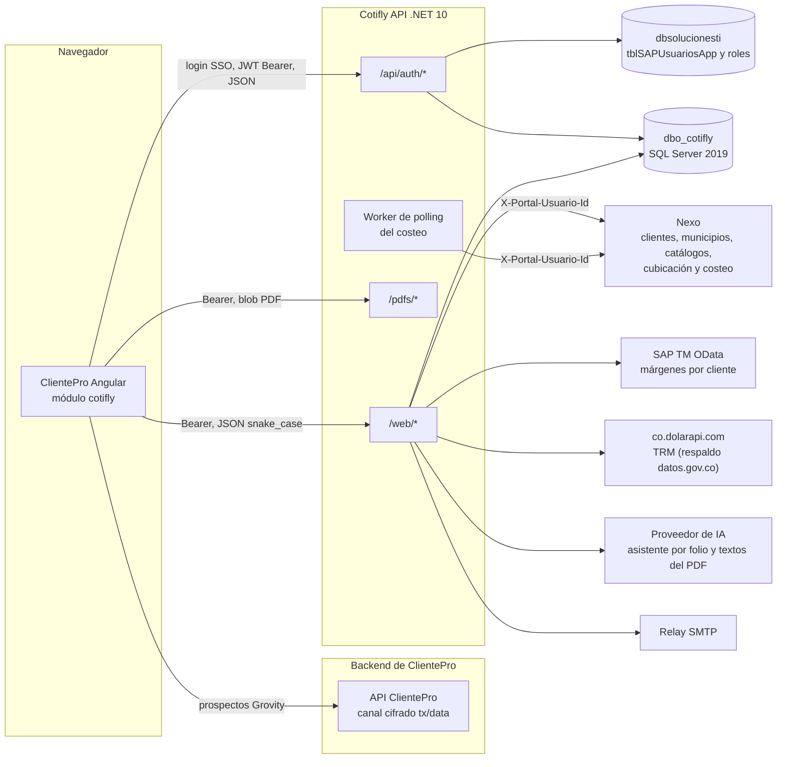

- El navegador **solo** habla con la API de Cotifly (y, para crear prospectos, con el backend de ClientePro por su canal existente `RequestDataService`, ver ADR-005 §3). Nunca llama a Nexo, SAP, la TRM ni la IA directamente.
- La API llama a Nexo en nombre del comercial con `X-Portal-Usuario-Id` = `UsuariosWeb.idUsuarioExterno`, que sale del `sub` del JWT y nunca del cliente. El frontend no envía nada de Nexo.
- Google Chat se retiró en #105 (HU-013.9, ADR-018): `POST /chat/events` ya no existe (404). La consola web es el único canal.

### 2.2 URL base por ambiente

| Ambiente | URL base de la API | Nota |
|---|---|---|
| Local (contenedor) | `http://localhost:8080` | El `servers` del spec |
| QA / staging | `<URL_API_COTIFLY_QA>` | A confirmar con infraestructura (HU-006) |
| Producción | `<URL_API_COTIFLY_PROD>` | A confirmar con infraestructura (HU-006) |

Se recomienda una variable `environment.cotiflyApiUrl`, sin barra final, distinta de `environment.backendUrl` de ClientePro.

### 2.3 Protocolo

- **Solo REST sobre HTTPS con JSON.** No hay SSE, WebSocket, SignalR ni long-polling (verificado en el código: no existen `MapHub`, `text/event-stream` ni WebSockets).
- Las actualizaciones asíncronas (estado del costeo en Nexo) se consultan con **polling desde el frontend** contra endpoints que leen la base de Cotifly. El polling a Nexo lo hace el servidor.
- Métodos usados: `GET`, `POST` y `PUT`. CORS no permite `DELETE` ni `PATCH`, y ningún endpoint los usa.
- La única respuesta binaria es `GET /pdfs/{archivo}` (`application/pdf`).

### 2.4 Nombres de campos (snake_case y camelCase)

| Grupo | Convención | Ejemplos |
|---|---|---|
| `/web/*` (request y response) | **snake_case**, obligatorio también en el cuerpo de la petición | `sesion_id`, `cotizacion_origen_id`, `motivo_rechazo`, `metodo_calculo`, `is_active`, `nit_cliente` |
| `/api/auth/*` | **camelCase** del patrón "Login SSO — Cliente Pro", con una excepción | `idUsuario`, `nombreUsuario`, `debeCambiarPassword`. Excepción: `user.nombre_completo` |
| `/health`, `/health/ready` | camelCase por defecto de ASP.NET | `status`, `servicio`, `entorno` |

Reglas de serialización de `/web/*` (`clsJsonWeb`):

- En `/web/*` un campo en camelCase **se ignora en silencio** (`motivoRechazo` no llega a `motivo_rechazo`). La lectura no distingue mayúsculas, pero el guion bajo sí cuenta.
- Los campos `nullable` **siempre vienen** en la respuesta, con `null` si no tienen valor. Nunca se omiten.
- Los números son estrictos: `"margen": "0.2"` (texto) es un cuerpo inválido y responde 400.
- Los enums van como código snake_case: `sin_enviar`, `politica_linea`, `pendiente_costeo`.
- Las tildes no se escapan (`"Cotización"`).

### 2.5 Fechas, horas y zona horaria

| Tipo | Formato | Ejemplo | Dónde |
|---|---|---|---|
| Fecha y hora | ISO 8601 con desfase. El servidor escribe en UTC (`+00:00`) | `"2026-09-29T14:03:11.517+00:00"` | `created_at`, `updated_at`, `ultima_cotizacion`, `costeo_listo_at`, `deadline` |
| Fecha sola | `AAAA-MM-DD` | `"2026-09-26"` | `trm_vigencia_desde`, `trm_vigencia_hasta` (En QA desde #71) |

- La zona de negocio es **America/Bogota** (UTC-5, sin horario de verano). El folio (`DDMMAAAA`), la "fecha de hoy" del PDF y la vigencia de la TRM se calculan en Bogotá.
- Mostrar siempre convirtiendo a America/Bogota (por ejemplo, `DatePipe` con `'-0500'` o `Intl.DateTimeFormat('es-CO', { timeZone: 'America/Bogota' })`).
- Para `deadline` (formulario de costeo), enviar ISO 8601 **con desfase**, por ejemplo `"2026-10-03T17:00:00-05:00"`. Un valor sin desfase se interpretaría con la zona del servidor (**a confirmar**; no enviarlo así).

### 2.6 Dinero y márgenes

| Dato | Formato | Ejemplo |
|---|---|---|
| Precio, costo y utilidad en COP | Número entero de pesos (redondeo half-to-even) | `3294798` |
| Precio en USD | Número con 2 decimales (half-to-even) | `996.35` |
| TRM | Número con hasta 4 decimales (COP por USD) | `3306.86` |
| Margen | Fracción decimal (0.135 = 13,5 %) | `0.135` |
| Campos del formulario de costeo (`peso_kg`, `valor_*`, `horas_*`, medidas) | Máximo 2 decimales. Un tercer decimal responde 400 `SOLICITUD_COSTEO_INVALIDA` | `12500.5` |

- En USD, `costo` y `utilidad` **siguen en COP**. Solo `precio` va en dólares.
- Formatear en la UI: COP como `$ 3.294.798` (sin decimales, locale `es-CO`); USD como `US$ 996,35`.
- `precio_cop` es el precio en pesos antes de convertir, **no** `precio × trm_aplicada`. Desde el 2026-10-05 ya no es un "mínimo a pagar": el PDF en USD lleva la nota de TRM mínima (ADR-014 §4, sección 6.3).
- El costo bruto de Nexo nunca llega al frontend. Solo precios con margen.
- Excepción: las métricas (sección 5.22) devuelven montos en COP con **2 decimales** (`costeo_total`, `valor_cotizado_cop`...), porque convierten USD × TRM por fila. En las tarjetas, mostrarlos sin decimales.

### 2.7 CORS

- Orígenes exactos por configuración (`Cors__OrigenesPermitidos__0`, `__1`...), sin comodines. En producción la API no arranca sin al menos uno. **Pendiente:** el equipo de frontend debe entregar los dominios reales de ClientePro por ambiente, incluido `http://localhost:4200` para desarrollo si se usa contra QA.
- Métodos: `GET`, `POST` y `PUT`. Encabezados permitidos: **solo `Authorization` y `Content-Type`**. Sin cookies (`withCredentials` debe ir en `false`). El preflight se cachea 10 minutos.
- Consecuencias prácticas:
  - **No enviar encabezados propios** a Cotifly (`X-Request-Id`, `X-Correlation-Id`, encabezados del canal cifrado de ClientePro, `Cache-Control`...). El preflight falla y la petición no sale. Si el interceptor global de ClientePro agrega encabezados, hay que excluir las URL de Cotifly.
  - La API **no expone encabezados de respuesta** (`Access-Control-Expose-Headers` no está configurado). El navegador **no deja leer** `Retry-After`, `Content-Disposition` ni `WWW-Authenticate`. El frontend no debe depender de ellos.

### 2.8 Límites de peticiones (429)

| Ámbito | Límite por defecto | Partición | Respuesta |
|---|---|---|---|
| `/api/auth/*` (login, refresh y logout juntos) | 30 peticiones por ventana fija de 60 s | IP del cliente (detrás de Traefik depende de `ForwardedHeaders`, a confirmar en HU-006.6) | 429 `{"error":"Demasiadas peticiones. Intenta de nuevo en unos segundos."}` |
| `POST /web/chat` | 20 turnos por ventana fija de 60 s | Comercial (claim `sub`) | 429, mismo cuerpo |
| Resto de `/web/*` | Sin límite propio | — | — |

- La API envía `Retry-After` en segundos, pero por CORS no se puede leer. Esperar la ventana completa (hasta 60 s) antes de reintentar y mostrar un aviso ("Demasiadas peticiones. Intenta de nuevo en unos segundos.").
- Son límites por proceso: con N réplicas el efectivo es N veces mayor.
- Diferencia importante en el chat: el 429 es el límite de **la API**. El límite del **proveedor de IA** llega como `200 {"texto": "...", "error": true}`.

### 2.8.1 Tiempo de un turno de chat (#84)

- **Timeout de cliente para `POST /web/chat`: al menos 120 s.** Un turno encadena hasta 12 llamadas al modelo con herramientas, más la respuesta final y su reintento (`IA:MaxIteraciones`); `IA:TimeoutSeg` (60 s) es por llamada, no por turno.
- **Tiempos medidos con OmniRoute** (2026-10-01): de 20 a 75 s por turno, y hasta 160 s cuando el modelo principal estaba en enfriamiento, antes del arreglo que pasa de inmediato al respaldo.
- **Mientras el turno está en curso:** mostrar el indicador "escribiendo..." y no reenviar. Si el cliente corta antes, el backend termina el turno igual y la respuesta queda en el historial de la sesión.
- **Estado:** el valor de 120 s está **pendiente de confirmar** con el desarrollador de frontend (Sara). En Traefik, los valores por defecto no cortan respuestas largas; falta verificarlo en la configuración del clúster (03-infraestructura, "OmniRoute").

### 2.9 Tamaño de los cuerpos

| Límite | Valor | Respuesta |
|---|---|---|
| Cuerpo de cualquier petición a `/web/*` | 64 KB (`SeguridadHttp:LimiteCuerpoWebBytes`) | 413 `{"error":"El cuerpo de la petición es demasiado grande."}` |
| Cuerpo de `/web/licitaciones*` (Excel + JSON) | 12 MB (`SeguridadHttp:LimiteCuerpoLicitacionBytes`); el archivo, 10 MB | 413 `ErrorWeb`; un archivo de más de 10 MB dentro del límite: 400 `ARCHIVO_DEMASIADO_GRANDE` |
| `mensaje` de `POST /web/chat` | 1 a 8000 caracteres | 400 `{"error":"Cuerpo inválido. Revisa: mensaje."}` |
| Cuerpo de refresh y logout | 4096 bytes (si pasa, se trata como sin cuerpo) | refresh 401; logout 204 |
| Posiciones del formulario de costeo | Máximo 200 | 400 `SOLICITUD_COSTEO_INVALIDA` |

### 2.10 Id de correlación y encabezados de seguridad

- **No hay encabezado de correlación** (ni `X-Request-Id`, ni `X-Correlation-Id`, ni `traceparent` propio). Tampoco se puede enviar uno, por CORS (sección 2.7). Para reportar un incidente, dar el folio, la hora (Bogotá), el endpoint y el `sesion_id` del chat.
- La API agrega `X-Content-Type-Options: nosniff`, `X-Frame-Options: DENY`, `Referrer-Policy: no-referrer`, `Content-Security-Policy: default-src 'none'; frame-ancestors 'none'` y `Cache-Control: no-store` en `/web/*` y `/pdfs/*`.
- Consecuencia: el PDF **no se puede incrustar en un `<iframe>` que apunte a la URL de la API** (`X-Frame-Options: DENY`). Hay que descargarlo como blob y mostrarlo con `URL.createObjectURL` (sección 5.6).

## 3. Autenticación y sesión (SSO ClientePro)

Cotifly no tiene login propio (ADR-009). ClientePro ya autenticó a la persona y le pasa su identidad a Cotifly, que emite su propia sesión (JWT de acceso y refresh opaco).

### 3.1 `POST /api/auth/login-clientepro` (En QA)

- Anónimo, con límite de `/api/auth/*`. camelCase.
- Request:

```json
{
  "idUsuario": "APEREZ",
  "nombreUsuario": "Ana Pérez",
  "roles": ["34"]
}
```

| Campo | Tipo | Obligatorio | Uso |
|---|---|---|---|
| `idUsuario` | string, 1 a 100 | Sí | Identidad que el servidor revalida: primero como `NOMBREUSUARIO` de `tblSAPUsuariosApp` y, si no aparece y es un entero positivo, como `ID` |
| `nombreUsuario` | string o null, hasta 200 | No | Informativo (auditoría). Nunca identifica |
| `roles` | string[] o null | No | Informativo (auditoría). **Nunca decide el acceso** |

Qué debe enviar el frontend: el identificador de usuario de la sesión de ClientePro (el `NOMBREUSUARIO` de `tblSAPUsuariosApp`, o su `ID` numérico). **A confirmar con ClientePro** cuál de los dos expone hoy la sesión del portal. Los otros dos campos son opcionales.

- Respuesta 200 (`LoginResponse`):

```json
{
  "access": "eyJhbGciOiJIUzI1NiIsInR5cCI6IkpXVCJ9...",
  "refresh": "fI1FJv7TFUPtgck3URCDw-VCYq0m3u9yY8x0l3yq1sE",
  "user": {
    "id": "968c9f61-b1f1-44a8-bb23-7a3d31d7d602",
    "username": "APEREZ",
    "email": "aperez@boterosoto.com.co",
    "nombre_completo": "Ana Pérez",
    "rol": "comercial",
    "ubicacion": null
  },
  "debeCambiarPassword": false
}
```

| Campo | Significado |
|---|---|
| `user.id` | UUID interno de Cotifly (`UsuariosWeb.id`). Es el `sub` del JWT |
| `user.rol` | `comercial` o `gerente_comercial`. **Es el rol que manda en Cotifly** (no los roles de ClientePro) |
| `user.ubicacion` | Regional (`UsuariosWeb.regional`). `null` mientras no se cruce con DimEjecutivo |
| `debeCambiarPassword` | Siempre `false` |

- Errores:

| HTTP | Cuerpo | Cuándo |
|---|---|---|
| 400 | `{"error":"..."}` | Cuerpo inválido (falta `idUsuario`, JSON mal formado, `Content-Type` no JSON) |
| 401 | `{"error":"Credenciales inválidas"}` | **Cualquier** rechazo: usuario inexistente, sin rol autorizado, rol cambiado en ClientePro, almacén caído, error interno. Mismo mensaje siempre (anti-enumeración) |
| 429 | `{"error":"Demasiadas peticiones. Intenta de nuevo en unos segundos."}` | Límite de `/api/auth/*` |

**Verificación doble** (lo que pasa en el servidor, útil para entender los 401):

1. **Externa:** busca la persona en `dbsolucionesti` y traduce sus `IDROLES` a roles internos con `Roles.idRolExterno`. Sin rol interno activo, 401. Si mapea a los dos roles, gana `gerente_comercial`.
2. **Interna:** ubica o crea (primer ingreso, JIT) al usuario en `UsuariosWeb` por el `NOMBREUSUARIO` real. En los ingresos siguientes la asignación en `UsuariosRoles` debe coincidir con el rol resuelto. Si difiere (por ejemplo, le cambiaron el rol en ClientePro), 401 hasta que un gerente lo revise; no se re-sincroniza solo.
3. La verificación se repite en **cada refresh**.

Mientras el DBA no fije los `IDROLES` reales en `Roles`, **nadie entra** (todo 401). Es un pendiente de ADR-009.

UX recomendada ante el 401 del login: "No tienes acceso a Cotifly con tu usuario de ClientePro. Si crees que es un error, contacta a tu gerente." No reintentar en bucle.

### 3.2 Access token (JWT)

| Propiedad | Valor |
|---|---|
| Algoritmo | HS256 |
| Vigencia | 60 minutos (`Jwt:AccessMinutes`, 1 a 1440). Tolerancia de reloj en el servidor: 30 s |
| Claims | `sub` (UUID de `UsuariosWeb`), `username`, `rol` (`comercial` o `gerente_comercial`), `jti` (GUID), `iss` (`cotifly-api` por defecto), `aud` (`clientepro` por defecto), `iat`, `nbf`, `exp` |
| Envío | `Authorization: Bearer <access>` en **toda** llamada a `/web/*` y `/pdfs/*` |
| Revocación | Por `jti` en el logout. Con varias réplicas puede tardar hasta 60 s en verse en las demás |

El frontend puede decodificar el payload (base64url, sin validar la firma) para leer `exp` y `rol`. El rol autoritativo es `user.rol` de la respuesta del login.

### 3.3 Refresh token y rotación: `POST /api/auth/refresh` (En QA)

- Anónimo (no requiere Bearer), con límite de `/api/auth/*`.
- Request: `{"refresh": "<refresh opaco>"}`.
- 200: un `LoginResponse` completo con un par **nuevo** (access y refresh). Hay que reemplazar los dos.
- 401 `{"error":"Inicia sesión de nuevo."}`: refresh vencido, revocado, ya rotado (reuso), cuerpo inválido, o la verificación doble falló.

Reglas de ADR-009 que afectan al cliente:

| Regla | Consecuencia para el frontend |
|---|---|
| Opaco, 32 bytes base64url. Vence a los **30 días del login** (`Jwt:RefreshDays`). La rotación **no** extiende la vigencia | A los 30 días hay que volver a hacer login SSO aunque se haya usado a diario |
| Se rota en cada uso: el anterior deja de servir | Guardar siempre el `refresh` nuevo. No reutilizar el anterior |
| Reusar uno ya rotado (más de 10 s después) = posible robo: **revoca todos los refresh del usuario** | Si varias pestañas comparten el refresh, una rotación de la pestaña A deja obsoleto el de la B, y la B lo revoca todo. Ver la sección 3.6 |
| Dos rotaciones simultáneas del mismo token en menos de 10 s: una gana y la otra recibe 401 **sin** revocar nada | Hacer el refresh en *single-flight* (una sola petición en vuelo) |

### 3.4 `POST /api/auth/logout` (En QA)

- Request opcional `{"refresh": "<refresh>"}` y, si lo hay, `Authorization: Bearer <access>`.
- Siempre **204**, exista o no el token (salvo 429). Revoca la familia del refresh y el `jti` del access.
- Enviar los dos para cerrar bien. Luego borrar los tokens locales aunque la llamada falle.

### 3.5 El 401 genérico y cuándo refrescar

| Respuesta | Qué hacer |
|---|---|
| 401 `{"error":"Inicia sesión de nuevo."}` en `/web/*` o `/pdfs/*` | Refresh **una sola vez** (single-flight) y repetir la petición original |
| 401 en `/api/auth/refresh` | La sesión de Cotifly terminó. Hacer login SSO silencioso otra vez (`login-clientepro` con la identidad de ClientePro). Si ese login responde 401, mostrar "sin acceso" |
| 403 `{"error":"No tienes permiso para esta operación."}` | No refrescar. El rol no permite la operación (por ejemplo, un comercial en `/web/admin/*`) |
| 401 de `login-clientepro` | No refrescar ni reintentar |

Refresco proactivo recomendado: si faltan menos de 60 s para `exp`, refrescar antes de enviar. Evita un 401 en medio de un turno de chat largo.

`GET /web/usuario/telefono` y `PUT` pueden responder 401 si el usuario del token ya no existe en `UsuariosWeb`. Se trata igual.

### 3.6 Dónde guardar los tokens

| Opción | Recomendación |
|---|---|
| Access | En memoria (servicio singleton). Si hace falta sobrevivir a un F5, `sessionStorage` |
| Refresh | `sessionStorage` (una sesión por pestaña: cada pestaña hace su propio login SSO y tiene su propia familia, así no hay reuso entre pestañas). Evitar `localStorage` compartido. Si se usa, coordinar el refresh entre pestañas (Web Locks API o `BroadcastChannel`) y releer el refresh justo antes de usarlo |
| Nunca | En la URL, en logs, en `console.log`, en analítica ni en cookies (la API no usa cookies) |

La API no emite cookies. `withCredentials` debe quedar en `false`.

### 3.7 Interceptor Angular (boceto con refresh single-flight)

Boceto para Angular 17 (interceptor funcional). Solo aplica a las URL de Cotifly y no agrega encabezados distintos de `Authorization`.

```typescript
// cotifly-auth.interceptor.ts
import { HttpContextToken, HttpErrorResponse, HttpInterceptorFn, HttpRequest } from '@angular/common/http';
import { inject } from '@angular/core';
import { Observable, catchError, finalize, shareReplay, switchMap, throwError } from 'rxjs';
import { environment } from 'src/environments/environment';
import { CotiflySesionService } from './cotifly-sesion.service';

/** Marca local (no viaja como encabezado): la petición ya se reintentó una vez tras un refresh. */
const YA_REINTENTADA = new HttpContextToken<boolean>(() => false);

let refrescoEnVuelo$: Observable<string> | null = null;

function conBearer(req: HttpRequest<unknown>, access: string): HttpRequest<unknown> {
  return req.clone({ setHeaders: { Authorization: `Bearer ${access}` } });
}

export const cotiflyAuthInterceptor: HttpInterceptorFn = (req, next) => {
  const base = environment.cotiflyApiUrl;
  if (!req.url.startsWith(base)) {
    return next(req); // No es Cotifly: no tocar.
  }
  const sesion = inject(CotiflySesionService);
  const esAuth = req.url.startsWith(`${base}/api/auth/`);
  if (esAuth) {
    return next(req); // login/refresh/logout no llevan refresh automático.
  }

  const access = sesion.accessVigente(); // null si falta o vence en menos de 60 s
  const enviar$ = access
    ? next(conBearer(req, access))
    : refrescar(sesion).pipe(switchMap(nuevo => next(conBearer(req, nuevo))));

  return enviar$.pipe(
    catchError((err: unknown) => {
      if (err instanceof HttpErrorResponse && err.status === 401 && !req.context.get(YA_REINTENTADA)) {
        // Un solo reintento por petición: la marca va en HttpContext, nunca como encabezado (CORS).
        const reintento = req.clone({ context: req.context.set(YA_REINTENTADA, true) });
        return refrescar(sesion).pipe(
          switchMap(nuevo => next(conBearer(reintento, nuevo))),
        );
      }
      return throwError(() => err);
    }),
  );
};

/** Single-flight: todas las peticiones que llegan durante un refresh esperan el mismo resultado. */
function refrescar(sesion: CotiflySesionService): Observable<string> {
  if (!refrescoEnVuelo$) {
    refrescoEnVuelo$ = sesion.refrescarOReloguear().pipe( // POST /api/auth/refresh; si 401, POST /api/auth/login-clientepro
      shareReplay({ bufferSize: 1, refCount: false }),
      finalize(() => { refrescoEnVuelo$ = null; }),
    );
  }
  return refrescoEnVuelo$;
}
```

Notas del boceto:

- `refrescarOReloguear()` guarda el par nuevo (access y refresh) y devuelve el access. Si el refresh responde 401, intenta un login SSO silencioso. Si ese login también responde 401, limpia la sesión y emite error, y la UI muestra "sin acceso a Cotifly".
- No mandar ningún encabezado propio a la API (sección 2.7). Por eso el "un solo reintento" se marca con un `HttpContextToken` y no con un encabezado.
- `req.context.set` modifica el contexto en su lugar. Si la petición original se reutiliza en otro lado, crear un `HttpContext` nuevo.
- El 403 no se toca: la UI lo muestra.

### 3.8 Secuencia de login y renovación

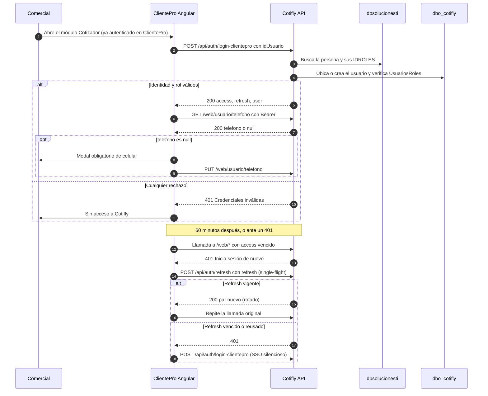

## 4. Errores

### 4.1 Las dos formas de error

**`ErrorWeb`**: un texto, sin código.

```json
{ "error": "Cotización no encontrada o no es tuya." }
```

**`ErrorNegocio`** (en el spec; en esta guía también `ErrorRespuesta`): un objeto con código.

```json
{
  "error": {
    "codigo": "SOLICITUD_COSTEO_INVALIDA",
    "mensaje": "La línea Bogotá → Medellín debe traer el peso total en kg (o posiciones con peso).",
    "detalle": { "motivo": "PESO_REQUERIDO" }
  }
}
```

- `detalle` es opcional. Cuando viene, siempre tiene la forma `{"motivo": "<texto>"}` (a veces un código de Nexo, a veces una explicación).
- Para distinguirlas en TypeScript: `typeof body.error === 'string'` es `ErrorWeb`; `typeof body.error === 'object'` es `ErrorNegocio`.

```typescript
export interface ErrorWeb { error: string; }
export interface ErrorNegocio { error: { codigo: string; mensaje: string; detalle?: { motivo: string } }; }
export function esErrorNegocio(b: unknown): b is ErrorNegocio {
  return !!b && typeof (b as any).error === 'object' && typeof (b as any).error?.codigo === 'string';
}
```

### 4.2 Qué forma usa cada endpoint

| Endpoint | `ErrorWeb` | `ErrorNegocio` |
|---|---|---|
| `/api/auth/*` | 400, 401, 429 | Nunca |
| Cualquier `/web/*` | 401, 403, 404, 413, 429 y 400 de validación del cuerpo | — |
| `POST /web/chat` | 400 (`sesion_id inválido`, `folio inválido`, mensaje), 404 (sesión de otro comercial, o folio ajeno o inexistente) | 400 `FOLIO_REQUERIDO` (desde #102, sin `folio`). Los errores de las herramientas llegan en `errores` de un 200 |
| `POST /web/cotizaciones/{folio}/enviar` | 400 `CORREO_INVALIDO` (sin código visible), 404 | 400 (`CORREO_DUPLICADO`, `CORREO_PDF_NO_ENCONTRADO`, `CORREO_ENVIO_FALLIDO`...), 503 `CORREO_DESHABILITADO` |
| `POST .../seguimiento` | 400 (motivo de más de 2000), 404 | 409 `USAR_RESULTADO_NEXO` (En PR #77) |
| `GET /web/clientes` | 400 si falta `q` (`Falta el texto de búsqueda (q).`) | 400 `CLIENTE_BUSQUEDA_NO_DISPONIBLE` |
| `GET /web/municipios`, `GET /web/catalogos-flete`, `POST /web/cubicacion` | 401 | 400 `*_NO_DISPONIBLE`, `ITEMS_REQUERIDOS`, `CUBICACION_DEMASIADO_GRANDE` |
| `POST /web/solicitudes-costeo` (En PR #74) | 400 si el JSON es inválido | 400 `SOLICITUD_COSTEO_INVALIDA`, `MARGEN_LINEA_DESCONOCIDA`, `FOLIO_CONSECUTIVO_AGOTADO` |
| `POST .../costeo/reintentar` (En PR #74) | 404 | 409 `COSTEO_NO_REINTENTABLE`; 400 `SOLICITUD_COSTEO_INVALIDA` si lo guardado ya no pasa la validación |
| `GET .../costeo`, `PUT .../servicios-conexos`, `POST .../costeo/pdf` (En PR #76) | 404 | 400 `SOLICITUD_COSTEO_INVALIDA` (id de conexo desconocido), `PDF_PAYLOAD_INVALIDO`; 409 `COSTEO_NO_LISTO`, `PDF_YA_GENERADO`; 503 `PDF_RENDER_NO_DISPONIBLE` (#92) |
| `POST .../resultado` (En PR #77) | 400 (`resultado` inválido, `motivo` de más de 100, `comentario` de más de 500), 404 | 400 `COSTEO_NEXO_RECHAZADA`; 409 `RESULTADO_YA_DEFINIDO`, `COTIZACION_NO_ENTREGADA`, `SOLICITUD_NO_TRANSICIONABLE`, `COSTEO_NO_LISTO`; 503 `COSTEO_NEXO_NO_DISPONIBLE`, `COSTEO_NEXO_TIEMPO_AGOTADO` |
| `PUT /web/admin/lineas-negocio/{id}` | 400, 403, 404 | — |
| `GET /web/metricas/comercial` (PR de #45) | 400 (fechas), 401 | — |
| `GET /web/metricas/regional` (PR de #45) | 400 (fechas o `usuario_id`), 401, 403, 404 `Comercial no encontrado en tu regional.` | 409 `REGIONAL_NO_ASIGNADA`, 503 `REGIONAL_NO_DISPONIBLE` |
| `GET /pdfs/{archivo}` | 401, 404 (JSON aunque se pidió un blob) | — |

Traducción general del servidor (`clsRespuestasWeb`): `COTIZACION_NO_ENCONTRADA` → 404 `ErrorWeb`; `SIN_PERMISO` → 403; validaciones → 400 `ErrorWeb`; `CORREO_DESHABILITADO` (y en PR #77 `COSTEO_NEXO_NO_DISPONIBLE` y `COSTEO_NEXO_TIEMPO_AGOTADO`) → 503 `ErrorNegocio`; los de conflicto de estado del costeo → 409 `ErrorNegocio`; el resto de códigos de negocio → 400 `ErrorNegocio`.

### 4.3 Mensajes fijos de `ErrorWeb`

| HTTP | Texto exacto |
|---|---|
| 401 | `Inicia sesión de nuevo.` (login: `Credenciales inválidas`) |
| 403 | `No tienes permiso para esta operación.` |
| 404 | `Cotización no encontrada o no es tuya.` (no existe o es de otro comercial: indistinguibles a propósito). En el chat: `Sesión no encontrada.` |
| 413 | `El cuerpo de la petición es demasiado grande.` |
| 415 | `Cuerpo inválido: envía JSON con Content-Type: application/json.` |
| 429 | `Demasiadas peticiones. Intenta de nuevo en unos segundos.` |
| 400 de validación | `Cuerpo inválido.` o `Cuerpo inválido. Revisa: campo1, campo2.` |

### 4.4 Códigos de negocio: significado y UX sugerida

| Código | Dónde aparece | Significado | UX sugerida | Estado |
|---|---|---|---|---|
| `TARIFA_FUENTE_NO_DISPONIBLE` | `errores` del chat (`buscar_tarifa`) | El tarifario de Drive se retiró: no hay tarifa automática | **No es un error para el usuario**: el agente pide el costo. No mostrar alerta | En QA |
| `TARIFA_CONFIG_INVALIDA` | `errores` del chat | La tarifa de la fuente no está en COP | Aviso: "La tarifa no está en pesos; indica el costo" | En QA |
| `MARGEN_FUENTE_NO_DISPONIBLE` | chat | SAP caído y la línea no tiene política | "No se pudo obtener el margen. Intenta más tarde" | En QA |
| `MARGEN_LINEA_DESCONOCIDA` | chat; 400 en `solicitudes-costeo` | La línea no existe o está inactiva | Marcar el campo línea: "Línea no disponible" | En QA / En PR #74 |
| `PRECIO_INVALIDO` | chat | Datos de precio inválidos (costo o margen fuera de rango, moneda desconocida) | Mostrar el texto del agente | En QA |
| `AJUSTE_MARGEN_INVALIDO` | chat | Margen negociado fuera de rango (negativo o 1 o más con método `margen`) | "Margen fuera de rango" | En QA |
| `AJUSTE_COTIZACION_INVALIDA`, `AJUSTE_ID_INVALIDO` | chat | Ajuste de margen sin cotización válida | Texto del agente | En QA |
| `PDF_PAYLOAD_INVALIDO` | chat; 400 en `costeo/pdf` | Datos incompletos o incoherentes para el PDF | "No se pudo generar el PDF: faltan datos" | En QA / En PR #76 |
| `PDF_RENDER_NO_DISPONIBLE` | chat; 503 en `costeo/pdf` (desde #92) | Falló el render o no hubo turno de render a tiempo (los PDF se generan uno a la vez) | "Reintenta más tarde" con botón Reintentar | En QA / En PR #76 |
| `CONFIRMACION_REQUERIDA` | chat (y `errores`); 400 en `/enviar` | Falta confirmar (PDF, o elegir el municipio o el cliente) | No mostrar alerta: el agente lo pide. Ofrecer el botón "Confirmo" si hay previsualización | En QA |
| `COTIZACION_NO_ENCONTRADA` | 404 `ErrorWeb` en `/web/*` | No existe o no es tuya | "Cotización no encontrada" y refrescar la lista | En QA |
| `CORREO_DUPLICADO` | 400 en `/enviar` | Mismo envío a los mismos destinatarios hace menos de 5 min | "Ya enviaste esta cotización a esos destinatarios hace poco" | En QA |
| `CORREO_PDF_NO_ENCONTRADO` | 400 en `/enviar` | La cotización no tiene PDF | Deshabilitar "Enviar" si `pdf_url` es null | En QA |
| `CORREO_ENVIO_FALLIDO` | 400 en `/enviar` | Falló el relay SMTP | "No se pudo enviar. Reintenta" | En QA |
| `CORREO_DESHABILITADO` | 503 en `/enviar` | El correo está apagado en el servidor (`Correo:Habilitado=false`, por defecto) | "El envío de correo no está habilitado en este ambiente" | En QA |
| `CORREO_INVALIDO` | 400 `ErrorWeb` (sin código) en `/enviar` | Destinatarios inválidos o vacíos, asunto de más de 300 o cuerpo de más de 5000 | Validar en el formulario antes de enviar | En QA |
| `FOLIO_DUPLICADO` | chat | Colisión de folio | "Reintenta" | En QA |
| `FOLIO_CONSECUTIVO_AGOTADO` | chat; 400 en `solicitudes-costeo` | Se usaron los 999 folios del día de esas iniciales | "Límite diario de folios alcanzado. Contacta a soporte" | En QA / En PR #74 |
| `CLIENTE_BUSQUEDA_NO_DISPONIBLE` | 400 en `/web/clientes`; chat | Nexo sin configurar, caído, o el comercial sin `idUsuarioExterno`. **No** significa "sin resultados" (eso es 200 con `candidatos: []`) | En el autocompletado: "Buscador de clientes no disponible" con reintento | En QA |
| `HERRAMIENTA_DESCONOCIDA` | chat (interno) | El modelo pidió una herramienta inexistente | Ignorar | En QA |
| `MUNICIPIOS_NO_DISPONIBLE` | 400 en `/web/municipios`; chat | Catálogo de Nexo no disponible | Deshabilitar el autocompletado de origen y destino y mostrar reintento. El chat sigue con texto libre | En QA |
| `CATALOGOS_FLETE_NO_DISPONIBLE` | 503 en `/web/catalogos-flete` y en `/web/solicitudes-costeo` | Catálogos maestros de Nexo no disponibles y sin copia de respaldo en el servidor (menos de 24 h, HU-013.10) | Selects vacíos con reintento; no enviar texto libre | En QA |
| `ITEMS_REQUERIDOS` | 400 en `/web/cubicacion` | Falta `items` o viene vacío | Deshabilitar "Cubicar" sin bultos | En QA |
| `CUBICACION_NO_DISPONIBLE` | 400 en `/web/cubicacion` | Nexo o el Cubicador no responden | "Cubicación no disponible" | En QA |
| `CUBICACION_DEMASIADO_GRANDE` | 400 en `/web/cubicacion` | Nexo rechazó la solicitud (típicamente demasiados bultos; también medidas inválidas) | "Reduce el número de bultos o revisa las medidas" | En QA |
| `MUNICIPIO_ARGUMENTO_INVALIDO` | Solo interno del agente | — | Ignorar | En QA |
| `ERROR_INTERNO` | Cualquiera | Error no controlado | "Ocurrió un error. Reintenta" | En QA |
| `TRM_NO_DISPONIBLE` | `errores` del chat (`calcular_precio`, `registrar_ajuste_margen`); 400 en `POST /web/licitaciones` y en `POST /web/solicitudes-costeo` (#103) con `moneda = USD` | Ninguna fuente de la TRM respondió (DolarApi ni la Superintendencia): no hay precio en USD | Mensaje no bloqueante: "No se pudo obtener la TRM. Reintenta en unos minutos o cotiza en pesos", con botones **Reintentar** y **Cambiar a COP**. Quitar el spinner | En QA (#70/#71) |
| `SOLICITUD_COSTEO_INVALIDA` | 400 en `solicitudes-costeo`, `reintentar` y `servicios-conexos` | Campo fuera de los límites de Nexo. `detalle.motivo` = `PESO_REQUERIDO` o `PESO_INCONSISTENTE` cuando es el peso | Mostrar `mensaje` junto al campo (el mensaje nombra el campo) | En PR #74 |
| `COSTEO_NEXO_NO_DISPONIBLE` | `motivo_estado_costeo` (envío); 503 en `resultado` | Nexo caído, circuito abierto, sin configurar, 401/403 de Nexo o cliente no resoluble | En el envío queda `error_envio` (botón Reintentar). En resultado: "Nexo no responde; intenta más tarde". Nada cambió | En PR #74/#77 |
| `COSTEO_NEXO_TIEMPO_AGOTADO` | 503 en `resultado`; motivo del envío | Nexo no respondió a tiempo | En el envío: advertir "Nexo pudo haber recibido la solicitud: verifica en Nexo antes de reintentar" | En PR #74/#77 |
| `COSTEO_NEXO_RECHAZADA` | Motivo del envío; 400 en `resultado` | Nexo respondió 4xx (código de Nexo en `detalle.motivo`); también NIT fuera del catálogo o **cliente prospecto sin BP** | Mostrar el motivo | En PR #74/#77 |
| `COSTEO_NEXO_SOLICITUD_INVALIDA` | Motivo del envío (prefijo `Rechazo definitivo de Nexo...`) | Nexo respondió 400 al alta: definitivo | Ocultar "Reintentar". "Corrige el formulario en una cotización nueva" | En PR #74 |
| `COSTEO_NEXO_SOLICITUD_NO_ENCONTRADA` | Motivo (polling) | Nexo ya no reconoce la solicitud; queda `costeo_vencido` | Mostrar el motivo | En PR #75 |
| `COSTEO_NO_REINTENTABLE` | 409 en `reintentar` | El estado no permite reenviar (no está en `error_envio` ni en un `pendiente_envio` de más de 2 min, ya tiene resultado, rechazo definitivo u otro reenvío en curso) | Refrescar la fila y ocultar "Reintentar" | En PR #74 |
| `COSTEO_NO_LISTO` | 409 en `servicios-conexos`, `costeo/pdf` y `resultado` | Todavía sin precio con margen; o, en resultado, la cotización no está en Nexo (chat, descartada, vencida, o no enviada) | Deshabilitar los botones hasta que haya `precio_final`. En resultado, usar `/seguimiento` | En PR #76/#77 |
| `PDF_YA_GENERADO` | 409 en `servicios-conexos` y `costeo/pdf` | Ya tiene PDF: no se cambia | Bloquear la selección de conexos y el botón PDF. "Genera una cotización nueva para cambiarla" | En PR #76 |
| `RESULTADO_YA_DEFINIDO` | 409 en `resultado` | Nexo ya tiene otro resultado | Deshabilitar ganada/perdida y refrescar | En PR #77 |
| `COTIZACION_NO_ENTREGADA` | 409 en `resultado` | Nexo exige la cotización entregada (su issue #171) | "Nexo todavía no ha entregado esta cotización" | En PR #77 |
| `SOLICITUD_NO_TRANSICIONABLE` | 409 en `resultado` | Nexo no permite la transición | Mostrar el `mensaje` | En PR #77 |
| `REGIONAL_NO_ASIGNADA` | 409 en `/web/metricas/regional` | El gerente no tiene regional (ni en `DimEjecutivo` ni en `UsuariosWeb.regional`) | Estado vacío con el `mensaje`: "Tu usuario no tiene una regional asignada...". Sin reintento automático | PR de #45 |
| `REGIONAL_NO_DISPONIBLE` | 503 en `/web/metricas/regional` | La fuente de la regional (`DimEjecutivo`) está configurada pero no responde | "No se pudo consultar tu regional" con Reintentar | PR de #45 |
| `USAR_RESULTADO_NEXO` | 409 en `/seguimiento` | Cotización del flujo de Nexo: hay que usar `/resultado` | Error de programación del frontend: enrutar el botón a `/resultado` (sección 6.5) | En PR #77 |

Códigos internos que el frontend solo ve como texto en un `ErrorWeb` 400: `SOLICITUD_INVALIDA`, `TELEFONO_INVALIDO`, `CORREO_INVALIDO` y `SEGUIMIENTO_INVALIDO`.

Regla para `errores` del chat (En QA): reaccionar solo a los códigos conocidos (`TRM_NO_DISPONIBLE`, `TARIFA_CONFIG_INVALIDA`, `CLIENTE_BUSQUEDA_NO_DISPONIBLE`, `MUNICIPIOS_NO_DISPONIBLE`, `PDF_RENDER_NO_DISPONIBLE`) e **ignorar** el resto (`TARIFA_FUENTE_NO_DISPONIBLE`, `CONFIRMACION_REQUERIDA`, `HERRAMIENTA_DESCONOCIDA`...), que el agente ya explica en `texto`.

## 5. Endpoints

Todos los de `/web/*` exigen `Authorization: Bearer`, responden 401 `ErrorWeb` sin token y usan snake_case. "Ambos" = `comercial` o `gerente_comercial`; cada uno ve **solo lo suyo**, salvo donde se indique.

Resumen:

| Método y ruta | Rol | Estado |
|---|---|---|
| `POST /api/auth/login-clientepro` | Anónimo | En QA |
| `POST /api/auth/refresh` | Anónimo | En QA |
| `POST /api/auth/logout` | Cualquiera | En QA |
| `GET /health`, `GET /health/ready` | Anónimo | En QA |
| `POST /web/chat` | Ambos | En QA (incluye `moneda` y `errores` desde #71) |
| `GET /web/mis-cotizaciones` | Ambos | En QA (incluye `trm_aplicada`; `motivo_estado_costeo` y enum de `estado_costeo` En PR #74) |
| `POST /web/cotizaciones/{folio}/correo/vista-previa` | Ambos | En QA |
| `POST /web/cotizaciones/{folio}/enviar` | Ambos | En QA |
| `GET /web/clientes/{nit}/destinatarios-previos` | Ambos | En QA |
| `POST /web/cotizaciones/{folio}/seguimiento` | Ambos | En QA (obsoleto y 409 En PR #77) |
| `POST /web/cotizaciones/{folio}/resultado` | Ambos (dueño) | En PR #77 |
| `GET /web/cotizaciones/{id}/nueva-version` | Ambos | En QA |
| `GET`, `PUT /web/usuario/telefono` | Ambos | En QA |
| `GET /pdfs/{archivo}` | Dueño o gerente de su regional | En QA |
| `GET /web/clientes?q=` | Ambos | En QA |
| `GET /web/municipios` | Ambos | En QA |
| `GET /web/catalogos-flete` | Ambos | En QA |
| `POST /web/cubicacion` | Ambos | En QA |
| `POST /web/solicitudes-costeo` | Ambos | En PR #74 |
| `POST /web/cotizaciones/{folio}/costeo/reintentar` | Ambos (dueño) | En PR #74 |
| `GET /web/cotizaciones/{folio}/costeo` | Ambos (dueño) | En PR #76 |
| `PUT /web/cotizaciones/{folio}/costeo/servicios-conexos` | Ambos (dueño) | En PR #76 |
| `POST /web/cotizaciones/{folio}/costeo/pdf` | Ambos (dueño) | En PR #76 |
| `POST /web/licitaciones/analizar-excel` | Ambos | PR de #47 |
| `POST /web/licitaciones` | Ambos | PR de #47 |
| `GET /web/licitaciones/{folio}` | Ambos (dueño) | PR de #47 |
| `GET /web/licitaciones/{folio}/excel` | Ambos (dueño) | PR de #48 |
| `GET /web/admin/lineas-negocio` | `gerente_comercial` | En QA |
| `PUT /web/admin/lineas-negocio/{id}` | `gerente_comercial` | En QA |
| `GET /web/metricas/comercial` | Ambos (lo propio) | PR de #45 (por abrir) |
| `GET /web/metricas/regional` | `gerente_comercial` | PR de #45 (por abrir) |
| `GET /web/metricas/actividad` | Ambos | En QA, borrador **obsoleto** |
| `GET /web/metricas/ajustes-margen` | Ambos | En QA, borrador **obsoleto** |
| Líneas de negocio activas para el comercial | Ambos | **Pendiente** (no existe) |
| Score de urgencia desde Nexo | — | **Pendiente** (el deadline vencido ya lo calcula Cotifly: `deadline_vencidas`, con el `0004`) |

Parámetro común `folio` (ruta): string de hasta 50 caracteres, `PCN-[{nit}-]{INICIALES}-DDMMAAAA-{NNN}[-vN]` (ADR-011), por ejemplo `PCN-DG-25092026-001` o `PCN-9000472281-DG-25092026-002-v2`. También hay folios heredados (`PCN-23072026`). **No validar el formato ni parsearlo**: solo mostrarlo, y codificarlo con `encodeURIComponent` en la ruta.

### 5.1 Autenticación

Ver la sección 3: `POST /api/auth/login-clientepro`, `POST /api/auth/refresh` y `POST /api/auth/logout`.

### 5.2 Salud (`GET /health`, `GET /health/ready`). En QA

- Anónimos. No los necesita la UI, salvo para una página de diagnóstico.
- `GET /health` → 200 `{"status":"ok","servicio":"cotifly-api","entorno":"Production"}`.
- `GET /health/ready` → 200 `{"status":"ready"}` o 503 `{"status":"unavailable","detalle":"esquema incompleto: falta 0004"}` (base caída, sin cadena, falta el 0002 o, con la pila B, el 0004; con HU-011, `falta 0005`).

### 5.3 `POST /web/chat`. En QA

> **El chat es el asistente de UNA cotización y `folio` es obligatorio** (#102, HU-013.6). Sin `folio` responde siempre 400 `FOLIO_REQUERIDO`. Desde #105 (HU-013.9) el agente cotizador legado (slot filling, `calcular_precio`, `generar_pdf`...) y el flag `Chat:CreacionHabilitada` **ya no existen**: las cotizaciones solo se crean con el formulario. El flujo completo está en la sección 10, "Asistente por folio".

- Rol: ambos. Límite: 20 turnos por minuto por comercial.
- Request (`MensajeWeb`):

| Campo | Tipo | Obligatorio | Regla |
|---|---|---|---|
| `mensaje` | string | Sí | 1 a 8000 caracteres, sin contar espacios al borde |
| `sesion_id` | string | Sí | `^[A-Za-z0-9_-]{8,64}$`. La genera el cliente: `crypto.randomUUID().replaceAll('-', '')` |
| `folio` | string | Sí | Folio de la cotización abierta (hasta 50 caracteres; más: 400 `folio inválido`). Vacío o ausente: 400 `FOLIO_REQUERIDO`. Ajeno o inexistente: 404 |
| `cotizacion_origen_id` | string (UUID) o null | No | Obsoleto: se acepta y se ignora desde #105. No enviarlo |
| `moneda` | `"COP"`, `"USD"` o null | No | Obsoleto: se acepta y se ignora desde #105 (la moneda va en el formulario). No enviarlo |

- Respuesta 200 (`RespuestaChat`): `texto` (markdown simple, mostrarlo tal cual), `herramientas` (las del asistente: `consultar_cotizacion`, `proponer_ajuste_margen`, `proponer_re_solicitud`, `buscar_servicio_conexo`), `errores` (`[{herramienta, codigo}]`, lista vacía si no hubo) y `accion_propuesta` (o `null`). `precio`, `margen` y `pdf` siguen en el esquema como **obsoletos** y siempre llegan en `null`: no leerlos (`SalidaPrecio`, `SalidaMargen` y `SalidaPdf` eran del agente legado).
- Un fallo del asistente o del proveedor de IA responde 200 `RespuestaChatError` `{texto, error: true, codigo}`: mostrar el texto como error. Desde HU-013.16 (#126), `codigo` dice el motivo, para decidir qué mostrar sin leer el texto:

  | `codigo` | Qué pasó | Qué ofrecer |
  |---|---|---|
  | `IA_NO_DISPONIBLE` | Fallaron todos los modelos de IA, el principal y los respaldos | Aviso de "asistente no disponible"; los botones del detalle siguen funcionando |
  | `LIMITE_MODELO` | Límite de peticiones por minuto del proveedor o de Cotifly. Llega en menos de 20 s, sin esperar el cupo | Reenviar el mismo mensaje en unos segundos |
  | `TURNO_EN_CURSO` | Otro mensaje de la misma conversación sigue en proceso | Esperar la respuesta anterior |
  | `MAX_ITERACIONES` | El asistente necesitó demasiados pasos | Pedir una cosa a la vez |
  | `RESPUESTA_NO_ESTRUCTURADA` | La respuesta del modelo no pasó la validación | Reenviar o reformular |
  | `ERROR_INTERNO` | Cualquier otro fallo | Reintentar más tarde |
- 404 `Sesión no encontrada.` si el `sesion_id` es de otro comercial; 404 `Cotización no encontrada o no es tuya.` si el folio no es suyo.

### 5.4 `GET /web/mis-cotizaciones`. En QA

- Rol: ambos; solo las propias (el gerente también ve solo las suyas aquí). Máximo 100, de la más reciente a la más antigua. **Sin paginación ni filtros** en el servidor: filtrar y ordenar en el cliente.
- Respuesta 200 (`MisCotizaciones`):

```json
{
  "total": 2,
  "cotizaciones": [
    {
      "id": "7c2d9b3e-2a41-4c7a-9f0d-5b6e1a2c3d4e",
      "folio": "PCN-9000472281-DG-29092026-005",
      "version": 1,
      "nit_cliente": "9000472281",
      "origen_cliente": "cliente",
      "origen_margen": "politica_linea",
      "cliente": "ALMACENES EXITO S.A.",
      "linea_negocio": "Nacional",
      "precio_final": null,
      "margen_aplicado": 0.15,
      "moneda": "COP",
      "trm_aplicada": 0,
      "estado_costeo": "pendiente_costeo",
      "motivo_estado_costeo": null,
      "estado_envio": "sin_enviar",
      "ganada": null,
      "motivo_rechazo": null,
      "pdf_url": null,
      "created_at": "2026-09-29T15:12:40.113+00:00"
    },
    {
      "id": "5a0c1e7b-7d0e-4a8e-9a55-2f1f6f3d8c21",
      "folio": "PCN-9000472281-DG-29092026-004",
      "version": 1,
      "nit_cliente": "9000472281",
      "origen_cliente": "cliente",
      "origen_margen": "negociado",
      "cliente": "ALMACENES EXITO S.A.",
      "linea_negocio": "Nacional",
      "precio_final": 3294798,
      "margen_aplicado": 0.135,
      "moneda": "COP",
      "trm_aplicada": 0,
      "estado_costeo": null,
      "motivo_estado_costeo": null,
      "estado_envio": "enviada",
      "ganada": null,
      "motivo_rechazo": null,
      "pdf_url": "/pdfs/PCN-9000472281-DG-29092026-004.pdf",
      "created_at": "2026-09-29T14:03:11.517+00:00"
    }
  ]
}
```

| Campo | Tipo | Nota |
|---|---|---|
| `id` | UUID | Para `GET /web/cotizaciones/{id}/nueva-version` y `cotizacion_origen_id` |
| `folio`, `version` | string, int | Mostrar "v2", "v3"... si `version` > 1 |
| `nit_cliente` | string o null | Para `destinatarios-previos` |
| `origen_cliente` | `cliente`, `prospecto` o null | Etiqueta "Prospecto" |
| `origen_margen` | `sap_tm`, `politica_linea`, `negociado` o null | `negociado` = badge "Ajuste fuera de política" |
| `cliente`, `linea_negocio` | string o null | — |
| `precio_final` | number o null | En `moneda`. En el flujo de Nexo es null hasta que el costeo pasa por el margen |
| `margen_aplicado` | number o null | Fracción |
| `moneda` | string | `COP` o `USD` |
| `trm_aplicada` | number | En QA (#71). 0 en COP |
| `estado_costeo` | enum o null | En QA es un string libre (null en las del chat). **En PR #74** es el enum de 7 valores (sección 7.1). null = cotización del chat (no pasa por Nexo) |
| `motivo_estado_costeo` | string o null | **En PR #74.** Motivo legible (error al enviar, rechazo, vencido, precio conservado tras un cambio de costeo...) |
| `estado_envio` | `sin_enviar`, `enviada` o `reenviada` | — |
| `ganada` | bool o null | null = sin resultado |
| `motivo_rechazo` | string o null | — |
| `pdf_url` | string o null | Absoluta o relativa |
| `created_at` | fecha y hora o null | UTC |

No trae costo (ni `costo` ni el de Nexo) a propósito.

### 5.5 Correo: vista previa, envío y destinatarios previos. En QA

**`POST /web/cotizaciones/{folio}/correo/vista-previa`**

- Cuerpo **opcional** (`EnvioWeb` parcial) para renderizar con lo que el comercial ya escribió.
- 200 (`VistaPreviaCorreo`):

```json
{
  "asunto": "Cotización PCN-9000472281-DG-29092026-004 — Botero Soto",
  "cuerpo": "Buenos días,\n\nAdjunto la cotización ...",
  "para": ["compras@cliente.com"],
  "cc": [],
  "adjunto": "PCN-9000472281-DG-29092026-004.pdf"
}
```

- 404 si no es tuya.

**`POST /web/cotizaciones/{folio}/enviar`**

- Request (`EnvioWeb`): `para` (string[], al menos 1, correos de hasta 320), `cc` (string[], por defecto []), `asunto` (string o null, hasta 300; por defecto "Cotización {folio} — Botero Soto") y `cuerpo` (string o null, hasta 5000).

```json
{ "para": ["compras@cliente.com"], "cc": ["gerente@boterosoto.com.co"], "asunto": null, "cuerpo": null }
```

- 200 `{"enviado": true, "message_id": "<id del relay o null>"}`.
- Errores: 400 `ErrorWeb` (destinatarios, asunto o cuerpo inválidos); 400 `ErrorNegocio` (`CORREO_DUPLICADO`, `CORREO_PDF_NO_ENCONTRADO`, `CORREO_ENVIO_FALLIDO`, `CONFIRMACION_REQUERIDA`); 404; 503 `CORREO_DESHABILITADO`.
- El remitente es el comercial del token. Tras un 200, `estado_envio` pasa a `enviada` y luego a `reenviada`. Refrescar la fila con `GET /web/mis-cotizaciones` (el envío no devuelve la fila).

**`GET /web/clientes/{nit}/destinatarios-previos`**

- 200 `{"para": [...], "cc": [...]}`, del último envío exitoso **de este comercial** a ese NIT. Listas vacías si no hay. 400 si el NIT tiene más de 20 caracteres.

### 5.6 Descarga del PDF (`GET /pdfs/{archivo}`). En QA

- `archivo` sigue `^[A-Za-z0-9_-]+\.pdf$` (el folio más `.pdf`). Tomarlo de `pdf_url`, nunca construirlo a mano.
- Acceso con **Bearer**: el dueño, o un `gerente_comercial` de la misma regional (si la regional del gerente no se conoce, solo el dueño).
- 200 `application/pdf` inline. 401 `ErrorWeb` sin sesión. 404 `ErrorWeb` (no existe o no es tuya), con cuerpo JSON aunque se haya pedido un blob.
- **URL firmada `?t=`**: se retiró en #105 junto con Google Chat (era el único que la emitía). El endpoint exige siempre Bearer.
- Un `<a href>` directo no envía `Authorization` y recibe 401. Además, `X-Frame-Options: DENY` impide incrustar la URL en un iframe. Hay que descargar el blob:

```typescript
descargarPdf(pdfUrl: string, folio: string): Observable<void> {
  const url = /^https?:\/\//i.test(pdfUrl) ? pdfUrl : `${environment.cotiflyApiUrl}${pdfUrl}`;
  return this.http.get(url, { responseType: 'blob' }).pipe(
    map(blob => {
      const objeto = URL.createObjectURL(blob);
      const a = document.createElement('a');
      a.href = objeto;
      a.download = `${folio}.pdf`; // Content-Disposition no es legible por CORS
      a.click();
      setTimeout(() => URL.revokeObjectURL(objeto), 30_000);
    }),
  );
}
```

- Para ver el error de un 404, leer el blob como texto y parsear el JSON.
- Si `pdf_url` es absoluta, debe apuntar al mismo host de la API; el interceptor solo agrega el Bearer a las URL que empiezan por `cotiflyApiUrl`.

### 5.7 Seguimiento (`POST /web/cotizaciones/{folio}/seguimiento`). En QA; obsoleto En PR #77

- Request (`SeguimientoWeb`): `{"ganada": true | false | null, "motivo_rechazo": "string o null (hasta 2000)"}`. `ganada: null` **limpia** el resultado (botón "Limpiar").

```json
{ "ganada": false, "motivo_rechazo": "El cliente eligió otro proveedor por precio." }
```

- 200 `CotizacionResumen` (la fila actualizada). 400 (motivo de más de 2000, cuerpo inválido). 404.
- **En PR #77**: queda `deprecated`. Para una cotización con `estado_costeo` con valor responde **409 `USAR_RESULTADO_NEXO`**, salvo en `descartada` y `costeo_vencido`, que se marcan aquí solo en Cotifly. Las del chat (`estado_costeo = null`) siguen igual, y se pueden cambiar o limpiar libremente.

### 5.8 Resultado en Nexo (`POST /web/cotizaciones/{folio}/resultado`). En PR #77

- Rol: ambos, solo el dueño.
- Request (`ResultadoWeb`):

| Campo | Tipo | Regla |
|---|---|---|
| `resultado` | `ganada` o `perdida` | Obligatorio |
| `motivo` | string o null | Hasta 100. Se guarda en `motivo_rechazo` y se envía a Nexo |
| `comentario` | string o null | Hasta 500. **Solo se envía a Nexo**; no se guarda en Cotifly |

```json
{ "resultado": "perdida", "motivo": "Precio", "comentario": "El cliente consiguió 8 % menos con otro transportador." }
```

- Primero escribe en Nexo y, **solo si Nexo responde 200**, en Cotifly. En 409 y 503 no cambia nada local.
- 200 `CotizacionResumen` (con `ganada` y `motivo_rechazo`; puede traer `estado_costeo` = `entregada` si Nexo la entregó en ese momento).
- **Costeo no leído (#123, HU-013.14).** Si Nexo ya entregó y Cotifly todavía no lo había leído, la API relee el costeo al registrar el resultado y la respuesta trae `estado_costeo = entregada` **con** `precio_final`. Si esa relectura falla, el resultado queda registrado igual, `estado_costeo` conserva su valor (por ejemplo `pendiente_costeo`) y `precio_final` llega con el polling en segundos: seguir consultando `GET .../costeo` mientras `precio_final` sea `null`. Con resultado registrado, el PDF sigue la regla de ADR-018 §11 (`PDF_YA_ENVIADO`: versión nueva), ya no `COSTEO_NO_LISTO`.
- **`RESULTADO_YA_DEFINIDO` con `detalle.motivo` (#123).** Si Nexo ya tenía otro resultado, Cotifly lo toma y responde 409 con `detalle.motivo` = `ganada`/`perdida` (el de Nexo). Mostrar el mensaje y recargar la cotización: Cotifly ya quedó con el resultado de Nexo.
- **Perdida antes del costeo (#127, HU-013.17).** Si el cliente desiste mientras `estado_costeo` es `pendiente_costeo` o `error_envio`, ofrecer **solo** "Marcar perdida", con el motivo obligatorio, y enviar `If-Match` con el `ETag` de `GET .../costeo`:
  - sin `If-Match`, 428; con uno viejo, 409 `CONFLICTO_CONCURRENCIA` (recargar);
  - no se envía a Nexo y el polling se detiene: dejar de consultar;
  - la respuesta trae `ganada = false` y `motivo_estado_costeo` empieza por "Perdida solo en Cotifly";
  - el 200 trae el `ETag` nuevo;
  - una "ganada" en esos estados es 409 `COTIZACION_NO_ENTREGADA`;
  - en `pendiente_costeo`, si Nexo ya la entregó, la pérdida va a Nexo como siempre; si Nexo no responde, 503 sin cambios: ofrecer Reintentar.
- Errores: 400 `ErrorWeb` (`resultado` inválido o límites); 400 `ErrorNegocio` `COSTEO_NEXO_RECHAZADA` (otro 4xx de Nexo; código en `detalle.motivo`); 404 (no es tuya o Nexo no encuentra la cotización); 409 `COSTEO_NO_LISTO` (chat, descartada, vencida o no enviada), `COTIZACION_NO_ENTREGADA` (también sin pedirle el resultado a Nexo en `pendiente_envio`, o en `pendiente_costeo` si Nexo todavía no tiene el costo; desde #123 en `pendiente_costeo` primero se le pregunta a Nexo si ya costeó), `RESULTADO_YA_DEFINIDO`, `SOLICITUD_NO_TRANSICIONABLE`; 503 `COSTEO_NEXO_NO_DISPONIBLE` (también si Nexo responde 401/403: es configuración) o `COSTEO_NEXO_TIEMPO_AGOTADO`.
- Re-marcar el **mismo** resultado en Nexo es idempotente; cambiarlo responde `RESULTADO_YA_DEFINIDO`. Deshabilitar los botones cuando `ganada` tenga valor.

### 5.9 Nueva versión (`GET /web/cotizaciones/{id}/nueva-version`). En QA

- `id` es el UUID de la cotización (no el folio). Un id que no es UUID, ajeno o inexistente responde 404.
- 200 (`DatosNuevaVersion`), sin modificar la original:

```json
{
  "cotizacion_origen_id": "5a0c1e7b-7d0e-4a8e-9a55-2f1f6f3d8c21",
  "folio_base": "PCN-9000472281-DG-29092026-004",
  "version_siguiente": 2,
  "cliente_nombre": "ALMACENES EXITO S.A.",
  "nit_cliente": "9000472281",
  "origen_cliente": "cliente",
  "linea_negocio": "Nacional",
  "costo": 2850000,
  "margen_politica": 0.15,
  "margen_aplicado": 0.135,
  "origen_margen": "negociado",
  "metodo_calculo": "margen",
  "moneda": "COP"
}
```

- Uso: prellenar "Nueva cotización" y luego enviar `POST /web/chat` con un `sesion_id` **nuevo** y `cotizacion_origen_id`. El PDF sale como `{folio_base}-v2`. `version_siguiente` es informativa: la definitiva la asigna el servidor.
- Aquí sí se muestra `costo`, porque es el costo que escribió el comercial en el chat.
- Para cotizaciones del flujo de Nexo no hay "nueva versión" por costeo (`solicitudes-costeo` no acepta `cotizacion_origen_id`). **A confirmar** con negocio (sección 9).

### 5.10 Teléfono del comercial (`GET` y `PUT /web/usuario/telefono`). En QA

- `GET` → 200 `{"telefono": "+57 300 123 4567"}` o `{"telefono": null}` si nunca se capturó.
- `PUT` con `{"telefono": "3001234567"}` → 200 con el valor guardado. `null` o vacío lo borra (el PDF omite "Cel"). Patrón `^\+?[0-9 ]{7,20}$`; fuera del patrón, 400 `ErrorWeb`. 401 si el usuario ya no existe.
- Es el "Cel" que imprimen los PDF siguientes.

### 5.11 Buscador de clientes (`GET /web/clientes?q=`). En QA

- `q` (obligatorio): nombre o NIT, tal como lo escribió el comercial. Sin `q`, 400 `{"error":"Falta el texto de búsqueda (q)."}`.
- 200 (`ResultadoBusquedaClientes`):

```json
{
  "exacta": false,
  "candidatos": [
    { "nit_cliente": "9000472281", "nombre": "ALMACENES EXITO S.A.", "origen_cliente": "cliente", "bp": "1000234" },
    { "nit_cliente": "9014433221", "nombre": "EXITO LOGISTICA SAS", "origen_cliente": "prospecto", "bp": null }
  ]
}
```

- `exacta = true` solo cuando hay un único candidato (Nexo no distingue exacta de aproximada).
- `candidatos: []` = sin coincidencias (no es un error). 400 `ErrorNegocio` `CLIENTE_BUSQUEDA_NO_DISPONIBLE` = el buscador no está disponible.
- **Nunca mostrar `bp`** (uso interno). **Nunca tratar el texto buscado como NIT**: el NIT sale solo de `candidatos`.
- Autocompletado recomendado: debounce de 300 ms, mínimo 3 caracteres (regla de UX; el servidor acepta 1) y cancelar la búsqueda anterior (`switchMap`). Cada búsqueda llama a Nexo (hasta 8 s en el peor caso).
- Prospectos: se pueden elegir, pero **el envío a costeo en Nexo falla** para prospectos sin BP (queda `error_envio` con `COSTEO_NEXO_RECHAZADA`, sección 6.4). Advertir en la UI. Crear un prospecto nuevo va por el componente existente de ClientePro (`RegistroclienteprospectoComponent`, Grovity), no por Cotifly.

### 5.12 Municipios (`GET /web/municipios`). En QA

- 200 con el catálogo **completo, sin paginar**:

```json
[
  { "id": 1101, "codigo_dane": "11001", "municipio": "BOGOTA, D.C.", "departamento": "BOGOTA, D.C.", "pais": "COLOMBIA" },
  { "id": 76892, "codigo_dane": "76892", "municipio": "YUMBO", "departamento": "VALLE DEL CAUCA", "pais": "COLOMBIA" }
]
```

- El servidor lo cachea 60 minutos (`Nexo:MinutosCacheMunicipios`). Cachearlo también en el cliente durante la sesión (`shareReplay`).
- 400 `ErrorNegocio` `MUNICIPIOS_NO_DISPONIBLE`.
- Hay nombres repetidos entre departamentos (por ejemplo, "La Unión" o "Sucre"): mostrar siempre "Municipio, Departamento". Qué texto exacto se envía como `origen` o `destino` a `solicitudes-costeo` está **a confirmar** (sección 6.4).

### 5.13 Catálogos de flete (`GET /web/catalogos-flete`). En QA

- 200 (`CatalogosFlete`), cada opción `{valor, etiqueta}`:

```json
{
  "tipos_vehiculo": [ { "valor": "3S3", "etiqueta": "Tractocamión 3S3" }, { "valor": "2", "etiqueta": "Camión sencillo 2 ejes" } ],
  "tipos_carroceria": [ { "valor": "FURGON", "etiqueta": "Furgón" }, { "valor": "PLATAFORMA", "etiqueta": "Plataforma" } ],
  "clases_viaje": [ { "valor": "Contenedor", "etiqueta": "Contenedor" }, { "valor": "CargaSuelta", "etiqueta": "Carga suelta" } ]
}
```

(Valores ilustrativos: los reales vienen de los catálogos maestros de Nexo, HU-013.10.)

- Mostrar `etiqueta` y enviar `valor`. 503 `CATALOGOS_FLETE_NO_DISPONIBLE` (reintentar más tarde; no ofrecer texto libre).
- **No incluye** `tipologia` ni `clase_contenedor`, ni las líneas de negocio. Esos siguen hardcodeados en el frontend con los códigos del mapeo (sección 6.4).
- **A confirmar** con Nexo: que los `valor` de este catálogo sean los mismos códigos que acepta el alta de la solicitud (`tipo_vehiculo`, `carroceria`, `clase_viaje`).

### 5.14 Cubicación rápida (`POST /web/cubicacion`). En QA

- Sin persistencia. Unidades en **centímetros y kilogramos**.
- Request:

```json
{
  "items": [
    { "descripcion": "Estiba de cajas", "cantidad": 20, "largo_cm": 120, "ancho_cm": 100, "alto_cm": 150, "peso_kg": 450 },
    { "descripcion": "Máquina", "cantidad": 1, "largo_cm": 420, "ancho_cm": 260, "alto_cm": 280, "peso_kg": 3200 }
  ],
  "clase_viaje": "CargaSuelta"
}
```

- 200 (`ResultadoCubicacion`):

```json
{
  "sugerencia": {
    "unidad_id": "TRACTO_3S3_FURGON", "unidad_nombre": "Tractocamión 3S3 furgón", "banda": "optima",
    "factor_utilizacion": 0.82, "config_vehiculo": "3S3", "carroceria": "FURGON", "clase_viaje": "CargaSuelta", "clase_contenedor": null
  },
  "sugerencia_flota": null,
  "advertencias": ["La pieza Máquina excede el ancho estándar."],
  "extradimension": {
    "hay_extradimension": true,
    "medidas_estandar": { "largo_max_cm": 1200, "ancho_max_cm": 250, "alto_max_cm": 280, "peso_max_kg": 34000 },
    "piezas": [ { "descripcion": "Máquina", "excesos": ["ancho"], "largo_cm": 420, "ancho_cm": 260, "alto_cm": 280, "peso_kg": 3200 } ],
    "sugerencia": "Evaluar vehículo extradimensionado."
  }
}
```

(Valores ilustrativos.)

- `sugerencia` = mejor vehículo único (o null si ninguno sirve); `sugerencia_flota` = cuando hace falta más de un vehículo (`cantidad_vehiculos`, `utilizacion_promedio`).
- 400 `ITEMS_REQUERIDOS`, `CUBICACION_DEMASIADO_GRANDE` o `CUBICACION_NO_DISPONIBLE`.
- Uso: sugerir `tipo_vehiculo` y `carroceria` al comercial. Las posiciones de `solicitudes-costeo` usan las mismas unidades (ojo: allí la cantidad por defecto es 1).

### 5.15 Solicitud de costeo en Nexo (`POST /web/solicitudes-costeo`). En PR #74

Crea la cotización con el formulario ampliado (folio del servidor con el NIT) y la envía a Nexo. **Responde 201 aunque Nexo falle.**

- Request (`SolicitudCosteoWeb`):

| Campo | Tipo | Obligatorio | Reglas y notas |
|---|---|---|---|
| `tipo` | `spot` o `licitacion` | Sí | Si falta u otro valor: 400 `SOLICITUD_COSTEO_INVALIDA` |
| `nit_cliente` | string, hasta 20 | Sí | NIT elegido en `GET /web/clientes`. El BP lo resuelve el servidor en Nexo |
| `cliente_nombre` | string o null, hasta 300 | No | Referencia visible. Se reemplaza por el nombre del catálogo |
| `linea_negocio` | string | Sí | Nombre de la línea en Cotifly (`MargenesPolitica`). Si no existe o está inactiva: 400 `MARGEN_LINEA_DESCONOCIDA` |
| `deadline` | fecha y hora o null | No | ISO 8601 con desfase |
| `valor_estimado` | number o null | No | 0 a 9.999.999.999.999,99; máximo 2 decimales |
| `referencia` | string o null, hasta 200 | No | — |
| `horas_cargue`, `horas_descargue` | number o null | No | 0 a 240, 2 decimales |
| `origen`, `destino` | string, hasta 150 | Sí | Municipio del catálogo (`GET /web/municipios`) |
| `tipo_vehiculo` | string o null, hasta 100 | No | Código SICE-TAC de Nexo (`2`, `2S3`, `3S3`...) |
| `carroceria` | string o null, hasta 100 | No | `ESTACAS`, `ESTIBAS`, `FURGON`, `FURGON REFRIGERADO`, `PLATAFORMA`, `PORTACONTENEDORES`, `TANQUE`, `TRAYLER`, `VOLCO` |
| `tipologia` | string o null, hasta 50 | No | `Contenedor`, `CargaSuelta`, `GranelSolido`, `GranelLiquido`, `Alimentos`, `Refrigerados`, `CargaSeca` |
| `clase_viaje` | string o null, hasta 50 | No | `Contenedor`, `Cupo`, `CargaSuelta`, `Extradimensionado` |
| `clase_contenedor` | string o null, hasta 20 | No | `CNT20.IT/RE/ST`, `CNT40.HC/RE` (condicional a `clase_viaje = Contenedor`) |
| `exclusivo`, `consolidado` | bool o null | No | — |
| `retorna_contenedor` y `ciudad_devolucion_contenedor` | bool o null; string hasta 150 | No | Condicionales |
| `levante_contenedor_diferente` y `ciudad_levante_contenedor` | bool o null; string hasta 150 | No | Condicionales |
| `valor_aprovisionamiento` | number o null | No | 0 o más, 2 decimales |
| `peso_kg` | number o null | Condicional | 0 a 999.999,99. **Regla de peso de Nexo:** hace falta `peso_kg` > 0 **o** posiciones con peso (`PESO_REQUERIDO`); y si hay los dos, el peso no puede diferir más del 1 % de `sum(cantidad × peso_kg)` (`PESO_INCONSISTENTE`) |
| `valor_mercancia` | number o null | No | 0 o más, 2 decimales |
| `posiciones` | array, hasta 200 | No | `[{descripcion?, cantidad (1 a 100000, por defecto 1), largo_cm, ancho_cm, alto_cm (0,1 a 999999, 2 decimales), peso_kg? (0 a 999.999,99)}]` |
| `moneda` | `"COP"`, `"USD"` o null | No | #103 (HU-013.7). COP por defecto. Con USD la TRM del día queda fija al crear (ver "Moneda" más abajo) |

Las reglas condicionales de Nexo (mostrar u ocultar, y requerido u opcional) **no las valida el servidor** más allá de los largos y rangos: el formulario debe replicarlas (HU-005.3).

```json
{
  "tipo": "spot",
  "nit_cliente": "9000472281",
  "cliente_nombre": "Almacenes Éxito",
  "linea_negocio": "Nacional",
  "deadline": "2026-10-03T17:00:00-05:00",
  "valor_estimado": null,
  "referencia": "OC-7781",
  "horas_cargue": 4,
  "horas_descargue": 3,
  "origen": "YUMBO",
  "destino": "BOGOTA, D.C.",
  "tipo_vehiculo": "3S3",
  "carroceria": "FURGON",
  "tipologia": "CargaSeca",
  "clase_viaje": "CargaSuelta",
  "clase_contenedor": null,
  "exclusivo": true,
  "consolidado": false,
  "retorna_contenedor": null,
  "ciudad_devolucion_contenedor": null,
  "levante_contenedor_diferente": null,
  "ciudad_levante_contenedor": null,
  "valor_aprovisionamiento": null,
  "peso_kg": 9000,
  "valor_mercancia": 180000000,
  "posiciones": [
    { "descripcion": "Estiba de cajas", "cantidad": 20, "largo_cm": 120, "ancho_cm": 100, "alto_cm": 150, "peso_kg": 450 }
  ]
}
```

- 201 `CotizacionResumen` (la fila nueva). Leer `estado_costeo`:
  - `pendiente_costeo`: Nexo la recibió y falta el flete;
  - `autocosteo`: Nexo la costeó en la misma petición y la respuesta **ya trae `precio_final`** (#123, HU-013.14). Si `precio_final` es `null`, falta el margen y `motivo_estado_costeo` lo explica: no esperar a que llegue;
  - `error_envio`: Nexo no la recibió; ver `motivo_estado_costeo` y ofrecer Reintentar (salvo un rechazo definitivo);
  - `pendiente_envio`: el envío quedó a medias (raro).
- 400 (nada queda guardado): `SOLICITUD_COSTEO_INVALIDA` (el `mensaje` nombra el campo; para el peso, `detalle.motivo`), `MARGEN_LINEA_DESCONOCIDA`, `FOLIO_CONSECUTIVO_AGOTADO` o `TRM_NO_DISPONIBLE` (solo con `moneda = USD`). 400 `ErrorWeb` si el JSON es inválido.
- **Cambio de #123 (compatible, el enum no cambia):** antes el formulario podía devolver `autocosteo` con `precio_final: null` hasta la primera consulta del polling. Ahora, si Nexo costea en el alta, la API lee el costo antes de responder; si esa lectura falla, responde `pendiente_costeo` y el polling la promueve. Regla para la UI: consultar `GET .../costeo` mientras `estado_costeo` sea `pendiente_costeo`, o mientras sea `autocosteo`/`entregada` con `precio_final` nulo y sin `motivo_estado_costeo`. Nunca dejar de consultar solo porque el estado dice `autocosteo`.
- La petición puede tardar hasta unos 30 s (el alta en Nexo auto-costea en línea). Spinner y bloquear el doble clic: un segundo POST crea **otra** cotización.
- **Moneda (#103, HU-013.7, ADR-014 §5):** `moneda` opcional, `"COP"` (por defecto) o `"USD"`, sin distinguir mayúsculas ni espacios al borde. Con `USD` la API fija la TRM del día **antes de guardar** (`trm_aplicada` de 5.17 y de "Mis cotizaciones") y ya no cambia: el `precio_final` y el `precio` de los conexos llegan en USD (2 decimales), convertidos con esa TRM, también tras un ajuste de margen o un reintento. El costo sigue en COP y nunca se muestra. El PDF lleva la tarifa en `US$` y la nota de TRM mínima (sección 6.3, punto 7). Sin TRM: 400 `TRM_NO_DISPONIBLE`, no se crea nada ni se envía a Nexo; ofrecer **Reintentar** o **Cambiar a COP**. Una cadena vacía u otro valor: 400 `SOLICITUD_COSTEO_INVALIDA` (el mensaje nombra `moneda`).

### 5.16 Reintentar el envío (`POST /web/cotizaciones/{folio}/costeo/reintentar`). En PR #74

- Sin cuerpo. Reenvía el formulario y las posiciones guardados (no hay que volver a llenarlos).
- Permitido solo si `ganada` es null **y** (`estado_costeo = error_envio` sin rechazo definitivo, **o** `pendiente_envio` con más de 2 minutos sin cambios).
- 200 `CotizacionResumen` (otra vez `pendiente_costeo`/`autocosteo`, o `error_envio` con un motivo nuevo). 404. 409 `COSTEO_NO_REINTENTABLE`. 400 `SOLICITUD_COSTEO_INVALIDA` si lo guardado ya no pasa una regla nueva.
- Si el motivo anterior fue tiempo agotado, Nexo pudo haber creado la solicitud: mostrar la advertencia "Verifica en Nexo antes de reintentar" (no hay clave de idempotencia).
- Rechazo definitivo: `motivo_estado_costeo` empieza por `Rechazo definitivo de Nexo (corrige el formulario en una versión nueva): `. En ese caso **ocultar** Reintentar.

### 5.17 Costeo de la cotización (`GET /web/cotizaciones/{folio}/costeo`). En PR #76

- Solo el dueño. Lee la base de Cotifly (no llama a Nexo): se puede consultar con polling sin costo para Nexo.
- 200 (`CosteoCotizacion`):

```json
{
  "folio": "PCN-9000472281-DG-29092026-005",
  "estado_costeo": "autocosteo",
  "motivo_estado_costeo": null,
  "costeo_listo_at": "2026-09-29T15:13:02.400+00:00",
  "precio_final": 4705882,
  "margen_aplicado": 0.15,
  "moneda": "COP",
  "trm_aplicada": 0,
  "servicios_conexos": [
    { "id": "8b1f3c2a-0d4e-4f5a-9b6c-7d8e9f0a1b2c", "nombre": "Cargue con montacargas", "categoria": "logistico", "cantidad": 1, "precio": 411765, "incluido": true },
    { "id": "2c4e6a8b-1d3f-4a5b-8c7d-9e0f1a2b3c4d", "nombre": "Escolta", "categoria": "seguridad", "cantidad": 1, "precio": 823529, "incluido": false }
  ],
  "pdf_url": null
}
```

| Campo | Nota |
|---|---|
| `precio_final` | Precio total con margen: flete + aprovisionamiento + retorno del contenedor **+ servicios conexos** (HU-021, ADR-019). null mientras no haya costeo |
| `margen_aplicado` | null mientras no haya `precio_final` |
| `moneda`, `trm_aplicada` | #103 (HU-013.7). `trm_aplicada` es la TRM fijada al crear (COP por USD); 0 en COP. En USD, `precio_final` y el `precio` de los conexos van en dólares con 2 decimales: mostrar `US$` y "TRM aplicada: `trm_aplicada`" |
| `servicios_conexos[]` | `id` (id de Nexo como string), `nombre` (string o null), `categoria` (por ejemplo, `logistico`), `cantidad`, `precio` (con el mismo margen) e `incluido` (por defecto true). **Nunca trae el costo** |
| `costeo_listo_at` | Cuándo quedó costeada |
| `pdf_url` | null hasta generar el PDF |

- 404 si no es tuya.
- **HU-021:** el total es `precio_final` (ya incluye los conexos). **No** sumarle el `precio` de los conexos. Todos los conexos que llegan están incluidos (`incluido` siempre es true): excluir uno lo quita de la ruta.
- **HU-021.8 (#135): `rutas[]`.** Cada ruta (`RutaCosteo`) trae `linea_orden`, `linea_solicitud_id`, `origen`, `destino`, `estado_costeo`, `precio_final_linea`, `margen_aplicado`, `margen_sugerido`, `origen_margen` y sus `servicios_conexos` (cada conexo trae también `linea_orden`). El margen es **por ruta**: mostrar el margen y el sugerido de cada ruta y usar su `linea_orden` (o `linea_solicitud_id`) en el ajuste de margen y en los conexos (sección 5.18.1). `margen_aplicado`, `margen_sugerido` y `origen_margen` de primer nivel son los de la ruta 1 (compatibilidad). Nunca trae costos.

### 5.18 Servicios conexos (`PUT /web/cotizaciones/{folio}/costeo/servicios-conexos`). En PR #76

- Request: `{"incluidos": ["<id>", "<id>"]}`: los ids que van en el precio y en el PDF. Los demás quedan excluidos. `[]` excluye todos.
- 200 `CosteoCotizacion` actualizado. 400 `SOLICITUD_COSTEO_INVALIDA` (algún id no es del costeo). 404. 409 `COSTEO_NO_LISTO` (sin precio) o `PDF_YA_GENERADO`.
- Solo mientras haya precio y no haya PDF. Enviar la lista completa en cada cambio (reemplaza la anterior). Riesgo conocido: si el polling actualiza el costeo en el mismo instante, la selección puede perderse (ADR-015). Refrescar con la respuesta.

### 5.18.1 Margen y conexos por ruta (HU-021.8, #135). Implementado

La cotización tiene una o varias rutas y cada una tiene su margen y sus conexos (ADR-019, decisiones 3 y 6).

- **Ajuste de margen:** `PUT /web/cotizaciones/{folio}/costeo/margen` con `{"margen": 0.18, "justificacion": null, "linea_orden": 2}` (o `"linea_solicitud_id": "<uuid>"` en lugar de `linea_orden`). Con una sola ruta, la ruta es opcional. Con varias y sin indicarla: **400 `RUTA_REQUERIDA`** con `detalle.rutas` (`linea_orden`, `linea_solicitud_id`, `origen`, `destino`): mostrar un selector de ruta y repetir. Una ruta que no es de la cotización: 400 `RUTA_INEXISTENTE`. La justificación es obligatoria por debajo del `margen_sugerido` **de esa ruta** (`rutas[].margen_sugerido`); el 400 `JUSTIFICACION_REQUERIDA` trae `detalle.margen_sugerido`, `detalle.linea_orden` y `detalle.linea_solicitud_id`. Solo cambian esa ruta (`rutas[].precio_final_linea`) y `precio_final`.
- **Conexos de una ruta:** `PUT /web/cotizaciones/{folio}/costeo/servicios-conexos` con `{"linea_orden": 2, "conexos": [{"id": "<servicios_conexos[].id>", "cantidad": 1}]}`: la lista es lo que **queda** en la ruta. Los que no vienen se **quitan** (se borra la fila; para volver a tenerlo, agregarlo de nuevo con el `POST`) y a los demás se les cambia la cantidad (0,01 a 999.999,99, hasta 2 decimales). `incluidos` sigue funcionando (sin ruta, en todas las rutas), pero no se puede enviar junto con `conexos` (400 `ErrorWeb`). Un id que no es de esa ruta: 400 `SOLICITUD_COSTEO_INVALIDA`. Cada cambio queda auditado.
- **Agregar conexos:** en `POST .../costeo/servicios-conexos`, cada item lleva la ruta (`linea_orden` o `linea_solicitud_id`; opcional con una sola ruta, 400 `RUTA_REQUERIDA` con varias). Todos los items de un clic deben ser de la misma ruta. Las licitaciones siguen sin admitir conexos (409 `ESTADO_NO_PERMITE`).
- **Concurrencia y PDF:** como siempre, `If-Match` obligatorio (428/409) y el `ETag` nuevo en la respuesta. Sin enviar, el PDF vigente queda invalidado (`pdf_desactualizado`); enviada o con resultado, 409 `PDF_YA_ENVIADO` con la llamada para crear la versión `-vN`. Sin cambios (mismo margen o mismas cantidades), 200 sin tocar nada.
- **Asistente:** la acción propuesta `ajustar_margen` trae `linea_orden` en el `cuerpo`: enviarlo tal cual al Confirmar. Si la cotización tiene varias rutas y el comercial no dijo cuál, el asistente pregunta antes de proponer.

### 5.19 PDF del costeo (`POST /web/cotizaciones/{folio}/costeo/pdf`). En PR #76

- Sin cuerpo. El servidor arma el PDF: una fila con origen, destino, vehículo y la tarifa del transporte, más los conexos, cada uno con su precio. Tarifa + conexos = `precio_final` (HU-021).
- 201 `SalidaPdf` `{cotizacion_id, folio, pdf_url, registrada_en_bd: true}`.
- 400 `PDF_PAYLOAD_INVALIDO`. 404. 409 `COSTEO_NO_LISTO` o `PDF_YA_GENERADO`. 503 `PDF_RENDER_NO_DISPONIBLE` (transitorio: reintentar; desde #92).
- **Una sola vez por cotización.** Pedir confirmación antes ("Después no podrás cambiar los servicios conexos"). Antes de generarlo, confirmar el teléfono (`GET`/`PUT /web/usuario/telefono`), igual que en el chat.
- Hoy se permite en `autocosteo` y en `entregada` (**a confirmar** con negocio si solo en `entregada`).

### 5.20 Administración de márgenes (`/web/admin/lineas-negocio`). En QA

Solo `gerente_comercial` (403 `ErrorWeb` para `comercial`).

**`GET /web/admin/lineas-negocio`** → 200 con todas las líneas (activas e inactivas):

```json
[
  { "id": 1, "linea_negocio": "Nacional", "margen": 0.15, "metodo_calculo": "margen", "is_active": true, "updated_at": "2026-09-28T18:00:00+00:00" },
  { "id": 4, "linea_negocio": "Almacenamiento 3PL", "margen": 0.2, "metodo_calculo": "markup", "is_active": false, "updated_at": null }
]
```

**`PUT /web/admin/lineas-negocio/{id}`** (`id` entero):

```json
{ "margen": 0.18, "metodo_calculo": "margen", "is_active": true }
```

- Los tres campos son obligatorios. `margen` numérico de 0 a 0,99 (no como texto). `metodo_calculo` es `margen` o `markup`.
- 200 `LineaNegocio` actualizada (queda auditada). 400 `ErrorWeb` (falta un campo, fuera de rango, método inválido, número como texto). 403. 404 (la línea no existe).
- No crea ni borra líneas. La UI debe trabajar en porcentaje y convertir: 18 % se envía como `0.18`.

### 5.21 Webhook de Google Chat (`POST /chat/events`). Retirado en #105

Ya no existe: responde 404 (HU-013.9, ADR-018). Las cotizaciones que se crearon por Google Chat o por el chat de la consola antes del retiro (`estado_costeo = null`) siguen en "Mis cotizaciones", admiten `/seguimiento` y cuentan en las métricas.

### 5.22 Métricas (HU-010.1). PR de #45 (por abrir)

Fuentes: `openapi.yaml` (tag `metricas`), `docs/docs_front/CONTRATO_API_WEB.md` §3.1, ADR-016 y `specs/features/metricas_tablero.feature` de la rama `45-hu-0101-endpoints-de-métricas-agregadas-backend`, **commit `a48ed49`** (contrato final). ADR-016 está en estado **Propuesta**: Gerencia Comercial todavía tiene que validar las definiciones (sección 9).

| Endpoint | Rol | Uso | Estado |
|---|---|---|---|
| `GET /web/metricas/comercial?desde&hasta` | `comercial` y `gerente_comercial` (política `Comercial`) | Tablero del comercial (HU-010.2, #50): **las cotizaciones propias**. El gerente también ve aquí solo las suyas | PR de #45 (por abrir) |
| `GET /web/metricas/regional?desde&hasta&usuario_id` | Solo `gerente_comercial` (política `GerenteComercial`); un `comercial` recibe 403 | Tablero del gerente (HU-010.3, #51): **su regional**, filtrable por comercial | PR de #45 (por abrir) |
| `GET /web/metricas/actividad` | Ambos | Borrador anterior. **Obsoleto** (`deprecated: true`) | En QA, obsoleto |
| `GET /web/metricas/ajustes-margen` | Ambos | Borrador anterior. **Obsoleto** (`deprecated: true`) | En QA, obsoleto |

El rol sale del claim `rol` del access token (login SSO con la verificación doble, ADR-009) y el caso de uso lo revalida. No se lee de `UsuariosWeb` ni se pide a ClientePro en cada consulta.

#### 5.22.1 Parámetros y validación

| Parámetro | Endpoints | Tipo | Por defecto | Regla |
|---|---|---|---|---|
| `desde` | Los dos | `AAAA-MM-DD` (fecha de Bogotá, incluida) | 1 de enero del año en curso (Bogotá) | Mal formada: 400 `{"error":"El parámetro 'desde' debe ser una fecha AAAA-MM-DD."}` |
| `hasta` | Los dos | `AAAA-MM-DD` (fecha de Bogotá, incluida) | Hoy (Bogotá) | Mal formada: 400 (mismo texto con `'hasta'`). Anterior a `desde`: 400 `{"error":"El parámetro 'hasta' no puede ser anterior a 'desde'."}`. Rango de más de 3 años: 400 `{"error":"El periodo no puede superar 3 años."}` |
| `usuario_id` | Solo `/regional` | UUID (`UsuariosWeb.id`) | Sin filtro (toda la regional) | No UUID: 400 `{"error":"El parámetro 'usuario_id' debe ser un UUID."}`. Inexistente o de otra regional: 404 `{"error":"Comercial no encontrado en tu regional."}` (igual en los dos casos) |

- El periodo va de `desde` 00:00 a `hasta` 24:00 en America/Bogota (UTC-5) y se compara con la **primera creación** de cada cadena de versiones (sección 5.22.2).
- `periodo` en la respuesta trae el rango aplicado, con los valores por defecto ya resueltos. Usarlo para pintar el filtro de fechas en la primera carga.
- Los parámetros van en snake_case (`usuario_id`). No hay cuerpo (es `GET`).

#### 5.22.2 Definición exacta de cada métrica

**Unidad: la cadena de versiones.** Una cadena son las filas de `Cotizaciones` del mismo comercial (`usuarioId`) con el mismo **folio base** (el folio sin el sufijo `-vN`; ADR-011: la v2 en adelante reutiliza el folio de la v1). Cada cadena cuenta **una sola vez**, en cualquier estado (lo mismo que lista "Mis cotizaciones"):

| Aspecto | De dónde sale |
|---|---|
| Valores (precio, costo, margen, moneda, TRM, costeo, ciudades, deadline, ajustes de margen) | La **versión vigente**, la de mayor `version` |
| Periodo y mes de la serie | La **primera creación** de la cadena, `MIN(createdAt)` de todas sus versiones, en fecha de Bogotá |
| Resultado (`ganada`) | El **más reciente de toda la cadena**: el `ganada` no nulo con mayor `marcadoAt` (sin fecha, al final) y, a igualdad, el de mayor `version`. Una v1 ganada con una v2 aún sin marcar cuenta como **ganada** |
| `versiones` | Total de filas (todas las versiones) de esas cadenas. Solo referencia: no entra en ningún cociente |

Ejemplo (del contrato): `PCN-DG-10082026-001` se crea el **10 de agosto** (v1, 1.000.000) y se rehace el **3 de septiembre** (`-v2`, 1.100.000). Cuenta **una** cotización en **agosto**, con el valor de la v2 (1.100.000); septiembre no la ve. Consultar agosto antes o después de la v2 da la misma cantidad: rehacer no cambia periodos pasados.

**Moneda: `valor_cop` por fila.**

- `valor_cop = precioFinal` si `moneda` es `COP` (o nula);
- `valor_cop = round(precioFinal × trmAplicada, 2)` (half-to-even, por fila y luego se suma) si la moneda es otra (USD) y `trmAplicada > 0`;
- una fila en USD con `trmAplicada = 0` cuenta en `cantidad` pero no suma dinero;
- `costo` siempre está en COP y **nunca** se convierte.

`valor_cop` es un nombre interno de la definición (no es un campo de la respuesta) y **no es** el `precio_cop` de ADR-014 que devuelve el chat (`SalidaPrecio.precio_cop`, recalculado del costo y el margen antes de convertir). Pueden diferir unos pesos por el redondeo a centavos del precio en USD. El nombre distinto evita confundirlos.

**Partición.** Siempre se cumple `cantidad = ganadas + perdidas + sin_resultado + pendientes_por_cotizar`:

| Grupo | Condición |
|---|---|
| `ganadas` | Resultado de la cadena = ganada (con o sin precio) |
| `perdidas` | Resultado de la cadena = perdida (con o sin precio) |
| `sin_resultado` | **Con** precio y sin resultado (pendientes por marcar ganada o perdida) |
| `pendientes_por_cotizar` | **Sin** precio y sin resultado (esperando el costeo o el precio) |

`IndicadoresMetricas` (mismo esquema en `/comercial`, en `/regional` y en cada `comerciales[].indicadores`; todos los campos son obligatorios en la respuesta):

| Campo | Tipo | Definición |
|---|---|---|
| `cantidad` | int | Cadenas cuya primera creación cae en el periodo, en cualquier estado |
| `versiones` | int | Filas (todas las versiones) de esas cadenas |
| `ganadas` | int | Ver la partición |
| `perdidas` | int | Ver la partición |
| `sin_resultado` | int | Ver la partición |
| `pendientes_por_cotizar` | int | Ver la partición |
| `conversion` | number o null | ganadas / cantidad (definición del backlog, "#ganadas / #totales"). `null` si cantidad = 0 |
| `conversion_sobre_cerradas` | number o null | ganadas / (ganadas + perdidas). `null` si no hay cerradas |
| `margen_promedio` | number o null | Promedio simple de `margenAplicado` (fracción, 0.15 = 15 %) de las que lo tienen. `null` si ninguna |
| `costeo_total` | number | SUM(`costo`) en COP de **todas** |
| `costeo_ganadas` | number | SUM(`costo`) en COP de las ganadas |
| `valor_cotizado_cop` | number | SUM(`valor_cop`) |
| `valor_ganado_cop` | number | SUM(`valor_cop`) de las ganadas. Es el **valor cotizado** de lo ganado, **no dinero recaudado**. En la UI: **"Valor ganado (COP)"**, también en el mapa |
| `ganancias` | number | SUM(`valor_cop` − `costo`) de las ganadas con precio y costo |
| `cotizaciones_usd` | int | Cadenas en moneda distinta de COP |
| `tiempo_promedio_cotizacion_horas` | number o null | Promedio de (`costeoListoAt` − `createdAt` de la versión vigente) en horas. Se descartan las filas con `costeoListoAt` anterior a `createdAt`. `null` si no queda ninguna. Hoy solo el flujo de costeo de Nexo (PR #76) llena `costeoListoAt`, así que en QA será `null` |
| `desviacion_promedio_margen` | number o null | Promedio de `MargenAjustes.diferencia` (negociado − política, **con signo**) de los ajustes de la versión vigente. `null` sin ajustes |
| `desviacion_promedio_margen_abs` | number o null | Promedio del **valor absoluto** de esas diferencias (magnitud de la negociación, sin que se compensen subidas y bajadas). `null` sin ajustes |
| `ajustes_margen` | int | Cantidad de esos ajustes |
| `deadline_vencidas` | int o null | Sin resultado y con `deadline` anterior al momento de la consulta. **`null`** mientras la base no tenga la columna `deadline` (script `0004`, PR #73) |

Solo en `/regional`: `lineas_negocio_activas` (int) = líneas de `MargenesPolitica` con `isActive = 1`. No depende del periodo ni de la regional.

**Identidades para QA** (#52): `cantidad = ganadas + perdidas + sin_resultado + pendientes_por_cotizar` (siempre), y `ganancias = valor_ganado_cop − costeo_ganadas` cuando todas las ganadas tienen precio y costo y ninguna en USD tiene TRM 0.

**Redondeo:** half-to-even. Fracciones (`conversion`, `conversion_sobre_cerradas`, `margen_promedio`, `desviacion_promedio_margen`, `desviacion_promedio_margen_abs`) con 4 decimales (la desviación con signo puede ser negativa). Montos en COP con **2 decimales** (a diferencia del resto de la API, donde COP es entero, porque `precioFinal × trmAplicada` produce centavos). Horas con 2 decimales.

**Fuera de alcance por ahora:** los servicios conexos (ADR-015) **no** se suman a precio ni costo; se integran después de #42 (HU-005.14). Una solicitud de varias líneas cuenta solo la ciudad de la cabecera.

Comprobación del `.feature` (comercial "ana", año 2026). A1 COP 1.000.000 ganada, A2 COP 2.000.000 perdida, A3 USD 1.000 × TRM 4.000 ganada, A4 sin precio ni resultado. Resultado: `cantidad` 4, `ganadas` 2, `perdidas` 1, `sin_resultado` 0, `pendientes_por_cotizar` 1, `conversion` 0.5, `conversion_sobre_cerradas` 0.6667, `margen_promedio` 0.15, `costeo_total` 5.950.000, `costeo_ganadas` 4.250.000, `valor_cotizado_cop` 7.000.000, `valor_ganado_cop` 5.000.000, `ganancias` 750.000, `cotizaciones_usd` 1 y `deadline_vencidas` null (sin el `0004`).

`PuntoSerieMensual` (`serie_mensual[]`): un punto por **mes de Bogotá** del periodo (por la primera creación de la cadena), en orden, **también los meses sin cotizaciones (en 0)**. Campos: `mes` (`AAAA-MM`), `cantidad`, `ganadas`, `perdidas`, `valor_cotizado_cop` y `valor_ganado_cop`, con las mismas definiciones.

`ConcentracionCiudades` (`concentracion_ciudades`, solo `/regional`):

| Campo | Tipo | Significado |
|---|---|---|
| `disponible` | bool | `false` mientras la base no tenga las columnas `origen`/`destino` (script `0004`, PR #73). Entonces las listas van vacías |
| `por_destino` | `MetricaCiudad[]` | Por municipio de **destino** (la vista del mapa) |
| `por_origen` | `MetricaCiudad[]` | Por municipio de origen (complemento) |
| `sin_destino`, `sin_origen` | int | Cotizaciones sin ciudad (las del chat no guardan ciudades) |

`MetricaCiudad`: `ciudad` (texto del catálogo de municipios de Nexo, tal como se guardó en la cabecera), `cantidad`, `ganadas`, `valor_cotizado_cop` y `valor_ganado_cop` ("Valor ganado (COP)"). Ordenadas por `cantidad` descendente y luego por nombre. No vienen coordenadas ni código DANE.

#### 5.22.3 `GET /web/metricas/comercial`

- Alcance: las cotizaciones del usuario del token (`sub`).
- 200 (`MetricasComercial`): `periodo`, `usuario_id`, `indicadores` y `serie_mensual`. Ejemplo exacto del spec (periodo 2026-08-01 a 2026-09-29):

```json
{
  "periodo": { "desde": "2026-08-01", "hasta": "2026-09-29", "zona_horaria": "America/Bogota" },
  "usuario_id": "5f0c2a8e-4b1d-4c55-9a51-2f7d0c1e9b10",
  "indicadores": {
    "cantidad": 12,
    "versiones": 14,
    "ganadas": 3,
    "perdidas": 4,
    "sin_resultado": 3,
    "pendientes_por_cotizar": 2,
    "conversion": 0.25,
    "conversion_sobre_cerradas": 0.4286,
    "margen_promedio": 0.1542,
    "costeo_total": 38500000.00,
    "costeo_ganadas": 10540000.00,
    "valor_cotizado_cop": 45310000.00,
    "valor_ganado_cop": 12400000.00,
    "ganancias": 1860000.00,
    "cotizaciones_usd": 1,
    "tiempo_promedio_cotizacion_horas": 5.75,
    "desviacion_promedio_margen": -0.015,
    "desviacion_promedio_margen_abs": 0.025,
    "ajustes_margen": 2,
    "deadline_vencidas": 1
  },
  "serie_mensual": [
    { "mes": "2026-08", "cantidad": 5, "ganadas": 1, "perdidas": 2, "valor_cotizado_cop": 18200000.00, "valor_ganado_cop": 4100000.00 },
    { "mes": "2026-09", "cantidad": 7, "ganadas": 2, "perdidas": 2, "valor_cotizado_cop": 27110000.00, "valor_ganado_cop": 8300000.00 }
  ]
}
```

(En el ejemplo se cumple la partición: 3 + 4 + 3 + 2 = 12, y también `ganancias = valor_ganado_cop − costeo_ganadas`: 12.400.000 − 10.540.000 = 1.860.000.)

Comercial sin cotizaciones (200, estado vacío; construido con las reglas del contrato: ceros, `null` en los promedios y la serie en 0):

```json
{
  "periodo": { "desde": "2026-08-01", "hasta": "2026-09-29", "zona_horaria": "America/Bogota" },
  "usuario_id": "968c9f61-b1f1-44a8-bb23-7a3d31d7d602",
  "indicadores": {
    "cantidad": 0, "versiones": 0, "ganadas": 0, "perdidas": 0, "sin_resultado": 0, "pendientes_por_cotizar": 0,
    "conversion": null, "conversion_sobre_cerradas": null, "margen_promedio": null,
    "costeo_total": 0, "costeo_ganadas": 0, "valor_cotizado_cop": 0, "valor_ganado_cop": 0, "ganancias": 0,
    "cotizaciones_usd": 0, "tiempo_promedio_cotizacion_horas": null,
    "desviacion_promedio_margen": null, "desviacion_promedio_margen_abs": null, "ajustes_margen": 0,
    "deadline_vencidas": null
  },
  "serie_mensual": [
    { "mes": "2026-08", "cantidad": 0, "ganadas": 0, "perdidas": 0, "valor_cotizado_cop": 0, "valor_ganado_cop": 0 },
    { "mes": "2026-09", "cantidad": 0, "ganadas": 0, "perdidas": 0, "valor_cotizado_cop": 0, "valor_ganado_cop": 0 }
  ]
}
```

(`deadline_vencidas` es `null` sin el `0004` y `0` con él.)

| HTTP | Cuerpo | Cuándo |
|---|---|---|
| 200 | `MetricasComercial` | Siempre que las fechas sean válidas (también sin cotizaciones) |
| 400 | `ErrorWeb` | Fechas inválidas (sección 5.22.1) |
| 401 | `ErrorWeb` `Inicia sesión de nuevo.` | Token |

#### 5.22.4 `GET /web/metricas/regional`

- Alcance: **siempre** la regional del gerente autenticado, resuelta en el servidor. No se acepta una regional por parámetro.
- Regional efectiva de un usuario: `DWCubosEBSSAP.DimEjecutivo` (si está conectada, `ConnectionStrings__Regional`) o, si no, `UsuariosWeb.regional`, que llena el DBA. Los miembros de la regional son los usuarios de `UsuariosWeb` con esa regional efectiva.
- **Caché de 60 s:** la regional resuelta (y los miembros de cada regional) se reutilizan 60 s por proceso. Cambiar el selector no vuelve a consultar `DimEjecutivo`. Los fallos no se guardan, así que un reintento tras un 503 sí vuelve a consultar. Un cambio de regional hecho por el DBA puede tardar hasta 60 s en verse.
- **El gerente es miembro de su regional:** aparece en `comerciales[]` con `rol: "gerente_comercial"` y sus propias cotizaciones **cuentan en el agregado** de la regional.
- `usuario_id` filtra `indicadores`, `serie_mensual` y `concentracion_ciudades`. **`comerciales` siempre trae a todos** los usuarios de la regional (ordenados por nombre), cada uno con su `rol` y sus indicadores del periodo, aunque se filtre.
- 200 (`MetricasRegional`):

| Campo | Tipo | Significado |
|---|---|---|
| `periodo` | `PeriodoMetricas` | Rango aplicado |
| `regional` | string | Regional del gerente (texto de la fuente, por ejemplo `ANTIOQUIA`) |
| `fuente_regional` | `dim_ejecutivo` o `usuarios_web` | De dónde salió la regional |
| `usuario_id` | UUID o null | Comercial filtrado, o null (toda la regional) |
| `indicadores` | `IndicadoresMetricas` | De la regional (incluido el gerente) o del comercial filtrado |
| `lineas_negocio_activas` | int | Líneas activas (global) |
| `comerciales[]` | `{usuario_id, nombre_usuario, nombre_completo, rol, indicadores}` | Todos los usuarios de la regional, incluido el gerente. `nombre_usuario` y `nombre_completo` pueden ser null. `rol`: `comercial`, `gerente_comercial` o `null` (rol interno asignado en `UsuariosRoles`, fijado en el login SSO; `null` si no tiene asignación activa) |
| `serie_mensual[]` | `PuntoSerieMensual[]` | De la regional o del comercial filtrado |
| `concentracion_ciudades` | `ConcentracionCiudades` | De la regional o del comercial filtrado |

Ejemplo exacto del spec (periodo 2026-08-01 a 2026-09-29):

```json
{
  "periodo": { "desde": "2026-08-01", "hasta": "2026-09-29", "zona_horaria": "America/Bogota" },
  "regional": "ANTIOQUIA",
  "fuente_regional": "usuarios_web",
  "usuario_id": null,
  "lineas_negocio_activas": 8,
  "indicadores": {
    "cantidad": 40,
    "versiones": 46,
    "ganadas": 9,
    "perdidas": 11,
    "sin_resultado": 14,
    "pendientes_por_cotizar": 6,
    "conversion": 0.225,
    "conversion_sobre_cerradas": 0.45,
    "margen_promedio": 0.1497,
    "costeo_total": 131000000.00,
    "costeo_ganadas": 31370000.00,
    "valor_cotizado_cop": 154100000.00,
    "valor_ganado_cop": 36900000.00,
    "ganancias": 5530000.00,
    "cotizaciones_usd": 3,
    "tiempo_promedio_cotizacion_horas": 7.2,
    "desviacion_promedio_margen": -0.0125,
    "desviacion_promedio_margen_abs": 0.021,
    "ajustes_margen": 6,
    "deadline_vencidas": 2
  },
  "comerciales": [
    {
      "usuario_id": "5f0c2a8e-4b1d-4c55-9a51-2f7d0c1e9b10",
      "nombre_usuario": "APEREZ",
      "nombre_completo": "Ana Pérez",
      "rol": "comercial",
      "indicadores": {
        "cantidad": 12,
        "versiones": 14,
        "ganadas": 3,
        "perdidas": 4,
        "sin_resultado": 3,
        "pendientes_por_cotizar": 2,
        "conversion": 0.25,
        "conversion_sobre_cerradas": 0.4286,
        "margen_promedio": 0.1542,
        "costeo_total": 38500000.00,
        "costeo_ganadas": 10540000.00,
        "valor_cotizado_cop": 45310000.00,
        "valor_ganado_cop": 12400000.00,
        "ganancias": 1860000.00,
        "cotizaciones_usd": 1,
        "tiempo_promedio_cotizacion_horas": 5.75,
        "desviacion_promedio_margen": -0.015,
        "desviacion_promedio_margen_abs": 0.025,
        "ajustes_margen": 2,
        "deadline_vencidas": 1
      }
    },
    {
      "usuario_id": "0b7e4c1a-9d2f-4e8b-a3c5-6f1d2e3a4b5c",
      "nombre_usuario": "GRAMIREZ",
      "nombre_completo": "Gloria Ramírez",
      "rol": "gerente_comercial",
      "indicadores": {
        "cantidad": 0,
        "versiones": 0,
        "ganadas": 0,
        "perdidas": 0,
        "sin_resultado": 0,
        "pendientes_por_cotizar": 0,
        "conversion": null,
        "conversion_sobre_cerradas": null,
        "margen_promedio": null,
        "costeo_total": 0,
        "costeo_ganadas": 0,
        "valor_cotizado_cop": 0,
        "valor_ganado_cop": 0,
        "ganancias": 0,
        "cotizaciones_usd": 0,
        "tiempo_promedio_cotizacion_horas": null,
        "desviacion_promedio_margen": null,
        "desviacion_promedio_margen_abs": null,
        "ajustes_margen": 0,
        "deadline_vencidas": 0
      }
    }
  ],
  "serie_mensual": [
    { "mes": "2026-08", "cantidad": 18, "ganadas": 4, "perdidas": 5, "valor_cotizado_cop": 70100000.00, "valor_ganado_cop": 16400000.00 },
    { "mes": "2026-09", "cantidad": 22, "ganadas": 5, "perdidas": 6, "valor_cotizado_cop": 84000000.00, "valor_ganado_cop": 20500000.00 }
  ],
  "concentracion_ciudades": {
    "disponible": true,
    "sin_destino": 4,
    "sin_origen": 4,
    "por_destino": [
      { "ciudad": "BOGOTA D.C.", "cantidad": 15, "ganadas": 4, "valor_cotizado_cop": 60200000.00, "valor_ganado_cop": 17100000.00 },
      { "ciudad": "CARTAGENA", "cantidad": 9, "ganadas": 2, "valor_cotizado_cop": 35800000.00, "valor_ganado_cop": 8900000.00 }
    ],
    "por_origen": [
      { "ciudad": "MEDELLIN", "cantidad": 30, "ganadas": 7, "valor_cotizado_cop": 118000000.00, "valor_ganado_cop": 28700000.00 }
    ]
  }
}
```

(Partición del agregado: 9 + 11 + 14 + 6 = 40. El ejemplo muestra dos de los comerciales de la regional; la lista real trae a todos.)

Mientras el `0004` no esté aplicado (hoy en QA), `concentracion_ciudades` llega con `disponible: false` y las listas vacías, y `deadline_vencidas` llega `null`:

```json
{
  "concentracion_ciudades": { "disponible": false, "por_destino": [], "por_origen": [], "sin_destino": 0, "sin_origen": 0 }
}
```

(Qué valen `sin_destino` y `sin_origen` con `disponible = false` no está documentado: **a confirmar**. No usarlos en ese caso.)

| HTTP | Cuerpo | Cuándo | UX |
|---|---|---|---|
| 200 | `MetricasRegional` | OK | — |
| 400 | `ErrorWeb` | Fechas inválidas o `usuario_id` no UUID | Validar el filtro de fechas en el cliente |
| 401 | `ErrorWeb` `Inicia sesión de nuevo.` | Token | Refresh |
| 403 | `ErrorWeb` `No tienes permiso para esta operación.` | El usuario es `comercial` | No mostrar el tablero del gerente a un comercial |
| 404 | `ErrorWeb` `Comercial no encontrado en tu regional.` | `usuario_id` inexistente o de otra regional | Volver a "Todos" y recargar la lista de comerciales |
| 409 | `ErrorNegocio` `REGIONAL_NO_ASIGNADA` (mensaje: "Tu usuario no tiene una regional asignada. Pide al administrador que la registre.") | El gerente no tiene regional en `DimEjecutivo` ni en `UsuariosWeb.regional` | Estado vacío explicativo con el `mensaje`. Sin reintento automático. Nunca se devuelven todas las regionales |
| 503 | `ErrorNegocio` `REGIONAL_NO_DISPONIBLE` | `DimEjecutivo` configurada pero caída (fail-closed) | "No se pudo consultar tu regional. Intenta más tarde", con botón Reintentar |

#### 5.22.5 Notas para la UI

- **Promedios nulos:** con `cantidad = 0` (o sin filas que aporten), `conversion`, `conversion_sobre_cerradas`, `margen_promedio`, `tiempo_promedio_cotizacion_horas`, `desviacion_promedio_margen` y `desviacion_promedio_margen_abs` llegan `null`. Mostrar "—" (no "0 %" ni `NaN`). Los conteos y montos llegan en 0. `deadline_vencidas = null` significa "dato no disponible" (sin `0004`), no cero: ocultar esa tarjeta o mostrar "—".
- **Estado vacío:** 200 con `cantidad = 0` es "Aún no tienes cotizaciones en este periodo", no un error.
- **Rótulos:** `valor_ganado_cop` = **"Valor ganado (COP)"**, nunca "dinero recaudado" (es valor cotizado, no cobrado). `pendientes_por_cotizar` = "Pendientes por cotizar" (sin precio). `sin_resultado` = "Pendientes por marcar". Con la partición, las cuatro tarjetas suman `cantidad` (sirve para una barra apilada o una torta de estados).
- **Formatos:** fracciones × 100 con 1 decimal ("25,0 %"). Para la desviación, mostrar puntos porcentuales ("−1,5 pp"; "2,5 pp" en valor absoluto). Montos en COP sin decimales en las tarjetas (`$ 45.310.000`). `tiempo_promedio_cotizacion_horas` en horas, o en días si pasa de 24.
- **Conversión:** mostrar `conversion` como el "% de conversión" oficial (backlog). `conversion_sobre_cerradas` puede ir como dato secundario ("sobre cerradas").
- **Mes de una cotización rehecha:** cuenta en el mes de su primera creación. Si un comercial pregunta por qué no ve en septiembre una v2 creada en septiembre, es por esta regla.
- **Selector de comercial** (gerente):
  - Se llena con `comerciales[]` de la primera respuesta (`usuario_id` null). Mostrar `nombre_completo` (o `nombre_usuario`) y una etiqueta con el `rol` ("Gerente" cuando es `gerente_comercial`, "sin rol" si es null).
  - Al elegir uno, pedir `/regional?usuario_id=...` con el **mismo** periodo y reemplazar solo `indicadores`, `serie_mensual` y `concentracion_ciudades`, **sin recargar la página**. "Todos" = sin `usuario_id`.
  - `comerciales` llega completo en cada respuesta, así que se puede refrescar desde cualquiera.
  - Cancelar la petición anterior (`switchMap`) si el usuario cambia rápido.
  - Como alternativa sin petición, `comerciales[i].indicadores` ya trae los KPI de cada uno, pero no su serie ni sus ciudades.
- **Gráfica:** `serie_mensual` alimenta la línea de tiempo (cantidad y ganadas por mes, o valor cotizado y valor ganado). Vienen todos los meses, sin huecos.
- **Mapa:** usar `concentracion_ciudades.por_destino`, con el rótulo "Valor ganado (COP)" para el dinero. Con `disponible = false`, ocultar el mapa o mostrar "El mapa estará disponible cuando se active el costeo por ciudad" (depende del `0004`, PR #73). Las ciudades llegan como texto del catálogo de Nexo: el frontend necesita su propio diccionario de coordenadas (o cruzar con `GET /web/municipios`, que trae `codigo_dane`). **A confirmar** qué texto exacto se guardará en `origen`/`destino` (sección 6.4, paso 3).
- **Fechas:** por defecto el año en curso. Validar en el cliente `desde <= hasta` y un rango de 3 años o menos.
- **Conexos:** los montos no incluyen servicios conexos todavía (se integran después de #42). Si el tablero lo muestra junto a la vista de costeo, avisar "Valores sin servicios conexos".
- **Pendiente de Nexo:** el "score de urgencia" no está en el contrato. Llegará como campo nuevo de `indicadores` (cambio compatible). No reservar esa tarjeta todavía. El "deadline vencido" **sí** está (`deadline_vencidas`), calculado por Cotifly con el `deadline` del formulario.

#### 5.22.6 Borradores obsoletos (se mantienen, no usar en pantallas nuevas)

`GET /web/metricas/actividad` (En QA, `deprecated: true`)

- Rol: ambos. El `comercial` ve solo su fila. El `gerente_comercial` ve las filas de los comerciales de su regional (`UsuariosWeb.regional`; si es null, solo la suya). Cuenta todas las versiones y no convierte moneda.
- 200 (`ActividadComercial[]`):

```json
[
  { "usuario_id": "968c9f61-b1f1-44a8-bb23-7a3d31d7d602", "nombre_completo": "Ana Pérez", "num_cotizaciones": 42, "num_cotizaciones_enviadas": 30, "num_ajustes": 7, "ultima_cotizacion": "2026-09-29T14:03:11+00:00" }
]
```

`GET /web/metricas/ajustes-margen` (En QA, `deprecated: true`)

- Mismo alcance. 200 (`AjustesMargenComercial[]`, una fila por comercial y línea). La desviación pasó a `IndicadoresMetricas.desviacion_promedio_margen`.

```json
[
  { "usuario_id": "968c9f61-b1f1-44a8-bb23-7a3d31d7d602", "nombre_completo": "Ana Pérez", "linea_negocio": "Nacional", "num_ajustes": 5, "diferencia_promedio": -0.012, "diferencia_min": -0.03, "diferencia_max": 0.005, "ultimo_ajuste": "2026-09-28T20:11:00+00:00" }
]
```

Se retirarán cuando el frontend use los nuevos. Si algún componente ya los consume, migrarlo.

### 5.23 Analizar el Excel del pliego (`POST /web/licitaciones/analizar-excel`). PR de #47

Formato y mapeo: `docs/conexion_nexo/HU-011-formato-excel-licitacion.md`. Cotifly **no impone plantilla**: reenvía el archivo al análisis de Nexo, que detecta el encabezado de cada hoja y devuelve las filas como texto. No se guarda nada.

- Request: `multipart/form-data` con la parte `archivo` (`.xlsx` o `.xlsm`, máximo **10 MB menos 64 KB**: Nexo limita a 10 MB el cuerpo completo). No poner `Content-Type` a mano (el navegador pone el `boundary`).
- 200 `AnalisisExcel`:

```json
{
  "archivo": "pliego.xlsx",
  "hojas": [
    {
      "nombre": "Pliego 2026",
      "fila_encabezado": 3,
      "encabezados": ["ITEM", "CIUDAD ORIGEN", "CIUDAD DESTINO", "TIPO VEHÍCULO", "TON", "OBSERVACIONES"],
      "filas": [["1", "Buenaventura", "Bogotá", "Tractomula", "32", "Carga seca"], ["2", "Cali", "Cartagena", "Tractomula", "28", ""]],
      "total_filas": 2,
      "filas_excel": [4, 5]
    }
  ]
}
```

- `filas` trae hasta 1000 filas por hoja (`total_filas` es el total real). **El índice de cada fila en `filas` es la `fila` que se envía en cada línea** de `POST /web/licitaciones`.
- **Numeración que ve el comercial (HU-013.15, #124): la fila del Excel.** `filas_excel[i]` es el número de fila de la hoja de Excel (base 1, encabezado incluido) de `filas[i]`: en el ejemplo, la portada ocupa la fila 1, el encabezado la 3 y los datos empiezan en la 4. Mostrar siempre esa numeración en la tabla del mapeo y en los errores ("Fila 7 del Excel"); el índice `fila` (base 0) es técnico y no se muestra. Si `filas_excel` es `null` (la hoja no cuadra con el análisis de Nexo), mostrar la posición base 1 (`i + 1`) como "línea".
- 400 `ErrorNegocio`: `ARCHIVO_REQUERIDO`, `FORMATO_NO_SOPORTADO`, `ARCHIVO_DEMASIADO_GRANDE`, `EXCEL_INVALIDO`, `EXCEL_SIN_DATOS`. 403 `ErrorNegocio` `NEXO_SIN_PERMISO`: el comercial no tiene el rol de Cabina de Fletes en Nexo ("Pide a soporte el rol Comercial en Nexo"; no cerrar la sesión de Cotifly). 503 `COSTEO_NEXO_NO_DISPONIBLE` / `COSTEO_NEXO_TIEMPO_AGOTADO`; `detalle.motivo` lleva solo el código de Nexo (por ejemplo `SESION_INVALIDA`), nunca su texto (#124): mostrar el `mensaje`. 413 `ErrorWeb` si el cuerpo pasa de 12 MB.

### 5.24 Crear la licitación (`POST /web/licitaciones`). PR de #47

Valida **todas** las filas antes de guardar nada; si son válidas crea la cotización `licitacion` con sus N líneas y el Excel original, y la envía a Nexo como **una sola solicitud con N líneas**. **Responde 201 aunque Nexo falle** (igual que `POST /web/solicitudes-costeo`).

- Request recomendado: `multipart/form-data` con la parte `licitacion` (texto JSON `LicitacionWeb`) y la parte `archivo` (el mismo Excel que se analizó; se guarda para la exportación de la sección 5.26). Sin archivo se puede enviar `application/json` con el `LicitacionWeb`.
- `LicitacionWeb`: `nit_cliente` (obligatorio), `cliente_nombre?`, `linea_negocio` (obligatorio; una por licitación), `deadline?`, `valor_estimado?`, `referencia?`, `notas?` (nota para la Mesa de Nexo, HU-013.11), `horas_cargue?`, `horas_descargue?`, `hoja` (obligatoria con archivo), `moneda?` (`COP` por defecto o `USD`, rama de #50) y `lineas` (1 a 1000). **`linea_negocio` es una línea de Cotifly** (las de 5.20): da el margen de toda la licitación. "Licitaciones" es una línea del catálogo de Nexo, no de Cotifly: responde 400 `MARGEN_LINEA_DESCONOCIDA` con `detalle.motivo = "LINEA_DE_NEXO"` y `detalle.lineas_validas` (las líneas activas; cualquier otra línea desconocida trae también `lineas_validas`). UX: ofrecer un selector con las líneas de Cotifly, nunca texto libre (HU-013.15, #124; pregunta abierta a negocio en `docs/HU-013-preguntas-nexo.md`, 16). Cada línea lleva los campos de `SolicitudCosteoWeb` de la sección 5.15 desde `origen` hasta `posiciones` (mismos límites y catálogos), `fila` (obligatoria con archivo, única) y, opcionales (HU-013.11, #108), `origen_municipio_id`, `destino_municipio_id`, `horas_cargue` y `horas_descargue` propias de la fila. El `tipo` lo pone el servidor (`licitacion`).

```json
{
  "nit_cliente": "9000472281",
  "linea_negocio": "Nacional",
  "deadline": "2026-10-20T17:00:00-05:00",
  "referencia": "Pliego 2026-04",
  "hoja": "Pliego 2026",
  "lineas": [
    { "fila": 0, "origen": "BUENAVENTURA", "destino": "BOGOTA, D.C.", "tipo_vehiculo": "3S3", "peso_kg": 32000 },
    { "fila": 1, "origen": "CALI", "destino": "CARTAGENA", "tipo_vehiculo": "3S3", "peso_kg": 28000 }
  ]
}
```

- 201 `Licitacion` (ver 5.25), con `estado_costeo` = `pendiente_costeo` (o `error_envio` si Nexo falló; reintentar con `POST /web/cotizaciones/{folio}/costeo/reintentar`, que reenvía todas las líneas).
- 400 `ReporteLicitacionInvalida`: **todas** las filas con error, para pintarlas en la tabla del mapeo:

```json
{
  "error": { "codigo": "LICITACION_INVALIDA", "mensaje": "La licitación tiene 2 error(es): corrige las filas indicadas y vuelve a enviarla." },
  "errores": [
    { "indice": 0, "fila": 0, "fila_excel": 4, "campo": "destino", "codigo": "LINEA_INCOMPLETA", "mensaje": "El campo 'destino' es obligatorio." },
    { "indice": 2, "fila": 2, "fila_excel": 7, "campo": "peso_kg", "codigo": "PESO_REQUERIDO", "mensaje": "La línea debe traer el peso total en kg (o posiciones con peso)." },
    { "indice": 3, "fila": 3, "fila_excel": null, "campo": "fila", "codigo": "FILA_INVALIDA", "mensaje": "La línea 4 apunta a una fila que no está en la hoja 'Pliego 2026': la hoja tiene 3 filas con datos (de la fila 4 a la 7 del Excel)." }
  ]
}
```

  **Numeración (HU-013.15, #124).** `fila_excel` es la fila de la hoja de Excel (base 1, encabezado incluido) de esa línea, la que ve el comercial; `null` sin archivo, en un error del encabezado o si la `fila` no existe en la hoja (entonces mostrar "línea `indice + 1`"). Los `mensaje` usan la misma numeración (la fila del Excel o la línea en base 1), nunca el índice `fila`.

  `indice` es la posición en `lineas[]` (`null` = error del encabezado). Los errores vienen ordenados: encabezado primero y luego por línea. Códigos: `LINEAS_REQUERIDAS`, `DEMASIADAS_LINEAS`, `LINEA_INCOMPLETA`, `CAMPO_REQUERIDO`, `CAMPO_DEMASIADO_LARGO`, `VALOR_FUERA_DE_RANGO`, `DEMASIADAS_POSICIONES`, `POSICION_INVALIDA`, `PESO_REQUERIDO`, `PESO_INCONSISTENTE`, `FILA_INVALIDA` y, desde HU-013.11 (#108), `CODIGO_NO_CATALOGO`, `CAMPO_NO_APLICA`, `MUNICIPIO_AMBIGUO` y `MUNICIPIO_NO_ENCONTRADO` (ver "Reglas de captura por fila").
- **Reglas de captura por fila (HU-013.11, #108).** Cada fila cumple las mismas reglas del formulario de 5.15, y todos los errores llegan juntos en `errores[]`:
  - **Códigos de catálogo:** `tipo_vehiculo`, `carroceria`, `clase_viaje`, `clase_contenedor` y `tipologia` deben ser códigos de `GET /web/catalogos-flete`, con las mismas mayúsculas (`3s3` no es `3S3`). Texto libre del pliego (`Tractomula`, `carga seca`) da `CODIGO_NO_CATALOGO` en ese campo. Se aceptan las clases provisionales `CNT20.FT`, `CNT20.OP`, `CNT40.FT` y `CNT40.OP`. Los espacios al borde se recortan al guardar.
  - **Condicionales:** `clase_contenedor` es obligatoria con `clase_viaje = Contenedor` (`CAMPO_REQUERIDO`) y solo se admite con ella (`CAMPO_NO_APLICA`); `valor_aprovisionamiento` solo con una `ciudad_levante_contenedor` distinta del origen (`CAMPO_NO_APLICA`).
  - **Municipios:** si la fila no trae `origen_municipio_id`/`destino_municipio_id`, la API resuelve el texto de `origen`/`destino` en el catálogo de `GET /web/municipios` (sin tildes ni mayúsculas; acepta `Municipio, Departamento`). Una sola coincidencia: se usa su id. Varias, o solo una aproximada: `MUNICIPIO_AMBIGUO`, con los candidatos y su id en el `mensaje`. Ninguna: `MUNICIPIO_NO_ENCONTRADO`. **La API nunca elige entre candidatos.** Para corregir, el comercial elige el municipio y el frontend reenvía la fila con `origen_municipio_id` (o escribe `La Unión, Nariño`). Si el frontend ya resolvió los ids con `GET /web/municipios`, que los mande: se respetan y la API no consulta el catálogo.
  - **Horas por línea:** `horas_cargue`/`horas_descargue` de la fila viajan a Nexo en esa línea; sin ellas, viajan las del encabezado.
  - El primer envío, el reintento y la re-solicitud mandan exactamente lo guardado (valores recortados, ids resueltos y horas por línea).
- **Catálogos caídos (HU-013.11):** sin catálogo maestro de Nexo ni una copia de menos de 24 h, 503 `CATALOGOS_FLETE_NO_DISPONIBLE` (igual que el formulario). Si alguna fila necesita resolver su municipio y el catálogo de municipios no responde, 503 `MUNICIPIOS_NO_DISPONIBLE` (ojo: en `GET /web/municipios`, 5.12, ese código sigue siendo 400). En los dos casos no se guarda nada; ofrecer Reintentar. Si además hay errores que se detectan sin ese catálogo (forma, contenedor y aprovisionamiento, tipología, carrocería, clase de contenedor), llega primero el reporte 400 con todos ellos y `error.detalle.motivo` = el código del catálogo caído: pintar las filas y avisar que el tipo de vehículo, la clase de viaje o los municipios se validarán al volver a enviar.
- **Licitaciones guardadas que ya no se pueden reenviar (HU-013.11).** El reintento (5.16) y la re-solicitud de una licitación (mismo folio o `-vN`) vuelven a validar sus filas guardadas con todas estas reglas; las filas sin id de municipio se resuelven y el id queda guardado. Una licitación creada antes de #108 con texto libre (`Tractomula`), un contenedor o aprovisionamiento incoherente, o un municipio ambiguo responde 400 `LICITACION_INVALIDA` con `detalle.motivo = "LICITACION_REQUIERE_NUEVA_CARGA"` y `detalle.errores[]` (las mismas filas de `ErrorFilaLicitacion`). No se envía nada a Nexo, y una `-vN` tampoco la arregla porque copia las mismas filas. UX: mostrar las filas con error y el botón "Crear licitación nueva", que reabre el mapeo del pliego y la crea con `POST /web/licitaciones`.

  Diagnóstico para el DBA (solo lectura; no cambia nada). Cuenta las licitaciones con filas que fallan reglas que se pueden revisar sin Nexo (tipología, carrocería, clase de contenedor y reglas de contenedor y aprovisionamiento). El tipo de vehículo, la clase de viaje y los municipios dependen de los catálogos de Nexo: la segunda consulta lista los valores para revisarlos contra `GET /web/catalogos-flete`.

  ```sql
  -- 1. Licitaciones con filas que ya no pasan las reglas que se validan en código (HU-013.11).
  SELECT COUNT(DISTINCT c.id) AS licitaciones, COUNT(*) AS filas
  FROM dbo_cotifly.Cotizaciones c
  JOIN dbo_cotifly.CotizacionLineasSolicitud l ON l.cotizacionId = c.id
  WHERE c.tipoSolicitud = 'licitacion'
    AND (
         (l.tipologia IS NOT NULL AND LTRIM(RTRIM(l.tipologia)) COLLATE Latin1_General_100_BIN2 NOT IN
             ('Contenedor', 'CargaSuelta', 'GranelSolido', 'GranelLiquido', 'Alimentos', 'Refrigerados', 'CargaSeca'))
      OR (l.carroceria IS NOT NULL AND LTRIM(RTRIM(l.carroceria)) COLLATE Latin1_General_100_BIN2 NOT IN
             ('ESTACAS', 'ESTIBAS', 'FURGON', 'FURGON REFRIGERADO', 'PLATAFORMA', 'PORTACONTENEDORES', 'TANQUE', 'TRAYLER', 'VOLCO'))
      OR (l.claseContenedor IS NOT NULL AND LTRIM(RTRIM(l.claseContenedor)) COLLATE Latin1_General_100_BIN2 NOT IN
             ('CNT20.IT', 'CNT20.RE', 'CNT20.ST', 'CNT40.HC', 'CNT40.RE', 'CNT20.FT', 'CNT20.OP', 'CNT40.FT', 'CNT40.OP'))
      OR (l.claseContenedor IS NOT NULL AND ISNULL(LTRIM(RTRIM(l.claseViaje)), '') COLLATE Latin1_General_100_BIN2 <> 'Contenedor')
      OR (LTRIM(RTRIM(l.claseViaje)) COLLATE Latin1_General_100_BIN2 = 'Contenedor' AND l.claseContenedor IS NULL)
      OR (l.valorAprovisionamiento IS NOT NULL
          AND (l.ciudadLevanteContenedor IS NULL OR UPPER(LTRIM(RTRIM(l.ciudadLevanteContenedor))) = UPPER(LTRIM(RTRIM(l.origen)))))
    );

  -- 2. Valores que dependen de los catálogos de Nexo, para revisarlos a mano (y filas sin ids de municipio, que se resuelven al reenviar).
  SELECT l.tipoVehiculo, l.claseViaje, COUNT(*) AS filas,
         SUM(CASE WHEN l.origenMunicipioId IS NULL OR l.destinoMunicipioId IS NULL THEN 1 ELSE 0 END) AS filas_sin_ids
  FROM dbo_cotifly.Cotizaciones c
  JOIN dbo_cotifly.CotizacionLineasSolicitud l ON l.cotizacionId = c.id
  WHERE c.tipoSolicitud = 'licitacion'
  GROUP BY l.tipoVehiculo, l.claseViaje
  ORDER BY filas DESC;
  ```
- **Moneda (rama de #50, ADR-014 §5):** con `"moneda": "USD"` la API consulta la TRM del día antes de guardar y la deja fija en la licitación (`trm_aplicada` de 5.25). Todos los precios (líneas, total, servicios conexos, Excel y PDF del pliego) salen en USD, convertidos con esa TRM. Mostrar `US$` con 2 decimales y la TRM aplicada. Otro valor de `moneda` (o cadena vacía) es un error del reporte con `campo = "moneda"` y `VALOR_FUERA_DE_RANGO`.
- 400 `ErrorNegocio`: errores del archivo (5.23), `EXCEL_SIN_DATOS` si la `hoja` no está en el archivo, `MARGEN_LINEA_DESCONOCIDA` (la línea no existe **o está inactiva**: `detalle.motivo` lo dice), `FOLIO_CONSECUTIVO_AGOTADO`, `TRM_NO_DISPONIBLE` (con `moneda = USD` y ninguna fuente de la TRM respondió: no se guardó nada ni se envió a Nexo; ofrecer Reintentar en unos segundos o crearla en COP). 400 `ErrorWeb` si el JSON es inválido. 413 `ErrorWeb` si el cuerpo (Excel + JSON) pasa de 12 MB.
- Si Nexo responde 403 al alta (rol del comercial en Nexo), la licitación se crea igual (201) en `error_envio` con `motivo_estado_costeo` que lo explica; se reintenta cuando le den el rol.
- La petición puede tardar hasta unos 30 s (alta en Nexo). Con más de 10 líneas Nexo costea en segundo plano: la licitación nace en `pendiente_costeo` y el polling la avanza.
- **Doble envío (responsabilidad del frontend):** el servidor no tiene clave de idempotencia; dos POST iguales crean **dos** licitaciones y dos solicitudes en Nexo. Deshabilitar el botón desde el clic hasta la respuesta (hasta unos 30 s), no reintentar automáticamente un POST que se cortó (consultar "Mis cotizaciones" antes) y no reenviar en un refresco de la página.

### 5.25 Ver la licitación (`GET /web/licitaciones/{folio}`). PR de #47

200 `Licitacion`: `folio`, `cliente_nombre`, `nit_cliente`, `referencia`, `deadline`, `estado_costeo`, `motivo_estado_costeo`, `moneda`, `trm_aplicada` (rama de #50; 0 en COP), `precio_final` (suma de las líneas en `moneda`, **solo** cuando todas tienen flete), `lineas_costeadas`, `lineas_pendientes`, `archivo_nombre`, `hoja` y `lineas[]` con `orden`, `fila`, `origen`, `destino`, `tipo_vehiculo`, `peso_kg`, `estado_costeo` y `precio_final` de cada línea (`null` mientras no tiene flete). Nunca trae costos de Nexo. 404 si no es suya.

Una línea puede tener precio aunque la licitación siga en `pendiente_costeo`: mostrarlo por fila con la marca "pendiente" en las demás.

- **Total:** `precio_final` es la suma de los precios ya redondeados de las líneas, **sin servicios conexos**. Rotularlo "Total (sin servicios conexos)" y mostrar los conexos aparte (`GET /web/cotizaciones/{folio}/costeo`).
- Si una línea no se pudo asociar con certeza a su línea en Nexo (dos rutas idénticas, o Nexo devolvió otra cosa), queda sin precio y `motivo_estado_costeo` lo explica: mostrar el motivo; la licitación no tendrá total hasta que se resuelva con el equipo de Nexo.
- Las licitaciones no aparecen en la concentración por ciudad del tablero de métricas (sus rutas viven por línea).

### 5.26 Exportar el Excel con resultados (`GET /web/licitaciones/{folio}/excel`). PR de #48

- 200 binario `application/vnd.openxmlformats-officedocument.spreadsheetml.sheet` con `Content-Disposition: attachment; filename={folio}.xlsx`. Descargarlo como blob con el `Authorization` (no abrir la URL en una pestaña: no lleva token).
- Contenido: el Excel **original** del cliente sin cambios en sus columnas, con tres columnas nuevas a la derecha de la hoja mapeada: `Precio final Cotifly (COP)` (o `USD`), `Estado costeo Cotifly` (`Costeada`, `Pendiente de costeo`, `Entregada sin flete`, `Descartada en Nexo`, `Costeo vencido`, `No llegó a Nexo`, o `Sin enviar` para filas que no se mandaron) y `Servicios conexos Cotifly`; y una hoja `Resumen Cotifly` con el total y los servicios conexos incluidos con su precio. Las líneas sin costeo dicen `SIN COSTEO` con fondo amarillo.
- Se puede exportar en cualquier momento (no hace falta esperar a que todas las líneas tengan costeo). Nunca trae costos de Nexo.
- Sin archivo original (licitación creada con JSON) genera una hoja `Licitación` con los campos mapeados.
- El total de la hoja `Resumen Cotifly` dice "Total de la licitación (sin servicios conexos)". `Sin enviar` solo aparece entre la primera y la última fila enviada; las líneas cuya fila ya no está en el pliego se listan en el resumen.
- Siempre se descarga como `.xlsx`: si el original era `.xlsm` se quitan las macros, y gráficos, imágenes o tablas dinámicas del original pueden no conservarse. Avisarlo al comercial ("copia de trabajo con los precios").
- 404 si no es suya o no es una licitación (una cotización spot o del chat). 400 `EXCEL_INVALIDO`/`EXCEL_SIN_DATOS` si el original guardado ya no se puede leer.

### 5.27 PDF del pliego (mismo `POST /web/cotizaciones/{folio}/costeo/pdf`). PR de #49

- Sin endpoint nuevo: una **licitación** (aunque tenga una sola línea) sale con el **layout de pliego**: resumen de todas las rutas con su tarifa y "TOTAL DEL PLIEGO (N RUTAS, SIN SERVICIOS CONEXOS)", y luego las tablas por origen. El formulario spot de una línea sigue con el PDF de siempre.
- **Tamaño:** con más de 60 rutas o más de 20 orígenes el PDF trae **solo el resumen** (todas las rutas siguen ahí; las tablas por origen se omiten). Admite hasta 1000 rutas; un pliego grande puede tener decenas de páginas: mostrar un spinner y descargar el blob.
- **409 `COSTEO_NO_LISTO`** mientras alguna línea no tenga precio (`lineas_pendientes > 0`, o una línea sin asociar en Nexo) o el total todavía no sea la suma de las líneas (esperar la siguiente consulta del costeo): deshabilitar el botón hasta que `precio_final` de la licitación tenga valor.
- **409 `PDF_YA_GENERADO`**: una sola vez por licitación. Los servicios conexos excluidos con `PUT .../costeo/servicios-conexos` no aparecen.
- En USD (rama de #50) las tarifas salen en `US$` y el PDF lleva la nota de TRM mínima con la `trm_aplicada` de la licitación (sección 6.3, punto 7). Ya no responde `PDF_PAYLOAD_INVALIDO` por la moneda.

## 6. Flujos

### 6.1 Login y renovación de sesión

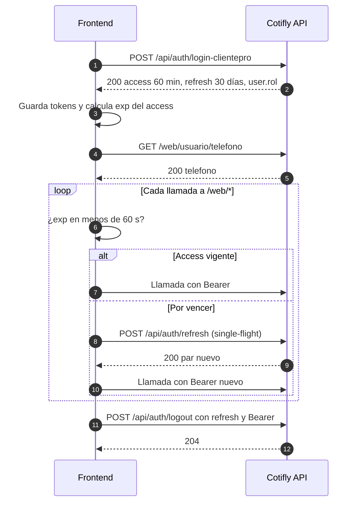

Responsabilidades del frontend:

1. Hacer el login SSO al entrar al módulo (o al arrancar la app, si el usuario tiene acceso a Cotifly).
2. Construir el menú con `user.rol` (sección 7.2).
3. Si `telefono` es null, mostrar el modal obligatorio del celular antes de la primera cotización.
4. Interceptor con refresh single-flight, un solo reintento y SSO silencioso si el refresh falla.
5. Al cerrar la sesión de ClientePro, llamar a `logout` de Cotifly y borrar los tokens.

### 6.2 Cotización por chat. Retirada en #105

La cotización por chat (slot-filling, municipios, previsualización, confirmación y PDF por `POST /web/chat`) y el selector de moneda del chat se retiraron con el agente cotizador legado (#102 la apagó, #105 borró el código). Las cotizaciones se crean con el formulario (6.4) y la moneda va en él (`moneda` de `SolicitudCosteoWeb`, #103). El chat es el asistente de una cotización ya creada (sección 10, "Asistente por folio").

### 6.3 Cotización en USD

El selector de moneda del chat se retiró (#105): la cotización en dólares se pide en el formulario (5.15, #103) o en la licitación (5.24), que fijan la TRM del día al crear la cotización. Lo que sigue vigente para el frontend:

1. (Retirado con el chat.)
2. (Retirado con el chat.)
3. Mostrar en USD: `US$ precio` y "TRM aplicada: `trm_aplicada`". Ya no se muestra un "mínimo a pagar" en pesos (decisión de negocio del 2026-10-05). Costo y utilidad, si se muestran, en COP.
4. `TRM_NO_DISPONIBLE` al crear: no se crea nada; ofrecer Reintentar o cambiar a COP.
5. (Retirado con el chat: la TRM queda fijada al crear la cotización.)
6. "Mis cotizaciones": columna `moneda` (y `trm_aplicada` si es USD).
7. El PDF en USD trae, debajo de la tabla, la nota de negocio (2026-10-05, rama de #50): "Esta cotización está bajo una TRM mínima de {TRM} y es de resaltar que la tarifa puede variar de acuerdo al comportamiento de la misma a la fecha de elaboración de la CPI.", con `{TRM}` = la `trm_aplicada` de la cotización (la del día en que se cotizó) en formato `$3.273,49`. Los PDF en COP no la llevan. No hace falta nada en el frontend; si se muestra una vista previa del texto, usar ese mismo formato.
8. El formulario ampliado de Nexo (spot) soporta USD desde #103 (HU-013.7): enviar `moneda` en `POST /web/solicitudes-costeo` (sección 5.15). Las **licitaciones** también: ver 5.24 (`moneda`).

### 6.4 Formulario ampliado con costeo en Nexo. En PR #74 a #76

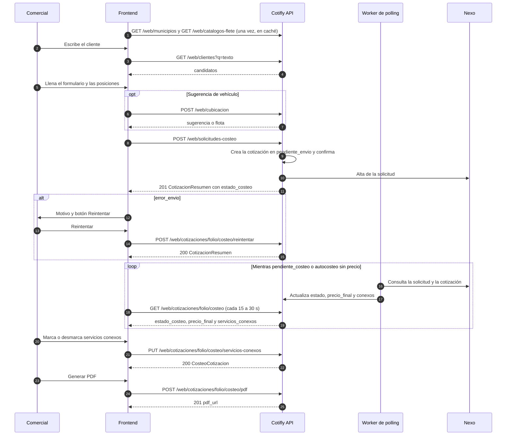

Responsabilidades del frontend, paso a paso:

1. **Catálogos** (En QA): cargar `GET /web/municipios` y `GET /web/catalogos-flete` una vez por sesión. Si fallan (`*_NO_DISPONIBLE`), deshabilitar los selects afectados y ofrecer reintento.
2. **Cliente** (En QA): autocompletado con `GET /web/clientes?q=`. Guardar `nit_cliente` y mostrar la etiqueta "Prospecto". Para prospectos, avisar que Nexo aún no los acepta (el envío quedará en `error_envio`), **Pendiente** con Nexo.
3. **Origen y destino**: autocompletado sobre el catálogo plano. Validar que el valor salga del catálogo. El frontend actual guarda `"MUNICIPIO (DEPARTAMENTO)"` para nombres repetidos, y el backend reenvía `origen` y `destino` a Nexo tal cual. **A confirmar con Nexo** si acepta ese formato o solo el `municipio` exacto (o su `id`/`codigo_dane`). Hasta confirmarlo, enviar el valor `municipio` del catálogo.
4. **Catálogos cerrados**: `tipo_vehiculo`, `carroceria` y `clase_viaje` desde `catalogos-flete` (mostrar `etiqueta`, enviar `valor`). `tipologia` y `clase_contenedor` hardcodeados con los códigos de la sección 5.15, en texto amigable.
5. **Línea de negocio**: no existe un endpoint de líneas para el comercial (`GET /web/admin/lineas-negocio` responde 403 a `comercial`). Seguir con la lista hardcodeada y manejar `MARGEN_LINEA_DESCONOCIDA` (**Pendiente**).
6. **Cubicación** (En QA, opcional): `POST /web/cubicacion` con las posiciones para sugerir el vehículo y la carrocería.
7. **Validación en el cliente** antes de enviar: obligatorios (`tipo`, `nit_cliente`, `linea_negocio`, `origen`, `destino`), regla de peso (peso > 0 o posiciones con peso; 1 % de tolerancia), máximo 2 decimales, rangos, hasta 200 posiciones, condicionales de contenedor.
8. **Enviar** (`POST /web/solicitudes-costeo`): spinner de hasta 30 s y bloqueo del doble envío. Con el 201, navegar al detalle de la cotización o a "Mis cotizaciones".
9. **Reintento**: con `error_envio` y un motivo que no empiece por "Rechazo definitivo", botón Reintentar. Si el motivo menciona tiempo agotado, advertir que se verifique en Nexo.
10. **Seguimiento del costeo (polling del frontend)**: consultar `GET /web/cotizaciones/{folio}/costeo` (o la lista) cada 15 a 30 s **solo** mientras la vista esté abierta y el estado sea `pendiente_envio`, `pendiente_costeo`, o `autocosteo` sin `precio_final`. Detenerlo en `entregada`, `descartada`, `costeo_vencido` y `error_envio`, o al tener `precio_final`. Pausarlo con la pestaña oculta (`document.visibilityState`). El servidor consulta a Nexo con un espaciado de 5 s al inicio hasta 15 min, y hasta 72 h. Consultar más seguido no acelera nada.
11. **Conexos**: checkboxes sobre `servicios_conexos` (`PUT` con la lista completa de `incluidos`). Bloquearlos si `pdf_url` tiene valor.
12. **PDF**: confirmación (una sola vez) y teléfono; luego `POST .../costeo/pdf` y descarga del blob.

### 6.5 "Mis cotizaciones": estados y botones

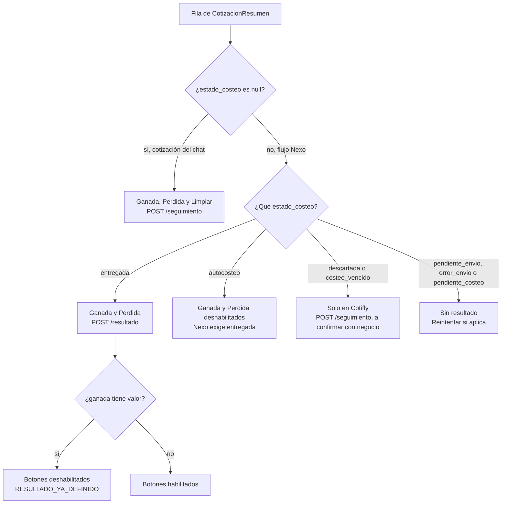

Tabla de acciones por fila (con las dos pilas fusionadas):

| Acción | Habilitada cuando | Endpoint |
|---|---|---|
| Descargar PDF | `pdf_url` no es null | `GET /pdfs/{archivo}` (blob) |
| Enviar correo | `pdf_url` no es null | `vista-previa` y luego `enviar` |
| Ganada / Perdida | `ganada` es null **y** (`estado_costeo` es null, **o** `estado_costeo = entregada`) | Chat: `/seguimiento` `{ganada, motivo_rechazo}`. Nexo: `/resultado` `{resultado, motivo, comentario}` |
| Limpiar resultado | Solo cotizaciones del chat (`estado_costeo` null) con `ganada` con valor | `/seguimiento` con `{"ganada": null}` |
| Ganada / Perdida en `descartada` o `costeo_vencido` | El backend lo permite por `/seguimiento`, solo en Cotifly. **A confirmar** con negocio si se muestra | `/seguimiento` |
| Reintentar envío a Nexo | `estado_costeo = error_envio` sin "Rechazo definitivo", o `pendiente_envio` antiguo, y `ganada` null | `/costeo/reintentar` |
| Ver costeo y conexos | `estado_costeo` con valor | `GET /costeo` |
| Nueva versión | Cotizaciones del chat | `GET /nueva-version` y luego `/web/chat` con `cotizacion_origen_id` |

Notas:

- Regla de ruteo del botón de resultado: `estado_costeo === null` → `/seguimiento`; `entregada` → `/resultado`; `descartada` o `costeo_vencido` → `/seguimiento`. Cualquier otro estado → deshabilitado. Si `/seguimiento` responde 409 `USAR_RESULTADO_NEXO`, es un error de ruteo del frontend.
- El backend también **intenta** `/resultado` en `autocosteo` (el polling pudo no ver aún la entrega), pero Nexo responde `COTIZACION_NO_ENTREGADA` mientras siga en borrador. La recomendación es habilitar solo en `entregada`. Si negocio quiere permitir el intento en `autocosteo`, manejar ese 409.
- Mientras la pila B no esté fusionada (hoy en QA), todas las filas tienen `estado_costeo` null y todo va por `/seguimiento`.
- Estado de envío: badge `sin_enviar`, `enviada` o `reenviada`. Margen negociado: badge "Ajuste fuera de política" si `origen_margen = negociado`.
- Refrescar la fila con la respuesta de `/seguimiento`, `/resultado` o `/reintentar` (devuelven `CotizacionResumen`) sin recargar la tabla.
- Vacío: "No tienes cotizaciones registradas". Carga: spinner o skeleton.

### 6.6 Envío por correo

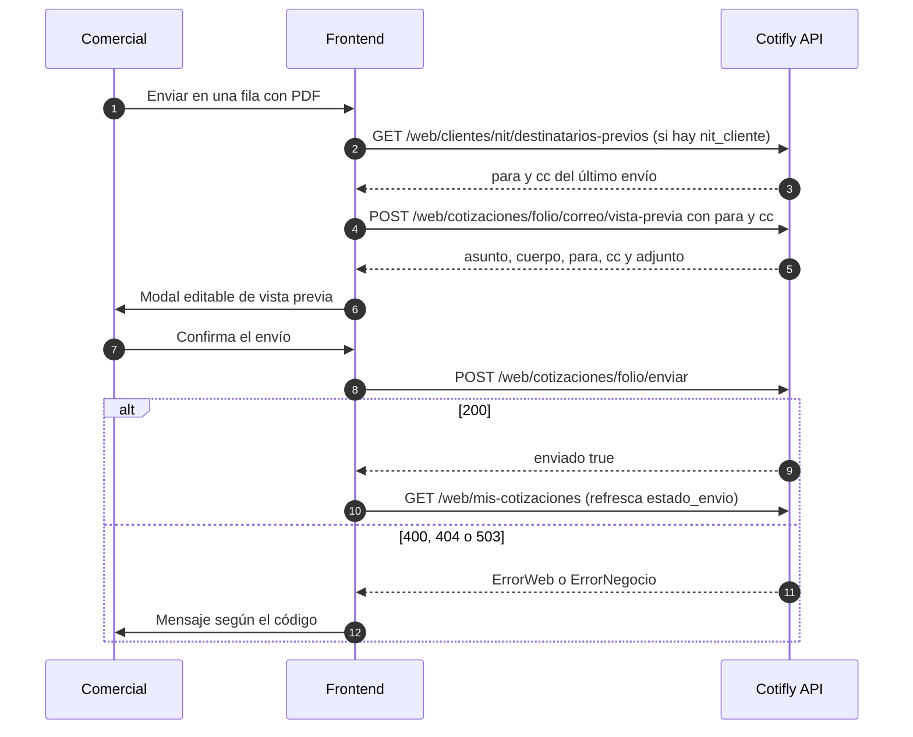

Responsabilidades: prellenar con los destinatarios previos, validar los correos en el cliente (al menos un `para`, asunto hasta 300, cuerpo hasta 5000), enviar solo desde la confirmación del modal, manejar `CORREO_DUPLICADO` (5 min) y `CORREO_DESHABILITADO` (503, apagado por defecto en ambientes sin relay) y refrescar `estado_envio`. El agente del chat también puede enviar correos (`enviar_correo`) si el comercial lo pide en el chat.

### 6.7 Administración de márgenes por línea (Gerente Comercial)

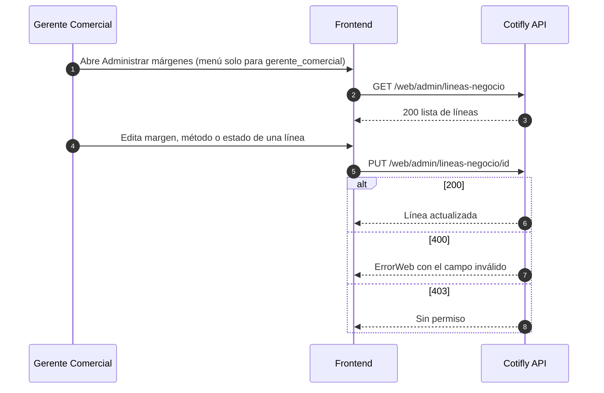

Responsabilidades: ruta y menú visibles solo con `user.rol = gerente_comercial` (el backend igual responde 403 a un comercial), edición en porcentaje convertida a fracción (0 a 99 %), confirmación antes de desactivar una línea (deja de estar disponible para cotizar) y actualizar la fila con la respuesta.

### 6.8 Tableros (métricas). PR de #45 (por abrir)

Contrato en la sección 5.22. Los dos tableros son de solo lectura, con `GET` y un filtro de periodo (por defecto el año en curso). No hay push: se recarga al cambiar un filtro o con un botón "Actualizar".

#### 6.8.1 Tablero Comercial (clientepro-frontend #50, HU-010.2)

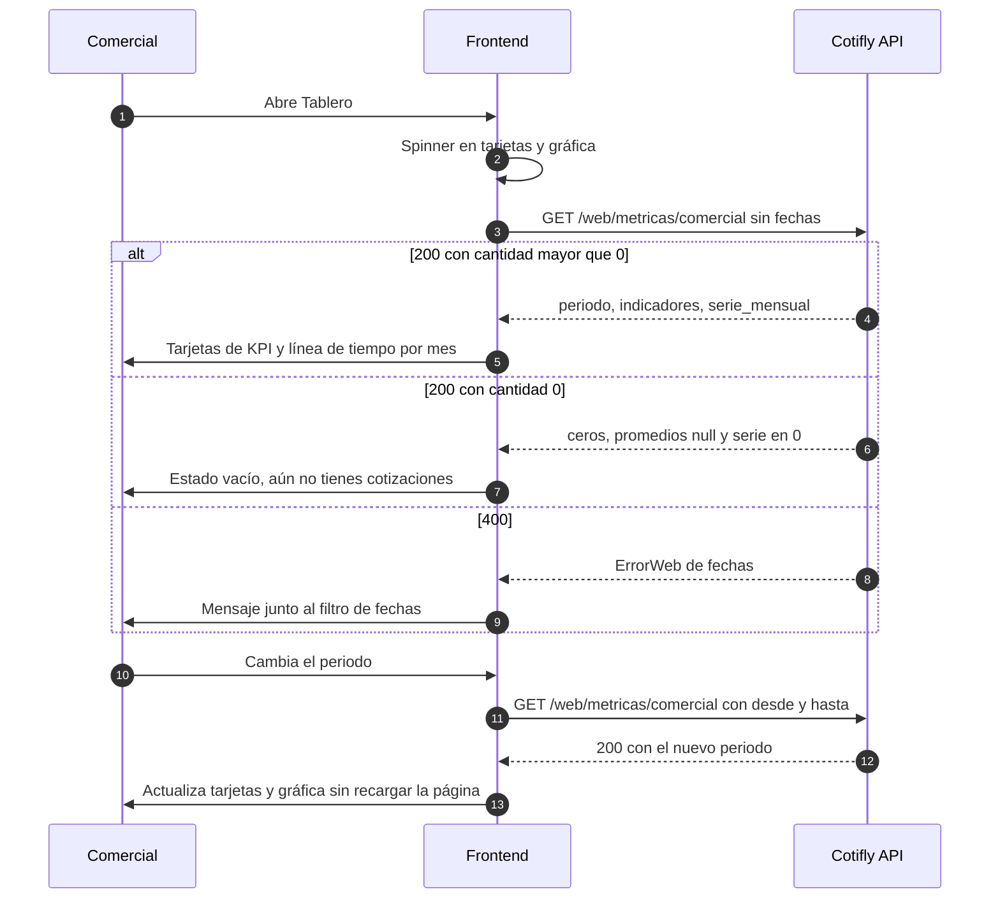

Responsabilidades del frontend:

1. Menú "Tablero" visible para `comercial` y también para `gerente_comercial` (el gerente puede ver sus propias cotizaciones; **a confirmar** con negocio si se le muestra este tablero o solo el de regional).
2. Primera carga sin `desde` ni `hasta`. Tomar `periodo` de la respuesta para inicializar el filtro.
3. Las seis métricas básicas de HU-010.2: `cantidad`, `ganadas`, `conversion` (% de conversión), `margen_promedio`, `costeo_total` y `ganancias`. Opcionales: `perdidas`, `sin_resultado` y `pendientes_por_cotizar` (las cuatro de estado suman `cantidad`), `valor_cotizado_cop`, `valor_ganado_cop` (rótulo "Valor ganado (COP)"), `costeo_ganadas` y `deadline_vencidas` (ocultarla si es `null`). Una cotización rehecha cuenta una vez, en el mes de su primera creación.
4. Gráfica con `serie_mensual` (todos los meses vienen, en 0 si están vacíos).
5. `null` se muestra como "—". Spinner mientras carga y estado vacío cuando `cantidad = 0`.
6. Validar las fechas en el cliente (`desde <= hasta`, máximo 3 años) antes de pedir.

#### 6.8.2 Tablero Gerente Comercial (clientepro-frontend #51, HU-010.3)

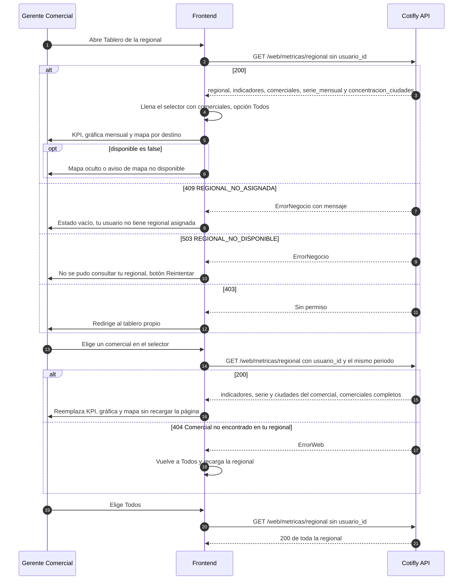

Responsabilidades del frontend:

1. Menú "Tablero de regional" y ruta visibles solo con `user.rol = gerente_comercial` (el backend responde 403 a un comercial).
2. **Selector dinámico:** se llena con `comerciales[]` (`nombre_completo`, o `nombre_usuario` si viene null), más la opción "Todos". Cambiar la selección hace una sola petición con `usuario_id` y el mismo periodo, cancela la anterior (`switchMap`) y actualiza solo `indicadores`, `serie_mensual` y `concentracion_ciudades`, sin recargar la página. `comerciales` llega completo en cada respuesta. La lista incluye al gerente (`rol: gerente_comercial`), y sus cotizaciones cuentan en el agregado "Todos". Mostrar el `rol` como etiqueta. La regional se cachea 60 s en el servidor: cambiar el selector no vuelve a consultar `DimEjecutivo`.
3. Una tabla de comerciales (opcional) sale de `comerciales[].indicadores` sin más peticiones.
4. **Gráfica:** línea de tiempo con `serie_mensual` (cantidad y ganadas, o valor cotizado y valor ganado). Para la torta por línea de negocio no hay datos agregados por línea en el contrato (**Pendiente**, sección 9).
5. **Mapa** (la HU lo llama "concentración de cotizaciones por ciudad y dinero recaudado", pero el dato es valor cotizado de lo ganado: rotularlo **"Valor ganado (COP)"**): `concentracion_ciudades.por_destino` con `cantidad` y `valor_ganado_cop`. Si `disponible = false`, ocultarlo o mostrar un estado vacío; se llena cuando el DBA aplique el `0004` (PR #73). Mostrar aparte `sin_destino` ("sin ciudad", las del chat) solo cuando `disponible = true`. Hay que resolver en el frontend las coordenadas a partir del nombre del municipio.
6. **409 `REGIONAL_NO_ASIGNADA`:** estado vacío con el `mensaje` del error y el texto "Pide al administrador que registre tu regional". No reintentar en bucle.
7. **503 `REGIONAL_NO_DISPONIBLE`:** aviso con botón Reintentar (fuente caída; el servidor no cae al respaldo).
8. `lineas_negocio_activas` como tarjeta informativa (no depende del filtro).
9. Mostrar `regional` en el encabezado. `fuente_regional` solo sirve para soporte (no mostrarlo al usuario).

#### 6.8.3 QA de cálculos (clientepro-frontend #52, HU-010.4)

Las definiciones de la sección 5.22.2 son recalculables a mano sobre `dbo_cotifly`. El escenario del `.feature` (sección 5.22.2, "Comprobación") sirve como caso de referencia. El frontend no recalcula nada: muestra lo que devuelve la API.

### 6.9 Licitación desde Excel. PR de #47 a #49

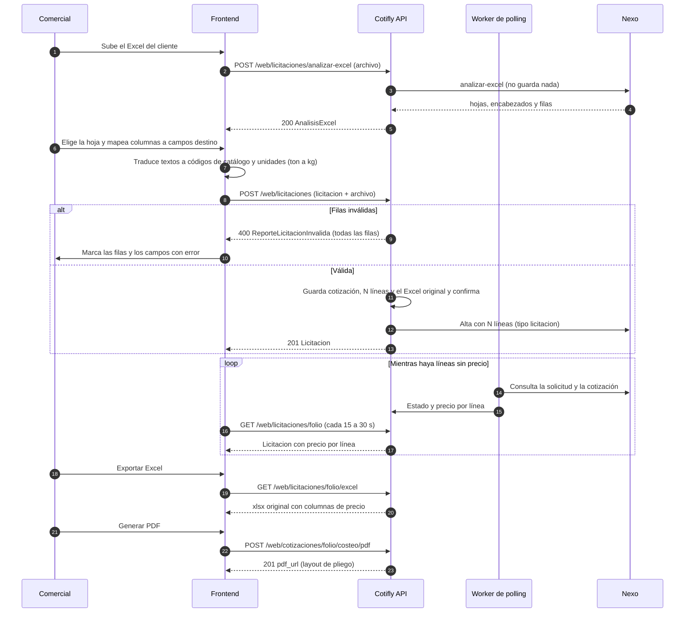

Responsabilidades del frontend:

1. **Analizar** (5.23) y mostrar las hojas; el comercial elige una y asigna columnas a los campos destino (`docs/conexion_nexo/HU-011-formato-excel-licitacion.md` §3). Las columnas sin asignar se ignoran y se conservan en la exportación.
2. **Traducir** cada celda al código del catálogo (vehículos, carrocerías, clases y tipologías de `GET /web/catalogos-flete`) y las unidades (toneladas × 1000, metros × 100). Cargar los catálogos una sola vez, no por fila. El origen y el destino pueden ir como texto: la API los resuelve a `origen_municipio_id`/`destino_municipio_id` (5.24, HU-013.11). Si el frontend ya tiene el id (el comercial lo eligió en `GET /web/municipios`), enviarlo.
3. **Validar en el cliente** con las reglas de 5.15 (códigos exactos y reglas de contenedor y aprovisionamiento) y marcar las filas antes de enviar; el servidor vuelve a validar todo y devuelve el reporte por fila.
4. **Corregir el reporte (HU-013.11):** con `CODIGO_NO_CATALOGO`, ofrecer el selector del catálogo en esa celda; con `MUNICIPIO_AMBIGUO`, mostrar los candidatos del `mensaje` (o filtrar `GET /web/municipios`) y reenviar la fila con el id elegido; con `MUNICIPIO_NO_ENCONTRADO`, pedir que corrija el texto o elija el municipio. Con 503 `CATALOGOS_FLETE_NO_DISPONIBLE` o 400 `MUNICIPIOS_NO_DISPONIBLE`, nada se guardó: ofrecer Reintentar.
5. **Enviar** con el archivo (5.24); spinner de hasta 30 s y bloqueo del doble envío (un segundo POST crea otra licitación).
6. **Seguimiento**: `GET /web/licitaciones/{folio}` cada 15 a 30 s mientras haya líneas sin precio y el estado sea `pendiente_costeo` o `autocosteo`; detener en `entregada`, `descartada`, `costeo_vencido` o `error_envio`.
7. **Reintento** con `error_envio`: `POST /web/cotizaciones/{folio}/costeo/reintentar` (todas las líneas, con los mismos ids de municipio y horas).
8. **Exportar** (5.26, PR de #48) y **PDF** (5.19 con layout de pliego, PR de #49).

## 7. Estados y reglas de UI

### 7.1 Máquina de estados de `estado_costeo` (En PR #74 a #77)

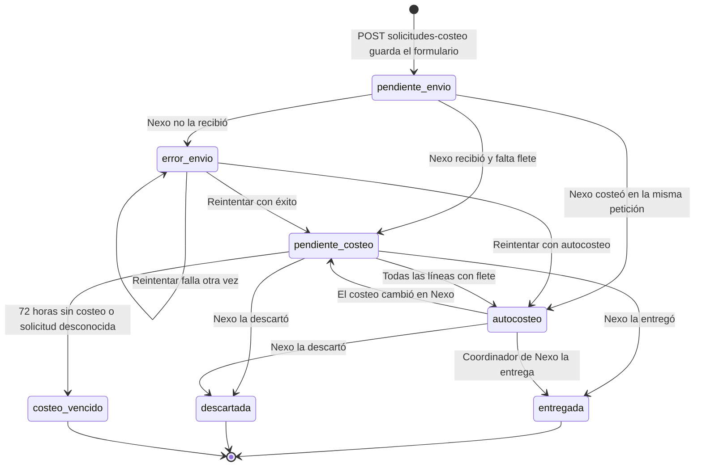

`null` = la cotización no pasa por Nexo (chat con costo manual). No aparece en el diagrama.

Notas del diagrama:

- `autocosteo → pendiente_costeo` sale de la regla de derivación del dominio (si en una consulta alguna línea queda sin flete). Es un caso raro y **a confirmar** que Nexo lo produzca.
- `autocosteo` a las 72 h **no** cambia de estado: solo deja de consultarse.
- En `entregada` y `autocosteo`, `POST .../resultado` puede pasar la cotización a `entregada` en el mismo momento, si Nexo la entrega al marcar el resultado.

UI por estado:

| `estado_costeo` | Etiqueta sugerida | Precio | Acciones | Polling del frontend |
|---|---|---|---|---|
| `null` | (sin etiqueta, "Chat") | `precio_final` | PDF, Enviar, Ganada/Perdida/Limpiar por `/seguimiento`, Nueva versión | No |
| `pendiente_envio` | "Enviando a Nexo" | "—" | Reintentar tras 2 minutos | Sí, corto |
| `error_envio` | "No llegó a Nexo" (rojo) y `motivo_estado_costeo` | "—" | Reintentar (salvo "Rechazo definitivo") | No |
| `pendiente_costeo` | "En costeo" (ámbar) | "Pendiente" | Ninguna de resultado | Sí |
| `autocosteo` | "Costeada (borrador Nexo)" | `precio_final` cuando llegue | Conexos y PDF (a confirmar si solo en `entregada`); resultado deshabilitado | Hasta tener `precio_final` |
| `entregada` | "Entregada" (verde) | `precio_final` | Conexos, PDF, Enviar, Ganada/Perdida por `/resultado` | No |
| `descartada` | "Descartada por Nexo" (gris) | "—" | Ganada/Perdida solo en Cotifly por `/seguimiento` (a confirmar) | No |
| `costeo_vencido` | "Costeo vencido" (gris) y motivo | "—" | Ídem `descartada` | No |

`motivo_estado_costeo` también puede avisar que el costeo cambió en Nexo después del PDF (el precio del PDF se conserva). Mostrarlo como tooltip o línea secundaria siempre que venga.

### 7.2 Roles y menú

| Elemento | `comercial` | `gerente_comercial` | Regla del backend |
|---|---|---|---|
| Cotizador (Nueva cotización, Asistente, Mis cotizaciones) | Sí | El backend **lo permite** (política `Comercial`: "el gerente también cotiza"). HU-004.3 dice "solo comercial": **a confirmar** con negocio | `/web/*` acepta ambos roles |
| Tablero propio (`/web/metricas/comercial`) | Sí (HU-010.2) | El backend lo permite (ve solo lo suyo); **a confirmar** si se muestra | Política `Comercial` |
| Tablero de regional (`/web/metricas/regional`) | No (403) | Sí (HU-010.3): su regional, filtrable por comercial | Política `GerenteComercial`; 409 sin regional |
| Administrar márgenes | No | Sí | `/web/admin/*` solo `gerente_comercial` (403 si no). HU-004.10 dice "rol admin": es `gerente_comercial` |
| PDF de otros comerciales | No | Solo de su regional (y solo si su regional se conoce) | `/pdfs` |

- Usar `user.rol` del login de Cotifly (o el claim `rol`), no los `IDROLES` de ClientePro.
- Proteger las rutas con guards además de esconder los menús; el backend igual valida.

### 7.3 Estados vacíos, de carga y de error

| Situación | UI |
|---|---|
| Login SSO en curso | Pantalla de carga del módulo |
| 401 del login | "No tienes acceso a Cotifly" (sin reintento automático) |
| Lista vacía | "No tienes cotizaciones registradas" |
| Turno de chat en curso | Indicador "escribiendo...", input deshabilitado, timeout de al menos 120 s (sección 2.8.1) |
| `error: true` en el chat | Burbuja de aviso con `texto` e input reactivado |
| Catálogos no disponibles | Selects deshabilitados y "Reintentar" |
| Buscador sin resultados | "Sin coincidencias" (no es un error) |
| Envío a costeo (hasta 30 s) | Spinner con texto "Enviando a Nexo..." y botón deshabilitado |
| Costeo pendiente | Badge "En costeo" y hora de la última actualización |
| 429 | "Demasiadas peticiones. Intenta en unos segundos", y reintentar a los 60 s |
| 503 de correo o Nexo | Mensaje del código, sin cambiar el estado de la fila |
| 413 | "El contenido es demasiado grande" (revisar las posiciones o el mensaje) |
| Métricas sin datos | Tarjetas en 0, promedios "—" y el texto "Aún no tienes cotizaciones en este periodo" |
| Gerente sin regional (409) | "Tu usuario no tiene una regional asignada" |
| Mapa sin `0004` (`disponible = false`) | Mapa oculto o estado vacío |

## 8. Checklist para el desarrollador frontend

### 8.1 Se puede construir ya contra QA

| Tarea | Endpoints | Issue en `clientepro-frontend` |
|---|---|---|
| Login SSO, interceptor con refresh single-flight, logout, guards por `user.rol` | `/api/auth/*` | HU-004.3 (#34, cerrado); verificar el interceptor frente a #17 (refresh de ClientePro) |
| Modal de celular y confirmación del teléfono antes del PDF | `/web/usuario/telefono` | HU-004.3 (#34), HU-004.4 (#35) |
| Vista "Asistente" y formulario simple por chat: progreso, previsualización, Confirmo, Ajustar, descarga del PDF por blob | `/web/chat`, `/pdfs` | HU-004.4 (#35, **cerrado con criterios sin marcar**: verificar), HU-004.6 (#37) |
| "Mis cotizaciones": tabla, versión, badges, motivo, Ganada/Perdida/Limpiar por `/seguimiento`, Nueva versión | `/web/mis-cotizaciones`, `/seguimiento`, `/nueva-version` | HU-004.5 (#36; quedan sin marcar los botones de resultado y el deshabilitado por estado) |
| Correo: destinatarios previos, vista previa y envío | `destinatarios-previos`, `vista-previa`, `enviar` | HU-004.5 (#36) |
| Buscador de clientes con etiqueta Prospecto | `/web/clientes` | HU-005.2 / HU-005.11 (#44, cerrado) |
| Selector de municipios (catálogo plano) | `/web/municipios` | HU-005.12 (#43) y HU-005.13 (#48), cerrados. Revisar el formato enviado (sección 6.4, paso 3) |
| Campos del formulario ampliado con catálogos reales de vehículo, carrocería y clase de viaje | `/web/catalogos-flete` | HU-005.3 (#39, cerrado). Reemplazar el hardcode de esos tres por el endpoint |
| Cubicaje por posiciones y sugerencia de vehículo | `/web/cubicacion` | HU-005.4 (#40, cerrado) |
| Pantalla de márgenes para `gerente_comercial` | `/web/admin/lineas-negocio` | HU-004.10 (#46, cerrado; corregir "rol admin" a `gerente_comercial`) |
| Selector COP/USD en el formulario por chat, visualización en USD, `TRM_NO_DISPONIBLE`, TRM vencida, columna `moneda` y `trm_aplicada` en "Mis cotizaciones" | `/web/chat` (`moneda`, `errores`), `/web/mis-cotizaciones` | HU-012.4 (#55). Ya está en QA desde #70 y #71 |
| Pruebas QA del módulo migrado | Todo lo anterior | HU-004.8 (#38) |

### 8.2 Espera a un PR (construir con mocks de esta guía)

| Tarea | Espera | Issue |
|---|---|---|
| QA de conversión de moneda (el precio ya está en QA; falta el PDF en USD con la nota de TRM mínima) | Rama de #50 | HU-012.5 (#56) |
| Enviar el formulario ampliado a Nexo, estados `estado_costeo`, `motivo_estado_costeo` y Reintentar | PR #73 y #74 | HU-005.3 (#39), HU-005.5 (backend) |
| Polling del frontend y estados que avanzan solos | PR #75 | HU-005.6 (backend), "Mis cotizaciones" (#36) |
| Vista de costeo, selección de conexos y PDF del costeo | PR #76 | HU-005.7 (backend); patrón reutilizable para HU-011.4 (#53) |
| Botón Ganada/Perdida por `/resultado` y ruteo `/seguimiento` frente a `/resultado` | PR #77 | HU-004.5 (#36), HU-005.14 |
| QA end-to-end con Nexo | Toda la pila B | HU-005.9 (#41) |
| **Tablero Comercial**: tarjetas con los KPI, filtro de periodo, gráfica con `serie_mensual`, estado vacío y promedios "—". Nada depende del DBA | PR de #45 (por abrir). Se puede empezar ya con los ejemplos de la sección 5.22 | HU-010.2 (#50) |
| **Tablero Gerente**: selector dinámico con `comerciales`, filtro por `usuario_id` sin recargar, gráfica, tabla por comercial, UX de 409, 503 y 404, y mapa con su estado vacío (`disponible = false`) | PR de #45 (por abrir) para el código; **datos reales** esperan al DBA (ver 8.3) | HU-010.3 (#51) |
| **QA de cálculos**: recalcular cada campo con las definiciones de la sección 5.22.2 | PR de #45 fusionado y datos en QA | HU-010.4 (#52) |

### 8.3 Espera a otros trabajos

| Tarea | Espera | Issue |
|---|---|---|
| Tablero del gerente con datos reales (no 409) | El DBA llena `UsuariosWeb.regional` de gerentes y comerciales (después de su primer login), o se conecta `DimEjecutivo` (`ConnectionStrings__Regional`). Mientras tanto, todo gerente recibe 409 `REGIONAL_NO_ASIGNADA` | HU-010.3 (#51), HU-010.4 (#52) |
| Mapa de concentración por ciudad con datos | El DBA aplica el `0004` (PR #73) y hay cotizaciones del formulario ampliado (las del chat no guardan ciudades) | HU-010.3 (#51) |
| `tiempo_promedio_cotizacion_horas` con valor | `costeoListoAt` lo llena el flujo de costeo de Nexo (PR #76) | HU-010.3 (#51) |
| Torta por línea de negocio | No hay agregado por línea en el contrato (**Pendiente**) | HU-010.3 (#51) |
| Licitaciones por Excel (carga, progreso por línea y exportación) | HU-011.1 a HU-011.3 (backend no construido) | HU-011.4 (#53), HU-011.6 (#54) |
| Selector de líneas de negocio activas para el comercial | Endpoint no existente (**Pendiente**) | HU-005.3 (#39, comentario) |
| Score de urgencia | Contrato de Nexo (**Pendiente**) | HU-010.3 (#51) |
| `deadline_vencidas` con valor (hoy `null`) | El DBA aplica el `0004` (columna `deadline`) | HU-010.3 (#51) |
| Montos con servicios conexos | Integración de conexos en métricas, después de #42 (**Pendiente**) | HU-010.2 (#50), HU-010.3 (#51) |

Ajenos a Cotifly: clientepro-frontend #45 (embarqa; no confundir con el issue #45 de Cotifly, HU-010.1) y #66 (ajustes visuales del portal).

## 9. Pendientes y preguntas abiertas que afectan al frontend

| Tema | Pregunta o pendiente | Dueño | Impacto en la UI |
|---|---|---|---|
| Nexo: formato de origen y destino | ¿Nexo acepta `"MUNICIPIO (DEPARTAMENTO)"` o solo el `municipio` exacto (o `id`/`codigo_dane`)? El backend reenvía el texto tal cual | Duban + equipo Nexo | Qué se envía en `origen`, `destino` y las ciudades del contenedor |
| Nexo: prospectos | Nexo exige `clienteId` o `clienteBp`; un prospecto sin BP queda en `error_envio` | Duban + equipo Nexo | Advertir o bloquear prospectos en el formulario ampliado |
| Nexo: códigos de catálogo | Resuelto en HU-013.10 (#106): `catalogos-flete` sale de los catálogos maestros (`GET /api/catalogos/*`) y el backend rechaza lo que no es código | Duban + equipo Nexo | Confirmar si `clases-contenedor` trae los códigos `CNT..` |
| Nexo: urgencia | Score de urgencia mayor a 75: **no implementado** (ADR-016). No hay contrato de Nexo. Llegará como campo nuevo de `indicadores` (cambio compatible). El "deadline vencido" sí está (`deadline_vencidas`, calculado por Cotifly; `null` sin el `0004`) | Duban + equipo Nexo | Tablero del gerente (HU-010.3): no mostrar la tarjeta de urgencia todavía |
| Métricas: servicios conexos | Los montos del tablero no suman conexos todavía; se integran después de #42 | Duban | Aviso "valores sin servicios conexos" si hace falta |
| Nexo: idempotencia del alta | Sin clave de idempotencia: un reintento tras tiempo agotado puede duplicar | Equipo Nexo | Advertencia en Reintentar |
| Nexo: autenticación | Hoy `X-Portal-Usuario-Id` del comercial, sin token. ¿API key o JWT de servicio? | Duban + equipo Nexo | Ninguno directo; un comercial sin `idUsuarioExterno` recibe `*_NO_DISPONIBLE` |
| Nexo: polling | Intervalos (5 s a 15 min, 72 h) pendientes de aprobar por Nexo | Equipo Nexo | Tiempo que una fila queda "En costeo" |
| Negocio: PDF en `autocosteo` | ¿Se permite el PDF con el costeo automático o solo en `entregada`? | Gerencia Comercial | Habilitar el botón PDF y los conexos |
| Negocio: `margen_aplicado` visible | Junto a `precio_final` permite deducir el costo de Nexo. ¿Ocultarlo en el flujo de Nexo? | Gerencia Comercial | Columna de margen |
| Negocio: conexos | ¿Los conexos llevan el mismo margen que el flete? ¿El PDF muestra un total? | Gerencia Comercial | Totales en la vista de costeo |
| Negocio: resultado en `descartada`/`costeo_vencido` | El backend lo permite solo en Cotifly. ¿Se muestra el botón? | Gerencia Comercial | Botones de "Mis cotizaciones" |
| Negocio: menú del gerente | ¿El gerente ve el Cotizador? El backend lo permite; HU-004.3 dice solo comercial | Negocio + Sara | Menú |
| Negocio: nueva versión de una cotización de Nexo | `PDF_YA_GENERADO` dice "genera una versión nueva", pero `solicitudes-costeo` no crea versiones (`-vN`) | Duban + negocio | Botón "Nueva versión" en filas de Nexo |
| Negocio: USD en el costeo de Nexo | La pila B es solo COP | Duban (integración HU-012 con ADR-015) | Selector de moneda en el formulario ampliado |
| Negocio: v2 en USD | ¿TRM de la original o la del día al rehacer? | Gerencia Comercial | Texto de la nueva versión |
| Negocio: texto de la nota del PDF en USD | Definido el 2026-10-05 (nota de TRM mínima, ADR-014 §4) | Gerencia Comercial | Ninguno (lo pone el PDF) |
| Backend: precio del ajuste de margen | `RespuestaChat.precio` no expone la salida de `registrar_ajuste_margen` | Duban | Precio estructurado tras "Ajusta el margen" |
| Backend: endpoint de líneas para el comercial | No existe; el selector sigue hardcodeado | Duban | Selector de línea (HU-005.3) |
| Backend: PR de #45 | Las ramas #72 a #79 y la de #45 fusionan sin conflictos contra `QA`. Falta abrir el PR de #45 | Duban | Ninguno en el contrato |
| ClientePro: identidad | ¿Qué valor de la sesión de ClientePro es `idUsuario` (`NOMBREUSUARIO` o `ID`)? | Sara + scalderon-bs | Llamada al login |
| ClientePro: seguridad del login | El login confía en `idUsuario` (riesgo crítico de ADR-009): se planea una aserción firmada por el backend de ClientePro | Duban + scalderon-bs | El request del login podría cambiar (un campo más) |
| DBA: `IDROLES` | Sin `Roles.idRolExterno` nadie entra | DBA + ClientePro | Todo login responde 401 hasta que se fijen |
| Infraestructura: dominios y URL | Orígenes CORS de ClientePro por ambiente y URL de la API | Sara + infraestructura | `environment.ts` |
| Infraestructura: salida a `datos.gov.co` | Sin ella, todo USD responde `TRM_NO_DISPONIBLE` | Infraestructura | Aviso de TRM |
| DBA: datos de la regional | Confirmar la tabla (`DWCubosEBSSAP.DimEjecutivo`: esquema, columna de usuario, columna `REGIONAL`, si incluye a los gerentes y el catálogo de valores), dar acceso de solo lectura y `ConnectionStrings__Regional`. Mientras tanto, llenar `UsuariosWeb.regional` con un `UPDATE` (plantilla en `docs/10-operacion.md`) | DBA / equipo de datos / infraestructura | Sin esto el tablero del gerente responde 409 `REGIONAL_NO_ASIGNADA`. `user.ubicacion` del login refleja `UsuariosWeb.regional`, no `DimEjecutivo` (**a confirmar** que coincidan) |
| DBA: `0004` | Aplicar el script `0004` (PR #73) | DBA | Mapa de ciudades (`disponible = false` hasta entonces) |
| Negocio: validar las definiciones de métricas (ADR-016, Propuesta) | Una fila por cadena de versiones con el periodo por la primera creación y el resultado más reciente de la cadena (frente a contar cada versión, como decía el backlog); `conversion` sobre el total (y no sobre las cerradas); `costeo_total` sobre todo el universo; `ganancias` solo de ganadas; periodo por defecto (año en curso); que las cotizaciones del gerente cuenten en el agregado de su regional; que `valor_ganado_cop` sea valor cotizado y no dinero recaudado | Gerencia Comercial (Sara / scalderon-bs) | Etiquetas y tarjetas del tablero; posible cambio de definiciones |
| Negocio: tablero propio del gerente | ¿El gerente ve también `/web/metricas/comercial` en su menú? | Negocio + Sara | Menú |
| Tiempo de un turno de chat | Propuesta del backend (#84): timeout de cliente ≥ 120 s (sección 2.8.1). Confirmar con frontend y verificar los timeouts de Traefik | Duban + Sara | Configuración de `HttpClient` |

## 10. Próximo contrato HU-013 (en construcción)

**Estado: implementado en el backend** (ajuste de margen y concurrencia #98, servicios conexos #99, "Cotizar costo" #100, textos del PDF #101, asistente por folio #102 y moneda del formulario #103; los de #102 entran a QA con su PR). Ningún endpoint de esta sección queda con `x-estado: pendiente` en `backend-dotnet/specs/openapi.yaml`: ya se puede integrar. Quedan pendientes #104 (la guía completa de estos flujos) y #105 (retiro de Google Chat y del código legado del chat). Decisión: ADR-018 (2026-10-05). Fuente de verdad: el spec. Esta sección solo resume.

**Qué cambia.** La cotización sale siempre del formulario y del costeo de Nexo (sección 6.4):

- el costo lo da Nexo;
- el margen sugerido, SAP TM o la política de la línea;
- el precio y el PDF, el código.

La IA solo redacta el asunto y la introducción del PDF, y **propone** acciones. El chat ya no crea cotizaciones, y Google Chat se retiró (#105).

| Endpoint | Para qué | Issue |
|---|---|---|
| `POST /web/solicitudes-costeo` + `moneda` (`COP` o `USD`) | **Implementado (#103).** Formulario en dólares con la TRM fijada al crear; sin TRM responde 400 `TRM_NO_DISPONIBLE` y no se crea nada. Ver 5.15 | #103 (HU-013.7) |
| `PUT /web/cotizaciones/{folio}/costeo/margen` `{margen, justificacion?, linea_orden?, linea_solicitud_id?}` | **Implementado (#98; por ruta en #135).** Ajuste de margen de 0 a 0,99 de UNA ruta, con `If-Match` obligatorio. Con varias rutas y sin indicarla, 400 `RUTA_REQUERIDA` (sección 5.18.1). La justificación es obligatoria por debajo del `margen_sugerido` de la ruta (400 `JUSTIFICACION_REQUERIDA` con `detalle.margen_sugerido`). Responde `CosteoCotizacion` con los precios recalculados y el `ETag` nuevo | #98 (HU-013.2), #135 (HU-021.8) |
| `GET /web/servicios-conexos?q=&categoria=&page=&page_size=` | **Implementado (#99).** Buscador del catálogo de Nexo: solo servicios activos y nunca su costo. Ver abajo | #99 (HU-013.3) |
| `POST /web/cotizaciones/{folio}/costeo/servicios-conexos` `{items: [{linea_orden, servicio_id, cantidad}]}` | **Implementado (#99).** Agrega conexos en Nexo; vuelven con precio e incluidos. `If-Match` obligatorio e `Idempotency-Key` opcional. Ver abajo | #99 (HU-013.3) |
| `POST /web/cotizaciones/{folio}/costeo/re-solicitar` `{motivo, datos_carga?, nueva_version?}` | **Implementado (#100).** Botón "Cotizar costo": 200 con el mismo folio, o 201 con la versión `-vN` (y `Location`) si cambia la carga o con `nueva_version: true`. `If-Match` obligatorio e `Idempotency-Key` recomendada. Ver "Cotizar costo" abajo | #100 (HU-013.4) |
| `POST /web/cotizaciones/{folio}/costeo/textos/redactar[?sobrescribir=true]` | **Implementado (#101).** Sin cuerpo, con `If-Match` obligatorio. La IA redacta el asunto y la introducción y responde 200 `TextosCotizacion` con el `ETag` nuevo (`fuente`: `ia`, o `estandar` si la IA tardó más de 15 s, falló o su texto no pasó la validación: nunca un error por la IA). Sobre textos editados responde 409 `TEXTOS_EDITADOS` sin llamar a la IA, salvo con `sobrescribir=true` | #101 (HU-013.5) |
| `PUT /web/cotizaciones/{folio}/costeo/textos` `{asunto, introduccion}` | **Implementado (#101).** El comercial edita los textos (`editado: true`), con `If-Match` obligatorio. Asunto de 1 a 120 caracteres e introducción de 1 a 1100, sin URL ni correos (400 `TEXTOS_COTIZACION_INVALIDOS`); los montos sí se permiten | #101 (HU-013.5) |
| `POST /web/chat` con `folio` obligatorio | **Implementado (#102).** Asistente sobre una cotización. Sin folio: 400 `FOLIO_REQUERIDO`; folio ajeno o inexistente: 404. Responde `{texto, accion_propuesta?}`. Ver "Asistente por folio" abajo | #102 (HU-013.6) |
| `POST /chat/events` | **Retirado (#105).** Responde 404 | #105 (HU-013.9) |

**`GET /web/cotizaciones/{folio}/costeo`** suma `margen_sugerido`, `origen_margen`, `pdf_desactualizado` y `row_version`, y el encabezado `ETag` (implementados en #98); `trm_aplicada` (#103) y `textos` (asunto e introducción guardados, o `null` si todavía no hay; #101) ya están. `PUT .../servicios-conexos` ya exige `If-Match` y, con el PDF generado y sin enviar, lo invalida en lugar de responder `PDF_YA_GENERADO` (#98). `GET /web/metricas/ajustes-margen` trae `num_ajustes_bajo_sugerido`.

**Servicios conexos de Nexo (implementado en #99).**

- **Buscar:** `GET /web/servicios-conexos?q=alm&categoria=logistico&page=1&page_size=20`. `q` busca en el nombre o el código (hasta 100 caracteres), `categoria` es `logistico` o `adicional`, `page` desde 1 y `page_size` de 1 a 50 (por defecto 20). Responde `PaginaServiciosConexos` `{total, page, page_size, items: [{id, codigo, nombre, categoria, unidad, origen, destino, puerto, ruta, tipo_maquina, vigencia}]}`. Nunca trae costos. Errores: 400 `ErrorWeb` (filtro fuera de límites), 403 `NEXO_SIN_PERMISO` (el comercial no tiene rol en Nexo), 503 `NEXO_NO_DISPONIBLE`.
- **Agregar:** `POST /web/cotizaciones/{folio}/costeo/servicios-conexos` con `{"items": [{"linea_orden": 1, "servicio_id": "<id del catálogo>", "cantidad": 2}]}`. Entre 1 y 20 items; `cantidad` de 0,01 a 999.999,99 con hasta 2 decimales; `linea_orden` es 1 en una cotización del formulario. Encabezados: `If-Match` (obligatorio) e `Idempotency-Key` (un UUID nuevo por clic). Responde 200 `CosteoCotizacion` con el `ETag` nuevo: los conexos agregados quedan en `servicios_conexos` con su `precio` (con el margen de la cotización) e `incluido = true`. Si había PDF sin enviar, queda `pdf_desactualizado`.
- **Errores al agregar:** 400 `ErrorWeb` (items vacíos, más de 20 o fuera de rango); 400 `CONEXO_INVALIDO` (la línea no existe o Nexo no acepta el servicio; `detalle.motivo` trae el código de Nexo); 403 `NEXO_SIN_PERMISO`; 404 (no es suya); 409 `COSTEO_NO_LISTO`, `LINEA_SIN_COTIZACION_NEXO` (esa línea todavía no tiene flete en Nexo), `PDF_YA_ENVIADO`, `ESTADO_NO_PERMITE` con `detalle.motivo = LICITACION` (las licitaciones no admiten conexos todavía) y `CONFLICTO_CONCURRENCIA`; 428 sin `If-Match`; 503 `NEXO_NO_DISPONIBLE`. En `detalle.motivo` viaja solo el código de Nexo (o `HTTP 401`), nunca su texto.
- **Tras un rechazo de Nexo el `ETag` YA CAMBIÓ.** Un 400 `CONEXO_INVALIDO` de Nexo, un 403 `NEXO_SIN_PERMISO` o un 503 `NEXO_NO_DISPONIBLE` llegan después de reservar la versión: el conexo no se agregó, pero el `If-Match` que se usó ya no sirve. Antes de reintentar (o de ofrecer otro servicio), recargar el costeo (`GET .../costeo`) y usar su `ETag` nuevo; si no, el reintento responde 409 `CONFLICTO_CONCURRENCIA`.
- **503 con `detalle.agregado_en_nexo = true`:** Nexo sí agregó el conexo pero no se pudo leer de nuevo la cotización. **No reintentar el POST**: avisar "El conexo se agregó; su precio aparecerá en unos segundos" y seguir consultando `GET .../costeo`. Un 409 `CONFLICTO_CONCURRENCIA` con `agregado_en_nexo = true` significa lo mismo: recargar el costeo, no volver a agregar.
- **503 con `detalle.agregado_en_nexo = "desconocido"`:** Nexo no respondió y no se pudo confirmar si agregó el conexo. Avisar "No sabemos si el conexo se agregó; revisa el costeo en unos minutos" y no ofrecer reintentar hasta recargar el costeo.
- **Versión reservada:** de dos peticiones con el mismo `If-Match`, solo una llega a Nexo; la otra recibe 409 `CONFLICTO_CONCURRENCIA`. Si Nexo falla después de reservar, el `ETag` ya cambió: recargar el costeo antes de reintentar.
- **Doble clic:** con la misma `Idempotency-Key`, la segunda petición devuelve la misma respuesta (mismo cuerpo y `ETag`) sin repetir el POST en Nexo. La misma clave con otro cuerpo responde 400. Generar una clave nueva para cada intención del usuario, no para cada reintento de red.
- Quitar un conexo o cambiar su cantidad es `PUT .../servicios-conexos` por ruta (sección 5.18.1); no lo borra en Nexo (Cotifly es la fuente de los conexos).

**"Cotizar costo" (`re-solicitar`, implementado en #100).** Nexo no tiene "reabrir": Cotifly hace una captura nueva en Nexo con lo guardado y guarda el id de la solicitud nueva.

- **Cuándo mostrar el botón.** Mismo folio: `estado_costeo` en `costeo_vencido`, `entregada` o `error_envio`, `estado_envio = sin_enviar` y sin resultado. Versión nueva: en cualquier estado salvo `pendiente_envio` y `pendiente_costeo`.
- **Mismo folio** (cuerpo `{"motivo": "..."}`): 200 `CotizacionResumen` en `pendiente_costeo` (o `error_envio` si Nexo falla, con `motivo_estado_costeo`). Precio y conexos anteriores desaparecen (`precio_final = null`) hasta el nuevo costeo, y el PDF queda desactualizado. Guardar el `ETag` de la respuesta.
- **Versión nueva** (`datos_carga` con solo los campos que cambian, o `nueva_version: true`): 201 con la cotización `-vN` y `Location: /web/cotizaciones/{folio nuevo}/costeo`. Navegar a la versión nueva; la original no cambia. Un campo de `datos_carga` en `null` se borra (ej. `clase_contenedor` al pasar a carga suelta); `posiciones`, si viene, reemplaza todas. Origen, destino, cliente y línea no se cambian aquí: el backend responde 400.
- **Errores.** 400 `SOLICITUD_COSTEO_INVALIDA` (motivo vacío o de más de 300 caracteres, `datos_carga` vacío o con un campo no permitido, o reglas de la captura como el peso); 409 `ESTADO_NO_PERMITE` (estado; con `detalle.motivo = LICITACION` si se mandan cambios de carga a una licitación), `PDF_YA_ENVIADO` (ofrecer la versión con `nueva_version: true`) o `CONFLICTO_CONCURRENCIA`; 428 sin `If-Match`. Un `error_envio` por rechazo definitivo de Nexo (motivo "Rechazo definitivo de Nexo…") no se reenvía igual: pedir los cambios de carga.
- **Dólares.** En el mismo folio la cotización conserva su moneda y su TRM. La versión nueva copia la moneda y toma la TRM del día (puede diferir de la original); si no hay TRM responde 400 `TRM_NO_DISPONIBLE` y no se crea nada: mostrar "no hay TRM disponible, intenta más tarde".
- **Doble clic.** Generar un UUID por clic y enviarlo en `Idempotency-Key`: la repetición devuelve la misma respuesta sin crear otra versión ni reenviar a Nexo. La misma clave con otro cuerpo responde 400 `ErrorWeb`.
- **Servicios conexos descartados (HU-013.15, #124).** La captura nueva de Nexo empieza sin conexos: en el mismo folio se pierden los del costeo anterior y la `-vN` no los copia. La respuesta (200 o 201) trae siempre `conexos_descartados` (solo nombres, sin montos; `[]` si no había), por ejemplo `"conexos_descartados": ["Cargue", "Stand-by"]`. Cotifly **no** los vuelve a agregar en Nexo. UX: si la lista no está vacía, mostrar un aviso persistente en el detalle ("Se descartaron los servicios conexos Cargue y Stand-by: agrégalos de nuevo cuando llegue el costeo") y, cuando el costeo vuelva a estar listo, ofrecer el buscador de 5.18 precargado con esos nombres. Solo se listan los conexos **incluidos**: los excluidos no iban para el cliente.
- **Aviso antes de confirmar "Cotizar costo" (regla, #124).** Si `servicios_conexos` de `GET .../costeo` tiene conexos con `incluido = true`, el diálogo de confirmación del botón muestra, antes de llamar al endpoint, el mismo texto que el resumen del asistente, con sus nombres (hasta 3 y "y N más"):
  - mismo folio: «Se descartan los servicios conexos «Cargue», «Stand-by»: agrégalos de nuevo cuando llegue el costeo nuevo.»;
  - versión nueva: «La versión nueva no lleva los servicios conexos «Cargue», «Stand-by»: agrégalos de nuevo cuando llegue su costeo.».

  Sin conexos incluidos, no se muestra aviso.

**Textos del PDF (#101).** Mostrar `textos.asunto` y `textos.introduccion` del costeo en un editor (la introducción son párrafos separados por una línea en blanco). El botón "Redactar con IA" llama a `.../textos/redactar`: si responde 409 `TEXTOS_EDITADOS`, preguntar al comercial si reemplaza sus textos y repetir con `?sobrescribir=true`. Guardar llama a `PUT .../textos`. Con `fuente = estandar` conviene avisar que se usó el texto estándar: es exactamente el que imprime el PDF (en un pliego, su introducción con viñetas `·` mide 1026 caracteres y se puede guardar editada sin recortarla: el límite del comercial es 1100; la IA redacta hasta 900). Sin textos guardados, el PDF sale con los estándar: `POST .../costeo/pdf` nunca llama a la IA. Las condiciones, las notas legales y la nota de TRM del PDF no cambian con los textos.

**Asistente por folio (implementado en #102).** El asistente se abre desde el detalle de una cotización y solo trabaja sobre ella.

- **Petición.** `POST /web/chat` con `{"mensaje": "...", "sesion_id": "<uuid sin guiones>", "folio": "<folio de la cotización abierta>"}`. Sin `folio`: 400 `FOLIO_REQUERIDO` (`ErrorNegocio`). Folio ajeno o inexistente: 404 `Cotización no encontrada o no es tuya.`. La conversación queda ligada al comercial y al folio: con el mismo `sesion_id` y otro folio empieza otra conversación. Conviene un `sesion_id` por cotización abierta.
- **Qué hace.** Lee la cotización (`consultar_cotizacion`) y **propone**: ajustar el margen (`proponer_ajuste_margen`), volver a pedir el flete a Nexo (`proponer_re_solicitud`, con cambios de peso, horas de cargue o descargue, exclusivo o consolidado) o agregar un servicio conexo del catálogo (`buscar_servicio_conexo`). No genera ni envía el PDF, no redacta los textos y no crea cotizaciones: para eso están los botones del detalle. `herramientas` trae los nombres usados; `errores`, los códigos de negocio de las herramientas (por ejemplo `JUSTIFICACION_REQUERIDA` si pidió bajar del sugerido sin justificar, `COSTEO_NO_LISTO`, `PDF_YA_ENVIADO`).
- **Respuesta.** `RespuestaChat` con `texto`, `herramientas`, `errores`, `accion_propuesta` (o `null`) y `precio`, `margen` y `pdf` siempre en `null` (obsoletos). Un fallo del agente o del proveedor sigue siendo 200 `{texto, error: true}`.
- **Cotizaciones de chat anteriores** (`estado_costeo = null` en "Mis cotizaciones"): siguen visibles con su seguimiento y el asistente las puede consultar, pero no propone cambios sobre ellas (no tienen costeo de Nexo: `COSTEO_NO_LISTO`).

**Fin de la transición (#105).** El flag `Chat:CreacionHabilitada` y el agente cotizador legado se retiraron: un mensaje SIN `folio` responde siempre 400 `FOLIO_REQUERIDO`, en todos los ambientes. El frontend debe enviar `folio` y no ofrecer una vista de "Asistente" para crear cotizaciones (HU-013.8).

**Patrón propuesta → Confirmar.** Cuando la respuesta del chat trae `accion_propuesta` (como máximo una por turno):

1. Mostrar `accion_propuesta.resumen` con un botón **Confirmar**. El resumen lo arma el servidor con los precios calculados por código ("Ajustar el margen de 15 % a 18 %: el precio del flete pasa de $3.000.000 a $3.109.756 COP."), y cita entre comillas la justificación o el motivo que quedarán guardados ("Justificación: «…»", "Motivo: «…»"); el `texto` del asistente nunca trae montos. La propuesta ya pasó las mismas validaciones del endpoint (por ejemplo, la regla de peso frente a las posiciones al re-solicitar con cambios de carga): si no las pasa, el asistente responde solo con texto y explica el motivo. Si el `tipo` es `ajustar_margen` y el cuerpo trae `justificacion`, dejar que el comercial la edite antes de confirmar. En `re_solicitar_costeo`, si la cotización tiene conexos, el resumen avisa cuáles se descartan antes del motivo ("Se descartan los servicios conexos «Cargue», «Stand-by»: agrégalos de nuevo cuando llegue el costeo nuevo."; en la `-vN`, "La versión nueva no lleva los servicios conexos …"), y al confirmar la respuesta trae `conexos_descartados` (HU-013.15, #124).
2. Solo al pulsar Confirmar, llamar a `accion_propuesta.metodo` sobre `accion_propuesta.endpoint`, con `accion_propuesta.cuerpo` como cuerpo JSON (tal cual) y el encabezado `If-Match: "<accion_propuesta.row_version>"`. En `re_solicitar_costeo` y `agregar_servicios_conexos` enviar además `Idempotency-Key` con un UUID nuevo por clic.

   | `tipo` | `metodo` y `endpoint` | `cuerpo` |
   |---|---|---|
   | `ajustar_margen` | `PUT /web/cotizaciones/{folio}/costeo/margen` | `{"margen": 0.18, "justificacion": null, "linea_orden": 1}` |
   | `re_solicitar_costeo` | `POST /web/cotizaciones/{folio}/costeo/re-solicitar` | `{"motivo": "...", "datos_carga": {"peso_kg": 28000}, "nueva_version": true}` (sin `datos_carga` si no cambia la carga) |
   | `agregar_servicios_conexos` | `POST /web/cotizaciones/{folio}/costeo/servicios-conexos` | `{"items": [{"linea_orden": 1, "servicio_id": "<id>", "cantidad": 2}]}` |

3. La respuesta es la del endpoint normal (por ejemplo `CosteoCotizacion`, o 201 con la versión `-vN` en `re-solicitar`), con sus mismos errores. Ante 409 `CONFLICTO_CONCURRENCIA`: la cotización cambió después de la propuesta. Recargar el costeo y pedirle al asistente una propuesta nueva.
4. Cancelar no llama a nada. La IA nunca ejecuta cambios por su cuenta: conversar con el asistente nunca modifica la cotización (su `ETag` no cambia).

**Concurrencia (implementada en #98 para margen, conexos PUT y PDF).** Guardar el `ETag` de `GET .../costeo` (y el de cada respuesta de una mutación, que trae el nuevo) y enviarlo en `If-Match`. El `ETag` es opaco (hoy un número entre comillas): guardarlo y reenviarlo tal cual. Solo cambia con cambios de negocio (margen, conexos, PDF, o un costo, precio o estado nuevo que trae el polling), no con cada consulta del polling. Ante 409 `CONFLICTO_CONCURRENCIA`: recargar el costeo y reintentar. Es **obligatorio** en margen, conexos (POST y PUT), re-solicitar, textos y redactar: sin él la respuesta es 428 `PRECONDICION_REQUERIDA`. En el PDF es opcional. En `POST .../servicios-conexos` y en `re-solicitar`, enviar además `Idempotency-Key` con un UUID nuevo por cada clic de Confirmar o del botón: un doble clic no duplica el conexo ni crea dos versiones.

**Regla del PDF.** Mientras la cotización no se haya enviado al cliente ni tenga resultado, el margen, los conexos, los textos y la re-solicitud se pueden cambiar en el mismo folio. Cada cambio deja `pdf_url = null` y `pdf_desactualizado = true`: mostrar "PDF desactualizado" y el botón para regenerarlo (`POST .../costeo/pdf`). Ya enviada o con resultado, la respuesta es 409 `PDF_YA_ENVIADO` y `detalle` trae la llamada para crear la versión `-vN` (`re-solicitar` con `nueva_version: true`); ofrecerla con un Confirmar.

**Montos y la IA.** El asistente nunca ve montos de dinero (solo porcentajes de margen). El `resumen` con precios de la acción propuesta lo arma el servidor. `precio`, `margen` y `pdf` de la respuesta del chat están obsoletos y siempre llegan en `null`.

**Códigos nuevos de `ErrorNegocio`:**

- `CONFLICTO_CONCURRENCIA` (409)
- `FOLIO_REQUERIDO` (400)
- `ESTADO_NO_PERMITE` (409)
- `JUSTIFICACION_REQUERIDA` (400, con `detalle.margen_sugerido`)
- `CONEXO_INVALIDO` (400)
- `NEXO_NO_DISPONIBLE` (503)
- `TEXTOS_COTIZACION_INVALIDOS` (400)
- `PDF_YA_ENVIADO` (409, con `detalle` para crear la versión)
- `PRECONDICION_REQUERIDA` (428)
- `LINEA_SIN_COTIZACION_NEXO` (409)
- `TEXTOS_EDITADOS` (409)

**Catálogos del formulario.** Enviar siempre el **código** de catálogo (`valor` de `GET /web/catalogos-flete`) en `tipo_vehiculo`, `carroceria`, `clase_viaje`, `clase_contenedor` y `tipologia`, nunca texto libre: Nexo crea vehículos duplicados si el texto no coincide. `deadline` va con fecha, hora y zona (`2026-10-10T17:00:00-05:00`). Más detalle en `docs/conexion_nexo/HU-005.1-mapeo-campos-nexo.md` y `docs/conexion_nexo/HU-013-preguntas-nexo.md`.

La guía completa de estos flujos llega con HU-013.8 (#104).
